# جلسه ۱: کلیات، تاریخچه، انکولوژی و اصطلاحات ژنتیک پزشکی

## ۱. ارکان ژنتیک پزشکی و کرونولوژی تاریخچه

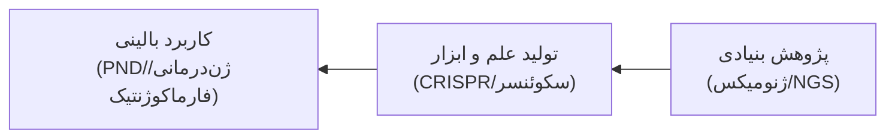

* **فنوتیپ/ژنوتیپ:** فنوتیپ سوار بر ژنوتیپ؛ اصلاح فنوتیپ مستلزم دستکاری ژنوتیپ، شناخت ژنوم (NGS) و ویرایش دقیق (CRISPR-Cas).
* **ژنوم انسان:** $3.3 \times 10^9\text{ bp}$؛ صرفاً ۲٪-۳٪ کدکننده پروتئین (۲۰-۲۵ هزار ژن)؛ ۵۰٪ توالی‌های تکراری و ۷۵٪ فاقد رونویسی.
* **تنوع فردی:** تشابه ۹۹.۹٪ ژنوم تمام انسان‌ها؛ تفاوت ۰.۱٪ (~۳ میلیون نوکلئوتید) عامل تنوع چهره، پاسخ دارویی و استعداد بیماری‌ها.
* **خروج از آفریقا:** مهاجرت جمعیت اولیه (~۱۰۰ هزار نفر) در ۱۵۰> هزار سال پیش (خاورمیانه ۱۰۰، شرق آسیا ۶۷، اروپا ۴۰، آمریکا ۱۳-۲۰ هزار سال پیش).

### ایستگاه‌های امتحانی تاریخ ژنتیک

| سال           | دانشمند                 | دستاورد کلیدی شب امتحان                                              |
| :------------ | :---------------------- | :------------------------------------------------------------------- |
| **۱۸۶۶**      | گرگور مندل              | پایه‌گذاری اصول وراثت با آزمایش‌های هیبریداسیون نخودفرنگی.           |
| **۱۸۷۱**      | فریدریش میشر            | استخراج نخستین اسید نوکلئیک از هسته گلبول‌های سفید چرک.              |
| **۱۹۰۰**      | دووریس، کورنز، چرماک    | بازکشف مستقل و همزمان قوانین مندل پس از ۳۴ سال فراموشی.              |
| **۱۹۰۲**      | آرچیبالد گارود          | اثبات وراثت مغلوب آلکاپتونوری (نخستین خطای مادرزادی متابولیسم).      |
| **۱۹۰۴**      | ویلیام بیتسون           | کشف پیوستگی ژنی (*Linkage*) و ابداع رسمی واژه **Genetics**.          |
| **۱۹۱۰**      | توماس هانت مورگان       | اثبات **کروموزومی بودن توارث ژن‌ها** با مگس سرکه (Drosophila).       |
| **۱۹۲۶**      | هرمان مولر              | اثبات توانایی **اشعه X** در القای جهش‌های ژنتیکی.                    |
| **۱۹۴۴**      | ایوری، مک‌لود، مک‌کارتی | اثبات ترانسفورماسیون باکتریایی؛ **DNA ماده وراثتی است**، نه پروتئین. |
| **۱۹۵۳**      | واتسون و کریک           | کشف **ساختار مارپیچ دوگانه DNA** و مدل همانندسازی نیمه‌حفاظت‌شده.    |
| **۱۹۷۷**      | فردریک سنگر             | **ابداع متد توالی‌یابی دی‌دئوکسی** (برنده ۲ نوبل شیمی).              |
| **۱۹۹۰-۲۰۰۳** | کنسرسیوم HGP            | توالی‌یابی کامل ژنوم هاپلوئید طی ۱۳ سال با بودجه میلیارد دلاری.      |

---

## ۲. دگمای مرکزی و مقایسه طبقه‌بندی سنی بیماری‌ها

> $$\text{DNA} \xrightarrow{\text{Replication}} \text{DNA} \xrightarrow{\text{Transcription}} \text{pre-mRNA} \xrightarrow{\text{Splicing}} \text{Mature mRNA} \xrightarrow{\text{Translation}} \text{Polypeptide} \xrightarrow{\text{PTM}} \text{Functional Protein}$$

* **آناتومی ژن یوکاریوت:** پروموتور و TATA Box (اتصال فاکتورهای عمومی و RNA Pol II)؛ Enhancer و Silencer و LCR (تنظیم بافتی بیان)؛ UTRهای '5 و '3 (ثبات mRNA و هدایت ریبوزوم)؛ اگزون‌ها (کدکننده) و اینترون‌ها (حذف حین پیرایش با حفظ پیوند GT...AG).

| شاخص مقایسه        | کروموزومی (Chromosomal)                | تک‌ژنی (Single Gene)                | چندعاملی (Multifactorial)         |
| :----------------- | :------------------------------------- | :---------------------------------- | :-------------------------------- |
| **ماهیت ژنتیکی**   | ناهنجاری عددی/ماکروساختاری             | جهش نقطه‌ای/ایندل در ۱ ژن           | پلی‌ژنیک + اثر مستقیم محیط        |
| **الگوی توارث**    | عمدتاً اسپورادیک/دونوو                 | الگوهای کلاسیک مندلی (AD, AR, XR)   | غیرمندلی (مدل آستانه و لایبیلیتی) |
| **اوج سن تظاهر**   | **جنینی/نوزادی**<br>(افت با افزایش سن) | **کودکی/اوایل بلوغ**<br>(سپس پلاتو) | **بزرگسالی/کهنسالی**              |
| **تنوع و شیوع**    | ۱۰۰-۶۰۰ سندروم؛ ۱:۱۱۰ تولد             | بیش از ۱۸,۰۰۰ اختلال؛ ۱:۱۰۰ تولد    | شایع‌ترین در جامعه (>۱:۱۰۰۰)      |
| **نمونه‌های شاخص** | داون، ادوارد، پاتو، ترنر               | تالاسمی، فیبروز سیستیک، هانتینگتون  | دیابت، فشار خون، CAD              |

---

## ۳. انکولوژی مولکولی و فرضیه دو ضربه نادسن (Two-Hit)

* **انکوژن‌ها (Go Signals):** جهش افزایش عملکرد (GoF) در تک‌الل؛ فعال‌سازی گیرنده‌های رشد (*EGFR*, *HER2*) و مسیرهای پیام‌رسانی (*KRAS*).
* **تومورساپرسورها (Stop Signals):** مهار چرخه سلولی و آپوپتوز (*TP53*, *RB1*, *p16/ARF*). جهش‌های مغلوب و ناشی از کاهش عملکرد (LoF).

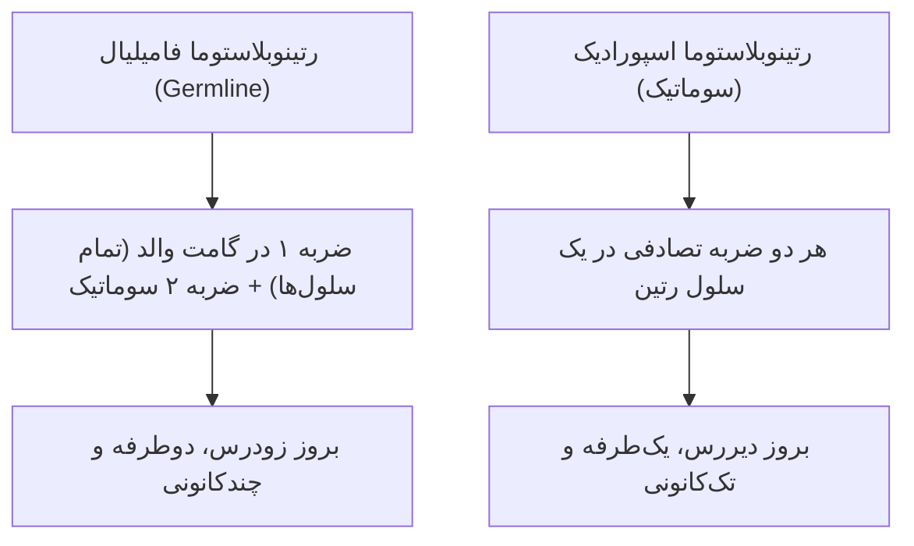

> [!important] تله‌های پاتولوژی سرطان و ترمیم DNA
> * **گزودرما پیگمنتوزوم (XP):** نقص AR در سیستم **ترمیم برش نوکلئوتیدی (NER)**؛ ناتوانی ترمیم دیمرهای پیریمیدینی القاشده با UV ⇦ بدخیمی‌های پوستی مرگبار در سنین پایین *(«کودکان شب»)*.
> * **چرخه سلولی:** چک‌پوینت $G_1/S$ نقطه تصمیم ورود به فاز سنتز و چک‌پوینت $G_2/M$ ناظر بر تکثیر صحیح ژنوم؛ p53 القاکننده مهارکننده $p21$ حین آسیب DNA.

---

## ۴. فناوری‌های ژنومیکس و اصطلاحات کلیدی بالینی

* **آنزیم‌درمانی جایگزین (ERT):** تجویز آنزیم‌های نوترکیب در بیماری‌های ذخیره‌ای لیزوزومی: **گوشه (Gaucher)**، **فابری (Fabry)**، **موکوپلی‌ساکاریدوزها (MPS)** و **پمپه (Pompe / GSD Type II)**.
* **پلتفرم‌های Nanopore:** سکوئنسرهای جیبی نانوپوری نسل جدید با اتصال به گوشی و خوانش رشته‌های طویل بدون تکثیر PCR: مدل‌های MinION (۸۷ گرمی)، SmidgION و مدل‌های صنعتی PromethION.

### واژه‌نامه تشخیصی شب امتحان

| واژه | تعریف دقیق بالینی | تله یا نکته تستی |
| :--- | :--- | :--- |
| **Locus** | جایگاه ثابت فیزیکی ژن روی کروموزوم. | در کاریوتایپ با بازو، ناحیه و باند معرفی می‌شود. |
| **Allele** | فرم‌های نوکلئوتیدی جایگزین در لوکوس معین. | در فرد دیپلوئید حداکثر ۲ الل برای هر ژن اتوزوم وجود دارد. |
| **Polymorphism** | حضور الل در جمعیت با فرکانس **حداقل ۱٪ ($\ge ۱\%$)**. | فراوانی <۱٪ جهش نادر (Mutation) محسوب می‌شود. |
| **Hemizygote** | حضور تنها ۱ نسخه از ژن در کل ژنوم. | مردان برای ژن‌های کروموزوم‌های X و Y همی‌زیگوت هستند. |
| **Dominant** | تظاهر فنوتیپ صفت در حالت هتروزیگوت ($Aa$). | حاصل نیاز به دوز ۱۰۰٪ پروتئین یا اثر منفی غالب. |
| **Recessive** | تظاهر فنوتیپ منحصراً در حالت هوموزیگوت ($aa$). | کفایت دوز ۵۰٪ پروتئین برای سلامت (ناقل سالم). |
| **Congenital** | وجود نقص/صفت ساختاری در **بدو تولد** (مادرزادی). | بیماری می‌تواند مادرزادی باشد اما ژنتیکی نباشد (عفونت CMV). |
| **Genetic** | ناشی از نقص/جهش در ژن یا کروموزوم. | بیماری می‌تواند ژنتیکی باشد اما مادرزادی نباشد (هانتینگتون). |
| **Familial** | تمایل صفت به تجمع در اعضای خانواده. | بیماری چندعاملی تجمع فامیلی دارد اما مندلی تک‌ژنی نیست. |
| **Hereditary** | دریافت قطعی صفت از ماده ژنتیکی والدین. | داون تریزومی آزاد ژنتیکی/مادرزادی است اما ارثی نیست. |
# جلسه ۲: سیتوژنتیک بالینی و ناهنجاری‌های عددی

## ۱. مورفولوژی کروموزوم‌ها و پروتکل کشت کاریوتایپ

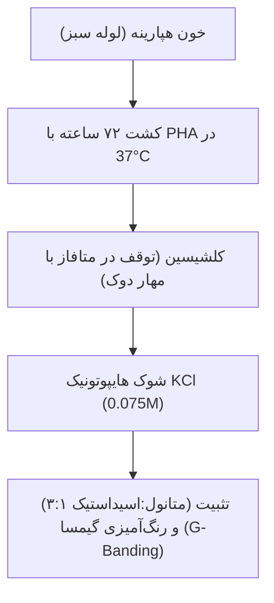

* **متاسانتریک:** ۱، ۳، ۱۶، ۱۹، ۲۰ ($p \approx q$).
* **ساب‌متاسانتریک:** اکثر کروموزوم‌ها + کروموزوم X ($p < q$).
* **آکروسنتریک:** منحصراً ۵ جفت (**۱۳، ۱۴، ۱۵، ۲۱، ۲۲**)؛ بازوی $p$ فاقد ژن ساختاری حیاتی، دارای ساقه (Stalk) و ماهواره (Satellite) واجد ژن‌های rRNA. (کروموزوم تلوژنتیک فاقد بازوی کوتاه در انسان وجود ندارد).
* **تله‌های آزمایشگاهی:** خون باید حتماً در لوله **هپارینه** گرفته شود (EDTA مانع تقسیم است). زمان کشت لنفوسیت‌ها **حداقل ۷۲ ساعت** است؛ ادعای جواب‌دهی ۱ روزه کاریوتایپ باطل است.

---

## ۲. اپیدمیولوژی، نان‌دیسجانکشن و مول هیداتی‌فورم

* **آمار سقط:** شیوع ناهنجاری کروموزومی در نوزادان زنده **۰.۹٪** (1:110) و در سقط‌های سه‌ماهه اول **۵۰ تا ۶۰ درصد** است (زیر ۱۲ هفته ۶۰٪ ⇦ ۱۲ تا ۲۰ هفته ۲۰٪ ⇦ بالای ۲۰ هفته ۵٪).
* **شایع‌ترین‌ها در سقط:** **سندروم ترنر (45,X)** با ۲۳٪ کل سقط‌ها؛ شایع‌ترین تریزومی اتوزوم در سقط **تریزومی ۱۶** است (هرگز زنده متولد نمی‌شود).
* **خطای میوزی گامت‌ها:** اسپرم ۱-۲٪؛ تخمک **۲۰٪** (توقف طولانی در مرحله دیکتیوتن پروفاز میوز I).
* **مکانیسم نان‌دیسجانکشن:**
  * **میوز I:** عدم تفکیک کروموزوم‌های همولوگ ⇦ **۱۰۰٪ گامت‌ها غیرطبیعی** (۵۰٪ واجد $n+1$ هتروزیگوت با هر دو الل والدین، ۵۰٪ تهی $n-1$).
  * **میوز II:** عدم تفکیک کروماتیدهای خواهری ⇦ **۵۰٪ گامت‌ها غیرطبیعی** (۲۵٪ واجد $n+1$ هوموزیگوت، ۲۵٪ تهی $n-1$، ۵۰٪ نرمال $n$).

> [!important] تمایز تشخیصی مول ناقص و کامل
> * **مول ناقص (Partial):** تریپلوئید (**69,XXY / 69,XXX**)؛ لقاح ۱ تخمک با ۲ اسپرم پدری (Dispermy)؛ واجد جنین ناقص و بدشکل.
> * **مول کامل (Complete):** دیپلوئید (**46,XX / 46,XY**)؛ **۱۰۰٪ منشأ پدری (Androgenetic)** ناشی از بارور شدن تخمک فاقد هسته با اسپرم مضاعف‌شده؛ فاقد هرگونه بافت جنینی، ظاهر دانه‌انگوری جفت، $\beta$-hCG به شدت نجومی و خطر بالای کوریوکارسینوما.

---

## ۳. مقایسه تریزومی‌های اتوزومی شایع زنده متولد

| شاخص بالینی        | داون (تریزومی ۲۱)                                                          | ادوارد (تریزومی ۱۸)                                                          | پاتو (تریزومی ۱۳)                                                         |
| :----------------- | :------------------------------------------------------------------------- | :--------------------------------------------------------------------------- | :------------------------------------------------------------------------ |
| **شیوع بدو تولد**  | **1:800** (شایع‌ترین)                                                      | 1:6000 تا 1:8000                                                             | 1:10,000 تا 1:20,000                                                      |
| **علت سایتوژنتیک** | **۹۵٪ تریزومی آزاد**،<br>۴٪ ترنسلوکاسیونی،<br>۱٪ موزائیسم                  | >۹۰٪ تریزومی آزاد میوزی                                                      | ۷۵٪ تریزومی آزاد،<br>۲۵٪ روبرتسونین rob(13q14q)                           |
| **منشأ خطا**       | >۹۰٪ میوز I مادری (وابسته به سن مادر)                                      | عمدتاً میوز مادری                                                            | عمدتاً میوز I مادری                                                       |
| **تظاهرات کلیدی**  | هایپوتونی، ۳ فونتانل، فلت نازال بریج، اپی‌کانتوس، صورت پهن، شیار منفرد دست | اکسی‌پوت برجسته، میکروگناتیا، **انگشتان مشت‌شده روی‌هم (۲ روی ۳ و ۵ روی ۴)** | **هولوپروزنسفالی**، آپلازی پوست اسکالپ، **میکروافتالمی**، **پلی‌داکتیلی** |
| **ناهنجاری قلبی**  | ۴۰-۵۰٪ (نقص بالشتک اندوکارد / AVSD)                                        | **>۹۰٪** (VSD، PDA)                                                          | **>۸۰٪** (VSD، ASD، PDA)                                                  |
| **طول عمر**        | ۸۵٪ تا ۱ سالگی؛<br>۸۰٪ تا ۱۰ سالگی؛<br>۵۰٪ بالای ۵۰ سال                    | **>۹۰٪ مرگ زیر ۱ سال**<br>(بقای چند هفته)                                    | **>۹۰٪ مرگ زیر ۱ سال**<br>(بقای چند روز/هفته)                             |

> [!warning] تله‌های تشخیصی سندرم داون
> * **شیار سیمین (Simian Crease):** تنها در ۵۰٪ داون‌ها دیده می‌شود و در ۱٪ افراد نرمال و سندرم الکل جنینی (FAS) و سندرم Aarskog نیز وجود دارد؛ لذا *اختصاصی (Pathognomonic) نیست*.
> * **فرم ترنسلوکاسیونی (۴٪):** ناشی از ترنسلوکیشن روبرتسونین $\text{rob}(14q21q)$؛ **کاملاً مستقل از سن مادر** است و ریسک عود فامیلیال دارد.
> * **مارکرهای سرمی غربالگری:** در داون، سطح **$\beta$-hCG آزاد بالا** و سطح **AFP پایین** است (برعکس NTD باز که AFP بالاست).
> * **ریسک عود:** با یک فرزند داون تریزومی آزاد = **۱٪ + ریسک بر پایه سن مادر**.

---

## ۴. رزولوشن تکنیک‌ها و فرمول‌نویسی ISCN

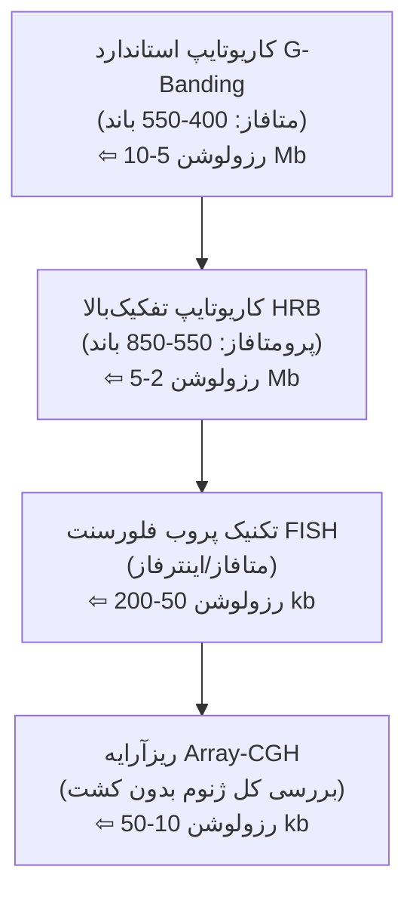

* **قانون بالینی:** در صورت وجود شک بالینی قوی به نقص کروموزومی اما کاریوتایپ نوری نرمال، «**نباید به شک بالینی شک کرد**»؛ تست بعدی **Array-CGH** یا **FISH** است.
* **نمونه‌های استاندارد ISCN:**
  * $47,XX,+21$ : زن با تریزومی ۲۱ آزاد (داون).
  * $47,XY,+18$ : مرد با تریزومی ۱۸ آزاد (ادوارد).
  * $47,XX,+13$ : زن با تریزومی ۱۳ آزاد (پاتو).
  * $45,X$ : زن مبتلا به سندرم ترنر.
  * $47,XXY$ : مرد مبتلا به سندرم کلاین‌فلتر.
  * $46,XX,del(4)(p16.3)$ : زن مبتلا به ولف-هیرشهورن.
  * $46,XY,del(5)(p15)$ : مرد مبتلا به کرای‌دوچت.
  * $45,XX,der(14;21)(q10;q10)$ : زن ناقل متعادل روبرتسونین ۱۴ و ۲۱ (سالم با ۴۵ کروموزوم).
  * $46,XY/47,XY,+21$ : موزائیسم سندرم داون.
# جلسه ۳: ناهنجاری‌های ساختمانی و کروموزوم‌های جنسی

## ۱. سیتوژنتیک بالینی و مورفولوژی کروموزوم‌ها

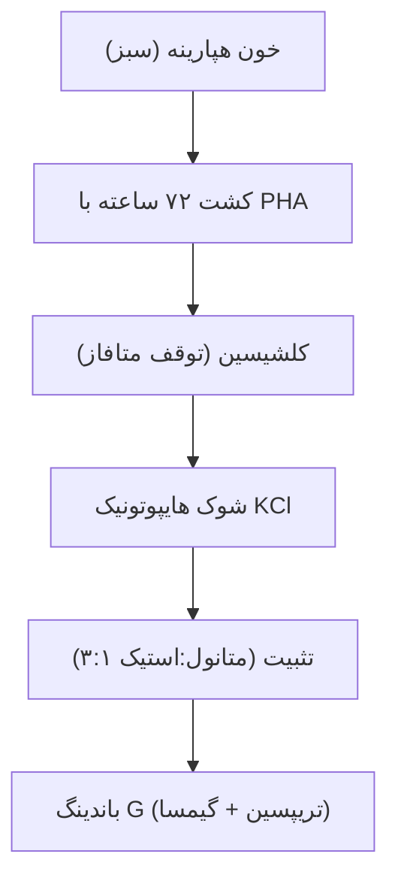

* **کشت کاریوتایپ:** لوله هپارینه سبز (نه EDTA/لخته)؛ انکوباسیون الزامی حداقل ۷۲ ساعته (ادعای ۱ روزه باطل است).
* **متاسانتریک:** ۱، ۳، ۱۶، ۱۹، ۲۰ ($p \approx q$).
* **ساب‌متاسانتریک:** اکثر کروموزوم‌ها از جمله X ($p < q$).
* **آکروسنتریک:** ۵ جفت (۱۳، ۱۴، ۱۵، ۲۱، ۲۲). بازوی $p$ فاقد ژن حیاتی، دارای ماهواره و ژن‌های تکراری rRNA. (تلوژنتیک فاقد بازوی کوتاه در انسان وجود ندارد).

---

## ۲. ناهنجاری‌های ساختمانی (۱:۳۷۵ تولد)

* **متعادل (Balanced):** ماده ژنتیکی دست‌نخورده؛ فرد ناقل کاملاً سالم، اما ریسک بالای سقط، مرده‌زایی و گامت نامتعادل دارد.
  * **ترنسلوکیشن رسیپروکال (۱:۵۰۰):** تبادل متقابل بین دو کروموزوم غیرهمولوگ؛ در میوز ساختار ۴تایی صلیبی (Quadrivalent) می‌سازد.
  * **ترنسلوکیشن روبرتسونین:** فیوژن سنتریکی بازوهای $q$ دو آکروسنتریک و حذف بازوهای $p$؛ کاریوتایپ ناقل سالم واجد **۴۵ کروموزوم** است (شایع‌ترین: 13q14q و 14q21q).
  * **داون ترنسلوکاسیونی:** ناشی از $\text{rob}(14q21q)$ با کاریوتایپ **۴۶ کروموزومی**؛ مستقل از سن مادر و با ریسک عود مکرر فامیلیال.
  * **واژگونی (Inversion):** پری‌سنتریک (شامل سانترومر) یا پاراسنتریک (بدون سانترومر).
* **نامتعادل (Unbalanced):** کمبود یا افزایش ماده ژنتیکی همراه با دیسمورفیسم، نقایص چندگانه مادرزادی و عقب‌ماندگی ذهنی (شامل انواع حذف ترمینال/اینترستیشیال، مضاعف‌شدگی، کروموزوم حلقوی Ring و ایزوکروموزوم).
* **ترنسلوکیشن نهفته (Cryptic):** تبادل زیر 2-3 Mb در ساب‌تلومرها؛ غیرقابل تشخیص در کاریوتایپ نوری. تست انتخابی در عقب‌ماندگی ذهنی با کاریوتایپ نرمال (نباید به شک بالینی شک کرد): **Array-CGH** یا **Subtelomeric FISH** .

---

## ۳. سندروم‌های ریزحذف (Contiguous Gene Syndromes)

> ریزحذف‌ها با کاریوتایپ نوری معمولی دیده نمی‌شوند و تشخیص قطعی آنها نیازمند FISH یا Array-CGH است.

| سندروم حذفی                 | لوکوس / ژن کلیدی                   | کاریوتایپ / شیوع         | ویژگی‌های اختصاصی شب امتحان                                                                                                                                                                   |
| :-------------------------- | :--------------------------------- | :----------------------- | :-------------------------------------------------------------------------------------------------------------------------------------------------------------------------------------------- |
| **ولف-هیرشهورن (WHS)**      | **4p16.3** (حذف 165kb شامل ۹ ژن)   | 46,del(4p)<br>1:50,000   | چهره شبیه **کلاه‌خود یونانی**، *نقص قلبی* (۵۰٪)، *تشنج‌های مقاوم مکرر*، عقب‌ماندگی بسیار شدید (IQ < 20)، مرگ یک‌سوم در سال اول، ۸۵-۹۰٪ جهش De novo.                                           |
| **کرای‌دوچت (Cri-du-Chat)** | **5p15.2** (بازوی کوتاه ۵)         | 46,del(5p)<br>1:50,000   | **گریه شبیه گربه** در سال اول نوزادی (نقص حنجره)، *صورت گرد ماه‌مانند*، *هایپرتلوریسم*، میکروسفالی، عقب‌ماندگی شدید (IQ < 20)، بقا تا بلوغ، ۱٪ معلولین آسایشگاه‌ها.                           |
| **ویلیامز-برون (WBS)**      | **7q11.23** (حذف 1.4Mb شامل ۲۸ ژن) | تشخیص با FISH<br>1:7,500 | نارسایی هاپلو ژن الاستین (*ELN*) ⇦ تنگی بالای دریچه آئورت (**SVAS**) و تنگی پولمونر؛ *LIMK1/CYLN2* ⇦ *هایپرکلسمی نوزادی*، عقب‌ماندگی ذهنی، رفتار بیش‌ازحد صمیمی و پرحرف (**Cocktail party**). |
| **دی‌جرج (DGS)**            | **22q11.2**                        | 1:4,000                  | **هایپوپلازی تیموس** و نقص ایمنی T cell، **فقدان پاراتیروئید** و تتانی هایپوکلسمیک نوزادی، نقایص قلبی مخروطی (تترالوژی فالوت، تنه شریانی مشترک).                                              |

---

## ۴. تمایز جنسی و علل ژنتیکی ناباروری مردان

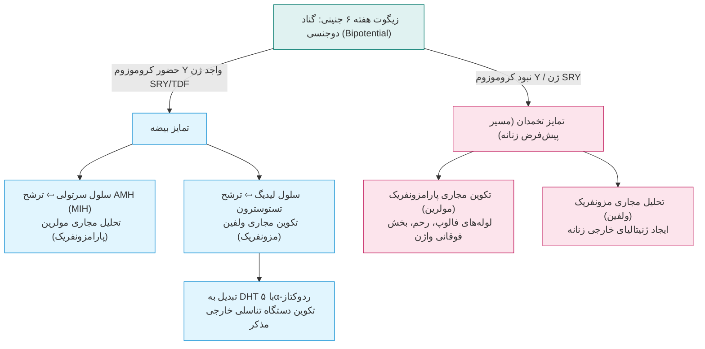

* **کروموزوم Y:** یک‌سوم اندازه X و حاوی ~۵۰ ژن؛ دارای نواحی سودواتوزومال (**PAR1 و PAR2**) در دو انتها هومولوگ با کروموزوم X جهت سیناپس و کراسینگ‌اور در میوز مردانه.
* ناباروری ۱ از هر 6 زوج؛ 50% علل وابسته به فاکتور مردانه است.
* **علل ناباروری مردان (۱۰-۲۰٪ آزواسپرمی غیرانسدادی):**
  1. کلاین‌فلتر (47,XXY) شایع‌ترین آنیوپلوئیدی.
  2. ترنسلوکیشن‌های روبرتسونین (به‌ویژه ۱۳، ۱۴ و ۱۵) و رسیپروکال.
  3. **ریزحذف‌های کروموزوم Y:** حذف لوکوس‌های فاکتور آزواسپرمی (**AZFa, AZFb, AZFc**) روی **Yq11.23** حاوی ژن‌های اسپرماتوژنز **DAZ**.
  4. **مردان 46,XX:** جابجایی نابجای ژن SRY از بازوی کوتاه Y به کروموزوم X در میوز پدر؛ ظاهر مردانه طبیعی به دلیل آندروژن، ولی نابارور و فاقد اسپرم قطعی (نبود فاکتورهای AZF).

---

## ۵. آنیوپلوئیدی‌های کروموزوم‌های جنسی

> [!important] تله امتحانی زمان تشخیص آنیوپلوئیدی‌ها
> * آنیوپلوئیدی‌های **اتوزوم** (داون، پاتو، ادوارد) به علت نقایص ماژور بدشکلی در **بدو تولد** تشخیص داده می‌شوند.
> * آنیوپلوئیدی‌های **جنسی** (کلاین‌فلتر، جاکوبز، تریپل X) به علت فقدان دیسمورفیسم شدید تا **سن بلوغ** مخفی می‌مانند؛ **تنها استثنا سندروم ترنر است** که در نوزادی با هایگروما کیستیک، وبد نک و لنف‌ادم اندام‌ها کشف می‌شود.

| سندروم         | کاریوتایپ و شیوع                                | باروری                                  | تظاهرات مورفولوژیک                                                                                                                              | وضعیت شناختی                                            |
| :------------- | :---------------------------------------------- | :-------------------------------------- | :---------------------------------------------------------------------------------------------------------------------------------------------- | :------------------------------------------------------ |
| **ترنر**       | **45,X**<br>(۸۰٪ خطای میوز پدری)<br>1:4000 دختر | گناد نواری (Streak)؛<br>**عقیم قطعی**   | **قد کوتاه** (نارسایی هاپلو *SHOX*)، **گردن پرده‌دار** (Webbed neck)، کوآرکتاسیون آئورت، قفسه سینه سپری، لنف‌ادم نوزادی.<br>۹۹٪ سقط خودبه‌خودی. | هوش کلی نرمال؛<br>نقص در درک فضایی و مهارت ظریف.        |
| **کلاین‌فلتر** | **47,XXY**<br>(۵۰/۵۰ پدر یا مادر)<br>1:1000 پسر | بیضه‌های آتروفیک؛<br>**آزواسپرمی قطعی** | **قد بلند**، **اندام لاغر کشیده**، **ژنیکوماستی** (خطر سرطان پستان مردان)، تستوسترون پایین.<br>تستوسترون ناباروری را درمان نمی‌کند.             | افت هوش کلامی؛<br>اختلال یادگیری خواندن.                |
| **جاکوبز**     | **47,XYY**<br>1:1000 پسر                        | بیضه نرمال؛<br>**بارور (Fertile)**      | **قد بسیار بلند**، **آکنه کیستیک شدید نوجوانی**؛<br>ظاهر مردانه طبیعی.                                                                          | افت ۱۰ نمره‌ای IQ، تکانشگری.<br>باور مجرمیت رد شده است. |
| **تریپل X**    | **47,XXX**<br>1:1000 دختر                       | تخمدان نرمال؛<br>**بارور (Fertile)**    | **قد بلند**، میکروسفالی خفیف، بلوغ فیزیکی نرمال.                                                                                                | افت ۱۰-۱۵ نمره‌ای IQ، تاخیر در تکلم در ۷۰٪.             |
* **قانون افزایشی X:** در واریانت‌های پلی‌زومی جنسی ($48,XXXY$ و $49,XXXXY$) به ازای هر کروموزوم X اضافی، شدت عقب‌ماندگی ذهنی به طور فاحش جهش یافته و IQ بین ۲۰ تا ۸۰ افت می‌کند و چهره خشن‌تر می‌شود.

---

## ۶. ابهام تناسلی (Ambiguous Genitalia)

* **اورژانس بالینی نوزادی:** **ابهام تناسلی یک اورژانس پزشکی و روانی است**؛ پیش از ارزیابی کامل، ثبت شناسنامه و نسبت دادن جنسیت مطلقاً ممنوع است.
* **علل کلیدی:** هایپرپلازی مادرزادی آدرنال (**CAH**؛ نقص ۲۱-هیدروکسیلاز با ریسک بحران نمک‌زدایی و مرگ نوزاد)، سندروم عدم حساسیت به آندروژن (AIS)، دیسژنزی گنادی، ترانس‌لوکاسیون SRY.
* **اقدامات تشخیصی:** تشکیل فوری تیم چندتخصصی (MDT)؛ **کاریوتایپ فوری الزامی است ولی کافی نیست**؛ تلفیق با سونوگرافی لگن (بررسی رحم/تخمدان)، الکترولیت‌های سرم و پروفایل هورمونی (17-OHP و تستوسترون) الزامی است.
# جلسه ۴: پزشکی فردمحور و فارماکوژنتیک

## ۱. آناتومی ژنوم و سیستم‌های چندامیکس

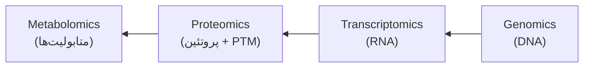

* **داده‌های کلیدی HGP:** سال‌های ۱۹۹۰ تا ۲۰۰۳ (۱۳ سال) با روش Sanger؛ ژنوم هاپلوئید انسانی برابر $3.3 \times 10^9\text{ bp}$؛ تعداد ژن‌های کدکننده ۲۰ تا ۲۵ هزار؛ ۹۳٪ نمونه‌ها از ۱۱ اهداکننده خون و ۷٪ از ۱ فرد.
* **تراکم ژنی:** انسان و موش دارای ۱ ژن در هر 100kb هستند. بیشترین تراکم ژنی در یوکاریوت‌ها متعلق به **مخمر نانوایی** (۱ ژن در 2kb) است. بزرگی ژنوم پستانداران معلول ازدیاد ژن‌ها نبوده بلکه ناشی از **توالی‌های بین‌ژنی و تکراری (Non-coding)** است.
* **فناوری NGS:** بر پایه بیوانفورماتیک محاسباتی، نانوالکترونیک و تصویربرداری نوری؛ شامل WGS (کل ژنوم)، WES (توالی اگزوم، ۱ تا ۲ درصد ژنوم)، پنل‌های هدفمند (سرطان و ناباروری) و cffDNA / NIPT (غربالگری پیش از تولد).
* **فنوتیپ:** حاصل تعامل مستقیم **ژنوتیپ** با **محیط** است.

---

## ۲. تنوع ژنتیکی، اسنیپ‌ها و تکرارهای تندم

* **پایه تنوع:** تمام انسان‌ها ۹۹.۹٪ یکسان‌اند؛ **۰.۱٪ تفاوت** منشأ تنوع فنوتیپی، پاسخ دارویی و بیماری‌هاست. ۴ عامل سازنده: تفکیک مستقل کروموزوم‌ها ($2^{23}$ حالت در میوز)، کراسینگ‌اور، جهش‌های دونوو و انتخاب طبیعی. بزرگترین تنوع جثه پستانداران متعلق به سگ‌هاست. 
* **تعریف پلیمورفیسم:** حضور الل در جمعیت با فراوانی **$\ge ۱\%$** (زیر ۱٪ جهش نادر یا Mutation است).
* **انواع واریانت‌ها:** اسنیپ (SNP، بیش از ۱۵ میلیون لوکوس)، VNTR (میکروستلایت/STR با تکرار ۱ تا ۶ باز؛ مینی‌ستلایت با تکرار ۱۴ تا ۱۰۰ باز)، تغییرات ساختاری (CNV، حذف و مضاعف‌شدگی) و تغییرات اپی‌ژنتیک.
* **پیامد اسنیپ:** در اگزون به صورت Synonymous (هم‌معنی بدون تغییر اسیدآمینه) یا Non-synonymous (دگرمعنی پاتوژنیک یا خنثی)؛ در نواحی تنظیمی/اسپلایس سبب افت رونویسی، نقص پیرایش یا برهم‌خوردن اتصال miRNA در UTR می‌شود.

> [!important] پلی‌مورفیسم‌های شاخص بالینی و انتخاب متوازن
> * **فاکتور ۵ لیدن (FVL):** جهش مانع غیرفعال‌سازی آن توسط پروتئین C فعال می‌شود. مصرف **OCP** در فرد ناقل حین پرواز طولانی به علت ترومبوفیلی منجر به بروز **DVT حاد و حوادث ترومبوآمبولیک مغزی** می‌شود.
> * **مزیت هتروزیگوتی (Balancing Selection):** واریانت G6PD A⁻ (افت ۱۵ درصدی عملکرد آنزیم با شیوع ۴۰٪ در آفریقا) و کم‌خونی داسی‌شکل (HbAS) سبب بقا در برابر **مالاریا** می‌شوند.
> * **عدم تحمل لاکتوز:** ژنوتیپ **GG** پروموتور ژن *LCT* عامل فنوتیپ افت لاکتاز است (شیوع >۸۰٪ در شرق آسیا، <۲۰٪ در اروپا).
> * **پنل Personal SNP:** ژن‌های رنگدانه پوست (MC1R، TYR)، متابولیسم ویتامین C (ژن‌های SLC23A1/3 و RER1)، شاخص BMI، ژن‌های سطح پایین اضطراب (RAD51، CNGB3، ADCY2، PDE4B).

---

## ۳. ژنتیک گیرنده‌ها: تکرارهای تریپلتی CAG ژن AR

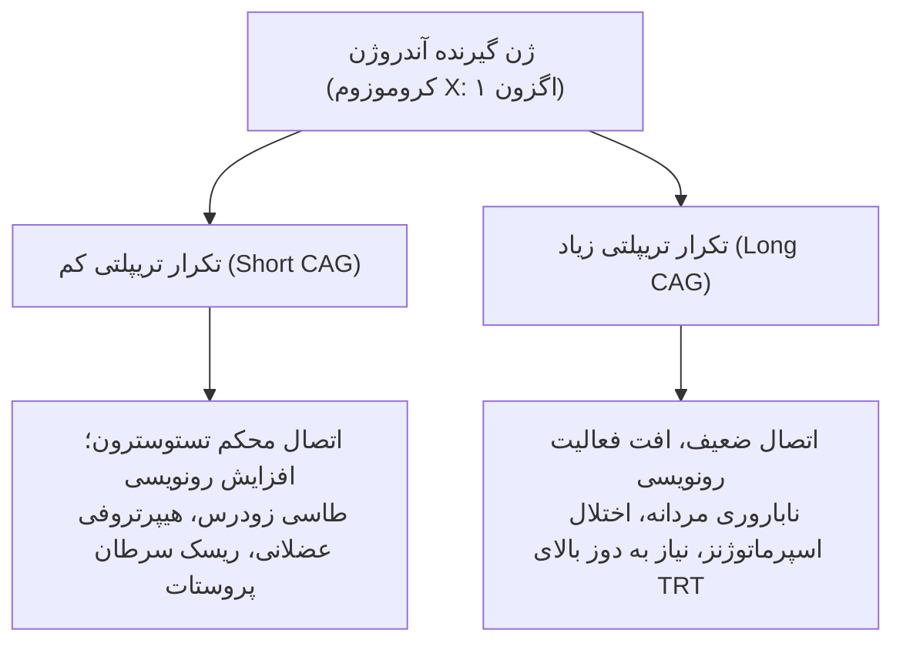

> [!warning] تله امتحانی
> سطح هورمون آزاد در سرم بیمار می‌تواند کاملاً نرمال باشد؛ نقص پاسخ‌دهی یا فعالیت بیش‌ازحد ناشی از **طول تکرارهای CAG گیرنده** است، نه غلظت تستوسترون. در سندرم عدم حساسیت به آندروژن (AIS)، جهش غیرفعال‌کننده کامل AR در جنین 46,XY فنوتیپ زنانه بدون رحم و تخمدان و بیضه‌های نهفته ایجاد می‌کند.

---

## ۴. فارماکوژنتیک در شیمی‌درمانی و بیماری‌های قلبی/اعصاب

| دارو | ژن‌های درگیر | پیامد موتاسیون و نقص عملکرد | تدبیر و اهمیت بالینی |
| :--- | :--- | :--- | :--- |
| **6-مرکاپتوپورین (6MP)** | آنزیم کبدی **TPMT** | الل‌های جهش‌یافته (\*3/\*3) = متابولایزر ضعیف (Poor). تجمع شدید دارو در خون. | کاهش دوز تا **۹۰٪** (تجویز دوز ۱۰ میلی‌گرم به جای ۱۰۰) جهت پیشگیری از سرکوب مرگبار مغز استخوان (پان‌سیتوپنی). |
| **وارفارین** | **VKORC1** (فارماکودینامیک)<br>**CYP2C9** (فارماکوکینتیک) | الل‌های \*2 و \*3 آنزیم CYP2C9 یا واریانت -1639G>A ژن VKORC1 متابولیسم و کلیرنس را مختل می‌کنند. | پنجره درمانی باریک؛ اوردوز = خونریزی کشنده؛ آندردوز = ترومبوز و سکته مغزی. زمان تثبیت دوز: الل نرمال ۴-۵ روز، الل موتانت ۱۲-۱۵ روز. |
| **کدئین** | **CYP2D6** | پیش‌دارو است و باید به **مرفین** تبدیل شود. در ۷٪ افراد سفیدپوست این ژن غیرفعال است (Poor). | در افراد فاقد نسخه فعال، کدئین **هیچ‌گونه اثر ضددردی ندارد**. در متابولایزرهای فوق‌سریع خطر مسمومیت حاد و ایست تنفسی وجود دارد. |
| **کلوپیدوگرل (Plavix)** | **CYP2C19** | پیش‌دارو ضدپلاکت؛ عدم تبدیل به فرم فعال در حاملین الل‌های ناقص. | ترومبوز مجدد استنت و انفارکتوس کشنده قلبی (**Black-Box Warning** از FDA). |

* **کیت AmpliChip CYP450 (Roche):** تراشه تشخیصی دارای تاییدیه FDA برای ژنوتیپینگ همزمان واریانت‌های دگرگشت دارویی **CYP2D6** و **CYP2C19**.

---

## ۵. انکولوژی فردمحور و بیومارکرهای الزامی FDA

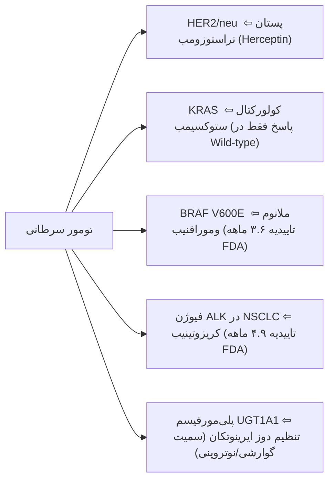

* **تراستوزومب (Trastuzumab / Ariotrust):** آنتی‌بادی مونوکلونال ضد دامنه خارج‌سلولی گیرنده HER2؛ انجام آزمایش IHC یا FISH پیش از تجویز **الزامی (Required)** است؛ در تومورهای فاقد HER2 فاقد اثر درمانی است.

---

## ۶. اصول طب فردمحور، اخلاق و اقتصاد ژنومیکس

* **ارکان ۵ گانه تجویز:** داروی مناسب، دوز مناسب، اندیکاسیون مناسب، بیمار مناسب و در زمان مناسب (The Right Drug, Dose, Indication, Patient, Time).
* **شکست درمانی طب کلاسیک:** عدم کارایی یا پاسخ متغیر در استاتین‌ها (۳۰-۷۰٪)، آگونیست‌های بتادو (۴۰-۷۰٪)، داروهای ضدافسردگی (۲۰-۵۰٪)، بتا-بلوکرها (۱۵-۲۵٪) و مهارکننده‌های ACE (۱۰-۳۰٪).
* **قانون منع تبعیض ژنتیکی (GINA 2008):** قانون فدرال مصوب ۲۰۰۸ آمریکا؛ ممنوعیت مطلق برای شرکت‌های بیمه در افزایش حق بیمه یا لغو پوشش بر اساس تست ژنتیکی و ممنوعیت کارفرمایان در استخدام/اخراج بر پایه پروفایل ژنوم افراد.
* **اقتصاد ژنومیکس:** پیشنهاد خرید خصمانه (Hostile Takeover) ۵.۷ میلیارد دلاری شرکت Roche برای تسخیر Illumina در سال ۲۰۱۲ و دفاع ایلومینا با استراتژی **قرص سمی (Poison Pill)** جهت صیانت از استقلال فناوری NGS.
# جلسه ۵: مشاوره ژنتیک، پدیگری و تحلیل بیزی

## ۱. ارکان و اخلاق مشاوره ژنتیک

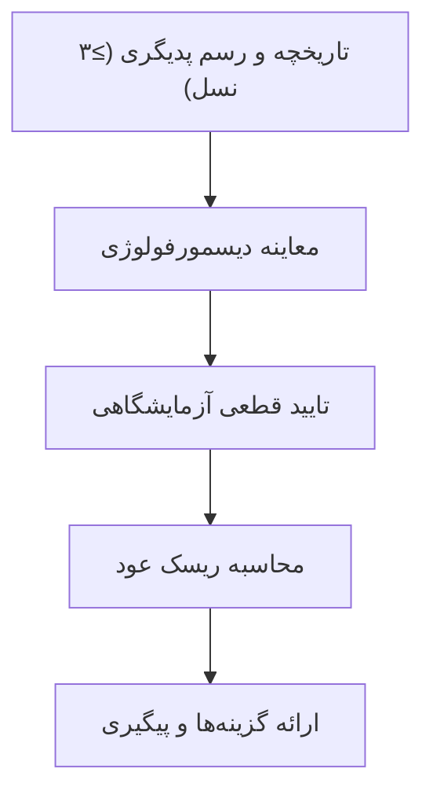

* **اصول ۴ گانه اخلاقی:**
  1. **غیرمستقیم (Non-Directive):** تصمیم‌گیری نهایی منحصراً با خانواده است؛ مشاور تصمیم‌سازی تحمیلی نمی‌کند.
  2. **حمایتی (Supportive):** مدیریت بحران روانی و اضطراب مراجع.
  3. **بدون قضاوت (Non-Judgmental):** احترام به باورهای اخلاقی، مذهبی و توان مالی.
  4. **زدودن احساس گناه:** تاکید بر تصادفی بودن خطا و عدم ارتباط با تقصیر یا گناه والدین.
* **ادراک کیفی ریسک:** خانواده‌ها بار بیماری را ارزیابی می‌کنند؛ پذیرش ریسک بالای ۵۰٪ برای نقص خفیف (مثل براکی‌داکتیلی) بسیار راحت‌تر از پذیرش ریسک ۱٪ برای نقایص وخیم (مثل سندرم داون) است. ریسک حافظه ندارد؛ برای هر بارداری مستقل است.

---

## ۲. اندیکاسیون‌های سه‌گانه ارجاع

* **پیش از ازدواج / بالغین:** سن مادر >۳۵ سال، ازدواج فامیلی (Consanguinity)، سابقه سرطان‌های زودرس فامیلی، آتاکسی یا نقایص حسی-عصبی، تعیین وضعیت ناقلی.
* **دوران بارداری (PND):** غربالگری مثبت سرمی/سونوگرافی، مواجهه با تراتوژن، بیماری مادر، سابقه **۲ بار یا بیشتر سقط خودبه‌خودی**.
* **نوزادان و کودکان:** مثبت شدن غربالگری نوزادی (NBS)، وجود $\ge 1$ ناهنجاری ماژور، تاخیر رشد (FTT)، عقب‌ماندگی ذهنی، ابهام تناسلی، دیسمورفیسم.

---

## ۳. استاندارد علائم شجره‌نامه و پرچم‌های قرمز (Red Flags)

| نماد | مفهوم بالینی | نماد / قاعده | مفهوم بالینی |
| :--- | :--- | :--- | :--- |
| **مربع / دایره** | مرد / زن | **پیکان ($\nearrow$)** | پروباند (نخستین فرد جلب‌توجه‌کننده) |
| **لوزی** | جنسیت نامشخص | **دو خط موازی (=)** | ازدواج خویشاوندی (همخونی) |
| **نماد توپر** | فرد مبتلا به بیماری | **دو خط مورب (//)** | طلاق یا متارکه |
| **مثلث** | سقط خودبه‌خودی (SAB) | **مثلث خط‌خورده** | سقط القایی / ختم بارداری |
| **عدد داخل نماد** | تعداد فرزندان سالم | **[ ] (کروشه)** | فرزندخواندگی (تفکیک والد بیولوژیک) |
| **P داخل لوزی** | بارداری فعال جاری | **خط مورب روی نماد** | فرد متوفی (با درج سن فوت) |

> [!important] پرچم‌های قرمز شجره‌نامه (Red Flags)
> ابتلای چند عضو خانواده به بیماری یا سرطان مشابه در سنین پایین، مرگ ناگهانی و نامنتظره در افراد جوان، وجود نقایص مادرزادی تک‌ژنی نادر (نابینایی/ناشنوایی)، تاخیر تکاملی همزمان با دیسمورفیسم، ابتلای نامتعارف به بیماری‌های چندعاملی شایع.

---

## ۴. مخدوش‌کننده‌های شجره‌نامه و کدهای OMIM

* **ناهمگونی اللی (Allelic):** جهش‌های مختلف در *یک ژن* $\leftarrow$ طیف شدت یک بیماری (ژن CFTR در سیستیک فیبروزیس).
* **ناهمگونی جایگاهی (Locus):** جهش در *ژن‌های مستقل و لوکوس‌های مجزا* $\leftarrow$ یک فنوتیپ مشترک با الگوهای وراثتی گوناگون (کرولالی ارثی با >۱۲۰ ژن، Amelogenesis imperfecta).
* **ناهمگونی سببی (Etiologic):** ایجاد یک فنوتیپ بالینی همسان توسط علل ژنتیکی یا آسیب‌های محیطی/تراتوژن (عقب‌ماندگی ذهنی).
* **نفوذ (Penetrance):** در سطح *فرد* پدیده **همه یا هیچ (All-or-None)** است (یا ۰٪ است یا ۱۰۰٪)؛ نفوذ کسری (مثلاً ۸۰٪) صرفاً در سطح جامعه و خانواده کاربرد دارد. نفوذ ناقص سبب **پرش نسل کاذب** در شجره غالب می‌شود.
* **تغییرپذیری بیان (Expressivity):** شدت متفاوت علائم در افراد دارای ژنوتیپ کاملاً یکسان.

> [!tip] کدهای ۶ رقمی OMIM
> * **100000:** اتوزومال غالب (ثبت پیش از ۱۹۸۴/۱۹۹۴)؛ **200000:** اتوزومال مغلوب (ثبت قدیم)
> * **300000:** وابسته به X؛ **400000:** وابسته به Y؛ **500000:** میتوکندریایی (mtDNA)
> * **600000 به بالا:** کلیه لوکوس‌های اتوزومال ثبت‌شده پس از می ۱۹۹۴

---

## ۵. تحلیل بیزی شجره‌نامه XR (مسئله کلاسی اسلاید ۴۲-۴۴)

* **صورت مسئله:** مادر مادربزرگ (I-2) ناقل قطعی XR است. دخترش (II-2) دارای **۳ پسر سالم** و یک دختر (III-3) است. مطلوب است محاسبه احتمال ناقل بودن دختر (III-3):

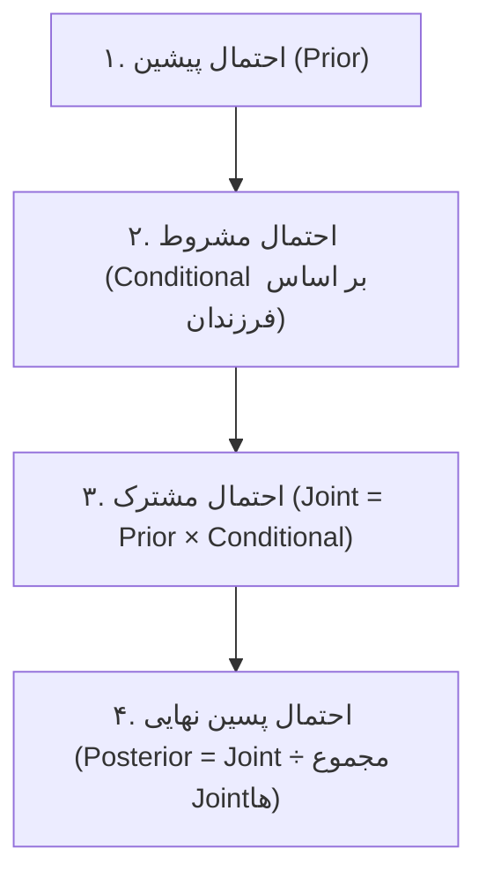

| گام محاسبه بیز | فرض ۱: مادر (II-2) ناقل باشد | فرض ۲: مادر (II-2) سالم باشد |
| :--- | :--- | :--- |
| **پیشین (Prior)** | ۱/۲ (دریافت X معیوب) | ۱/۲ (دریافت X سالم) |
| **مشروط (Conditional)** | شانس ۳ پسر سالم: $(1/2)^3 = 1/8$ | شانس ۳ پسر سالم: $(1)^3 = 1$ |
| **مشترک (Joint)** | $1/2 \times 1/8 = 1/16$ | $1/2 \times 1 = 8/16$ |
| **پسین (Posterior)** | $(1/16) \div (9/16) = \mathbf{1/9}$ | $(8/16) \div (9/16) = \mathbf{8/9}$ |

$$\text{P(دختر III-3 ناقل باشد)} = \text{P(مادرش ناقل باشد)} \times \frac{1}{2} = \frac{1}{9} \times \frac{1}{2} = \mathbf{\frac{1}{18}}$$

---

## ۶. قوانین افراد غریبه و حل مسائل شجره‌نامه مغلوب (اسلاید ۱۲)

* **قانون افراد غریبه (Outsider Rules):** فرد غریبه مبتلا در شجره AD همواره **Aa** و فرد غریبه سالم در شجره AR همواره **AA** فرض می‌شود (مگر فرکانس جامعه داده شود).
* **قانون ناقلین قطعی:** والدین و فرزندان افراد مبتلا به بیماری AR همواره ناقل قطعی (ریسک = ۱) هستند.

### سناریوهای تستی شجره AR اسلاید ۱۲
1. **ازدواج پسرعمو (III-1) با فرد مبتلا (III-4):**
   * شانس ناقلی والد (II-1) از والدین ناقل = ۱/۲.
   * شانس ناقلی پسرعمو (III-1) = $1/2 \times 1/2 = 1/4$.
   * شانس انتقال الل معیوب از بیمار (aa) = ۱؛ شانس انتقال از والد ناقل = ۱/۲.
   $$\text{Risk} = \frac{1}{4} \times \frac{1}{2} \times 1 = \mathbf{\frac{1}{8}}$$
2. **ازدواج دو خویشاوند سالم (III-2 با III-3):**
   * شانس ناقلی فرد III-2 (پسرعمو) = ۱/۴.
   * شانس ناقلی فرد III-3 (خواهر سالم دو فرد مبتلا) بر اساس قاعده بیزی AR = **۲/۳**.
   $$\text{Risk} = \frac{1}{4} \times \frac{2}{3} \times \frac{1}{4} = \mathbf{\frac{1}{24}}$$

---

## ۷. گزینه‌های مداخله‌ای و قوانین بارداری

* **PGD:** تشخیص روی بلاستومر/ترفوکتودرم در IVF پیش از انتقال جنین (حذف نیاز به سقط درمانی).
* **PND:** تهاجمی از طریق CVS (هفته ۱۱ تا ۱۴) یا آمنیوسنتز (هفته ۱۵ به بعد).
* **غربالگری نوزادی (NBS):** تست خون پاشنه پا برای مداخله فوری رژیمی و دارویی در بیماری‌های متابولیک ارثی (PKU) جهت ممانعت از عقب‌ماندگی ذهنی.
* **قانون سقط درمانی در ایران:** حداکثر تا **پایان هفته ۱۹ بارداری** (پیش از ۱۲۰ روزگی سن جنینی و پیش از ولوج روح) صرفاً با تایید رسمی پزشکی قانونی مجاز است.
# جلسه ۶: ژنتیک مولکولی، جهش‌ها، HGVS و مشاوره ژنتیک

## ۱. دگمای مرکزی و آناتومی ژن

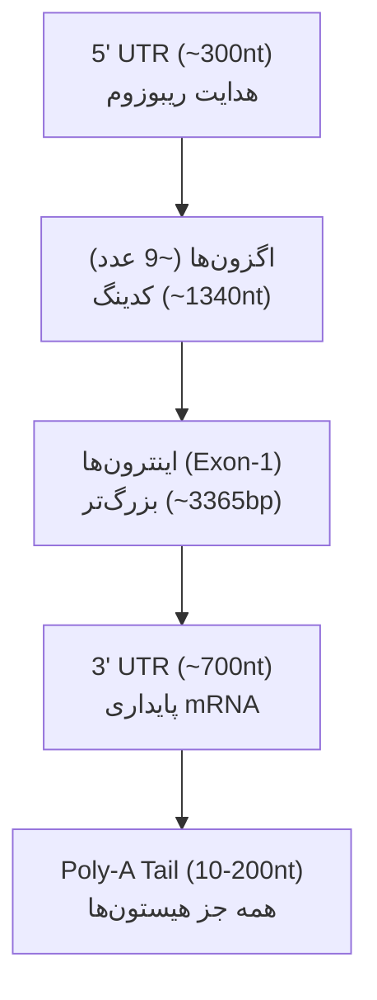

* **ساختار DNA:** مارپیچ دوگانه ناهمسو (Antiparallel)؛ خوانش سکانس از 5' به 3'؛ پیوند A=T (دو پیوند) و G≡C (سه پیوند).
* **کدون‌ها:** استارت منحصراً **AUG** (متیونین)؛ استاپ‌ها: **UAA, UAG, UGA**. ژنوم انسان: ۲۰ تا ۲۵ هزار ژن کدکننده پروتئین.
* **مرزهای پیرایش (Splice Sites):** آغاز اینترون/Donor دارای توالی ثابت **GT** (موتیف GTG)؛ پایان اینترون/Acceptor دارای توالی ثابت **AG** (موتیف CAG). *جهش در این دو باز سبب تغییر اسیدآمینه نشده ولی رونویسی/اسپلایس را کاملاً نابود می‌کند.*
* **رنگ‌های توالی‌یابی سنگر (Sanger):** A = سبز | C = آبی | G = سیاه | T = قرمز.

---

## ۲. دسته‌بندی جهش‌ها و پاتولوژی مولکولی

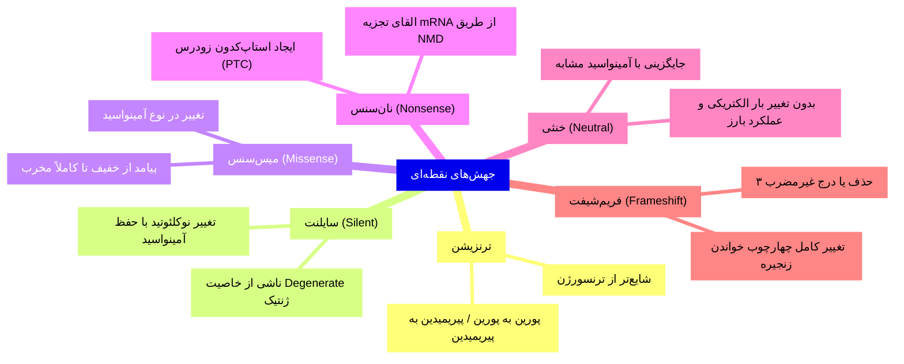

> [!important] قاعده طلایی ایندل‌ها و پاتولوژی نوین
> * **حذف/اضافه مضرب ۳ (In-frame Indel):** هرگز چارچوب خوانش را تغییر نمی‌دهد؛ صرفاً یک یا چند اسیدآمینه کم یا زیاد می‌شود.
> * **اثر منفی غالب (Dominant Negative):** الل معیوب علاوه بر از دست دادن کارکرد خود، پروتئین سالم حاصل از الل دیگر را نیز بلاک می‌کند (مثل TP53 و RAS).
> * **نارسایی هاپلو (Haploinsufficiency):** تولید ۵۰٪ دوز پروتئین طبیعی برای سلول ناکافی است و سبب بروز بیماری غالب می‌شود.
> * **پیش‌اندازی (Anticipation):** کاهش سن شروع و تشدید علائم در نسل‌های بعدی ناشی از انبساط توالی‌های تکراری.

### بیماری‌های شاخص گسترش تکرارهای سه‌نوکلئوتیدی

| بیماری                | الگو | تکرار   | ژن و جایگاه        | مرز نرمال  | مرز جهش پاتوژنیک                |
| :-------------------- | :--- | :------ | :----------------- | :--------- | :------------------------------ |
| **هانتینگتون**        | AD   | **CAG** | اگزون ۱ ژن *HTT*   | کمتر از ۳۴ | **بیش از ۴۰**                   |
| **ایکس شکننده**       | XR   | **CGG** | 5' UTR ژن *FMR1*   | کمتر از ۵۰ | **بیش از ۲۰۰** (هایپرمتیلاسیون) |
| **دیستروفی میوتونیک** | AD   | **CTG** | 3' UTR ژن *DMPK*   | کمتر از ۳۵ | **۸۰ تا ۲۰۰۰**                  |
| **آتاکسی فریدریش**    | AR   | **GAA** | اینترون ۱ ژن *FXN* | کمتر از ۳۴ | **۳۶ تا ۱۲۰۰**                  |
| **SBMA**              | XR   | **CAG** | اگزون ژن *AR*      | ۱۱ تا ۳۱   | بیش از ۴۰                       |

---

## ۳. سیستم استاندارد نام‌گذاری واریانت‌ها (HGVS)

* **پیشوندها:** `c.` (DNA کدینگ)، `g.` (ژنومیک)، `p.` (پروتئین)، `r.` (رونوشت RNA)، `m.` (میتوکندری).
* **علائم:** `>` جایگزینی | `del` حذف | `ins` الحاق | `_` دامنه و بازه | `*` استاپ کدون | `/` موزائیسم | `//` کایمریسم | `=` بدون تغییر نسبت به رفرنس.
* **تفسیر نوکلئوتیدهای اینترونی:** `c.88+1G>T` یعنی اولین نوکلئوتید اینترون پس از آخرین باز اگزون (شماره ۸۸) جهش یافته است.

---

## ۴. مشاوره ژنتیک، پدیگری و پایگاه OMIM

* **اصول مشاوره:** کاملاً غیرمستقیم (Non-Directive - تصمیم نهایی با خانواده است)، حمایتی، بدون قضاوت و با هدف حذف احساس گناه والدین.
* **پروپوزیتوس (Proband):** نخستین فرد مبتلا که مورد توجه پزشکی قرار گرفته و با **پیکان** در شجره‌نامه رسم می‌شود. ترسیم حداقل **۳ نسل** الزامی است.
* **کدهای رفرنس OMIM:**
  * **100000:** اتوزومال غالب (قبل از ۱۹۸۴)؛ **200000:** اتوزومال مغلوب (قبل از ۱۹۸۴)
  * **300000:** وابسته به X؛ **400000:** وابسته به Y؛ **500000:** میتوکندریایی (mtDNA)
  * **600000 به بالا:** لوکوس‌های اتوزومال ثبت‌شده پس از ۱۹۹۴

> [!warning] تله‌های تفکیک ناهمگونی (Heterogeneity)
> * **ناهمگونی اللی (Allelic):** جهش‌های مختلف در *یک ژن واحد* $\leftarrow$ یک فنوتیپ (جهش‌های گوناگون CFTR در سیستیک فیبروزیس).
> * **ناهمگونی جایگاهی (Locus):** جهش در *ژن‌های کاملاً مجزا و لوکوس‌های متفاوت* $\leftarrow$ یک فنوتیپ یکسان (کرولالی ارثی با >۸۰ ژن، اهَلرز-دانلوس).
> * **ناهمگونی سببی (Etiologic):** ایجاد یک فنوتیپ همسان توسط علل ژنتیکی یا آسیب‌های غیرژنتیکی/محیطی (عقب‌ماندگی ذهنی).

---

## ۵. محاسبات ریسک، قوانین افراد غریبه و روش بیز (Bayesian)

* **قانون ضرب (AND):** برای احتمالات مستقل | **قانون جمع (OR):** برای وقایع ناسازگار و جدا از هم.
* **قوانین غریبه‌ها (Outsiders):** فرد غریبه در شجره غالب (AD) همواره **Aa** و فرد غریبه سالم در شجره مغلوب (AR) همواره **AA** فرض می‌شود (مگر فرکانس جامعه داده شود).

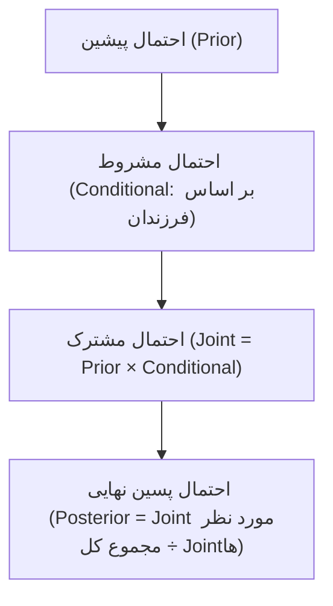

### مسئله امتحانی شجره XR (محاسبه ناقلی دختر III-3 با ۳ برادر سالم)
* مادر دختر (II-2) فرزند مادری ناقل قطعی است و ۳ پسر سالم متولد کرده است:

| مرحله محاسبه | فرض ناقل بودن مادر (Carrier) | فرض سالم بودن مادر (Non-carrier) |
| :--- | :--- | :--- |
| **پیشین (Prior)** | ۱/۲ (دریافت X جهش‌یافته) | ۱/۲ (دریافت X سالم) |
| **مشروط (Conditional)** | شانس ۳ پسر سالم: $(1/2)^3 = 1/8$ | شانس ۳ پسر سالم: $(1)^3 = 1$ |
| **مشترک (Joint)** | $(1/2) \times (1/8) = 1/16$ | $(1/2) \times 1 = 8/16$ |
| **پسین (Posterior)** | $(1/16) \div (9/16) = \mathbf{1/9}$ | $(8/16) \div (9/16) = \mathbf{8/9}$ |

$$\text{Carrier Risk (III-3)} = P(\text{مادر ناقل}) \times \frac{1}{2} = \frac{1}{9} \times \frac{1}{2} = \mathbf{\frac{1}{18}}$$

---

## ۶. تکنیک‌های تشخیصی و قوانین بارداری

* **PGD:** تشخیص روی بلاستومر جنین حین IVF پیش از لانه‌گزینی (پیشگیری از سقط درمانی).
* **PND:** بیوپسی کوریون (**CVS** در هفته ۱۱ تا ۱۴) یا **آمنیوسنتز** (هفته ۱۵ به بعد).
* **محدودیت قانونی سقط درمانی:** حداکثر تا **پایان هفته ۱۹ بارداری** (پیش از ۱۲۰ روزگی سن جنینی و پیش از ولوج روح) با تایید رسمی پزشکی قانونی.
# جلسه ۷: ناهنجاری‌ها، تراتوژن‌ها و ژنتیک دوقلویی

## ۱. اپیدمیولوژی و آمار کلیدی
* **شیوع سقط:** ۱ از هر ۴ تا ۵ زن (۲۰ تا ۲۵٪)، اوج در سه‌ماهه اول (T1).
* **سهم ژنتیک در سقط T1:** ۵۰ تا ۸۰٪ (ناهنجاری ساختاری در ۸۰-۸۵٪ سقط‌های T1 در برابر ۲۵٪ در T2).
* **مورتالیتی:** نقایص بدو تولد در ۳ تا ۵٪ نوزادان زنده؛ علت ~۸۰٪ مرگ‌های پری‌ناتال و ۲۰-۳۰٪ مرگ‌های نوزادی.
* **علت عقب‌ماندگی ذهنی:** ۵۰٪ ژنتیکی.

> [!important] تله امتحانی: نسبت سن به سهم مرگ ناشی از ناهنجاری ماژور
> با افزایش سن کودک، سهم مرگ افت می‌کند: بدو تولد (**۲۵٪**) ← ۱ تا ۱۰ سال (**۲۰٪**) ← ۱۰ تا ۱۵ سال (**۷.۵٪**).

---

## ۲. دسته‌بندی و شیوع ناهنجاری‌ها
* **ماژور (۲ تا ۳٪ تولدها):** تهدید حیات/عملکرد؛ نیازمند مداخله قطعی (مثل آنانسفالی، Cleft lip/palate).
* **ماینور (~۱۰٪ نوزادان):** بدون عارضه عملکردی (اپی‌کانتوس، Simian crease، Brushfield spots).
* **تغییرات نرمال:** انتهای طیف طبیعی (پل بینی صاف، هیدروسل غیرارتباطی، سین‌داکتیلی انگشت ۲-۳ پا).

> [!warning] نکته بالینی
> وجود **۳ ناهنجاری ماینور یا بیشتر** = احتمال قوی وجود یک **ناهنجاری ماژور پنهان**.

* **بروز ماژور در هر ۱۰۰۰ تولد:**
  * **CVS (۱۰/۱۰۰۰ - شایع‌ترین با CNS):** **VSD** (حدود ۲.۵) > ASD = PDA = TOF (هرکدام ۱.۰).
  * **CNS (۱۰/۱۰۰۰):** **اسپاینا بیفیدا کمری‌خاجی** (۲.۰) > آنانسفالی = هیدروسفالی = میکروسفالی (۱.۰).
  * **GI (۴/۱۰۰۰):** **شکاف لب/کام** (۱.۵) > فتق دیافراگم (۰.۵) > آترزی مری (۰.۳) > مقعد بسته (۰.۲).
  * **ادراری‌تناسلی (۴/۱۰۰۰):** **آژنزیا دوطرفه کلیه** (۲.۰) > اکستروفی مثانه (۰.۰۳) > ARPKD (۰.۰۲).
  * **اندام‌ها (۲/۱۰۰۰):** **آمپوتاسیون عرضی** (۰.۲).

---

## ۳. ترمینولوژی مورفوژنز (نقایص تک‌گیر)

| نوع نقص          | پاتوفیزیولوژی                        | زمان رخداد (سه‌ماهه: T) و اتولوژی      | نمونه بارز                                   |
| :--------------- | :----------------------------------- | :------------------------------------- | :------------------------------------------- |
| **مالفورماسیون** | نقص ذاتی اولیه در تکوین بافت         | **T1**؛ کروموزومی، تک‌ژنی، تراتوژن     | Cleft lip/palate، نقایص لوله عصبی            |
| **دفورماسیون**   | اثر نیروی مکانیکی خارجی بر بافت سالم | **T2 و T3**؛ الیگوهیدرآمنیوس، چندقلویی | کلاب‌فوت (تمایل به بهبودی خودبه‌خود)         |
| **دیسراپشن**     | تخریب بافت کاملاً سالم قبلی          | ایسکمی، Amniotic bands، کوکائین        | آمپوتاسیون نامتقارن، پروانسفالی              |
| **دیسپلازی**     | سازمان‌یابی غیرعادی سلولی در بافت    | عمدتاً تک‌ژنی با ریسک عود بالا         | دیسپلازی اکتودرمی، DDH (تست Barlow/Ortolani) |

> [!tip] علامت کلیدی دیسراپشن
> وجود **عدم تقارن شدید (Asymmetry)** در نقایص اندام، شاخص تشخیصی قطعی علل غیرژنتیکی و دیسراپشن است.

---

## ۴. ناهنجاری‌های چندگانه

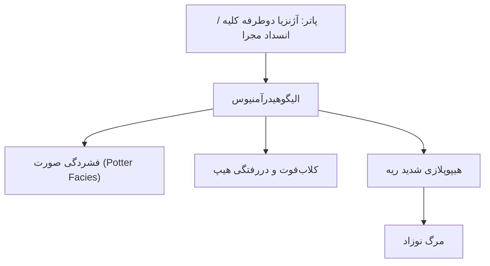

* **توالی (Sequence):** نقص اولیه زنجیره‌ای از نقایص ثانویه ترتیبی می‌سازد (مانند پاتر).
* **سندروم (Syndrome):** مجموعه‌ای از علائم همزمان با ریشه مشترک بدون رابطه علی-معلولی خطی (مانند سندروم ون‌در وود: AD با شکاف لب/کام + فرورفتگی متقارن لب تحتانی).
* **همراهی (Association):** همراهی غیرتصادفی فاقد الگوی ژنتیکی مشخص؛ **VACTERL** (شامل **V:** مهره‌ای | **A:** آنورکتال (آترزی مقعد) | **C:** قلبی | **TE:** فیستول تراکئوازوفاژیال و آترزی مری | **R:** رنال/رادیال | **L:** اندام‌ها (Limb)).

---

## ۵. اتیولوژی و نقایص تک‌ژنی
* **علل:** ناشناخته (~۵۰٪) > چندعاملی (۲۰-۳۰٪) > ژنتیکی قطعی (کروموزومی ۶٪، تک‌ژنی ۷.۵-۱۰٪) > محیطی/تراتوژن (۵-۱۰٪: عفونت ۲٪، دارو/شیمیایی ۲٪، مادری ۲٪، فیزیکی ۱٪).
* **الگوی توارث ژنی:**
  * **مغز و چشم:** هیدروسفالی (XR)؛ مگالنسفالی و آنیریدیا (AD)؛ کاتاراکت، میکروفتالمی و میکروسفالی (AD/AR).
  * **اندام‌ها:** براکی‌داکتیلی و پلی‌داکتیلی (AD)؛ اکتروداکتیلی (AD/AR).
  * **سندروم‌های معروف:** آپرت (AD - کرانیوسینوستوزیس و سین‌داکتیلی دست/پا)؛ EEC (AD - دیسپلازی اکتودرمی، اکتروداکتیلی، شکاف لب/کام)؛ مکل (AR - انسفالوسل اکسیپیتال، پلی‌داکتیلی، کلیه پلی‌کیستیک)؛ رابرتز (AR - فوکوملیا و شکاف فاسیال).

---

## ۶. بیماری‌های RAS-MAPK و اورگروس

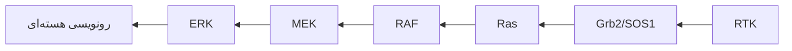

* **سندروم نونان:** هایپرتلوریسم، پتوز، پره گردن، تنگی دریچه پولمونر و کاردیومیوپاتی هیپرتروفیک.
  * ژن اصلی: **PTPN11 (≥۵۰٪)** (عامل سندروم LEOPARD نیز هست).
  * سایر ژن‌ها: SOS1, RIT1, RAF1, KRAS, SHOC2.
* **سندرم‌های مرتبط:** کاستلو (**HRAS** >۵۰٪ - پوست شل، شیار کف دست/پا، تومورزایی)؛ CFC (**BRAF** ≤۵۰٪ - موی وزوزی، پوست و عقب‌ماندگی شدید)؛ لگسیوس (**SPRED1**).
* **سندروم سوتو (اورگروس اطفال):** ماکروسفالی، پیشانی بلند، چانه نوک‌تیز، اسکولیز.
  * **تیپ ۱ (۸۰-۹۰٪):** جهش یا حذف ژن **NSD1** (لوکوس 5q35).
  * **تیپ ۲:** ژن **NFIX** (لوکوس 9p13).

---

## ۷. نقایص لوله عصبی (NTD) و محور MTHFR
* **زمان بحرانی:** روزهای ۱۴ تا ۲۸ (هفته ۲ تا ۴ بارداری).
* **طیف بالینی:** آنانسفالی/اکسنسفالی (قدامی)، انسفالوسل (فتق بافت مغز از اکسیپیتال)، میلومننگوسل/مننگوسل و اسپاینا بیفیدا اوکولتا (**Hairy patch** یا خال در خط وسط کمر).
* **واریانت‌های شایع C677T و A1298C ژن MTHFR:**
  * افت فعالیت آنزیم $\leftarrow$ کاهش فولات + تجمع **هموسیستئین**.
  * آسیب: **ترومبوز و آرترواسکلروز شریانی** (برخلاف فاکتور ۵ لیدن که وریدی است)، پیری زودرس جفت و سقط T2/T3، ناتوانی در متیلاسیون DNA و بروز NTD.
  * **پروتوکل پیشگیری:** اسید فولیک با دوز بالا (**5 mg/day**) قبل و حین بارداری.

---

## ۸. تراتولوژی بالینی

### بازه‌های بحرانی
1. **هفته ۱ تا ۲:** قانون *همه یا هیچ (All-or-None)*؛ سقط کامل یا ترمیم کامل بدون نقص پایدار.
2. **هفته ۳ تا ۸ (ارگانوژنز):** اوج آسیب‌پذیری ساختاری ماژور (هفته ۳: قلب و CNS؛ هفته ۴ تا ۶: چشم، گوش، اندام‌ها؛ تا هفته ۸: کام و ژنیتالیا).
3. **هفته ۹ تا زایمان:** نقایص عملکردی، رفتاری، IUGR و نقایص ماینور (نه ناهنجاری ساختاری ماژور).

### داروهای تراتوژن قطعی
* **تالیدوماید:** آملیا و فوکوملیا (اندام پره‌ای)، مایکروشیا (بحرانی‌ترین زمان: **روز ۲۱ تا ۳۶ لقاح**).
* **الکل (FAS/FASD):** فیلتروم صاف، لب فوقانی نازک، شکاف پلکی کوتاه، خط هاکی کف دست، VSD، عقب‌ماندگی ذهنی (*پدیده کوه یخ*).
* **والپروئیک اسید:** **NTD** (ریسک ۱-۲٪)، نقایص شناختی/اتیسم.
* **فنی‌توئین:** هیپوپلازی ناخن/بند دیستال، شکاف کام/لب، نقص قلبی (**سندروم هیدانتوئین جنینی**).
* **ایزوترتینوئین (روآکوتان):** فقدان گوش (آنوتیا/مایکروشیا)، هیدروسفالی، نقص قوس آئورت و تترالوژی فالوت.
* **مهارکننده‌های ACE:** نارسایی/دیسپلازی کلیه، الیگوهیدرآمنیوس، هیپوپلازی کالواریا (مواجهه در T2 و T3).
* **وارفارین:** هیپوپلازی تیغه بینی، Stippled epiphyses (*جایگزینی با LMWH در بارداری*).
* **تتراسایکلین:** هیپوپلازی و تغییر رنگ زرد-قهوه‌ای مینای دندان‌ها.
* **استرپتومایسین:** سمیت عصب VIII و ناشنوایی پایدار حسی‌عصبی.
* **لیتیم:** آنومالی ابشتین (Ebstein).
* **دی‌اتیل‌استیل‌بسترول (DES):** رحم T-شکل، آدنوکارسینومای سلول شفاف واژن در سن بلوغ نوزاد دختر.

### سایر عوامل تراتوژن و بیماری‌های مادر
* **کوکائین:** *وازوکانستریشن شدید* $\leftarrow$ دیسراپشن، نقص اندام و آترزی روده (اتصال به اسپرم پدر نیز موثر است).
* **اشعه یونیزان:** میکروسفالی و نقص تکاملی (CT شکم/لگن دوزی معادل ۱۰۰ برابر عکس قفسه سینه دارد).
* **هایپرترمی پایدار (تب شدید/سونا در T1):** NTD و شکاف فاسیال.
* **دیابت بارداری:** هایپرگلیسمی $\leftarrow$ **اگرسیون کودال (Caudal regression - کاملاً اختصاصی)**، نقایص قلبی، ماکروزومی، هایپوگلیسمی نوزاد.
* **PKU مادر:** فنیل‌آلانین بالا $\leftarrow$ میکروسفالی و نقص قلبی جنین (حتی با وجود جنین هتروزیگوت سالم).
* **عفونت‌های TORCH:**
  * **توکسوپلاسموز:** کلسینوز اینتراکرانیال منتشر، کوریورتینیت، هیدروسفالی.
  * **سیفلیس و آبله‌مرغان:** رینیت خونی و اوستئیت (سیفلیس)؛ اسکارهای زیکاتریس و نقص اندام (واریسلا).
  * **سرخجه (Rubella):** تریاد کاتاراکت، ناشنوایی، نقص قلبی (PDA و تنگی شریان ریوی).
  * **سیتومگالوویروس (CMV):** شایع‌ترین؛ کلسیفیکاسیون اطراف بطنی (پری‌ونتریکولار) و میکروسفالی.
  * **هرپس (HSV):** آنسفالیت نکروزان، میکروفتالمی.
  * **تشخیص قطعی جنینی:** سنجش اختصاصی **IgM نوزاد** (IgG از جفت عبور می‌کند، IgM عبور نمی‌کند) + Real-Time PCR.

---

## ۹. ژنتیک دوقلویی و پرده‌ها

### دوقلوی همسان (MZ) در برابر ناهمسان (DZ)
* **مونوزیگوتیک (MZ - تشابه ۱۰۰٪ ژنوم هسته‌ای):** تفاوت‌های اندک فنوتیپی به دلیل توزیع mtDNA، تغییرات اپی‌ژنتیک و جهش‌های سوماتیک.
* **دی‌زیگوتیک (DZ - تشابه ۵۰٪):** حاصل ۲ تخمک و ۲ اسپرم مجزا؛ همواره **DC/DA** هستند. ارث‌رسانی از سمت مادر.

### تعیین پرده‌ها در دوقلوهای همسان بر اساس زمان تسهیم زیگوت
* **روز ۱ تا ۳ (مورولا):** دی‌کوریونیک / دی‌آمنیوتیک (**DC/DA** - دو جفت، دو کیسه؛ ~۳۰٪).
* **روز ۴ تا ۸ (بلاستوسیست):** مونوکوریونیک / دی‌آمنیوتیک (**MC/DA** - یک جفت مشترک، دو کیسه؛ ~۶۵-۷۰٪).
* **روز ۸ تا ۱۳ (لانه‌گزینی):** مونوکوریونیک / مونوآمنیوتیک (**MC/MA** - یک جفت و یک کیسه مشترک؛ ~۱-۲٪).
* **روز ۱۳ تا ۱۵:** تسهیم ناقص $\leftarrow$ دوقلوی به‌هم‌چسبیده (Conjoined Twins).

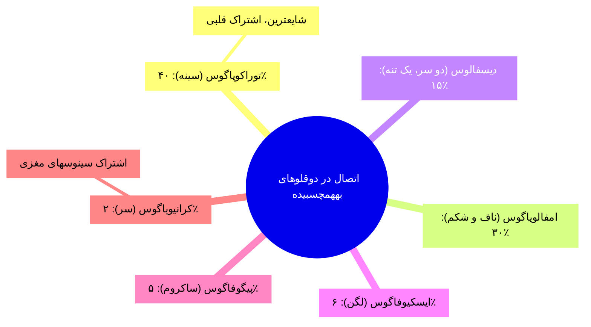
* **دوقلوی انگلی (Parasitic):** اتصال ساختار ناقص و فاقد ارگان حیاتی به عنوان یک زائده روی دوقلوی سالم (اتوزیت).

# جلسه ۸: الگوهای وراثتی AD و AR

## ۱. مفاهیم پایه و مبانی مولکولی

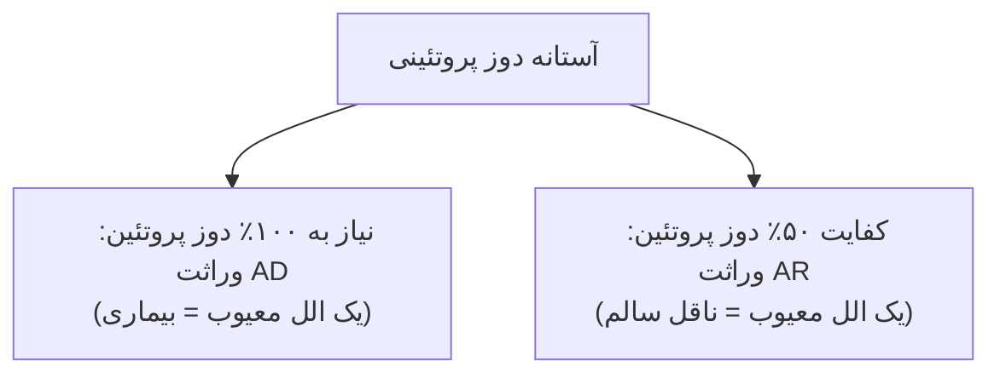

* **سیادت کامل (Complete Dominance):** فنوتیپ Aa و AA کاملاً یکسان (هانتینگتون).
* **سیادت ناقص (Incomplete Dominance):** فنوتیپ AA شدیدتر، زودرس یا لتال/کشنده (آکندروپلازی لتال در AA، هیپرکلسترولمی فامیلی/FH شدیدتر در AA).

---

## ۲. الگوی وراثتی اتوزومال غالب (AD)
* **سهم:** >۵۰٪ بیماری‌های تک‌ژنی مندلی.
* **شیوع‌های کلیدی:** FH (۱:۵۰۰) > دیستروفی میوتونیک (۱:۵۵۰) > هانتینگتون (۱:۳۰۰۰).

### شاخص‌های شجره‌نامه AD
* **انتقال عمودی:** بدون پرش نسل؛ *هر مبتلا حداقل یک والد مبتلا دارد*.
* **انتقال پدر به پسر (Male-to-Male):** قطعی‌ترین شاخص *رد وراثت وابسته به X*.
* **ریسک:** در تلاقی Aa × aa برابر **۵۰٪** برای هر فرزند (بدون وابستگی به جنسیت). در تلاقی دو فرد بیمار (Aa × Aa)، ریسک ابتلای فرزند زنده **۷۵٪** (۲۵٪ AA لتال یا وخیم، ۵۰٪ Aa) است.
* **استثنای صفت محدود به جنس (Sex-Limited):** بیماری اتوزومال است ولی فقط در یک جنس تظاهر می‌یابد؛ مانند **تستوتوکسیکوزیس فامیلیال مردانه** (جهش فعال‌کننده گیرنده LH/LHR؛ بلوغ زودرس در ~۴ سالگی؛ مشاهده Male-to-Male اثبات اتوزومال بودن آن است).

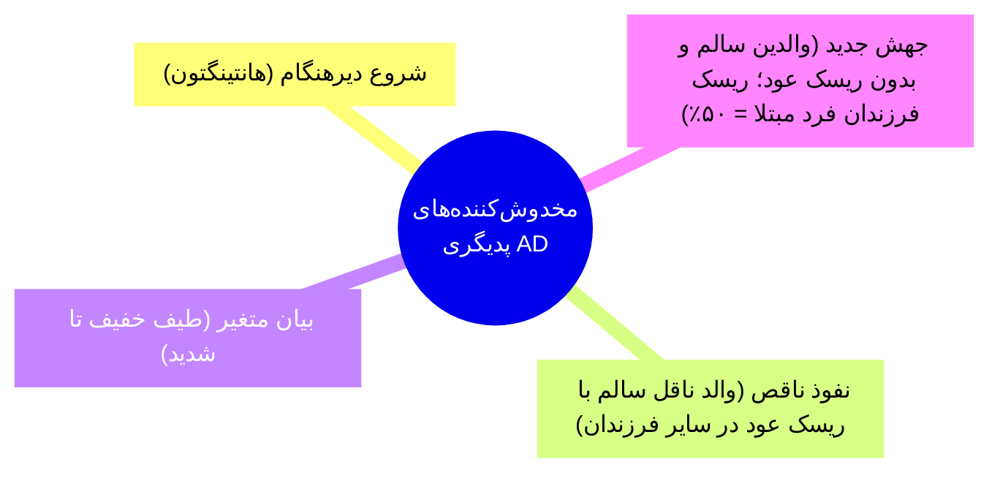

---

## ۳. الگوی وراثتی اتوزومال مغلوب (AR) و محاسبات ریسک

### شاخص‌های شجره‌نامه AR
* **انتقال افقی:** بیماران *در یک نسل* (هم‌شکم‌ها)؛ والدین سالم و ناقل؛ نسبت جنسی ۱:۱.
* **همخونی (Consanguinity):** شانس بروز AR را **۳ تا ۵٪ فراتر از جمعیت** می‌برد.

### فرمول‌ها و قواعد طلایی ناقلی
* **ناقلین قطعی (ریسک = ۱):** تمام والدین و تمام فرزندان فرد مبتلا (aa).
* **قاعده ۲/۳:** خواهر یا برادر فنوتیپاً سالم فرد مبتلا، شانس ناقلی **۲/۳** دارد.
* **بستگان دیگر:** عمو/عمه/دایی/خاله = **۱/۲** | فرزندان آنها (پسرعمو/دخترخاله) = **۱/۴**.
* **هاردی-واینبرگ:** $p^2 + 2pq + q^2 = 1$؛ شیوع بیماران = $q^2$؛ شیوع ناقلین در جامعه $\approx 2q$.

> [!important] فرمول کلی احتمال ابتلای فرزند در AR
> **ریسک فرزند = (شانس ناقلی والد اول) × (شانس ناقلی والد دوم) × (۱/۴)**

### جدول مقایسه سناریوهای تستی AR (خواهر فرد مبتلا: شانس ۲/۳)

| سناریوی ازدواج زن دارای برادر مبتلا      | شانس ناقلی همسر | محاسبه ریسک ابتلای فرزند            | ریسک نهایی |
| :--------------------------------------- | :-------------- | :---------------------------------- | :--------- |
| **با پسرعمو / پسرخاله**                  | ۱/۴ (خویشاوند)  | $(2/3) \times (1/4) \times (1/4)$   | **۱:۲۴**   |
| **با غریبه (فرکانس ناقلی جامعه = ۱/۲۰)** | ۱/۲۰            | $(2/3) \times (1/20) \times (1/4)$  | **۱:۱۲۰**  |
| **با غریبه (فرکانس ناقلی جامعه = ۱/۶۰)** | ۱/۶۰            | $(2/3) \times (1/60) \times (1/4)$  | **۱:۳۶۰**  |
| *ازدواج فامیلی دو فرد بدون سابقه*        | هر دو والد ۱/۲  | $(1/2) \times (1/2) \times (1/4)$   | **۱:۱۶**   |

---

## ۴. روش‌های تشخیص مولکولی (PND)
* **تست مستقیم ژن:** شناسایی جهش شناخته‌شده در والدین؛ دقت ۱۰۰٪ در جنین.
* **آنالیز پیوستگی (Linkage - غیرمستقیم):** به دلیل ناهمگونی ژنتیکی (جهش ناشناخته)؛ ردیابی الل بیماری با مارکرهای پلی‌مورفیک مجاور ژن بدون Recombination؛ **الزام دسترسی به DNA فرد مبتلا در خانواده** جهت فازبندی (Phase determination).

---

## ۵. چک‌لیست و تله‌های حل مسئله امتحانی

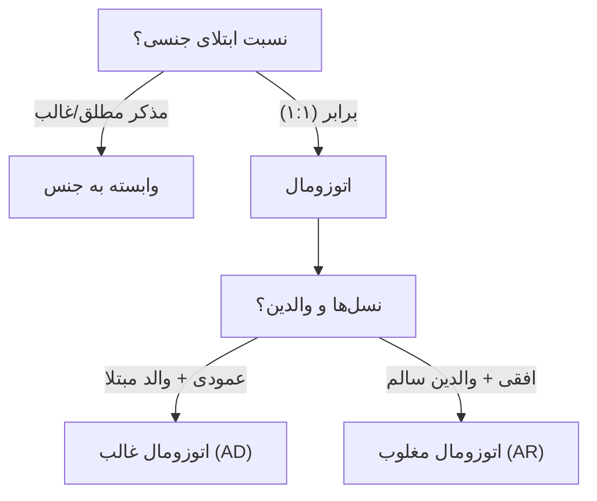

> [!warning] تله‌های کلاسیک تستی
> 1. **مارکر و بیماری دیررس AD:** اگر پدربزرگ مبتلا (A/B) با همسر سالم (A/A) باشد و نوه جنین مارکر (A/B) دریافت کند:
>    * پیش از بروز علائم در پدر (A/B): شانس ابتلای جنین **۵۰٪** است (جهش می‌تواند روی الل A یا B پدربزرگ باشد؛ شباهت الل همسر غریبه به دلیل اشتراک تباری نیست).
>    * فرزند دختر دارای ژنوتیپ (A/A): قطعاً **سالم** است (الل A پدر از مادربزرگ سالم آمده).
>    * پس از بروز علائم در پدر در سن بالای ۴۰: جهش قطعاً با الل B همراه بوده؛ پس جنین (A/B) قطعاً **مبتلا (حامل جهش)** خواهد بود.
> 2. **پرش نسل کاذب:** در پدیگری‌های کوچک AR، تولد تک‌فرزند مبتلا نشانه جهش جدید نیست؛ حاصل شانس ۱/۴ است.


# جلسه ۹: وراثت وابسته به X و صفات جنسی

## ۱. بیولوژی مولکولی و ساختار کروموزوم X
* **مشخصات:** کروموزوم ساب‌متاسانتریک، 153 مگاباز، ~۸۰۰ ژن کُدکننده (در برابر ۷۰ ژن کروموزوم Y).
* **مردان Hemizygous:** حضور تک‌نسخه X؛ بیان قطعی و مستقیم هرگونه الل معیوب.
* **لیونیزاسیون:** غیرفعال‌سازی تصادفی یکی از دو کروموزوم X در رویان اناث $\leftarrow$ جسم بار (Barr body) متراکم هتروکروماتینی.
* **ژن‌های Cancer-Testis (ژن‌های CT):** ~۱۰٪ ژن‌های X؛ فیزیولوژیک فقط در بیضه بیان می‌شوند (پنهان پشت سد خونی-بیضه‌ای). بیان نابجا در تومورها $\leftarrow$ تارگت عالی ایمونوتراپی سرطان.

---

## ۲. ناهنجاری‌های کروموزومی و سایتوژنتیک

| سندرم          | کاریوتایپ و مکانیسم                                    | تظاهرات بالینی و نکات                                                                                                                                                                                       |
| :------------- | :----------------------------------------------------- | :---------------------------------------------------------------------------------------------------------------------------------------------------------------------------------------------------------- |
| **کلاین‌فلتر** | 47,XXY <br>(Nondisjunction والدینی ۵۰/۵۰؛ شیوع ۱:۱۰۰۰) | **قد بلند**، **ژنیکوماستی**، بیضه کوچک، آزواسپرمی و عقیمی قطعی، اشکال در یادگیری کلامی، خطر بالای پوکی استخوان و سرطان پستان مردان. *نکته:* تستوسترون علائم را تعدیل می‌کند ولی آزواسپرمی را درمان نمی‌کند. |
| **ترنر**       | 45,X<br>(۸۰٪ خطای میوز پدر؛ شیوع ۱:۲۵۰۰ دختر)          | **قد کوتاه** (نارسایی هاپلوژن SHOX)، **گردن پره‌دار** (Webbed neck)، قفسه سینه سپری، کوآرکتاسیون آئورت، هایگروما کیستیک جنینی، **گناد خطی (Streak)** و آمنوره اولیه. درمان: استروژن.                        |
| **مردان XX**   | 46,XX<br>(کراسینگ‌اور نابه‌جا در میوز پدر)             | انتقال SRY از Yp به X؛ ظاهر کاملاً مذکر، اما فاقد ژن‌های اسپرماتوژنز (AZF) کروموزوم Y (ناباروری قطعی).                                                                                                      |
| **X شکننده**   | لوکوس Xq27.3 ژن FMR1                                   | **شایع‌ترین علت ارثی عقب‌ماندگی ذهنی/اوتیسم**؛ صورت دراز، گوش بزرگ، ماکروارکیدیسم پس از بلوغ.                                                                                                               |

```mermaid
flowchart TD
    A["تکرار تری‌نوکلئوتیدی CGG در 5' UTR ژن FMR1"] --> B["بیش از ۲۰۰ کپی (Full Mutation)"]
    B --> C["هایپرمتیلاسیون و خاموشی ژن FMRP"]
    C --> D["انبساط پره‌موتیشن (۵۵-۲۰۰) به کامل فقط در اووژنز مادر"]
```

> [!important] مفاهیم ساختاری امتحانی
> * **ایزوکروموزوم (Isochromosome):** حاصل تقسیم عرضی سانترومر در آنافاز (ایجاد کروموزوم با دو بازوی کوتاه یا دو بازوی بلند همسان و حذف بازوی دیگر).
> * **Isodicentric X:** اتصال دو کروموزوم X شکسته دارای دو سانترومر $\leftarrow$ دیسژنزی گنادی و آمنوره.

---

## ۳. وراثت مغلوب وابسته به ایکس (XR)

```mermaid
flowchart TD
    classDef carrier fill:#fff3e0,stroke:#ef6c00,stroke-width:1px;
    classDef aff fill:#ffebee,stroke:#c62828,stroke-width:2px;
    classDef norm fill:#e8f5e9,stroke:#2e7d32,stroke-width:1px;

    subgraph Mating1["تلاقی والد ۱: مادر ناقل (XAXa) × پدر سالم (XAY)"]
	    direction RL
        M1["مادر ناقل"] --> D1["دختر سالم: 25%"]:::norm
        M1 --> D2["دختر ناقل: 25%"]:::carrier
        M1 --> S1["پسر سالم: 25%"]:::norm
        M1 --> S2["پسر مبتلا: 25%"]:::aff
    end

    subgraph Mating2["تلاقی والد ۲: مادر سالم (XAXA) × پدر مبتلا (XaY)"]
	    direction RL
        M2["پدر مبتلا"] --> D3["100% دختران ناقل قطعی"]:::carrier
        M2 --> S3["100% پسران سالم"]:::norm
    end
```

* **شاخص‌های شجره‌نامه XR:** عدم انتقال پدر به پسر (No Male-to-Male)؛ انتقال مورب/شطرنجی (پدربزرگ به نوه پسری از طریق دختر ناقل)؛ شیوع بسیار بیشتر در مردان.

> [!warning] ۴ مکانیسم استثنایی ابتلای زنان در بیماری‌های XR
> 1. **هوموزیگوسیتی:** ازدواج پدر مبتلا با مادر ناقل یا جهش جدید (De novo) در الل دوم.
> 2. **لیونیزاسیون اریب (Skewed X-Inactivation):** خاموش شدن تصادفی X سالم در بیشتر سلول‌ها (Manifesting Heterozygote در دوشن و هموفیلی).
> 3. **آنومالی عددی:** همراهی تک الل جهش‌یافته با سندرم ترنر (45,X).
> 4. **ترنسلوکیشن X-Autosome:** برای بقای سلول، X سالم خاموش می‌شود تا ژن‌های اتوزوم دست‌نخورده بمانند؛ X جهش‌یافته فعال می‌ماند.

### مقایسه بیماری‌های مهم XR

| بیماری                      | نقص ژنی و مکانیسم                                                  | نکات بالینی و تله‌های تستی                                                                                                                                                                                                                                   |
| :-------------------------- | :----------------------------------------------------------------- | :----------------------------------------------------------------------------------------------------------------------------------------------------------------------------------------------------------------------------------------------------------- |
| **کوررنگی سرخ-سبز**         | ژن‌های **OPN1LW** (قرمز) و **OPN1MW** (سبز) لوکوس Xq28             | شیوع ۸٪ مردان، ۱:۱۵۰ زنان. نوترکیبی نابرابر به علت هومولوژی ۹۶٪. پروتانوپیا/پروتانومالی (کوری/نقص قرمز)؛ دوترانوپیا/دوترانومالی (کوری/نقص سبز).                                                                                                              |
| **هموفیلی A و B**           | کمبود **فاکتور ۸** (A - شایع‌تر)؛ **فاکتور ۹** (B - خاندان سلطنتی) | خونریزی مفصلی (همارتروز زانو). *تله:* **هموفیلی C** ناشی از فاکتور ۱۱، کروموزوم ۴ و **اتوزومال مغلوب (AR)** با نسبت ۱:۱ در دو جنس است.                                                                                                                       |
| **دوشن (DMD) و بکر (BMD)**  | لوکوس Xp21 ژن **دیستروفین** (۷۹ اگزون؛ بزرگ‌ترین ژن)               | **DMD:** جهش خروج از چارچوب (Out-of-Frame) $\leftarrow$ پروتئین صفر، شروع ۳-۵ سالگی، علامت گاورز، سودوهیپرتروفی ساق، ویلچر ۱۰-۱۲ سالگی، مرگ دهه ۲۰-۳۰. <br>**BMD:** جهش حفظ چارچوب (In-Frame) $\leftarrow$ پروتئین کوتاه‌تر ولی فعال، شروع دیررس و سیر خفیف. |

> [!note] سایر بیماری‌های XR
> - **G6PD (فاویسم):** همولیز با باقلا، پریماکین و سولفونامیدها. 
> - **ایکتیوز وابسته به X:** کمبود استروئید سولفاتاز (STS)؛ پوست فلس ماهی. 
> - **XLA (بروتون):** جهش BTK؛ توقف تمایز لنفوسیت B در مرحله پیش‌ساز. 
> - **ALD:** دمیلینه شدن CNS + نارسایی آدرنال.


> [!important] روش‌های تشخیص پیش از تولد (PND)
> cffDNA خون مادر (هفته ۱۰-۱۲)؛ CVS (هفته ۱۱-۱۴ با ۱٪ سقط)؛ آمنیوسنتز (هفته ۱۵ به بعد با ۰.۵٪ سقط).

---

## ۴. وراثت غالب وابسته به ایکس (XD)
* **شاخص‌های شجره‌نامه:** *پدر مبتلا* بیماری را به **۱۰۰٪ دختران** می‌دهد و **هیچ پسری** مبتلا نمی‌شود. *مادر مبتلا* بیماری را به **۵۰٪ فرزندان** (فارغ از جنس) منتقل می‌کند.
* **نسبت جنسی:** زنان ۲ برابر مردان درگیر می‌شوند ولی شدت بیماری در زنان خفیف‌تر است.
* **کشندگی در جنین مذکر (Male Lethality):** فقدان فرزند پسر در شجره‌نامه و سقط‌های مکرر مادری؛ مانند **سندرم Rett** (جهش *MECP2*؛ ۹۵٪ *دونوو*) و **Incontinentia Pigmenti** (*خطوط بلاشکو*).
* **سایر نمونه‌ها:** راشیتیسم مقاوم به ویتامین D (هیپوفسفاتمیک)، سندرم آلپورت، سندرم گولتز، سندرم آیکاردی، هتروتوپی ندولار (ژن FLNA).

> [!important] وراثت متناقض وابسته به X (ژن PCDH19)
> در آنسفالوپاتی صرعی نوزادی ۹: **مردان همی‌زیگوت کاملاً سالم** و **زنان هتروزیگوت دچار بیماری شدید** می‌شوند (ناشی از تداخل بافتی سلول‌های موزائیک سالم و جهش‌یافته در مغز زنان).

---

## ۵. صفات تحت‌تاثیر جنس و وابسته به Y

> [!note] صفات اتوزومال تحت تاثیر جنس (Sex-Influenced) - اثر هورمون‌های جنسی بر شدت و نفوذ
>   - **طاسی آندروژنیک:** بروز شدید در مردان با تستوسترون بالا
>   - **ناشنوایی GJB2:** ژن **Connexin 26** (*اتوزومال*)
>   - **فشار خون:** ژن‌های **AGT/ACE** (ACE2: ریه و کلیه، تارگت کووید)
>   - **هموکروماتوز:** وراثت *AR*؛ علائم کمتر در زنان به دلیل خونریزی قاعدگی


> [!tip] سندرم عدم حساسیت به آندروژن (AIS):
> - کاریوتایپ **46,XY** با جهش گیرنده AR روی کروموزوم X.
> - ظاهر کاملاً زنانه؛ فقدان رحم/تخمدان (*اثر فاکتور AMH*)؛ آمنوره.
> - بیضه‌های نهفته اینگوینال/شکمی؛ تستوسترون و LH بالا.


> [!important] وراثت هولاندریک (وابسته به Y)
> - انتقال **انحصاری پدر به تمام پسران**؛ عدم ابتلای دختران
> - ژن *SRY* و فاکتورهای آزواسپرمی (*AZF*)
