# جلسه ۱۰: وراثت چندعاملی، میتوکندریال و ایمونوژنتیک

## ۱. طیف بیماری‌ها و مدل آستانه (Threshold Model)

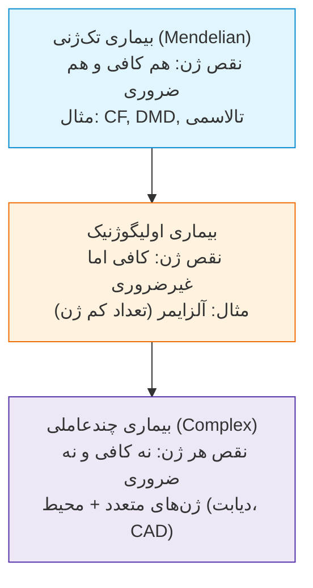

* **طیف ژنتیک-محیط:** **چپ** (*ژنتیک محض*، تالاسمی؛ محیط تعدیل‌کننده است)، **راست** (*محیط محض*، تروما/عفونت؛ ژنتیک تعیین‌کننده مقاومت)، **مرکز** (*کمپلکس چندعاملی*؛ بیش از ۶۰٪ علل ناتوانی و مرگ، شیوع >۱:۱۰۰۰).
* **ترمینولوژی بالینی:**
  * **مادرزادی (Congenital):** تظاهر در بدو تولد.
  * **ژنتیکی (Genetic):** نقص در ژنوم یا کروموزوم.
  * **ارثی (Inherited):** انتقال والد به فرزند.
  * **تک‌گیر (Sporadic):** بدون سابقه قبلی (داون ژنتیکی/مادرزادی است اما ارثی نیست).
  * **فنوکوپی (Phenocopy):** فنوتیپ مشابه صفت ژنتیکی بر اثر عامل محیطی (دیابت یا کری جنینی ناشی از عفونت).
* **صفات پیوسته:** توزیع گوسی در جامعه حاصل *اثر تجمعی (Additive effect)* چند ژن (قد، فشار خون، IQ).
* **صفات ناپیوسته کیفی با آستانه:** *استعداد ابتلا (Liability)* متغیری پیوسته است؛ با تجمع الل‌ها و عبور از خط **آستانه (Threshold)**، بیماری بروز می‌کند.

> [!important] اثر کارتر (Carter Effect) و اصول ۵‌گانه ریسک عود
> * **اثر کارتر:** جنسیتی که بیماری در آن *شیوع کمتری* دارد، **آستانه بالاتری** دارد. ابتلای فردی از جنس کم‌شیوع (پسر در NTD، دختر در تنگی پیلور) نشانه بار ژنتیکی سنگین‌تر خانواده بوده و **ریسک عود در بستگان و فرزندان بعدی را بسیار بالاتر می‌برد**.
> * **اصول ریسک عود چندعاملی:**
>   1. ریسک تجربی (Empirical Risk) بستگان درجه ۱ تقریباً معادل *جذر شیوع جمعیتی است* ($\sqrt{P}$).
>   2. برعکس مندلی، **با افزایش تعداد مبتلایان شجره، ریسک شدیداً جهش می‌یابد** (در شکاف لب و کام: ۰ مبتلا ۰.۱٪، ۱ والد ۳٪، ۲ والد ۳۴٪).
>   3. *شدت نقص با ریسک عود رابطه مستقیم دارد* (شکاف دوطرفه لب و کام ریسک بالاتری از یک‌طرفه دارد).
>   4. با دور شدن درجه خویشاوندی *ریسک به سرعت افت می‌کند* (درجه ۱: ۳.۲٪ ⇦ درجه ۲: ۰.۵٪ ⇦ درجه ۳: ۰.۱٪).
>   5. همخونی (**ازدواج خویشاوندی**) ریسک را افزایش می‌دهد.

---

## ۲. هرتابیلیتی، NTD و شکاف لب/کام

* **Heritability ($h^2$):** نسبت *واریانس ژنتیکی* به واریانس فنوتیپی کل ($h^2 = V_G / V_P$). اسکیزوفرنی ($h^2=85\%$) بیشترین مؤلفه ژنتیکی و نقایص قلبی CHD ($h^2=35\%$) بیشترین مؤلفه محیطی را دارند. تطابق <۱۰۰٪ در دوقلوهای MZ اثبات دخالت محیط است.
* **ریسک نسبی بستگان ($\lambda_r$):** نسبت *شیوع در بستگان* به جامعه. بالاترین مقدار دوقلوی MZ: اتیسم ($\lambda_{MZ}=2000$) و کرون ($\lambda_{MZ}=840$) و ام‌اس ($\lambda_{MZ}=800$).
* **چاقی و CAD:** فرم‌های تک‌ژنی چاقی شامل کمبود لپتین، گیرنده لپتین، PC1 و POMC (همگی AR) و ژن MC4R (الگوی AD)؛ فرم شایع پلی‌ژنیک (>۵۸ ژن، ۳۵٪ واریانس BMI). در CAD حدود ۱۰٪ موارد زیر ۵۰ سال ناشی از FH تک‌ژنی مونوژنیک است.

> [!note] روش‌های نقشه‌یابی در بیماری‌های پیچیده
>   * **Affected Sib-Pair (ASP):** روش بدون مدل (Model-free)؛ ارزیابی تسهیم اللی مارکرها در جفت‌خواهرهای مبتلا نسبت به مقادیر تصادفی (۲۵٪ فاقد الل، ۵۰٪ یک الل، ۲۵٪ دو الل مشترک؛ تسهیم >۵۰٪ نشانه پیوستگی است).
>   * **مطالعات همراهی (Association):** بررسی همبستگی الل با بیماری در سطح جمعیت از طریق نسبت شانس ($OR = ad/bc$).

| شاخص مقایسه‌ای         | نقایص لوله عصبی (NTD)                                                         | شکاف لب با/بدون کام (CL/P)                       |
| :--------------------- | :---------------------------------------------------------------------------- | :----------------------------------------------- |
| **شیوع جمعیتی**        | ۲ تا ۱۰ در ۱۰۰۰ تولد                                                          | ۰.۴ تا ۱.۷ در ۱۰۰۰ تولد                          |
| **پنجره بحرانی**       | روز ۱۴ تا ۲۸ بارداری (هفته ۲-۴)                                               | روز ۳۵ جنینی                                     |
| **ترجیح جنسی و نژادی** | **۲/۳ مؤنث**؛ سفیدپوست > سیاه‌پوست > آسیایی                                   | **۶۰٪ تا ۸۰٪ مذکر**؛ آسیایی > قفقازی > سیاه‌پوست |
| **پیشگیری و مارکر**    | **اسید فولیک** (۰.۴-۱mg عادی، 5mg سابقه‌دار ⇦ کاهش ۷۵٪ ریسک عود)؛ MS-AFP بالا | **جراحی پلاستیک ترمیمی** پس از تولد              |

* **طیف NTD:** **آنانسفالی** (فقدان مخ/جمجمه، ۲/۳ دختر، مرگبار)، **انسفالوسل** (فتق بافت مغز، ۸۰٪ اکسیپیتال، ۵۰٪ هیدروسفالی، ۷۵٪ MR)، **اسپاینا بیفیدا (لومبوساکرال)** (*اوکولتا/باز* با موی نابجا در کمر؛ *آپرتا/بسته* شامل مننگوسل (فتق مننژ + CSF) و میلومننگوسل (طناب نخاعی + پارالایز اندام)). ضایعات بالای L2 ویلچرنشینی دائم، ضایعات زیر S1 راه رفتن مستقل دارند.
* **ژن MTHFR:** پلی‌مورفیسم‌های C677T و A1298C با افت آنزیم، کاهش فولات و تجمع هموسیستئین باعث ناهنجاری‌های عروقی، پره‌اکلامپسی، *ترومبوز شریانی*، شکاف کام/لب، *سقط مکرر*، میگرن، گلوکوم، اسکیزوفرنی و **افزایش دوبرابری ریسک NTD** می‌شوند.

---

## ۳. ژنتیک میتوکندریال (mtDNA)

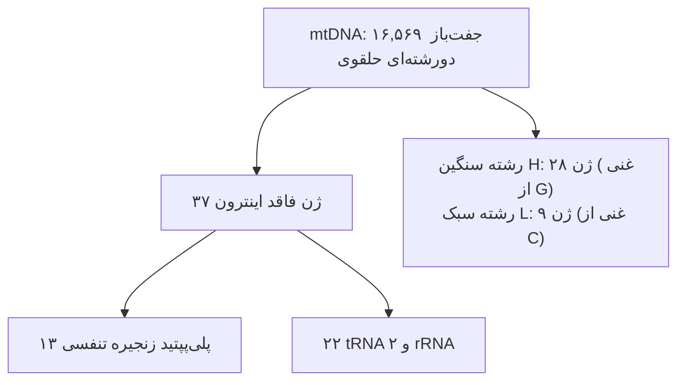

* **ویژگی‌ها:** ۹۳٪ کدکننده (فاقد اینترون و هیستون، متصل به TFAM). همانندسازی اختصاصی با **DNA پلیمراز گاما ($\gamma$)**. کدون‌های غیراستاندارد: AUA = متیونین، TGA = تریپتوفان، AGA/AGG = استاپ. 5-10 کپی در هر میتوکندری. رونویسی پلی‌سیسترونیک بزرگ از هر دو رشته.
* **نرخ جهش:** **۱۰ تا ۱۷ برابر سریع‌تر از ژنوم هسته** (فقدان هیستون، عدم ترمیم کارآمد، مجاورت با رادیکال‌های ROS).
* **وراثت مادری (Maternal):** مادر مبتلا بیماری را به **تمام فرزندان** و پدر مبتلا به **هیچ‌یک** منتقل نمی‌کند (اسپرم حاوی میتوکندری است اما پس از لقاح تخریب می‌شود).
* **هتروپلاسمی و تفکیک همانندسازی:** حضور همزمان mtDNA موتانت و سالم در سلول. توزیع تصادفی حین میتوز سبب نوسان درصد جهش در بافت‌ها شده و **انجام PND را عملاً ناممکن و غیرقابل اعتماد می‌سازد**. بروز علامت مشروط به عبور بار جهش از آستانه (Threshold معمولاً >۶۰-۸۵٪) در ارگان‌های پرمصرف ATP (CNS، قلب، عضله، کلیه) است.

### بیماری‌های شاخص شب امتحان mtDNA
* **LHON (لبر):** کوری ناگهانی بدون درد جوانان؛ جهش در زنجیره انتقال الکترون.
* **NARP:** آتاکسی، نوروپاتی، رتینیت پیگمانتوزا؛ جهش **T8993G** ژن *ATP6*.
* **MELAS:** میوپاتی، آنسفالوپاتی، اسیدوز لاکتیک، حملات شبه‌سکته مغزی؛ جهش در *tRNA لوسین*.
* **MERRF:** صرع میوکلونیک با فیبرهای قرمز تکه‌تکه (Ragged-Red) در بیوپسی عضله؛ جهش **A8344G** در *tRNA لیزین*.
* **سندرم‌های MDS:** تحلیل mtDNA ناشی از جهش ژن‌های هسته‌ای همانندسازی یا استخر نوکلئوتیدی میتوکندری (*POLG*, *POLG2*, *Twinkle*, *TK2*, *DGUOK*, *MPV17*).

---

## ۴. ایمونوژنتیک و سیستم HLA

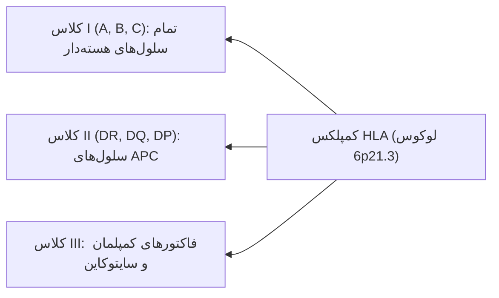

* **پلی‌مورفیسم HLA:** متراکم‌ترین و پلی‌مورفیک‌ترین لوکوس ژنوم (6p21.3). لوکوس HLA-B دارای 111 آلل و HLA-DR دارای 228 آلل.
* **همبستگی آللی بالینی:**
  * **HLA-B27:** اسپوندیلیت آنکیلوزان (ارتباط >۹۰٪).
  * **HLA-DR4:** بیماری سلیاک.
  * **HLA-DR3 / HLA-DR4:** دیابت نوع ۱.
  * **HLA-DR2 / HLA-DR3:** لوپوس (SLE).

### نقایص ایمنی اولیه (PID)
* **SCID (مرکب شدید):** وراثت AR (کمبود آنزیم *ADA*) یا XR. آپلازی **تیموس**، فقدان همزمان **لنفوسیت‌های T و B**، افت فاحش ایمونوگلوبولین‌ها و عفونت‌های مرگبار زودهنگام؛ درمان: پیوند مغز استخوان (BMT) و آنزیم‌درمانی جایگزین.
* **دی‌جرج (DiGeorge):** ریزحذف **22q11**. تریاد هیپوپلازی تیموس (افت T cell) + فقدان پاراتیروئید (تتانی هایپوکلسمیک نوزادی) + نقص ساختاری قلبی خروجی. **سلول‌های B و سطح ایمونوگلوبولین‌ها کاملاً نرمال است**. درمان: پیوند بافت تیموس جنینی.
* **بروتون (XLA):** وراثت XR؛ جهش *BTK*، توقف بلوغ لنفوسیت B در مرحله پیش‌ساز، فقدان پلاسماسل و سقوط ایمونوگلوبولین‌ها (ایمنی T نرمال است). درمان: IVIG دوره‌ای.
* **ویسکوت-آلدریچ (WAS):** وراثت XR (*Xp11*)؛ تریاد اگزما + ترومبوسیتوپنی با پلاکت‌های کوچک + عفونت مکرر.
* **آتاکسی تلانژکتازی (AT):** وراثت AR (ژن *ATM* روی 11q22.3)؛ همراه با افت انتخابی شدید IgA در ۵۰٪-۸۰٪ بیماران.

# جلسه ۱۱: غربالگری ژنتیکی پیش از تولد و نوزادی

## ۱. تمایز غربالگری و تشخیص، شاخص‌ها و منحنی ROC

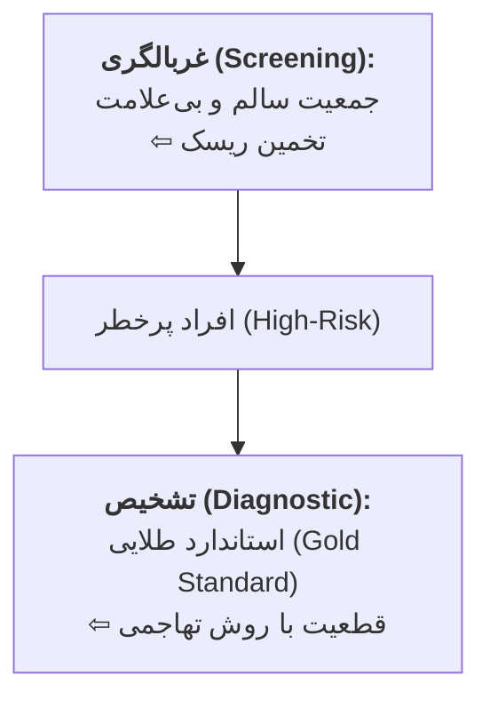

* **حساسیت (Sensitivity):** شناسایی مبتلایان واقعی (کاهش منفی کاذب / FN).
* **ویژگی (Specificity):** شناسایی افراد سالم واقعی (کاهش مثبت کاذب / FP).
* **PPV و NPV:** ارزش اخباری مثبت ($\text{PPV} = \frac{\text{True Positives}}{\text{All Positives}}$) و منفی ($\text{NPV} = \frac{\text{True Negatives}}{\text{All Negatives}}$)؛ به‌شدت وابسته به *شیوع* بیماری در جامعه.
* **تله تستی:** در بیماری‌های مسری (مثل HIV در انتقال خون) یا نیازمند سقط به‌موقع، **منفی کاذب (FN) فاجعه‌بارتر از مثبت کاذب (FP) است**؛ اولویت نخست غربالگری *حداکثر Sensitivity* است.
* **منحنی ROC:** رسم Sensitivity (عمودی) در برابر $1 - \text{Specificity}$ (افقی)؛ تست ایده‌آل نزدیک‌ترین نقطه به گوشه چپ بالا است.
* **۱۲ معیار تست غربالگری ایده‌آل:** دقت بالا (حساسیت/ویژگی بیشینه)، PPV/NPV مطلوب، شیوع بیماری معنادار، اثربخشی هزینه، ایمنی (ارجحیت غیرتهاجمی)، سهولت اجرا، پذیرش عمومی و اخلاقی، تایید مراجع قانونی (FDA/وزارت بهداشت)، تکرارپذیری، پیامد بالینی مثبت، پروتکل پیگیری مدون، آگاهی از تاریخچه طبیعی بیماری.
* **فناوری‌های تست ژنتیک:** مولکولی (بررسی SNV و Indel در DNA/RNA نظیر CFTR و NGS)، سیتوژنتیک (ناهنجاری ماکرو بالای 5-10Mb نظیر کاریوتایپ داون و ترنر)، بیوشیمیایی (سنجش سطح/فعالیت آنزیم و پروتئین نظیر GALT، AFP و تست عرق).
* **تفاوت غربالگری و تشخیص در تالاسمی (تکلیف کلاسی):** غربالگری ارزان در کل جامعه پیش از ازدواج با شاخص‌های CBC ($MCV<80$ و $MCH<27$) و الکتروفورز ($HbA_2>3.5\%$)؛ تشخیص زودهنگام با متد مولکولی تهاجمی CVS در جنین زوج ناقل مینور.

---

## ۲. مارکرهای بیوشیمیایی سرم مادر (سه‌ماهه اول و دوم)

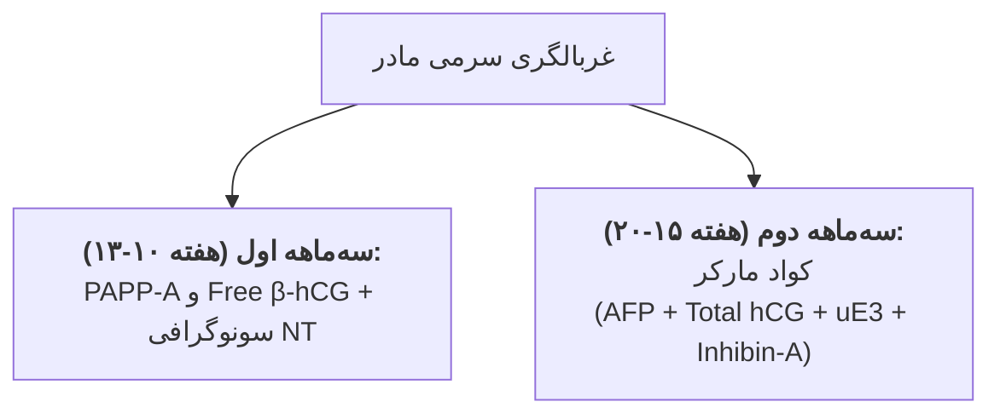

| ناهنجاری جنینی              | AFP          | Total / Free hCG | uE3       | Inhibin-A  | PAPP-A      |
| :-------------------------- | :----------- | :--------------- | :-------- | :--------- | :---------- |
| **داون (تریزومی ۲۱)**       | *کاهش*       | **افزایش**       | *کاهش*    | **افزایش** | *کاهش شدید* |
| **ادوارد (تریزومی ۱۸)**     | *کاهش*       | *کاهش*           | *کاهش*    | *کاهش*     | *کاهش شدید* |
| **نقص لوله عصبی باز (NTD)** | **جهش شدید** | بی‌ارتباط        | بی‌ارتباط | بی‌ارتباط  | بی‌ارتباط   |

> [!important] بیولوژی PAPP-A و سونوگرافی NT
> * **سونوگرافی NT:** ضخامت مایع پشت گردن جنین؛ مقادیر بالای 3.5mm قویاً مطرح‌کننده داون یا نقایص قلبی است.
> * **PAPP-A:** متالوپپتیداز جفتی؛ تجزیه IGF-BP جهت آزادسازی IGF، تهاجم تروفوبلاست، رگ‌زایی جفت، انتقال گلوکز/آمینواسید، تحریک استخوان‌سازی جنین و استتار ایمنی. افت شدید آن *نشانه داون* یا *پیامد نامطلوب بارداری* است.

---

## ۳. تست DNA آزاد غیرتهاجمی (NIPT / NIPS) و گاه‌شمار قانونی

* **مبنا و اهداف:** بررسی *قطعات ریز cffDNA پلاسمای مادر* (منشأ تروفوبلاست) از **هفته ۱۰ بارداری** با توالی‌یابی موازی عظیم NGS جهت کشف تریزومی ۲۱، ۱۸، ۱۳ و آنیوپلوئیدی جنسی (دقت داون >۹۹٪؛ جواب‌دهی <۲ هفته).
* **کسر جنینی (Fetal Fraction):** برای صحت آزمون حداقل **۴٪ تا ۱۰٪** از کل DNA پلاسما باید جنینی باشد.
* **محدودیت‌ها و کنتراندیکاسیون‌ها:** چاقی مفرط مادر (افت FF)، انتقال خون اخیر، بارداری‌های ۳ قلو و بیشتر، عدم امکان شناسایی ریزحذف‌های ساختاری، واژگونی یا موتاسیون تک‌ژنی، مثبت/منفی کاذب بر اثر موزائیسم محدود به جفت (CPM)، تحلیل قل دوقلو (Vanishing Twin) یا بدخیمی مخفی مادر.
* **شواهد دوقلویی:** در دوقلوها حساسیت ۱۰۰٪ و ویژگی ۹۹.۷٪ دارد ولی دقت مضاعف می‌طلبد.
* **خط قرمز بالینی:** NIPT غربالگری است و مثبت شدن آن **هرگز مجوز مستقیم ختم بارداری نیست**؛ تایید قطعی با CVS یا آمنیوسنتز الزامی است. در حضور NT بالای 3.5mm اتلاف وقت با NIPT ممنوع بوده و ارجاع مستقیم به تست تهاجمی الزامی است.

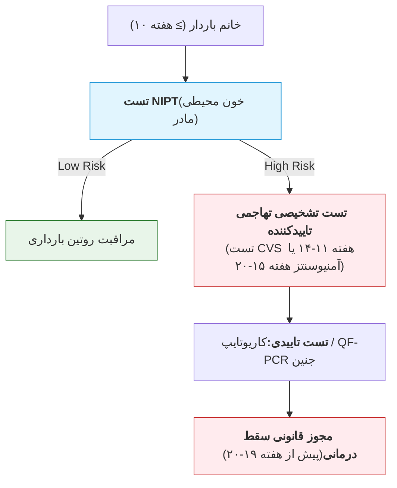


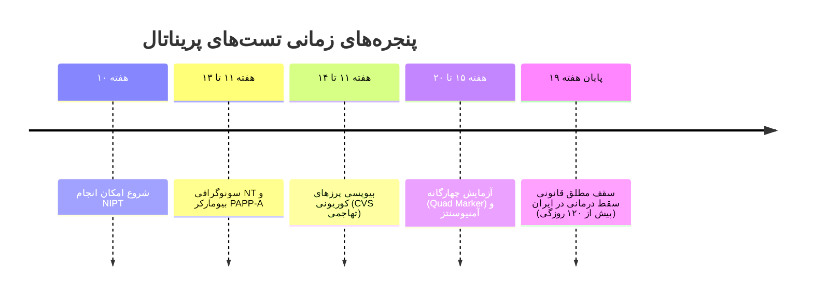
---

## ۴. غربالگری ناقلین و غربالگری نوزادی (NBS)

* **غربالگری ناقلین:** ارزیابی الل‌های جهش‌یافته مغلوب (AR یا XR) در افراد سالم پیش از ازدواج/بارداری؛ به دلیل ثبات ژنوم **تنها یک‌بار در کل عمر** انجام می‌شود. اولویت در ازدواج‌های فامیلی (Consanguinity) جهت تصمیم‌گیری باروری (PGT-M)، آگاهی خویشاوندان و صرفه‌جویی اقتصادی است. در ایران به علت همخونی بالا، **پنل ۲۷۷ ژن اگزوم اختصاصی** بومی طراحی شده است.
* **غربالگری نوزادی (NBS):** خون *پاشنه پا* روی *کاغذ گاتری* در **روز ۲ تا ۳ تولد (۴۸ تا ۷۲ ساعت)**. نمونه‌گیری *زیر ۲۴ ساعت* نیازمند *تکرار حتمی ظرف ۵ روز* است.
* **فناوری MS/MS:** طیف‌سنجی جرمی متوالی جهت سنجش **نسبت جرم به بار ($m/z$)** اسیدهای آمینه و آسیل‌کارنیتین‌ها برای کشف بیش از ۴۰ بیماری متابولیک (IEM). مثبت شدن نیازمند تایید فوری آزمایشگاهی است، اما مداخله درمانی نباید معطل بماند.

| بیماری هدف در NBS           | بیومارکر و روش غربالگری اولیه    | متد تایید قطعی تشخیصی             | مداخله فوری حیاتی               |
| :-------------------------- | :------------------------------- | :-------------------------------- | :------------------------------ |
| **کم‌کاری تیروئید (CH)**    | TSH بالا با ایمونواسی لکه خون    | سنجش سرمی Free T4 و TSH           | تجویز فوری لووتیروکسین          |
| **فنیل‌کتونوری (PKU)**      | افزایش نسبت Phe/Tyr با MS/MS     | HPLC اسیدهای آمینه + ژنتیک PAH    | شیر رژیمی فاقد فنیل‌آلانین      |
| **فاویسم (کمبود G6PD)**     | سنجش کیفی فلورسنتی آنزیم         | سنجش اسپکتروفتومتری کمی G6PD      | منع مصرف باقلا و اکسیدان‌ها     |
| **هایپرپلازی آدرنال (CAH)** | 17-OHP بالا با ایمونواسی         | پروفایل استروئیدی + ژنتیک CYP21A2 | تجویز کورتیکواستروئید           |
| **شربت افرا (MSUD)**        | افزایش اسیدهای شاخه‌دار با MS/MS | HPLC اسیدهای آمینه پلاسما         | رژیم فاقد لوسین/ایزولوسین/والین |
| **گالاکتوزمی**              | تست گاتری و سنجش متابولیت        | اندازه‌گیری فعالیت آنزیم GALT     | قطع فوری شیر مادر (پایه سویا)   |
| **ایمنی مرکب (SCID)**       | سنجش دایره‌های TREC با PCR       | فلوسایتومتری لنفوسیت T و B        | پیوند مغز استخوان (BMT)         |

# جلسه ۱۲: تشخیص ژنتیکی پریناتال (PND) و پیش از لانه‌گزینی (PGD)

> [!important] قاعده زرین بالینی
> تست غربالگری منحصراً **تخمین ریسک (Risk Assessment)** است و مبنای سقط نیست؛ صدور مجوز قانونی خاتمه بارداری صرفاً بر اساس تست تشخیصی تاییدکننده (PND تهاجمی) صادر می‌شود.

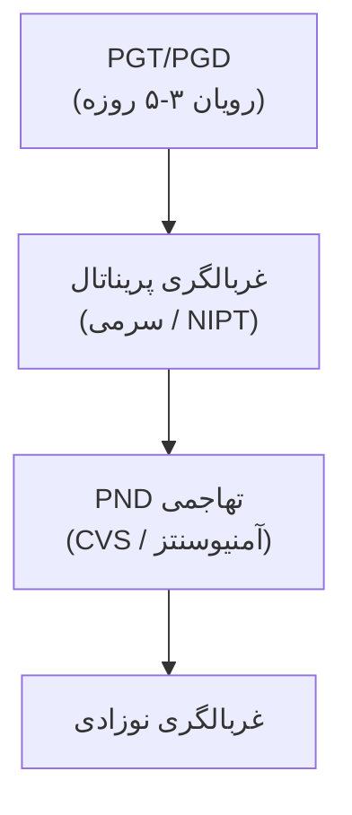

---

## ۱. تشخیص پیش از تولد (PND)

* **تعریف:** آزمایه‌های تهاجمی ژنتیکی/سیتوژنتیکی در بارداری برای تعیین قطعی ابتلا به ناهنجاری در مواردی که امکان مداخله یا مجوز سقط قانونی وجود دارد.
* **اندیکاسیون‌های ۵‌گانه:** سابقه تک‌ژنی والدین ناقل (تالاسمی، SMA، دوشن)، سن مادر بالای ۳۵ سال / سقط مکرر (RSA ≥ ۲)، گزارش پرخطر غربالگری، آنومالی ماژور سونوگرافی (NT بالای 3.5mm یا هایگروما)، پایش اضطراری سلامت جنین.
* **الزامات حیاتی آزمایشگاهی:** ۱) نمونه اندک و لیبل‌گذاری فوری؛ ۲) رد قطعی آلودگی سلول‌های مادری (MCC) با مارکرهای STR؛ ۳) شناسایی قبلی جهش در زوجین پیش از بارداری؛ ۴) تایید نتیجه با دو متد مجزا (مثلاً QF-PCR و کاریوتایپ).
* **محدودیت‌های PND:** ناتوانی در ناهنجاری‌های چندعاملی (اوتیسم، اسکیزوفرنی)، بیماری‌های دیرهنگام (هانتینگتون)، تراتوژن‌ها/عفونت‌ها، و موانع قانونی پس از ولوج روح.

### مقایسه متدهای نمونه‌برداری PND

| روش             | سن طلایی بارداری          | بافت هدف               | ریسک سقط | نکته کلیدی                                                          |
| :-------------- | :------------------------ | :--------------------- | :------- | :------------------------------------------------------------------ |
| **CVS**         | هفته ۱۱ تا ۱۳ (حداکثر ۱۴) | پرزهای کوریونی جفت     | ~۱٪      | بهترین متد برای سقط قانونی زودهنگام؛ ریسک موزائیسم جفتی (CPM)       |
| **آمنیوسنتز**   | هفته ۱۵ تا ۱۸ (حداکثر ۲۰) | سلول‌های مایع آمنیوتیک | ~۰.۵٪    | **استاندارد طلایی**؛ ایمن‌ترین بافت؛ زمان محدود تا ضرب‌الاجل قانونی |
| **کوردوسنتز**   | بالای هفته ۲۰             | خون لنفوسیتی بندناف    | ۱٪ تا ۲٪ | نقایص هماتولوژیک سریع؛ عبور از سقف زمانی سقط قانونی ایران           |
| **بیوپسی بافت** | بعد از هفته ۱۸            | عضله، کبد، پوست        | بالای ۲٪ | بسیار نادر؛ اختصاصی میوپاتی فاقد جهش مشخص یا نقایص آنزیمی کبد       |

---

## ۲. تشخیص ژنتیکی پیش از لانه‌گزینی (PGD / PGT)

ارزیابی ژنتیکی رویان‌های ۳ تا ۵ روزه لقاح آزمایشگاهی (IVF/ICSI) پیش از انتقال به رحم به منظور **حذف کامل سقط درمانی**.
* **انواع:** **PGT-M** (تک‌ژنی)، **PGT-SR** (ساختاری و ترنسلوکاسیون‌ها)، **PGT-A/PGS** (آنیوپلوئیدی و تریزومی‌ها).
* **اندیکاسیون‌ها:** مخالفت اخلاقی/مذهبی با سقط، جابجایی کروموزومی متعادل والدین (RSA > ۳)، انتخاب جنسیت در اختلالات وابسته به X شدید، تطابق بافت‌شناسی (**HLA Typing / Savior Sibling**) جهت درمان پیوند فرزند قبلی.

### مقایسه انواع بیوپسی جنین

| روش | زمان | سلول | مزیت | معایب / محدودیت |
| :--- | :--- | :--- | :--- | :--- |
| **جسم قطبی (PB)** | پس از لقاح | Polar Body ۱ و ۲ | غیرتهاجمی برای رویان | **فقط ژنوم مادر**؛ عدم بررسی سهم پدر و میوز مذکر |
| **بلاستومر** | روز ۳ (۶-۸ سلولی) | ۱ تا ۲ سلول | انتقال جنین تازه | افت توان تکاملی؛ **خطای بالا ناشی از موزائیسم**؛ زمان کمتر از ۲۴ ساعت تا هچینگ |
| **تروفکتودرم (TE)** | **روز ۵ تا ۶ (بلاستوسیست)** | **۵ تا ۱۰ سلول TE** | **استاندارد طلایی**؛ ICM دست‌نخورده؛ حداکثر دقت | الزام به انجماد شیشه‌ای (Vitrification) و انتقال در سیکل بعد |
تله‌های
> [!danger] نکات مهم امتحانی PGD
> * **عدم امکان کاریوتایپ نوری:** به دلیل تک‌سلولی بودن و عدم فاز متافاز؛ جایگزین‌ها: **اینترفیس FISH، Array-CGH و NGS**.
> * **حذف آللی (Allele Dropout - ADO):** عدم تکثیر تصادفی یکی از آلل‌ها در تک‌سلول. در بیماری اتوزوم غالب (AD)، اگر آلل جهش‌یافته دچار ADO شود، رویان مبتلا به غلط «سالم» گزارش شده و منتقل می‌شود! راهکار: بیوپسی چندسلولی TE، آنالیز هاپلوتایپ متصل (STR/SNP) و انجام PND تاییدکننده.
> * **کنترل کیفی:** استفاده از مارکرهای ۱۳‌گانه CODIS STR برای رد آلودگی مادری/خارجی.

---

## ۳. مبانی حقوقی و فقهی سقط درمانی در ایران (قانون جوانی جمعیت)

* **ارکان کمیسیون سقط قانونی (ماده ۵۶):** ۱) قاضی ویژه؛ ۲) پزشک متخصص متعهد؛ ۳) پزشک قانونی.
* **شروط سه‌گانه صدور مجوز:** ۱) حرج قطعی و غیرقابل تحمل مادر؛ ۲) بیماری ژنتیکی قطعی و غیرقابل درمان جنین (با تایید PND)؛ ۳) **سن جنین کمتر از ۴ ماه قمری (۱۲۰ روز سن جنینی / پایان هفته ۱۹ بارداری)** پیش از ولوج روح.
* **نکات حقوقی:** اعتبار مجوز سقط ۱۵ روز است. سونوگرافی و مشاهده قلب یا حرکت دالّ بر ولوج روح نیست. طبق ماده ۵۳، عدم ارجاع مادر به غربالگری تخلف انتظامی نیست.

---
تله‌هایتله‌های
## ۴. مقایسه جامع PND و PGD

| شاخص                    | PND                               | PGD                                   |
| :---------------------- | :-------------------------------- | :------------------------------------ |
| **زمان اقدام**          | هفته ۱۱ تا ۱۸ بارداری (داخل رحمی) | روز ۳ تا ۵ پس از لقاح (درون شیشه)     |
| **سرنوشت رویان بیمار**  | **نیازمند سقط تهاجمی بارداری**    | عدم انتقال به رحم و امحا در آزمایشگاه |
| **روش بارداری**         | **طبیعی (یا کمکی)**               | اجباراً منوط به سیکل IVF / ICSI       |
| **سلول اولیه**          | صدها هزار سلول (CVS/آمنیوسنتز)    | **۵ تا ۱۰ سلول** (یا ۱ سلول)          |
| **ریسک حذف آللی (ADO)** | عملاً صفر                         | **بسیار محتمل (نیازمند کنترل دقیق)**  |

---

## ۵. تحلیل سناریوی بالینی تالاسمی ماژور ($IVS1-110$ پدری / $IVS1-1$ مادری)

* **رویان مبتلا (غیرقابل انتقال):** حامل هر دو جهش $\leftarrow$ تالاسمی ماژور.
* **رویان سالم (اولویت اول انتقال):** هر دو آلل نرمال و فاقد جهش، هاپلوتایپ کاملاً سالم $\leftarrow$ ژنوتیپ سالم قطعی.
* **رویان‌های ناقل (اولویت دوم انتقال):** هتروزیگوت تک‌جهش $\leftarrow$ تالاسمی مینور (فاقد علامت بالینی، ناقل سالم).
* **رویان‌های غیرقابل انتقال:**
  * مشکوک به ADO پدری (تکثیر نشدن آلل مشکوک).
  * Failed Amplification (عدم تکثیر و نقص فنی).
  * ناقل مینور همراه با موزائیسم ۳۰٪ تریزومی ۱۶ (ریسک سقط و ناهنجاری).

---

## ۶. تفکیک مصادیق قانونی PND در برابر PGD

* **بیماری‌های دارای مجوز PND و سقط در ایران (۱۰ مورد شایع):** بتا-تالاسمی ماژور، SMA تیپ ۱ و ۲، دوشن (DMD)، تریزومی‌های ۲۱، ۱۸ و ۱۳، فیبروز سیستیک (CF ماژور)، آنسفالوسل/NTD، هایپرپلازی مادرزادی آدرنال (CAH)، سلول داسی‌شکل، SCID، موکوپلی‌ساکاریدوزها (سندرم هورلر).
* **موارد فاقد مجوز سقط PND و انحصاری PGD (۵ مورد):** سقط مکرر ناشی از جابجایی کروموزومی، غربالگری کلی آنیوپلوئیدی (PGT-A)، بیماری‌های دیرهنگام (مانند هانتینگتون از طریق تست انتخابی رد هاپلوتایپ Exclusion Test)، تعیین جنسیت، انتخاب بافتی جنین جهت نجات فرزند قبلی (HLA Typing).

# جلسه ۱۳: اپی‌ژنتیک و ایمپرینتینگ ژنومی

> [!important] قاعده بنیادین اپی‌ژنتیک
> تغییرات ارث‌پذیر و پایدار بیان ژن و فنوتیپ بدون تغییر توالی نوکلئوتیدی DNA. تشبیه: توالی، حروف کلمات؛ اپی‌ژنتیک، فونت و استایل متن است.

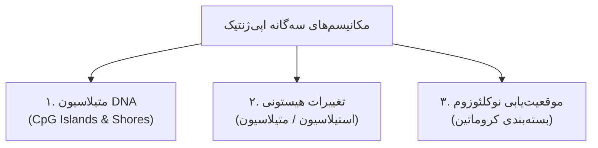

---

## ۱. متیلاسیون DNA و بیوشیمی آن

* **مکانیسم:** انتقال متیل از دهنده **SAM** به **کربن ۵ سیتوزین** در دی‌نوکلئوتیدهای **CpG** و سنتز 5-mC توسط آنزیم‌های DNMT.
* **جزایر و سواحل CpG:**
  * **جزایر (Islands):** طول بالای 200bp با $G+C \ge 50\%$ در پروموتور؛ متیلاسیون آنها رونویسی را خاموش می‌کند.
  * **سواحل (Shores):** فواصل 1kb تا 2kb بالادست؛ دخیل در خاموشی اختصاصی بافتی.
* **خانواده آنزیم‌های DNMT:**
  * **DNMT1:** متیلاسیون نگهدارنده (Maintenance) حین همانندسازی بر اساس رشته والد.
  * **DNMT2:** متیلاسیون RNAهای ناقل (tRNA).
  * **DNMT3a و DNMT3b:** متیلاسیون اولیه جنینی (De novo).
  * **DNMT3L:** پروتئین تنظیمی بدون اثر کاتالیتیک مستقل؛ محرک DNMT3a/b در ایمپرینتینگ گامت‌ها.
* **پیامدهای متیلاسیون:** ممانعت فیزیکی از اتصال فاکتورهای رونویسی، جذب پروتئین‌های MBD (نظیر MeCP2) و القای هتروکروماتین، و استعداد دآمیناسیون خودبه‌خودی (*جهش C به T*).
* **داروی کلیدی:** **5-Azacytidine**؛ آنالوگ سیتوزین و مهارکننده غیرقابل‌برگشت DNMT برای بازفعال‌سازی ژن‌های سرکوبگر تومور.

---

## ۲. هیستون‌ها و ساختار کروماتین

* **نوکلئوزوم:** اکتامر پروتئینی (دو نسخه از H2A, H2B, H3, H4) همراه 147bp رشته DNA و هیستون رابط H1.

### مقایسه یوکروماتین و هتروکروماتین

| شاخص | یوکروماتین (Euchromatin) | هتروکروماتین (Heterochromatin) |
| :--- | :--- | :--- |
| **تراکم فیزیکی** | باز و غیرفشرده (Unpacked) | کاملاً متراکم و فشرده (Packed) |
| **متیلاسیون DNA** | اندک در پروموتور | بالا و هایپرمتیله |
| **استیلاسیون هیستون‌ها** | بالا (توسط HAT) | بسیار اندک (توسط HDAC) |
| **پتانسیل رونویسی** | **فعال بیولوژیک** | **خاموش بیولوژیک** |

* **ساعت اپی‌ژنتیک (Horvath):** سنجش سن زیستی با الگوی متیلاسیون ژنوم. پستان زنان ۱۰ تا ۱۵ سال و معده مردان ۱۰ سال پیرتر از سن تقویمی است.
* **دوقلوهای تک‌تخمی (MZ):** در ۳ سالگی الگوی متیلاسیون یکسان دارند؛ اما در ۵۰ سالگی متأثر از محیط و سبک زندگی، کاملاً متمایز می‌شوند.

---

## ۳. تغییرات اپی‌ژنتیک در بیماری‌ها و سرطان

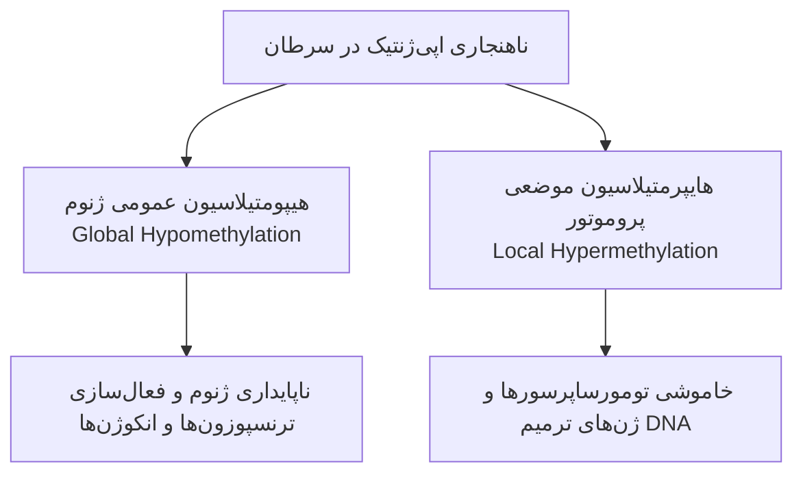

* **نمونه‌های بارز خاموشی ناشی از هایپرمتیلاسیون:**
  * **ترمیم DNA:** ژن‌های *MLH1* (کولون/اندومتر)، *BRCA1* (پستان/تخمدان)، *MGMT* (گلیوما).
  * **کنترل چرخه سلولی:** *p16INK4a*، *RB1*، *TP53*.
* **بیماری‌های ایمنی و نورولوژیک:**
  * **سندرم ICF:** جهش بی‌آلل ژن *DNMT3B* $\leftarrow$ هیپومتیلاسیون سانترومری و نقص ایمنی.
  * **لوپوس (SLE):** هیپومتیلاسیون و اوراکسپرشن سایتوکاین‌ها (*CD11a* و *CD70*).
  * **سندرم ATRX:** نقص متیلاسیون وابسته به X همراه عقب‌ماندگی ذهنی.
  * **آتاکسی فردریش:** تراکم شدید کروماتین در تکرارهای GAA ژن فراتاکسین.

---

## ۴. ایمپرینتینگ ژنومی (Genomic Imprinting)

* **تعریف:** بیان تک‌آللی غیرتصادفی بر پایه **والد انتقال‌دهنده (Parent-of-Origin)** در کمتر از ۲٪ ژن‌های انسان (متمایز از بیان تک‌آللی تصادفی در Ig، TCR و غیرفعال‌سازی کروموزوم X).
* **چرخه پاک‌سازی و بازنویسی (Erasure & Resetting):**
  1. پاک‌سازی کامل حافظه ایمپرینتینگ گذشته در سلول‌های زایای اولیه (PGC).
  2. بازنویسی و تثبیت الگوی پدری (اسپرماتوژنز) یا مادری (اووژنز) متناسب با جنسیت فرد.

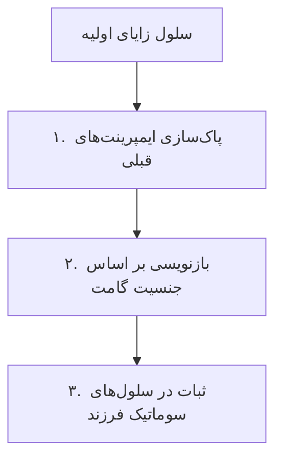

---

## ۵. سندرم‌های پرادر-ویلی (PWS) و آنجلمن (AS) در لوکوس 15q11-q13

* **وضعیت نرمال فیزیولوژیک:**
  * ژن‌های فعال در نسخه پدر: *SNRPN*، *NDN* و *snoRNA* (نسخه مادری خاموش).
  * ژن فعال در نسخه مادر: *UBE3A* (نسخه پدری در سلول‌های مغز خاموش).

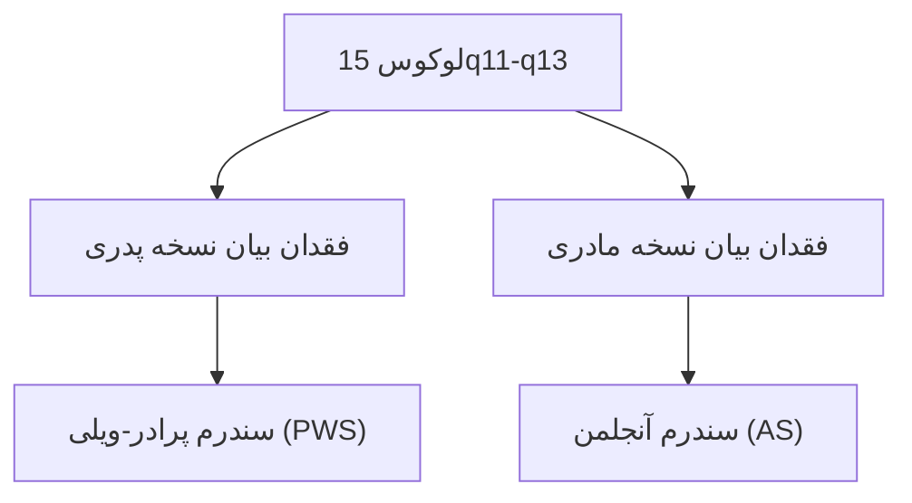

### مقایسه علائم بالینی و نقایص ژنتیکی

| شاخص | پرادر-ویلی (Prader-Willi) | آنجلمن (Angelman) |
| :--- | :--- | :--- |
| **نقص بیولوژیک** | **فقدان بیان آلل پدری** | **فقدان بیان آلل مادری (*UBE3A*)** |
| **شایع‌ترین علت** | ۷۰٪ حذف کروموزومی پدر ($15q11-q13$) | ۷۰٪ حذف کروموزومی مادر ($15q11-q13$) |
| **دومین علت** | ۳۰٪ دی‌زومی تک‌والدی مادری (**Maternal UPD**) | ۱۰٪ جهش ژن مادری *UBE3A* |
| **علل نادر** | نقص مرکز ایمپرینتینگ (<۱٪) | دی‌زومی تک‌والدی پدری (Paternal UPD < ۵٪) |
| **تظاهرات بالینی** | هیپوتونی شدید نوزادی با ضعف مکیدن، سپس **پرخوری سیری‌ناپذیر و چاقی مفرط**، دیابت، هایپوگنادیسم و دست‌وپای کوچک | **فقدان تکلم**، خنده‌های بی‌مورد (**Happy Puppet**)، آتاکسی و لرزش اندام، میکروسفالی و تشنج |

> [!danger] تله امتحانی UPD در برابر Deletion
> * حذف فیزیکی کروموزومی (۷۰٪ موارد) نقص **ژنتیکی** ساختاری است.
> * دی‌زومی تک‌والدی مادری در PWS (۳۰٪ موارد) فاقد نقص ساختاری است؛ هر دو کروموزوم ۱۵ از مادر به ارث رسیده و بیماری صرفاً ناشی از **خاموشی اپی‌ژنتیکی هر دو آلل** مادری است (نقص **اپی‌ژنتیکی** محض).

---

## ۶. اوتیسم (ASD)، مدل MEGDI و درمان‌های نوین

* **شواهد اپی‌ژنتیک در اوتیسم:** مضاعف‌شدگی ناحیه $15q11-q13$ **صرفاً با منشأ مادری** منجر به اوتیسم می‌شود (نسخه دوپلیکه پدری بیماری‌زا نیست).
* **مدل اتیولوژی MEGDI:** برآیند فاکتورهای ترکیبی:
  $$\text{MEGDI} = \text{Mixed Epigenetic, Genetic, De novo, Inherited}$$
* **افق‌های درمانی (Epigenetic Therapy):**
  1. کاربرد توأم مهارکننده‌های DNMT (مانند Azacytidine و Decitabine) و HDACiها (نظیر Vorinostat) جهت بازفعال‌سازی ژن‌های تومورساپرسور.
  2. بازنشانی اپی‌ژنتیک سلول‌های سوماتیک تمایزیافته برای تولید سلول‌های بنیادی پرتوان القایی (iPSC).

# جلسه ۱۴: مهندسی ژنتیک و بیوتکنولوژی

> [!important] زنجیره تبدیل ایده به ثروت
> ایده خام $\leftarrow$ پژوهش $\leftarrow$ تولید علم (Science) $\leftarrow$ فناوری (Technology) $\leftarrow$ تجاری‌سازی $\leftarrow$ **خلق ثروت**. ارزش واقعی بیوتکنولوژی پزشکی، کاربرد صنعتی و اقتصاد دانش‌بنیان آن است.

---

## ۱. کرونولوژی نقاط عطف تاریخی

* **۱۹۶۱ (ژاکوب و مونو):** مدل اپران لک و اثبات تنظیم رونویسی.
* **۱۹۶۸ (ورنر آربر):** کشف آنزیم‌های برش‌گر (Restriction Enzymes).
* **۱۹۷۳ (بویر و کوهن):** نخستین DNA نوترکیب (rDNA) و آغاز عصر مهندسی ژنتیک.
* **۱۹۷۸ (ژننتک):** تولید نخستین انسولین نوترکیب در *E. coli*.
* **۱۹۸۲ (تاییدیه FDA):** ورود اولین داروی نوترکیب (انسولین هومولین) به بازار دارویی.
* **۱۹۸۳ (کری مالیس):** ابداع واکنش زنجیره‌ای پلیمراز (PCR).
* **۱۹۸۷:** ارگانیسم یخ‌منفی (*P. syringae*)؛ نخستین تراریخته رهاشده در محیط.
* **۱۹۹۴:** گوجه‌فرنگی Flavr Savr؛ نخستین محصول خوراکی تراریخته تجاری.
* **۱۹۹۶ (یان ویلموت):** کلون‌سازی گوسفند دالی از سلول سوماتیک تمایزیافته.
* **۲۰۰۳:** پایان پروژه نقشه‌برداری ژنوم انسان (HGP) پس از ۱۳ سال.
* **۲۰۰۹ (داروی ATryn):** آنتی‌ترومبین نوترکیب از شیر بز تراریخته (اولین تاییدیه فرآورده حیوانی FDA).
* **۲۰۱۰ (کریگ ونتر):** سنتز نخستین ژنوم باکتریایی مصنوعی (*JCVI-syn1.0*).

---

## ۲. اصول PCR و الکتروفورز

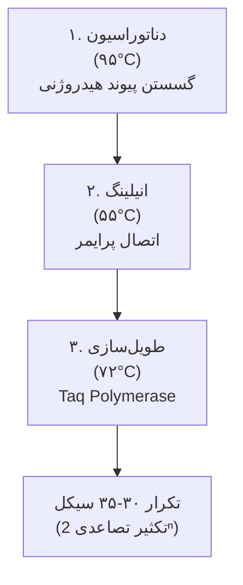

* **الکتروفورز ژل آگاروز:** مهاجرت اسکلت پلی‌آنیونی DNA (بار منفی) به سمت آند (قطب مثبت). قطعات کوچک‌تر سریع‌تر و دورتر حرکت می‌کنند.
* **تشخیص کووید-19:** استخراج RNA ویروسی $\leftarrow$ رونویسی معکوس (تولید cDNA) $\leftarrow$ انجام Real-Time PCR (سنجش ژن‌های N ،E و RdRp با رصد فلوروسنت بالاتر از حد آستانه Ct).

---

## ۳. مارکرهای سرمی، پروب و تکنیک FISH

* **تکنیک FISH:** قدرت تفکیک بسیار بالا (100kb در برابر 5-10Mb کاریوتایپ نوری)؛ بر پایه هیبریداسیون پروب نشان‌دار تک‌رشته‌ای. انواع پروب: تلومریک، سانترومریک (شمارش آنیوپلوئیدی اینترفازی) و اختصاصی ژن (Locus-Specific).

### آنزیم‌های شاخص سرمی در پایش تخریب بافتی

| آنزیم | مخفف | منشأ عمده | آسیب بالینی شاخص |
| :--- | :--- | :--- | :--- |
| **کراتین کیناز** | CK | قلب و عضله مخطط | انفارکتوس حاد میوکارد (اوج در روز اول)، دیستروفی دوشن |
| **آسپارتات ترانس‌آمیناز** | AST | کبد و قلب | هپاتیت حاد، نارسایی و سیروز کبد، آسیب میوکارد |
| **آلانین ترانس‌آمیناز** | ALT | منحصراً پارانشیم کبد | مارکر اختصاصی هپاتیت، کبد چرب و نکروز سلولی کبد |
| **لاکتات دهیدروژناز** | LDH | گلبول قرمز، قلب، کبد | دیررس‌ترین مارکر سکته قلبی، همولیز، نکروز بافتی |
| **آلکالین فسفاتاز** | ALP | مجاری صفراوی و استخوان | راشیتیسم، ایکتر انسدادی صفراوی، متاستاز استخوانی |
| **آمیلاز و لیپاز** | AMY / LPS | آسینوس‌های پانکراس | پانکراتیت حاد و مزمن |
| **اسید فسفاتاز** | ACP | اپیتلیوم پروستات | کارسینوم پروستات با متاستاز استخوانی |

---

## ۴. نسل‌های واکسن و آنتی‌بادی‌های مونوکلونال (mAbs)

* **انواع واکسن:** ۱) زنده ضعیف‌شده (سابین، سرخک، BCG)؛ ۲) کشته‌شده (سالک، سینوفارم)؛ ۳) ساب‌یونیت/نوترکیب (هپاتیت B، پاپیلوگارد/گارداسیل با خودآرایی پروتئین L1 به ذرات شبه‌ویروس VLP فاقد انکوژن)؛ ۴) ژنتیکی (mRNA فایزر و مدرنا).
* **آنتی‌بادی‌های مونوکلونال (بخش اتصالی تک‌زنجیره scFv):** بازار جهانی بالای ۲۰۰ میلیارد دلار. پرفروش‌ترین داروی تاریخ: **Humira (Adalimumab)** ضد TNF-alpha با فروش سالانه ۲۰ میلیارد دلار.
* **نمونه‌های شاخص درمانی:** Pembrolizumab (ضد PD-1)، Trastuzumab (ضد HER2 پستان)، Bevacizumab (ضد VEGF آنژیوژنز)، Rituximab (ضد CD20 لنفوسیت B).

---

## ۵. سلول‌های بنیادی (Stem Cells)

| ویژگی | سلول جنینی (ESC) | سلول پرتوان القایی (iPSC) | سلول بالغ (Adult) |
| :--- | :--- | :--- | :--- |
| **منشأ** | توده داخلی (ICM) بلاستوسیست | سلول تمایزیافته پوست/مخاط | مغز استخوان، بندناف، چربی |
| **پتانسیل** | **پرتوان (Pluripotent)** | **پرتوان (Pluripotent)** | **چندتوان (Multipotent)** |
| **مزایا/چالش** | چالش اخلاقی تخریب جنین؛ رد پیوند | **فاقد رد پیوند (کاملاً اتولوگ)**؛ فاقد منع اخلاقی | استخراج اتولوگ ایمن، پتانسیل تکثیر محدودتر |

---

## ۶. مدل‌های حیوانی تراریخته (ناک‌این) و ناک‌اوت

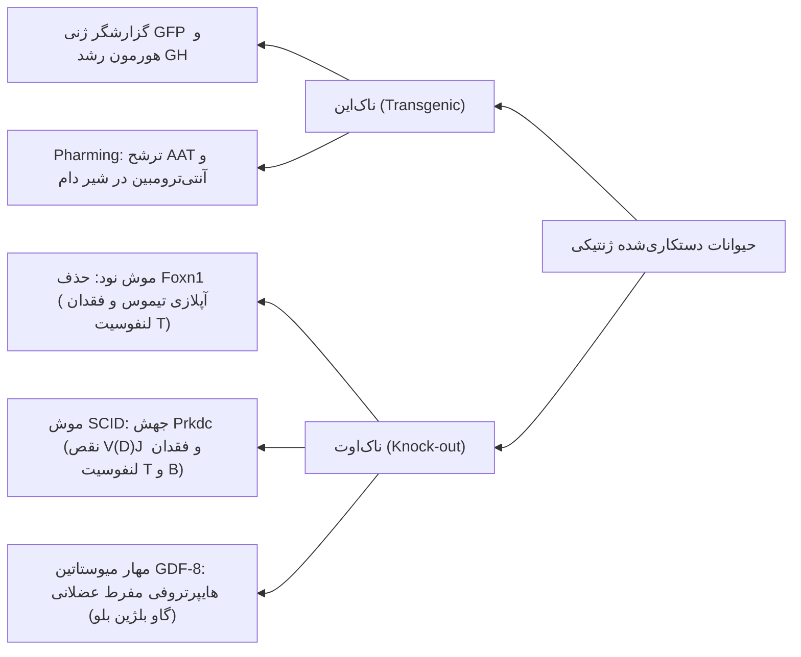

---

## ۷. بیوتکنولوژی صنعتی، غذایی و آنزیم‌ها

* **تفاوت اصطلاحی GMO در برابر LMO:** مفهوم GMO فراگیر است (موجود زنده یا فرآورده/روغن مشتق از آن)، اما LMO منحصراً موجود زنده‌ای است که طبق پروتکل کارتاهنا **توانایی تکثیر و انتقال ژنتیکی** در طبیعت دارد (نظیر بذر زنده).
* **نمونه‌های بارز گیاهی:** محصولات Bt حاوی ژن Cry باکتری، گوجه‌فرنگی Flavr Savr با خاموشی ژن پلی‌گالاکتوروناز، برنج طلایی غنی از بتاکاروتن.
* **آنزیم‌های صنعتی:**
  * **رنین (کیموزین):** دلمه کردن شیر در پنیرسازی (بیان ژن گاوی در میکروارگانیسم GRAS).
  * **تردکننده‌های گوشت:** هیدرولیز کلاژن توسط پروتئازهای پاپائین (خربزه درختی)، بروملین (آناناس) و فیسین (انجیر).
  * **ایزومراز:** تبدیل گلوکوز به شربت پرفروکتوز (HFCS).
  * **سایر:** لاکتاز (شیر رژیمی)، پروتئاز و لیپاز (شوینده‌ها و صنایع لبنی).

---

## ۸. مباحث تکمیلی: کیت‌های تشخیصی و فناوری کریسپر (تکالیف)

> [!tip] نکات امتحانی کیت‌های تشخیصی و کریسپر
> * **کیت‌های عمومی (الایزا):** مزیت در تولید نامحدود، ایمن و ارزان آنتی‌ژن بدون کشت پاتوژن خطرناک؛ چالش در نقص گلیکوزیلاسیون در میزبان‌های پروکاریوتی.
> * **کیت‌های فوق‌تخصصی (NGS Panels / MLPA):** مزیت در خوانش صدها اگزون و کشف جهش‌های ساب‌میکروسکوپی؛ چالش در هزینه، تحلیل بیوانفورماتیک، پدیده ADO و واریانت‌های مبهم (VUS).
> * **کریسپر در تشخیص فوق‌سریع (SHERLOCK و DETECTR):** مبتنی بر فعالیت **برش جانبی غیرانتخابی (Collateral Cleavage)** آنزیم‌های Cas12 و Cas13 پس از شناسایی توالی تارگت؛ شناسایی فوق‌حساس و هم‌دما (Isothermal) ویروس‌ها یا جهش‌ها بر نوار کاغذی (مشابه بیبی‌چک) در زیر ۳۰ دقیقه بدون نیاز به ترموسایکلر.
> * **اخلاق‌زیستی:** اصل اعتدال و عدالت زیستی؛ ممنوعیت ویرایش ژنتیکی رده زایا (Germline Editing) و کلون‌سازی انسان، و ضرورت حفظ محرمانگی ژنوم.

# جلسه ۱۵: ژن‌درمانی، ویرایش ژنوم و CRISPR

> [!important] قاعده بنیادین مداخله ژنتیکی
> ژن‌درمانی بر ۴ استراتژی استوار است: ۱) **افزودن ژن (Augmentation)**؛ ۲) **ویرایش مستقیم ژنوم (Editing)**؛ ۳) **خاموش‌سازی آلل پاتوژن (Silencing)**؛ ۴) **ژن‌درمانی خودکشی (Suicide)**. ژن‌درمانی سوماتیک مجاز، ولی رده زایا (Germline) در سراسر جهان ممنوع است.

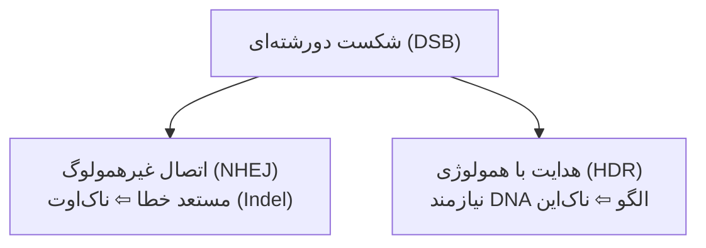

---

## ۱. مقایسه تطبیقی نسل‌های ویرایش ژنوم

| پلتفرم | سازوکار شناسایی | دُمین کاتالیتیک برش | ویژگی بارز امتحانی |
| :--- | :--- | :--- | :--- |
| **مگانوکلئاز** | برهم‌کنش پروتئین-DNA (۱۲-۴۰ باز) | ساختار درونی آنزیم | طراحی و مهندسی بسیار دشوار |
| **ZFN** | پروتئین-DNA (آرایه‌های انگشت روی برای تریپلت‌ها) | دایمر اندونوکلئاز **FokI** | پرهزینه و نیازمند مهندسی پروتئین پیچیده |
| **TALEN** | پروتئین-DNA (دمین TALE برای تک‌بازها) | دایمر اندونوکلئاز **FokI** | نیازمند سنتز سازه‌های بسیار طویل |
| **CRISPR-Cas9** | **هیبریداسیون RNA به DNA (با sgRNA بیست‌بازی)** | دمین‌های درونی **HNH** و **RuvC** | **ارزان، فوق‌سریع، با قابلیت Multiplexing بالا** |

---

## ۲. بیولوژی سیستم CRISPR-Cas9 و اشکال مهندسی‌شده

* **اجزای عملکردی:** کمپلکس sgRNA (حاوی ۲۰ باز اختصاصی هدایتگر + اسکفولد) با Cas9.
* **الزام توالی PAM:** شناسایی موتیف $5'\text{-NGG-}3'$ توسط دُمین PI در SpCas9 الزامی است؛ بدون PAM برشی رخ نمی‌دهد. برش ۳ نوکلئوتید بالادست PAM رخ داده و انتهای صاف (Blunt-end) می‌سازد.
* **دُمین‌های برش:** دُمین **HNH** رشته مکمل sgRNA و دُمین **RuvC** رشته غیرمکمل را برش می‌زند.
* **واریانت‌های مهندسی‌شده:**
  * **Cas9n (Nickase):** جهش غیرفعال‌کننده D10A یا H840A؛ ایجاد شکست تک‌رشته‌ای (Nick)؛ استفاده از جفت‌نیکاز خطای آف‌تارگت را به صفر نزدیک می‌کند.
  * **dCas9 (Dead Cas9):** فاقد توان برش؛ حامل موتیف‌های تنظیمی: **CRISPRa** (اتصال به VP64 جهت فعال‌سازی رونویسی) و **CRISPRi** (اتصال به KRAB جهت خاموشی رونویسی بدون شکست DNA).
  * **Base & Prime Editing:** تبدیل مستقیم بازها ($C \rightarrow T$ یا $A \rightarrow G$) بدون نیاز به برش دورشته‌ای یا DNA دونر.
* **تارگت درمانی تالاسمی (Casgevy / کارآزمایی ایران):** ناک‌اوت انسر ژن **BCL11A** یا ژن **KLF1** $\rightarrow$ رفع سرکوب و فعال‌سازی مجدد سنتز زنجیره گاما-گلوبین جنینی ($\gamma$) و افزایش **HbF ($\alpha_2\gamma_2$)** $\rightarrow$ قطع نیاز به تزریق خون.

---

## ۳. مقایسه ناقلین ویروسی (Viral Vectors)

| ویژگی عملکردی | رتروویروس (Retrovirus) | لنتی‌ویروس (Lentivirus) | آدنوویروس (Adenovirus) | ویروس مرتبط با آدنو (AAV) |
| :--- | :--- | :--- | :--- | :--- |
| **ژنوم ناقل** | RNA تک‌رشته‌ای | RNA تک‌رشته‌ای | dsDNA خطی | ssDNA |
| **ظرفیت بار (Cargo)** | حدود 8kb | حدود 8kb | **بسیار بالا (۸ تا ۳۶kb)** | **بسیار محدود (<4.7kb)** |
| **الحاق به ژنوم** | **پایدار (تمایل به پروموتور)** | **پایدار (درون ژن)** | **اپی‌زومال (غیرالحاقی)** | **عمدتاً اپی‌زومال (>۹۰٪)** |
| **سلول هدف** | **منحصراً در حال تقسیم** | مقسم و نامقسم | طیف وسیع (اپیتلیال) | تمایزیافته (عضله، عصب) |
| **ایمونوژنیسیته** | پایین | پایین | **فوق‌العاده شدید و خشن** | **بسیار ناچیز و ایمن** |
| **کاربرد شاخص** | اولین ژن‌درمانی (ADA) | سلول‌درمانی CAR-T | واکسن‌ها، Gendicine | لوکستورنا، زولژنسما |

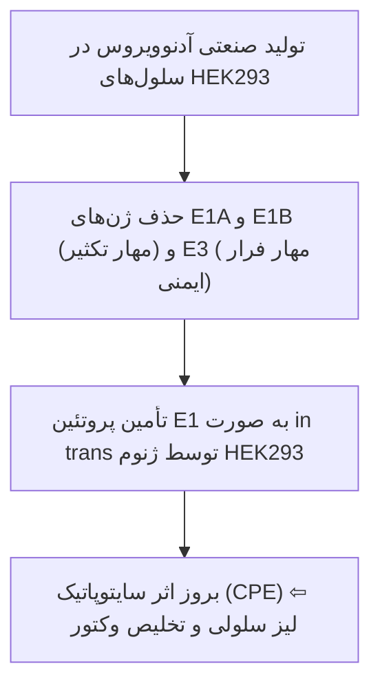

---

## ۴. کارآزمایی‌های تاریخی، وقایع کشنده و ژن‌درمانی خودکشی

* **نقاط عطف بالینی:** ۱) ۱۹۹۰: نخستین ژن‌درمانی موفق در ADA-SCID با رتروویروس؛ ۲) ۲۰۰۳: تأیید داروی **Gendicine** (آدنوویروس حامل TP53) در چین؛ ۳) ۲۰۱۲: داروی Glybera در اروپا؛ ۴) ۲۰۱۷: داروی **Luxturna** (AAV2 حامل RPE65 در شبکیه) و CAR-T سل؛ ۵) ۲۰۲۳: تأیید داروی **Casgevy** مبتنی بر CRISPR.
* **فاجعه جسی گلسینگر (۱۹۹۹):** بیمار ۱۸ ساله دچار نقص OTCD؛ تزریق دوز بالای آدنوویروس به کبد منجر به طوفان سایتوکینی، شوک آنافیلاکتیک، DIC و نارسایی چندارگانی (MODS) شد $\rightarrow$ اثبات خطر شوک سیستمیک آدنوویروس.
* **لوسمی در کارآزمایی X-SCID فرانسه (۲۰۰۳):** الحاق تصادفی گاما-رتروویروس در مجاورت پروموتور انکوژن **LMO2** به دلیل پروموتور قوی LTR منجر به لوسمی سلول T در کودکان شد $\rightarrow$ اثبات پدیده **موتاژنز الحاقی (Insertional Mutagenesis)**.
* **ژن‌درمانی خودکشی (Suicide Gene Therapy):** انتقال ژن **HSV-tk** به تومور (گلیوبلاستوما) + تجویز پیش‌داروی غیرسمی **گان‌سیکلوویر (GCV)**؛ تبدیل به متابولیت سمی مهارکننده همانندسازی؛ انتشار سم به سلول‌های مجاور از طریق Gap Junctions موسوم به **اثر رهگذر (Bystander Effect)**.

---

## ۵. چالش‌های فنی و افق‌های آینده ژن‌درمانی

* **سد اصلی:** انتقال هدفمند اسید نوکلئیک باردار از غشای لیپیدی و منافذ هسته بدون تخریب اندوزومی یا تحریک کشنده ایمنی.
* **چالش‌های کریسپر:** ۱) برش‌های ناخواسته (**Off-Target**) ناشی از عدم تطابق ۱ تا ۳ بازی؛ ۲) مصونیت ایمنی پیشین جامعه به پروتئین SpCas9 باکتریایی؛ ۳) هزینه سرسام‌آور (میلیون دلاری).
* **مهندسی هدفمند (Pseudotyping):** تغییر اسیدهای آمینه دُمین Knob فیبر آدنوویروس یا کپسید AAV جهت اتصال اختصاصی به مارکرهای توموری (مانند HER2 یا PSMA) به جای گیرنده طبیعی CAR برای نابودی متاستازها بدون سمیت کبدی.
# جلسه ۱۶: ژنتیک مولکولی و تنظیم بیان ژن

> [!important] هسته مرکزی ژنتیک پزشکی
> برهم‌کنش ۳ حوزه: ۱) **Genomics** (توالی و ساختار ۶Gb ژنوم دیپلوئید)؛ ۲) **Biochemistry & Cell Biology** (همانندسازی، رونویسی، ترجمه و PTM)؛ ۳) **Human Genetics** (شجره‌نامه و الگوهای وراثت مندلی).

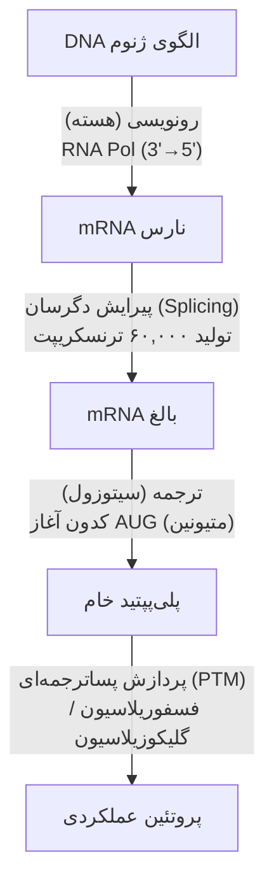

---

## ۱. آمار طلایی آناتومی ژنوم و ترمینولوژی

* **ژنوم انسان:** حاوی ۶ میلیارد جفت‌باز ($6\text{ Gb}$) در سلول‌های دیپلوئید ($2n=46$) و ۳ میلیارد ($3\text{ Gb}$) در سلول هاپلوئید.
* **تعداد و ابعاد ژن‌ها:** ۲۰ تا ۲۳ هزار ژن عملکردی کدکننده پروتئین (میانگین ۲۲,۰۰۰). میانگین طول هر ژن $14\text{ kb}$ (بزرگ‌ترین ژن: *دیستروفین* با $2.4\text{ Mb}$).
* **پیرایش دگرسان (Alternative Splicing):** در بالای ۶۰٪ ژن‌ها؛ تولید متوسط ۲.۶ رونوشت به ازای هر ژن (سنتز حدود ۶۰,۰۰۰ ترنسکریپت متمایز). سهم DNA غیرکدکننده: ۹۵٪ تا ۹۸٪ ژنوم.
* **واحدهای ژنتیکی:** $1\text{ Mb} = 1000\text{ kb} \approx 1\text{ cM}$ (معادل ۱٪ احتمال نوترکیبی و کراسینگ‌اور در مرحله پاکیتن پروفاز ۱ میوز).
* **مادرزادی (Congenital) در برابر ژنتیکی (Genetic):**
  * *مادرزادی:* حضور در بدو تولد (لزوماً ژنتیکی نیست؛ مانند تراتوژن‌ها یا سندرم سرخجه).
  * *ژنتیکی:* منشأ جهش DNA (لزوماً مادرزادی نیست؛ دارای شروع دیررس مانند هانتینگتون).
* **لوکوس و هاپلوتایپ:** لوکوس یعنی آدرس فیزیکی ژن (نظیر $4p16$). هاپلوتایپ یعنی بسته‌ای از آلل‌های متصل روی **یک کروموزوم واحد** که در میوز تفکیک نشده و با هم به ارث می‌رسند.

### مقایسه واریانت‌ها بر اساس فراوانی جمعیت

| نوع واریانت | تواتر در جامعه (Frequency) | نقش بالینی و فنوتیپی |
| :--- | :--- | :--- |
| **Wild-type (نوع وحشی)** | غالب جامعه ($>99\%$) | نسخه طبیعی با فنوتیپ کاملاً سالم |
| **Mutant (جهش‌یافته)** | نادر (معمولاً $<1\%$) | تغییر دائمی نوکلئوتیدی و بروز بیماری ژنتیکی |
| **Polymorphism (پلی‌مورفیسم)** | **شایع ($\ge 1\%$ جمعیت)** | تنوع طبیعی ژنتیکی جمعیت فاقد بیماری‌زایی مستقیم |
| **Rare variant (واریانت نادر)** | کم‌تکرار ($<1\%$ جمعیت$) | تنوع فردی خنثی و فاقد پاتولوژی بالینی |

---

## ۲. کلاسترهای ژنی و سوئیچینگ نموی هموگلوبین

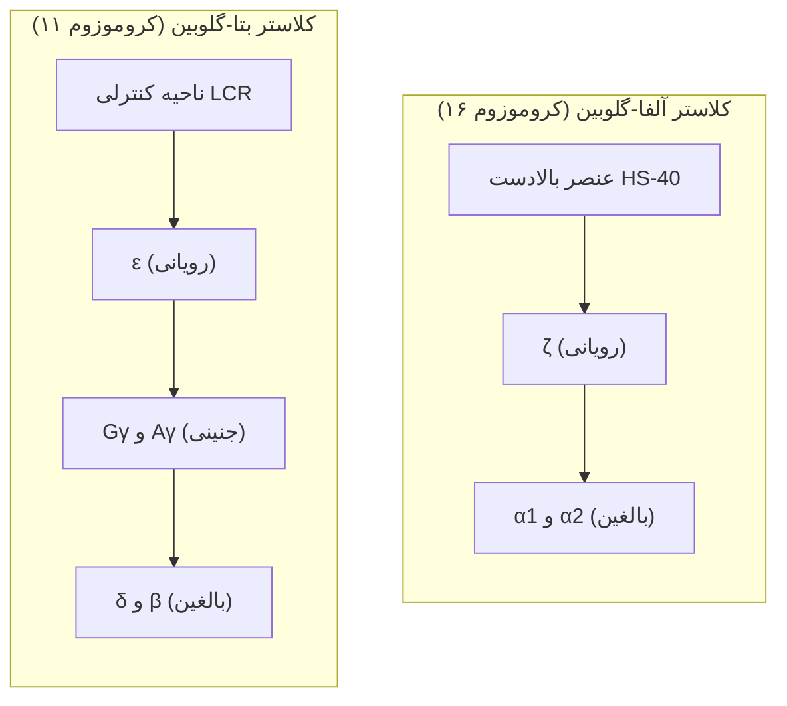

* **سوئیچینگ گلوبین‌ها:** ژن‌های گلوبین هم‌راستای زمان نمو آرایش یافته‌اند؛ کلاستر آلفا تحت فرمان سایت بسیار حساس **HS-40** بر کروموزوم ۱۶ و کلاستر بتا تحت کنترل هماهنگ‌کننده بالادست **LCR** بر کروموزوم ۱۱ بیان می‌شوند.

---

## ۳. بیوشیمی پایداری DNA و تله جهش‌های C به T

* **پیوندهای مکمل:** پیوند آدنین-تیمین با **۲ پیوند هیدروژنی** ($A=T$) و سیتوزین-گوانین با **۳ پیوند هیدروژنی** ($G \equiv C$). محتوای بالاتر GC موجب پایداری ترمودینامیکی فوق‌العاده DNA (امکان تعیین توالی فسیل‌های باستانی نئاندرتال) می‌شود.

> [!danger] تله فوق‌العاده امتحانی: منشأ دو سوم اسنیپ‌ها ($C \rightarrow T$)
> * در ژنوم انسان بیش از ۱۰ میلیون SNP وجود دارد (یک اسنیپ در هر ۱۰۰ تا ۳۰۰ باز).
> * **۶۶٪ از کل اسنیپ‌ها ناشی از جانشینی سیتوزین به تیمین ($C \rightarrow T$) هستند.**
> * **مکانیسم:** متیلاسیون سیتوزین در جزایر CpG به 5-متیل‌سیتوزین $\rightarrow$ **دآمیناسیون خودبه‌خودی (Deamination)** و از دست رفتن آمین $\rightarrow$ تبدیل مستقیم به **تیمین (T)**.

---

## ۴. مقایسه فرآیندهای همانندسازی، رونویسی و ترجمه

| شاخص مولکولی | همانندسازی DNA (Replication) | رونویسی (Transcription) | ترجمه (Translation) |
| :--- | :--- | :--- | :--- |
| **زمان چرخه سلولی** | منحصراً فاز S اینترفاز | تمام اینترفاز (G1, S, G2) | تمام اینترفاز در سیتوپلاسم |
| **آنزیم کلیدی** | DNA Polymerase | RNA Polymerase | ریبوزوم و پپتیدیل ترانسفراز |
| **رشته الگو** | هر دو رشته DNA (۵ به ۳ و ۳ به ۵) | **منحصراً رشته آنتی‌سنس (۳ به ۵)** | رشته mRNA بالغ (۵ به ۳) |
| **محصول نهایی** | دو مولکول دو رشته‌ای نیمه‌حفاظت‌شده | مولکول تک‌رشته‌ای pre-mRNA | زنجیره پلی‌پپتیدی خطی |
| **پرایمر و سیگنال** | نیازمند پرایمر موقت RNA (توسط Primase) | نیازمند پروموتور و TATA box (فاقد پرایمر) | کدون آغاز **AUG** (متیونین) |
| **سیگنال پایان** | تلاقی چنگال‌ها و تلومر | توالی پلی‌آدنیلاسیون (Terminator) | کدون‌های پایان (**UAA, UAG, UGA**) |

* **رشته پیشرو و پیرو در همانندسازی:** رشته پیشرو پیوسته در جهت $5' \rightarrow 3'$ ساخته می‌شود؛ رشته پیرو ناپیوسته به شکل قطعات **اوکازاکی** سنتز و توسط **DNA Ligase** به هم متصل می‌گردد.
* **رشته سنس در برابر آنتی‌سنس:** رشته سنس ($5' \rightarrow 3'$) کدی مشابه mRNA دارد (با جایگزینی U به جای T)؛ اما RNA پلیمراز روی رشته مکمل آنتی‌سنس ($3' \rightarrow 5'$) حرکت می‌کند.

---

## ۵. دگرگونی‌های پساترجمه‌ای پروتئین (PTMs)

پلی‌پپتید خطی برای کسب صورت‌بندی سه‌بعدی و فعالیت زیستی نیازمند PTM است:
1. **فسفوریلاسیون (Phosphorylation):** اتصال فسفات توسط کینازها به آمینواسیدهای سرین، ترئونین و تیروزین جهت فعال/خاموش‌سازی عملکرد.
2. **گلیکوزیلاسیون (Glycosylation):** اتصال الیگوساکاریدها در شبکه آندوپلاسمی و دستگاه گلژی جهت تثبیت تاخوردگی، حلالیت و نشاندن گیرنده‌های غشایی.
3. **هیدروکسیلاسیون (Hydroxylation):** افزودن گروه OH به باقی‌مانده‌های پرولین و لیزین (تثبیت مارپیچ سه‌گانه تروپوکلاژن).
4. **متیلاسیون (Methylation):** افزودن متیل به لیزین و آرژینین (به‌ویژه در دم هیستون‌ها و تنظیم تراکم کروماتین).

# جلسه ۱۷: ژنتیک سرطان و سندروم‌های ارثی

> [!important] قاعده بنیادین اتیولوژی سرطان
> بیش از ۹۰٪ سرطان‌ها اسپورادیک (سوماتیک) و تنها ۵٪ تا ۱۰٪ ارثی (ژرم‌لاین) هستند. تومورزایی محصول انباشت جهش‌های پیش‌برنده (Driver) و فرار از آپوپتوز است. افراد سیگاری دارای تلومر کوتاه بیشترین ریسک بدخیمی را دارند.

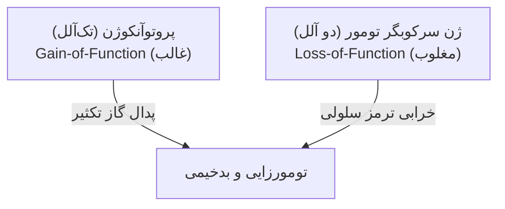

---

## ۱. آنکوژن‌ها در برابر ژن‌های مهارکننده تومور (TSGs)

| شاخص مولکولی | پروتوآنکوژن‌ها / آنکوژن‌ها | ژن‌های بازدارنده تومور (TSGs) |
| :--- | :--- | :--- |
| **نوع جهش** | افزایش و کسب عملکرد (**Gain-of-Function**) | کاهش و از دست رفتن عملکرد (**Loss-of-Function**) |
| **رفتار در سطح سلولی** | **غالب (Dominant)**؛ جهش تک‌آلل کافی است | **مغلوب (Recessive)**؛ نیازمند غیرفعال‌سازی هر دو آلل |
| **اثر بیولوژیک** | تحریک مهارنشدنی میتوژنز و بقا (پدال گاز) | مهار چرخه سلولی و القای آپوپتوز (پدال ترمز) |
| **فرضیه دو ضربه نادسن** | صدق نمی‌کند | **صدق می‌کند (Knudson's 2-Hit Hypothesis)** |

### مکانیسم‌های سه‌گانه فعال‌سازی آنکوژن‌ها
1. **تشکیل پروتئین فیوژن/کایمریک:** ترنسلوکاسیون متقابل $t(9;22)$ و تشکیل **کروموزوم فیلادلفیا (BCR-ABL)** در CML با فعالیت تیروزین‌کینازی دائمی (مهار دارویی اختصاصی با **ایماتینیب / Gleevec**).
2. **ربایش پروموتور (Promoter Hijacking):** ترنسلوکاسیون متقابل $t(8;14)$ در **لنفوم بورکیت**؛ قرارگیری ژن فاکتور رونویسی *MYC* در مجاورت پروموتور قدرتمند *IgH*.
3. **فزون‌سازی ژنی (Amplification):** تکثیر کپی‌های DNA نظیر تقویت ژن گیرنده **HER2 / ERBB2** در ۲۰٪ سرطان‌های پستان (تارگت داروی **تراستوزومب / هرسپتین**) و تقویت ژن **MYCN** در ۳۰٪ نوروبلاستومای اطفال.

> [!tip] استثنای اثر غالب منفی در ژن TP53
> پروتئین p53 برای اثرگذاری نیازمند تشکیل **تترامر** است؛ لذا جهش در یک آلل منفرد می‌تواند با مهار کل تترامر چهارگانه، اثر **غالب منفی (Dominant-Negative)** و فنوتیپ شبه‌غالب ایجاد کند.

---

## ۲. سندروم‌های ارثی تومور و فرضیه دو ضربه نادسن

* **رتینوبلاستوما (فرضیه دو ضربه):**
  * *فرم فامیلیال:* ضربه اول ژرم‌لاین در تمام سلول‌ها به ارث رسیده؛ ضربه دوم سوماتیک (غالباً پدیده **LOH / از دست رفتن هتروزیگوسیتی**) $\rightarrow$ تومور **زودرس، دوطرفه و چندکانونی**.
  * *فرم اسپورادیک:* وقوع دو ضربه سوماتیک مستقل در یک سلول نادر است $\rightarrow$ تومور **دیرهنگام، یک‌طرفه و تک‌کانونی**.

### جدول مقایسه‌ای سندروم‌های ارثی شاخص

| سندروم | ژن و لوکوس | مکانیسم پاتولوژی پایه | تظاهرات بالینی شاخص |
| :--- | :--- | :--- | :--- |
| **FAP** | *APC* ($5q21$) | اختلال در تخریب بتاکاتنین مسیر Wnt | هزاران پولیپ روده در نوجوانی، نفوذ ۱۰۰٪ سرطان کولورکتال در غیاب کولکتومی |
| **HBOC** | *BRCA1* ($17q21$)<br>*BRCA2* ($13q12$) | نقص در نوترکیبی همولوگ (HRR) ترمیم شکست دورشته‌ای (DSB) | سرطان زودرس پستان، تخمدان، پانکراس و پروستات؛ حساسیت به مهارکننده PARP |
| **لینچ (HNPCC)** | *MLH1*, *MSH2*<br>*MSH6*, *PMS2* | نقص در ترمیم عدم تطابق بازها (MMR) و لغزش پلیمراز | سرطان کولورکتال غیرپولیپوزی (سمت راست)، آندومتر و معده؛ همراه با ناپایداری ریزماهواره (MSI) |
| **لی-فرامنی (LFS)** | *TP53* ($17p13$) | اختلال ایست چرخه سلولی در G1/S و نقص آپوپتوز | سارکوم‌های متعدد، سرطان پستان جوانان، تومورهای مغز، لوکمی و کورتکس آدرنال |

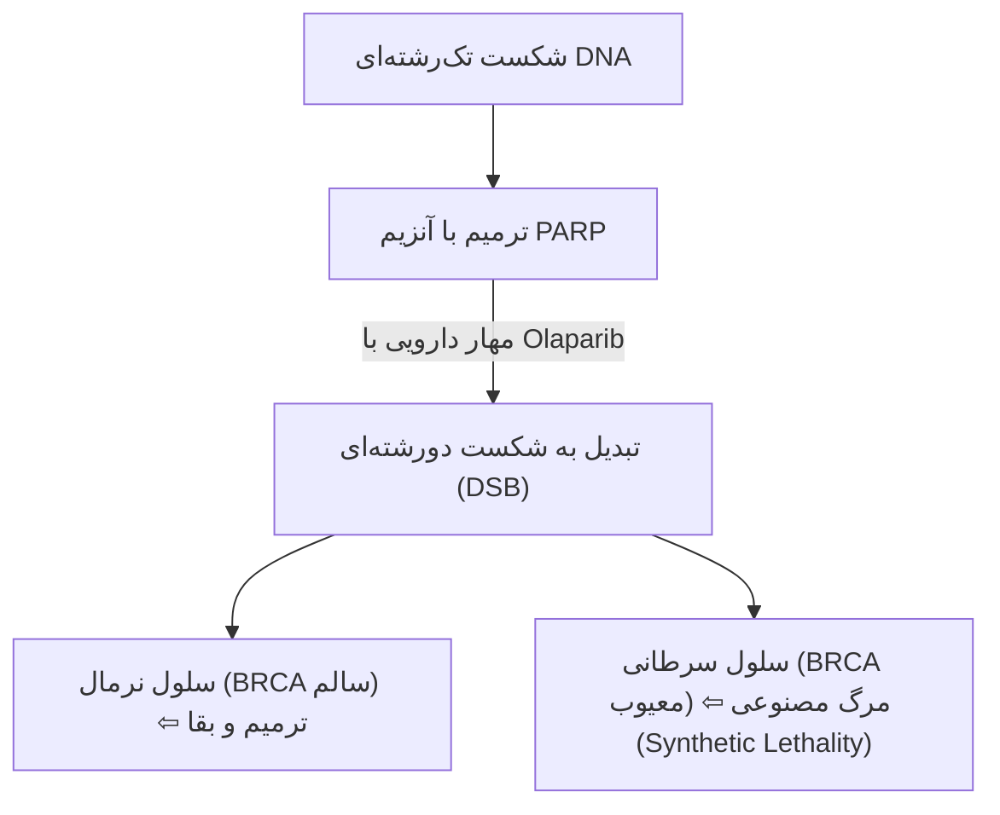

> [!danger] تله امتحانی افتراق سندروم لینچ از فرم اسپورادیک
> عدم بیان MLH1 در تومور می‌تواند ناشی از **هایپرمتیلاسیون پروموتور** در فرم اسپورادیک باشد. جهت افتراق:
> * **جهش BRAF V600E:** اختصاصی موارد **اسپورادیک** بوده و احتمال سندروم لینچ ارثی را تقریباً منتفی می‌کند.
> * ریزماهواره تکراری ژن سرکوبگر **TGFBR2** مستعد لغزش پلیمراز و جهش شیفت چارچوب در نقص سیستم MMR است.

---

## ۳. ناپایداری ژنومی، تلومراز و نشانگرهای مولکولی نوین

* **سطوح ناپایداری ژنومی:** ۱) مولکولی (جهش‌های تک‌نوکلئوتیدی KRAS)؛ ۲) ژنومی (ناپایداری ریزماهواره MSI)؛ ۳) اپی‌ژنتیک/کروماتین (هایپرمتیلاسیون پروموتور)؛ ۴) کروموزومی (ناهنجاری سانتروزوم و دوک‌های چندقطبی میتوز که به آنیوپلوئیدی و تتراپلوئیدی ختم می‌شوند).
* **تلومر و تلومراز:** تکرارهای $TTAGGG$ به طول 10-15kb با دم تک‌رشته‌ای ۱۵۰ تا ۲۰۰ نوکلئوتیدی در انتها؛ فعال‌سازی مجدد ترنسکریپتاز معکوس تلومراز سبب نامیرایی سلولی و تسهیل پتانسیل متاستاز می‌شود.
* **لیونیزاسیون:** خاموشی تصادفی یکی از دو کروموزوم X در مرحله ۸ سلولی با میانجی‌گری لncRNA ژن **XIST** جهت جبران دوزاژ ژنی.

### بیوپسی مایع (Liquid Biopsy) و ایمونوانکولوژی

```mermaid
flowchart TD
    Tumor["تومور اولیه / عود"] --> Blood["ورود به پلاسما:<br>ctDNA و CTC"]
    Blood --> Test["آنالیز NGS"]
    Test --> Res1["سنجش پاسخ/مقاومت به درمان ماه‌ها قبل از تصویربرداری"]
    Test --> Res2["کشف امضای جهشی Signature 3 (نقص HRR/BRCAness)"]
```

* **بار جهشی تومور (TMB):** تومورهای دچار نقص ترمیم MMR جهش‌های فراوانی انباشته کرده و نئوآنتی‌ژن‌های زیادی می‌سازند؛ لذا بالاترین پاسخ را به مهارکننده‌های چک‌پوینت ایمنی نظیر **پمبرولیزومب (Pembrolizumab / Keytruda)** نشان می‌دهند.
* **ستون‌های درمانی:** جراحی، رادیو/شیمی‌درمانی، هورمون‌درمانی، پیوند مغز استخوان و ایمونوتراپی (CAR-T و آنتی‌بادی‌های چک‌پوینت).
