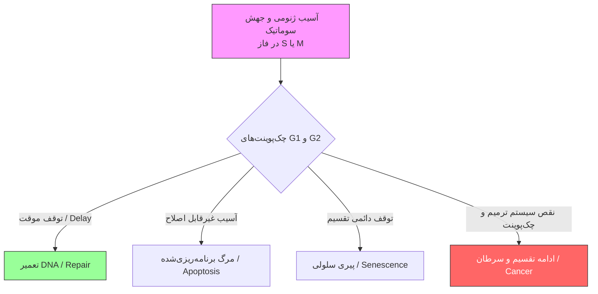
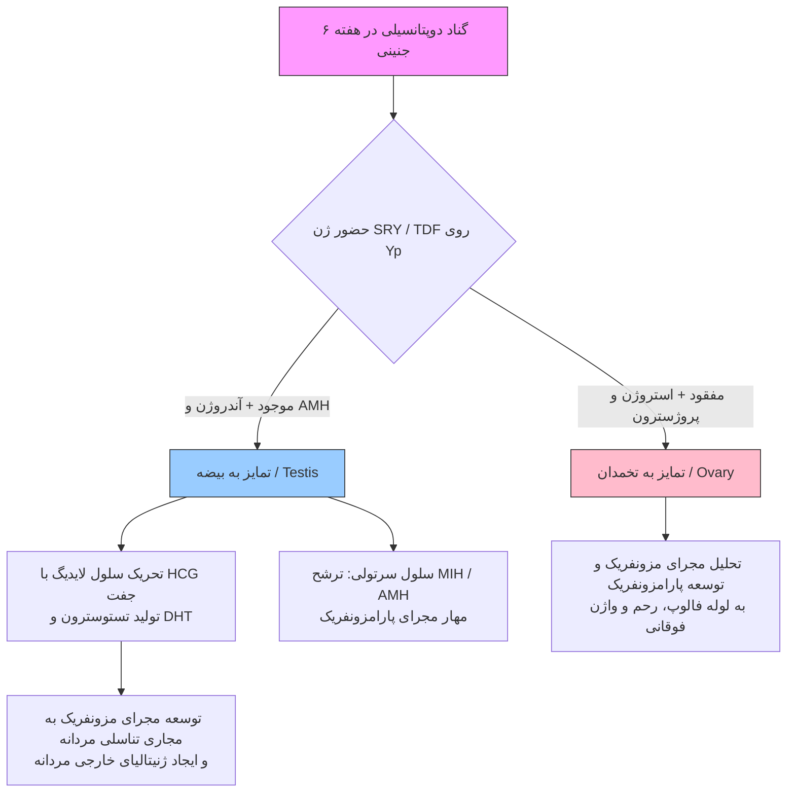
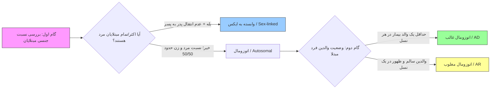

# ۱. مقدمه، تاریخچه، سرطان و تعاریف پایه ژنتیک پزشکی

> [!info] تعریف ژنتیک در برابر ژنتیک پزشکی
> - **ژنتیک (Genetics):** علم پایه (*Science*) و زیرشاخه زیست‌شناسی؛ مطالعه ژن‌ها، وراثت، تنوع ژنتیکی، ساختار DNA و بازهای A, T, C, G. مسیر جهانی: تحقیقات ⇦ تولید علم (*Science*) ⇦ فناوری (*Technology*) ⇦ تجاری‌سازی و خلق ثروت.
> - **ژنتیک پزشکی (Medical Genetics):** کاربرد (*Application*) اصول ژنتیک در طبابت بالینی (پیشگیری، تشخیص، درمان، فارماکوژنومیکس، نوتری‌ژنومیکس، پزشکی قانونی، مشاوره ژنتیک). هر ماده حاوی محتوای ژنومیک (DNA و RNA) در بدن ⇦ هدف تشخیصی، درمانی یا پیشگیری (مثل ساخت واکسن کرونا).

### تاریخچه و تکامل ژنتیک و تعیین توالی (Sequencing)
1. **۱۸۵۹ (داروین):** کتاب *منشأ گونه‌ها*؛ تکامل بر پایه انتخاب طبیعی (نیازمند اصل وراثت).
2. **۱۸۶۶ (مندل):** قوانین پایه وراثت با هیبریداسیون گیاهان (پایه مشاوره ژنتیک؛ نادیده گرفته‌شده تا ۱۹۰۰).
3. **۱۸۷۱ (میشر):** جداسازی اسید نوکلئیک (*Nucleic Acid*) از سلول‌های چرک (*Pus cells*).
4. **۱۹۰۰ (کورنس، دوریس، چرماک):** کشف مجدد قوانین مندل.
5. **۱۹۰۲ (گارود):** کشف پایه ژنتیکی **آلکاپتونوریا**؛ آغاز تمرکز بر ژنتیک انسانی (*Human Genetics*).
6. **۱۹۰۴ (بیتسون):** کشف پیوستگی ژنی (*Linkage*) و ابداع واژه **ژنتیک**.
7. **۱۹۱۰ (مورگان):** اثبات قرارگیری ژن‌ها روی کروموزوم‌ها و انتقال صفات فنوتیپی (چشم سفید جهش‌یافته در برابر قرمز وحشی، فرم بال) با مدل مگس سرکه (*Drosophila melanogaster*).
8. **۱۹۱۸ (فیشر):** آغاز ژنتیک کمی (*Quantitative*)؛ تفکیک واریانس فنوتیپی به دو جزء ژنتیکی و محیطی.
9. **۱۹۲۶ (مولر):** اثبات القای جهش (*Mutation*) با اشعه ایکس (X-ray).
10. **۱۹۴۴ (ایوری، مک‌لود، مک‌کارتی):** اثبات نقش DNA به‌عنوان ماده وراثتی با ترانسفورماسیون باکتری‌ها.
11. **۱۹۵۳ (واتسون و کریک):** کشف ساختار مارپیچ دوگانه (نردبان) DNA و نحوه همانندسازی آن.
12. **۱۹۶۶ (نیرنبرگ):** رمزگشایی کد ژنتیکی (هر ۳ باز DNA = ۱ اسید آمینه).
13. **۱۹۷۷ (فردریک سنگر):** ابداع **تعیین توالی سنگر (Sanger Sequencing)** (برنده ۲ جایزه نوبل). مکانیسم: قطعه‌قطعه کردن DNA ⇦ کلونینگ در وکتور پلازمیدی ⇦ واکنش حلقوی با افزودن نوکلئوتیدهای **دی‌داکسی (ddNTPs)** فاقد گروه لازم جهت ادامه زنجیره ⇦ توقف ساخت DNA. شناسایی قطعات با الکتروفورز مویین (*Capillary*) بر اساس لیبل رادیواکتیو (قدیم) یا تگ رنگی فلورسنت (جدید). محدودیت: خوانش تک‌به‌تک حداکثر **۸۰۰ نوکلئوتید**.
14. **۲۰۰۳ (پروژه ژنوم انسان - HGP):** تعیین توالی کل ژنوم انسان طی **۱۳-۱۵ سال** با هزینه **چند میلیارد دلار** توسط کنسرسیوم جهانی.
15. **۲۰۱۵ تاکنون (تعیین توالی نسل جدید - NGS):** خوانش موازی و همزمان میلیاردها قطعه ریز ژنوم طی **چند ساعت** با هزینه **~۱۰۰۰ دلار**. تکامل دستگاه‌ها از سایز بزرگ (*HiSeq*, *MiSeq*, *Ion Proton*, *GS-FLX*, *GridION*, *PromethION*) تا ابعاد جیبی و موبایلی (*MinION* با وزن ۸۷ گرم و *SmidgION*). *اهمیت بیوانفورماتیک:* رشد تصاعد هندسی داده‌های NGS ⇦ نیازمند تحلیل بیوانفورماتیکی.

### ساختار ژنوم، بیان ژن و مدل‌های آزمایشگاهی
- **مسیر بیان ژن (Central Dogma):** ژنوم (DNA هسته) ⇦ رونویسی (*Transcription*) به RNA ⇦ پیرایش (*Splicing*: حذف اینترون و اتصال اگزون؛ قابلیت **Alternative Splicing** جهت تولید پروتئین‌های متنوع از ۱ ژن واحد) ⇦ خروج mRNA به سیتوپلاسم ⇦ ترجمه (*Translation*) به پروتئین ⇦ تغییرات پس از ترجمه (*Post-translational modification*) ⇦ عملکرد (*Function*) یا بروز صفت (*Trait/Phenotype*).
- **اجزای ساختاری ژن:** نواحی تنظیمی بالادست (*Upstream*)، پروموتور، جعبه TATA، ناحیه 5'UTR، کدون آغاز (**AUG**)، اگزون‌ها و اینترون‌ها، کدون پایان (*Stop codon*)، ناحیه 3'UTR، دم پلی‌آ (PolyA Tail)، افزاینده (*Enhancers*)، خاموش‌کننده (*Silencers*) و نواحی کنترل لوکوس (*LCR*).
- **ویژگی‌های ژنوم انسان:** حاوی 3.3×10⁹ نوکلئوتید؛ **۷۵٪** عدم رونویسی؛ **۵۰٪** توالی تکراری (*Repetitive DNA*)؛ تنها **۲-۳٪** کدکننده پروتئین؛ حاوی **۲۰-۳۰ هزار ژن** (در مقایسه: نماتود *C. elegans* با <۱۰۰۰ سلول دارای ۱۹ هزار ژن).
- **تنوع انسانی و پزشکی فردمحور:** تشابه **۹۹.۹٪** ژنوم تمام انسان‌ها (خروج ~۱۰۰ هزار انسان از آفریقا در <۱۵۰ هزار سال پیش). تنها ۰.۱٪ تفاوت (**~۳ میلیون نوکلئوتید**) ⇦ عامل تفاوت قیافه، استعداد بیماری و پاسخ به دارو و غذا (پایه **فارماکوژنتیک** و **پزشکی شخصی‌شده / Personalized Medicine**).
- **مدل‌های تحقیقاتی ژنتیک:** عدم امکان بررسی مستقیم اولیه روی انسان ⇦ استفاده از باکتری، مخمر (*Yeast*)، نماتود (*C. elegans*)، مگس سرکه (*Drosophila*)، قورباغه (*Xenopus*)، موش و میمون.
- **حوزه‌های نوین و پول‌ساز:** مهندسی ژنتیک، بیوتکنولوژی، بیوانفورماتیک و *Lab on chip*. کاربرد PCR و کلونینگ (تولید واکسن آنفولانزا با ترکیب ژن‌های HA و NA سوش ۱ با ۶ ژن سوش ۲ در پلازمید و کشت در سلول حیوانی).
- **درمان‌های ژنتیکی:** 1. ویرایش ژنوم با **CRISPR-Cas** (انقلاب ژن‌درمانی؛ تغییر فنوتیپ ⇦ تغییر ژنوتایپ ⇦ شناخت ژنوم با NGS و دستکاری با CRISPR). 2. درمان جایگزینی آنزیم (**ERT**) در بیماری‌های متابولیک: **گوشه (Gaucher)**، **فابری (Fabry)**، **موکوپلی‌ساکاریدوز (MPS)** و **ذخیره‌ای گلیکوژن تیپ دو (GSD II / پومپه)**.

### ژنتیک سرطان و چرخه سلولی
- **ماهیت سرطان:** تغییرات ژنتیکی تجمعی در سلول ⇦ خروج تکثیر از کنترل (*Out of control*).
- **مقایسه تکثیر بافت‌ها:** تکثیر بالای مغز استخوان، پوست، ریه و لوله گوارش ⇦ شیوع بالای سرطان (لوکمی، ریه، معده، روده). **بیضه (Testis)** با وجود تکثیر بسیار بالا (تولید اسپرم)، به‌علت سیستم کنترلی و ترمیمی (*Repair*) فوق‌پیشرفته، دارای کمترین آمار سرطان (*Germ cell tumor* نادر).

- **انواع جهش در سرطان:** 1. **زایا (Germline):** به ارث رسیده از والدین، موجود در **تمام سلول‌های بدن**، ⇧ ریسک ابتلا. 2. **سوماتیک (Somatic):** اکتسابی در طول عمر (حین تقسیم سلولی یا اثر محیط مثل UV)، موجود **فقط در سلول‌های تومور**، غیرقابل انتقال به نسل بعد.
- **بیماری گزرودرما پیگمنتوزوم (Xeroderma Pigmentosum - XP):** وراثت **اتوزومال مغلوب (AR)**؛ نقص سیستم **ترمیم DNA (DNA Repair)** در برابر آسیب اشعه UV (خورشید و مهتابی) ⇦ سرطان شدید پوستی و مرگ (لقب: *فرزندان شب / Children of the Night*). شیوع: **۱/۲۵۰,۰۰۰** تولد زنده (در ایران با ۱ میلیون تولد سالانه = ۴ مورد/سال).
- **تعادل ژنی در چرخه سلولی (امت وسط):**
  - **سیگنال‌های حرکت (Go Signals):** انکوژن‌ها (*Oncogenes* مثل *EGFR*, *HER2/ERBB2*, *KRAS*)، میتوژن‌ها، سایکلین‌ها (*Cyclins*) و کینازهای وابسته به سایکلین (*CDKs*) ⇦ پیشبرد تقسیم (ضروری در دوران جنینی و ترمیم جراحات).
  - **سیگنال‌های توقف (Stop Signals):** ژن‌های سرکوبگر تومور (*Tumor Suppressors* مثل *p53/TP53*, *pRb/RB1*, *BRCA1/2*, *ARF*)، مهارکننده‌های کیناز (*CKIs*)، تماس سلول-سلول و تمایز نهایی.
  - *مکانیسم سرطان:* غلبه انکوپروتئین‌ها بر تومورساپرسورها ⇦ سوئیچ متابولیک ⇦ رشد نامحدود.
- **مدل دو ضربه نادسون در رتینوبلاستوما (Retinoblastoma):** تومور بدخیم شبکیه. ممانعت پروتئین *pRb* از ورود زودرس سلول به فاز S (توسط فاکتور *E2F*). ژن *RB1* اتوزومال است (کفایت ۱ آلل سالم جهت کنترل چرخه).
  - *فرم ارثی (Germline):* ضربه اول (M₁) ارثی از والد (هتروزیگوت در تمام سلول‌ها) + ضربه دوم (M₂) جهش سوماتیک در شبکیه ⇦ از کار افتادن هر دو آلل و بروز تومور.
  - *فرم غیرارثی (Somatic):* رخداد هر دو ضربه (M₁ و M₂) به‌صورت سوماتیک در ۱ سلول شبکیه.

> [!note] اصطلاح‌شناسی پایه (Terminology)
> - **ژنوتایپ (Genotype):** ساختار و ترکیب ژنتیکی موجود زنده.
> - **فنوتیپ (Phenotype):** نمود ظاهری و قابل مشاهده ژنوتایپ (شکل فیزیکی یا علائم بالینی).
> - **لوکوس (Locus):** جایگاه و آدرس مشخص ژن روی کروموزوم.
> - **آلل (Allele):** فرم‌های جایگزین و مختلف یک ژن در یک لوکوس مشخص.
> - **موتاسیون (Mutation):** تغییر نادر و بیماری‌زا (*Pathological*) در ماده ژنتیکی.
> - **پلی‌مورفیسم (Polymorphism):** تغییر شایع ماده ژنتیکی در **≥۱٪ جامعه**؛ غیربیماری‌زا (عامل تفاوت رنگ چشم و مو).
> - **هموزیگوت (Homozygote):** دارای ۲ آلل یکسان در یک لوکوس (هر دو سالم یا هر دو بیمار).
> - **هتروزیگوت (Heterozygote):** دارای ۲ آلل متفاوت در یک لوکوس.
> - **همی‌زیگوت (Hemizygote):** داشتن تنها ۱ کپی از ژن (مردان برای اکثر ژن‌های کروموزوم X و Y).
> - **صفت غالب (Dominant):** بروز فنوتیپ در حالت هتروزیگوت (عدم کفایت ۱ آلل سالم برای تولید پروتئین؛ نیاز بدن به محصول هر دو آلل؛ *Haploinsufficiency*).
> - **صفت مغلوب (Recessive):** پنهان ماندن صفت در حالت هتروزیگوت (کفایت ۱ آلل سالم جهت تولید پروتئین کافی).
> - **ارثی (Hereditary):** مشتق از والدین. | **فامیلیال (Familial):** منتقل‌شونده در گامت‌ها طی نسل‌ها.
> - **مادرزادی (Congenital):** موجود در بدو تولد. **تله امتحانی:** هر بیماری مادرزادی الزاماً ژنتیکی نیست (مثل سیفلیس مادرزادی و توکسوپلاسموز) و هر بیماری ژنتیکی هم مادرزادی نیست (مثل بیماری هانتینگتون با بروز در دهه ۳ و ۴ زندگی).

---

# ۲. سیتوژنتیک بالینی، کاریوتایپ و ناهنجاری‌های عددی کروموزوم‌ها

### کلیات طبقه‌بندی بیماری‌های ژنتیکی و سیتوژنتیک
- **سه دسته اصلی بیماری‌های ژنتیکی:**
  1. **کروموزومی:** حذف، اضافه یا جابه‌جایی (*Translocation*) قطعات بزرگ کروموزومی؛ **شایع اما کم‌تنوع** (۱۰۰-۶۰۰ نوع در منابع؛ علت تفاوت عدد ۱۰۰ و ۶۰۰: شمارش ریزحذف‌های تک‌ژنی جزو تک‌ژنی‌ها در برخی کتب). در مجموع **شایع‌تر از بیماری‌های تک‌ژنی**.
  2. **تک‌ژنی (مندلی):** جهش در نواحی کدکننده (اگزون؛ تغییر عملکرد پروتئین) یا تنظیمی (*Regulatory*؛ تغییر میزان بیان). **بسیار متنوع اما نادر** (**~۱۸,۰۰۰** بیماری؛ درگیری **۱٪** جامعه با وجود والدین سالم). کاریوتایپ بی‌فایده است.
  3. **چندعاملی (Multifactorial):** تقابل چندین ژن و محیط (دیابت، فشار خون، سرطان‌ها)؛ بیشترین شیوع در بزرگسالی (برخلاف اوج کروموزومی در دوره جنینی/تولد و تک‌ژنی در کودکی/نوزادی).
- **ساختار کروموزوم:** کروموزوم نخ تسبیح حامل ژن‌ها نیست، بلکه خودِ DNA به شدت فشرده (*Compact*) است (قابل مشاهده زیر میکروسکوپ فقط در فاز تقسیم میتوز و میوز). کشف تعداد **۴۶ کروموزوم** انسان در سال **۱۹۵۶** (تصور قبلی: ۴۸ عدد): ۴۴ اتوزوم + ۲ جنسی. بازوی کوتاه = **p**، بازوی بلند = **q**.
- **اهمیت بالینی سیتوژنتیک:** مسئول **۵۰٪ سقط‌های سه‌ماهه اول**، ریسک **۲٪** در بارداری‌های >۳۵ سال، و شیوع در **۱٪ کل تولدهای زنده**.
- **آمار سقط خودبه‌خودی (Spontaneous Abortion) و مرده‌زایی (Stillbirth - بعد از ماه ۴-۵ / >۲۰ هفته و وزن >۵۰۰ گرم):**
  - کل سقط‌های خودبه‌خودی: **۵۰٪** (یا ۳۵٪) دارای علت کروموزومی (شایع‌ترین‌ها در سقط: **ترنر 45,X**، **تریزومی ۱۶**، ۲۱ و ۲۲). زیر ۱۲ هفته: **۶۰٪** ⇦ ۱۲-۲۰ هفته: **۲۰٪** ⇦ مرده‌زایی (>۲۰ هفته): **۴-۵٪** (تریزومی ۱۳، ۱۸، ۲۱).
  - **قانون طلایی اول:** پیشرفت سن بارداری ⇦ **کاهش** سهم اختلالات کروموزومی در سقط (طرح علل فیزیکی، مکانیکی و عفونی).
  - **قانون طلایی دوم:** بیماری کروموزومی شدیدتر ⇦ شیوع **کمتر** در تولد زنده (به‌علت سقط جنینی).
  - **شیوع در کل بارداری‌ها (۹/۱۰۰۰ یا ۰.۹٪):** ۱.۴ تریزومی اتوزومال، ۵.۲ بازآرایی متوازن، ۰.۶ نامتوازن اتوزومال، ۱.۹ اختلال جنسی.
  - **شیوع در بررسی سقط‌ها:** ۵۰٪ تریزومی اتوزومال، ۲۳٪ ترنر، ۱۳٪ تریپلوئیدی، ۴٪ تتراپلوئیدی، ۳.۴٪ بازآرایی‌ها.
  - **شیوع در لایوبورن‌ها (۰.۳٪ کل):** تریزومی ۲۱ (۱.۵/۱۰۰۰)، تریزومی ۱۸ (۰.۱۲/۱۰۰۰)، تریزومی ۱۳ (۰.۰۷/۱۰۰۰)، کلاین‌فلتر (۱.۵/۱۰۰۰)، سندرم XYY (۱.۵/۱۰۰۰)، سندرم XXX (۰.۶۵/۱۰۰۰)، ترنر (۰.۴/۱۰۰۰).

> [!important] اندیکاسیون‌های حیاتی درخواست کاریوتایپ (Karyotype)
> 1. **ناهنجاری‌های مادرزادی متعدد (Multiple Congenital Malformations):** داشتن **≥۳** نقص مادرزادی ماژور/مینور قابل شمارش (پلی‌داکتیلی + لب‌شکری + نقص دیواره قلب؛ کلاب‌فوت + مقعد بسته + ابهام تناسلی؛ وزن کم تولد + میکروسفالی + گوش بدشکل).
> 2. **عقب‌ماندگی ذهنی (Mental Retardation):** ابتلای ۳٪ جامعه؛ کاریوتایپ در تمام موارد فاقد علت مشخص.
> 3. **تأخیر رشد یا تکامل:** اختلال رشد (*Growth*: توقف/افت قد، وزن، دور سر) یا تکامل (*Development*: تأخیر مایل‌استون‌ها مثل دندان درآوردن، نشستن، حرف زدن، کنترل اسفنکتر).
> 4. **شک بالینی به سندرم کروموزومی خاص:** صورت دیس‌مورفیک، گوش پایین‌افتاده (*Low-set ears*).
> 5. **سقط مکرر یا مرگ پری‌ناتال (Pregnancy Loss):** سابقه **≥۲** سقط خودبه‌خودی (عدم شمارش سقط عمدی) یا مرگ نوزاد بلافاصله پس از تولد (کاریوتایپ **هر دو زوج**).
> 6. **دختران با قد کوتاه یا آمنوره اولیه:** عدم قاعدگی در ۱۲-۱۴ سالگی + قد کوتاه (شک به ترنر).
> 7. **ناباروری (Infertility):** عدم بارداری پس از ۶ ماه تا ۱ سال اقدام بدون جلوگیری (بررسی **هر دو زوج** جهت رفع انگ فرهنگی از خانم‌ها).
> 8. **ابهام تناسلی (Ambiguous Genitalia):** یک **اورژانس نوزادان**.
> 9. **بدخیمی‌های خونی خاص:** به‌ویژه لوکمی میلوئید مزمن (**CML**)؛ کاریوتایپ خون یا مغز استخوان.
> 10. **مثبت شدن تست غربالگری بارداری:** ریسک بالاتر از حد مجاز ⇦ آمنیوسنتز یا CVS.

### تکنیک کاریوتایپ، نام‌گذاری و رزولوشن سیتوژنتیکی
- **مراحل انجام کاریوتایپ:** ۵ سی‌سی خون وریدی در لوله حاوی ضدلخته **هپارین** (استفاده از **EDTA اکیداً ممنوع**؛ مانع رشد سلولی در سیتوژنتیک و فقط مناسب استخراج DNA مولکولی) ⇦ جداسازی سلول‌های هسته‌دار (لنفوسیت‌ها) با سانتریفیوژ ⇦ افزودن **فیتوهم‌آگلوتینین (PHA)** جهت تحریک تقسیم ⇦ کشت در انکوباتور **۳۷ درجه به مدت ۳ روز** (**تله تستی:** کاریوتایپ یک‌روزه غیرممکن و کذب است!) ⇦ افزودن **کلشی‌سین (Colchicine)** جهت توقف در متافاز ⇦ افزودن **محلول هیپوتونیک** جهت تورم سلول و پخش کروموزوم‌ها ⇦ فیکس، تهیه گستره روی لام، هضم با تریپسین و رنگ‌آمیزی **گیمسا (G-banding)**.
- **اصول نام‌گذاری باندها و گزارش‌ها:** شماره‌گذاری از سانترومر به سمت انتها. مثال: `2p25.1` = کروموزوم ۲، بازوی کوتاه (p)، ناحیه (*Region*) ۲، باند ۵، ساب‌بند ۱. نمادها: `del` (حذف)، `inv` (واژگونی)، `t` (ترانس‌لوکاسیون)، `der` (کروموزوم مشتق‌شده). اسلش `/` = **موزائیسم**؛ عدد داخل کروشه `[]` = تعداد سلول شمارش‌شده؛ مثال: `46,XX[30]/45,X[20]`.

| روش سیتوژنتیکی / مولکولی | مرحله توقف سلولی | تعداد باند قابل مشاهده | قدرت تفکیک (Resolution) | کاربرد و ویژگی‌های کلیدی |
| :--- | :--- | :--- | :--- | :--- |
| **کاریوتایپ استاندارد (Standard)** | متافاز (*Metaphase*) | ۴۰۰ تا ۴۵۰ باند | **۱۰ مگاباز (10 Mb)** | غربالگری اولیه ناهنجاری‌های عددی و ساختمانی بزرگ |
| **کاریوتایپ با رزولوشن بالا (High Resolution)** | پرومتافاز (*Prometaphase*) | ۵۵۰ تا ۸۵۰ باند | **۲ تا ۵ مگاباز (2-5 Mb)** | کروموزوم‌های کشیده‌تر؛ تشخیص ریزحذف‌های متوسط در صورت نرمال بودن کاریوتایپ استاندارد |
| **هیبریداسیون فلورسنت درجا (FISH)** | متافاز یا اینترفاز | بررسی تک‌ژن / ناحیه خاص | **۱۰ تا ۳۰ کیلوباز (10-30 kb)** | استفاده از پروب اختصاصی هدفمند؛ تایید سندرم‌های میکرودلیشن (مثل ویلیامز و ولف-هیرشهورن) |
| **میکرواری (Array CGH)** | بدون نیاز به تقسیم سلولی (DNA) | کل ژنوم بر اساس پروب‌ها | **چند کیلوباز تا چند جفت‌باز (bp)** | مقایسه DNA بیمار و کنترل روی میکروچیپ؛ بالاترین دقت در کشف تغییرات تعداد کپی (CNV) |

### مکانیسم‌های ناهنجاری عددی: پلی‌پلوئیدی و آنوپلوئیدی
- **سوماتیک موزائیسم (Somatic Mosaicism):** دسته سوم اختلالات کروموزومی (در کنار عددی و ساختمانی)؛ وجود ≥۲ رده سلولی با کاریوتایپ متفاوت در بافت‌های مختلف یک فرد (مثلاً کاریوتایپ مختل تومور پستان در کنار خون و عضله نرمال).
- **پلی‌پلوئیدی (Polyploidy):** افزایش مضرب کامل هاپلوئید (3n=69 تریپلوئیدی یا 4n=92 تتراپلوئیدی)؛ ناسازگار با حیات.
  - **مول هیداتیدی‌فرم (Hydatidiform Mole / بچه‌خوره):** تست β-hCG مثبت + عدم مشاهده جنین در سونوگرافی.
    1. **مول ناقص (Partial Mole):** کاریوتایپ **تریپلوئید (3n=69)**؛ منشأ کروموزوم اضافه عمدتاً **پدری (Paternal)** + کوریون غیرطبیعی (منشأ مادری تریپلوئیدی ⇦ سقط سریع خودبه‌خودی بدون ایجاد مول).
    2. **مول کامل (Complete Mole):** کاریوتایپ **دیپلوئید (46,XX)**؛ منشأ **کاملاً پدری** (لقاح اسپرم 2X یا مضاعف‌شده با تخمک فاقد هسته).
- **آنوپلوئیدی (Aneuploidy):** تغییر تعداد کروموزوم به‌صورت 2n±1 (تریزومی ۴۷ یا مونوزومی ۴۵)؛ تغییر تعداد کپی (**CNV**) و اختلال دوزاژ ژنی (**Gene Dosage**).
  - *نکته حیاتی:* پیش‌آگهی کمبود کروموزوم (**Deficiency / Monosomy**) بسیار بدتر از افزایش آن (**Excess / Trisomy**). تمام مونوزومی‌های اتوزومال ۱۰۰٪ کشنده‌اند؛ تنها مونوزومی سازگار با حیات = **سندرم ترنر (45,X)** (با ۹۹٪ سقط).
  - **مکانیسم بروز:** عدم جدا شدن کروموزوم‌ها (**Non-disjunction**) در آنافاز میوز ۱ یا ۲ (شایع‌ترین علت: **میوز ۱ مادری**).
  - **فراوانی آنوپلوئیدی در مراحل مختلف:** اسپرم **۱-۲٪** ⇦ اووسیت **۲۰٪** (۱۰-۲۰ برابر اسپرم؛ به‌علت آزادسازی تنها ۱ تخمک در هر سیکل و توقف طولانی در میوز) ⇦ جنین قبل از لانه‌گزینی (**Pre-implantation**) **۲۰٪** (خطای میتوزهای اولیه در نطفه سالم) ⇦ سقط خودبه‌خودی **۳۵-۵۰٪** ⇦ مرده‌زایی **۴٪** ⇦ تولد زنده **۰.۳٪**.

### تریزومی‌های اتوزومال شایع (۲۱، ۱۸، ۱۳)

| ویژگی بالینی و ژنتیکی | سندرم داون (تریزومی ۲۱) | سندرم ادوارد (تریزومی ۱۸) | سندرم پاتو (تریزومی ۱۳) |
| :--- | :--- | :--- | :--- |
| **شیوع در تولد زنده** | **۱ در ۸۰۰** (شایع‌ترین ناهنجاری کروموزومی انسان؛ ۱۰٪ کودکان پرورشگاه‌های آمریکا) | ۱ در ۸۰۰۰ (۰.۱۲ در ۱۰۰۰)؛ شدت بینابین داون و پاتو | **۱ در ۲۰,۰۰۰** (۰.۰۷ در ۱۰۰۰)؛ شدیدترین فرم |
| **علائم بالینی شاخص** | **هیپوتونی شدید** (شل بودن نوزاد)، سر گرد، **۳ فونتانل** (نرمال ۲ عدد)، پل بینی صاف (*Flat nasal bridge*)، دهان باز و زبان بزرگ بیرون‌زده، چین اپی‌کانتال چشم، **شیار سیمین کف دست (Simian crease)** و فاصله انگشت ۱ و ۲ پا | **هیپرتونی و اسپاسم عضلانی**، قرارگیری انگشتان روی هم (**مشت گره‌کرده**: انگشت ۱ و ۴ روی ۲ و ۳)، **تنگی پیلور**، تشنج، عقب‌ماندگی ذهنی شدید، پای گهواره‌ای | **هولوپروزنسفالی** (عدم تقسیم مغز پیشین / Forebrain)، **شکاف لب و کام شدید**، **میکروفتالمی یا آنوفتالمی** (نبود چشم)، **پلی‌داکتیلی**، هیپرتونی، تشنج مقاوم، میکروسفالی |
| **انواع سیتوژنتیکی** | 1. **تریزومی آزاد (Full):** ۹۵٪ موارد (۹۰-۹۵٪ خطای میوز تخمک مادر، ۵٪ خطای اسپرم پدر) 2. **ترانس‌لوکاسیون روبرتسونی:** ۴٪ موارد (عمدتاً ۱۴ و ۲۱) 3. **موزائیسم (خطای میتوزی):** ۱٪ موارد (علائم و هوش بسیار خفیف‌تر و مؤدب‌تر!) | عمدتاً تریزومی آزاد ناشی از Non-disjunction مادری | 1. **تریزومی آزاد:** ۷۵٪ موارد 2. **ترانس‌لوکاسیون روبرتسونی:** ۲۵٪ موارد (عمدتاً بین کروموزوم ۱۳ و ۱۴؛ `der(13;14)`) |
| **پیش‌آگهی و بقا (Survival)** | بقای **۸۵٪** تا ۱ سال، **۸۰٪** تا ۱۰ سال، **۵۰٪** تا ۵۰ سال. هوش (IQ) بین ۲۰ تا ۸۵ (در حد کودک ۶-۸ ساله). | مرگ عمدتاً جنینی یا هفته اول؛ بقای بالای ۱ سال **<۵٪**. | مرگ عمدتاً در ماه اول؛ بقای بالای ۱ سال **<۵٪**. |

- **نکات تکمیلی و تله‌های امتحانی سندرم داون:**
  - **قلب در داون:** ابتلای ۱/۳ (۳۳٪) به ناهنجاری مادرزادی قلبی (سوراخ قلب) ⇦ الزام انجام **اکوکاردیوگرافی** (نه نوار قلب!) برای **تمام** نوزادان داون.
  - **شیار سیمین (Simian Crease):** مشاهده در ۵۰٪ بیماران داون و **۱٪ افراد کاملاً نرمال**؛ نشانه راهنما (*Hallmark*) است اما **پاتوگنومونیک نیست**! سایر علل: **سندرم الکل جنینی (Fetal Alcohol Syndrome)** در مادران الکلی و **سندرم آرسکوگ (Aarskog)**.
  - **تأثیر سن مادر در داون:** ۲۰ سالگی (۱/۱۵۰۰)، ۳۰ سالگی (۱/۹۰۰)، ۳۳ سالگی (۱/۶۲۵)، ۳۵ سالگی (۱/۴۰۰)، ۴۰ سالگی (۱/۱۰۰)، ۴۵ سالگی (۱/۲۵ تا ۱/۳۰؛ افزایش ۵۰ برابری ریسک!).
  - **سناریوی غربالگری بارداری:** خانم ۳۳ ساله در پایان هفته ۱۲ (سه‌ماهه اول)؛ در سندرم داون **Free β-hCG بالا** و **AFP پایین** است. ریسک محاسبه‌شده نرم‌افزار (*Calculated adjusted risk*) بالاتر از مرز **۱/۲۵۰** (مثلاً ۱/۱۷۰) = غربالگری **مثبت** ⇦ نمونه‌گیری جنینی با **آمنیوسنتز** یا **CVS** جهت کاریوتایپ و صدور مجوز سقط درمانی پزشکی قانونی در صورت ابتلا.
  - **ریسک تکرار (Recurrence Risk):** در زوج دارای ۱ فرزند مبتلا به تریزومی آزاد (۲۱، ۱۸ یا ۱۳) برای بارداری بعدی = **۱٪ پایه + ریسک سن مادر**.

---

# ۳. ناهنجاری‌های ساختمانی و اختلالات کروموزوم‌های جنسی

### کلیات ناهنجاری‌های ساختمانی (Structural Abnormalities)
- **طبقه‌بندی کروموزوم‌ها بر اساس محل سانترومر:** 1. **متاسنتریک** (وسط)، 2. **ساب‌متاسنتریک** (متمایل به یک سمت)، 3. **آکروسنتریک** (نزدیک انتها با بازوی کوتاه بسیار کوچک دارای زائده ماهواره‌ای *Satellite*؛ شامل ۵ کروموزوم **۱۳، ۱۴، ۱۵، ۲۱، ۲۲**).
- **شیوع و انواع کلی:** شیوع **۱/۳۷۵** تولد؛ تعداد کروموزوم معمولاً نرمال (۴۶ عدد):
  1. **متوازن (Balanced):** بدون حذف/اضافه ماده ژنتیکی (ترانس‌لوکاسیون متقابل، روبرتسونی و واژگونی یا *Inversion*). فنوتیپ **کاملاً نرمال** (حضور ژن‌های حیاتی در دوز مضاعف نرمال؛ گاهی IQ کمی پایین‌تر و شغل‌های معمولی)، اما فرد **ناقل (Carrier)** بوده و در میوز گامت **نامتوازن (Unbalanced)** می‌سازد ⇦ سقط مکرر، ناباروری یا نوزاد با ناهنجاری متعدد (ریسک تکرار در این ناقلین حتی بالاتر از ۵۰٪ غالب و ۲۵٪ مغلوب!).
  2. **نامتوازن (Unbalanced):** تغییر مقدار ماده ژنتیکی؛ شامل حذف (*Deletion*)، مضاعف‌شدگی (*Duplication*)، ایزوکروموزوم (*Isochromosome*) و کروموزوم حلقوی (*Ring*). **نکته:** حذف‌ها بسیار پرسر‌و‌صداتر و بدخیم‌تر از مضاعف‌شدگی‌ها بوده و با مکانیسم **هاپلواینسافیشنسی (Haploinsufficiency)** (عدم کفایت ۱ نسخه ژن) بیماری‌زا می‌شوند.
- **ترانس‌لوکاسیون‌های مخفی (Cytogenetically Cryptic Translocations):** جابه‌جایی قطعات بسیار کوچک (**<۲-۳ مگاباز**) در نواحی انتهایی غنی از ژن (**تلومرها / Gene-rich**)؛ غیرقابل مشاهده با کاریوتایپ عادی و G-banding. **قانون بالینی:** در شک بالینی قوی به اختلال کروموزومی (≥۳ ناهنجاری مادرزادی یا تشنج مقاوم + افت هوش) با گزارش کاریوتایپ نرمال، **به شک خود شک نکنید** ⇦ انجام روش‌های مولکولی-سیتوژنتیکی (FISH یا Array CGH)!

### سندرم‌های حذف و ریزحذف (Microdeletion Syndromes)
- **علت تمایل برخی کروموزوم‌ها به حذف:** وجود قطعات با تشابه سکانسی بسیار بالا در کروموزوم‌های **۱، ۷، ۸، ۱۱، ۱۵، ۱۶، ۱۷ و ۲۲** ⇦ مستعد کراسینگ‌اور نابرابر (*Unequal crossing over*) و حذف.
  - *ریزحذف‌های مهم:* حذف `1p36` (۱)، ویلیامز (۷)، لانگر-گیدیون (۸)، سندرم WAGR شامل تومور ویلمز، آنیریدیا، ناهنجاری تناسلی-ادراری و عقب‌ماندگی رشد (۱۱)، آنجلمن و پرادر-ویلی (۱۵)، روبینشتاین-طیبی (۱۶)، میلر-دیکر و اسمیت-مگنیس (۱۷)، دی‌جورج یا ولوکاردیوفیشیال (۲۲).

| ویژگی | سندرم ولف-هیرشهورن (Wolf-Hirschhorn) | سندرم کری‌دوچت / فریاد گربه (Cri-du-chat) | سندرم ویلیامز-بئورن (Williams-Beuren) |
| :--- | :--- | :--- | :--- |
| **نقص سیتوژنتیکی** | حذف بازوی کوتاه کروموزوم ۴: `46,XX,del(4p)` ناحیه بحرانی: `4p16.3` (طول ۱۶۵ کیلوباز، حاوی ۹ ژن) | حذف بازوی کوتاه کروموزوم ۵: `46,XX,del(5p)` | ریزحذف بازوی بلند کروموزوم ۷: `del(7q11.23)` طول حذف: ۱۴۰۰ کیلوباز (تشخیص قطعی با **FISH**) |
| **شیوع** | ۱ در ۵۰,۰۰۰ تولد زنده (۸۵-۹۰٪ موارد جهش جدید / *De novo* با والدین سالم) | ۱ در ۵۰,۰۰۰ تولد زنده (تشکیل‌دهنده **۱٪** کل افراد عقب‌مانده ذهنی در پرورشگاه‌ها) | **۱ در ۷۵۰۰** تولد زنده (نسبتاً شایع؛ سندرم ژن‌های مجاور / *Contiguous gene syndrome*) |
| **چهره و علائم بالینی** | چهره **کلاه‌خود یونانی (Greek helmet facies)**، تشنج مکرر مقاوم، ناهنجاری قلبی در **۵۰٪** موارد | **صدای گریه شبیه گربه** در سال اول زندگی (نقص حنجره/لارنکس؛ رفع پس از ۱ سالگی)، **صورت گرد ماه‌مانند (Moon-like)**، میکروسفالی، هیپوتونی، هیپرتلوریسم، فیلتروم کوتاه، گوش پایین، نقص قلبی در **۱/۳** موارد | صورت مثلثی، لب پایینی برجسته و آویزان، **شانه‌های افتاده (Sloping shoulders)**، قد کوتاه، **هیپوکلسیمی** (تشنج کمبود کلسیم)، **تنگی بالای دریچه آئورت (SVAS)** و تنگی شریان ریوی محیطی |
| **بهره هوشی و بقا** | عقب‌ماندگی بسیار شدید (**IQ < 20**)؛ مرگ **۱/۳** بیماران در سال اول زندگی | عقب‌ماندگی بسیار شدید (**IQ < 20**)، تأخیر شدید رشد و تکامل؛ **بقای اکثر بیماران تا بزرگسالی و بلوغ** | عقب‌ماندگی ذهنی متوسط (عدم توانایی زندگی مستقل)؛ رفتار **Cocktail party manner** (شادی و برون‌گرایی بی‌دلیل در کودکی، انزوا و حساسیت در بزرگسالی) |

- **ژن‌های کلیدی حذف‌شده در سندرم ویلیامز:** 1. هاپلواینسافیشنسی ژن **الاستین (ELN):** عامل نقص بافت همبند عروق و **SVAS (Supravalvular Aortic Stenosis)**. 2. ژن‌های **LIMK1** و **CYLN2:** عامل عقب‌ماندگی ذهنی و ویژگی‌های خاص صورت.

### ترانس‌لوکاسیون‌های روبرتسونی و متقابل
- **ترانس‌لوکاسیون روبرتسونی (Robertsonian):** اتصال بازوهای بلند (q) دو کروموزوم **آکروسنتریک (۱۳، ۱۴، ۱۵، ۲۱، ۲۲)** در سانترومر + حذف بازوهای کوتاه (p) هر دو. کاهش تعداد کل کروموزوم‌های ناقل به **۴۵ عدد** با فنوتیپ نرمال. شایع‌ترین‌ها: بین ۱۳ و ۱۴ (`13q14q`) و ۱۴ و ۲۱ (`14q21q`؛ گزارش: `45,XX,der(14;21)(q10;q10)`). ریسک بالای تولید گامت نامتوازن و فرزند تریزومی ۱۳ یا ۲۱.
- **ترانس‌لوکاسیون متقابل (Reciprocal):** تبادل قطعات بین دو کروموزوم غیرهمولوگ (مثلاً `46,XY,t(3;21)(q31;q21)`). شیوع: **۱/۵۰۰**. اکثر ناقلین سالم (فقط کاهش باروری یا سقط)؛ در صورت افتادن نقطه شکست (*Breakpoint*) وسط یک ژن مهم ⇦ بروز علائم بیماری اتوزومال غالب در ناقل.

### کروموزوم‌های جنسی، تمایز جنسی و ناباروری مردان
- **ویژگی‌های کروموزوم X و Y:** منشأ گرفته از پیش‌ساز مشترک؛ از دست رفتن اکثر ژن‌های Y (دارای فقط **~۵۰ ژن**). حضور نواحی **اتوزوم کاذب (Pseudoautosomal Regions - PAR)** در دو انتهای بازوی کوتاه و بلند X و Y ⇦ جفت شدن و نوترکیبی (*Recombination*) در میوز (علت تفاوت قد و هوش پسران یک خانواده).
- **مکانیسم تمایز جنسی جنین:** تعیین جنسیت ژنتیکی در لحظه لقاح؛ دوپتانسیلی (*Bipotential*) و یکسان بودن گنادها تا **هفته ۶ جنینی**:

- **نواحی ژنی حیاتی روی کروموزوم Y و ناباروری مردان:**
  - ناباروری در ۱/۶ زوج‌ها (۵۰٪ علت مردانه). وجود نقص ژنتیکی در ۱۰-۲۰٪ مردان دچار اختلال شدید اسپرماتوژنز و **آزواسپرمی غیرانسدادی (اسپرم صفر)**.
  - **ناحیه SRY (روی Yp):** انتقال نابجا به X در میوز پدر ⇦ **مرد 46,XX (XX Male)** (شیوع ۱/۲۰,۰۰۰؛ آزواسپرمی بدون درمان). حذف از روی Y ⇦ **زن 46,XY**.
  - **ناحیه AZF (Azoospermia Factor در ۳ زیرناحیه AZFa, AZFb, AZFc روی Yq) و ژن‌های DAZ (Deleted in Azoospermia):** حذف (`46,XY,del(Yq)`) ⇦ آزواسپرمی (اسپرم صفر). الزام انجام **کاریوتایپ + بررسی مولکولی ریزحذف‌های Y** در هر مرد با اسپرم صفر (در صورت عدم حذف AZF: درمان با *Micro-TESE* و *ICSI*).

### سندرم‌های ناهنجاری عددی کروموزوم‌های جنسی
- **قاعده کلی:** برخلاف اختلالات اتوزومال (بسیار پرعلامت و کشنده در بدو تولد)، اختلالات کروموزوم جنسی (به‌جز ترنر) اغلب خفیف بوده و تا **بلوغ** (تأخیر بلوغ یا ناباروری) تشخیص داده نمی‌شوند. شیوع کلی: **۱/۳۶۰ تولد پسر** و **۱/۵۸۰ تولد دختر**. عدم صدور مجوز سقط درمانی در اختلالات جنسی.

| ویژگی | سندرم ترنر (Turner) | سندرم کلاین‌فلتر (Klinefelter) | سندرم وای اضافه (XYY) | سندرم تریپل ایکس (Triple X) |
| :--- | :--- | :--- | :--- | :--- |
| **کاریوتایپ و شیوع** | **45,X** (۵۰٪ کلاسیک، ۲۵٪ موزائیک) ۱ در ۴۰۰۰ تولد دختر (**۹۹٪ سقط جنینی**؛ عامل ۲۳٪ کل سقط‌ها) | **47,XXY** (و واریانت‌های 48,XXYY یا 48,XXXY) ۱ در ۱۰۰۰ تولد پسر (۰.۱ تا ۰.۵٪) | **47,XYY** ۱ در ۱۰۰۰ تولد پسر | **47,XXX** ۱ در ۹۰۰ تا ۱۰۰۰ تولد دختر |
| **منشأ و پاتوژنز** | عمدتاً خطای میوز **پدری (Paternal)** در تشکیل اسپرم | خطای Non-disjunction میوزی؛ افزایش تعداد X ⇦ تشدید علائم و عقب‌ماندگی | خطای میوز ۲ پدری | خطای میوز مادری؛ غیرفعال شدن دو کروموزوم X |
| **غدد جنسی و باروری** | دیس‌ژنزی گناد (**تخمدان نواری / Streak ovaries**)، آمنوره اولیه و **ناباروری** | **بیضه آتروفیک**، هیپوگنادیسم، آزواسپرمی و **ناباروری** (درمان با Micro-TESE-ICSI) | بیضه نرمال و **بارور (Fertile)** | تخمدان و بلوغ نرمال و **بارور (Fertile)** |
| **قد و ظاهر فیزیکی** | **قد کوتاه**، **پره گردنی (Webbed neck)**، **لنف‌ادم دست و پا** در نوزادی (رفع در بزرگسالی)، سینه پهن (*Broad chest*)، **کوآرکتاسیون آئورت** و ناهنجاری کلیوی | **قد بلند و لاغر**، پاهای دراز، **ژنیکوماستی** (بزرگی پستان)، صدای نازک و ظاهر زنانه، عدم رشد عضلانی و صفات ثانویه | **قد بلند**، لاغر، **آکنه شدید** در بلوغ، بدون دیس‌مورفیسم واضح | **قد بلند**، سر کمی کوچک‌تر از نرمال |
| **هوش و وضعیت روانی-حرکتی** | **هوش نرمال**؛ نقص درک فضایی و حرکات ظریف (*Fine motor*). **نکته:** X باقی‌مانده از مادر (حذف X پدری) ⇦ اختلال شناخت اجتماعی بسیار شدیدتر! | هوش نرمال یا کمی ⇩؛ اختلال درک کلامی (*Verbal*) و مشکل یادگیری و خواندن | کاهش **۱۰ واحدی IQ**، بیش‌فعالی (*Hyperactivity*)، نقص توجه، تکانشگری (**تله تستی:** رد ارتباط با جنایت در زندان‌ها به‌علت خطای تاریخی نمونه‌گیری!) | کاهش **۱۰-۱۵ واحدی IQ** نسبت به خواهر و برادر؛ اختلال یادگیری در **۷۰٪** موارد، تأخیر حرکات درشت (*Gross motor*) |

- **تترازومی و پنتازومی کروموزوم‌های جنسی:** زنان **48,XXXX** (عقب‌ماندگی ذهنی و فیزیکی شدیدتر). مردان با X اضافه (**48,XXXY** و **49,XXXXY**) ⇦ افت شدید هوش (**IQ: 20-80**)، چهره خشن (*Coarse*) و هیپوپلازی شدید گناد. مردان با Y اضافه (**48,XYYY** و **49,XYYYY**) ⇦ قد بلند، رفتار تکانشی و تحمل پایین، هوش مرزی/پایین، اختلال بیضه و دیس‌مورفیسم جمجمه و صورت.
- **مدیریت ابهام تناسلی نوزادان (DSD - هیپوسپادیاس خفیف تا هرمافرودیتیسم واقعی):** یک **اورژانس نوزادان**. کاریوتایپ **لازم است اما کافی نیست**! تعیین جنسیت تربیتی و جراحی نیازمند **کار تیمی (Teamwork)**: متخصص ژنتیک، غدد اطفال، اورولوژیست، روانشناس و خانواده.

---

# ۴. مشاوره ژنتیک، رسم شجره‌نامه و اصول محاسبه ریسک

> [!info] تعریف و اصول اخلاقی مشاوره ژنتیک
> - **تعریف:** فرآیند ارتباطی دوطرفه بین مشاوره‌دهنده (*Counselor*) و مراجعه‌کننده (*Consultant*) جهت تشخیص، تعیین الگوی توارث، محاسبه ریسک تکرار و ارائه راهکارهای پیشگیری.
> - **اصول پنج‌گانه مشاوره:** 1. **حمایتی (Supportive):** معرفی به انجمن‌های حمایتی (تالاسمی، اوتیسم)، ارائه بروشور و ارجاع به متخصصین (چشم‌پزشک، نورولوژیست). 2. **غیرمستقیم و غیرآمرانه (Non-Directive):** عدم تحمیل نظر؛ ارائه تمام گزینه‌ها بدون تصمیم‌سازی. 3. **بدون قضاوت (Non-Judgmental):** احترام کامل به تصمیم خانواده بر اساس فرهنگ، مذهب و اقتصاد (حتی در صورت تصمیم مادر به ادامه بارداری جنین مبتلا به داون و عدم سقط!). 4. **رفع احساس گناه:** تأکید بر عدم ارتباط بیماری با قصور، کوتاهی یا گناه والدین. 5. **پذیرش تفاوت در واکنش (Response):** تفاوت پاسخ خانواده‌ها بسته به درک، شدت بیماری، زمینه عاطفی و اعتقادات (عدم انتظار واکنش یکسان).

### سطوح پیشگیری، اندیکاسیون‌های مشاوره و پرچم‌های قرمز (Red Flags)
- **تفاوت ژنتیک پزشکی با سایر تخصص‌ها:** تمرکز سایر رشته‌ها فقط روی بیمار (*Patient*) و بیماری (*Disease*)؛ تمرکز ژنتیک روی **بیمار + بیماری + کل خانواده (Entire Family)** (بررسی افراد سالم در معرض خطر برای بیماری‌های دیررس / *Late-onset*).
- **مراحل پیشگیری:**
  1. **مشاوره ژنتیک:** بالغین (قبل از ازدواج/بارداری، سابقه سرطان ارثی، نابینایی/ناشنوایی و عقب‌ماندگی ذهنی فامیل)، قبل از تولد (*Prenatal*: سن مادر >۳۵ سال، غربالگری غیرطبیعی سه‌ماهه ۱ یا ۲، تماس با تراتوژن، بیماری زمینه‌ای مادر مثل فشار خون، سقط مکرر ≥۲ بار، ازدواج فامیلی، نژاد خاص) و نوزادی/کودکی (غربالگری نوزادی مختل، نقص مادرزادی، تأخیر رشد و تکامل، دیس‌مورفیسم).
  2. **آزمایشات ژنتیکی:** تشخیص قبل از لانه‌گزینی (**PGD**: بررسی جنین IVF قبل از انتقال به رحم)، تشخیص قبل از تولد (**PND**: از **هفته ۱۱ بارداری** با CVS یا آمنیوسنتز؛ **نکته قانونی مهم:** الزام مشخص شدن جواب نهایی حداکثر تا **۱۲۰ روزگی یا پایان هفته ۱۹ بارداری**؛ عدم صدور مجوز سقط قانونی پس از آن!)، غربالگری نوزادان (**NBS** در بیماری‌های متابولیک قابل درمان)، تشخیص پیش از بروز علائم (*Pre-symptomatic*)، تست تأییدی (*Confirmational*) و تعیین ناقلین (*Carrier testing*).
- **اصول اخذ شرح حال خانوادگی (Family History):** حداقل **۳ نسل**، ثبت نام، سن، نژاد/قومیت، وضعیت سلامت، سن و علت فوت، نتیجه بارداری‌ها، پرسش از فرد مطلع (*Informative*) و **به‌روزرسانی سالانه (Up-to-date)**.
- **پرچم‌های قرمز (Red Flags) خانواده‌های پرخطر:** چند فرد مبتلا یا سرطان غیرمعمول، نژاد خاص، ازدواج خویشاوندی، نواقص مادرزادی یا عقب‌ماندگی ذهنی، اختلالات تک‌ژنی (نابینایی، ناشنوایی، متابولیک، نوروماسکولار)، ظاهر غیرطبیعی، شیوع غیرعادی بیماری‌های شایع (دیابت، فشار خون) و **مرگ ناگهانی (Sudden death)** در افراد سالم خانواده.

### اصول رسم شجره‌نامه (Pedigree) و نمادهای استاندارد
- **قواعد شماره‌گذاری:** نسل‌ها از بالا به پایین با اعداد رومی (**I, II, III, IV**) در سمت چپ؛ افراد هر نسل از چپ به راست با اعداد عربی (**1, 2, 3...**) (اول نسل، بعد فرد؛ مثلاً `III-4`).
- **نمادهای افراد و روابط:**
  - مرد: `□` | زن: `○` | جنس نامشخص (جنین): `◊` | مبتلا: توپر `■` / `●`. بررسی همزمان ۲-۴ صفت: تقسیم نماد به ۲-۴ بخش و پر کردن بخش بیماری مربوطه. فشرده‌سازی: نوشتن عدد داخل نماد (مثلاً ۵ پسر سالم: ۵ داخل مربع) یا حرف **n** (تعداد نامشخص فرزندان سالم).
  - فوت‌شده: خط کج (اسلش) روی نماد | مرده‌زایی (*Stillbirth*): **SB** و سن زیر نماد | بارداری فعلی: حرف **P** داخل نماد + ذکر **LMP**.
  - **پروبند (Proband):** اولین فرد **بیمار** ارجاع‌دهنده خانواده به مشاوره (فلش با حرف **P**). **کانسالتند (Consultand):** مراجعه‌کننده مشاوره (سالم یا بیمار؛ فلش بدون P).
  - سقط خودبه‌خودی: مثلث `△` (جنسیت زیر آن؛ در صورت ابتلا: مثلث توپر) | ختم بارداری (سقط درمانی): مثلث با خط کج.
  - ازدواج: ۱ خط افقی | طلاق/جدایی: ۲ خط کج موازی روی خط ازدواج | **ازدواج خویشاوندی (Consanguinity):** ۲ خط افقی موازی `═` | والدین بیولوژیک نامشخص: `؟` روی خط عمودی فرزند.
  - دوقلوهای تک‌تخمکی (**MZ**): دو خط منشعب از یک نقطه + **خط افقی رابط بین دو خط** | دوتخمکی (**DZ**): دو خط منشعب بدون خط افقی رابط | زایگوزیتی نامشخص: `؟` بین دو خط.
  - بدون فرزند خودخواسته: خط عمودی ختم به خط افقی + ذکر علت | **ناباروری (Infertility):** خط عمودی ختم به **۲ خط افقی موازی**.
  - فرزندخوانده واردشده (**Adoption in**): خط نقطه‌چین عمودی + نماد داخل کروشه `[]` | فرزند واگذارشده (**Adoption out**): خط ممتد عمودی + داخل کروشه `[]`.
  - **سناریوهای کمک‌باروری (ART):** 1. اهدای اسپرم (*Sperm donation*): اتصال اهداکننده مرد با خط کج به خط بارداری (پدر بیولوژیک = اهداکننده، مادر بیولوژیک و رحمی = همسر). 2. اهدای تخمک (*Ovum donation*): اتصال اهداکننده زن با خط کج به خط بارداری (پدر بیولوژیک = همسر، مادر بیولوژیک = اهداکننده، مادر رحمی = همسر). 3. رحم اجاره‌ای (*Surrogate mother*): رشد جنین اسپرم و تخمک زوج اصلی در رحم زن دیگر (والدین بیولوژیک = زوج اصلی). 4. رحم اجاره‌ای + اهدای تخمک: لقاح اسپرم مرد با تخمک زن دوم و رشد در رحم همان زن دوم (فقط پدر بیولوژیک از زوج اصلی).

> [!warning] قوانین افراد خارج از خانواده (Outsider Rules) در شجره‌نامه
> در افراد واردشده از خارج به شجره‌نامه با وضعیت والدین نامشخص (*Outsiders*)، با فرض نادر بودن آلل جهش‌یافته در جامعه:
> 1. در شجره‌نامه **اتوزومال غالب (AD):** فرض **هتروزیگوت** بودن فرد Outsider بیمار.
> 2. در شجره‌نامه **اتوزومال مغلوب (AR):** فرض **هموزیگوت نرمال** بودن فرد Outsider سالم (مگر در صورت سابقه فامیلی یا ارائه فراوانی ناقلین جامعه در مسئله).

### عوامل مخدوش‌کننده الگوی توارث و پایگاه OMIM
1. **هتروژنیتی ژنتیکی (Genetic Heterogeneity):** بروز ۱ فنوتیپ/بیماری واحد با مکانیسم‌های ژنتیکی متفاوت (داشتن هر سه الگوی AD، AR و وابسته به X در **آملوژنزیس ایمپرفکتا**، **اهلرز-دانلوس** و **رتینیت پیگمنتوزا / RP**!):
   - **آللی (Allelic):** جهش‌های متفاوت در نقاط مختلف (مثلاً اگزون ۱، ۵ و ۷) از **۱ ژن واحد** با فنوتیپ یکسان.
   - **لوکوسی (Locus):** جهش در **ژن‌های کاملاً متفاوت** در لوکوس‌های مختلف با فنوتیپ یکسان (مثال بارز: **ناشنوایی / Deafness** با >**۱۲۰ ژن** شناخته‌شده و دارای هر دو نوع هتروژنیتی آللی و لوکوسی).
2. **هتروژنیتی اتیولوژیک (Etiologic Heterogeneity):** بروز بیماری مشابه در اثر عوامل ژنتیکی یا **محیطی** (ناشنوایی عفونت گوش یا عقب‌ماندگی ذهنی محیطی؛ در فرم محیطی معمولاً ابتلای فقط ۱ نفر در فامیل).
3. **نفوذ (Penetrance):** درصدی از افراد دارای ژنوتایپ بیماری‌زا که فنوتیپ (علائم بالینی، هرچند خفیف) را نشان می‌دهند.
   - **تله بزرگ امتحانی:** پنترنس برای **یک فرد** قانون **همه یا هیچ (All-or-none)** است؛ یعنی در یک شخص یا **۰٪** است یا **۱۰۰٪** (حتی با علائم بسیار خفیف، پنترنس فرد ۱۰۰٪ بوده و پنترنس ۸۰٪ برای یک فرد غلط است!). پنترنس عددی (مثلاً ۱۰/۱۲ یا ۸۳٪) مفهومی آماری برای **یک خانواده مشخص** (و نه کل جامعه به‌صورت ثابت) است.
4. **بیان متغیر (Variable Expressivity):** تفاوت در **شدت** علائم بالینی در افراد دارای ژنوتایپ یکسان (در یک یا چند خانواده؛ به‌علت ژن‌های تعدیل‌کننده / *Modifier*).
5. **سن بروز (Age of Onset):** عدم بروز علائم بیماری‌های دیررس (*Late-onset*) در فرد حامل جهش در زمان رسم شجره‌نامه ⇦ فرض اشتباه فرد به‌عنوان سالم.
- **پایگاه داده OMIM (Online Mendelian Inheritance in Man):** کاتالوگ آنلاین بیماری‌های تک‌ژنی در سایت NCBI دارای کد ۶ رقمی (**MIM Number**)؛ مفهوم رقم اول: **1** = اتوزومال غالب (ثبت قبل از ۱۵ می ۱۹۹۴) | **2** = اتوزومال مغلوب (ثبت قبل از ۱۵ می ۱۹۹۴) | **3** = وابسته به X | **4** = وابسته به Y | **5** = میتوکندریال | **6** = لوکوس اتوزومال (ثبت **بعد از ۱۵ می ۱۹۹۴**؛ نامشخص بودن غالب/مغلوب از روی عدد ۶ و نیازمند بررسی متن).

### اصول محاسبه ریسک، قوانین احتمالات و قضیه بیز (Bayes' Theorem)
- **ابعاد کمی و کیفی ریسک:** *کمی (Quantification):* ریسک ۲۵٪ (۱/۴) یعنی اولاً **۷۵٪ شانس سلامت**؛ ثانیاً **شانس حافظه ندارد**! (با وجود ۳ فرزند مبتلا، شانس ابتلای فرزند چهارم همچنان ۲۵٪ است، نه صفر!). *کیفی (Qualification / Nature of Risk):* اهمیت بیشتر تأثیر بیماری بر کیفیت زندگی نسبت به عدد ریسک؛ پذیرش راحت‌تر ریسک بالای **۵۰٪** برای نقص جزئی قابل جراحی (**پلی‌داکتیلی** / **براکی‌داکتیلی**) نسبت به ریسک پایین **۱٪** برای بیماری شدید (**سندرم داون**)!
- **قوانین پایه احتمالات:**
  1. **قانون جمع (Addition / OR Rule):** برای دو واقعه مانعةالجمع (وقوع همزمان غیرممکن) = مجموع احتمالات (احتمال پسر یا دختر بودن جنین تک‌قلو: 0.5 + 0.5 = 1).
  2. **قانون ضرب (Multiplication / AND Rule):** برای وقایع مستقل (وقوع همزمان ممکن) = حاصل‌ضرب احتمالات. (در بارداری دوقلو: شانس هر دو پسر 1/2×1/2=1/4؛ هر دو دختر 1/4؛ قل اول پسر و دوم دختر 1/4؛ قل اول دختر و دوم پسر 1/4 ⇦ شانس داشتن ۱ پسر و ۱ دختر بدون توجه به ترتیب: 1/4 + 1/4 = 1/2 یا ۵۰٪).
- **قضیه بیز (Bayes' Theorem):** اصلاح احتمال اولیه بر اساس داده‌های جدید (تولد فرزندان سالم یا نتایج آزمایش). **مراحل چهارگانه:** 1. احتمال اولیه (**Prior** بر اساس شجره‌نامه)، 2. احتمال مشروط (**Conditional** بر اساس شواهد جدید مثل فرزندان سالم)، 3. احتمال مشترک (**Joint** = اولیه × مشروط)، 4. احتمال نهایی (**Posterior / Exact** = تقسیم احتمال مشترک یک حالت بر مجموع احتمالات مشترک کل حالات).

> [!example] مسئله امتحانی قضیه بیز در بیماری وابسته به ایکس مغلوب (XLR)
> **صورت مسئله (شجره‌نامه اسلاید ۴۲ فایل ۰۵):** در شجره‌نامه XLR، خانم `I-2` دارای برادر بیمار (`I-3`)، پسر بیمار (`II-3`) و دختری (`II-4`) با پسر بیمار (`III-5`) است. دختر دیگرش (`II-2`) دارای ۳ پسر سالم (`III-1`, `III-2`, `III-4`) و ۱ دختر (`III-3` - کانسالتند) است. الف) ناقلین اجباری (*Obligatory Carrier*)؟ ب) احتمال ناقل بودن دختر `III-3`؟
> - **پاسخ الف:** خانم `I-2` و `II-4` (به‌علت داشتن پسر بیمار).
> - **پاسخ ب (محاسبه خام غلط در برابر بیز):** محاسبه خام: شانس ناقل بودن `II-2` برابر 1/2 و دخترش `III-3` برابر 1/2×1/2=1/4 (۲۵٪). اما تولد **۳ پسر سالم** برای `II-2` احتمال مشروط ایجاد می‌کند:
>   - **حالت ۱ (ناقل بودن II-2):** اولیه (*Prior*) = 1/2 | مشروط (۳ پسر سالم) = (1/2)³ = 1/8 | مشترک (*Joint*) = 1/2 × 1/8 = 1/16.
>   - **حالت ۲ (سالم هموزیگوت بودن II-2):** اولیه (*Prior*) = 1/2 | مشروط (۳ پسر سالم) = (1)³ = 1 | مشترک (*Joint*) = 1/2 × 1 = 1/2.
>   - **احتمال نهایی (Posterior) ناقل بودن مادر (II-2) و دختر (III-3):**
>     $$P(\text{Carrier II-2}) = \frac{\frac{1}{16}}{\frac{1}{16} + \frac{1}{2}} = \frac{1}{9} \implies P(\text{Carrier III-3}) = \frac{1}{9} \times \frac{1}{2} = \frac{1}{18}$$
>     *(کاهش ریسک از ۲۵٪ به ۱/۱۸ به‌علت داشتن ۳ برادر سالم؛ احتمال سالم بودن مادر = 8/9).*

---

# ۵. الگوهای وراثتی اتوزومال غالب (AD) و مغلوب (AR) و آنالیز پیوستگی

### مقایسه جامع توارث اتوزومال غالب و مغلوب
- **مفهوم پایه بیوشیمیایی غالب و مغلوب:** عدم ارتباط با قوی یا ضعیف بودن ژن؛ وابسته به **میزان نیاز بدن به پروتئین کدشده**. تولید ۵۰٪ پروتئین توسط هر آلل + نیاز حیاتی بدن به ۱۰۰٪ پروتئین ⇦ بروز علائم با جهش ۱ آلل و ⇩ پروتئین به زیر ۱۰۰٪ (**اتوزومال غالب**). کفایت ۵۰٪ پروتئین برای ادامه حیات طبیعی سلول ⇦ عدم بروز علائم با جهش ۱ آلل و سالم ماندن ناقل (**اتوزومال مغلوب**).
- **غالبیت کامل در برابر ناقص در AD:**
  1. **غالبیت کامل (Complete Dominance):** یکسان و غیرقابل تفکیک بودن فنوتیپ هموزیگوت بیمار (`AA`) و هتروزیگوت بیمار (`Aa`)؛ مثال منحصربه‌فرد: **بیماری هانتینگتون (Huntington's Disease)**.
  2. **غالبیت ناقص (Incomplete Dominance):** فنوتیپ بسیار شدیدتر یا کشنده‌تر در هموزیگوت بیمار نسبت به هتروزیگوت (امکان حدس ژنوتایپ از روی شدت فنوتیپ):
     - **آکندروپلازی (Achondroplasia):** کوتولگی اندام کوتاه، سر بزرگ، هوش و طول عمر نرمال در هتروزیگوت؛ شیوع ازدواج دو فرد مبتلا با ریسک ۲۵٪ فرزند **هموزیگوت مبتلا** (**کشنده / Lethal**)، ۵۰٪ هتروزیگوت مبتلا و ۲۵٪ نرمال.
     - **هیپرکلسترولمی فامیلیال (Familial Hypercholesterolemia):** بیماری عروق کرونر زودرس؛ فرم هموزیگوت دارای شدت بسیار بیشتر، سن بروز پایین‌تر و امید به زندگی بسیار کوتاه‌تر از هتروزیگوت.

| ویژگی و معیار مقایسه | اتوزومال غالب (Autosomal Dominant - AD) | اتوزومال مغلوب (Autosomal Recessive - AR) |
| :--- | :--- | :--- |
| **سهم و شیوع** | **>۵۰٪** کل بیماری‌های مندلی؛ شیوع متغیر جغرافیایی (هیپرکلسترولمی فامیلیال ۱/۵۰۰، دیستروفی میوتونیک ۱/۵۵۰، هانتینگتون ۱/۳۰۰۰) | شایع در جوامع با ازدواج فامیلی بالا (سیستیک فیبروزیس، تالاسمی، فنیل‌کتونوریا) |
| **الگوی شجره‌نامه** | **انتقال عمودی (Vertical):** ظهور در تمام نسل‌ها؛ داشتن حداقل ۱ والد بیمار در هر فرد بیمار. عدم انتقال بیماری توسط افراد سالم. | **انتقال افقی (Horizontal):** ظهور در ۱ نسل (بین خواهران و برادران)؛ والدین مبتلایان معمولاً **سالم اما ناقل هتروزیگوت**. |
| **نسبت جنسی و انتقال** | نسبت مرد و زن برابر (۱:۱)؛ **وجود انتقال مرد به مرد (پدر به پسر)** (مهم‌ترین معیار رد توارث وابسته به X!). | نسبت مرد و زن برابر (۱:۱)؛ افزایش چشمگیر ریسک در **ازدواج‌های خویشاوندی (Consanguinity)**. |
| **ریسک تکرار در فرزندان** | ۱ والد بیمار (هتروزیگوت): **۵۰٪** بیمار، ۵۰٪ سالم. هر دو والد بیمار: **۲۵٪** هموزیگوت بیمار، **۵۰٪** هتروزیگوت بیمار (جمعاً ۷۵٪ بیمار)، **۲۵٪** سالم. | ازدواج دو والد ناقل: **۲۵٪ (۱/۴)** بیمار، **۵۰٪ (۱/۲)** ناقل سالم، **۲۵٪ (۱/۴)** هموزیگوت سالم. **نکته طلایی:** شانس ناقل بودن خواهر/برادرِ **سالمِ** فرد مبتلا = **۲/۳**! |
| **موارد استثنا و چالش‌ها** | 1. جهش جدید (*New mutation* در گامت والد سالم؛ ریسک تکرار پایین برای فرزندان بعدی والدین، اما انتقال ۵۰٪ به فرزندان فرد مبتلا) 2. عدم نفوذ (*Non-penetrance*: پنهان ماندن در دو نسل و تقلید AR) 3. بیان متغیر و بروز دیررس (*Late onset*) | ازدواج فرد بیمار با فرد ناقل (ایجاد نمای عمودی و تقلید الگوی غالب؛ *شبه‌غالب / Pseudodominant*). |

- **صفت محدود به جنس (Sex-Limited Phenotype) در AD:** بیماری **تستوتوکسیکوز فامیلیال محدود به مردان (Male-limited familial testotoxicosis)**؛ جهش ژن گیرنده هورمون لوتئینیزه‌کننده (**LHR**) روی اتوزوم ⇦ بلوغ زودرس و صفات ثانویه جنسی در پسران مبتلا در **~۴ سالگی**. **تله شجره‌نامه:** علامت‌دار شدن فقط مردان (شبیه وابسته به X مغلوب)؛ اما مشاهده **انتقال پدر به پسر (Male-to-male transmission)** ⇦ رد وابسته به X و اثبات اتوزومال بودن!

### قوانین محاسبه شانس ناقل بودن در AR و تعادل هاردی-واینبرگ
- **قوانین پله‌ای ناقل بودن در AR:**
  1. **ناقلین اجباری (Obligatory Carriers - شانس ۱۰۰٪ یا ۱):** **والدین** و **فرزندان** فرد مبتلا به AR.
  2. **خواهر و برادر سالم فرد مبتلا:** شانس ناقل بودن = **2/3** (از ۴ حالت ژنوتیپی فرزندان دو والد ناقل یعنی `AA`, `Aa`, `aA`, `aa`، حذف حالت بیمار `aa` به‌علت سالم بودن فرد ⇦ ماندن ۲ حالت ناقل از ۳ حالت ممکن = 2/3).
  3. **بستگان درجه دو و دورتر:** کاهش شانس ناقل بودن به **نصف (1/2)** به ازای هر ۱ پله (*Step*) فاصله از ناقل اجباری (عمو، عمه، خاله، دایی، پدربزرگ، مادربزرگ، خواهر/برادر ناتنی یا *Half-sibs* و خواهرزاده/برادرزاده = 1/2؛ پسرعمو/دخترعمو = 1/4).
- **تعادل هاردی-واینبرگ (Hardy-Weinberg Equilibrium):** فراوانی آلل سالم شایع = p | آلل بیمار نادر = q | معادله پایه: p + q = 1 و در نتیجه:
  $$p^2 + 2pq + q^2 = 1$$
  هموزیگوت سالم = p² | هموزیگوت بیمار (**شیوع بیماری جامعه**) = q² | هتروزیگوت (**فراوانی ناقلین جامعه**) = 2pq. در بیماری‌های نادر (p ≈ 1) ⇦ فراوانی ناقلین جامعه: **Carrier Frequency ≈ 2q**.
- **اثر ازدواج خویشاوندی (Consanguinity):** افزایش **۳-۵٪** ریسک ناهنجاری‌های شدید و بیماری‌های AR در ازدواج فامیلی (پسرعمو-دخترعمو / *First cousins*) نسبت به جمعیت عمومی، حتی بدون سابقه بیماری در خانواده.

### حل مسائل امتحانی شجره‌نامه و محاسبه ریسک (تک‌تک مثال‌های اسلایدها)
1. **شجره‌نامه سیستیک فیبروزیس (اسلاید ۲۳ و ۲۴ فایل ۰۵):** زوج پسرعمو-دخترعمو (`II-3` و `II-4`) دارای ۳ دختر (دختر سوم `III-4` پروبند مبتلا به CF). ازدواج دختر اول (`III-2`) با پسرعمویش (`III-1`) ⇦ ۱ پسر مبتلا (`IV-1`) و ۱ دختر سالم (`IV-2`). ابتلای دخترعموی دیگر زوج اول (`II-5`) به CF. *الگو:* **AR** | *مبتلایان:* `II-5`, `III-4`, `IV-1` | *ناقلین اجباری:* والدین مبتلایان (`I-5`, `I-6`, `II-3`, `II-4`, `III-1`, `III-2`).
2. **شجره‌نامه AR (اسلاید ۴۵ فایل ۰۵):** فرد `II-4` مادر ۱ پسر مبتلا (`III-4`)، ۱ دختر مبتلا (`III-6`) و ۱ دختر سالم (`III-3`). خواهرش (`II-1`) دارای ۲ فرزند سالم (`III-1` و `III-2`).
   - *سؤال ۱ (ریسک فرزند مبتلا در ازدواج `III-1` با بیمار `III-4`):* انتقال ۱۰۰٪ (۱) آلل بیمار توسط `III-4`. ناقل اجباری بودن مادرش `II-4` (۱) ⇦ شانس ناقل بودن خاله `II-1` (۱ پله دورتر) = 1/2 و فرزند خاله `III-1` = 1/2×1/2=1/4. احتمال انتقال آلل بیمار از `III-1` به فرزند = 1/2 ⇦ **Risk = 1/4 × 1 × 1/2 = 1/8**.
   - *سؤال ۲ (ریسک فرزند مبتلا در ازدواج پسرخاله `III-2` با دخترخاله سالم `III-3`):* شانس ناقل بودن `III-2` = 1/4. شانس ناقل بودن `III-3` (خواهر سالم فرد مبتلا به AR) = **2/3**. شانس بیمار شدن فرزند دو ناقل = 1/4 ⇦ **Risk = 1/4 × 2/3 × 1/4 = 2/48 = 1/24**.
3. **محاسبات جمعیتی AR (اسلاید ۷، ۸ و ۱۳ فایل ۰۸):**
   - *حالت ۱ (بدون سابقه فامیلی با فراوانی ناقلین جامعه 1/22):* ریسک فرزند مبتلا برای دو غریبه سالم = **1/22 × 1/22 × 1/4 = 1/1936** (~۱/۲۰۰۰).
   - *حالت ۲ (خانم دارای برادر مبتلا به AR + ازدواج با مرد غریبه):* شانس ناقل بودن خانم = 2/3. با فراوانی ناقلین جامعه 1/20 ⇦ ریسک = **2/3 × 1/20 × 1/4 = 1/120**. با فراوانی ناقلین 1/60 (بیماری نادرتر) ⇦ ریسک = **2/3 × 1/60 × 1/4 = 1/360**. با فراوانی ناقلین 1/100 (۱٪) ⇦ ریسک = **2/3 × 1/100 × 1/4 = 1/600**.
   - *حالت ۳ (خانم ۲۰ ساله دارای برادر مبتلا به AR + ازدواج با پسرعمو):* شانس ناقل بودن خانم = 2/3 | عمو = 1/2 و پسرعمو = 1/4 ⇦ ریسک فرزند = **2/3 × 1/4 × 1/4 = 1/24** (افزایش ۲۵ برابری ریسک در ازدواج فامیلی نسبت به 1/600 غریبه!).
   - *حالت ۴ (اسلاید ۸ فایل ۰۸):* پدربزرگ ناقل ⇦ فرزندش ناقل اجباری ⇦ شانس ناقل بودن نوه‌ها (`III-1` و `III-4` با ۲ پله فاصله) = 1/2 ⇦ ریسک فرزند مبتلا در ازدواج این دو نوه = **1/2 × 1/2 × 1/4 = 1/16**.

### آنالیز پیوستگی (Linkage Analysis) و مسائل مارکرهای ژنتیکی
- **کاربرد آنالیز پیوستگی (تست غیرمستقیم):** ردیابی انتقال کروموزوم حامل بیماری در خانواده با **مارکرهای پلی‌مورفیک** همسایه ژن، در بیماری‌های دارای هتروژنیتی ژنتیکی که جهش والدین با تست مستقیم قابل شناسایی نیست (نیازمند DNA افراد سالم و بیمار خانواده).
- **مثال رنگی آنالیز پیوستگی در AR (اسلاید ۹ تا ۱۱ فایل ۰۸):** پدر دارای مارکرهای **مشکی** (جهش شناخته‌شده) و **سبز** (سالم)؛ مادر دارای مارکرهای **آبی** و **خردلی/نارنجی** (جهش ناشناخته). فرزند اول بیمار دارای مارکر **مشکی و آبی** است ⇦ اثبات سوار بودن جهش ناشناخته مادر روی کروموزوم **آبی**! وضعیت جنین‌های بعدی: 1. **سبز و خردلی:** کاملاً **سالم (Normal)**. 2. **مشکی و خردلی:** **ناقل (Carrier)** (جهش از پدر). 3. **سبز و آبی:** **ناقل (Carrier)** (جهش از مادر). 4. **مشکی و آبی:** **بیمار (Affected)**.

> [!danger] تله بسیار چالشی امتحانی: مسئله مارکر در بیماری اتوزومال غالب دیررس (اسلاید ۱۲ فایل ۰۸)
> **صورت مسئله:** شجره‌نامه بیماری **اتوزومال غالب (AD)** با سن بروز **>۴۰ سال** (افراد نسل III همگی زیر سن بروز علائم). ژنوتیپ افراد برای مارکر داخل ژن عامل بیماری (با فرض عدم وجود نوترکیبی / *Recombination*):
> - نسل I: پدر بیمار (`I-1`) = `A/B` | مادر سالم غریبه (`I-2`) = `A/A`.
> - نسل II: پسر ظاهراً سالم (`II-1`) = `A/B` | همسر سالم و **غریبه** (`II-2`) = `A/A`.
> - نسل III: دختر (`III-1`) = `A/A` | پسر (`III-2`) = `A/B` | جنین (`III-3`) = `A/B`.
> 
> **سؤالات و پاسخ‌های تشریحی:**
> 1. **الف) در حال حاضر احتمال وجود موتاسیون عامل بیماری در جنین (`III-3`) چقدر است؟ (۲۵٪، ۵۰٪ یا ۱۰۰٪؟)** ⇦ **پاسخ: ۵۰٪!** *علت و تله تستی:* تصور اشتباه دانشجو این است که چون مادر `I-2` سالم و `A/A` است، پس در پدر بیمار (`I-1` با `A/B`) حتماً `B` بیمار است و جنین ۱۰۰٪ موتاسیون دارد! این استدلال **غلط** است؛ زیرا والدین نسل اول خویشاوند نیستند و تشابه مارکر `A` صرفاً تصادفی (**Identity by chance / IBS**) است نه از جد مشترک (**Identity by descent / IBD**)! در پدر بیمار (`I-1`)، ژن بیمار با احتمال ۵۰٪ روی `A` و ۵۰٪ روی `B` است. چون هنوز علائم در پسرش (`II-1` که `B` را از پدر و `A` را از مادر سالم گرفته) بروز نکرده، نمی‌دانیم پدرش آلل بیمار را به او داده یا سالم را! پس احتمال حضور موتاسیون روی آلل `B` منتقل‌شده به جنین دقیقاً **۵۰٪** است.
> 2. **ب) وضعیت شخص `III-1` (با ژنوتیپ `A/A`)؟** ⇦ **پاسخ: قطعاً سالم (Unaffected)!** *علت:* دریافت یک `A` از مادر غریبه سالم (`II-2`) و `A` دیگر از پدرش (`II-1` که آن را از مادربزرگ سالم `I-2` گرفته بود)؛ هر دو آلل `A` از منابع کاملاً سالم آمده و ۱۰۰٪ فاقد جهش است.
> 3. **ج) در صورت بروز علائم در پدر (`II-1`) در ۴۰ سالگی، وضعیت جنین (`III-3`)؟** ⇦ **پاسخ: قطعاً حامل جهش و بیمار در آینده (Affected)!** *علت:* بیمار شدن `II-1` اثبات می‌کند آلل `B` پدربزرگ (`I-1`) حامل موتاسیون بوده و چون جنین هم همان `B` را از پدر گرفته، ۱۰۰٪ موتاسیون را دارد.
