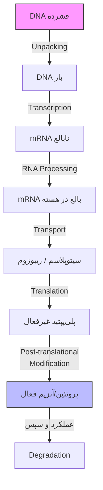
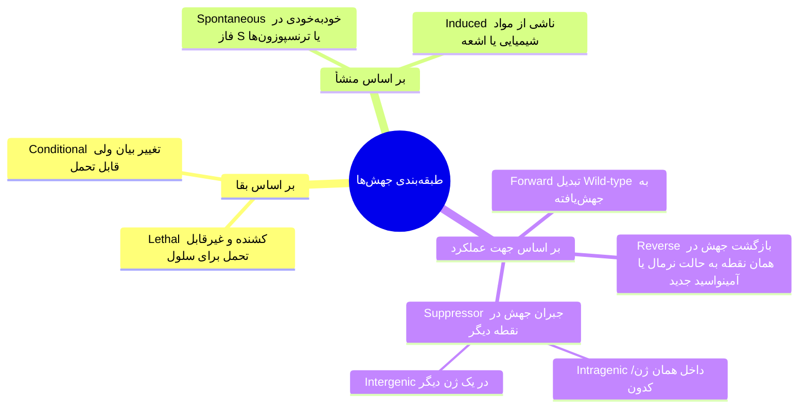
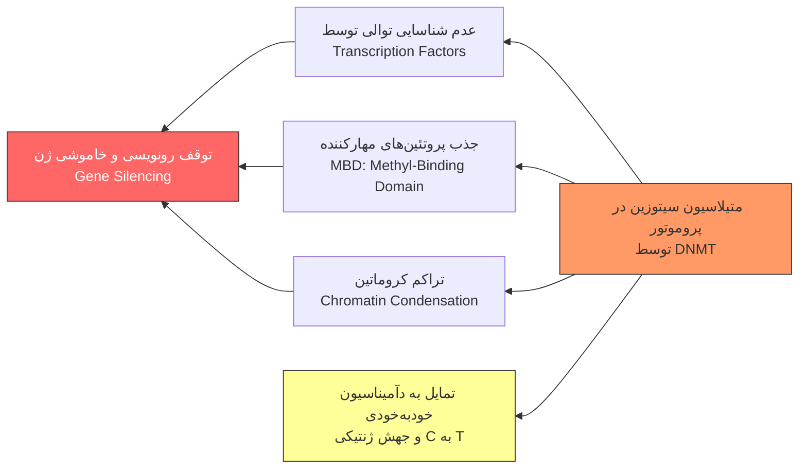
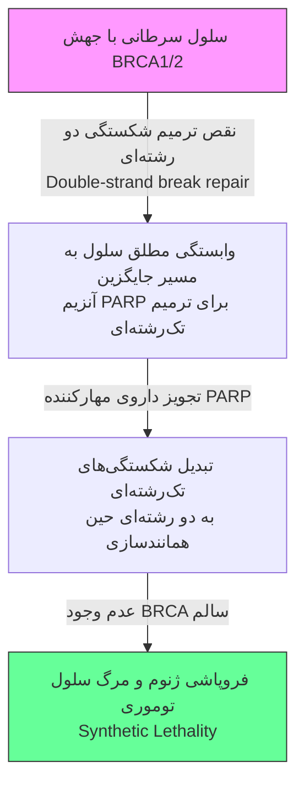

# جلسه ۱۶ (و ۶): کلیات ژنتیک، ساختار ژنوم و رونویسی

## شاخه‌های علم ژنتیک و ارتباطات پایه
* **مباحث سه‌گانه ژنتیک پزشکی**: **Genomics** (خصوصیات مولکول بزرگ ژنوم و دبل هلیکس DNA در هسته)، **Cell Biology & Biochemistry** (خصوصیات ژن‌ها داخل سلول)، **Human Genetics** (علم وراثت و انتقال ژن در شجره‌نامه از ناقلین به مبتلایان/غیرمبتلایان).
* **زیرشاخه‌های تخصصی ژنتیک**:
	1. **Molecular Genetics**: بررسی سطح DNA و RNA.
	2. **Cytogenetics**: مطالعه سطح کروموزوم.
	3. **Clinical Genetics**: تشخیص، درمان و پیشگیری بیماری‌های ژنتیکی.
	4. **Population Genetics**: بررسی ژنتیک سطح جامعه (Gene frequency و Allele frequency).
	5. **Immunogenetics**: ژنتیک سیستم ایمنی (مثل آنتی‌بادی‌ها).
	6. **Pharmacogenetics**: مکانیسم و تاثیر داروها در افراد مختلف.
	7. **Developmental Genetics**: ژنتیک رشد نرمال و غیرنرمال.
	8. **Behavioral Genetics**: بررسی وراثت رفتاری افراد مختلف.

> [!info] تفاوت بیماری مادرزادی (Congenital) و ژنتیکی (Genetic)
> * **مادرزادی (Congenital)**: حضور و شروع از بدو تولد (روزهای اول/دوره نوزادی یا بروز بعدی با منشأ جنینی). گاهی بی‌ارتباط با ژن خاص و ناشی از عوامل محیطی/مشکلات مادر در بارداری.
> * **ژنتیکی (Genetic)**: اتیولوژی ناشی از ۱ یا چند ژن خاص. اکثراً بارز از بدو تولد، گاهی شروع علائم (Onset) در میانسالی. (امکان حضور همزمان اختلال مادرزادی و ژنتیکی در نوزاد).

## آناتومی ژنوم انسان و تعاریف پایه
* **ابعاد ژنوم (دیپلوئید)**: ۴۶ کروموزوم (۲۲ جفت اتوزوم + XX یا XY) از بدو لقاح (زایگوت/رویان) تا کل بدن انسان بالغ (حاوی ~۶ میلیارد سلول دیپلوئید با کروموزوم‌های کاملاً یکسان) ⇦ مجموعاً **۶ میلیارد جفت باز (6 Billion bp)** و طول خطی **~۲ متر**.
* **تعداد ژن‌ها و رونویسی**: **~۲۰,۰۰۰ تا ۲۵,۰۰۰ ژن** کدکننده پروتئین (در منابع مختلف ۲۲ تا ۲۳ هزار). سایز متوسط ژن **۱۴,۰۰۰ جفت باز (14 kb)** با دامنه **2 kb تا 2400 kb** (۲ میلیون و ۴۰۰ هزار باز؛ بزرگترین ژن).
* **تنوع رونوشت‌ها**: ساخت >۱ نوع mRNA در **60%** ژن‌ها به علت *Alternative splicing* (متوسط **2.6 رونوشت** به ازای هر ژن؛ ۲ تا ۳ نسخه ⇦ تولید **~۶۰,۰۰۰ نوع mRNA** از کل ژنوم).
* **واحدهای اندازه‌گیری طول ژنوم**:
	* **1 kb (کیلو باز)** = 1000 bp (جفت باز DNA).
	* **1 Mb (مگا باز)** = 1,000,000 bp یا 1000 kb.
	* **1 cM (سانتی‌مورگان)** ≈ **1 Mb** (۱ میلیون bp) ⇦ معادل **1% نوترکیبی (Recombination)**. (فاصله تقریبی دو کراسینگ‌اور در *پاکیتن پروفاز میوز ۱*؛ تبادل ماده ژنتیکی بین کروماتیدهای غیرخواهری دو کروموزوم همولوگ طی *سیناپسیس*).

> [!note] تعاریف لوکوس، آلل، ژنوتیپ و هاپلوتایپ
> * **Locus (لوکوس)**: موقعیت فیزیکی و آدرس ژن روی کروموزوم (مثال: `4p16` ⇦ بازوی کوتاه کروموزوم ۴، باند ۱، ساب‌باند ۶).
> * **Allele (آلل)**: فرم‌ها و توالی‌های جایگزین یک ژن در لوکوس مشخص (گاهی اشاره به کل کروموزوم پدری/مادری). **حرف بزرگ (A)**: آلل اکثریت جامعه (*Superiority*)؛ **حرف کوچک (a)**: آلل اقلیت جامعه (*Minority*).
> * **Genotype و Phenotype**: ژنوتیپ = ترکیب آلل‌ها در یک لوکوس (هموزیگوت مثل BB، هتروزیگوت مثل Aa). فنوتیپ = تظاهر قابل مشاهده ژنوتیپ (مورفولوژیک، بالینی، بیوشیمیایی/فعالیت آنزیمی، مولکولی)؛ تحت تنظیم سایر ژن‌ها و غیرقابل پیش‌بینی دقیق صرفاً از روی ژنوتیپ.
> * **Haplotype (هاپلوتایپ)**: گروهی از ژن‌ها/آلل‌های بسیار نزدیک روی یک بازوی کروموزوم با توارث یکجا (پکیج واحد) در شجره‌نامه به نسل بعد (مثال: Haplotype AB).

* **انواع آلل‌ها (۴ مدل)**:
	1. **Wild-type**: فرم نرمال و غالب در اکثریت جامعه (*Prevailing version*).
	2. **Mutant (Variant)**: تغییر دائمی توالی نوکلئوتیدی منجر به بیماری (*Disease-causing*).
	3. **Polymorphism Variant**: تغییر توالی بدون بیماری (نرمال)، در اقلیت جامعه با فراوانی **> 1%**.
	4. **Rare Variant**: تغییر توالی نرمال (غیربیماری‌زا) با فراوانی **< 1%**.

## ساختار شیمیایی DNA، RNA و همانندسازی (Replication)
* **اجزای نوکلئوتید**: باز آلی (A, T, C, G) + قند ۵ کربنه (ریبوز در RNA، دئوکسی‌ریبوز در DNA) = **نوکلئوزید (Nucleoside)** ➕ گروه فسفات = **نوکلئوتید (Nucleotide)**. (در دیدگاه بیوشیمیایی، زنجیره DNA نیز به علت مکانیسم خاص، نوعی ساختار پروتئینی/پلیمری محسوب می‌شود).
* **پیوندهای هیدروژنی (مدل واتسون و کریک ۱۹۵۳)**: دو رشته‌ای موازی ناهمسو (*Double Helix*). **A با T** (**۲ پیوند هیدروژنی**؛ ضعیف‌تر) و **C با G** (**۳ پیوند هیدروژنی**؛ بسیار مستحکم، عامل پایداری DNA برای هزاران سال در فسیل‌های نئاندرتال و هوموساپینس).
* **تفاوت‌های RNA با DNA**: تک‌رشته‌ای (*Single-stranded*) و ناپایدار (مصرف سریع سلولی) + قند **ریبوز** + جایگزینی تیمین با **اوراسیل (Uracil)**.
* **جهت خوانش و قطبیت**: خوانش سکانس DNA (هم Sense و هم مکمل آن Antisense) همیشه از انتهای **'5 آزاد ⇦ '3 آزاد**. رشته کدکننده پروتئین = رشته **Sense (Coding strand)** (معادل توالی mRNA).
* **همانندسازی (Replication)**:
	* رخداد در **فاز S چرخه سلولی** (تبدیل محتوای DNA از **2n ⇦ 4n** قبل از میتوز) توسط آنزیم **رپلیکاز (Replicase)**.
	* فرآیند **نیمه‌حفاظتی (Semi-conservative)**: باز شدن دو رشته و عمل هر کدام به عنوان الگو (Template).
	* **Leading Strand (رشته پیشرو)**: سنتز پیوسته و سریع در جهت مستقیم '5 ⇦ '3.
	* **Lagging Strand (رشته پیرو)**: سنتز کندتر و ناپیوسته در جهت کلی '3 ⇦ '5 با تشکیل قطعات کوچک '5 ⇦ '3 به نام **قطعات اوکازاکی (Okazaki fragments)** (کشف دهه ۹۰ میلادی) و اتصال بعدی به هم.

> [!important] پلیمورفیسم تک‌نوکلئوتیدی (SNP) و مکانیسم دآمیناسیون
> * **تعریف SNP (اسنیپ)**: تغییر توالی در حد ۱ نوکلئوتید. وقوع هر **۱۰۰ تا ۳۰۰ جفت باز** یک‌بار ⇦ مجموعاً **~۱۰ میلیون SNP نرمال** در ژنوم انسان (عامل تفاوت گونه‌ها و نژادها در نقاط جغرافیایی مختلف).
> * **مکانیسم شایع**: **~دو سوم (66% یا ۲ از ۳)** کل SNPها ناشی از تبدیل **سیتوزین (C) ⇦ تیمین (T)**. مکانیسم: **متیلاسیون** سیتوزین (اتصال $CH_3$) ⇦ متیل‌سیتوزین ⇦ **دآمیناسیون (Deamination)** (حذف گروه آمین/آمونیاک و جایگزینی با اکسیژن) ⇦ تیمین (تغییر جفت‌باز از G:C ⇦ A:T). بسیار شایع در تنظیم پروموتور و بیان mRNA.

## دگم مرکزی (Central Dogma) و مسیر بیان ژن
* **مسیر کلاسیک و نوین**: کلاسیک شامل `DNA ⇦ RNA ⇦ Protein`. اخیراً افزودن **Replication** (کپی DNA از DNA) و **Reverse Transcription** (برگشت RNA ⇦ DNA).

* **منشأ بیماری‌های ژنتیکی**: اختلال در هر یک از مراحل ۷گانه فوق (آنپکینگ، رونویسی، پردازش RNA، انتقال هسته به سیتوپلاسم، ترجمه، فعال‌سازی پروتئین، یا تخریب پروتئین پس از عملکرد).

## ساختار ژن‌های کدکننده پروتئین و تنظیم بیان
* **بخش‌های غیرکدکننده ژنوم (~95% تا 98% کل DNA)**:
	1. **Intergenic**: نواحی بین ژن‌ها (خارج ژن‌ها؛ عدم تولید mRNA).
	2. **Intragenic**: نواحی غیرکدکننده داخل ژن‌ها (اینترون‌ها، پروموتور، نواحی UTR و کدون‌های پایانی؛ دارای رونویسی یا نقش تنظیمی ولی بدون ترجمه به اسید آمینه).
* **خوشه‌های ژنی (Gene Clusters)**: هم‌جواری ژن‌های مرتبط جهت تولید هماهنگ پروتئین‌ها (ژن‌های هیستون یا فاکتورهای رشد و گیرنده‌هایشان) یا تغییر تکاملی (*Developmental switching*).
	* *مثال هموگلوبین*: خوشه **آلفا-گلوبین (کروموزوم ۱۶)** دارای ناحیه تنظیمی **HS-40** (*Hypersensitive Site*) و ژن‌های $\zeta, \alpha_1, \alpha_2$. خوشه **بتا-گلوبین (کروموزوم ۱۱)** دارای ناحیه **LCR** (*Locus Control Region*) و ژن‌های $\varepsilon, G\gamma, A\gamma, \delta, \beta$.

| بخش ساختاری ژن                                 | موقعیت و ویژگی‌های ساختاری                                                                                                                                                          | سایز متوسط / تعداد                                                                                                | عملکرد اصلی و نکات بالینی/مولکولی                                                                                                                                                                                     |
| :--------------------------------------------- | :---------------------------------------------------------------------------------------------------------------------------------------------------------------------------------- | :---------------------------------------------------------------------------------------------------------------- | :-------------------------------------------------------------------------------------------------------------------------------------------------------------------------------------------------------------------- |
| **ناحیه تنظیمی (Regulatory) و پروموتور**       | عمدتاً در **'5 Flanking** (چپِ شروع ژن)؛ گاهی داخل اینترون‌ها یا '3 Flanking. حاوی جعبه **TATA** (`TATAAA` در پروموتور) و باکس **Pribnow** (توالی‌های توافقی `-10` و `-35`).        | کل ناحیه: **50 bp تا 100 kb** قطعات تکراری اتصال پروتئین: **50 تا 200 bp**                                     | تنظیم زمان، مکان (بافت) و میزان بیان mRNA (مثبت/تحریکی یا منفی/مهاری). شناسایی با **RNA ترنسکریپتاز (پلیمراز)** از روی TATA و شروع رونویسی از `+1` (TSS) روی رشته الگو (**Antisense / Lower strand**) در جهت '5 ⇦ '3. |
| **ناحیه '5 UTR**                               | ابتدای اگزون ۱ (فاصله Cap site تا کدون شروع ترجمه). جزو اگزون؛ دارای رونویسی ولی بدون ترجمه.                                                                                        | **~300 نوکلوتید**                                                                                                 | ⇧ دقت و کارایی ترجمه (**Translational efficiency**)؛ مشابه برش اولیه طناب با فاصله و سپس برش دقیق‌تر.                                                                                                                 |
| **توالی کدکننده (Coding Sequence) و اگزون‌ها** | نواحی کدکننده متصل‌شونده پس از حذف اینترون‌ها. شروع ترجمه از **AUG** (در DNA: **ATG**؛ کدکننده **متیونین**) و پایان در کدون‌های ختم (**UAA, UAG, UGA**؛ در DNA: **TAA, TAG, TGA**). | کدینگ: **1340 نوکلوتید** (**~450 آمینواسید**) تعداد اگزون: ۱ تا ۱۷۰-۱۸۰ (متوسط **۹**) هر اگزون: **~150 bp** | تعیین توالی اسیدهای آمینه پلی‌پپتید در ریبوزوم‌ها (کمپلکس rRNA و پروتئین‌های ریبوزومی) طی ۳ مرحله Initiation، Elongation و Termination.                                                                               |
| **اینترون‌ها (Introns)**                       | نواحی غیرکدکننده بین اگزون‌ها. تعداد اینترون = **تعداد اگزون منهای یک ($n-1$)**. (ژن بزرگتر ⇦ تعداد و سایز اینترون بیشتر).                                                          | متوسط: **3365 bp** (بزرگتر از اگزون‌ها)                                                                           | شرکت در تنظیمات mRNA و حذف طی Splicing.                                                                                                                                                                               |
| **ناحیه '3 UTR**                               | انتهای آخرین اگزون (بعد از کدون پایان تا پایان رونویسی/Poly A site). دارای رونویسی ولی بدون ترجمه.                                                                                  | **~700 نوکلوتید**                                                                                                 | حفظ پایداری mRNA (**mRNA Stability**؛ مهار تخریب سریع) و تعیین موقعیت مکانی در بافت هدف (**Localization**).                                                                                                           |
| **دم Poly(A)**                                 | افزودن پس از رونویسی (در فایل صوتی سهواً Post-translational ذکر شده) به انتهای '3 در mRNA.                                                                                          | **100 تا 200 نوکلوتید**                                                                                           | پایداری mRNA و کارایی ترجمه. حضور در **تمام mRNAهای پستانداران به جز mRNAهای هیستونی**.                                                                                                                               |

> [!warning] مرزهای اگزون-اینترون (Splice Sites) و تغییرات پس از ترجمه
> * **مرزهای برش (در ژن نمونه Casein Kinase 2 subunit $\beta$ با ۶ اگزون)**:
> 	* **مرز اگزون به اینترون (Exon-Intron boundary / انتهای اگزون و شروع اینترون)**: توالی ثابت **`GTG`** (یا `GT` ابتدای اینترون).
> 	* **مرز اینترون به اگزون (Intron-Exon boundary / انتهای اینترون و شروع اگزون بعد)**: توالی ثابت **`CAG`** (یا `AG` انتهای اینترون).
> 	* *نکته بالینی*: جهش در این ۴-۵ نوکلوتید مرزی داخل اینترون، بدون کد کردن مستقیم آمینواسید، **Splicing و رونویسی** را مختل و ایجاد بیماری می‌کند.
> * **پردازش پس از ترجمه (Post-Translational Processing)**: تبدیل زنجیره پلی‌پپتیدی بی‌عملکرد ⇦ **آنزیم/پروتئین فعال** طی ۴ مکانیسم شایع:
> 	1. **Phosphorylation**: اتصال فسفات ($PO_4$).
> 	2. **Hydroxylation**: اتصال هیدروکسیل ($OH$).
> 	3. **Methylation**: اتصال متیل ($CH_3$ یا $CH_4$ در بیان شفاهی).
> 	4. **Glycosylation**: اتصال قندها و اولیگوساکاریدها به آمینواسید.

---

# جلسه ۶: جهش‌ها، بیماری‌های تکرار سه‌تایی و نام‌گذاری استاندارد

## تکنیک‌های تعیین توالی و طبقه‌بندی بنیادی جهش‌ها
* **روش‌های تعیین توالی (Sequencing)**: تکثیر قطعه هدف با **PCR** (*Polymerase Chain Reaction*؛ میلیون‌ها کپی) و بررسی بخش‌های عملکردی (پروموتور و اگزون‌ها؛ Exon sequencing):
	* **Sanger Sequencing (روش دی‌دئوکسی)**: ابداع دهه ۸۰ میلادی (۲ جایزه نوبل)، مبتنی بر الکتروفورز و ورود تصادفی نوکلئوتیدهای خاتمه‌دهنده زنجیره (*Chain-terminating dideoxynucleotides*). همچنان **استاندارد طلایی (Gold Standard)** تایید تشخیص نهایی. رنگ بازها در گراف: **A (سبز)**، **G (مشکی)**، **C (آبی)**، **T (قرمز)** (دو پیک همزمان مثل G و A = هتروزیگوت طبیعی یا جهش‌یافته).
	* **NGS (Next Generation Sequencing)**: نسل جدید توالی‌یابی از سال ۲۰۰۰ به بعد جهت بررسی وسیع ژنوم/اگزوم.

* **نرخ جهش خودبه‌خودی (Spontaneous)**: رخداد در هر مرحله چرخه سلولی (حین همانندسازی DNA) در اثر خطای خوانش و نقص سیستم ترمیم (Repair) یا حرکت **ترنسپوزون‌ها** (قطعات جابه‌جاشونده ژنتیکی). نرخ وقوع بسیار پایین: **$10^{-4}$ تا $10^{-6}$ جهش به ازای هر ژن در هر نسل**.

## انواع جهش‌های نقطه‌ای (Point Mutations) و تغییر چارچوب
* **بر اساس نوع باز جایگزین (Base Substitutions)**:
	* **Transition**: پورین ⇦ پورین یا پیریمیدین ⇦ پیریمیدین (مثال: جفت‌باز **A:T ⇦ G:C**).
	* **Transversion**: پورین ⇄ پیریمیدین (مثال: جفت‌باز **C:G ⇦ G:C**).
* **بر اساس تاثیر بر توالی پروتئین (مثال جمله: `THE BIG RED FLY HAD ONE RED EYE`)**:
	1. **Silent Mutation**: تغییر نوکلئوتید بدون تغییر آمینواسید (به علت ۶۴ کدون برای ۲۰ آمینواسید؛ مثال: `AAA` ⇦ `AAG`؛ هر دو **لایزین**).
	2. **Neutral Mutation**: تغییر کدون به آمینواسید جدید با **خواص و بار شیمیایی مشابه** (تاثیر ناچیز بر ساختار پروتئین؛ مثال: `AAA` لایزین ⇦ `AGA` **آرژنین**؛ هر دو بازی).
	3. **Missense Mutation**: تغییر کدون و جایگزینی آمینواسید با خواص متفاوت (مثال: `AAA` لایزین ⇦ `GAA` **گلوتامیک اسید**؛ تغییر جمله به `THE BIG RED FQY...`). اثر متغیر از خفیف تا شدید بسته به محل و اهمیت آمینواسید.
	4. **Nonsense Mutation**: تبدیل کدون آمینواسید ⇦ کدون پایان (مثال: `AAA` لایزین ⇦ `TAA` کدون استاپ؛ تغییر جمله به `THE BIG RED`). تولید پروتئین نارس (*Premature*) و **Loss of function** (در اوایل/اواسط ژن اثر بالینی شدید، در کدون‌های انتهایی اثر کمتر).
	5. **Frameshift Mutation**: حذف (Deletion) یا ورود (Insertion) نوکلئوتید **غیرمضرب ۳** (۱ یا ۲ نوکلئوتید؛ مثل ورود یک باز G و تبدیل لایزین-ترئونین-آلانین ⇦ گلوتامین-ایزولوسین-تیروزین؛ تغییر جمله به `THE BIG RED FXL YHA DON ERE DEY`). به‌هم‌ریختگی کل چارچوب خوانش ۳تایی.
	6. **In-frame Deletion / Insertion / Duplication**: حذف، ورود یا مضاعف شدن **۳ نوکلئوتید (یا مضرب ۳)**. حفظ چارچوب خوانش؛ صرفاً کم/زیاد شدن یک یا چند آمینواسید (مثال: حذف `FLY`، مضاعف شدن `FLY`، یا ورود کلمه ۳ حرفی `WET`).

> [!important] جهش غالب منفی (Dominant Negative) و هاپلو-اینسافیشنسی (Haploinsufficiency)
> * **Dominant Negative (Antimorphic Mutation)**: جهش یک آلل که علاوه بر فقدان عملکرد خود، عملکرد پروتئین **آلل نرمال (Wild-type)** را نیز مسدود می‌کند (مستقیماً با اتصال به پروتئین نرمال، یا غیرمستقیم با اختلال در پروتئین واسط). مثال کلاسیک: ژن‌های **RAS** و **TP53** در سرطان‌ها.
> * **Haploinsufficiency**: کفایت ۵۰٪ محصول در اکثر ژن‌ها برای عملکرد طبیعی؛ اما در برخی ژن‌ها، ⇩ پروتئین به **نصف (۵۰٪)** در اثر جهش یک آلل، برای عملکرد طبیعی سلول ناکافی بوده و بیماری‌زاست («نصف کافی نیست»).

## بیماری‌های تکرار سه‌نوکلئوتیدی (Triplet Repeat Expansion)

> [!info] پدیده پیش‌آمدگی (Anticipation)
> در بیماری‌های تکرارهای ناپایدار (*Unstable repeat expansion*)، با انتقال ژن به نسل بعد (مثلاً از پدر ۴۰ ساله با بیماری خفیف به فرزند)، تعداد تکرارهای سه‌تایی ⇧ می‌یابد (مثال: ⇧ تکرار `FLY` از ۱ ⇦ ۳ ⇦ ۶ در نسل‌های بعد). نتیجه: **⇧ شدت بیماری** و **⇩ سن بروز (سنین پایین‌تر، مثلاً ۳۰ سالگی)** در نسل‌های بعدی.

| نام بیماری | الگوی وراثت و ژن مسئول | توالی تکرار و محل در ژن | تعداد تکرار نرمال | تعداد تکرار بیماری‌زا (Full Mutation) |
| :--- | :--- | :--- | :--- | :--- |
| **سندرم X شکننده (Fragile X)** | وابسته به X (**X-linked**) ژن **FMR1** | تکرار **`CGG`** در **'5 UTR** ژن | **6 تا 50** (< 50) | **> 200** (ایجاد عقب‌ماندگی ذهنی / MR) |
| **دیستروفی میوتونیک (Myotonic Dystrophy)** | اتوزومال غالب (**AD**) ژن **DMPK** | تکرار **`CTG`** در **'3 UTR** ژن | **5 تا 35** (< 35) | **80 تا 2000** |
| **بیماری هانتینگتون (Huntington Disease)** | اتوزومال غالب (**AD**) ژن **HD (HTT)** | تکرار **`CAG`** **داخل بخش کدینگ** | **11 تا 34** (< 34) | **> 40** (40 تا 100+) |
| **آتاکسی فردریش (Friedreich Ataxia)** | اتوزومال مغلوب (**AR**) ژن **FRDA (FXN)** | تکرار **`GAA`** در **اینترون** ژن | **< 34** | **36 تا 100** (یا بیشتر) |
| **بیماری کندی (آتروفی عضلانی نخاعی-بولبار)** | وابسته به X مغلوب ژن **AR** (گیرنده آندروژن) | تکرار **`CAG`** **داخل بخش کدینگ** | **11 تا 31** | **> 31** |

## نام‌گذاری استاندارد در گزارش‌های ژنتیک مولکولی (Nomenclature)
* **تغییر ترمینولوژی نوین**: به علت عدم بیماری‌زایی برخی جهش‌ها (Mutations) و همراهی برخی پلیمورفیسم‌ها با علائم بالینی، جهت پرهیز از سوگیری ذهنی پزشک، جایگزینی واژه‌های Mutation و Polymorphism با واژه‌های خنثی **Variation**، **Alteration** یا **Change (تغییر)**. ویژگی‌های سیستم نام‌گذاری: دقیق (*Accurate*)، بدون ابهام (*Unambiguous*)، پایدار (*Stable*) و انعطاف‌پذیر (*Flexible*).
* **اجزای اصلی گزارش ژنتیکی**:
	1. **توالی مرجع (Reference Sequence Prefix)**:
		* **`c.`**: توالی کدکننده (Coding DNA؛ فقط اگزون‌های ترجمه‌شونده).
		* **`g.`**: توالی ژنومیک (Genomic DNA؛ کل اگزون‌ها و اینترون‌ها).
		* **`m.`**: DNA میتوکندریایی (Mitochondrial).
		* **`p.`**: توالی پروتئین (Protein).
		* **`r.`**: توالی RNA (ترنسکریپت).
	2. **شماره‌گذاری (Numbering) و نوع تغییر**: شماره نوکلئوتید یا آمینواسید + حروف بزرگ نوکلئوتیدها + اختصارات تغییر: **`>`** (جایگزینی/Substitution)، **`del`** (حذف)، **`ins`** (اضافه شدن)، **`dup`** (مضاعف شدن)، **`inv`** (واژگونی)، **`con`** (کانورژن)، **`delins`** یا **`indel`** (حذف و اضافه همزمان).

| نماد / کاراکتر              | مفهوم در گزارش ژنتیک مولکولی                                | مثال کاربردی از اسلایدها و تفسیر دقیق                                                                                                                                                                              |
| :-------------------------- | :---------------------------------------------------------- | :----------------------------------------------------------------------------------------------------------------------------------------------------------------------------------------------------------------- |
| **`+` (Plus)**              | نوکلئوتید داخل اینترون (سمت '3 یا بعد از اگزون)          | `c.88+1G>T` یا `c.123+45A>G`: باز ۸۸ = آخرین باز اگزون؛ اولین نوکلئوتید داخل اینترون بعدی (اینترون ۲ یا `IVS2+1G>T`) از G ⇦ T تغییر کرده (چون مرجع `c.` است، اینترون شماره کدینگ ندارد و ۸۹ نوشته نمی‌شود!). |
| **`-` (Minus)**             | نوکلئوتید سمت چپ / '5 (قبل از اگزون یا در '5 UTR)        | `c.124-56C>T`: نوکلئوتید واقع در ۵۶ باز قبل از شروع اگزون (انتهای اینترون قبلی) از نوع C ⇦ نوع T تغییر یافته.                                                                                                      |
| **`*` (Asterisk)**          | کدون پایان ترجمه (Stop codon) یا '3 UTR                     | `p.Trp26*` (حاصل از `c.78G>A`): آمینواسید تریپتوفان موقعیت ۲۶ ⇦ کدون پایان.                                                                                                                                        |
| **`_` (Underscore)**        | مشخص‌کننده محدوده (Range) دو نوکلئوتید                      | `c.76_78del` (یا `c.76_78delACT`): حذف ۳ نوکلئوتید شماره ۷۶ تا ۷۸ در توالی کدینگ.                                                                                                                                  |
| **`:` (Colon)**             | جداکننده شناسه فایل مرجع از توصیف واریانت                   | `NC_000023.9:g.32317682G>A`: جداسازی کد بانک اطلاعاتی ژنوم از نوع جهش.                                                                                                                                             |
| **`[ ]` (Square brackets)** | مشخص‌کننده آلل‌های مختلف یا تکرارها                         | `g.[123C>A];[345G>T]`: دو تغییر روی دو آلل/کروموزوم مختلف (یا `g.123_124[14]` برای تعداد تکرار).                                                                                                                   |
| **`;` (Semicolon)**         | جداکننده واریانت‌های دو کروموزوم مختلف (Trans)              | `g.[123G>A];[456C>T]` (در صورت نامشخص بودن فاز: `g.123G>A(;)456C>T`).                                                                                                                                              |
| **`,` (Comma)**             | جداکننده رونوشت‌ها یا پروتئین‌های مختلف از یک آلل           | محصولات متفاوت منشأگرفته از یک آلل واحد.                                                                                                                                                                           |
| **`( )` (Parentheses)**     | عدم قطعیت یا پیش‌بینی نظری (بدون تایید آزمایشگاهی)       | `p.(Cys611Tyr)`: پیش‌بینی تبدیل سیستئین ۶۱۱ ⇦ تیروزین در سطح پروتئین در اثر جهش `c.1832G>A`.                                                                                                                       |
| **`?` (Question mark)**     | موقعیت یا وضعیت نامشخص                                      | عدم اطلاع دقیق از نقطه شروع یا پایان تغییر.                                                                                                                                                                        |
| **`^` (Caret)**             | به معنی «یا» (Or)                                           | رخداد تغییر اول یا تغییر دوم (`c.76A>C^78G>T`).                                                                                                                                                                    |
| **`{ }` (Braces)**          | توصیف واریانت‌ها در کپی‌های دیگر نسبت به کپی طبیعی          | نمایش تغییرات در توالی‌های دارای کپی‌های متعدد.                                                                                                                                                                    |
| **`=` (Equal)**             | عدم تغییر توالی (Unchanged)                                 | بررسی توالی و طبیعی بودن آن (یا جهش Silent در سطح پروتئین).                                                                                                                                                        |
| **`/` و `//` (Slashes)**    | تک‌اسلش (`/`): **موزائیسم** دو اسلش (`//`): **کایمریسم** | `/`: دو رده سلولی متفاوت از یک فرد (Zygote واحد). `//`: دو رده سلولی حاصل از ادغام دو زایگوت متفاوت.                                                                                                            |

* **سایر مثال‌های مهم گزارش‌خوانی**:
	* `g.22171G>A` (معادل `p.Gly691Ser`): تغییر توالی ژنومیک در باز ۲۲۱۷۱ از نوع G ⇦ نوع A و تبدیل گلایسین ۶۹۱ ⇦ سرین.
	* `c.112_117delinsTG` (یا `c.112_117delAGGTCAinsTG`): در توالی کدینگ، حذف ۶ نوکلئوتید شماره ۱۱۲ تا ۱۱۷ و ورود ۲ نوکلئوتید TG به جای آن‌ها.

---

# ۳. اپی‌ژنتیک، ایمپرینتینگ ژنومی و بیماری‌های انسانی (فصل ۱۳)

## مفاهیم پایه، تاریخچه و ضرورت اپی‌ژنتیک
* **تقسیم‌بندی بیماری‌ها در ژنتیک محض**: ۱. تک‌ژنی (*Single Gene*؛ محور اصلی رسم شجره‌نامه و محاسبه ریسک)، ۲. کروموزومی (*Chromosomal*)، ۳. کمپلکس / مولتی‌فاکتوریال / پلی‌ژنیک.

> [!info] تعریف اپی‌ژنتیک (Epigenetics) و اپی‌ژنومیکس
> * **تعریف لغوی و علمی**: به معنی *On top of genetics* (فراتر از ژنتیک)؛ ابداع توسط **Waddington (۱۹۴۲)**. تغییرات پایدار و قابل توارث در **بیان ژن** (تغییر فنوتیپ) **بدون هیچ تغییری در توالی و ساختمان DNA** (عمدتاً با اثر بر نواحی تنظیمی ژن).
> * **تمثیل فونت حروف**: فرض توالی DNA به صورت ۴ حرف ثابت `CAGT` ⇦ اپی‌ژنتیک = تغییر **سایز، رنگ یا نوع فونت** حروف (ثبات حروف اما ⇩/⇧ خوانایی و بیان آن‌ها).
> * **Epi-genotype**: وضعیت اپی‌ژنتیکی یک لوکوس (مجموعه وضعیت متیلاسیون DNA، تغییرات هیستونی، واریانت‌های هیستونی و فعالیت RNAهای غیرکدکننده).
> * **Epigenomics**: مطالعه تغییرات اپی‌ژنتیکی در مقیاس کل ژنوم (*Genome-wide*).

* **۳ معمای بیولوژیک غیرقابل توجیه با ژنتیک کلاسیک (علل پیدایش اپی‌ژنتیک)**:
	1. **تنوع فنوتیپی وسیع جمعیت انسانی**: یکسانی **> 99.9%** توالی DNA تمام انسان‌ها (آفریقا، آمریکا، ایران)؛ تفاوت ژنتیکی **< 0.1% تا 1%** اما تفاوت ظاهری و استعداد ابتلا به بیماری‌ها بسیار فراتر از این عدد.
	2. **تفاوت دوقلوهای مونوزیگوت (MZ Twins) و حیوانات کلون‌شده**: یکسانی **100%** DNA در دوقلوهای همسان یا حیوانات شبیه‌سازی‌شده، اما تفاوت در استعداد بیماری‌ها و صفات رفتاری/اخلاقی. *مطالعه دوقلوهای MZ*: در **۳ سالگی** انطباق کامل درصد متیلاسیون DNA ($5mC$) و استیلاسیون هیستون‌های H3 و H4 در دو قل و تشابه فنوتیپ‌ها؛ اما در **۵۰ سالگی** (در اثر تغییرات وابسته به سن و محیط) فاصله گرفتن کامل سطح متیلاسیون و استیلاسیون آن‌ها.
	3. **تمایز سلولی (Cellular Differentiation) در جنین‌شناسی**: تبدیل یک تخمک بارورشده واحد با DNA یکسان ⇦ سلول‌های کاملاً متفاوت (کبد، قلب، پوست، چشم، مغز) با ظاهر و عملکرد متمایز (پاسخ: خاموش/روشن شدن انتخابی ژن‌ها با مکانیسم‌های اپی‌ژنتیک).
* **مفهوم بیماری اپی‌ژنتیکی**: رخداد **نوع غلط تغییر اپی‌ژنتیکی در مکان غلط یا زمان غلط (*Wrong type of epigenetic marks at the wrong place or wrong time*)**. (مکان غلط = بیان/عدم بیان ژن در بافت/سلول نامناسب مثل سرطان؛ زمان غلط = عدم شروع/توقف بیان ژن در سن و دوره زمانی خاص).
* **دسته‌بندی جدید بیماری‌ها**: ۱. **Genetic**: تغییر توالی نوکلئوتیدی یا کروموزوم، ۲. **Epigenetic**: تغییر اپی‌ژنوتیپ و بیان ژن بدون تغییر توالی، ۳. **Both (ترکیبی / مدل MEGDI)**: مخفف *Mixed Epigenetic & Genetic and De novo & Inherited* (تغییرات توأمان ژنتیکی و اپی‌ژنتیکی، وراثتی و جدید/De novo در بیماری‌های مونوژنیک یا اولیگوژنیک).

## مکانیسم‌های سه‌گانه اپی‌ژنتیک
* **سه مکانیسم اصلی و تعاملات**: ۱. **DNA Methylation**، ۲. **Histone Modification**، ۳. **Nucleosome Positioning**. اثر متقابل و فیدبک‌های مثبت/منفی این سه مکانیسم همراه با **Non-coding RNAs** (*miRNA* و *snoRNA*) بر یکدیگر (هدایت تغییرات هیستونی توسط متیلاسیون DNA و برعکس).

### ۱. متیلاسیون DNA (شناخته‌شده‌ترین مکانیسم)
* **مکانیسم شیمیایی**: انتقال کووالانسی گروه متیل ($CH_3$) از **S-آدنوزیل متیونین (SAM)** به **کربن ۵ باز سیتوزین** ⇦ تولید **5-methylcytosine** توسط خانواده آنزیمی **DNMT** (*DNA Methyltransferase*).
* **محل وقوع (جزایر و سواحل CpG)**:
	* **CpG Islands**: نواحی سمت **'5 ژن (پروموتور)** و نزدیک محل شروع رونویسی (TSS)، با طول **> 200 bp** و تراکم نوکلئوتید C مجاور G (متصل با پیوند فسفودی‌استر در یک رشته، نه مکمل هم!) **حداقل 50% (> 50%)**.
	* **CpG Island Shores**: نواحی با تراکم کمتر CpG نسبت به جزایر (ولی > حد نرمال) در فاصله دورتر از ژن (**1 kb تا 2 kb** یا ۱۰۰۰ تا ۲۰۰۰ نوکلوتید از شروع ژن)؛ مسئول تنظیم بیان ژن به صورت **اختصاصی بافت (Tissue-specific)**.
* **خانواده آنزیمی DNMT و مهارکننده‌های دارویی**:
	* **DNMT3a و DNMT3b**: متیلاسیون جدید (**De novo methylation**؛ افزودن متیل برای اولین بار).
	* **DNMT1**: حفظ و نگهداری متیلاسیون (**Maintenance**؛ ممانعت از جدا شدن متیل پس از همانندسازی).
	* **DNMT2**: متیلاسیون **tRNA**.
	* **DNMT3L**: فاقد فعالیت کاتالیتیک مستقیم، همکار DNMT3a/b.
	* *فارماکولوژی*: مهار آنزیم DNMT توسط داروی ضدسرطان **5-Azacytidine** ⇦ توقف متیلاسیون ⇦ ⇧ بیان ژن‌های خاموش‌شده (کاربرد در Epigenetic therapy).

* **وظایف سلولی و عوامل محیطی موثر بر متیلاسیون DNA**:
	* *وظایف*: تمایز سلولی، آپوپتوز، چرخه سلولی، متابولیسم کارسینوژن‌ها، ترمیم DNA و تنظیم هورمونی.
	* *عوامل تغذیه‌ای و محیطی*: **الکل، فولات (Folate)، ویتامین A، متیونین، آرسنیک، سلنیوم، زینک (روی)، کولین، فیبر، جنیستئین (Genistein)، کومسترول و ایکوئول (Equol)**.

> [!important] ساعت اپی‌ژنتیکی (Epigenetic Clock) و سن بیولوژیک ارگان‌ها
> * **تعریف**: تخمین‌گر سن بیولوژیک (۰ تا ۱۰۰ سالگی) بر پایه بیومارکرهای متیلاسیون DNA (کاربرد در مطالعات پیری و مداخلات *Epigenetic anti-aging*). عدم تطابق سن اپی‌ژنتیکی بافت‌های مختلف یک فرد با سن تقویمی او!
> * **خانم‌ها (سن متوسط ۴۴ سال)**: غدد لنفاوی (۳۹ سال)، دیافراگم (۴۳ سال)، ریه (۴۸ سال)، آئورت (۵۳ سال)، و **پستان (Breast: ۶۷ سال؛ مسن‌ترین بافت زنان)**.
> * **آقایان (سن متوسط ۴۷-۴۸ سال)**: قلب و آدرنال (۴۲ سال)، ریه (۴۴ سال)، آئورت (۴۶ سال)، غدد لنفاوی و دیافراگم (۴۸ سال)، و **معده (Stomach: ~۱۰ سال پیرتر از سن بیولوژیک؛ مسن‌ترین ارگان مردان)**.

* **نقش متیلاسیون در سرطان (تومورزایی)**:
	1. **Hypomethylation (⇩ متیلاسیون)**: اولین تغییر اپی‌ژنتیکی کشف‌شده در تومورها؛ ⇧ درجه آن با پیشرفت از تکثیر خوش‌خیم ⇦ سرطان مهاجم. *مکانیسم‌های تومورزایی*: **فعال‌سازی پروتوانکوژن‌ها** ⇦ آنکوژن (⇧ رشد و تقسیم) + **ناپایداری کروموزومی** (*Chromosomal instability*) + **فعال‌سازی مجدد ترنسپوزون‌ها** + **فقدان ایمپرینتینگ (LOI)**.
	2. **Hypermethylation (⇧ متیلاسیون)**: رخداد در جزایر CpG پروموتور ژن‌های **سرکوبگر تومور (Tumor Suppressor Genes)** و **ترمیم‌کننده DNA (DNA-repair genes)** ⇦ خاموشی رونویسی، حذف ترمز سلولی و عدم اصلاح خطاهای همانندسازی.

### ۲. تغییرات هیستونی (Histone Modifications) و ۳. موقعیت نوکلئوزوم‌ها
* **ساختار نوکلئوزوم (Nucleosome)**: واحد تکراری پایه کروماتین (پایین‌ترین سطح فشردگی DNA دو رشته‌ای به شکل طناب تسبیح یا *Beads on a string* با قطر 11nm ⇦ فیبر 30nm ⇦ لوپ‌های 300nm ⇦ بخش متراکم 700nm ⇦ کروموزوم متافازی 1400nm).
	* اجزا: **۸ پروتئین هیستونی مرکزی (Octamer core)** شامل چهار نوع **H2A, H2B, H3, H4** + هیستون **H1 به عنوان رابط (Linker)**.
* **نقش تغییرات هیستونی**: تنظیم رونویسی، ترمیم DNA، همانندسازی DNA، پیرایش متناوب (*Alternative splicing*) و تراکم کروموزوم.
* **مقایسه یوکروماتین و هتروکروماتین**:
	* **Euchromatin (یوکروماتین)**: ساختار باز (فنر باز شده) ⇦ **فعال در رونویسی** ⇦ **متیلاسیون DNA کم**، اما **استیلاسیون (Ac) و فسفوریلاسیون (P) هیستونی زیاد**.
	* **Heterochromatin (هتروکروماتین)**: ساختار متراکم و فشرده (*Condensed*؛ فنر جمع‌شده بدون تغییر ماهیت شیمیایی) ⇦ **غیرفعال در رونویسی** ⇦ **متیلاسیون DNA زیاد**، اما **استیلاسیون و فسفوریلاسیون هیستونی کم**.
* **موقعیت‌یابی نوکلئوزوم (Nucleosome Positioning)**: آرایش دقیق نوکلئوزوم‌ها اطراف محل شروع رونویسی (TSS). عمل نوکلئوزوم به عنوان سد فیزیکی ⇦ مسدودسازی یا تسهیل (با جابه‌جایی و آنپک شدن) دسترسی فاکتورهای رونویسی و فعال‌کننده‌ها به DNA.
* **خلاصه بیماری‌های مرتبط با اپی‌ژنتیک (جدول مرجع اسلایدها - جهت آشنایی)**:
	* *سرطان‌ها*: هایپرمتیلاسیون پروموتور (**MLH1** در کولون/معده/آندومتر، **BRCA1** در پستان/تخمدان، **p16**)، هایپومتیلاسیون (**MASPIN** در پانکراس، **SNCG** در پستان/تخمدان، **MAGE** در ملانوما)، هایپرمتیلاسیون سواحل CpG (**HOXA2, GATA2** در کولون)، ⇩ استیلاسیون H3 و H4 (**p21 / CDKN1A**)، و اختلال نوکلئوزوم (**PML-RARa, RB1**).
	* *نورولوژیک*: آلزایمر، ام‌اس (MS)، سندرم ATRX، پارکینسون، هانتینگتون، آتاکسی فردریش و دیستروفی میوتونیک مادرزادی.
	* *اتوایمیون*: آرتریت روماتوئید (RA)، لوپوس (SLE) و دیابت نوع ۱.
* **آینده اپی‌ژنتیک**: ۱. **Epigenetic Therapy** (بازگرداندن بیان ژن به حالت نرمال با داروهای متیله‌کننده یا دمتیله‌کننده)، ۲. **تراپی سلول‌های بنیادی و کلونینگ** (ری‌پروگرام کردن سلول‌های تمایزیافته ⇦ Stem cells جهت درمان).

## ایمپرینتینگ ژنومی (Genomic Imprinting) و بیان تک‌آللی
* **بیان تک‌آللی (Monoallelic Expression)**: بیان تنها یکی از دو آلل (پدری یا مادری) در سلول:
	1. **بیان تک‌آللی تصادفی (Random)**: مستقل از والد منشأ؛ شامل ژن‌های **ایمونوگلوبولین**، **گیرنده سلول T (TCR)**، **گیرنده سلول NK**، **گیرنده‌های بویایی (Olfactory)**، **اینترلوکین-۲ (IL-2)** (همگی اتوزومال) و **ژن‌های غیرفعال‌شده کروموزوم X**.
	2. **بیان تک‌آللی غیرتصادفی (Non-random) = Genomic Imprinting**: زیرمجموعه خاص اپی‌ژنتیک شامل **تعداد محدودی ژن اتوزومال**. بیان برنامه‌ریزی‌شده ژن وابسته به **جنسیت والد منشأ (Parent of origin)** (توصیف اولیه در حشرات).
		* **Paternally Imprinted**: آلل **پدری خاموش (Silenced/Off)**؛ بیان انحصاری آلل مادری.
		* **Maternally Imprinted**: آلل **مادری خاموش**؛ بیان انحصاری آلل پدری.

> [!warning] پاک شدن و برنامه‌ریزی مجدد ایمپرینتینگ (Erasure & Resetting)
> حضور الگوی ایمپرینتینگ خاص پدری و مادری در سلول‌های سوماتیک. اما هنگام تولید مثل، در مرحله **سلول‌های زاینده اولیه (Primordial Germ Cells - PGCs)**، حافظه اپی‌ژنتیکی هر دو کروموزوم (پدری و مادری) **کاملاً پاک می‌شود (Erased)**. سپس در مرحله تشکیل گامت (اسپرم یا تخمک)، برنامه‌ریزی مجدد (**Reset / Reprogrammed**) هر دو کروموزوم بر اساس **جنسیت خود فرد** (در مرد هر دو کروموزوم الگوی پدری و در زن هر دو الگوی مادری).

### بیماری‌های ایمپرینتینگ (کروموزوم 15q11-q13) و اوتیسم

| ویژگی مقایسه‌ای                      | سندرم پرادر-ویلی (Prader-Willi Syndrome)                                                                                                          | سندرم آنجلمن (Angelman Syndrome)                                                                                                                                                                 |
| :----------------------------------- | :------------------------------------------------------------------------------------------------------------------------------------------------ | :----------------------------------------------------------------------------------------------------------------------------------------------------------------------------------------------- |
| **وضعیت ایمپرینتینگ نرمال ژن مسئول** | آلل مادری طبیعی **خاموش (Maternally imprinted)**؛ بیان انحصاری آلل پدری.                                                                       | آلل پدری طبیعی **خاموش (Paternally imprinted)**؛ بیان انحصاری آلل مادری.                                                                                                                      |
| **علت اصلی بیماری (کمبود عملکردی)**  | **Paternal deficiency** در `15q11-q13` (نقص کروموزوم پدری + خاموشی طبیعی مادری).                                                               | **Maternal deficiency** در `15q11-q13` (نقص کروموزوم مادری + خاموشی طبیعی پدری).                                                                                                              |
| **مکانیسم ژنتیکی (Deletion)**        | **70%** ناشی از حذف (Deletion) یا جهش کروموزوم ۱۵ **پدری**.                                                                                       | **70%** ناشی از حذف (Deletion) یا جهش کروموزوم ۱۵ **مادری**.                                                                                                                                     |
| **مکانیسم اپی‌ژنتیکی (UPD)**         | **30%** ناشی از **دیزومی تک‌والدی مادری (Maternal UPD)** (توارث هر دو کروموزوم ۱۵ از مادر ⇦ هر دو خاموش).                                      | **نادر (Rare)** ناشی از **دیزومی تک‌والدی پدری (Paternal UPD)** (توارث هر دو کروموزوم ۱۵ از پدر ⇦ هر دو خاموش).                                                                               |
| **تظاهرات بالینی کلیدی**             | **هیپوتونی نوزادی** و مشکل تغذیه، **پرخوری (Hyperphagia) و چاقی**، MR خفیف تا متوسط، **هیپوپلازی گنادی**، **کوتاهی قد** (رفتار شبیه و ضد اوتیسم). | **نقص شدید یادگیری**، **عدم تکلم (Absent speech)**، **خنده‌های بی‌مورد و حالت شاد (Happy disposition)**، **تشنج**، **آتاکسی/ترمور**، **میکروسفالی** و **فک تحتانی برجسته (Prominent mandible)**. |

* **اتیولوژی ژنتیکی و اپی‌ژنتیکی اوتیسم (Autism)**:
	* *شواهد ایمپرینتینگ*: ارتباط با `15q11-q13`؛ بروز اوتیسم در خانواده‌های دارای مضاعف‌شدگی (`dup15q11-q13` یا `Inv dup 15q`) صرفاً در صورت منشأ **کروموزوم مادری** (عدم بیماری‌زایی منشأ پدری).
	* *شواهد ژنتیک کلاسیک و مولتی‌لوکوس*: هم‌رویدادی (Concordance) بسیار بالاتر در دوقلوهای مونوزیگوت نسبت به دی‌زیگوت + غلبه جنسیتی **پسران (نسبت ۴ به ۱ به دختران)** + دخالت **۱۰ تا ۲۰ لوکوس** (سازگاری بسیار بیشتر مدل‌های آماری با حضور **≥ 15 لوکوس** نسبت به مدل‌های ≤ 10 لوکوس).

---

# جلسه ۱۷: ژنتیک سرطان، آنکوژن‌ها و سندرم‌های ارثی تومور

## تکامل کلونال تومور و طبقه‌بندی جهش‌های سرطانی
* **پارادوکس ژنتیک سرطان**: ژنتیکی بودن تمام سرطان‌ها (ناشی از اختلال DNA سلول)، اما تقسیم به دو نوع ارثی و اسپورادیک:
	1. **Germline Mutations (جهش‌های رده زایا)**: دریافت ژن معیوب از اسپرم/تخمک ⇦ حضور در **تک‌تک سلول‌های بدن** از بدو تولد (خطای چاپی کارخانه‌ای در تمام نسخه‌های کتاب؛ شروع مسابقه سرطان از چند متر جلوتر).
	2. **Somatic Mutations (جهش‌های سوماتیک)**: رخداد در طول زندگی صرفاً در یک سلول/بافت خاص (سلول ریه در اثر سیگار؛ خط‌خوردگی با مداد روی یک صفحه خاص).
* **جهش‌های پیش‌برنده در برابر مسافر**:
	* **Driver Mutations (پیش‌برنده)**: فشردن مستقیم پدال گاز؛ ایجاد برتری رشدی/بقایی و پدیده **گسترش کلونال (Clonal Expansion)** (انتخاب طبیعی داروینی میکروسکوپی و جایگزینی بافت سالم).
	* **Passenger Mutations (مسافر)**: جهش‌های تصادفی انباشته‌شده در اثر نقص ترمیم DNA، فاقد تاثیر عملکردی بر رشد تومور (صرفاً بار اضافه ژنوم).

## مقایسه آنکوژن‌ها و ژن‌های مهارکننده تومور

| ویژگی مقایسه‌ای                          | پروتوانکوژن‌ها و آنکوژن‌ها (Oncogenes)                                                                                     | ژن‌های مهارکننده تومور (Tumor Suppressor Genes)                                                                                                          |
| :--------------------------------------- | :------------------------------------------------------------------------------------------------------------------------- | :------------------------------------------------------------------------------------------------------------------------------------------------------- |
| **نقش فیزیولوژیک (تمثیل)**               | **پدال گاز سلول**: انتقال سیگنال‌های تکثیر و بقا در حالت طبیعی (تحت کنترل کلیدهای روشن/خاموش).                             | **ترمز سلول**: توقف چرخه سلولی، ترمیم DNA یا هدایت سلول آسیب‌دیده به آپوپتوز.                                                                            |
| **نوع جهش بیماری‌زا**                    | **کسب عملکرد (Gain of Function)**: قفل شدن کلید سیگنالینگ روی حالت روشن دائمی (بی‌نیاز از فاکتور رشد خارجی).            | **از دست دادن عملکرد (Loss of Function)**: بریده شدن کامل ترمز و از کار افتادن پروتئین محافظتی.                                                          |
| **الگوی عمل در سطح سلولی**               | **غالب (Dominant)**: کفایت جهش در **فقط یکی از دو آلل** برای تکثیر بی‌وقفه.                                                | **مغلوب (Recessive)**: نیازمند حذف **هر دو آلل** (مشابه چرخاندن همزمان کلید توسط دو افسر برای پرتاب موشک هسته‌ای).                                       |
| **مکانیسم‌های فعال‌سازی / غیرفعال‌سازی** | ۱. جابه‌جایی کروموزومی (ساخت پروتئین هیبریدی یا ربایش پروموتور) ۲. تقویت ژنی (**Gene Amplification**) ۳. جهش نقطه‌ای | **فرضیه دو ضربه‌ای نادسن (Two-hit Hypothesis)**: ضربه اول (ارثی یا سوماتیک) + ضربه دوم (غالباً با **LOH**). *استثنا*: ژن **TP53** (اثر غالب منفی). |

### مثال‌های بالینی فعال‌سازی آنکوژن‌ها
1. **لوسمی میلوئید مزمن (CML) و کروموزوم فیلادلفیا `t(9;22)`**: جابه‌جایی ژن تیروزین کیناز **ABL** (کروموزوم ۹) و ادغام با ژن **BCR** (کروموزوم ۲۲) ⇦ تولید **پروتئین کایمریک/هیبریدی BCR-ABL** ⇦ نابودی بخش کنترلی ABL و فعالیت دائمی دومین کینازی. *درمان هدفمند*: نشستن مستقیم داروی **ایماتینیب (Imatinib / Gleevec)** در پاکت کینازی غیرطبیعی و انسداد آن.
2. **لنفوم بورکیت (Burkitt Lymphoma) و جابه‌جایی `t(8;14)`**: مکانیسم **ربایش پروموتور (فعال‌سازی با تغییر مکان)**. کنده شدن ژن فاکتور رونویسی **MYC** (کروموزوم ۸) با ساختار کاملاً سالم و قرارگیری روی کروموزوم ۱۴ مجاور پروموتورها و انهنسرهای فوق‌العاده فعال **زنجیره سنگین ایمونوگلوبولین (IgH)** در لنفوسیت‌های B ⇦ ⇧ صدها برابری بیان پروتئین نرمال MYC (بدون تولید پروتئین هیبریدی!).
3. **سرطان پستان و تقویت ژنی (Gene Amplification)**: ⇧ تعداد کپی‌های ژن **ERBB2 (HER2)** در DNA و تراکم بیش از حد گیرنده‌ها در سطح سلول.

### مکانیسم‌های مهارکننده‌های تومور (RB1 و TP53)
* **فرضیه دو ضربه‌ای آلفرد نادسن (رتینوبلاستوما - ژن RB1)**:
	* *فرم ارثی*: حضور ضربه اول (جهش زایا/Germline) در تمام سلول‌های شبکیه کودک؛ نیازمند تنها یک ضربه دوم سوماتیک (احتمال بسیار بالا) ⇦ بروز تومور در **سنین بسیار پایین و دوطرفه (هر دو چشم)**.
	* *فرم اسپورادیک (غیرارثی)*: نیازمند دو جهش سوماتیک کاملاً مستقل در یک سلول واحد (احتمال آماری بسیار پایین) ⇦ بروز **دیرتر و یک‌طرفه (یک چشم)**.
* **از دست رفتن هتروزیگوسیتی (Loss of Heterozygosity - LOH)**: مکانیسم اصلی «ضربه دوم»؛ از دست رفتن تنها آلل سالم در سلول هتروزیگوت (دارای یک آلل سالم و یک معیوب) در اثر نوترکیبی میتوزی، حذف کروموزومی یا عدم تفکیک (Non-disjunction) حین تقسیم ⇦ هموزیگوت شدن سلول برای ژن معیوب.
* **استثنای بزرگ ژن TP53 (نگهبان ژنوم)**: نیازمند تشکیل کمپلکس چهارگانه (**تترامر**) پروتئین p53 جهت اتصال به DNA. در صورت جهش **فقط یک آلل**، ورود زیرواحدهای معیوب به تترامر و تخریب عملکرد کل کمپلکس (حتی زیرواحدهای سالم آلل دوم) ⇦ مکانیسم **غالب منفی (Dominant Negative)** (شکستن میز چهارپایه با پوسیده بودن تنها یک پایه).

## سندرم‌های ارثی تومور و کاربردهای تشخیصی/درمانی نوین

1. **پولیپوز آدنوماتوز خانوادگی (FAP) و ژن APC**:
	* نقش طبیعی مهارکننده تومور **APC**: نشانه‌گذاری و تخریب پروتئین **بتا-کاتنین ($\beta$-catenin)** در مسیر سیگنالینگ **WNT** («رفتگر سلول»).
	* حذف هر دو آلل APC (دو ضربه‌ای) ⇦ تجمع بتاکاتنین در سیتوپلاسم و ورود به هسته ⇦ تحریک تکثیر بی‌وقفه اپیتلیوم روده ⇦ ایجاد **هزاران پولیپ کولون** و تبدیل به سرطان کولورکتال با **نفوذ 100%** در صورت عدم جراحی.
2. **سرطان ارثی پستان و تخمدان (ژن‌های BRCA1 و BRCA2) و مرگ مصنوعی**:
	* نقش BRCA: ترمیم شکستگی‌های بزرگ و **دو رشته‌ای DNA** (*Double-strand break repair* / نوترکیبی همولوگ).
	* **مفهوم مرگ مصنوعی (Synthetic Lethality)**: مسئولیت آنزیم **PARP** در ترمیم شکستگی‌های کوچک و **تک‌رشته‌ای**. وابستگی مطلق سلول توموری فاقد BRCA به مسیر PARP جهت بقا (ژنراتور برق اضطراری). تجویز **مهارکننده‌های PARP** ⇦ تبدیل شکستگی‌های تک‌رشته‌ای به دو رشته‌ای حین تقسیم و نابودی سلول سرطانی؛ اما بقای سلول‌های سالم بیمار (دارای حداقل یک آلل سالم BRCA) با ترمیم آسیب.
3. **سندرم لینچ (Lynch Syndrome) و سیستم ترمیم عدم تطابق (MMR)**:
	* نقص ژن‌های **Mismatch Repair** شامل **MLH1, MSH2, MSH6, PMS2** (مسئول اصلاح اشتباهات املایی حین کپی DNA).
	* *علت بروز اختصاصی سرطان در روده (کولون) با وجود نقص عمومی در کل بدن*: حضور نواحی تکراری مستعد خطا به نام **میکروستلایت‌ها (Microsatellites)**. کنترل تکثیر سلول روده توسط ژن مهارکننده تومور **TGFBR2** حاوی **۱۰ باز آدنین پیاپی (poly-A tract)**. لیز خوردن DNA پلیمراز روی این ۱۰ آدنین (**Polymerase Slippage**) و کم/زیاد کردن یک باز ⇦ عدم اصلاح خطا در غیاب سیستم MMR ⇦ جهش **Frameshift** و نابودی پروتئین TGFBR2 در روده.

> [!important] نکات طلایی پاتولوژی، NGS و ایمونوتراپی در سرطان (بسیار امتحانی)
> * **افتراق سندرم لینچ ارثی از سرطان کولون اسپورادیک در IHC**: غربالگری اولیه لینچ با رنگ‌آمیزی ایمونوهیستوشیمی (**IHC**) برای ۴ پروتئین MMR. عدم رنگ‌گیری (فقدان) پروتئین **MLH1** لزوماً به معنی لینچ ارثی نیست! وقوع **هیپرمتیلاسیون اپی‌ژنتیکی** پروموتور MLH1 در بسیاری از تومورهای اسپورادیک. *تست افتراقی*: بررسی جهش سوماتیک **BRAF V600E** در بافت تومور؛ مثبت بودن آن قویاً به نفع **منشأ اسپورادیک (غیرارثی)**.
> * **امضاهای جهشی (Mutational Signatures) در NGS**: به‌جا ماندن الگوی جهشی خاص (مشابه اثر انگشت) از هر عامل مخرب (UV، سیگار، نقص ترمیم). مشاهده **Signature 3** در گزارش NGS = نقص شدید ترمیم همولوگ (**مفهوم BRCAness**) ⇦ صدور مجوز تجویز داروهای **مهارکننده PARP** حتی **بدون یافتن جهش نقطه‌ای در ژن BRCA**.
> * **بیوپسی مایع (Liquid Biopsy)**: بررسی قطعات DNA آزاد سلولی (**cfDNA / Cell-free DNA**) رهاشده از تومور در پلاسمای خون؛ پایش لحظه‌ای وضعیت کلونال تومور، تشخیص مقاومت دارویی و تشخیص زودهنگام عود تومور **قبل از مشاهده در CT اسکن**.
> * **بار جهشی تومور (Tumor Mutational Burden - TMB) و ایمونوتراپی**: انباشت هزاران جهش در تومورهای دارای نقص MMR (سندرم لینچ) ⇦ تولید پروتئین‌های تغییرشکل‌یافته و غریبه (Neoantigens) مانند چراغ نئون چشمک‌زن ⇦ تحریک شدید سیستم ایمنی بیمار ⇦ درخشان‌ترین پاسخ بالینی تومورهای **MMR-deficient** به داروهای **ایمونوتراپی**.

---

# ۵. مشاوره ژنتیک، رسم شجره‌نامه و محاسبه ریسک (تکمیلی PDF فصل ۶)

## اصول و مراحل مشاوره ژنتیک (Genetic Counseling)
* **تعریف و ارکان**: پروسه ارتباطی و آموزشی بین مشاوره‌دهنده (*Counselor*) و مراجعه‌کننده (*Consultand*) جهت ارائه اطلاعات و حمایت برای تصمیم‌گیری آگاهانه. تمرکز ژنتیک پزشکی بر ۳ محور: **بیمار (Patient)**، **بیماری (Disease)** و **کل خانواده (Entire family)** (*"To fail to take a good family history is a bad medicine"*).
* **ویژگی‌های اخلاقی مشاوره (بسیار مهم)**:
	1. **حمایتی (Supportive)** و معرفی گروه‌های حمایتی/مراکز درمانی.
	2. **غیرمستقیم و غیردستوری (Non-directive)**: عدم تصمیم‌سازی؛ تصمیم‌گیری شخص خانواده بر اساس شرایط اجتماعی، فرهنگی، اقتصادی و اعتقادی خود.
	3. **بدون قضاوت (Non-judgmental)**.
	4. **رفع حس گناه**: تاکید بر عدم ارتباط بیماری با کوتاهی یا قصور والدین (تفاوت پاسخ خانواده‌ها به مشاوره بسته به درک، شدت بیماری، زمینه احساسی و مذهب).
* **اندیکاسیون‌های مشاوره ژنتیک**:
	* *قبل از تولد (Prenatal)*: **سن مادر > ۳۵ سال**، غربالگری غیرطبیعی سه‌ماهه اول یا دوم، سابقه خانوادگی نقایص مادرزادی/کروموزومی، تماس با تراتوژن‌ها، بیماری زمینه‌ای مادر (فشار خون)، **سابقه ≥ ۲ بار سقط خودبه‌خودی**، ازدواج خویشاوندی (*Consanguinity*)، و نژادهای خاص پرخطر.
	* *کودکان و نوزادان*: غربالگری نوزادی (NBS) غیرطبیعی، نقایص مادرزادی، تاخیر رشد و نمو، عقب‌ماندگی ذهنی (MR)، نابینایی، ناشنوایی، شک به اختلال کروموزومی.
	* *بالغین*: قبل از ازدواج (ازدواج فامیلی)، قبل از بارداری (*Pregnancy planning*)، سابقه سرطان‌های ارثی، بیماری‌های دژنراتیو یا تک‌ژنی در خانواده.
* **پرچم‌های قرمز (Red Flags) تاریخچه خانوادگی (حداقل از ۳ نسل)**: چند فرد مبتلا (شیوع غیرمعمول سرطان)، نژاد خاص، هم‌خونی والدین، نقایص مادرزادی و MR، ظاهر غیرطبیعی، شیوع غیرطبیعی بیماری‌های شایع، و **مرگ ناگهانی (Sudden death) در افراد سالم خانواده**.

> [!warning] گزینه‌های پیشگیری و قانون سقط درمانی در ایران (PND و PGD)
> * **سطوح پیشگیری**: ۱. مشاوره ژنتیک، ۲. تست‌های غربالگری و تشخیصی شامل **PGD** (تشخیص قبل از لانه‌گزینی)، **PND** (تشخیص قبل از تولد)، **NBS** (غربالگری نوزادان)، تست‌های **Pre-symptomatic** (قبل از بروز علائم)، **Conformational** (تاییدی) و **Carrier testing** (تعیین ناقلین)، ۳. درمان و ۴. آموزش.
> * **نکته قانونی PND**: امکان تشخیص قبل از تولد از **~هفته ۱۰ بارداری**. در صورت بیماری جنین، جهت اخذ مجوز **سقط درمانی انتخابی (Selective abortion)**، لزوم تعیین نتیجه نهایی حداکثر تا **۱۲۰ روزگی بارداری (پایان هفته ۱۹ بارداری)**؛ عدم صدور مجوز سقط پس از این زمان تحت هیچ شرایطی.

## آنالیز شجره‌نامه (Pedigree) و پایگاه OMIM
* **اهداف شجره‌نامه**: ۱. تعیین نحوه وراثت (اتوزومال غالب/مغلوب، غلبیت نسبی، وابسته به جنس، میتوکندریایی، اثر مادری/Maternal effect)، ۲. تعیین درصد احتمال تولد فرزند مبتلا.
* **اصول تفسیر سریع شجره‌نامه**:
	* *نسبت جنسیتی*: اکثریت مبتلایان مرد ⇦ **وابسته به جنس (Sex-linked)**؛ نسبت زن و مرد ۵۰/۵۰ ⇦ **اتوزومال**.
	* *وضعیت والدین*: ابتلای یکی از والدین ⇦ **غالب (Dominant)**؛ عدم ابتلای هر دو والد ⇦ **مغلوب (Recessive)**.
* **عوامل مخدوش‌کننده الگوی شجره‌نامه**:
	1. **Genetic Heterogeneity (هتروژنیسیتی ژنتیکی)**: ایجاد فنوتیپ یکسان توسط مکانیسم‌های ژنتیکی متفاوت (مثال: وراثت AD، AR یا XR در *Amelogenesis imperfecta* و *Ehlers-Danlos*). دو نوع:
		* **Allelic Heterogeneity**: جهش‌های (آلل‌های) متفاوت در **یک ژن واحد** ⇦ فنوتیپ یکسان.
		* **Locus Heterogeneity**: جهش در **ژن‌های (لوکوس‌های) متفاوت** ⇦ فنوتیپ یکسان.
	2. **Etiologic Heterogeneity**: ایجاد بیماری یکسان توسط علل متفاوت ژنتیکی و محیطی (MR یا ناشنوایی ناشی از عفونت محیطی یا ژنتیک).
	3. **Penetrance (نفوذ)**: درصدی از افراد دارای ژنوتیپ بیماری‌زا با بروز علائم بالینی (حتی خفیف)؛ مفهوم **همه یا هیچ (All-or-none)**.
	4. **Expressivity (بیان)**: تفاوت در **شدت** علائم بالینی در افراد دارای ژنوتیپ یکسان (در یک خانواده یا خانواده‌های متفاوت).
	5. **سایر عوامل**: سن بروز متفاوت (*Age of onset*؛ جنینی تا کهنسالی)، جهش‌های جدید (*De novo*)، سایز کوچک خانواده و عوامل محیطی.

> [!info] کاتالوگ OMIM و قوانین افراد خارج از خانواده (Outsider Rules)
> * **پایگاه OMIM (Online Mendelian Inheritance in Man)**: کاتالوگ ژن‌ها و صفات انسانی با کدهای ۶ رقمی منحصربه‌فرد (رقم اول = نوع لوکوس):
> 	* **`1`** و **`2`**: لوکوس‌ها یا فنوتیپ‌های **اتوزومال** (ثبت قبل از ۱۵ می ۱۹۹۴؛ ۱ غالب و ۲ مغلوب).
> 	* **`3`**: لوکوس‌ها یا فنوتیپ‌های **وابسته به X (X-linked)**.
> 	* **`4`**: لوکوس‌ها یا فنوتیپ‌های **وابسته به Y (Y-linked)**.
> 	* **`5`**: لوکوس‌ها یا فنوتیپ‌های **میتوکندریایی (Mitochondrial)**.
> 	* **`6`**: لوکوس‌ها یا فنوتیپ‌های **اتوزومال** (ثبت بعد از ۱۵ می ۱۹۹۴).
> * **قوانین Outsider در محاسبه ریسک**: برای افراد واردشده به شجره‌نامه با والدین نامشخص (با فرض نادر بودن آلل‌های جهش‌یافته در جامعه):
> 	1. وراثت **غالب (Dominant)**: فرض فرد Outsider **بیمار** به صورت **هتروزیگوت**.
> 	2. وراثت **مغلوب (Recessive)**: فرض فرد Outsider **سالم** به صورت **هموزیگوت نرمال** (غیرناقل) (مگر اثبات خلاف آن با تولد فرزند مبتلا).

## ارزیابی ریسک (Risk Assessment) و قضیه بیز (Bayes' Theorem)
* **جنبه کمی و کیفی ریسک**:
	* *کمی (Quantification)*: درک دو روی سکه (ریسک ۲۵٪ ابتلا = ۷۵٪ احتمال سلامت فرزند؛ استقلال ریسک در هر بارداری). امکان محاسبه دقیق ریسک در بیماری‌های تک‌ژنی (مندلی)، اما قطعیت کمتر و ریسک قدری پایین‌تر در موارد غیرمندلی.
	* *کیفی (Qualification / Nature of Risk)*: تاثیر درازمدت بیماری بر کیفیت زندگی. پذیرش بسیار راحت‌تر ریسک بالای **50%** یک عارضه جزئی (*Polydactyly* یا *Brachydactyly*) توسط والدین نسبت به ریسک پایین **1%** یک بیماری شدید مثل **سندرم داون**.
* **قوانین پایه احتمالات**:
	* **قانون جمع (Addition / OR rule)**: دو واقعه ناسازگار (وقوع همزمان غیرممکن) ⇦ جمع احتمالات.
	* **قانون ضرب (Multiplication / AND rule)**: دو یا چند واقعه مستقل (وقوع همزمان ممکن) ⇦ حاصل‌ضرب احتمالات.
* **قضیه بیز (Bayes' Theorem)**: محاسبه احتمال ثانویه/نهایی با اصلاح احتمال اولیه بر اساس مشاهدات جدید (تعداد فرزندان سالم متولدشده یا نتایج آزمایشات).
	* **مراحل ۴گانه جدول بیز**:
		1. **Prior Probability (احتمال اولیه)**: بر اساس اطلاعات وراثتی پایه (از والدین).
		2. **Conditional Probability (احتمال مشروط)**: احتمال رخداد مشاهدات فعلی (داشتن ۳ پسر سالم) به شرط ناقل بودن یا نبودن.
		3. **Joint Probability (احتمال مشترک/ترکیبی)**: حاصل‌ضرب احتمال اولیه در مشروط ($\text{Prior} \times \text{Conditional}$).
		4. **Posterior Probability (احتمال نهایی/دقیق)**: تقسیم احتمال مشترک حالت مورد نظر بر مجموع احتمالات مشترک همه حالات ممکن:
$$\text{Posterior Probability} = \frac{\text{Joint Probability of State A}}{\text{Joint Probability A} + \text{Joint Probability B}}$$

### مسائل حل‌شده شجره‌نامه در اسلایدها (بسیار مهم برای امتحان)
1. **مسئله اول (اسلاید ۲۴ و ۲۵؛ سیستیک فیبروزیس - وراثت AR)**:
	* *صورت مسئله*: زوج خویشاوند (پسرعمو-دخترعمو: `II-3` و `II-4`) دارای ۳ دختر؛ ابتلای دختر سوم (`III-4`) به CF. ازدواج دختر اول (`III-2`) با پسرعمویش (`III-1`) ⇦ دارای یک پسر مبتلا (`IV-1`) و یک دختر سالم (`IV-2`). ابتلای دخترعموی دیگر زوجین (`II-5`) به CF.
	* *پاسخ‌ها*: الگوی وراثت: **اتوزومال مغلوب (AR)** \| افراد مبتلا: **`II-5, III-4, IV-1`** \| افراد **قطعاً ناقل (Obligatory Carriers)**: والدین تمام مبتلایان شامل **`I-5, I-6`** (والدین `II-5`)، **`II-3, II-4`** (والدین `III-4`) و **`III-1, III-2`** (والدین `IV-1`).
2. **مسئله دوم (اسلاید ۴۲ تا ۴۴؛ محاسبه بیز در وراثت وابسته به X مغلوب - XR)**:
	* *صورت مسئله*: مادربزرگ (`I-2`) دارای یک برادر مبتلا (`I-3`)، یک پسر مبتلا (`II-3`) و یک دختر ناقل (`II-4` دارای پسر مبتلای `III-5`). دختر دیگر او (`II-2`) دارای **۳ پسر کاملاً سالم** (`III-1, III-2, III-4`) و یک دختر (`III-3`؛ پروبند).
	* *سوال اول*: افراد قطعاً ناقل (Obligatory Carrier)؟ پاسخ: **`I-2` و `II-4`** (حضور فرد مبتلا هم در نسل بالا/برادر و هم در فرزندان).
	* *سوال دوم*: احتمال ناقل بودن مادر (`II-2`) و دخترش (`III-3`)؟
		* **احتمال اولیه (Prior)**: ناقل بودن `II-2` برابر **$1/2$** و سالم (هموزیگوت نرمال) بودن او **$1/2$**.
		* **احتمال مشروط (Conditional)** داشتن ۳ پسر سالم: در صورت ناقل بودن $(1/2)^3 = 1/8$؛ در صورت سالم بودن $(1)^3 = 1$.
		* **احتمال مشترک (Joint)**: ناقل بودن $1/2 \times 1/8 = 1/16$؛ سالم بودن $1/2 \times 1 = 1/2$ (معادل $8/16$).
		* **احتمال نهایی (Posterior)** ناقل بودن مادر (`II-2`): $\frac{1/16}{1/16 + 1/2} = \frac{1/16}{9/16} = \mathbf{1/9}$ (احتمال سالم بودن او $\mathbf{8/9}$).
		* احتمال ناقل بودن دخترش (`III-3`): $1/9 \times 1/2 = \mathbf{1/18}$.
3. **مسئله سوم (اسلاید ۴۵؛ محاسبه ریسک در شجره‌نامه AR)**:
	* *تحلیل شجره‌نامه*: والدین `II-4` و `II-5` سالم اما دارای یک پسر مبتلا (`III-4`) و یک دختر مبتلا (`III-6`) ⇦ الگوی وراثت: **اتوزومال مغلوب (AR)** (ابتلای دختر و پسر از والدین سالم). ناقل قطعی بودن والدین `II-4` و `II-5` (احتمال ناقل بودن یکی از والدین نسل اول `I-1` یا `I-2` برابر ۱ و احتمال انتقال آلل معیوب به فرزند دیگرشان `II-1` برابر **$1/2$**).
	* *سوال اول*: ریسک فرزند مبتلا در ازدواج `III-1` با پسر مبتلا (`III-4`)؟
		* فرد `III-4` بیمار است ($aa$؛ انتقال آلل معیوب با احتمال **1**).
		* احتمال ناقل بودن مادر `II-1` برابر **$1/2$** ⇦ احتمال ناقل بودن دخترش `III-1` برابر $1/2 \times 1/2 = \mathbf{1/4}$.
		* ریسک فرزند مبتلا: (احتمال ناقل بودن `III-1`) × (احتمال انتقال آلل از او به فرزند) = $1/4 \times 1/2 = \mathbf{1/8}$.
	* *سوال دوم*: ریسک فرزند مبتلا برای زوج خویشاوند `III-2` (برادر `III-1`) و `III-3` (خواهر سالمِ فرد مبتلای `III-4`)؟
		* احتمال ناقل بودن `III-2` (مانند خواهرش `III-1`) = **$1/4$**.
		* فرد `III-3` = خواهر سالم یک بیمار AR (از والدین هر دو ناقل) ⇦ احتمال ناقل بودن او = **$2/3$**!
		* ریسک تولد فرزند مبتلا در ازدواج دو ناقل = **$1/4$** ⇦ ریسک نهایی: $1/4 \times 2/3 \times 1/4 = 2/48 = \mathbf{1/24}$.