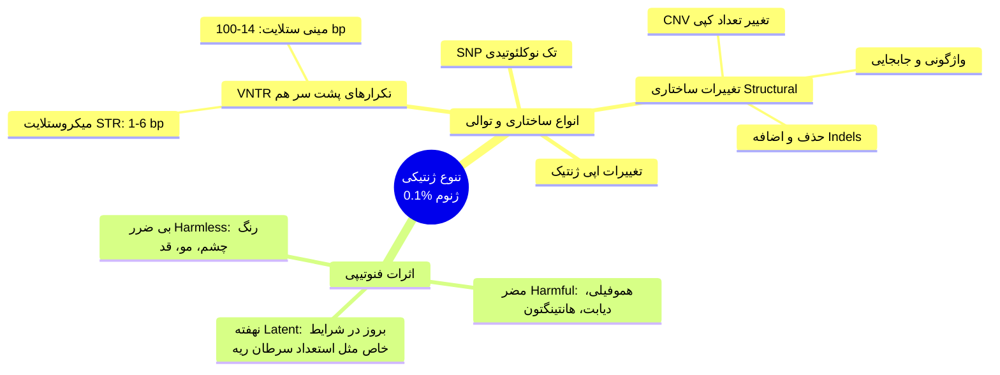
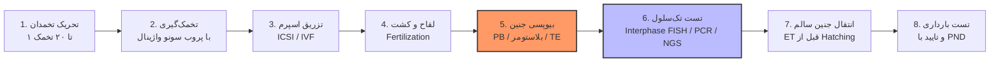
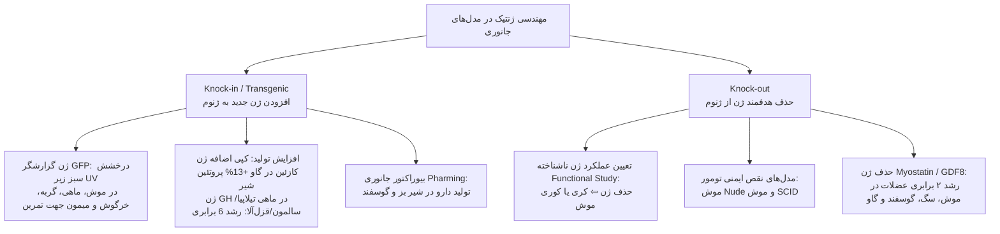
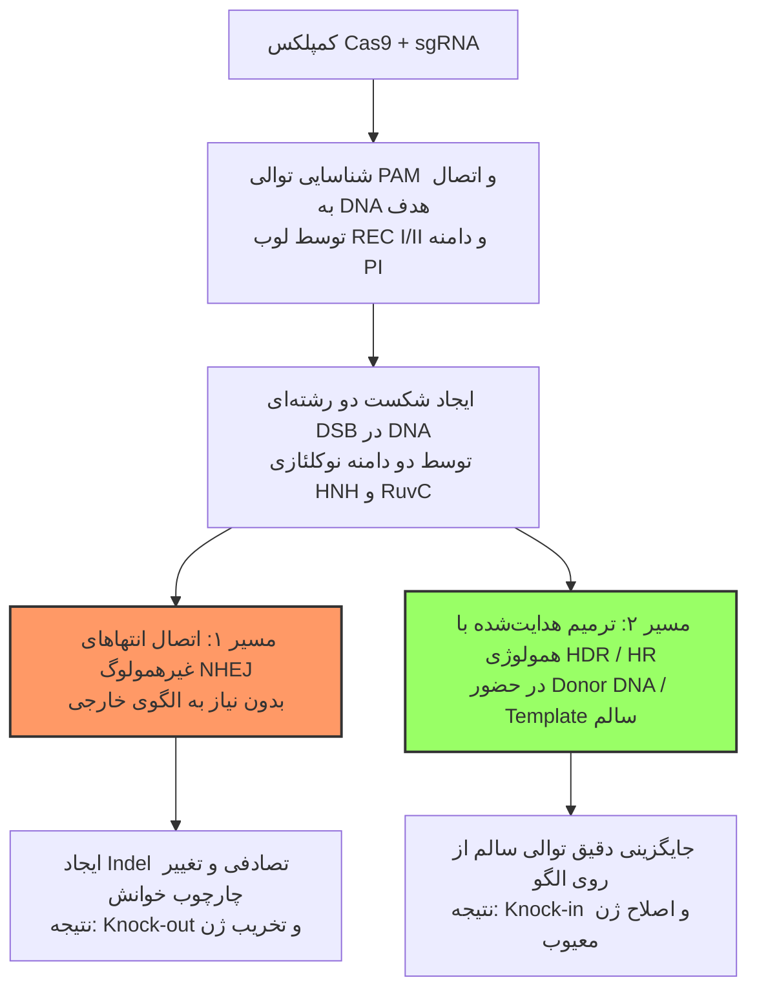

# بخش ۱: پزشکی فردمحور (Personalized Medicine)، فارماکوژنومیکس و NGS

## ۱. مفاهیم پایه: ژن، ژنوم و شبکه امیکس (Omics)

> [!note] تعاریف پایه ژنوم و ژن
> * **ژنوم (Genome):** کل ماده ژنتیکی و محتوای DNA هسته سلول (انسان: 3.3 × 10⁹ bp / نوکلئوتید).
> * **ژن مندلی:** واحد پایه وراثت.
> * **ژن مولکولی:** توالی نوکلئوتیدی DNA ⇦ رونویسی (Transcribe) به RNA عملکردی (۲ نوع: *Protein-coding* و *Non-coding*). انسان: **۲۰-۳۰ هزار ژن** (تخمین اسلاید: ~۲۵,۰۰۰) = فقط **۳-۵٪ کل ژنوم** (۹۵-۹۷٪ بقیه: *Junk DNA* یا غیرکدکننده).

* **بیان ژن و اسپلایسینگ:**
  1. **رونویسی (Transcription):** تبدیل DNA ⇦ Pre-mRNA.
  2. **اصلاحات پس از رونویسی (Post-transcriptional modification):** حذف اینترون‌ها (Introns) و اتصال اگزون‌ها (Exons) به هم (Splicing) + افزودن 5'cap و دم Poly-A ⇦ **mRNA بالغ**. پدیده **Alternative Splicing** ⇦ تولید ایزوفرم‌های مختلف پروتئینی از ۱ ژن واحد.
  3. **ترجمه (Translation) و تغییرات پس از ترجمه (PTM):** تبدیل mRNA (از کدون شروع AUG تا پایان UAG/...) ⇦ زنجیره آمینواسیدی ⇦ پروتئین عملکردی.
* **نواحی تنظیمی (Regulatory Sequences):** شامل پروموتور (Promoter: بخش‌های Proximal و Core)، Enhancer/Silencer، نواحی **5'UTR** و **3'UTR** (در Upstream و Downstream ژن) و Terminator. بدون ترجمه، اما حیاتی در **تنظیم بیان ژن (Expression Regulation)** و عملکرد نهایی.
* **شبکه مولکولی بیولوژی انسان (Multi-omics):**
  * بررسی DNA ⇦ **Genomics** | تغییرات اپی‌ژنتیک ⇦ **Epigenomics** | بررسی RNA و بیان ژن ⇦ **Transcriptomics** | پروتئین‌ها و PTM ⇦ **Proteomics** | متابولیت‌های سلولی ⇦ **Metabolomics** (سایر: *Lipidomics*، *Ionomics*، *Interactomics*، *Phenomics*).
* **ژنوتایپ و فنوتایپ:** **ژنوتایپ** = ساختار ژنتیکی / کتابچه DNA؛ **فنوتایپ** = شکل ظاهری، عملکرد پروتئین، بیماری‌های جسمی و *خصلت‌های رفتاری* (مثل خشونت) ناشی از برهم‌کنش **بیان ژن‌ها × عوامل زیست‌محیطی**.

## ۲. پروژه ژنوم انسان (HGP) و انقلاب NGS

* **پروژه ژنوم انسان (HGP):**
  * **تاریخچه:** ۱۹۹۰ تا ۲۰۰۳ (**۱۳ سال**، هزینه **میلیاردها دلار**، مشارکت آمریکا، چین، اروپا، ژاپن و...).
  * **روش:** سیستم **Sanger Sequencing** (سرعت ⇩، هزینه ⇧⇧؛ فردریک سنگر برنده ۲ نوبل، ابداع ۱۹۷۷).
  * **نمونه‌ها:** سکانس کل ژنوم (3.3 × 10⁹ باز) فقط از **تعداد محدودی اهداکننده خون** (**۹۳٪ از ۱۱ نفر** + **۷٪ از ۱ نفر**).
  * **۴ هدف HGP:** 1. تعیین توالی ۳ میلیارد جفت‌باز، 2. شناسایی تمام ژن‌های تخمینی، 3. ذخیره در **دیتابیس‌ها** (**NCBI** و **Ensembl** - هوم‌ورک)، 4. توسعه فناوری آنالیز جامع بیان ژن. پس از انسان ⇦ سکانس مدل‌ها (موش، مگس سرکه، گیاهان، مخمر، باکتری).

| موجود زنده (Organism) | اندازه تخمینی ژنوم | تعداد تخمینی ژن | تراکم متوسط ژن (Gene Density) | کروموزوم |
| :--- | :--- | :--- | :--- | :--- |
| **انسان (Homo sapiens)** | ۲,۹۰۰ میلیون باز | ~۲۵,۰۰۰ | ۱ ژن در ۱۰۰,۰۰۰ باز | ۴۶ |
| **موش (Mus musculus)** | ۲,۵۰۰ میلیون باز | ~۳۰,۰۰۰ | ۱ ژن در ۱۰۰,۰۰۰ باز | ۴۰ |
| **مگس سرکه (Drosophila)** | ۱۸۰ میلیون باز | ۱۳,۶۰۰ | ۱ ژن در ۹,۰۰۰ باز | ۸ |
| **گیاه خردل (Arabidopsis)** | ۱۲۵ میلیون باز | ۲۵,۵۰۰ | ۱ ژن در ۴,۰۰۰ باز | ۱۰ |
| **کرم لوله‌ای (C. elegans)** | ۹۷ میلیون باز | ۱۹,۱۰۰ | ۱ ژن در ۵,۰۰۰ باز | ۱۲ |
| **مخمر (S. cerevisiae)** | ۱۲ میلیون باز | ۶,۳۰۰ | ۱ ژن در ۲,۰۰۰ باز | ۳۲ |

* **توالی‌یابی نسل جدید (Next Generation Sequencing - NGS):**
  * **تکامل تاریخی:** سنگر (۱۹۷۷) ⇦ ژنوم میتوکندری انسان (۱۹۸۱) ⇦ شروع HGP (۱۹۹۰) ⇦ ژنوم کامل باکتری/سلول (۱۹۹۵) ⇦ ژنوم یوکاریوت (۱۹۹۶) ⇦ اتمام HGP (۲۰۰۱-۲۰۰۳) ⇦ نسل ۲: *454GS20* (۲۰۰۵) و *Genetic Analyzer 2* (۲۰۰۷) ⇦ پروژه میکروبیوم انسان HMP (۲۰۰۸ و فاز سوم ۲۰۱۹) ⇦ نسل ۳: *PacBio RS* (۲۰۱۱) و *Nanospace* (۲۰۱۴).
  * **ویژگی:** توالی‌یابی موازی عظیم (*Massively parallel*)، سرعت ⇧⇧ و هزینه ⇩⇩ ⇦ سکانس هزاران نفر (ایجاد دیتابیس ژنوم ایرانیان در گروه ژنتیک دانشگاه).
  * **۳ پایه تکنولوژیک NGS:** 1. کامپیوتر و **بیوانفورماتیک** (تحلیل کلان‌داده)، 2. **الکترونیک**، 3. **اپتیک و عکسبرداری** با حساسیت سطح مولکولی.

> [!important] نکته بالینی و امتحانی: انتخاب WGS، WES و Panel در NGS
> فقط **۳-۵٪** ژنوم کدکننده پروتئین (اگزون) است؛ لذا درخواست **Whole Genome Sequencing (WGS)** برای تشخیص روتین یا سرطان = **خطای فاحش** (هزینه و زمان ⇧⇧).
> * **WES (Whole Exome Sequencing):** فقط سکانس اگزون‌ها (همان ۳-۵٪)؛ سریع‌تر و ارزان‌تر ⇦ مناسب **بیماری‌های ژنتیکی نامشخص و جهش‌های نادر**.
> * **Panel:** فقط ژن‌های مرتبط با یک بیماری خاص (مثلاً پنل ناباروری یا پنل سرطان: *FoundationOne CDx* برای >300 ژن، *Guardant360*، یا *Oncotype DX* برای پیش‌بینی عود سرطان پستان اولیه و نیاز به شیمی‌درمانی) ⇦ **سرعت ⇧⇧ و هزینه ⇩⇩**.

* **کاربردهای کلیدی NGS در پزشکی فردمحور:**
  1. **بیماری‌های ارثی/نادر:** تشخیص جهش *CFTR* (فیبروز کیستیک) و بیماری‌های نادر.
  2. **ژنومیکس سرطان (Cancer Genomics):** سکانس DNA بیوپسی تومور یا RNA-seq (بررسی بیان ژن) ⇦ انتخاب شیمی‌درمانی/ایمونوتراپی هدفمند (موتاسیون تومور هر بیمار متفاوت است).
  3. **فارماکوژنومیکس:** پیش‌بینی اثربخشی، سمیت و دوز بهینه دارو.
  4. **تست غیرتهاجمی پیش از تولد (NIPT):** مثل *VeriSeq NIPT* (بررسی cffDNA خون مادر برای تریزومی ۲۱/داون؛ جایگزین ایمن آمنیوسنتز).
  5. **میکروبیوم و عفونت‌ها:** توالی‌یابی **16S rRNA** (میکروبیوم روده/واژن) و **Metagenomic sequencing** (شناسایی ویروس/باکتری جدید یا مقاوم؛ مثل سکانس کرونا در ایران توسط آزمایشگاه استاد).
  6. **پیش‌بینی بیماری‌های غیرواگیر:** ارزیابی ریسک دیابت نوع ۲، پرفشاری خون و قلبی-عروقی.
  7. **چالش‌ها و اخلاق:** وابستگی به اینترنت و دیتابیس‌ها جهت طراحی پرایمر؛ ملاحظات اخلاقی/قانونی (حفظ محرمانگی اطلاعات بیماری‌های لاعلاج/دیررس مثل هانتینگتون، دمانس، کری، کوری، سرطان سینه در برابر بیمه‌ها و کارفرمایان).

## ۳. تنوع ژنتیکی انسان (Genetic Variation) و پلی‌مورفیسم‌ها

* **تفاوت ژنتیکی:** هیچ ۲ انسانی (جز دوقلوهای همسان / Identical twins) ژنوم یکسانی ندارند. **۹۹.۹٪** ژنوم انسان‌ها یکسان است و تمام تفاوت‌های ظاهری، فردی و استعداد بیماری‌ها فقط در **۰.۱٪** ژنوم رخ می‌دهد! (بیشترین تنوع سایز در پستانداران: نژادهای سگ).
* **۴ علت تنوع ژنتیکی:**
  1. **جور شدن مستقل کروموزوم‌ها (Independent assortment):** ترکیب تصادفی کروموزوم‌های پدری و مادری در میوز (2²³ حالت؛ مثلاً به ارث بردن کروموزوم ۱ از مادربزرگ مادری در یک فرد و از پدربزرگ مادری در برادرش).
  2. **کراسینگ‌اور (Crossing over / Recombination):** تبادل ژن‌ها در میوز سلول جنسی.
  3. **رخدادهای جهشی (Mutational events).**
  4. **انتخاب طبیعی (Natural / Balancing selection).**

> [!note] تعریف پلی‌مورفیسم (Polymorphism)
> وجود ≥2 آلل/فرم مختلف در یک لوکوس ژنی در جمعیت کل جهان، به شرط فراوانی کمترین آلل **≥1%** در کل دنیا (مرز کشورها ملاک نیست؛ مثلاً موی بلوند در ایران <1% ولی در دنیا ≥1% ⇦ پلی‌مورفیسم). فراوانی <1% = **موتاسیون (Mutation)** یا واریانت نادر.

### الف) پلی‌مورفیسم‌های تک‌نوکلئوتیدی (SNPs - Snip)
* **ویژگی:** تغییر ۱ نوکلئوتید (مثلاً T به G) در **>15 میلیون نقطه** ژنوم (در چیپ‌های SNP Array ایران تا ۸۵ میلیون نقطه بررسی می‌شود). سال ۲۰۰۷ مجله *Science*: معرفی تنوع ژنتیکی انسان و SNP به عنوان *Breakthrough of the Year*.
* **کاربردهای SNP:** پزشکی قانونی (Forensics، تشخیص هویت اجساد جنگ)، مطالعات ارتباطی کل ژنوم (**GWAS**)، تخمین استعداد بیماری (Predisposition) یا عفونت، پزشکی فردمحور، و **ردیابی شجره‌نامه و مهاجرت قاره‌ای (Ancestry tracking)** با بررسی هاپلوگروپ مادری (mtDNA) و پدری (کروموزوم Y) تا ۵۰-۱۰۰ نسل قبل (مثال اسلاید استاد: ۷۷.۵٪ غرب آسیا [۶۹٪ ایرانی/ترکی/قفقازی + ۸.۵٪ عربی/شامی] و ۲۲.۵٪ آسیای مرکزی/جنوبی؛ تشابه هاپلوگروپ مادری با ناپلئون و ماری آنتوانت، پدری با بن افلک، برنی سندرز و ون‌گوگ؛ قرابت ژنتیکی سادات با کلینی و بنی‌اسرائیل/حضرت ابراهیم).
* **محل قرارگیری SNPها:**
  1. **کدکننده (Coding / اگزون):** *Synonymous* (بدون تغییر اسیدآمینه؛ موقعیت ۳ کدون) یا *Replacement / Non-synonymous* (تغییر اسیدآمینه: شامل **Functional** = جایگزینی قابل قبول، و **Non-functional** = ایجاد صفات یا بیماری).
  2. **غیرکدکننده (Non-protein coding):** پروموتور، 5'UTR، 3'UTR، اینترون، بین‌ژنی و سودوژن ⇦ موثر در **اسپلایسینگ**، **تنظیم رونویسی** (اتصال فاکتور رونویسی)، **تنظیم ترجمه** و جایگاه هدف **miRNA تنظیمی**.

#### مثال‌های بالینی و پاتولوژیک SNPها:
1. **ترومبوفیلی (Thrombophilia) و DVT:**
   * **پاتوفیزیولوژی:** ⇧ لخته‌پذیری خون (عامل **۱۵-۶۰٪ سقط‌های مکرر**، DVT و سکته مغزی).
   * **ژن‌های درگیر:** **فاکتور V لیدن (Factor V Leiden)** (جهش نقطه‌ای کدکننده ⇦ مقاومت پروتئین به غیرفعال شدن / Low inactivation ⇦ فعالیت مداوم آبشار انعقادی)؛ **فاکتور II / پروترومبین** (پلی‌مورفیسم ⇦ ⇧ پروترومبین پلاسما ⇦ ⇧ لخته)؛ **SERPINE1 / PAI-1** (مهارکننده فیبرینولیز؛ واریانت ⇦ ⇧ PAI-1 پلاسما ⇦ ⇩ لیز لخته)؛ و **MTHFR** (اختلال متابولیسم فولات و ⇧ لخته).
   * **سناریوی بالینی حیاتی:** خانم هتروزیگوت برای فاکتور V لیدن، فاکتور II و MTHFR + مصرف **قرص ضدبارداری (OCP)** + بی‌حرکتی در **پرواز طولانی** (۱۵ ساعت به کانادا) ⇦ بروز DVT و آمبولی/سکته مغزی؛ پیشگیری ساده: تجویز **آسپرین** قبل از پرواز.
2. **عدم تحمل لاکتوز (Lactose Intolerance):**
   * پلی‌مورفیسم ناحیه تنظیمی نزدیک ژن لاکتاز (*Near LCT*، ژنوتیپ GG) ⇦ ⇩ آنزیم لاکتاز ⇦ اسهال و علائم گوارشی با مصرف شیر.
   * **پراکندگی جغرافیایی (انتخاب طبیعی):** اروپا، آمریکا، روسیه و استرالیا بسیار پایین (۰-۲۰٪)؛ چین و آفریقا بسیار بالا (۸۰-۱۰۰٪)؛ ایران متوسط. (مدیریت: شیر بدون لاکتوز/بادام/سویا، کفیر، ماست ایسلندی، پنیر خامه‌ای غلیظ؛ تامین کلسیم و ویتامین D از کلم‌بروکلی، کلم‌پیچ، بادام، دانه چیا، خشخاش، سالمون و ساردین).
3. **کمبود آنزیم G6PD (فاویسم):**
   * حفظ در جمعیت‌ها با *Balancing selection* (مقاومت به مالاریا، مشابه کم‌خونی داسی‌شکل و گروه‌های خونی). واریانت A (۸۵٪ فعالیت آنزیمی) در آفریقای زیرصحرا ۴۰٪، خارج از آفریقا و خاورمیانه <1%.
   * **اهمیت بالینی:** تجویز اشتباه دارو در پلی‌مورفیسم شدید G6PD ⇦ **همولیز حاد و نارسایی کلیه**. احتیاط شدید در تجویز *کلشی‌سین* (نقرس)، *استرپتومایسین*، *ویتامین K*، *سولفونامیدها*، *آسپرین*، *کلروکین*، *داپسون* و *راسبوریکاز* (در جدول اسلاید ۳۳، برخی داروها در دوز درمانی برای واریانت‌های خفیف بدون آنمی همولیتیک غیراسفروسیتیک ایمن ذکر شده‌اند: استامینوفن، اسید اسکوربیک، کلرامفنیکل، دیفن‌هیدرامین، ایزونیازید، فنی‌توئین، پروبنسید، پروکائین‌آماید، پیریمتامین، کینیدین، کینین، تری‌متوپریم و...).
4. **سیستم HLA (MHC انسانی روی کروموزوم 6p21):**
   * طول ۳.۶ میلیون bp، به شدت پلی‌مورفیک (هزاران آلل؛ بیشترین تنوع در **HLA-B** با ۶۶۱ آلل [۵۸۰ پروتئین، ۱۹ آلل Null]، **HLA-DRB** با ۴۸۱ آلل، **HLA-A** با ۳۷۲ آلل [کشف HLA-A2 در ۱۹۵۲ توسط Dausset] و **HLA-C** با ۱۹۰ آلل؛ کلاس I = A, B, C, E, F, G؛ کلاس II = DP, DQ, DR, DM, DO + پروتئین‌های TAP1, TAP2, TAPBP, LMP, MICA, MICB؛ در موش: سیستم H-2 شامل K, D, L, O, M, A, E).
   * **اهمیت:** مقاومت به پاتوژن‌ها، تومورها و تطابق **پیوند اعضا (Transplantation)**. عدم تطابق آلل‌ها یا وجود آنتی‌بادی‌های از پیش شکل‌گرفته (Sensitization ناشی از بارداری، تزریق خون یا پیوند قبلی) یا ایجاد آنتی‌بادی جدید (de novo DSA) ⇦ **رد پیوند (Rejection)** (مدیریت حساسیت‌زدایی: پلاسمافرزیس، IVIG، اهداکننده کلیه زوجی).

### ب) تکرارهای پشت سر هم (VNTR / Tandem Repeats)
* **دسته‌بندی بر اساس سایز واحد تکرار:**
  * **میکروستلایت (Microsatellite) یا STR (Short Tandem Repeat):** تکرارهای **۱ تا ۶ نوکلئوتیدی** (مثل تکرار دو نوکلئوتیدی CACACA یا سه‌تایی CAG) = **۳٪ کل ژنوم انسان**.
  * **مینی‌ستلایت (Minisatellite):** تکرارهای **۱۴ تا ۱۰۰ نوکلئوتیدی**.
* **مثال بالینی شاهکار: گیرنده آندروژن (AR) و گیرنده‌های استروئیدی (SHRs):**
  * ساختار گیرنده استروئیدی: از N-terminal به C-terminal شامل نواحی **A/B (NTD / AF-1)**، **C (DBT - اتصال به DNA)**، **D (Hinge)** و **E (LBD / AF-2 - اتصال به لیگاند/دی‌هیدروتستوسترون)**.
  * در اگزون اول ژن AR (ناحیه N-terminal)، تکرار سه‌تایی `CTG(CAG)nCAA` (کدکننده گلوتامین) وجود دارد ⇦ تغییر تعداد تکرار CAG ⇦ تغییر ساختار پروتئین و قدرت اتصال هورمون به گیرنده:
    * **تکرار CAG کمتر (Shorter repeat):** اتصال محکم‌تر هورمون به گیرنده ⇦ **⇧ فعالیت رونویسی و عملکرد بسیار بالا** ⇦ ⇧ ریسک **سرطان پروستات**، سرطان بیضه، طاسی مردانه، عضله‌سازی شدید (Body building) و نیاز به دوز کمتر در جایگزینی تستوسترون.
    * **تکرار CAG بیشتر (Longer repeat):** اتصال شل‌تر هورمون به گیرنده ⇦ **⇩ فعالیت رونویسی و عملکرد پایین** ⇦ **ناباروری مردان** (اختلال اسپرماتوژنز)، هیپوگنادیسم، اختلالات استخوانی، قلبی-عروقی، نورودژنراتیو و روانپزشکی (نیاز به دوز بالاتر تستوسترون).

> [!warning] نکته طلایی بالینی (تله تشخیصی آزمایشگاه در اندوکرینولوژی)
> در آزمایش روتین خون برای ناباروری یا اختلالات اندوکرین، فقط **سطح سرمی هورمون** (تستوسترون، استروژن، پروژسترون، پرولاکتین، FSH، کورتیزول، مینرالوکورتیکوئید) سنجیده شده و نرمال گزارش می‌شود؛ در حالی که مشکل اصلی می‌تواند پلی‌مورفیسم و تغییر تکرارها در **گیرنده هورمون (Receptor)** (**AR, ER, PR, FSHR, GR, MR**) باشد! در آینده با NGS، سکانس ژن گیرنده مکمل/جایگزین تست سرمی خواهد شد.

### ج) کاربردهای Personal SNP Array در سبک زندگی (Lifestyle) و سلامت
* با بررسی **۸۵ میلیون SNP** در آزمایشگاه‌های ایران (تیم دکتر صالحی‌پور)، گزارش‌های زیر ارائه می‌شود:
  * **آلرژی و حساسیت:** واکنش آلرژیک، بادام‌زمینی، میگو، سگ، هلو، آسم، تب یونجه، التهاب مری، عدم تحمل الکل و هیستامین، صدابیزاری، عطسه واکنش به نور.
  * **روانشناسی:** ژن‌های اضطراب (۸ ناحیه: *RAD51, CNGB3, ADCY2, PTPRT, SDK1, PDE4B*؛ قرارگیری در ۵٪ پایین جامعه = خونسرد)، پیری مغز (۶۸ ناحیه: *MAPT, CRHR1, WNT3, RUNX2* و...)، خشم، تنهایی، آلزایمر، پارکینسون، ADHD، افسردگی، دوقطبی، بی‌اشتهایی عصبی، اسکیزوفرنی، فقدان لذت و PTSD.
  * **ورزش و فیزیولوژی:** پیش‌بینی **قد** (۱۳۵۷ ناحیه: *ACAN, ADAMTS* و...؛ کوتاه‌تر از میانگین = عدم موفقیت در بسکتبال)، **بافت چربی احشایی** (۱۹۸ ناحیه: *BDNF,CCK, CYP1A1, DIO2* و...)، توان هوازی (VO2max)، عملکرد استقامتی/قدرتی، BMI، تاندونوپاتی فوقانی/تحتانی، آسیب عضلانی و ریکاوری، ضربان قلب، نسبت دور کمر به لگن و سرعت راه رفتن.
  * **پوست و مو:** رنگدانه‌های پوستی (۱۹۳ ناحیه: *OCA2, TYR, TYRP1, HERC2, SLC45A2* و...؛ پوست تیره و برنزه شدن)، **آکنه** (۴۴ ناحیه: *BCL11A, EDAR, FGF10, TIMP3* و...؛ ریسک ژنتیکی پایین آکنه = جوش ناشی از آلودگی و تغییر فلور میکروبی پوست!)، جوانی و چروک پوست، پسوریازیس، ویتیلیگو، اگزما، افتادگی پلک، نیش پشه، ضخامت/حالت/سفیدی مو، کک‌ومک، ترک پوستی و طاسی مردانه.
  * **تغذیه (Nutrigenomics):** بررسی متابولیسم کافئین، چربی، کربوهیدرات، امگا ۳ و ۶، کلسیم، رژیم مدیترانه‌ای، پرخوری، طعم شیرین/تلخ/تند و ویتامین‌ها. **مثال شخصی استاد:** خونریزی مداوم لثه هنگام مسواک/روزه‌داری (مشکوک به افت پلاکت/لوسمی) ⇦ در SNP Array (۱۱ ناحیه ویتامین C: ژن‌های ناقل **SLC23A1, SLC23A3** و ژن متابولیسم **RER1** + *AKT1, GSTA1, MAF*) مشخص شد جذب ویتامین C در پایین‌ترین سطح جامعه است ⇦ درمان کامل با مصرف روزانه پرتقال/مکمل ویتامین C (منابع: سیب‌زمینی، طالبی، مرکبات، بروکلی، کلم قرمز، فلفل دلمه‌ای، توت سیاه، کیوی، آب گوجه، اسفناج).
  * **استعدادها (Talents):** درآمدزایی (۱۴۴ ناحیه: *FOXP1, FOXP2, BCL11A, LINGO1* و...)، ریاضی، موسیقی و ضرب‌آهنگ، خوانش‌پریشی (Dyslexia)، املا، تفکر منطقی، شناختی، تحصیلی، Multitasking و **حجم هیپوکامپ**.
  * **سلامت پیشرفته (پیش‌بینی بیماری‌های کشنده):**
    1. **کاردیومیوپاتی هایپرتروفیک خانوادگی:** ژن‌های **MYH7, MYL2, PRKAG2, TPM1, TTN** (هایپرتروفی زیر آئورت ⇦ ایست قلبی و مرگ ناگهانی / Sudden death در فوتبالیست‌ها و ورزشکاران).
    2. **آنفارکتوس قلبی (MI):** بررسی ۸۹ ناحیه (*APOE, LDLR, PCSK9, NOS3, TGFB1, ABO* و...؛ ۹۰٪ جامعه ریسک متوسط دارند).
    3. **هایپرکلسترولمی فامیلی:** بررسی ۱۲۵۸ ناحیه در ژن‌های **APOB** و **LDLR**.
    4. **آسم:** بررسی ژن‌های *IL6, IL7R, GATA3, STAT6, SMAD3* و... .

## ۴. فارماکوژنتیکس و فارماکوژنومیکس (Pharmacogenomics)

* **مقایسه ۳ دیدگاه طب:** 1. **طب سنتی:** تجویز گیاه حاوی صدها ماده ناشناخته بدون دوز دقیق به همه؛ 2. **طب نوین (Current Medicine):** رویکرد *One-treatment-fits-all* و آزمون و خطا (*Trial and error*)؛ 3. **طب فردمحور (Future/Precision Medicine):** تجویز **Right Dose** از **Right Drug** برای **Right Indication** به **Right Patient** در **Right Time** بر اساس ژنوم.
* **آمار حیاتی آمریکا:** سالانه **۱۰۰,۰۰۰ مرگ** و **>2,000,000 بستری بیمارستانی** در اثر عوارض ناخواسته دارویی (ADR).
* **میزان اثربخشی محدود داروهای شایع (درصد پاسخ‌دهی بیماران):**
  * فشار خون (ACE Inhibitors): **۱۰-۳۰٪** | نارسایی قلبی (Beta Blockers): **۱۵-۲۵٪** | ضدافسردگی‌ها (Antidepressants): **۲۰-۵۰٪** | کلسترول (Statins): **۳۰-۷۰٪** (ریسک میوپاتی) | آسم (Beta-2-agonists): **۴۰-۷۰٪**.

> [!note] تفاوت فارماکوژنتیکس و فارماکوژنومیکس
> * **فارماکوژنتیکس (Pharmacogenetics):** تاثیر تفاوت‌های ژنتیکی در **یک ژن واحد (Single gene)** بر پاسخ دارو (اثربخشی/سمیت).
> * **فارماکوژنومیکس (Pharmacogenomics):** تاثیر تفاوت‌های ژنومی در **چندین ژن (Multiple genes / کل ژنوم)** بر پاسخ دارویی.

* **عوامل موثر بر پاسخ دارو:** سن، نژاد، وزن، جنسیت، بیماری‌ها و داروهای همزمان، عوامل اجتماعی و **ژنتیک**.
* **۴ مرحله تحت تاثیر ژنتیک:** 1. سرعت جذب، 2. **متابولیسم کبدی** (آنزیم‌های سیتوکروم P450)، 3. دفع/فیلتراسیون کلیوی و صفراوی، 4. **گیرنده‌های هدف دارو (Target receptors)** (تعداد زیاد، کم، فقدان یا تغییر شکل گیرنده).
* **۴ فنوتایپ متابولیسمی کبد:** *Ultrarapid metabolizers* (نیاز به دوز ⇧⇧ مثلاً ۵۰۰ mg)، *Extensive (normal) metabolizers* (دوز نرمال ۱۰۰ mg)، *Intermediate metabolizers*، و *Poor metabolizers* (متابولیسم ⇩⇩ ⇦ تجمع دارو و سمیت کشنده؛ نیاز به دوز ⇩⇩ مثلاً ۱۰ mg).

### داروهای شاخص در فارماکوژنومیکس (فوق‌العاده امتحانی)

| نام دارو (Drug) | ژن / آنزیم یا گیرنده | مکانیسم و پیامد بالینی اختلال ژنتیکی | اقدام بالینی و الزام FDA |
| :--- | :--- | :--- | :--- |
| **6-Mercaptopurine** (آزاتیوپرین / تیوگوانین) | آنزیم کبدی **TPMT** (تیوپورین متیل‌ترانسفراز) | شیمی‌درمانی لوسمی (توکسیک). **هتروزیگوت:** متابولیسم کند؛ **هموزیگوت معیوب:** عدم متابولیسم و تجمع دارو ⇦ **سمیت کشنده (Fatal)**. | کاهش دوز در نقص TPMT (تست ژنتیک توسط FDA **توصیه شده / Recommended**). |
| **Warfarin** (ضد انعقاد دریچه مصنوعی) | آنزیم **CYP2C9** (فارماکوکینتیک) و **VKORC1** (فارماکودینامیک) + *CYP4F2* | مهارکننده اپوکسید ردوکتاز ویتامین K. پنجره درمانی باریک؛ **تغییر دوز تا ۱۰ برابر**! متابولیسم کند (*2/*2, *3/*3 و AA) ⇦ **Overdose و خونریزی مغزی کشنده**؛ سریع (*1/*1 و GG) ⇦ **Underdose و ترومبوز/سکته**. | تست ژنتیک قبل از تجویز توصیه شده (زمان رسیدن به دوز پایدار در *1/*1: ۴-۵ روز؛ *1/*2: ۸-۱۰ روز؛ *1/*3, *2/*2, *3/*3: **۱۲-۱۵ روز**). تنظیم با INR. |
| **Codeine** (اپیوئید ضد درد) | آنزیم کبدی **CYP2D6** (کروموزوم ۲۲) | کدئین **پیش‌دارو (Prodrug)** است ⇦ تبدیل به **مورفین** توسط CYP2D6. **۷٪ سفیدپوستان (Caucasians)** فاقد نسخه فعال ژن ⇦ **عدم اثر ضددرد کدئین** (تفاوت اثر مواد مخدر در افراد). | تعیین ژنوتیپ با چیپ تجاری **Roche AmpliChip CYP450** (بررسی CYP2D6 و CYP2C19 با ۱ قطره خون؛ تایید FDA). |
| **Clopidogrel (Plavix)** (ضد پلاکت قلبی؛ فروش ۲.۳ میلیارد دلار) | آنزیم **CYP2C19** (کروموزوم ۱۰)، *CYP3A4, 1A2, 2B6, 2C9* و ناقل روده‌ای *ABCB1* | ۸۵٪ دارو توسط CES1 هیدرولیز و غیرفعال شده و فقط ۱۵٪ در کبد به `2-oxo-clopidogrel` و متابولیت فعال (بلاک گیرنده P2Y12 پلاکت) تبدیل می‌شود. جهش CYP2C19 یا مصرف PPI ⇦ عدم تولید متابولیت فعال ⇦ **MI حاد و ترومبوز**. | دارای **هشدار جعبه سیاه (Black-box warning) از FDA**؛ تست با AmpliChip (شیوع Poor metabolizer در آسیایی‌ها ۱۵-۲۰٪!). |
| **Trastuzumab (Herceptin)** (ایران: *آریوتراست*) | گیرنده سطح سلولی **HER2/neu** | آنتی‌بادی مونوکلونال (**-mab**) علیه سرطان پستان و معده ⇦ بلاک گیرنده HER2، توقف تقسیم سلول، مهار آنژیوژنز (VEGF) و تحریک ایمنی سلولی (NK cell از طریق FcγRIII). (تاموکسیفن در ۶۵٪ موارد ER+ مقاومت می‌دهد). | تست HER2 قبل از تجویز **اجباری (Required)** است؛ در HER2 منفی کاملاً بی‌اثر و تحمیل هزینه میلیونی! |
| **Vemurafenib (Zelboraf)** | جهش ژن **BRAF V600E** | داروی کوچک‌مولکول (**-nib**)؛ مهار پروتئین جهش‌یافته BRAF V600E در **۵۰٪ بیماران ملانومای متاستاتیک/غیرقابل جراحی**. در فاقدین جهش بی‌اثر. | تایید همزمان دارو و کیت همراه (*Cobas 4800*) توسط FDA در زمان رکوردشکنی **۳.۶ ماه** (آگوست ۲۰۱۱). |
| **Crizotinib (Xalkori)** | بازآرایی ژن **ALK** | مهار تومورهای دارای ژن غیرطبیعی ALK در **۵٪ سرطان ریه سلول غیرکوچک (NSCLC)**. | تایید همزمان دارو با تست همراه (**ALK FISH probe**) توسط FDA در **۴.۹ ماه** (کارآزمایی روی فقط ۲۵۵ بیمار). |

* **سایر جزئیات مسیرها، سیتوکروم‌ها و قوانین:**
  * **متابولیسم کدئین و مورفین در کبد:** کدئین توسط *CYP3A4* به نورکدئین و توسط *UGT2B7* به کدئین-۶-گلوکورونید تبدیل می‌شود؛ مورفین توسط **UGT1A1** و *UGT2B7* به مورفین-۳ و ۶-گلوکورونید تبدیل شده و از طریق ناقل‌های **ABCB1, ABCC2, ABCC3, SLCO1B1** وارد صفرا (Bile) و دفع می‌گردد.
  * **الزامات FDA (Required / Recommended):** تست **EGFR** برای *Cetuximab* (**اجباری / Required**)؛ تست **UGT1A1** برای *Irinotecan* (توصیه شده)؛ تست **نقص آنزیم چرخه اوره** برای *Valproic acid* (توصیه شده)؛ تست **G6PD** برای *Dapsone* و *Rasburicase* (توصیه شده). (در اسلاید ۶۹: بررسی فارماکوژنتیک *فلکاینید، هیدروکلروتیازید، متوپرولول و سیمواستاتین*؛ واریانت `rs12777823` در پاکسازی وارفارین در آفریقایی‌تبارها و `c.-1639G>A` در VKORC1).
  * **جدول پلی‌مورفیسم‌های سیتوکروم P450 (اسلاید ۷۸):**
    1. **CYP2B6 (کروموزوم ۱۹):** متابولیسم کند در ۳-۴٪ سفیدپوستان؛ سوبستراها: *بوپروپیون، سیکلوفسفامید، افاویرنز، ایفسفامید، متادون*.
    2. **CYP2C9 (کروموزوم ۱۰):** متابولیسم کند در ۱-۳٪ سفیدپوستان؛ سوبستراها: *NSAIDها (سلکوکسیب، دیکلوفناک، ایبوپروفن، ناپروکسن، پیروکسیکام)، ضدقند خوراکی (تولبوتامید، گلیپیزاید)، ARBها (ایربزارتان، لوزارتان)، فلوواستاتین، فنی‌توئین، وارفارین*.
    3. **CYP2C19 (کروموزوم ۱۰):** متابولیسم کند در ۲-۴٪ سیاه‌پوستان، ۳-۵٪ سفیدپوستان و **۱۵-۲۰٪ آسیایی‌ها**؛ سوبستراها: *مهارکننده‌های پمپ پروتون (PPI)، آمی‌تریپتیلین، سیکلوفسفامید، دیازپام، ایندومتاسین، فنی‌توئین، فنوباربیتال، پروژسترون، وریکونازول، کلوپیدوگرل*.
    4. **CYP2D6 (کروموزوم ۲۲؛ >100 پلی‌مورفیسم):** متابولیسم کند در ۵-۱۰٪ سفیدپوستان؛ سوبستراها: *ضدافسردگی‌ها، بتابلاکرها، آنتی‌سایکوتیک‌ها، کلرفنیرامین، کدئین، دکسترومتورفان، اندانسترون، لیدوکائین، پرومتازین، تاموکسیفن، ترامادول*.
  * **قانون و اقتصاد:** تصویب قانون **GINA (Genetic Information Nondiscrimination Act - 2008 / Public Law 110-233)** در آمریکا و اصلاح قانون ERISA 1974 جهت منع تبعیض توسط بیمه‌های سلامت و کارفرمایان بر اساس اطلاعات ژنتیکی (مثلاً در فرد دارای جهش *BRCA1* با ریسک ۸۵٪ سرطان). پیشنهاد **۵.۷ میلیارد دلاری** شرکت داروسازی سوئیسی **Roche** (بازل) در سال ۲۰۱۲ برای خرید (Hostile takeover) شرکت آمریکایی **Illumina** (بزرگترین تولیدکننده دستگاه‌های سکانسینگ در سن‌دیگو؛ دفاع ایلومینا با استراتژی *Poison Pill*) جهت ادغام تشخیص ژنتیکی در تولید دارو (درآمد ۲۵ میلیارد دلاری تست‌های ژنتیک در سال).

---

# بخش ۲: تشخیص ژنتیکی پیش از تولد (PND) و پیش از لانه‌گزینی (PGD)

## ۱. تعاریف پایه و زمان‌بندی تست‌های ژنتیکی

> [!note] تعاریف تست‌های تشخیصی و غربالگری
> * **تست تشخیصی (Diagnostic Test):** انجام در حضور وضعیت مشکوک یا علامت/سابقه قبلی (*Suspected condition*) جهت تایید یا رد قطعی بیماری. بهترین و دقیق‌ترین تست در دسترس = **Gold Standard**.
> * **زمان‌بندی تست‌ها در طول حیات:** قبل از بارداری (PGD و Carrier Screening) ⇦ حین بارداری (PNS و PND) ⇦ بدو تولد (Newborn Screening) ⇦ قبل از بروز علائم (Early Detection / Pre-symptomatic / Predictive) ⇦ بروز علائم (Diagnostic، Pharmacogenetic و Prognostic) ⇦ پس از مرگ (Forensic Medicine).
> * **تشخیص پیش از تولد (PND):** تست تشخیصی تهاجمی در **حین بارداری** برای تعیین قطعی ابتلای جنین.
> * **تشخیص پیش از لانه‌گزینی (PGD / PGT-M):** تست تشخیصی ژنتیکی روی **جنین ۳ روزه (یا ۵ روزه) حاصل از IVF در لوله آزمایش**، قبل از انتقال به رحم.
> * **غربالگری پیش از لانه‌گزینی (PGS / PGT-A):** بررسی جنین‌های IVF در زوج‌های **بدون سابقه بیماری ژنتیکی خاص**، صرفاً جهت غربالگری آنیوپلوئیدی‌های شایع (تریزومی یا مونوزومی **21, 18, 13, X, Y**) با روش FISH یا Array (در ایران به دلیل هزینه بالا کاربرد کمی دارد).

## ۲. تشخیص پیش از تولد (PND)

* **۵ اندیکاسیون اصلی PND:**
  1. **سابقه خانوادگی بیماری ژنتیکی:** تالاسمی، فیبروز کیستیک (CF)، کم‌خونی داسی‌شکل (Sickle cell)، تای‌ساکس (Tay-Sachs).
  2. **مدیریت بارداری پرخطر:** سابقه سقط مکرر (Recurrent abortion)، سن بالای مادر، مشکلات بارداری قبلی.
  3. **گزارش High-Risk در غربالگری (PNS):** مثبت شدن تست سه‌گانه (Triple)، چهارگانه (Quad) یا NIPT.
  4. **ناهنجاری آناتومیک در سونوگرافی:** نقایص قلبی مادرزادی یا نقایص لوله عصبی (NTD) (گاهی بدون نیاز به PNS مستقیماً PND انجام می‌شود).
  5. **پایش سلامت جنین (Fetal Health Monitoring):** بررسی ضربان قلب و حرکات جنین یا استرس شدید مادر (با تشخیص ضرورت توسط پزشک).
* **چالش تصمیم‌گیری در PND (مثال اتوزومال مغلوب مثل تالاسمی):**
  * ازدواج دو ناقل (Carrier) ⇦ ۲۵٪ فرزند کاملاً سالم، ۵۰٪ ناقل سالم (مشابه والدین)، **۲۵٪ بیمار مبتلا (Affected / Homozygote)**.
  * جنین مبتلا یک بیمار (Patient) است و چون درمانی ندارد، تنها راه **سقط درمانی (Abortion / قتل جنین)** است؛ نیازمند ۴ شرط: 1. پذیرش والدین، 2. آمادگی مادر برای استرس جسمی (کورتاژ) و روحی، 3. مجوز قانونی و اخلاقی، 4. **زمان مناسب (در ایران: حتماً قبل از پایان ۴ ماهگی قمری / حدود هفته ۱۹-۲۰ بارداری)**.
* **۸ مرحله استاندارد انجام PND:**
  1. **مشاوره پیش از تست (Pre-Test Counseling):** کار تیمی مشاور ژنتیک و متخصص زنان؛ بررسی اندیکاسیون، مزایا و ریسک‌ها.
  2. **انتخاب تست مناسب (Choosing Test):** انتخاب CVS یا آمنیوسنتز پس از غربالگری.
  3. **آماده‌سازی و اخذ رضایت‌نامه (Test Preparation & Consent):** توضیح تهاجمی بودن تست، ریسک سقط ناشی از نمونه‌گیری (**0.01% تا 0.1% / کمتر از ۱٪**)، اخذ رضایت‌نامه قانونی (Informed consent) و برنامه‌ریزی زمانی (**۱ هفته زمان** برای پروسه‌های پزشکی قانونی).
  4. **نمونه‌گیری (PND Sampling):**
     * **پرزهای کوریونی جفت (CVS):** در **هفته ۱۲ تا ۱۳ بارداری** (Transcervical یا Transabdominal زیر گاید سونوگرافی). **نکته حیاتی:** بیوپسی باید اکیداً از **بخش جنینی جفت (Trophoblast)** انجام شود نه بخش مادری! (چند هزار سلول؛ کاربرد در کاریوتایپ، DNA و بیوشیمی).
     * **آمنیوسنتز (Amniocentesis):** در **هفته ۱۳ تا ۱۵ بارداری**؛ کشیدن چند سی‌سی مایع آمنیوتیک حاوی سلول‌های جداشده از پوست و مخاط جنین (سلول برای کاریوتایپ، DNA و بیوشیمی؛ مایع برای بیوشیمی).
     * *روش‌های بدون کاربرد روتین در ایران:* خون بند ناف (**Cordocentesis / Fetal blood** برای کاریوتایپ، DNA، سرولوژی، هماتولوژی و بیوشیمی) و بیوپسی بافت جنین (پوست، عضله، کبد) ⇦ چون در **بالای ۲۰ هفتگی** انجام می‌شوند و در ایران بعد از ۲۰ هفتگی مجوز سقط صادر نمی‌شود، برای PND بی‌فایده‌اند (*Useless*)! خون مادر (**Maternal blood**) نیز غیرتهاجمی است اما فقط ارزش غربالگری (PNS/NIPT) دارد و **هرگز بر اساس خون مادر یا غربالگری مجوز سقط صادر نمی‌شود**.
  5. **آنالیز آزمایشگاهی (Laboratory Analysis):**
     * *سیتوژنتیک (اختلالات کروموزومی تعدادی و ساختاری بزرگ):* **Karyotyping**، **FISH** و **CGH**.
     * *مولکولی (جهش نقطه‌ای و حذف/اضافه‌های کوچک):* انواع **PCR** (شامل PCR-RFLP, Nested PCR, RT-PCR)، **Reverse dot blotting**، **MLPA** (تشخیص حذف‌های کوچک)، **Sanger Sequencing** و **NGS**.
  6. **تفسیر نتایج و مشاوره پس از تست (Results Interpretation):** توضیح نتیجه (سالم، ناقل یا مبتلا) به والدین.
  7. **مراقبت پیگیری (Follow-Up Care):** ارجاع به متخصص زنان جهت سقط یا ادامه بارداری.
  8. **حمایت روانی و مشاوره آینده:** تاکید بر پابرجا بودن ریسک ۲۵٪ در بارداری‌های بعدی (لزوم تکرار PND/PGD) و بررسی سایر اعضای خانواده.

> [!warning] ۴ قانون طلایی و حیاتی در PND (مورد تاکید شدید استاد)
> 1. **حجم کم نمونه و لیبلینگ (Labeling):** نمونه جنینی بسیار کم است. **خطای لیبل زدن** روی لوله‌ها هنگام آمنیوسنتز فاجعه‌بار است (مثال واقعی استاد در ۱۵-۲۰ سال پیش: جابجایی لیبل دو بیمار ⇦ سقط جنین سالم یک خانواده و تولد نوزاد تالاسمی ماژور در خانواده دیگر!).
> 2. **کنترل آلودگی مادری (Maternal Contamination):** چک کردن نشانگرهای **STR** برای تایید خلوص نمونه جنینی الزامی است.
> 3. **قانون طلایی "Must check parents in advance BEFORE pregnancy":** قبل از بارداری باید دقیقاً نوع جهش/حذف در والدین مشخص شود («اول باید دزد را بشناسیم تا در زمان کم بارداری پیدایش کنیم»). حین بارداری فرصت گشتن در ۳.۳ میلیارد نوکلئوتید نیست!
> 4. **تایید نتیجه با روش دوم:** چون نتیجه PND مجوز سقط (قتل جنین) است، آزمایشگاه باید نتیجه را با **حداقل ۲ متد مختلف** چک و تایید کند.

* **۶ محدودیت اصلی PND (مواردی که PND کاربرد ندارد):** 1. ممنوعیت قانونی/مذهبی سقط (مثل عراق)، 2. **بیماری‌های مولتی‌فاکتوریال**، 3. **بیماری‌های با شروع دیررس (Late-Onset)** مثل **هانتینگتون** (شروع ۴۰ سالگی) یا جهش سرطان‌زای **BRCA1/2** (عدم مجوز سقط برای بیماری بزرگسالی)، 4. **تغییرات تعداد کپی (CNV)** (مثلاً ۵ کپی از ژن که فقط ۱ کپی معیوب است)، 5. شرایط غیرژنتیکی و محیطی (اوتیسم، عفونت‌ها، توکسین‌ها)، 6. **جهش‌های ناشناخته (Unknown mutations)** یا خارج از پنل.

## ۳. تشخیص ژنتیکی پیش از لانه‌گزینی (PGD)

> [!important] شاه‌کلید امتحانی PGD
> در PGD چون لقاح به روش **IVF (درون لوله آزمایش)** انجام شده و فقط جنین سالم به رحم منتقل می‌شود (**انتخاب احسن** بین جنین‌های بالقوه بدون دستکاری ژنوم انسان)، **هیچ بارداری قبلی و هیچ سقط جنینی (NO Abortion) وجود ندارد!** لذا PGD روش انتخابی برای **تمام بیماری‌های فاقد مجوز سقط قانونی/شرعی** است (برای بیماری‌های دارای مجوز سقط مثل تالاسمی نیز جهت پرهیز از استرس سقط قابل انجام است).

* **کاربردهای اختصاصی PGD (پزشکی و غیرپزشکی):**
  * بیماری‌های فاقد مجوز سقط: **ناشنوایی (Deafness - جهش ژن Connexin 26)**، **نابینایی (Blindness / Retinitis Pigmentosa - RP)**، حذف کروموزوم Y.
  * بیماری‌های با شروع دیررس: **هانتینگتون** و استعداد سرطان‌ها.
  * **تطابق سازگاری بافتی (HLA Typing) برای نجات فرزند اول (Savior Sibling):** زوج دارای فرزند اول مبتلا به تالاسمی ماژور یا لوسمی نیازمند پیوند مغز استخوان (BMT) ⇦ با PGD جنینی انتخاب می‌شود که هم سالم باشد و هم از نظر **HLA کاملاً منطبق (Matched)** با فرزند اول باشد (چون جنین سالم ولی غیرمنطبق از نظر HLA را نمی‌توان در بارداری طبیعی سقط کرد، PND غیرممکن است!).
  * **تعیین جنسیت (Gender Selection):** کاربرد غیرپزشکی (توازن خانواده؛ فریز کردن جنین‌های جنس دیگر) و کاربرد پزشکی برای **بیماری‌های وابسته به X (X-linked):** دیستروفی عضلانی دوشن (DMD) و بکر (BMD)، هموفیلی، سندرم X شکننده (FXS)، سندرم هانتر (Hunter)، سندرم منکه (Menke) و سندرم چشمی-مغزی-کلیوی Lowe. (کاتولیک‌ها PGD را ممنوع می‌دانند چون معتقدند روح در لحظه لقاح دمیده می‌شود؛ لذا در آلمان فقط بیوپسی جسم قطبی انجام می‌شود).
  * سایر موارد: سقط مکرر خودبه‌خودی (**RSA > 3**)، زوج نابارور کاندید IVF، جابجایی‌های کروموزومی رابرتسونین یا متقابل و واژگونی‌ها، بیماری‌های میتوکندریایی و تک‌ژنی (سیستیک فیبروزیز، آتروفی عضلانی نخاعی طفولیت SMA، دیستروفی میوتونیک، بتاتالاسمی، داسی‌شکل).

* **۳ روش بیوپسی جنین در PGD (بحرانی‌ترین مرحله تکنیکی):**
  1. **بیوپسی جسم قطبی (Polar Body - PB):** برداشت اجسام قطبی تخمک (میوز II)؛ غیرتهاجمی‌ترین روش، اما **فقط اطلاعات ژنتیکی مادری (Maternal)** را نشان می‌دهد و برای بررسی ژن‌های پدری یا جنسیت بی‌ارزش است (کاربرد در آلمان).
  2. **بیوپسی بلاستومر (Blastomere / Cleavage Stage):** در **روز ۳ پس از لقاح**؛ سوراخ کردن زونا پلوسیدا و برداشت **۱ یا ۲ سلول از جنین ۶ تا ۸ سلولی** (سلول‌ها بنیادی هستند). روش روتین فعلی، اما **ریسک موزائیسم** و کاهش قدرت لانه‌گزینی بالاتر است.
  3. **بیوپسی تروفکتودرم (Trophectoderm - TE / Blastocyst Stage):** در **روز ۵ یا ۶ پس از لقاح**؛ برداشت **۵ تا ۱۰ سلول** از تروفکتودرم (بخش جفتی آینده، بدون دست زدن به توده سلولی داخلی / ICM). **استاندارد طلایی، ایمن‌ترین و دقیق‌ترین روش** (کاهش خطای موزائیسم و ADO)، اما **محدودیت شدید زمانی** دارد (فقط چند ساعت تا <1 روز فرصت جوابدهی؛ چون اگر جنین به مرحله **Hatching / پارگی زونا پلوسیدا و خروج سلول‌ها** برسد دیگر قابل انتقال به رحم نیست!).
* **موزائیسم (Mosaicism):** وجود ≥2 جمعیت سلولی با کاریوتایپ/ژنوم متفاوت در یک جنین ناشی از **خطای میتوزی پس از لقاح** (تفاوت احتمالی سلول‌های TE با ICM؛ برداشت ۱ سلول در روز ۳ ممکن است به طور تصادفی همان سلول معیوب باشد و جنین سالم دور انداخته شود).

> [!warning] ۳ نکته فوق‌العاده امتحانی در تکنیک‌های آزمایشگاهی PGD
> 1. **چرا در PGD کاریوتایپ (Karyotyping) نداریم و فقط Interphase FISH داریم؟**
>    چون در بیوپسی بلاستومر فقط **۱ سلول** و **<1 روز (چند ساعت)** فرصت داریم؛ کشت ۱ سلول برای رسیدن به متافاز کاریوتایپ هفته‌ها زمان می‌برد. لذا برای بررسی کروموزومی فقط از **Interphase FISH** استفاده می‌شود (کروموزوم‌ها در هسته اینترفازی به صورت **نقاط نوری رنگی / Dots** شمارش می‌شوند؛ مثلاً ۳ نقطه آبی = تریزومی ۲۱؛ تعیین جنسیت با پروب X و Y).
> 2. **کنترل کیفی (QC) و تشخیص آلودگی با ۱۳ مارکر CODIS STR:**
>    چون تست مولکولی PGD روی **تنها ۱ سلول** انجام می‌شود، ورود ۱ سلول خارجی از هوا یا عطسه تکنسین کل نتیجه را تغییر می‌دهد! برای تشخیص آلودگی در PGD/PND از **۱۳ لوکوس استاندارد STR سیستم CODIS** (متعلق به FBI در پزشکی قانونی، با طول تکرار ۲-۶ bp که ۳٪ ژنوم را می‌سازند) استفاده می‌شود: **TPOX** (کروموزوم ۲)، **D3S1358** (ک ۳)، **FGA** (ک ۴)، **D5S818** و **CSF1PO** (ک ۵)، **D7S820** (ک ۷)، **D8S1179** (ک ۸)، **TH01** (ک ۱۱)، **VWA** (ک ۱۲)، **D13S317** (ک ۱۳)، **D16S539** (ک ۱۶)، **D18S51** (ک ۱۸)، **D21S11** (ک ۲۱) + ژن تعیین جنسیت **AMEL** (روی X و Y).
>    * *سایر کاربردهای STR و CODIS:* پروفایلینگ مجرمین و زندانیان (از خون یا سلول مخاط دهان / Buccal)، تست ابوت (Paternity testing؛ سالانه ۱۰۰ هزار مورد در آمریکا/کانادا)، شناسایی اجساد متلاشی‌شده در جنگ و بمباران، تبرئه افراد بی‌گناه (Exoneration) و ژنتیک جمعیت.
> 3. **پدیده حذف آللی (Allelic Dropout - ADO) (مختص PGD تک‌سلولی / PGT-M و PGT-SR):**
>    * **مکانیسم:** در ۱ سلول فقط ۲ رشته DNA (دو کروموزوم) وجود دارد؛ شکستن یکی از رشته‌ها در محل اتصال پرایمر حین استخراج یا PCR ⇦ **عدم تکثیر یکی از آلل‌ها (ADO)**.
>    * **پیامد خطرناک:** موزائیسم کاذب یا تشخیص غلط هتروزیگوت به عنوان هموزیگوت! در بیماری اتوزومال مغلوب (AR مثل تالاسمی) شکستن آلل سالم فقط باعث دور انداختن جنین ناقل می‌شود؛ اما در **اتوزومال غالب (AD مثل کلیه پلی‌کیستیک بزرگسالان)** اگر آلل بیمار دچار ADO شود، فقط آلل سالم تکثیر شده و **جنین بیمار به اشتباه سالم تشخیص داده و به رحم منتقل می‌شود (فاجعه بالینی)!**
>    * **۴ راهکار پیشگیری از ADO:** 1. برداشت ≥2 سلول (بیوپسی تروفکتودرم)، 2. بررسی همزمان نشانگرهای پلی‌مورفیک (**STR یا SNP**) مجاور ژن (در فاصله **۱ سانتی‌مورگان**) برای ردیابی هاپلوتایپ والد مبتلا (Linkage analysis؛ مثلاً ردیابی استی‌آر ۷ تکراری مادر)، 3. افزایش عمق توالی‌یابی (NGS depth) با چند لوکوس، 4. **انجام حتمی PND در حین بارداری برای تایید نتیجه PGD** (به ویژه در بیماری‌های AD).

### جدول مقایسه جامع PND و PGD (پاسخ سوال هوم‌ورک)

| ویژگی مقایسه‌ای | تشخیص پیش از تولد (PND) | تشخیص پیش از لانه‌گزینی (PGD / PGT-M) |
| :--- | :--- | :--- |
| **زمان انجام و نوع بارداری** | حین بارداری طبیعی (هفته ۱۲ تا ۱۵ بارداری). | قبل از بارداری، روی جنین ۳ یا ۵ روزه حاصل از **IVF / ICSI**. |
| **نیاز به سقط درمانی (Abortion)** | در صورت ابتلای جنین، نیازمند **سقط جنین** (محدودیت شدید قانونی/شرعی). | **بدون نیاز به سقط (NO Abortion)**؛ انتخاب احسن و انتقال جنین سالم. |
| **روش نمونه‌گیری (Biopsy)** | پرزهای کوریونی جفت (**CVS**) یا مایع آمنیوتیک (**Amniocentesis**). | جسم قطبی (**PB**)، بلاستومر روز ۳ (**۱-۲ سلول**)، یا تروفکتودرم روز ۵ (**۵-۱۰ سلول**). |
| **تعداد سلول و محدودیت زمانی** | هزاران سلول در دسترس؛ چند هفته (تا قبل از ۴ ماهگی قمری) فرصت جوابدهی. | فقط ۱ تا چند سلول؛ فرصت جوابدهی **<1 روز (چند ساعت)** قبل از Hatching. |
| **روش سیتوژنتیک و خطاهای تکنیکی** | امکان **Karyotype متافازی**، FISH و CGH؛ عدم بروز مشکل شدید ADO. | عدم امکان کاریوتایپ؛ فقط **Interphase FISH**، PCR و NGS؛ ریسک بالای **ADO** و **موزائیسم**. |
| **دامنه کاربرد بالینی** | فقط بیماری‌های شدید دارای مجوز سقط قانونی در قبل از ۴ ماهگی. | تمام بیماری‌ها (از جمله کری، کوری، Late-onset، **تطابق HLA** و **تعیین جنسیت**). |

## ۴. قوانین سقط درمانی در ایران (قانون جوانی جمعیت ۱۴۰۰) و سناریوی بالینی

* **ماده ۵۳ (غربالگری) و ماده ۵۴ (ثبت در سامانه):** کادر درمان مجاز به توصیه یا تشویق روتین مادران به غربالگری نیستند و عدم ارجاع مادر به غربالگری تخلف محسوب نمی‌شود! تجویز غربالگری/تشخیص صرفاً به **درخواست یکی از والدین** و تشخیص پزشک متخصص مبنی بر ظن قوی علمی به ناهنجاری جدی یا خطر جانی مادر مجاز است (پوشش بیمه منوط به رعایت این ماده؛ ثبت اجباری در سامانه الکترونیک ماده ۵۴ با جریمه اخطار کتبی ⇦ تعلیق ۳ ماهه ⇦ سلب مجوز؛ **نقد علمی استاد:** خلط مبحث علمی بین *غربالگری* که فقط ریسک را نشان می‌دهد و *تشخیص* در متن قانون).
* **ماده ۵۶ و دستورالعمل اجرایی ۱۴۰۱ (کمیسیون سقط قانونی):**
  * سقط غیرقانونی جرم عمومی (مواد ۷۱۶-۷۲۰ و ۶۲۴ مجازات اسلامی) ⇦ دیه، حبس و **ابطال پروانه پزشکی (حتی با یک بار ارتکاب، بدون نیاز به تکرار)**.
  * **اعضای کمیسیون سقط در پزشکی قانونی (تشکیل حداکثر ظرف ۱ هفته):** مرکب از ۳ نفر: 1. **قاضی ویژه**، 2. پزشک متخصص متعهد، 3. متخصص پزشکی قانونی. **تصمیم‌گیرنده نهایی برای صدور مجوز سقط (با اعتبار حداکثر ۱۵ روز و تنظیم در ۳ نسخه)، شخص قاضی است!** (قابل اعتراض ظرف ۱ هفته در دادگاه تجدیدنظر).
  * **شروط صدور مجوز سقط توسط قاضی:** خطر جدی جانی مادر، یا احراز همزمان شروط زیر: 1. رضایت مادر و اخذ اظهارات ولی (پدر، جد پدری، دادستان)، 2. وجود قطعی ناهنجاری غیرقابل درمان جنین، 3. ایجاد **حرج (مشقت شدید غیرقابل تحمل)** برای مادر و **فقدان امکان جبران یا جایگزینی حرج** (استعلام از بهزیستی و نهادهای حمایتی طبق ماده ۱۶؛ **نقد استاد:** ایجاد تناقض در صدور رای بین افراد پولدار و فقیر یا بین قضات شهرهای مختلف!)، 4. **سن جنین کمتر از ۴ ماه قمری پس از لقاح**، و 5. **فقدان نشانه‌ها و امارات ولوج روح**. (تعاریف آیین‌نامه: *سقط فراموش‌شده* = جنین شکل‌نگرفته یا مرده؛ *سقط اجتناب‌ناپذیر* = پارگی کیسه آب، انقباض، خونریزی و باز شدن دهانه رحم).
  * **نقد علمی استاد بر تعریف «امارات ولوج روح» در آیین‌نامه:** در آیین‌نامه، امارات ولوج روح شامل «کامل بودن عرفی اندام‌های ظاهری و **واقعی بودن حرکات دست و پا به نحوی که ارادی باشد** (حتی قبل از ۴ ماهگی)» تعریف شده است! استاد تاکید می‌کنند طبق قرآن (مومنون ۱۴: *ثُمَّ أَنشَأْنَاهُ خَلْقًا آخَرَ*)، انسان حیوان ناطق و دارای روح ربانی است؛ حرکات جنین در رحم و تپش قلب کاملاً غیرارادی (رفلکسی) بوده و در جنین حیوانات (مثل گاو) نیز وجود دارد، لذا تشخیص «حرکت ارادی» در سونوگرافی از نظر علمی بی‌معنی است، اما رعایت قانون برای پزشکان الزامی است.

> [!example] حل کامل سناریوی بالینی اسلاید ۳۷ (بسیار مهم برای امتحان)
> **صورت مساله:** زوج ۲۹ ساله شمالی دارای فرزند ۴ ساله مبتلا به تالاسمی ماژور (سارا). جهت فرزند دوم کاندید PGD شده‌اند (۱۲ تخمک ⇦ ۸ بلاستوسیست ⇦ بیوپسی تروفکتودرم جهت بررسی جهش پدری `IVS1-110` و جهش مادری `IVS1-1`).
> **تحلیل جنین‌ها و ترتیب اولویت انتقال به رحم:**
> * **اولویت اول انتقال: جنین شماره ۴** ⇦ فاقد جهش پدری و فاقد جهش مادری، هاپلوتایپ نرمال (**سالم کامل / Homozygote Wild-type**). بهترین گزینه.
> * **اولویت دوم انتقال: جنین‌های شماره ۲، ۳ و ۵** ⇦ دارای یک آلل جهش‌یافته و یک آلل سالم (**ناقل سالم / تالاسمی مینور** مشابه والدین؛ جنین ۲ هتروزیگوت پدری و جنین‌های ۳ و ۵ هتروزیگوت مادری). در صورت عدم موفقیت جنین ۴، کاملاً قابل انتقال هستند.
> * **جنین‌های غیرقابل انتقال (مردود):** *جنین ۱:* دارای هر دو جهش پدری و مادری (کمپوند هتروزیگوت = مبتلا به **تالاسمی ماژور** مثل سارا) ⇦ حذف | *جنین ۶:* آلل پدری تشکیل نشده (**دچار ADO / تکثیر ناقص**) و وضعیت نامشخص ⇦ حذف | *جنین ۷:* دارای هر دو جهش و مبتلا به ADO ⇦ حذف | *جنین ۸:* ناقل تالاسمی + مبتلا به **موزائیسم ۳۰٪ تریزومی ۱۶** (آنیوپلوئیدی سقط‌کننده) ⇦ حذف.
> * **چرا به جای PND از PGD استفاده کرده‌اند؟** 1. عدم تمایل روحی/اخلاقی مادر به سقط جنین در PND، 2. **قصد انجام HLA Typing همزمان** جهت یافتن جنین منطبق با «سارا» برای **پیوند مغز استخوان (BMT)** و درمان قطعی فرزند اول!

---

# بخش ۳: مهندسی ژنتیک و بیوتکنولوژی در پزشکی، صنعت و کشاورزی

## ۱. تعاریف، تاریخچه و زنجیره خلق ثروت

* **زنجیره ارزش علمی:** **ایده** ⇦ پژوهش علمی ⇦ علم (Science) ⇦ **فناوری (Technology) ⇦ تجاری‌سازی (Commercialization) ⇦ خلق ثروت** (مثال: گردش مالی شرکت‌های فارغ‌التحصیلان دانشگاه استنفورد = سالانه **۲.۷ تریلیون دلار**، معادل دهمین اقتصاد جهان).

> [!note] تفکیک مفاهیم: بیولوژی، بیوتکنولوژی، ژنتیک و مهندسی ژنتیک
> * **بیولوژی و ژنتیک:** **علم (Science)** هستند؛ مطالعه سلول، ژن‌ها، وراثت و تنوع.
> * **بیوتکنولوژی (Biotechnology):** **فناوری (Technology)** است (*Bios* = حیات، *Technos* = ابزار)؛ استفاده از سیستم‌های زیستی و موجودات زنده به عنوان ابزار برای تولید محصول/خدمت و خلق ثروت.
> * **مهندسی ژنتیک (Genetic Engineering / Modification):** دستکاری مستقیم ژنوم ارگانیسم (حذف، اضافه، تغییر ژن یا انتقال ژن بین گونه‌ها) با بیوتکنولوژی. موجود حاصل = **GMO (Genetically Modified Organism)** یا به طور دقیق‌تر علمی **تراریخته (Transgenic)**.

* **نقاط عطف تاریخی مهندسی ژنتیک:** **8000 BCE:** اصلاح نژاد انتخابی | **۱۹۲۲:** اولین ذرت هیبرید تجاری | **۱۹۴۰:** اصلاح نژاد جهشی | **۱۹۵۳:** کشف ساختار DNA | **۱۹۶۱:** مفهوم تنظیم اپران (ژاکوب و مونود) | **۱۹۶۸:** کشف **آنزیم‌های محدودکننده (Restriction enzymes)** توسط *W. Arber* (برنده نوبل) | **۱۹۷۳:** اولین مهندسی ژنتیک و تولید **DNA نوترکیب (rDNA)** در پلاسمید توسط *Boyer* و *Cohen* | **۱۹۷۸ / ۱۹۸۲:** تولید **انسولین انسانی نوترکیب** در باکتری (اولین داروی مهندسی ژنتیک تاییدشده در ۱۹۸۲) | **۱۹۸۳:** اختراع تکنیک **PCR** توسط *Kary Mullis* (برنده نوبل) | **۱۹۸۶:** چارچوب قانونی بیوتکنولوژی آمریکا (FDA, USDA, EPA) | **۱۹۸۷:** رهاسازی اولین باکتری GMO در محیط زیست (سویه *ice-minus* باکتری *P. syringae*) | **۱۹۹۲:** جداسازی اولین ژن گزارشگر (**GFP** - پروتئین فلورسنت سبز) | **۱۹۹۴:** اولین محصول غذایی GMO تاییدشده (**گوجه‌فرنگی Flavr Savr**) | **۱۹۹۶:** شبیه‌سازی (Cloning) گوسفند **دالی (Dolly)** از سلول بالغ | **۲۰۱۰:** ساخت اولین ژنوم باکتریایی کاملاً مصنوعی (Synthetic life form).

## ۲. تکنیک PCR و الکتروفورز ژل (موتور محرک مهندسی ژنتیک)

* **تعریف PCR (واکنش زنجیره‌ای پلیمراز):** تکنیک مولکولی برای **تکثیر سریع، دقیق و تصاعدی (Exponential)** یک قطعه مشخص از DNA.
* **۳ مرحله هر سیکل PCR:**
  1. **واسرشت (Denaturing Stage) در 95°C:** باز شدن دو رشته مارپیچ DNA از هم در اثر حرارت.
  2. **اتصال پرایمر (Annealing Stage) در 55°C (تا 60°C):** کاهش دما و اتصال دو **پرایمر الیگونوکلئوتیدی** (قطعات کوتاه ~۲۰ نوکلئوتیدی مکمل دو طرف ناحیه هدف) به دو رشته الگو.
  3. **گسترش (Extending Stage) در حدود 75°C:** آنزیم **DNA Polymerase** با برداشت نوکلئوتیدهای آزاد (**dNTPs**) از انتهای پرایمر رشته مکمل را می‌سازد ⇦ دو برابر شدن DNA در پایان سیکل.
* **تصاعد هندسی (مثال صفحه شطرنج):** با تکرار ۳۰-۴۰ سیکل، تعداد نسخه‌ها با فرمول 2ⁿ به میلیاردها نسخه می‌رسد (در داستان مخترع شطرنج و پادشاه هند، قرار دادن گندم با تصاعد دو برابر در ۶۴ خانه = `2⁶⁴ - 1` معادل `18,446,744,073,709,551,615` دانه گندم؛ با احتساب ۲۵ دانه در cm³ یا ۲۰ میلیون در m³ = حجمی معادل **۶۸۵ میلیارد مترمکعب** یعنی **۸ بار کشت کل کره زمین**!).
* **الکتروفورز ژل آگارز (Gel Electrophoresis):**
  * **مکانیسم:** DNA دارای **بار الکتریکی منفی** است ⇦ در میدان الکتریکی درون شبکه ژل آگارز از قطب منفی به سمت **قطب مثبت** حرکت می‌کند.
  * **جداسازی بر اساس سایز:** قطعات **کوچک‌تر (Shorter)** سریع‌تر از منافذ آگارز رد شده و جلوتر می‌روند؛ قطعات **بزرگ‌تر (Longer)** عقب می‌مانند. مشاهده باندها با رنگ **فلورسنت (زیر نور UV)** یا **نیترات نقره**.
  * **کاربرد در تشخیص کرونا (SARS-CoV-2):** سواپ حلق/بینی ⇦ استخراج RNA ⇦ تبدیل به DNA با آنزیم **Reverse Transcriptase** ⇦ تکثیر با پرایمر اختصاصی و رنگ فلورسنت (**RT-PCR**). چالش‌ها: حرکت ویروس از حلق به ریه، تخریب سریع RNA و نیاز به انتقال سریع نمونه به آزمایشگاه.

## ۳. کاربردهای مهندسی ژنتیک در پزشکی (پیشگیری، تشخیص، درمان)

* دستکاری ژنتیکی در ۳ میزبان (Host): 1. **میکروارگانیسم‌ها** (باکتری/مخمر: تولید دارو، سوخت، پلاستیک)، 2. **گیاهان**، 3. **جانوران**. (کاربرد در تصفیه زیستی پسماندها / *Bio-remediation* و تولید انرژی).

### الف) پیشگیری (Prevention): تولید واکسن‌ها (Vaccines)
* **مکانیسم:** شناسایی ژن پروتئین تحریک‌کننده ایمنی پاتوژن ⇦ انتقال به میزبان (مخمر/باکتری) ⇦ تولید پروتئین نوترکیب (Recombinant) ایمن و بدون ریسک عفونت (علیه مالاریا، شیستوزومیازیس، HBV و HPV). پاسخ ایمنی: ابتدا تولید **IgM** (کوتاه‌مدت، نشانه عفونت فعال) و سپس **IgG** (ماندگار، ایمنی طولانی؛ سنجش با ELISA).
* **۴ نوع واکسن:** 1. **زنده ضعیف‌شده (Attenuated):** مثل فلج اطفال (پولیو) | 2. **کشته‌شده / غیرفعال (Killed / Inactivated):** کمترین نقش مهندسی ژنتیک | 3. **پایه پروتئینی (نوترکیب / Truncated / Peptides):** کاملاً مهندسی ژنتیک؛ مثل واکسن **هپاتیت B (HBV)** و **HPV** (*Gardasil*، *Cervarix* و نمونه ایرانی **پاپیلوگارد / Papilloguard**). (*چالش کرونا:* موتاسیون‌های مکرر پروتئین‌های S, M, N و **گلیکوزیلاسیون شدید** پروتئین Spike کارایی واکسن‌های پروتئینی کرونا را محدود می‌کند) | 4. **مبتنی بر DNA یا RNA:** مثل مدرنا و فایزر.

### ب) تشخیص (Diagnostics): کیت‌های مولکولی، آنزیمی و سیتوژنتیک
1. **کیت‌های ELISA و آنزیم‌های تشخیصی آسیب بافتی:** تولید پروتئین نوترکیب و آنتی‌بادی مونوکلونال برای کیت‌های **ELISA** (مثل کیت Ferritin) و سنجش آنزیم‌های سرمی:
   * **حمله قلبی (MI):** افزایش **CK** (کراتین کیناز؛ سریع‌ترین پیک در روز ۱-۲)، **AST** (پیک روز ۲-۳) و **LDH** (تبدیل لاکتات به پیرووات؛ پیک دیررس روز ۳-۴ و ماندگار تا روز ۸).
   * **بیماری کبدی (هپاتیت/سیروز):** افزایش **ALT (SGPT)**، **AST (SGOT)** و **LDH**.
   * **کارسینوم کبد یا بیماری استخوان (راشیتیسم / Rickets):** افزایش آلکالین فسفاتاز (**ALP**).
   * **بیماری پانکراس:** افزایش **آمیلاز**، **لیپاز (LPS)** و **کولین‌استراز**.
   * **کارسینوم پروستات:** افزایش اسید فسفاتاز (**ACP**).
2. **تکنیک FISH و پروب‌های مولکولی (Molecular Probes):**
   * **پروب (Probe):** رشته تک‌رشته‌ای DNA یا RNA نشان‌دارشده با ماده رادیواکتیو یا **رنگ فلورسنت** (ساخته شده با مهندسی ژنتیک) ⇦ اتصال (Hybridize) به توالی مکمل روی کروموزوم و درخشش زیر نور UV.
   * **کاربردهای تاریخی و فعلی FISH:** در گذشته برای مکان‌یابی ژن‌های جدید (مثل کشف و تعیین محل ژن بیضه‌ای **TSGA10** روی کروموزوم ۲ انسان و کروموزوم ۱ باند B موش [*Mtsga10*]، و ژن **GNG2** [زیرواحد گاما ۲ پروتئین G] روی کروموزوم **14q21** توسط **دکتر مدرسی** در سال ۲۰۰۰ در UCL لندن؛ توجه: کروموزوم‌های موش تلوسنتریک و کاملاً متفاوت از انسان هستند). امروزه برای تشخیص **اختلالات کروموزومی ساختاری (ترانسلوکاسیون، حذف‌های کوچک)**، تعدادی، و شناسایی سانترومر (Centromeric FISH) و تلومر استفاده می‌شود.

> [!important] مقایسه امتحانی: حساسیت و ویژگی FISH در برابر Karyotype
> در کاریوتایپ معمولی، ۴۰۰ تا ۸۰۰ باند دیده می‌شود که هر باند **۴ تا ۸ مگاباز (Mb)** است؛ اما در **FISH** قطعات **۱۰۰ کیلوبازی (kb)** نیز قابل تشخیص‌اند! لذا **Sensitivity (حساسیت) و Specificity (ویژگی) تکنیک FISH به مراتب بالاتر از کاریوتایپ است**.

### ج) درمان (Therapeutics): داروهای بیوتک، آنتی‌بادی‌های مونوکلونال و سلول‌های بنیادی
1. **داروهای نوترکیب (Biotech Drugs):** برخلاف داروهای شیمیایی کوچک (استامینوفن)، پایه پروتئینی/پپتیدی دارند و گران‌قیمت‌اند (>30 محصول از ۱۹۸۲؛ تولید در شرکت‌های بیوتک ایران مثل *تک‌ژن*): **انسولین** (دیابت)، **هورمون رشد (HGH)** (نقص رشد، سوختگی‌ها، افزایش وزن دام)، **tPA** (حل فوری لخته در MI و سکته مغزی)، **اینترلوکین-۲ (IL-2)** (سرطان)، **Taxol** (سرطان تخمدان)، اینترفرون‌ها و فاکتورهای انعقادی VIII و IX.
2. **آنتی‌بادی‌های مونوکلونال (Monoclonal Antibodies - mAbs):**
   * **ساختار مهندسی‌شده:** آنتی‌بادی کامل (IgG) بزرگ است (شامل زنجیره سنگین H و سبک L، نواحی ثابت CH1-3, CL، لولا Hinge، باند دی‌سولفیدی و کربوهیدرات). در مهندسی ژنتیک گاهی فقط قطعه کوچک متصل‌شونده به آنتیژن (**Single-chain Fv** شامل VH و VL) طراحی و تولید می‌شود.
   * **بازار اقتصادی عظیم:** >500 آنتی‌بادی ساخته شده که **>100 مورد تاییدیه FDA** دارند. بازار جهانی: **>200 میلیارد دلار در سال** (بیشترین سهم: ۱. آنکولوژی، ۲. ایمونومدولاتورها). تنها داروی **Humira (Adalimumab - شرکت AbbVie)** در سال ۲۰۱۸ بالغ بر **۲۰ میلیارد دلار** فروش داشته است (معادل درآمد نفت یک کشور)! سایر پرفروش‌ها: *Keytruda, Herceptin, Avastin, Rituxan, Opdivo, Stelara, Remicade, Soliris, Cosentyx, Abciximab (Reopro), Alefacept, Alemtuzumab, Basiliximab, Belimumab*.
3. **سلول‌های بنیادی (Stem Cells) و طب بازساختی (Regenerative Medicine):**
   * ویژگی‌ها: خودنوزایی (**Self-renewal**)، تکثیر، پرتوانی (**Pluripotent**) و تمایز به سلول‌های تخصصی جهت بازسازی بافت (تولید پوست مصنوعی برای سوختگی).

| ویژگی مقایسه‌ای | سلول بنیادی جنینی (ESCs) | سلول بنیادی تحریکی (iPSCs) | سلول بنیادی بالغ (Adult / Somatic) |
| :--- | :--- | :--- | :--- |
| **منشا (Source)** | توده سلولی داخلی (ICM) بلاستوسیست جنین. | سلول سوماتیک بالغ (پوست یا مخاط دهان) با **ورود ۴ ژن**. | بافت‌های بالغ، نوزادی و جنینی (مثل مغز استخوان). |
| **توانایی تمایز و تنوع سلولی** | بسیار بالا (**Pluripotent** / تمام‌پذیر؛ تبدیل به هر سلول). | بسیار بالا (**Pluripotent**؛ مشابه سلول جنینی). | محدود (**Multipotent**؛ فقط سلول‌های همان بافت). |
| **سرعت تکثیر و دسترسی** | سرعت تکثیر بالا / دسترسی بالا. | سرعت تکثیر بالا / دسترسی بالا. | سرعت تکثیر پایین / دسترسی پایین. |
| **تمایز خودبه‌خودی و ریسک تومور** | دارد (Yes). | دارد (Yes)؛ **هنوز وارد درمان روتین نشده** (تکثیر شبیه سرطان‌زایی و عدم کنترل کامل). | ندارد (No)؛ ایمن و در حال استفاده بالینی. |
| **وضعیت رد پیوند ایمنی (HLA)** | متعلق به جنین دیگر ⇦ **رد پیوند (Rejection)** در فرد دیگر. | اتولوگ (از خود فرد) ⇦ **بدون رد پیوند** (آینده اصلی درمان). | اتولوگ (از خود فرد) ⇦ **بدون رد پیوند**. |

## ۴. مهندسی ژنتیک در پژوهش‌های پزشکی: حیوانات Knock-in (تراریخته) و Knock-out

### الف) موجودات تراریخته (Transgenic / Knock-in) و بیوفارمینگ (Pharming)
* **تعریف Pharming (Animal Bioreactors):** تبدیل حیوان (بز، گوسفند، گاو) به کارخانه زنده تولید پروتئین نوترکیب در **غدد پستانی و شیر حیوان** (بسیار ارزان‌تر از کشت سلولی).
* **مثال‌های شاخص Pharming در شیر حیوانات:**
  1. **آنتی‌ترومبین III انسانی (ATryn):** در **شیر بز**؛ ضدلخته فوری در سکته‌ها؛ **اولین داروی حاصل از حیوان تراریخته تاییدشده توسط FDA در سال ۲۰۰۹**.
  2. **آلفا-۱-آنتی‌تریپسین (AAT):** در **شیر گوسفند** برای درمان آمفیزم و سیستیک فیبروزیز.
  3. **ابریشم عنکبوت (Spider silk):** انتقال ژن ابریشم عنکبوت *Orb* به **شیر بز** جهت ساخت جلیقه ضدگلوله (شایعه ذبح این بزهای چند میلیون دلاری و تبدیل شدن مصرف‌کننده گوشت به مرد عنکبوتی، خرافات ضدعلمی محض است؛ همان‌طور که با خوردن کلروفیل گیاه هالک نمی‌شویم!).
  4. *سایر پروتئین‌های تولیدشده در شیر:* اریتروپویتین، فاکتور VIII و IX، فیبرینوژن، هورمون رشد، هموگلوبین، انسولین، tPA و آنتی‌بادی‌های مونوکلونال.

### ب) حیوانات ناک‌اوت (Knock-out) در تحقیقات پزشکی و دامپروری
1. **موش برهنه (Nude Mouse / Nu/Nu):**
   * **ژن حذف‌شده:** حذف خودبه‌خودی/مهندسی‌شده ژن **Foxn1** (شناسایی ۱۹۹۴).
   * **فنوتایپ:** بدون مو (کچل) و **فاقد غده تیموس (Defect in thymus development)** ⇦ نقص در: 1. تولید آنتی‌بادی، 2. ایمنی سلولی (T cell)، 3. ازدیاد حساسیت تاخیری، 4. کشتن سلول‌های ویروسی/بدخیم، و 5. **عدم توانایی رد پیوند (Graft rejection)**.
   * **کاربرد:** پیوند تومورهای توپر انسانی (**Xenotransplantation**) زیر پوست موش جهت بررسی اثر شیمی‌درمانی یا رشد غضروف گوش انسان روی پشت موش. (قبل از کشف موش Nude، تومورها را در نقاط *Immune-privileged* مثل اتاقک قدامی چشم، مغز یا کیسه گونه‌ای کشت می‌دادند!).
2. **موش اسکید (SCID Mouse):**
   * **ژن حذف‌شده:** جهش هموزیگوت ژن **Prkdc** روی کروموزوم ۱۶ (کشف ۱۹۸۳، مقاله Blunt 1996؛ کدکننده زیرواحد کاتالیتیک پروتئین کیناز وابسته به DNA که با شکست دو رشته‌ای DNA فعال می‌شود).
   * **فنوتایپ:** اختلال در بازترکیبی **V(D)J** و ترمیم شکست دو رشته‌ای DNA ⇦ **توقف کامل تمایز لنفوسیت‌های T و B** (نقص ایمنی ترکیبی شدید + ریسک لنفوم خودبه‌خودی).
   * **کاربرد:** زنوترانسپلنت سلول توموری انسانی (در مدل پیشرفته‌تر **NOG** = `NOD/SCID-IL2Rgamma null`)، پیوند سلول ایمنی (ایجاد التهاب مزمن چندارگانی)، و پیوند روده انسان/گاو زیر پوست موش SCID برای مطالعه بیماری **کرون (Crohn's disease)**. (نیازمند نگهداری در محیط کاملاً ایزوله و استریل).
3. **حذف ژن میوستاتین (Myostatin / GDF-8):**
   * میوستاتین (فاکتور رشد و تمایز ۸) یک میوکاین اتوکرین است که **مانع رشد و تمایز عضلات (مهار میوژنز)** می‌شود.
   * **پیامد Knock-out ژن GDF8:** ایجاد موش، سگ، گوسفند و گاوهای فوق‌العاده عضلانی (**حجم عضله >2 برابر حالت طبیعی**؛ گاوهای بالای ۱ تن). چون ژن خارجی اضافه نشده و فقط ۱ ژن حذف شده، گوشت آن‌ها کاملاً ایمن (Safe) است.

## ۵. مهندسی ژنتیک در صنعت، تخمیر، کشاورزی و آنزیم‌ها

### الف) صنعت تخمیر (Fermentation) و پروبیوتیک‌ها
* **الگوبرداری از روده بزرگ انسان (Colon):** کولون (شامل سکوم، آپاندیس، کولون صعودی/عرضی/نزولی/سیگموئید و رکتوم) یک فرمانتور طبیعی 37°C با حرکت، غذا و میلیاردها باکتری مفید تولیدکننده ویتامین‌های **B1, B2, B6, B12، اسید فولیک و بیوتین** است. با الگوبرداری از آن در بیوراکتورهای صنعتی (تاسیس کارخانه توسط استاد در ایران در دهه ۸۰)، **پروبیوتیک‌ها** (میکروارگانیسم زنده مفید برای غذا، دارو و جایگزین آنتی‌بیوتیک در خوراک دام)، پری‌بیوتیک‌ها و آنزیم‌ها تولید می‌شوند.

### ب) کشاورزی و محصولات تراریخته (GMO در برابر LMO)
* **اهداف اصلاح ژنتیکی غذا:** 1. **بهبود کیفیت (Better Quality):** مقاومت به آفات (کاهش سموم و آلودگی)، افزایش ارزش غذایی و ماندگاری (Shelf-life)؛ 2. **افزایش کمیت (Better Quantity):** بهره‌وری بیشتر در کم‌آبی.
* **مثال‌های شاخص گیاهان تراریخته:**
  1. **پنبه و ذرت Bt (مقاوم به آفات):** انتقال ژن توکسین **cry** (ژن‌های **cryIAc** و **cryIIAb** علیه کرم غوزه پنبه / Cotton bollworm، و ژن **cryIAb** علیه کرم ساقه‌خوار ذرت / Corn borer) از باکتری **Bacillus thuringiensis (Bt)** (ضد مالاریای بیولوژیک در جنوب ایران) + **ژن مارکر مقاومت به آنتی‌بیوتیک/علف‌کش** (جهت غربالگری سلول‌های گیاهی دریافت‌کننده ژن در محیط کشت حاوی آنتی‌بیوتیک). با خوردن گیاه توسط آفت، توکسین Bt حشره را می‌کشد ولی برای انسان بی‌خطر است (اولین بار در تنباکوی Bt علیه کرم *Manduca sexta*؛ سکانس و تایید پنبه تراریخته در آزمایشگاه استاد برای وزارت بهداشت).
  2. **گوجه‌فرنگی، کاهو و سیب با ماندگاری طولانی (Long Shelf-life):** در گوجه‌فرنگی (*Flavr Savr* - ۱۹۹۴)، ژن پروتئین نرم‌کننده بافت را بلاک کردند (یا در فناوری *Arcadia Biosciences* افزایش ماندگاری گوجه‌فرنگی از ۲۰-۲۴ روز به >50 روز، و دو برابر کردن ماندگاری ۱۴-۱۵ روزه کاهو). در سیب، آنزیم عامل سیاه شدن و فساد در اثر ضربه و افتادن از درخت را **Knock-out (غیرفعال)** کردند تا ماه‌ها سالم بماند.
  3. **برنج طلایی (Golden Rice):** انتقال ژن‌هایی از **گل نرگس (Daffodil)** و یک باکتری به برنج ⇦ تولید **بتاکاروتن (پیش‌ساز ویتامین A)** با رنگ زرد ⇦ پیشگیری از کوری سالانه ۵۰۰,۰۰۰ کودک در جهان.
  4. **بیوفارمینگ گیاهی (Biopharming / Edible Vaccines):** تولید دارو و واکسن خوراکی در موز، ذرت و سیب‌زمینی (موز حاوی واکسن هپاتیت B؛ انتقال ژن انسانی به خوک، ژن ماهی به گوجه‌فرنگی و ژن حشره به سیب‌زمینی).
  5. **بیشترین محصولات تراریخته آمریکا (FDA/USDA):** 1. **سویا (Soybeans - ۸۱٪ کل کشت / ۵۹.۷ میلیون جریب)**، 2. **پنبه (Cotton - ۷۳٪ / ۱۰ میلیون جریب)**، 3. **ذرت (Corn - ۴۰٪ / ۳۱.۶ میلیون جریب)** + کلزا (Canola)، پاپایا، چغندر قند، یونجه، کدو، سیب، سیب‌زمینی، برنج و نخودفرنگی (>50 محصول تاییدشده).

> [!note] تفاوت بسیار مهم امتحانی: GMO در برابر LMO
> * **ارگانیسم تغییریافته زنده (LMO - Living Modified Organism):** موجود یا دانه تراریخته‌ای که **زنده است و اگر بکاریم سبز می‌شود و تکثیر می‌یابد** (مثل خود دانه سویا یا بذر ذرت تراریخته).
> * **ارگانیسم تغییریافته ژنتیکی (GMO - Genetically Modified Organism):** اصطلاح علمی کلی‌تر که علاوه بر موجود زنده، شامل **فرآورده‌های استخراج‌شده و غیرزنده** نیز می‌شود (مثل **روغن سویا** که اگر بکاریم سبز نمی‌شود!).

* **ایمنی زیستی، نظارت قانونی و اخلاق زیستی (Bioethics):**
  * **۳ رکن نظارت دولتی بر GM Foods:** 1. **ارزیابی ایمنی (Safety assessment)** (مصرف حداقل ۱۰ ساله در کشور سازنده بدون عارضه)، 2. **برچسب‌گذاری (Labelling)** (حق انتخاب مصرف‌کننده بین ارگانیک گران و تراریخته ارزان)، 3. **تست‌های ردیابی مولکولی (Testing)**.
  * **نهادهای ناظر:** آمریکا: **FDA** (و USDA/EPA) | اتحادیه اروپا: **EFSA (European Food Safety Authority)** (حساسیت شدیدتر اروپا) | استرالیا/نیوزیلند: *ANZFA* | ایران: **سازمان غذا و دارو** و **شورای ملی ایمنی زیستی** (متشکل از وزرا و متخصصین از جمله دکتر مدرسی).
  * **اخلاق زیستی (Bioethics):** فناوری DNA چاقوی دو لبه است (ممنوعیت کلونینگ تولیدمثلی جنین انسان و دستکاری رده زایشی)؛ اصل کلیدی در مواجهه با مهندسی ژنتیک، آیه شریفه **«وَكَذَلِكَ جَعَلْنَاكُمْ أُمَّةً وَسَطًا»** (پرهیز از افراط و تفریط؛ تعادل و Equilibrium) است.
  * **۴ حوزه دارای بیشترین پتانسیل خلق ثروت دانش‌بنیان (پاسخ AI):** 1. کشاورزی و اصلاح نژاد، 2. داروسازی و بیوتکنولوژی، 3. تشخیص و آزمایش‌های ژنتیکی، 4. ژن‌درمانی.

### ج) بازار جهانی آنزیم‌ها و بیوتکنولوژی غذایی (Food Enzymes)
* **بازار اقتصادی:** رشد سالانه مرکب (**CAGR**) بازار جهانی آنزیم‌ها **۱۴.۰٪** است (رشد از ۸.۲ میلیارد دلار در ۲۰۱۵ به ۱۳.۳۸ در ۲۰۲۴ و **۲۵.۸۸ میلیارد دلار در سال ۲۰۲۹**). سهم صنایع: 1. **غذا و نوشیدنی (۳۵٪)**، 2. **مواد شوینده و پاک‌کننده (۲۵٪)**، 3. **خوراک دام (۲۰٪)**، 4. سوخت زیستی / Biofuel (۱۰٪)، 5. سایر (۱۰٪).
* **کاربردهای درمانی آنزیم‌ها (بسیار گران‌قیمت):** درمان بیماری‌های ژنتیکی متابولیک (**گوچر، فابری، پمپه، MPS I و MPS VI، فنیل‌کتونوری PKU، سیستیک فیبروزیز CF و SCID**)، دبریدمان سوختگی (Burn debridement)، انعقاد خون (پروکواگولانت و آنتی‌کواگولانت)، سرطان (آنزیم‌های فعال‌کننده پیش‌دارو و آنتی‌نئوپلاستیک) و عفونت‌ها (ضدباکتری، ضدقارچ، ضدپروتوزوآ).
* **کاربرد در صنایع غذایی:** فرآوری غذا (غلات، میوه/سبزیجات، گوشت و لبنیات)، نگهداری غذا (**لیزوزیم** و **گلوکز اکسیداز**) و تشخیص آلودگی غذایی (بیوسنسورهای آنزیمی، ELISA و PCR).

| نام آنزیم صنعتی / غذایی | کاربرد در صنعت و بیوتکنولوژی غذایی | مکانیسم عمل دقیق (طبق جداول اسلاید ۷۴ تا ۷۸) |
| :--- | :--- | :--- |
| **Rennin (رنین نوترکیب)** | تولید پنیر (Cheese production). | انعقاد شیر؛ انتقال ژن رنین گاوی به باکتری‌های ایمن **GRAS (Generally Recognized As Safe)** به جای استخراج پرهزینه از معده گوساله و خوک. |
| **Proteases (پروتئازها)** (*پاپائین، بروملین، فیسین*) | 1. **نرم‌کننده گوشت (Meat tenderizer)** (پودر تجاری یا کیوی در کبابی‌ها)؛ 2. **غذای کودک (Baby food)**. | پاپائین (سیستئین پروتئاز مقاوم به حرارت پخت) کلاژن و فیبرهای عضلانی سفت گوشت را می‌شکند؛ پیش‌هضم (Pre-digest) پروتئین‌ها در غذای کودک. |
| **Proteases & Lipases** | پودرهای لباسشویی بیولوژیک (Biological washing powders). | شکستن و پاک کردن لکه‌های پروتئینی و چربی (Break down stains). |
| **Carbohydrases** (*آمیلاز و گلوکوآمیلاز*) | صنایع نوشیدنی، نانوایی، مالت‌سازی و شیرین‌کننده‌ها. | تبدیل نشاسته ذرت و غلات به شربت قند (Sugar/corn syrup) و قندهای قابل تخمیر. |
| **Isomerase (ایزومراز)** | صنایع غذایی و رژیمی. | تبدیل گلوکز به **فروکتوز** (قند بسیار شیرین‌تر). |
| **Lactase (لاکتاز)** | تولید ماست و شیر بدون لاکتوز (برای افراد مبتلا به عدم تحمل لاکتوز). | شکستن لاکتوز به قندهای ساده‌تر **گلوکز و گالاکتوز**. |
| **Lipases (لیپازها)** | صنایع شکلات‌سازی و پنیرسازی. | ایجاد طعم و عطر (Flavor production) در شکلات و پنیر. |

> [!example] پاسخ سوالات هوم‌ورک انتهای بخش مهندسی ژنتیک (اسلاید ۸۰)
> 1. **مزایا و چالش‌های مهندسی ژنتیک در تولید کیت‌های تشخیصی پزشکی و کیت‌های فوق‌تخصصی ژنتیک:**
>    * *الف) کیت‌های تشخیصی روتین پزشکی (مثل ELISA برای فریتین/هورمون‌ها، کیت‌های آنزیمی MI و هپاتیت، و RT-PCR کرونا):* **مزایا:** تولید انبوه و ارزان آنتی‌ژن‌ها و آنتی‌بادی‌های مونوکلونال نوترکیب، ایمنی بالا (عدم مواجهه با پاتوژن زنده)، حساسیت و ویژگی بسیار بالا در تشخیص زودهنگام. **چالش‌ها:** ناپایداری RNA ویروس‌ها و نیاز به زنجیره سرد، موتاسیون‌های مکرر و گلیکوزیلاسیون پروتئین‌های ویروسی (مثل Spike کرونا)، وابستگی به واردات مواد اولیه و اینترنت جهت طراحی پرایمر.
>    * *ب) کیت‌های فوق‌تخصصی ژنتیک (مثل پروب‌های متافازی/اینترفازی FISH، چیپ Roche AmpliChip CYP450، پنل‌های NGS سرطان مثل FoundationOne CDx و کیت همراه Cobas 4800 BRAF):* **مزایا:** تشخیص تغییرات در مقیاس کیلوباز (حساسیت و ویژگی بسیار بالاتر از کاریوتایپ)، تعیین دقیق دوز دارو و درمان هدفمند سرطان در زمان کوتاه. **چالش‌ها:** هزینه بسیار بالا، نیاز به تجهیزات پیشرفته اپتیک/الکترونیک و متخصصین بیوانفورماتیک، و محدودیت‌های تحریمی.
> 2. **جایگاه و آینده فناوری CRISPR در تشخیص‌های ژنتیکی (نکته چالشی مورد تاکید استاد در ویس):**
>    * برخلاف سیستم **CRISPR-Cas9** که عمدتاً در **درمان و ویرایش ژن (Gene Editing)** کاربرد دارد، آنزیم‌های **Cas12، Cas13 و Cas14** به دلیل ویژگی برش جانبی پس از اتصال به هدف (تخریب گزارشگرهای فلورسنت)، انقلاب جدیدی در **کیت‌های تشخیصی سریع (Molecular Diagnostics)** ایجاد کرده‌اند (مانند کیت‌های تشخیصی مبتنی بر **Cas12** که در دوران پاندمی کرونا ساخته شدند و دعوای ثبت اختراع میلیارد دلاری بین دانشگاه‌های برکلی/استنفورد و MIT بر سر آن‌ها وجود دارد).

---

# بخش ۴: ژن‌درمانی (Gene Therapy)، ویرایش ژن و سیستم CRISPR-Cas9

## ۱. اصول، تاریخچه و استراتژی‌های ژن‌درمانی

> [!note] تعاریف ژن‌درمانی، هدف‌گیری ژن و ویرایش ژن
> * **ژن‌درمانی (Gene Therapy):** تکنیک مهندسی ژنتیک جهت درمان بیماری‌ها از طریق وارد کردن نسخه نرمال/سالم ژن (Transgene) به داخل سلول هدف برای جایگزینی ژن جهش‌یافته، بازیابی عملکرد پروتئین ضروری (مثل *CFTR* در سیستیک فیبروزیز، *ADA* در SCID، بتاگلوبین در تالاسمی) یا افزودن ژن مفید (مثل سرکوبگر تومور **p53** در سرطان).
> * **هدف‌گیری ژن (Gene Targeting):** تکنیک مبتنی بر **بازترکیبی همولوگ (Homologous Recombination - HR)** برای تغییر ژن درون‌زاد (حذف ژن/اگزون، افزودن ژن یا ایجاد جهش نقطه‌ای جهت ساخت مدل‌های موشی Knock-out و Knock-in).
> * **ویرایش ژن (Gene Editing):** فناوری‌های برش هدفمند DNA با قیچی‌های مولکولی (Engineered nucleases) جهت حذف، اضافه یا اصلاح دقیق نوکلئوتیدها در مکان خاص ژنوم.

* **نقاط عطف تاریخی ژن‌درمانی (۱۹۸۹ تا ۲۰۲۱):**
  * **۱۹۸۹:** اولین انتقال ژن در انسان و هدف‌گیری ژن با HR در سلول بنیادی موش (*Capecchi*).
  * **۱۹۹۰:** اولین ژن‌درمانی بالینی موفق در بیمار مبتلا به **ADA-SCID**.
  * **۱۹۹۲:** استفاده از سلول بنیادی به عنوان وکتور؛ معرفی سیستم *Cre-lox* در موش.
  * **۱۹۹۳:** انتشار قوانین نظارتی ژن‌درمانی توسط FDA.
  * **۱۹۹۸:** کشف نوکلئازهای انگشت روی (**ZFNs** - *Beerli*).
  * **۱۹۹۹:** **مرگ جسی گلسینگر (Jesse Gelsinger)** در اثر واکنش ایمنی به آدنوویروس.
  * **۲۰۰۰:** شناسایی سیستم دفاعی CRISPR در باکتری‌ها (*Mojica*)؛ درمان دو بیمار فرانسوی SCID.
  * **۲۰۰۳:** بروز لوسمی در کودک X-SCID با رتروویروس؛ تایید **اولین ژن‌درمانی تجاری جهان در چین**؛ اولین کارآزمایی با لنتی‌ویروس.
  * **۲۰۰۶:** درمان سرطان با لنفوسیت‌های مهندسی‌شده.
  * **۲۰۰۸-۲۰۱۰:** بازگشت بینایی کودک نابینای ارثی با ژن‌درمانی (۲۰۰۸)؛ ساخت سلول CD4 مقاوم به HIV با ZFN (۲۰۰۹)؛ کشف پروتئین‌های **TALENs** در باکتری *Xanthomonas* (۲۰۰۹)؛ اولین کارآزمایی **CAR-T cell** در لنفوم سلول B (۲۰۱۰).
  * **۲۰۱۲:** تایید اولین ژن‌درمانی در اروپا برای **نقص لیپوپروتئین لیپاز فامیلی**؛ کشف مکانیسم برش DNA با CRISPR-Cas9 (*Doudna & Charpentier*).
  * **۲۰۱۳:** اولین ویرایش ژنوم سلول پستانداران با CRISPR (*Mali & Cong*).
  * **۲۰۱۵:** اولین کارآزمایی بالینی CRISPR/Cas9 برای درمان HIV در چین.
  * **۲۰۱۷:** تایید اولین ژن‌درمانی‌های آنکولوژی و بیماری شبکیه چشم توسط FDA در آمریکا.
  * **۲۰۲۰-۲۰۲۱:** اولین تزریق مستقیم (In vivo) کریسپر به بدن بیمار (۲۰۲۰)؛ درمان بیمار آتروفی عضلانی نخاعی (**SMA**) در NHS انگلستان (۲۰۲۱).

* **دسته‌بندی استراتژی‌های ژن‌درمانی:**
  1. **بر اساس نوع سلول هدف:**
     * **ژن‌درمانی سلول سوماتیک (Somatic cell transgenesis):** اصلاح سلول‌های بدن بیمار؛ به نسل بعد منتقل **نمی‌شود** (مجاز و رایج).
     * **ژن‌درمانی رده زایشی (Germline transgenesis):** اصلاح گامت (اسپرم/تخمک)، تخم بارورشده یا جنین اولیه؛ به نسل‌های بعد منتقل می‌شود (در حال حاضر به دلایل اخلاقی و قانونی **ممنوع** است).
  2. **بر اساس روش ورود ژن به بدن:**
     * **روش Ex vivo (خارج از بدن):** برداشت سلول از بیمار ⇦ دستکاری و انتقال ژن در محیط کشت استریل آزمایشگاه (Clean room زیر هود) ⇦ تزریق مجدد به خود بیمار. **مناسب برای سلول‌های بنیادی مغز استخوان و خون**.
     * **روش In vivo (داخل بدن):** تزریق مستقیم وکتور حاوی ژن (ویروس) به بدن بیمار تا خودش سلول هدف را پیدا کند. **مناسب برای سلول‌هایی که دیگر تقسیم نمی‌شوند یا قابل برداشت نیستند (مثل سیستیک فیبروزیز در ریه و دیستروفی عضلانی دوشن در عضله)**.

## ۲. سیستم‌های ویرایش ژنوم و انقلاب CRISPR-Cas9

* **تکامل قیچی‌های مولکولی (Engineered Nucleases) به ترتیب افزایش دقت (Specificity) و سهولت:**
  1. **مگانوکلئازها (Meganucleases):** برش DNA؛ دقت پایین و کاربرد محدود به Knock-out.
  2. **نوکلئازهای انگشت روی (ZFNs - Zinc Finger Nucleases):** اتصال توالی پروتئینی شناسایی‌کننده کدهای ۳ تایی (`NNN`) به آنزیم برش‌دهنده غیراختصاصی **FokI**.
  3. **سیستم TALENs (Transcription Activator-Like Effector Nucleases):** اتصال پروتئین شناسایی‌کننده تک‌نوکلئوتیدها به آنزیم برش‌دهنده **FokI** (طراحی پروتئین برای هر ژن جدید در ZFN و TALEN بسیار دشوار و پرهزینه بود).
  4. **سیستم CRISPR-Cas9:**(Clustered Regularly Interspaced Short Palindromic Repeats)؛ بدون نیاز به مهندسی پروتئین؛ هدایت آنزیم صرفاً با یک رشته کوتاه RNA راهنما (**gRNA / sgRNA**)!

* **ساختار مولکولی و انواع مهندسی‌شده Cas9 (اسلاید ۱۱ و ۱۲):**
  * **ساختار کمپلکس Cas9:** در حالت غیرفعال، با اتصال به **Guide RNA (sgRNA)** فعال می‌شود. شامل لوب شناسایی (**REC I** و **REC II**)، مارپیچ پل (**Bridge helix**)، دامنه متصل‌شونده به توالی PAM (**PAM Interacting - PI**) و دو دامنه نوکلئازی برش‌دهنده رشته DNA به نام‌های **HNH** و **RuvC** است (در مقالات استاد، سیستم **CRISPR-Cpf1** نیز بررسی شده است).
  * **۳ حالت عملکردی Cas9:** 1. **Cas9 Nuclease معمولی:** برش هر دو رشته DNA (ایجاد DSB) ⇦ مسیر NHEJ یا HDR | 2. **Paired Cas9 Nickases (Cas9n):** ایجاد دو برش تک‌رشته‌ای مجزا (Double nicking) در دو طرف هدف جهت افزایش شدید دقت و کاهش خطای Off-target در مسیر HDR | 3. **Nuclease-deficient Cas9 (dCas9):** فاقد فعالیت برش‌دهندگی؛ اتصال به فاکتورهای **Activator** (جهت فعال‌سازی رونویسی / *CRISPR Activation*) یا **Repressor** (جهت مهار رونویسی / *CRISPR Repression*).
  * **نسل‌های جدیدتر کریسپر:** **Base Editing** (ویرایش تک‌باز بدون ایجاد شکست دو رشته‌ای) و **Prime Editing** (بخشی از خود gRNA به عنوان الگوی ترمیم عمل کرده و دیگر نیازی به تزریق Donor DNA خارجی نیست!).
* **داستان کشف از ماست، نوبل ۲۰۲۰ و پتنت‌های میلیارد دلاری (مورد تاکید استاد):**
  * **منشا بیولوژیک:** سیستم دفاعی اکتسابی باکتری‌های تولیدکننده ماست (*لاکتوباسیلوس بولگاریکوس* و *استرپتوکوکوس ترموفیلوس*) در برابر حمله **باکتریوفاژها** (ویروس‌های باکتریایی که با کشتن باکتری باعث خرابی صدها تن ماست در کارخانه‌ها می‌شدند؛ باکتری قطعه DNA فاژ مهاجم را به عنوان الگو/gRNA در ژنوم خود ذخیره کرده و در حمله بعدی با Cas9 فاژ را تکه‌تکه می‌کند).
  * **مقایسه دو مقاله تاریخی:** مقاله اول در مجله *Nature* (۲۰۱۰) توسط محققان شرکت لبنیاتی دانمارکی **Danisco** (و دانشگاه لاوال کانادا) چاپ شد؛ مقاله دوم در مجله *Science* (۲۰۱۲) توسط محققان دانشگاهی (**Jennifer Doudna** از برکلی کالیفرنیا و **Emmanuelle Charpentier** از سوئد/اتریش) منتشر گردید.
  * **چرا نوبل شیمی ۲۰۲۰ به دودنا و شارپنتیر رسید نه محققان دنیسکو (و نه الفنگ ژنگ و جورج چرچ)؟** چون دودنا و شارپنتیر دانشگاهی بودند و کاربرد این سیستم را برای ویرایش هدفمند ژنوم انسان نشان دادند؛ اما محققان **Danisco** به دنبال تجاری‌سازی صنعتی بودند و پاداش بسیار بزرگتری گرفتند: در سال ۲۰۱۱ شرکت آمریکایی **DuPont** شرکت دنیسکو (دارای **>9,300 پتنت فعال** در استارترهای لبنی، آنزیم‌ها، Betaine و...) را به مبلغ **۶.۳ میلیارد دلار** خرید! (ایران قبلاً استارتر لبنیات را از دنیسکو می‌خرید که پس از خرید توسط دوپونت آمریکا تحریم شد).
* **اولین ژن‌درمانی تاییدشده با CRISPR در جهان (درمان بتا-تالاسمی) و کارهای ایران:**
  * در بتاتالاسمی، ژن بتاگلوبین معیوب است. دو ژن تنظیمی **KLF1** و **BCL11A** در حالت طبیعی مسئول سوییچینگ هموگلوبین جنینی به بزرگسالی (مهار تولید گاماگلوبین / HbF و فعال‌سازی بتاگلوبین) هستند.
  * با **Knock-out (تخریب هدفمند) ژن BCL11A** (یا KLF1 در اگزون ۲ و ۳) توسط CRISPR-Cas9، مهار از روی گاماگلوبین برداشته شده و تولید **هموگلوبین جنینی (HbF)** به شدت افزایش می‌یابد و کمبود بتاگلوبین را جبران می‌کند! (**اولین داروی ژن‌درمانی کریسپر که تاییدیه FDA را گرفت، بر روی ژن BCL11A برای درمان تالاسمی بود**؛ تیم دکتر مدرسی در ایران اولین مقاله کریسپر روی KLF1 را در ۲۰۱۶ و مقالات BCL11A را در ۲۰۲۲-۲۰۲۳ چاپ کردند اما به دلیل مهاجرت دانشجویان و کمبودها در ایران به محصول نهایی نرسید).
* **کاربردهای درمانی و تشخیصی CRISPR:** درمان کوری ارثی، کری، بیماری‌های خونی و ریوی (تالاسمی، CF)، بیماری‌های کبدی، میتوکندریایی، دیستروفی دوشن (DMD)، هانتینگتون، سرطان‌ها و عفونت‌های ویروسی (HIV و COVID-19). (**نکته مهم:** Cas9 برای ویرایش ژن است، اما **Cas12, Cas13, Cas14** در کیت‌های تشخیصی کاربرد دارند).
* **۶ چالش و محدودیت اصلی CRISPR-Cas9 و ژن‌درمانی (اسلاید ۱۹ و ۲۰):**
  1. **ملاحظات اخلاقی (Ethical):** ممنوعیت ویرایش رده زایشی (Germline)، عدالت در دسترسی (Equity - هزینه میلیون دلاری) و خطر استفاده دوگانه (**Dual-use** در سلاح‌های بیولوژیک / Bioweapons و تقویت ژنتیکی).
  2. **ایمنی و اثرات خارج از هدف (Safety & Off-target effects):** اتصال اشتباه gRNA به توالی‌های مشابه در ژنوم و برش ژن‌های سالم (**Off-target**) + **واکنش سیستم ایمنی بدن (Immune response)** علیه پروتئین Cas9 (چون Cas9 یک پروتئین باکتریایی و برای بدن انسان آنتی‌ژن خارجی است!).
  3. **چالش‌های قانونی (Regulatory):** نیاز به تدوین گایدلاین‌های نظارتی جدید.
  4. **محدودیت‌های تکنیکی (Technical):** چالش **انتقال ژن (Gene Delivery)** برای عبور از دو سد **غشای سلولی** و **غشای هسته**، و کارایی (Efficiency) در بافت‌های مختلف.
  5. **پیامدهای اجتماعی (Societal):** نابرابری زیستی (Biological inequality) بین ثروتمندان و فقرا، و ترس عمومی.
  6. **مسیرهای آینده (Future Directions):** توسعه Base/Prime editing و پایش عوارض طولانی‌مدت.

## ۳. ژن‌درمانی سرطان و آمار کارآزمایی‌های بالینی جهان

* **سهم بیماری‌ها در کارآزمایی‌های بالینی ژن‌درمانی جهان (تا ۲۰۱۷):** 1. **سرطان‌ها: ۶۵٪ (۱۶۸۸ کارآزمایی)** (چون بیمار سرطانی به دلیل خطر مرگ قریب‌الوقوع، درمان‌های جدید را راحت‌تر می‌پذیرد!)، 2. بیماری‌های تک‌ژنی (Monogenic): ۱۱.۱٪ (۲۸۷ مورد)، 3. بیماری‌های عفونی: ۷٪، 4. قلبی-عروقی: ۶.۹٪، 5. نورولوژیک: ۱.۸٪، 6. چشمی: ۱.۳٪.
* **پروتکل‌های ژن‌درمانی در سرطان (اسلاید ۲۱، ۲۳ و ۲۴):**
  1. **ایمونوتراپی و واکسیناسیون ژنی (۵۴٪ کل کارآزمایی‌های سرطان؛ ۵۴٪ آن‌ها در ملانوما):** شامل *Gene Vaccination I* (تزریق ژن‌های سایتوکاین مثل **IL-2** و **GM-CSF**) و *Gene Vaccination II* (وارد کردن آنتی‌ژن‌های اختصاصی سرطان-بیضه مثل **MAGE** و **TSGA10** جهت تحریک سلول‌های T و NK علیه تومور).
  2. **ژن‌های سرکوبگر تومور (Tumor Suppressor Genes - ۲۳٪ کارآزمایی‌ها):** انتقال ژن **TP53 (p53)** سالم با ویروس به داخل سلول سرطانی. پروتئین p53 به صورت **تترامر (Tetramer)** به DNA متصل شده، ژن‌های مهارکننده رشد (Growth-inhibitory genes) و آپوپتوز را فعال کرده و سلول را در **اواخر فاز G1 (Late G1 phase)** متوقف می‌کند تا وارد فاز S نشود (در تومورهای High-grade هر دو آلل p53 حذف یا جهش یافته‌اند).
  3. **ژن‌های خودکشی (Suicide Genes - ۸٪ کارآزمایی‌ها):** در تومورهای موضعی مثل گلیوما (Glioma).
  4. **محافظت شیمیایی (Chemoprotection - ۸٪).**
  5. **تکنولوژی آنتی‌سنس (Antisense Technology):** نوع I (مهار پروتئین‌های آنژیوژنز/رگ‌زایی تومور) و نوع II (اتصال به mRNA جهش‌یافته و جلوگیری از ترجمه آن).
  6. **مهار آنزیم تلومراز (Stops Telomerase)** و سلول‌درمانی.

## ۴. اولین ژن‌درمانی تاریخ (ADA-SCID) و ۲ مورد مرگ تاریخی در ژن‌درمانی

* **درمان موفقیت‌آمیز ADA-SCID (پسر حبابی / Bubble Boy Disease):**
  * **پاتوفیزیولوژی:** بیماری اتوزومال مغلوب (یا X-linked SCID) ناشی از جهش ژن آنزیم خونی **آدنوزین دآمیناز (ADA)** ⇦ فقدان سلول‌های پیش‌ساز ایمنی ⇦ نقص کامل سیستم ایمنی (الزام به زندگی در محفظه پلاستیکی ایزوله / Bubble).
  * **درمان (۱۹۹۰):** انتقال ژن سالم *ADA* با استفاده از **وکتور رتروویروسی** به سلول‌های بنیادی خون بیمار (Ex vivo) ⇦ فعال شدن سیستم ایمنی و خروج کودک از حباب!

> [!warning] ۲ مورد مرگ و عارضه شدید تاریخی در کارآزمایی‌های ژن‌درمانی (فوق‌العاده امتحانی)
> 1. **مرگ جسی گلسینگر (Jesse Gelsinger - ۱۹۹۹) با آدنوویروس:** نوجوان ۱۸ ساله مبتلا به نقص آنزیم اورنیتین ترانس‌کاربامیلاز (**OTCD**). به دلیل سایز بزرگ و پروتئین‌های کپسیدی فراوان **وکتور آدنوویروسی**، سیستم ایمنی بیمار به شدت تحریک شده (واکنش التهابی/آنافیلاکسی حاد) و **۴ روز پس از تزریق در اثر نارسایی چندارگانی (Multiple organ failure) فوت کرد**!
> 2. **بروز لوسمی و مرگ در کودکان X-SCID (ژانویه ۲۰۰۳) با رتروویروس:** در کودکانی که با موفقیت با **وکتور رتروویروسی** روی سلول‌های بنیادی مغز استخوان درمان شده بودند، به دلیل اینکه رتروویروس ژن خود را به صورت **تصادفی (Random insertion / Integration)** وارد کروموزوم میزبان می‌کند، ویروس به طور شانسی در مجاورت یک پروتوانکوژن نشسته و باعث فعال شدن آن و بروز **لوسمی (Leukemia-like condition)** و مرگ شد (توقف موقت کارآزمایی‌ها توسط FDA).

## ۵. سیستم‌های انتقال ژن (Gene Delivery) و مهندسی وکتورهای ویروسی

* **مهم‌ترین چالش تکنیکی ژن‌درمانی = Gene Delivery (عبور از غشای سلول و غشای هسته):**
  * **روش‌های غیرویروسی (Non-viral):**
    1. *فیزیکی:* **Microinjection** (تزریق میکروسکوپی تک‌سلولی)، **Electroporation** (شوک الکتریکی برای ایجاد منفذ در غشا؛ غیرقابل انجام روی بدن انسان زنده!)، **Gene Gun** (تفنگ ژنی) و **Naked/Plasmid DNA** (۱۶.۶٪ کارآزمایی‌ها).
    2. *شیمیایی:* پلیمرها و **لیپوزوم‌ها / Lipofection** (۴.۴٪ کارآزمایی‌ها؛ قرار دادن پلاسمید DNA داخل وزیکول چربی دو لایه که با غشای دو لایه سلول فیوز می‌شود). **نکته آزمایش استاد با ژن GFP روی سلول‌های HEK293:** در روش Lipofection فقط تعداد بسیار کمی از سلول‌ها سبز شدند (کارایی بسیار پایین)، اما با **آدنوویروس حاوی GFP** پس از ۲۴ ساعت تقریباً ۱۰۰٪ سلول‌ها سبز شدند (**Efficiency ویروس‌ها به مراتب بالاتر از لیپوزوم است**).
  * **روش‌های ویروسی (Viral Vectors - بیشترین کاربرد):** شامل **آدنوویروس (۲۰.۵٪ کارآزمایی‌ها - رتبه ۱)**، **رتروویروس (۱۷.۹٪ - رتبه ۲)**، **AAV (۷.۶٪)**، **لنتی‌ویروس (۷.۳٪)**، واکسینیا (۶.۶٪)، پاکس‌ویروس (۴٪) و هرپس سیمپلکس HSV (۳.۵٪). (فاژها فقط کاربرد پژوهشی دارند).
* **مکانیسم ویروس به عنوان حامل (Vehicle / Shuttle) نه ویروس لیتیک:**
  * در عفونت طبیعی، ویروس از طریق گیرنده اختصاصی وارد سلول شده (مثلاً **آدنوویروس** به گیرنده **CAR** روی سلول‌های **اپیتلیال** تنفسی، گوارشی و چشم متصل شده و باعث عفونت ریه، اسهال و کنژنکتیویت می‌شود؛ **رتروویروس** به سلول‌های **خونی/مغز استخوان** و **کرونا** به گیرنده **ACE2** روی سلول‌های **اندوتلیال** متصل می‌شود)، سیستم سلول را می‌رباید (Hijack)، تکثیر شده و سلول را می‌ترکاند (خلط گلو = سلول‌های اپیتلیال ترکیده).
  * در ژن‌درمانی، ژن‌های تکثیر ویروس را حذف می‌کنند تا ویروس پس از ورود به سلول **تکثیر نشود (Replication defective)** و سلول را نکشد، بلکه صرفاً مانند یک **ماشین حمل بار (Vehicle)** ژن درمانی را تحویل دهد.

### جدول مقایسه جامع وکتورهای ویروسی در ژن‌درمانی (اسلاید ۳۹ - بسیار امتحانی)

| نام وکتور ویروسی | ماده ژنتیکی و پوشش | ظرفیت حمل ژن | سلول هدف (Tropism) | وضعیت در هسته | تحریک ایمنی / التهاب | مزایا و محدودیت‌های کلیدی |
| :--- | :--- | :--- | :--- | :--- | :--- | :--- |
| **Retrovirus (رتروویروس)** | RNA (پوشش‌دار / Enveloped) | **8 kb** | **فقط سلول‌های در حال تقسیم** (Dividing cells؛ مثل خون). | **Integrated** (ادغام در ژنوم). | **پایین (Low)** | بیان پایدار و طولانی؛ محدودیت: ادغام تصادفی ⇦ **ریسک انکوژنز و لوسمی**. |
| **Lentivirus (لنتی‌ویروس)** | RNA (پوشش‌دار) | **8 kb** | **وسیع (Broad)** (در حال تقسیم و غیرتقسیمی). | **Integrated** (ادغام در ژنوم). | **پایین (Low)** | بیان پایدار در اکثر بافت‌ها؛ محدودیت: **ریسک انکوژنز** در اثر ادغام. |
| **Adenovirus (آدنوویروس)** | dsDNA خطی (بدون پوشش) | **8 تا 30 kb** | **وسیع (Broad)** (به ویژه اپیتلیال دارای CAR). | **Episomal** (خارج کروموزومی؛ بدون ادغام). | **بسیار بالا (High)** | کارایی انتقال فوق‌العاده بالا؛ محدودیت: التهاب شدید کپسید (مرگ جسی گلسینگر) و بیان موقت. |
| **AAV (آدنو-اسوشیتد)** | ssDNA (بدون پوشش) | **< 5 kb** (بسیار کم) | وسیع (به جز سلول‌های خونساز). | **Episomal (>90%)** / Integrated (<10%). | **پایین (Low)** | غیربیماری‌زا و بدون التهاب؛ محدودیت: **ظرفیت حمل بسیار کوچک** و وابسته به ویروس کمکی. |
| **HSV-1 (هرپس سیمپلکس)** | dsDNA (پوشش‌دار) | **40 تا 150 kb** (بسیار بالا) | وسیع؛ تمایل شدید به **نورون‌ها (Neurons)**. | **Episomal** (اپیزومال). | **بالا (High)** | بالاترین ظرفیت بسته‌بندی ژن و عالی برای سیستم عصبی؛ محدودیت: التهاب‌زا و بیان موقت در غیرنورون. |

### مهندسی و تولید آدنوویروس نوترکیب در رده سلولی HEK293 و ژن‌درمانی هدفمند آینده
* **ساختار آدنوویروس (تیپ ۲ و ۵):** کپسید ۲۰ وجهی (Icosahedral) بدون پوشش به قطر ۷۰-۱۰۰ نانومتر، دارای ۲۵۲ کپسومر ساختاری (شامل پروتئین‌های II=Hexon، III=Penton، IV=Fiber، پروتئین‌های مرکزی V, VII و...؛ فیبرهای پنتون شاخک‌مانند به گیرنده **CAR: Coxsackie-Adenovirus Receptor** متصل می‌شوند). ژنوم شامل توالی‌های ITR، سیگنال بسته‌بندی Ψ، **ژن‌های اولیه (Early: E1A, E1B, E2A, E2B, E3, E4)** که ابتدا برای تکثیر ویروس بیان می‌شوند (شروع تکثیر ۶-۸ ساعت پس از عفونت و تداخل با مسیرهای آپوپتوز، کاسپاز، p53، Rb، Bax و TNF سلول)، و **ژن‌های تاخیری (Late: L1 تا L5)** که پروتئین‌های ساختاری کپسید را می‌سازند.
* **چگونه آدنوویروس فاقد ژن‌های تکثیر (E1 و E3 حذف‌شده) را در آزمایشگاه به صورت انبوه تولید می‌کنند؟ (سوال طلایی استاد):**
  * در وکتور آدنوویروسی، ژن‌های **E1 و E3** (و گاه E2A/E4) حذف شده و کاست ژن درمانی جایگزین E1 می‌شود؛ لذا ویروس در سلول‌های بدن بیمار قادر به تکثیر نیست.
  * برای تولید انبوه این ویروس در آزمایشگاه، آن را وارد رده سلولی مهندسی‌شده **HEK293** می‌کنند؛ زیرا **سلول‌های HEK293 از قبل ژن‌های E1 و E3 آدنوویروس را در داخل ژنوم خود دارند**! ویروس با استفاده از پروتئین‌های E1 سلول HEK293 تکثیر می‌شود.
  * **پدیده CPE (Cytopathic Effect):** پس از ۳۶ تا ۴۸ ساعت (و گسترش در روزهای ۲ تا ۱۰)، سلول‌های HEK293 پر از ویروس شده، متورم و گرد می‌شوند (**CPE**). دقیقاً قبل از ترکیدن سلول‌ها، آن‌ها را جمع‌آوری کرده، با فریز و ذوب در **نیتروژن مایع** دیواره سلول را می‌شکنند و با **اولتراسانتریفیوژ** ویروس خالص را استخراج می‌کنند.
* **آینده ژن‌درمانی: Target-Specific Gene Therapy (شکار متاستازها در خون):**
  * در سرطان پستان، تومور اولیه کشنده نیست بلکه متاستازها کشنده‌اند. با مهندسی ژنتیک روی بخش **Fiber & Knob** کپسید آدنوویروس (افزودن مولکول آداپتور/لیگاند اختصاصی و استفاده از پروموتور اختصاصی بافت)، ویروس دیگر به گیرنده CAR سلول‌های سالم نمی‌چسبد، بلکه در جریان خون گردش کرده و **منحصراً به گیرنده‌های اختصاصی سلول‌های سرطانی و متاستاتیک متصل می‌شود** و با وارد کردن ژن کشنده/توکسیک یا تکثیر انتخابی در سلول توموری، متاستازها را منهدم می‌کند!
