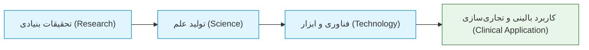
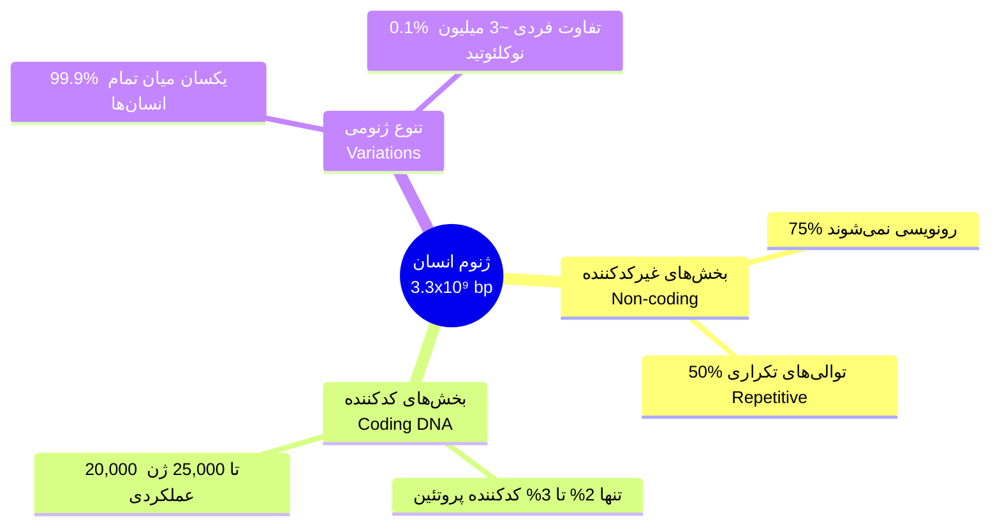
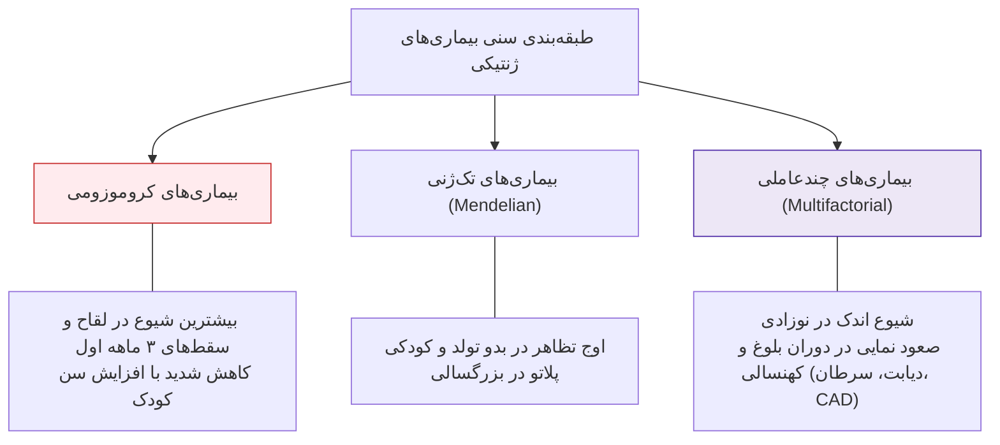
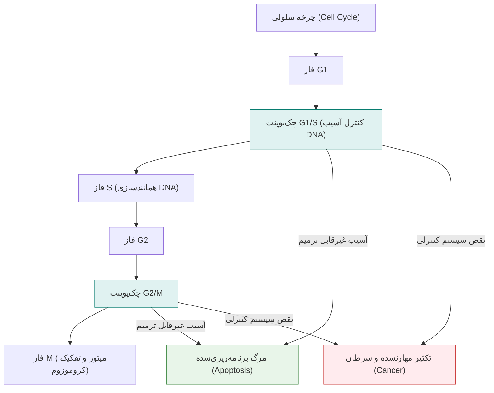

# جلسه ۱: مقدمه ژنتیک پزشکی، تاریخچه و کلیات بیماری‌ها (Medical Genetics: History, Principles & Basics)

## 1. تعاریف بنیادین و تمایز ژنتیک با ژنتیک پزشکی

> [!info] تعریف علم ژنتیک (Genetics) در برابر ژنتیک پزشکی (Medical Genetics)
> * **Genetics (علم پایه):** شاخه‌ای از بیولوژی که به مطالعه توارث، ساختار ژن‌ها و تنوع ژنتیکی موجودات زنده می‌پردازد.
> * **Medical Genetics (علم کاربردی):** به‌کارگیری اصول و تکنولوژی‌های ژنتیک در حوزه بالین شامل نقشه‌یابی ژن‌های بیماری‌زا، پیشگیری، تشخیص پیش از تولد، فارماکوژنومیکس، ژن‌درمانی و مشاوره ژنتیک.



> [!tip] هرم ارتباط فنوتیپ و ژنوتیپ
> فنوتیپ (Phenotype) بر پایه ژنوتیپ (Genotype) شکل می‌گیرد. برای دستکاری و درمان نقایص فنوتیپی باید ژنوتیپ را دستکاری کرد؛ برای دستکاری ژنوتیپ باید ژنوم شناخته شود (بهترین متد: **NGS**)؛ و برای ویرایش دقیق ژنوم از ابزارهای اصلاح ژن (بهترین متد: **CRISPR-Cas**) استفاده می‌شود.

---

## 2. جدول کرونولوژی و نقاط عطف تاریخ ژنتیک

| بازه زمانی / سال | دانشمند (دانشمندان) | کشف یا دستاورد کلیدی شب امتحان |
| :--- | :--- | :--- |
| **1859** | چارلز داروین (Darwin) | انتشار کتاب *Origin of Species* و نظریه تکامل بر پایه انتخاب طبیعی (وابسته به توارث). |
| **1866** | گرگور مندل (Mendel) | انتشار مقاله هیبریداسیون نخودفرنگی؛ پایه‌گذاری قوانین وراثت (تا سال ۱۹۰۰ نادیده گرفته شد). |
| **1871** | فریدریش میشر (Miescher) | جداسازی و استخراج **اسید نوکلئیک** برای نخستین‌بار از هسته گلبول‌های سفید چرک (Pus cells). |
| **1900** | دووریس، کورنز، چرماک | بازکشف مستقل قوانین مندل (Hugo de Vries, Carl Correns, Erich von Tschermak). |
| **1902** | آرچیبالد گارود (Garrod) | اثبات پایه ژنتیکی و وراثت مغلوب در بیماری **آلکاپتونوری** (نخستین خطای مادرزادی متابولیسم). |
| **1904** | ویلیام بیتسون (Bateson) | کشف پدیده **پیوستگی ژنی (Linkage)** و ابداع رسمی واژه **Genetics**. |
| **1910** | توماس هانت مورگان (Morgan) | اثبات قرارگیری ژن‌ها روی کروموزوم با مگس سرکه (*Drosophila*) و جهش چشم‌سفید. |
| **1918** | رونالد فیشر (R.A. Fisher) | پایه‌گذاری ژنتیک کمّی؛ تفکیک واریانس فنوتیپی به دو مؤلفه **ژنتیک** و **محیط**. |
| **1926** | هرمان جوزف مولر (Muller) | اثبات توانایی پرتوهای **اشعه X** در القای جهش‌های ژنتیکی (Inducible mutations). |
| **1944** | ایوری، مک‌لود، مک‌کارتی | اثبات ترانسفورماسیون باکتریایی؛ معرفی قطعی **DNA به عنوان ماده وراثتی** به جای پروتئین. |
| **1953** | جیمز واتسون و فرانسیس کریک | کشف ساختار مارپیچ دوگانه DNA (Double Helix) و پیشنهاد مدل همانندسازی نیمه‌حفاظت‌شده. |
| **1966** | مارشال نایرنبرگ (Nirenberg) | رمزگشایی کدهای ژنتیکی (کدون‌های تریپلتی ۳ نوکلئوتیدی برای کد کردن اسیدهای آمینه). |
| **1977** | فردریک سنگر (Fred Sanger) | ابداع روش توالی‌یابی خاتمه زنجیره با دی‌دئوکسی (Sanger Dideoxy Method؛ برنده ۲ جایزه نوبل). |
| **1990 - 2003** | کنسرسیوم جهانی HGP | پروژه ژنوم انسان (۱۳ سال زمان، هزینه میلیارد دلاری، توالی‌یابی 3.3 میلیارد جفت‌باز ژنوم). |
| **2015 به بعد** | توسعه فناوری‌های NGS | توالی‌یابی پرسرعت موازی؛ کاهش هزینه به زیر 1000 دلار و زمان توالی‌یابی ژنوم به چند ساعت. |

> [!important] نکته تکمیلی مدل‌های ژنتیکی
> مطالعات توارث صفات روی مدل‌های سلولی و حیوانی ارزان و سریع پایه تحقیقات بالینی است؛ از باکتری، مخمر (*S. cerevisiae*) و کرم نماتود (*C. elegans* با کمتر از ۱۰۰۰ سلول و ۱۹,۰۰۰ ژن) تا مگس سرکه (*Drosophila*)، مگس سرباز سیاه (BSF) و موش‌های آزمایشگاهی.

---

## 3. سازمان‌بندی ژنوم انسان و آمار طلایی HGP



* **منشأ تنوع 0.1% فردی:** همین تنوع نوکلئوتیدی اندک مبنای پزشکی فردمحور (Personalized Medicine)، استعداد بیماری‌ها، تنوع چهره، تفاوت متابولیسم داروها و ردپای اجدادی است.
* **مهاجرت تاریخی بشر از آفریقا:** جمعیت اولیه حدود ۱۰۰,۰۰۰ نفر در کمتر از ۱۵۰,۰۰۰ سال پیش از آفریقا خارج شدند (نقشه مهاجرت: خاورمیانه و غرب آسیا ۱۰۰,۰۰۰ سال، شرق آسیا ۶۷,۰۰۰ سال، اروپا و استرالیا ۴۰,۰۰۰ سال، آمریکای شمالی ۲۰,۰۰۰ سال و آمریکای جنوبی ۱۳,۰۰۰ سال پیش).

---

## 4. آناتومی عملکردی ژن و دگمای مرکزی

> [!info] جریان اطلاعات در دگمای مرکزی (Central Dogma)
> $$\text{DNA} \xrightarrow{\text{Replication}} \text{DNA} \xrightarrow{\text{Transcription}} \text{pre-mRNA} \xrightarrow{\text{Splicing}} \text{Mature mRNA} \xrightarrow{\text{Translation}} \text{Polypeptide} \xrightarrow{\text{PTM}} \text{Functional Protein}$$
> روند معکوس رونویسی (Reverse Transcription) نیز از RNA به DNA توسط ترنسکریپتاز معکوس انجام می‌شود.

```mermaid
flowchart LR
    classDef reg fill:#fff3e0,stroke:#ef6c00,stroke-width:1px;
    classDef utr fill:#e1f5fe,stroke:#0288d1,stroke-width:1px;
    classDef exon fill:#e8f5e9,stroke:#2e7d32,stroke-width:1px;
    classDef int fill:#f5f5f5,stroke:#9e9e9e,stroke-width:1px;

    Up["تنظیم‌کننده بالادست<br>(Enhancer/Silencer/LCR)"]:::reg --> Prom["پروموتور + TATA Box"]:::reg
    Prom --> U5["5' UTR"]:::utr
    U5 --> E1["اگزون ۱ (AUG)"]:::exon
    E1 --> I1["اینترون ۱"]:::int
    I1 --> E2["اگزون ۲"]:::exon
    E2 --> I2["اینترون ۲"]:::int
    I2 --> E3["اگزون ۳ (Stop)"]:::exon
    E3 --> U3["3' UTR + دم Poly-A"]:::utr
```



### بخش‌های کلیدی یک ژن یوکاریوتی
1. **Promoter و TATA Box:** جایگاه اتصال فاکتورهای عمومی رونویسی و RNA Polymerase جهت شروع ترنسکریپشن.
2. **عناصر تنظیمی (Enhancer, Silencer, LCR):** تنظیم شدت و اختصاصیت بافتی بیان ژن.
3. **5' UTR و 3' UTR:** نواحی غیرترجمه‌ای برای حفظ ثبات mRNA، خروج از هسته و دقت اتصال به ریبوزوم.
4. **اگزون‌ها و اینترون‌ها:** اگزون‌ها بخش کدکننده نهایی پروتئین و اینترون‌ها بخش‌های مداخله‌گر غیرکدکننده هستند که طی فرآیند **Splicing** حذف می‌شوند.

---

## 5. مقایسه الگوهای سه‌گانه بیماری‌های ژنتیکی بر حسب سن بروز



### مقایسه آماری و رفتاری سه رده بیماری‌های انسان

| شاخص مقایسه | اختلالات کروموزومی (Chromosomal) | اختلالات تک‌ژنی (Single Gene) | اختلالات چندعاملی (Complex / Multifactorial) |
| :--- | :--- | :--- | :--- |
| **ماهیت ژنتیکی** | تغییر در تعداد یا ساختار بزرگ کروموزوم‌ها | جهش نقطه‌ای یا ایندل در یک لوکوس منفرد | برهم‌کنش پلی‌ژنیک چندین ژن مستعدکننده + محیط |
| **الگوی توارث** | معمولاً غیرارثی (اسپورادیک یا حاصل ترنسلوکیشن ناقل) | توارث کلاسیک مندلی (AD, AR, XLR, XLD) | غیرمندلی؛ فاقد الگوی خطی شجره‌نامه |
| **اوج سن تظاهر** | **دوران جنینی، بدو تولد (نوزادی)** | **شیرخوارگی، کودکی تا اوایل بلوغ** | **دوران بزرگسالی و کهنسالی** |
| **تنوع و شیوع** | تعداد محدود (۱۰۰ تا ۶۰۰ سندروم)؛ شیوع ۱ در ۱۱۰ تولد | بیش از ۱۸,۰۰۰ اختلال؛ شیوع کلی ۱ در ۱۰۰ تولد | شایع‌ترین بیماری‌های جامعه (شیوع >1:1000) |
| **نمونه‌های بالینی** | سندروم داون ($47,+21$)، ترنر ($45,X$)، کلاین‌فلتر | تالاسمی، فیبروز سیستیک (CF)، هانتینگتون | دیابت، فشار خون اولیه، بیماری عروق کرونر، آسم |

---

## 6. ژنتیک سرطان، فرضیه دو ضربه و تنظیم چرخه سلولی



> [!info] جهش‌های رده زایا (Germline) در برابر سوماتیک (Somatic)
> * **Germline Mutations:** در گامت‌های والدین رخ داده، در تمام سلول‌های فرزند حضور داشته، ارثی هستند و خطر ابتلای فامیلی را بالا می‌برند.
> * **Somatic Mutations:** پس از لقاح و در طول حیات در بافت‌های خاص بر اثر عوامل محیطی (مانند اشعه UV) رخ داده و فقط در سلول‌های تومور دیده می‌شوند (غیرقابل انتقال به فرزند).

### اصل توازن سلولی: انکوژن‌ها در برابر تومورساپرسورها
* **سیگنال‌های پیش‌برنده (Go Signals / Oncogenes):** تحریک میتوز با گیرنده‌های فاکتور رشد و پروتئین‌های پیام‌رسان نظیر *EGFR, HER2 (ERBB2), KRAS* و سیکلین‌ها/CDKها.
* **سیگنال‌های بازدارنده (Stop Signals / Tumor Suppressors):** ترمز چرخه سلولی نظیر *TP53, RB1, p16/ARF* و فاکتورهای مهارکننده CDK (CKIs).
* **تعریف بیولوژیک سرطان:** برهم خوردن توازن میان ژن‌های انکوژن و تومورساپرسور (برتری شتاب‌دهنده‌ها بر ترمزهای سلولی).

> [!important] فرضیه دو ضربه نادسن (Knudson's Two-Hit Hypothesis) در رتینوبلاستوما
> * **فرم فامیلیال (Germline):** کودک اولین ضربه ($M_1$) را از طریق گامت والد در تمام سلول‌های بدن به ارث می‌برد. رخ دادن یک ضربه سوماتیک منفرد ($M_2$) در سلول رتین، منجر به بروز سریع، دوطرفه (Bilateral) و چندکانونی تومور می‌شود.
> * **فرم اسپورادیک (Non-germline):** کودک با دو الل سالم متولد می‌شود. هر دو ضربه ($M_1$ و $M_2$) باید به صورت مستقل و تصادفی در یک سلول رتین منفرد رخ دهند؛ لذا تومور یک‌طرفه (Unilateral)، تک‌کانونی و در سنین بالاتر بروز می‌کند.

> [!warning] سندرم گزودرما پیگمنتوزوم (Xeroderma Pigmentosum - XP)
> اختلال اتوزوم مغلوب در سیستم **ترمیم برش نوکلئوتیدی (NER)** آسیب‌های ناشی از اشعه فرابنفش (UV). بیماران معروف به «کودکان شب» (Children of the Night) هستند و به علت ناتوانی در ترمیم دیمرهای تیمین، با حداقل مواجهه با نور خورشید دچار بدخیمی‌های شدید پوستی و چشمی زودهنگام می‌شوند (شیوع: 1:250,000).

---

## 7. شاخه‌ها و فناوری‌های درمانی نوین در ژنتیک بالینی

1. **ژن‌درمانی (Gene Therapy):** انتقال نسخه سالم ژن به کمک ناقلین ویروسی (*Ex vivo* یا *In vivo*) یا ویرایش مستقیم ژنوم با ابزار نوظهور **CRISPR-Cas9**.
2. **آنزیم‌درمانی جایگزین (Enzyme Replacement Therapy - ERT):** تجویز سیستمیک آنزیم نوترکیب برای خطاهای متابولیک لیزوزومی شامل:
   * بیماری گوشه (Gaucher Disease)
   * بیماری فابری (Fabry Disease)
   * موکوپلی‌ساکاریدوزها (MPS)
   * بیماری ذخیره گلیکوژن تیپ دو / پمپه (GSD Type II / Pompe)
3. **نسل‌های دستگاه‌های توالی‌یابی (NGS & Nanopore):**
   * *سکوئنسرهای نسل دوم و سوم رومیزی:* HiSeq 2000/2500, MiSeq, Ion Torrent, Ion Proton, GS-FLX.
   * *پلتفرم‌های پرتابل نانوپوری (Oxford Nanopore):* MinION (اندازه کف دست، وزن 87g)، SmidgION (متصل به گوشی هوشمند)، GridION (وزن 11kg) و PromethION (وزن 40kg جهت توالی‌یابی با ظرفیت فوق‌بالا).

---

## 8. جدول جامع واژه‌نامه و اصطلاحات پایه‌ای ژنتیک (Terminology)

| اصطلاح ژنتیکی | تعریف استاندارد علمی | نکته بالینی یا تشخیصی |
| :--- | :--- | :--- |
| **Genotype** | ساختار و ترکیب اللی ژنتیکی یک موجود زنده. | در بیماری‌های با نفوذ ناقص ممکن است با فنوتیپ همخوانی نداشته باشد. |
| **Phenotype** | تظاهر قابل مشاهده فیزیکی، بیوشیمیایی یا بالینی ژنوتیپ. | برآیند اثر همزمان ژنوتیپ فرد و متغیرهای محیطی است. |
| **Locus** | جایگاه ثابت و مشخص یک ژن روی کروموزوم. | در کاریوتایپ با بازو، ناحیه، باند و ساب‌باند معرفی می‌شود. |
| **Allele** | اشکال و فرم‌های جایگزین نوکلئوتیدی در یک لوکوس معین. | هر فرد دیپلوئید برای هر لوکوس اتوزومال حداکثر ۲ الل حمل می‌کند. |
| **Mutation** | تغییر دائمی در ماده ژنتیکی؛ عمدتاً نادر و بیماری‌زا. | تواتر جمعیتی آن معمولاً زیر ۱٪ (<1%) است. |
| **Polymorphism** | تغییر ساختاری DNA با تواتر حداقل ۱٪ (≥1%) در جامعه. | لزوماً بیماری‌زا نبوده و معرف تنوع طبیعی است (نظیر رنگ چشم). |
| **Homozygote** | فردی با دو الل کاملاً یکسان در یک لوکوس مشخص. | در صفات اتوزوم مغلوب، برای بروز بیماری الزامی است ($aa$). |
| **Heterozygote** | فردی با دو الل متفاوت در یک لوکوس مشخص. | در صفات مغلوب به عنوان ناقل بی‌علامت ($Aa$) شناخته می‌شود. |
| **Hemizygote** | حضور تنها یک نسخه از یک ژن در کل ژنوم. | مردان برای ژن‌های کروموزوم‌های X و Y همی‌زیگوت هستند. |
| **Dominant** | صفتی که فنوتیپ آن حتی در حالت هتروزیگوت ($Aa$) ظاهر شود. | حاصل نیاز سلول به ۱۰۰٪ دوز پروتئینی یا اثر منفی غالب است. |
| **Recessive** | صفتی که فنوتیپ آن فقط در حالت هوموزیگوت ($aa$) ظاهر شود. | ۵۰٪ دوز پروتئینی حاصل از یک الل سالم برای سلامت کافی است. |
| **Hereditary** | صفتی که مستقیماً از مواد ژنتیکی والدین دریافت شده باشد. | به منشأ زیستی صفت اشاره دارد. |
| **Familial** | تمایل یک صفت یا بیماری به تجمع در میان اعضای یک خانواده. | بیماری‌های چندعاملی تجمع فامیلی دارند اما لزوماً تک‌ژنی نیستند. |
| **Congenital** | وجود نقص یا صفت ساختاری در بدو تولد (مادرزادی). | هر صفت مادرزادی ژنتیکی نیست (نظیر سیفلیس و توکسوپلاسموز مادرزادی) و هر بیماری ژنتیکی مادرزادی نیست (نظیر هانتینگتون). |

> [!important] تله امتحانی تفاوت Congenital و Genetic
> * **مادرزادی غیرژنتیکی:** عفونت جنینی با سیفلیس یا سایتومگالوویروس که در بدو تولد وجود دارد ولی مبنای جهش DNA ندارد.
> * **ژنتیکی غیرمادرزادی:** بیماری هانتینگتون (Huntington) یک اختلال اتوزوم غالب تک‌ژنی قطعی است، اما علائم نورولوژیک آن در دهه ۳ تا ۴ زندگی پدیدار می‌گردد نه در بدو تولد!
```

---

### جمع‌بندی نکات و ساختار فایل
* **جامعیت:** تمامی نکات مطرح‌شده در فایل متنی تدریس و اسلایدهای PDF (شامل تاریخچه و دانشمندان، آمار دقیق ژنوم، هرم تبدیل دگمای مرکزی، انکولوژی و فرضیه نادسن، بیماری‌های ERT، دستگاه‌های NGS و واژه‌نامه تخصصی) بدون حذف موارد کلیدی در فایل گردآوری شد.
* **فشردگی و دسته‌بندی:** ساختار طبقه‌بندی‌شده و تلگرافی با رعایت دقیق محدودیت کلمات در نمودارها و جداول طراحی شده است.

آیا مایلید تست‌های تالیفی و نکات چهارگزینه‌ای مرتبط با این جلسه را با یکدیگر مرور کنیم؟
