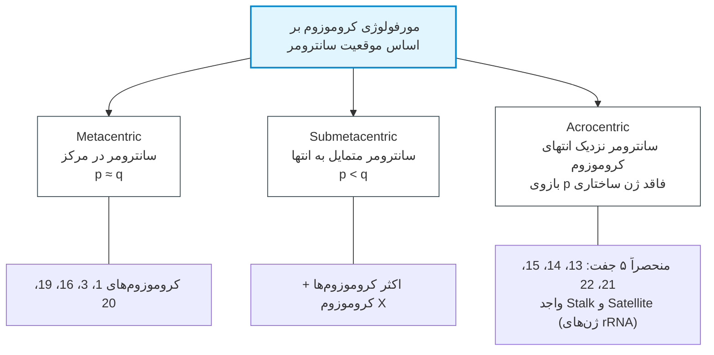
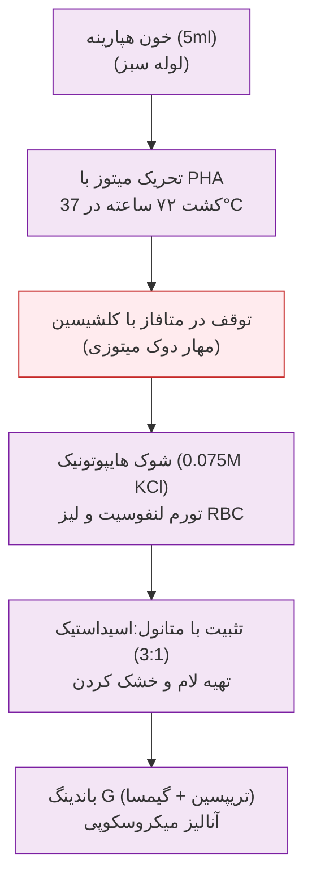
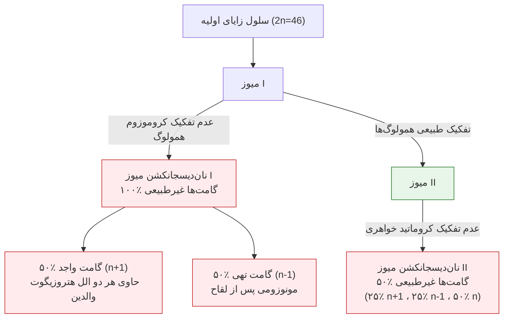

# جلسه ۲: سیتوژنتیک بالینی، مبانی کاریوتایپ و ناهنجاری‌های عددی کروموزوم‌ها (Clinical Cytogenetics & Numerical Abnormalities)

## ۱. مبانی سیتوژنتیک و ساختار ژنوم

> [!info] تعریف سیتوژنتیک بالینی (Clinical Cytogenetics)
> علم مطالعه ساختار، عملکرد، تعداد و ناهنجاری‌های کروموزومی در سطح میکروسکوپی و ارتباط مستقیم آن با بیماری‌های تکاملی و بالینی انسان.

* **ماهیت فیزیکی کروموزوم:** ژن‌ها دانه‌های تسبیح سوار بر نخ کروموزوم نیستند؛ بلکه کروموزوم حاصل تراکم و فشرده‌شدگی فوق‌العاده متوالی مولکول DNA به همراه پروتئین‌های هسته‌ای (هیستونی و غیرهیستونی) است.
* **کاریوتایپ هاپلوئید و دیپلوئید:** انسان دارای ۴۶ کروموزوم (۲۳ جفت) شامل ۴۴ کروموزوم اتوزوم و ۲ کروموزوم جنسی (XX در زنان و XY در مردان) است. حضور کروموزوم Y تکوین جنین را به سمت مذکر هدایت می‌کند.
* **دسته‌بندی سه‌گانه کل بیماری‌های ژنتیکی انسان:**
  1. *ناهنجاری‌های کروموزومی (Chromosomal):* بین ۱۰۰ تا ۶۰۰ اختلال؛ ناشی از حذف، اضافه یا جابجایی سگمان‌های بزرگ کروموزومی (شایع در جمعیت، اما تنوع محدود).
  2. *بیماری‌های تک‌ژنی (Single-Gene / Mendelian):* بیش از ۱۸,۰۰۰ اختلال؛ ناشی از موتاسیون نقطه‌ای یا تغییرات جزئی در اگزون‌ها یا نواحی تنظیمی (شیوع بدو تولد حدود 1:100).
  3. *بیماری‌های چندعاملی (Multifactorial / Complex):* برهم‌کنش چند ژن به همراه عوامل محیطی (مانند دیابت، هایپرتنشن، شکاف لب/کام).

> [!important] تله امتحانی کروموزوم تلوژنتیک (Telocentric)
> در ژنوم طبیعی انسان، کروموزوم تلوژنتیک (سانترومر در انتهای مطلق و فاقد بازوی p) **وجود ندارد**؛ کروموزوم‌های واجد بازوی بسیار کوتاه انسان منحصراً **آکروسنتریک** هستند.

---

## ۲. پروتکل آزمایشگاهی کشت کاریوتایپ خون محیطی

> [!danger] دو خطای رایج امتحانی در پروتکل کاریوتایپ
> * **ضدانعقاد مجاز:** نمونه خون وریدی باید حتماً در لوله **هپارینه (Sodium Heparin - درب سبز)** جمع‌آوری شود؛ لوله لخته یا لوله حاوی EDTA سلول‌ها را کشته یا مانع رشد شده و کشت کاریوتایپ را غیرممکن می‌سازد.
> * **مدت‌زمان کشت:** لنفوسیت‌های بالغ خون در فاز $G_0$ هستند و جهت ورود به میتوز نیاز به فیتوهماگلوتینین (PHA) و حداقل **۷۲ ساعت (۳ روز)** انکوباسیون دارند؛ هرگونه ادعای آماده‌سازی ۱ روزه کاریوتایپ روتین از خون محیطی **باطل و غیرعلمی** است.

---

## ۳. اندیکاسیون‌های بالینی قطعی انجام کاریوتایپ (چه کسانی باید کاریوتایپ شوند؟)

1. **نوزاد با ناهنجاری‌های چندگانه مادرزادی (Multiple Congenital Anomalies):** حضور همزمان $\ge 2$ ناهنجاری ماژور یا $\ge 3$ ناهنجاری ماینور ساختاری (مانند نقص دیواره قلب همراه با پلی‌داکتیلی و شکاف کام).
2. **عقب‌ماندگی ذهنی (Mental Retardation / Intellectual Disability):** در تمامی موارد تاخیر تکاملی بدون علت مشخص در کودکان (شیوع در جامعه حدود ۳٪).
3. **اختلال در رشد (Growth) یا نمو (Development):** نوزاد با کوتاهی قد، افت صدک وزن و دور سر (Failure to Thrive) یا تاخیر در کسب مهارت‌های حرکتی و کلامی (Milestones).
4. **دیسمورفولوژی چهره:** چهره غیرطبیعی با گوش‌های پایین‌افتاده، پل بینی فلت، میکروسفالی، شکاف چشمی مورب و لب شکری.
5. **سقط‌های مکرر و مرگ جنین (Recurrent Pregnancy Loss):** سابقه $\ge 2$ سقط خودبه‌خودی زودهنگام یا مرده‌زایی (Stillbirth) در زوجین.
6. **کوتاهی قد و آمنوره اولیه در دختران:** دختران فاقد بلوغ یا سیکل قاعدگی تا سن ۱۳-۱۴ سالگی (شک به سندرم ترنر).
7. **ناباروری در زوجین (Infertility):** عدم باروری پس از ۱ سال رابطه بدون پیشگیری (بررسی هر دو والد از نظر کلاین‌فلتر و ترنسلوکیشن‌های متعادل).
8. **ابهام تناسلی بدو تولد (Ambiguous Genitalia):** **اورژانس نوزادی**؛ نیازمند رویکرد تیمی چندتخصصی (کاریوتایپ الزامی است اما به تنهایی تعیین‌کننده جنسیت اجتماعی و جراحی نیست).
9. **سرطان‌های خون:** به خصوص لوسمی میلوئیدی مزمن (CML) جهت بررسی کروموزوم فیلادلفیا $t(9;22)$.
10. **غربالگری پیش از تولد غیرطبیعی:** مثبت شدن تست‌های سرمی سه‌ماهه اول یا دوم، یا مشاهده هایگروما و ادم در سونوگرافی (اندیکاسیون آمنیوسنتز یا CVS).

---

## ۴. اپیدمیولوژی و آمار سیتوژنتیک بارداری و سقط

* شیوع کلی ناهنجاری‌های کروموزومی در نوزادان زنده: **۰.۹٪ (حدود 1:110 تولد)**.
* سهم ناهنجاری‌های کروموزومی در سقط‌های ۳ ماهه اول: **۵۰٪ تا ۶۰٪** (اختلالات جنینی به قدری شدید است که سیستم ایمنی مادر بارداری را متوقف می‌سازد).
* تغییر سهم ژنتیک با سن بارداری: در سقط‌های زیر ۱۲ هفته **۶۰٪**، بین ۱۲ تا ۲۰ هفته **۲۰٪**، و در مرده‌زایی‌های بالای ۲۰ هفته (وزن >500g) تنها **۵٪** است (*اصل طلایی: با پیشرفت سن بارداری، سهم ناهنجاری کروموزومی در مرگ جنین افت کرده و عوامل محیطی/فیزیکی غالب می‌شوند*).
* شایع‌ترین اختلال در جنین‌های سقط‌شده: **سندرم ترنر (45,X)** با شیوع ۲۳٪ کل جنین‌های سقط‌شده، سپس **تریزومی ۱۶** (شایع‌ترین تریزومی اتوزومی سقط‌ها؛ هرگز زنده متولد نمی‌شود)، تریپلوئیدی (۱۳٪) و تتراپلوئیدی (۴٪).
* شیوع خطای کروموزومی در گامت‌ها: در اسپرم **۱٪ تا ۲٪**؛ در تخمک **۲۰٪** (تخمک ۱۰ تا ۲۰ برابر اسپرم مستعد آنیوپلوئیدی است به علت توقف طولانی در مرحله دیکتیوتن پروفاز میوز I).

---

## ۵. طبقه‌بندی آنیوپلوئیدی و مکانیسم نان‌دیسجانکشن

> [!info] آنیوپلوئیدی در برابر پلی‌پلوئیدی
> * **Aneuploidy ($2n \pm 1$):** تغییر در تعداد یک کروموزوم خاص منفرد؛ تریزومی ($2n+1=47$) و مونوزومی ($2n-1=45$). مونوزومی‌های اتوزومال (کروموزوم ۱ تا ۲۲) به طور مطلق کشنده بوده و هرگز متولد نمی‌شوند.
> * **Polyploidy ($3n, 4n$):** افزایش کل دسته‌های کروموزومی هاپلوئید ($3n=69$ تریپلوئیدی، $4n=92$ تتراپلوئیدی).

### تمایز تشخیصی دو فرم مول هیداتی‌فورم (Hydatidiform Mole)

1. **مول ناقص (Partial Mole):** کاریوتایپ **تریپلوئید (69,XXY / 69,XXX)**؛ ناشی از بارور شدن ۱ تخمک با ۲ اسپرم پدری (Dispermy)؛ واجد جنین ناقص و بدشکل به همراه بافت تروفوبلاستیک جنینی.
2. **مول کامل (Complete Mole):** کاریوتایپ **دیپلوئید (46,XX / 46,XY)**؛ **۱۰۰٪ منشأ پدری (Androgenetic)** ناشی از لقاح تخمک فاقد هسته با یک اسپرم دو برابر شده یا دو اسپرم؛ فاقد هرگونه بافت جنینی، ظاهر دانه‌های انگوری جفت، سطح خونی $\beta$-hCG به شدت نجومی و خطر بالا برای کوریوکارسینوما.

---

## ۶. مقایسه تطبیقی تریزومی‌های اتوزومی شایع زنده متولد

| شاخص بالینی             | تریزومی ۲۱ (سندرم داون)                                                   | تریزومی ۱۸ (سندرم ادوارد)                                                           | تریزومی ۱۳ (سندرم پاتو)                                                  |
| :---------------------- | :------------------------------------------------------------------------ | :---------------------------------------------------------------------------------- | :----------------------------------------------------------------------- |
| **شیوع بدو تولد**       | 1:800 تولد زنده (شایع‌ترین)                                               | 1:6000 تا 1:8000 تولد زنده                                                          | 1:10,000 تا 1:20,000 تولد زنده                                           |
| **مکانیسم ژنتیکی غالب** | **۹۵٪** تریزومی آزاد، ۴٪ ترنسلوکیشن، ۱٪ موزائیسم                          | **>۹۰٪** تریزومی آزاد میوزی                                                         | **۷۵٪** تریزومی آزاد، ۲۵٪ روبرتسونین rob(13q14q)                         |
| **منشأ خطای میوزی**     | >۹۰٪ میوز I مادری (وابسته به سن مادر)                                     | عمدتاً میوز I و II مادری                                                            | عمدتاً میوز I مادری                                                      |
| **علائم اختصاصی**       | هایپوتونی، ۳ فونتانل، فلت نازال بریج، چین اپی‌کانتوس، صورت تخت، زبان بزرگ | اکسی‌پوت برجسته، میکروگناتیا، هایپرتونی و انگشتان روی‌هم‌افتاده (۲ روی ۳ و ۵ روی ۴) | هولوپروزنسفالی، آپلازی پوستی اسکالپ، میکروافتالمی/آنوفتالمی، پلی‌داکتیلی |
| **ناهنجاری قلبی**       | ۴۰٪ تا ۵۰٪ (نقص بالشتک اندوکارد / AVSD)                                   | >۹۰٪ (VSD، PDA، نقایص دریچه‌ای)                                                     | >۸۰٪ (VSD، ASD، PDA)                                                     |
| **پیش‌آگهی و بقا**      | ۸۵٪ تا ۱ سالگی، ۸۰٪ تا ۱۰ سالگی، ۵۰٪ بالای ۵۰ سال                         | **>۹۰٪ مرگ زیر ۱ سالگی** (میانگین بقا چند هفته)                                     | **>۹۰٪ مرگ زیر ۱ سالگی** (میانگین بقا چند روز/هفته)                      |

> [!important] تله‌های تشخیصی سندرم داون (Down Syndrome)
> * **شیار منفرد کفی (Simian Crease):** تنها در ۵۰٪ بیماران داون دیده می‌شود و در ۱٪ افراد کاملاً سالم جامعه و همچنین در سندرم الکل جنینی (FAS) و سندرم آرسکوگ (Aarskog) نیز حضور دارد؛ لذا این علامت **Pathognomonic نیست**.
> * **سندرم داون ترنسلوکاسیونی (۴٪):** ناشی از ترنسلوکیشن روبرتسونین (عمدتاً بین ۱۴ و ۲۱ یا ۲۱ و ۲۱) است؛ این فرم برخلاف تریزومی ۲۱ آزاد، **کاملاً مستقل از سن مادر** بوده و دارای ریسک عود فامیلیال بالا در بارداری‌های بعدی است.
> * **موزائیسم سوماتیک (۱٪):** کاریوتایپ $46/47,+21$؛ فنوتیپ، دیسمورفولوژی و بهره هوشی فرد به مراتب به سمت نرمال نزدیک‌تر است.
> * **ریسک وابسته به سن مادر:** سن ۲۰ سال (1:1500)، سن ۳۰ سال (1:900)، سن ۳۵ سال (1:400)، سن ۴۰ سال (1:100)، و سن ۴۵ سال (1:25-30). *توجه: ۵٪ موارد داون ناشی از خطای میوزی پدری است.*
> * **غربالگری سه‌ماهه اول و دوم:** در جنین داون، سطح سرمی **$\beta$-hCG آزاد افزایش** و سطح **$\alpha$-Fetoprotein (AFP) افت** نشان می‌دهد (برعکس NTD باز که در آن AFP به شدت بالا می‌رود).

---

## ۷. رزولوشن تکنیک‌های سیتوژنتیک و مولکولی (مقایسه قدرت تفکیک)

| روش تشخیصی | فاز سلولی / نوع نمونه | تعداد باندها | قدرت تفکیک (Resolution) | توانایی شناسایی بالینی |
| :--- | :--- | :--- | :--- | :--- |
| **کاریوتایپ استاندارد (G-Banding)** | لنفوسیت در مرحله **متافاز** | ۴۰۰ تا ۵۵۰ باند | **۵ تا ۱۰ مگاباز (5-10 Mb)** | آنیوپلوئیدی‌ها، ترنسلوکیشن‌های بزرگ و حذف‌های ماکرو |
| **کاریوتایپ با تفکیک بالا (HRB)** | لنفوسیت متوقف در **پرومتافاز** | ۵۵۰ تا ۸۵۰ باند | **۲ تا ۵ مگاباز (2-5 Mb)** | ریزحذف‌های مرزی و سگمان‌های ساب‌باندهای ظریف |
| **تکنیک FISH** | لام متافازی یا هسته اینترفاز | اختصاصی به پروب | **۵۰ تا ۲۰۰ کیلوباز (50-200 kb)** | حذف‌های ساب‌میکروسکوپی ژن‌ها (دی‌جرج، ویلیامز) |
| **ریزآرایه هیبریداسیون (Array-CGH)** | استخراج DNA کل ژنوم (بدون کشت) | صدها هزار الیگوپروب | **۱۰ تا ۵۰ کیلوباز (10-50 kb)** | تغییرات تعداد کپی (CNVs) در کل ژنوم بدون نیاز به سلول زنده |

> [!tip] قانون طلایی برخورد بالینی با کاریوتایپ نرمال
> محدودیت عمده کاریوتایپ نوری، قدرت تفکیک آن است (نمی‌تواند حذف/اضافه زیر ۵ مگاباز را ببیند). در صورتی که بیمار علائم آشکار بیماری کروموزومی داشته باشد اما کاریوتایپ استاندارد او نرمال گزارش شود، **«نباید به شک بالینی شک کرد»**؛ گام بعدی انجام **Array-CGH** یا **FISH** است.

---

## ۸. فرمول‌نویسی استاندارد بین‌المللی نام‌گذاری کروموزوم‌ها (ISCN)

قاعده نگارش: **[تعداد کل کروموزوم‌ها] ، [کروموزوم‌های جنسی] ، [ناهنجاری ساختاری/تعدادی]**

* $47,XX,+21$ : زن مبتلا به تریزومی ۲۱ آزاد (داون).
* $47,XY,+18$ : مرد مبتلا به تریزومی ۱۸ آزاد (ادوارد).
* $47,XX,+13$ : زن مبتلا به تریزومی ۱۳ آزاد (پاتو).
* $45,X$ : زن مبتلا به مونوزومی X (سندرم ترنر).
* $47,XXY$ : مرد مبتلا به سندرم کلاین‌فلتر.
* $46,XX,del(4)(p16.3)$ : زن مبتلا به سندرم ولف-هیرشهورن (حذف بازوی کوتاه کروموزوم ۴).
* $46,XY,del(5)(p15)$ : مرد مبتلا به سندرم کرای‌دوچت (حذف بازوی کوتاه کروموزوم ۵).
* $46,XX,t(3;21)(q31;q21)$ : ترنسلوکیشن متقابل متعادل بین بازوی بلند کروموزوم‌های ۳ و ۲۱.
* $45,XX,der(14;21)(q10;q10)$ : زن ناقل ترنسلوکیشن روبرتسونین متعادل بین ۱۴ و ۲۱ (فنوتیپ کاملاً نرمال، اما دارای ۴۵ کروموزوم).
* $46,XY/47,XY,+21$ : موزائیسم سوماتیک در مرد برای سندرم داون.

---

## ۹. جمع‌بندی نکات کلیدی و دام‌های تستی شب امتحان

1. **ریسک عود سندرم داون:** برای زوجی با فرزند داون ناشی از تریزومی ۲۱ آزاد، ریسک ابتلای فرزند بعدی برابر است با: **۱٪ + ریسک مرتبط با سن مادر**.
2. **سندرم ترنر و ابهام تناسلی:** ترنر به عنوان اختلال جنسی در بدو تولد با ادم دست و پا و پره‌های گردنی قابل تشخیص است؛ اما اکثر آنیوپلوئیدی‌های جنسی (مانند کلاین‌فلتر و ترنر خفیف) تا زمان **بلوغ** تشخیص داده نمی‌شوند.
3. **افتراق دست‌ها در تریزومی ۱۸ و ۱۳:** در تریزومی ۱۸ **انگشتان مشت‌شده روی هم (Overlapping)** داریم؛ در تریزومی ۱۳ **پلی‌داکتیلی (انگشت اضافه)** تظاهر می‌یابد.
4. **توقف با کلشیسین:** مکانیسم بیوشیمیایی کلشیسین مهار پلیمریزاسیون دوک تقسیم میتوزی است که باعث توقف سلول‌ها در فاز **متافاز** می‌شود.
5. **شوک هایپوتونیک با KCl:** غلظت استاندارد 0.075M بوده و با ورود آب از طریق پدیده اسمز، گلبول‌های قرمز فاقد هسته را لیز کرده و لنفوسیت‌ها را بدون پاره شدن متورم می‌سازد تا کروموزوم‌ها از هم باز شوند.
