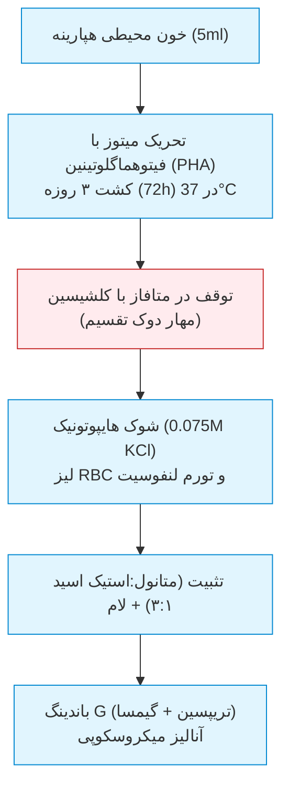
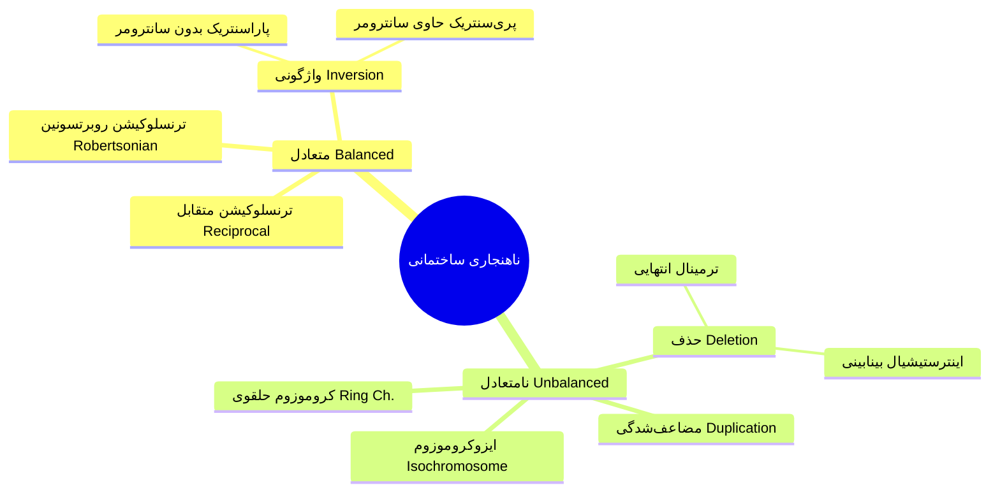
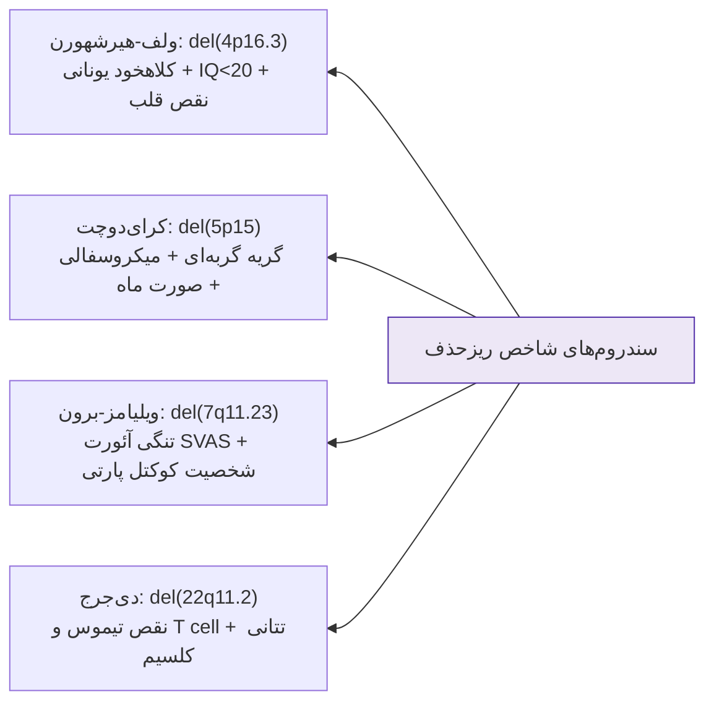
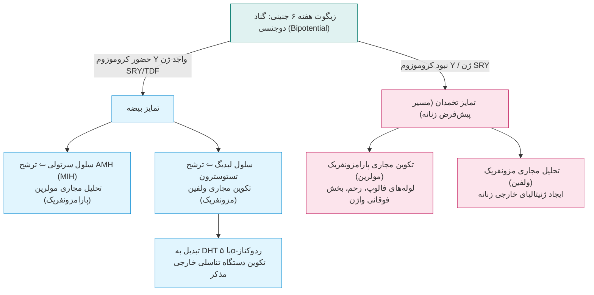
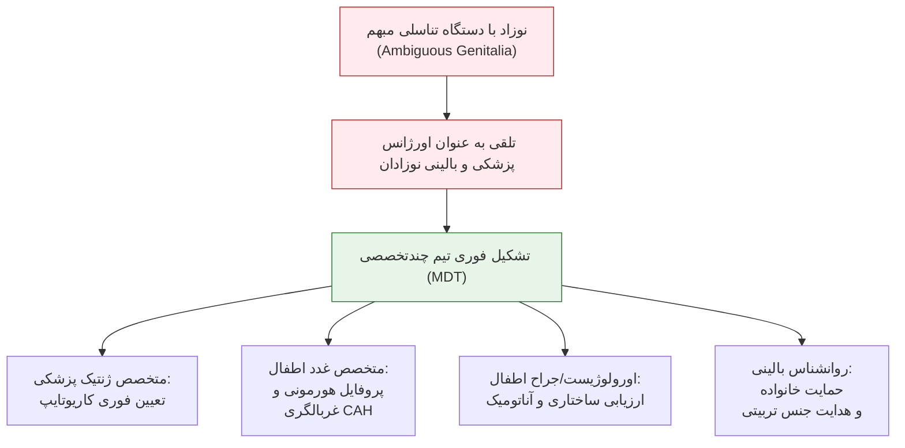

# جلسه ۳: ناهنجاری‌های ساختمانی و اختلالات کروموزوم‌های جنسی (Structural & Sex Chromosome Abnormalities)

## 1. مبانی سیتوژنتیک بالینی و مورفولوژی کروموزوم‌ها

> [!info] انواع کروموزوم بر اساس موقعیت سانترومر
> * **Metacentric:** سانترومر در مرکز؛ بازوهای $p$ و $q$ تقریباً برابر (کروموزوم‌های 1، 3، 16، 19، 20).
> * **Submetacentric:** سانترومر متمایل به یک سمت؛ بازوی کوتاه ($p$) کوتاه‌تر از بازوی بلند ($q$) (اکثر کروموزوم‌ها از جمله X).
> * **Acrocentric:** سانترومر نزدیک انتهای کروموزوم؛ بازوی کوتاه فاقد ژن‌های حیاتی، حاوی ساقه (Stalk) و ماهواره (Satellite) واجد ژن‌های rRNA. منحصراً شامل **5 جفت کروموزوم: 13، 14، 15، 21، 22**. (کروموزوم تلوژنتیک فاقد $p$ در انسان وجود ندارد).

> [!tip] تله امتحانی پروتکل کشت کاریوتایپ
> * خون باید حتماً در لوله **هپارینه** (سبز) گرفته شود (نه لوله لخته یا EDTA).
> * ادعای آماده‌سازی کاریوتایپ روتین ظرف ۱ روز **باطل و غیرعلمی** است؛ لنفوسیت‌ها جهت ورود به میتوز نیاز به حداقل **۷۲ ساعت (۳ روز)** کشت انکوباتور دارند.

---

## 2. دسته‌بندی ناهنجاری‌های ساختمانی کروموزوم (1:375 تولد)

### مقایسه تطبیقی ناهنجاری‌های متعادل و نامتعادل

| شاخص بالینی | ناهنجاری متعادل (Balanced) | ناهنجاری نامتعادل (Unbalanced) |
| :--- | :--- | :--- |
| **تعریف بیولوژیک** | حفظ کل محتوای ژنومی بدون افت یا افزایش قطعه DNA | کمبود (Loss) یا اضافه بودن (Gain) ماده ژنتیکی کروموزوم |
| **فنوتیپ بالینی فرد ناقل** | غالباً **کاملاً نرمال و بدون علامت** ارگانیک یا دیسمورفیسم | همراه با نقایص چندگانه مادرزادی، عقب‌ماندگی ذهنی، دیسمورفیسم |
| **پیامد در گامتوژنز** | خطر بالای جفت‌نشدن در میوز $\rightarrow$ **تشکیل گامت‌های نامتعادل** | نقایص شدید یا ناتوانی در شروع/تکمیل میوز و عقیمی |
| **پیامد در باروری** | سقط‌های مکرر، مرده‌زایی، ناباروری، تولد فرزند با ناهنجاری مادرزادی | معمولاً کشنده پیش از لانه‌گزینی یا مرگ در دوران پری‌ناتال |
| **مثال‌های تیپیک** | ترنسلوکیشن‌های متقابل، روبرتسونین، اینورژن‌های پری‌سنتریک | کرای‌دوچت ($5p-$)، ولف-هیرشهورن ($4p-$)، ایزوکروموزوم |

> [!important] ترنسلوکیشن‌های نهفته سیتوژنتیکی (Cryptic Translocations)
> تبادل قطعات بسیار کوچک (زیر 2 تا 3Mb) در نواحی غنی از ژن ساب‌تلومری که با کاریوتایپ استاندارد (باندینگ G) دیده نمی‌شوند. در موارد عقب‌ماندگی ذهنی فاقد تشخیص، با کاریوتایپ نرمال، **نباید به شک بالینی شک کرد**؛ اندیکاسیون قطعی انجام **Array CGH** یا **FISH ساب‌تلومریک** است.

---

## 3. انواع ترنسلوکیشن‌ها و پیامد باروری

### 1. ترنسلوکیشن متقابل (Reciprocal Translocation)
* تبادل دوطرفه قطعات بین **دو کروموزوم غیرهمولوگ**. شیوع جمعیتی: **1:500**.
* در فرد ناقل متعادل، تمام ژن‌ها با دوز ۲ کپی حضور دارند؛ لذا فنوتیپ نرمال است (مگر نقطه شکست یک ژن تومورساپرسور یا ژن حیاتی را قطع کند).
* *مشکل اصلی:* در پروفاز میوز I ساختار صلیبی ۴ تایی (**Quadrivalent**) تشکیل شده و تفکیک نامتعادل منجر به گامت‌های با مونوزومی یا تریزومی نسبی می‌گردد.

### 2. ترنسلوکیشن روبرتسونین (Robertsonian Translocation)
* فیوژن سنتریکی و اتصال بازوهای بلند ($q$) دو کروموزوم آکروسنتریک (13، 14، 15، 21، 22) با از دست رفتن بازوهای کوتاه ($p$).
* *کاریوتایپ فرد ناقل متعادل:* واجد **45 کروموزوم** است اما از نظر بالینی سالم است (ژن‌های بازوی کوتاه rRNA تکراری بوده و کمبود ایجاد نمی‌کنند).
* *شایع‌ترین انواع:* $\text{rob}(13q14q)$ و $\text{rob}(14q21q)$.
* *اهمیت در داون:* حاملین $\text{rob}(14q21q)$ می‌توانند فرزند مبتلا به **سندروم داون ترنسلوکاسیونی (46,XX/XY,der(14;21),+21)** به دنیا آورند که برخلاف تریزومی ۲۱ آزاد، مستقل از سن مادر بوده و ریسک عود فامیلیال بالا دارد.

---

## 4. سندروم‌های ریزحذف (Microdeletion) و ریزتکثیر

> [!info] تعریف سندروم ژن‌های مجاور (Contiguous Gene Syndrome)
> ناهنجاری ساختاری که در آن حذف همزمان چندین ژن ساختاری در کنار یکدیگر در یک قطعه کروموزومی کوچک، منجر به بروز مجموعه‌ای از علائم ناهماهنگ بالینی می‌گردد؛ با کاریوتایپ نوری دیده نشده و نیازمند FISH یا Array-CGH است.

### مقایسه تفصیلی سندروم‌های حذفی پرومیکروتیک کلاس درس

| سندروم حذفی | لوکوس و ژن کلیدی | شیوع و کاریوتایپ | ویژگی‌های کلینیکی اختصاصی شب امتحان |
| :--- | :--- | :--- | :--- |
| **ولف-هیرشهورن (WHS)** | 4p16.3 (حذف 165kb شامل 9 ژن) | 1:50,000 46,XX/XY,del(4p) | چهره شبیه کلاهخود یونانی (Greek helmet facies)، ناهنجاری قلبی (50%)، تشنج‌های مکرر مقاوم، عقب‌ماندگی بسیار شدید (IQ < 20)، مرگ یک‌سوم بیماران در سال اول، 85% تا 90% موتاسیون De novo. |
| **کرای‌دوچت (Cri-du-Chat)** | 5p15.2 (حذف بازوی کوتاه 5) | 1:50,000 46,XX/XY,del(5p) | صدای گریه مشابه گربه در سال اول (نقص حنجره)، میکروسفالی، صورت گرد ماه‌مانند، هایپرتلوریسم، ناهنجاری قلبی (30%)، عقب‌ماندگی شدید (IQ < 20)، بقا تا سن بلوغ، تشکیل‌دهنده 1% از معلولین آسایشگاه‌ها. |
| **ویلیامز-برون (WBS)** | 7q11.23 (حذف 1400kb شامل 28 ژن) | 1:7,500 تشخیص قطعی با FISH | هاپلو‌اینسافیشنسی ژن *ELN* (الاستین) $\rightarrow$ تنگی بالای دریچه آئورت (SVAS) و تنگی پولمونر؛ ژن‌های *LIMK1/CYLN2* $\rightarrow$ عقب‌ماندگی ذهنی، هایپرکلسمی نوزادی، رفتار بیش‌از‌حد صمیمی و پرحرف (Cocktail party manner). |

---

## 5. علل ژنتیکی ناباروری مردان (Male Infertility)

* از هر 6 زوج، 1 زوج نابارورند؛ 50% علل وابسته به فاکتور مردانه است.
* **10% تا 20%** از موارد آزواسپرمی غیرانسدادی ناشی از اختلالات ژنتیکی هستند.
* **علل اصلی سایتوژنتیک و مولکولی:**
  1. *ناهنجاری‌های کروموزومی عددی:* سندروم کلاین‌فلتر (47,XXY) $\rightarrow$ هیپوگنادیسم و آزواسپرمی کامل.
  2. *ناهنجاری‌های ساختاری:* ترنسلوکیشن‌های روبرتسونین (به ویژه در کروموزوم‌های 13، 14 و 15) و رسیپروکال.
  3. *ریزحذف‌های کروموزوم Y:* حذف لوکوس‌های فاکتور آزواسپرمی (**AZFa, AZFb, AZFc**) روی بازوی بلند کروموزوم Y جایگاه **Yq11.23** حاوی خانواده ژنی **DAZ** (Deleted in Azoospermia).
  4. *سندروم مردان XX:* سندروم 46,XX Male به دلیل ترنسلوکیشن نابجای SRY بر روی کروموزوم X در میوز پدر.

---

## 6. ژنتیک و بیولوژی کروموزوم‌های جنسی

### کروموزوم Y و ژن‌های حیاتی
* اندازه: یک‌سوم کروموزوم X؛ بخش عمده ژن‌های اجدادی خود را از دست داده و تنها حاوی حدود **50 ژن عملکردی** است.
* **Pseudoautosomal Regions (PAR1 و PAR2):** نواحی اتوزومی کاذب در دو انتهای $Yp$ و $Yq$ که با انتهای بازوهای $X$ هومولوژی دارند؛ در میوز مردانه جفت شده و کراسینگ‌اور طبیعی در این نواحی رخ می‌دهد.
* ژن **SRY** (منطقه تعیین جنسیت روی بازوی کوتاه کروموزوم Y): سوییچ اصلی القای تکوین بیضه.

---

## 7. سندروم‌های عددی کروموزوم‌های جنسی

> [!important] قاعده طلایی زمان تشخیص آنیوپلوئیدی‌ها
> * اکثر ناهنجاری‌های کروموزوم‌های **اتوزوم** (نظیر داون، پاتو، ادوارد) در **بدو تولد** تشخیص داده می‌شوند (چون نقایص شدید ساختاری ماژور دارند).
> * اکثر ناهنجاری‌های کروموزوم‌های **جنسی** (کلاین‌فلتر، تریپل X، جاکوبز) تا **سن بلوغ** ناشناخته می‌مانند و به علت تأخیر بلوغ یا ناباروری شناسایی می‌شوند؛ **تنها استثنا سندروم ترنر است** که در نوزادی با هایگروما کیستیک، گردن پرده‌دار و لنف‌ادم اندام‌ها تشخیص داده می‌شود.

### مقایسه چهار آنیوپلوئیدی شاخص جنسی

| سندروم جنسی | کاریوتایپ و شیوع | وضعیت گناد و باروری | تظاهرات مورفولوژیک و فنوتیپی | بهره هوشی و شناخت |
| :--- | :--- | :--- | :--- | :--- |
| **ترنر (Turner)** | 45,X (یا موزائیسم) 1:4000 تولد دختر | تخمدان نواری (Streak ovary) **نابارور قطعی** | قد کوتاه (*نقص SHOX*)، گردن پرده‌دار (Webbed neck)، کوآرکتاسیون آئورت، قفسه سینه سپری، ادم لنفاوی اندام در نوزادی | هوش کلی نرمال؛ نقص اختصاصی در ادراک فضایی و مهارت‌های حرکتی ظریف |
| **کلاین‌فلتر (Klinefelter)** | 47,XXY (یا واریانت‌ها) 1:1000 تولد پسر | بیضه‌های کوچک آتروفیک **آزواسپرمی و نابارور** | قد بلند، اندام‌های کشیده و لاغر، ژنیکوماستی (ریسک بالای سرطان برست مردانه)، موهای تنک بدن، تستوسترون پایین | بهره هوشی کلامی اندکی پایین‌تر از نرمال؛ اختلال یادگیری خواندن |
| **سندروم XYY (جاکوبز)** | 47,XYY 1:1000 تولد پسر | بیضه نرمال **کاملاً بارور (Fertile)** | قد بسیار بلند، آکنه شدید دوران نوجوانی، فنوتیپ ظاهری کاملاً طبیعی و مردانه | افت 10 نمره‌ای IQ، بیش‌فعالی و تکانشگری (باور قدیمی مجرم‌بودن رد شده) |
| **سندروم تریپل ایکس** | 47,XXX 1:1000 تولد دختر | تخمدان نرمال **معمولاً بارور (Fertile)** | قد بلند، میکروسفالی خفیف، بلوغ جنسی بدون مشکل بالینی خاص | افت 10 تا 15 نمره‌ای IQ، تاخیر در تکامل تکلم و مهارت‌های حرکتی در 70% |

> [!warning] نکات تکمیلی واریانت‌های کلاین‌فلتر و ترنر
> * **قانون افزایشی X:** در واریانت‌های تترازومی و پنتازومی جنسی نظیر $48,XXXY$ و $49,XXXXY$، علیرغم غیرفعال‌شدن کپی‌های اضافه به صورت Barr Body، به ازای هر کروموزوم X اضافی، **شدت عقب‌ماندگی ذهنی به طور فاحش جهش یافته (IQ بین 20 تا 80)** و دیسمورفیسم چهره خشن‌تر می‌شود.
> * **منشأ کروموزومی در ترنر:** 80% موارد ناشی از خطای میوز پدری (از دست رفتن کروموزوم جنسی اسپرم) است. اگر X باقی‌مانده از مادر باشد، اختلال شناخت اجتماعی شدیدتر است.
> * **مورتالیتی ترنر:** 99% جنین‌های 45,X دچار سقط خودبه‌خودی زودهنگام می‌شوند و تنها 1% زنده متولد می‌گردند.

---

## 8. ابهام تناسلی (Ambiguous Genitalia) و اورژانس نوزادی

> [!danger] پروتکل طلایی برخورد با ابهام جنسیتی نوزاد
> 1. ابهام جنسیتی یک **اورژانس حاد پزشکی و روانی** است؛ پیش از تعیین قطعی اتیولوژی، نباید هیچ جنسیتی به نوزاد نسبت داده شده یا شناسنامه صادر شود.
> 2. علل عمده شامل هایپرپلازی مادرزادی آدرنال (CAH - فرم 21-هیدروکسیلاز با خطر بحران از دست دادن نمک و شوک کشنده نوزاد)، سندروم عدم حساسیت به آندروژن (AIS)، دیسژنزی گنادی و ترنسلوکاسیون SRY است.
> 3. انجام **کاریوتایپ الزامی است اما به تنهایی کافی نیست**؛ تعیین جنسیت نهایی منوط به تلفیق کاریوتایپ، سونوگرافی ساختار داخلی لگن، پروفایل هورمونی (17-OHP، تستوسترون، کلسیم و الکترولیت‌ها) و پتانسیل جراحی ترمیمی است.
