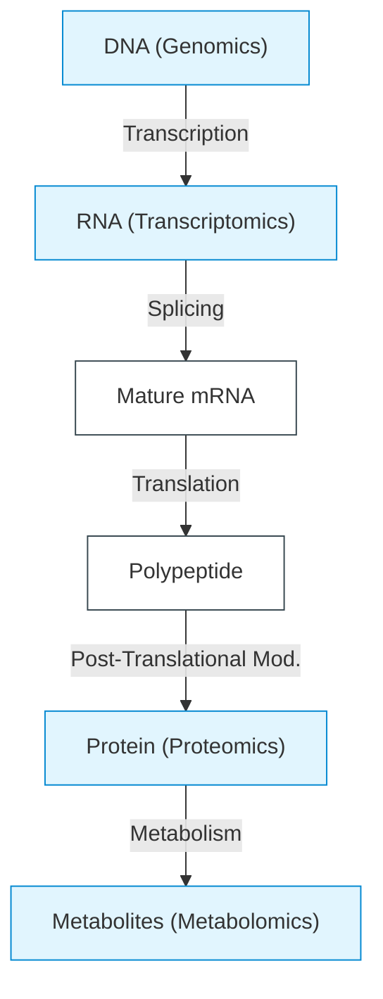
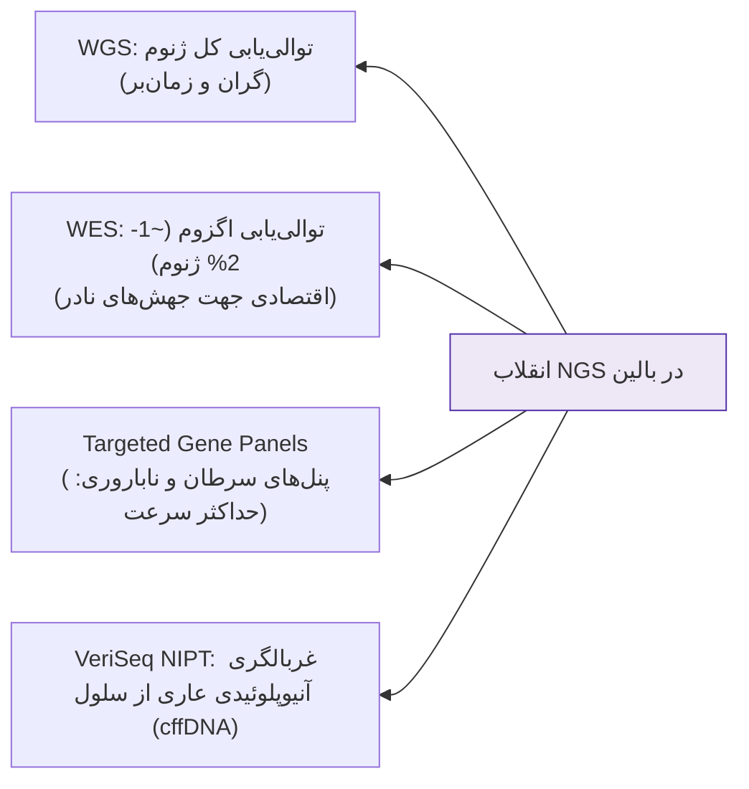
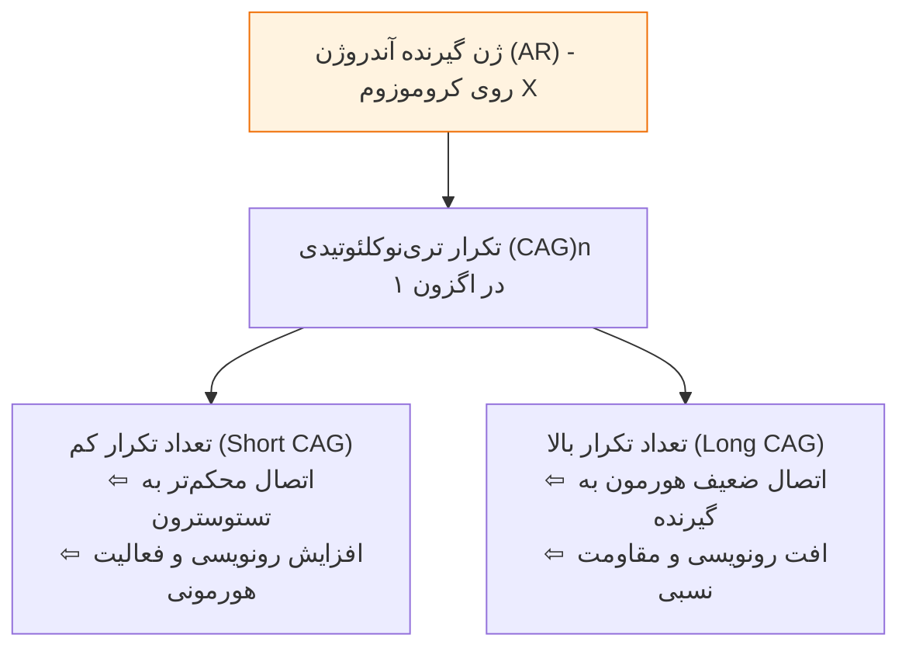
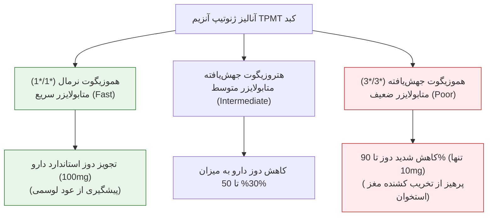
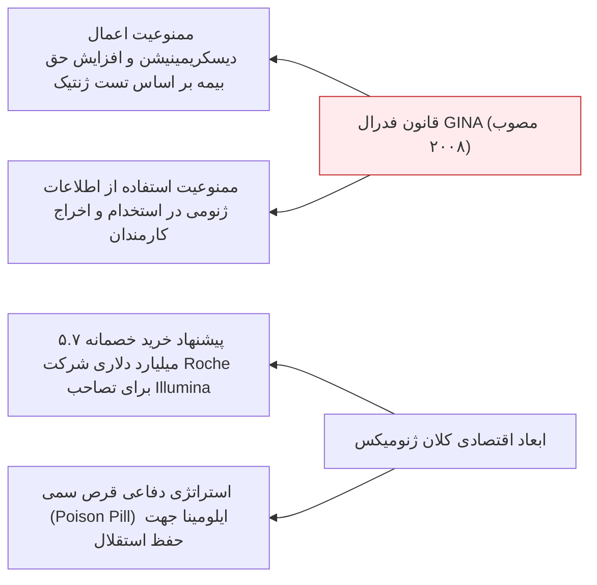

# جلسه ۴: پزشکی فردمحور، ژنومیکس و فارماکوژنتیک (Personalized Medicine & Pharmacogenomics)

## 1. مفاهیم بنیادین: ژن، ژنوم و سیستم‌های چندامیکس (Multi-Omics)

> [!info] تعاریف مرجع ژنتیک مولکولی
> * **Genome:** کل محتوای DNA سلول شامل توالی‌های کدکننده و غیرکدکننده هسته‌ای (3.3 × 10⁹ جفت‌باز) و میتوکندریال.
> * **Mendelian Gene:** واحد پایه توارث فیزیکی.
> * **Molecular Gene:** توالی نوکلئوتیدی رونویسی‌شونده DNA جهت تولید یک RNA عملکردی (شامل ژن‌های پروتئین‌ساز و ncRNA).

### شبکه‌های زیست‌شناسی مولکولی (Omics Cascades)
1. **Genomics:** مطالعه کل توالی ژنوم و تغییرات ساختاری DNA.
2. **Transcriptomics:** بررسی تمام رونوشت‌های RNA فعال در یک بافت/تومور.
3. **Proteomics:** شناسایی مجموع پروتئین‌های سنتز‌شده و تغییرات پساترجمه‌ای (*PTM*).
4. **Metabolomics:** سنجش مولکول‌های کوچک حاصل از فعالیت‌های متابولیک سلول.
5. **سایر شاخه‌ها:** *Epigenomics* (تغییرات اپی‌ژنتیک بدون دگرگونی توالی)، *Lipidomics*، *Phenomics* (تظاهرات بالینی و رفتاری)، *Interactomics* و *Ionomics*.

> [!important] ارتباط ژنوتیپ و فنوتیپ
> **فنوتیپ بالینی** (شامل سلامت، بیماری‌های جسمی یا صفات رفتاری نظیر خشونت و اضطراب) حاصل برهم‌کنش مستقیم **ژنوم فرد (Genotype)** با **عوامل محیطی (Environment)** است.

---

## 2. پروژه ژنوم انسان (HGP) و جهش توالی‌یابی نسل نوین (NGS)

### مشخصات آماری پروژه ژنوم انسان (HGP)
* **بازه زمانی:** سال‌های 1990 تا 2003 (13 سال) با متد Sanger Sequencing و هزینه میلیارد دلاری.
* **اهداف اصلی چهارگانه:**
  1. تعیین توالی دقیق 3.3 × 10⁹ جفت‌باز ژنوم هاپلوئید انسان.
  2. شناسایی تمام ژن‌های کدکننده (~20,000 تا 25,000 ژن).
  3. ذخیره‌سازی داده‌ها در پایگاه‌های مرجع جهانی (*NCBI*, *Ensembl*).
  4. توسعه فناوری‌های تحلیلی پرسرعت ژنومیک.
* **منشأ نمونه‌ها:** 93% کل توالی HGP منحصراً از 11 اهداکننده خون و 7% از 1 اهداکننده منفرد تهیه شد.

### مقایسه اندازه و تراکم ژنوم در گونه‌های مدل

| گونه مدل ژنتیکی | اندازه تخمینی ژنوم (bp) | تعداد ژن‌های عملکردی | تراکم ژنی (Gene Density) | تعداد کروموزوم |
| :--- | :--- | :--- | :--- | :--- |
| **انسان (Homo sapiens)** | 2.9 تا 3.3 میلیارد (Gb) | ~20,000 - 25,000 | 1 ژن در هر 100,000 باز | 46 |
| **موش (Mus musculus)** | 2.5 میلیارد (Gb) | ~30,000 | 1 ژن در هر 100,000 باز | 40 |
| **مگس سرکه (Drosophila)** | 180 میلیون (Mb) | 13,600 | 1 ژن در هر 9,000 باز | 8 |
| **گیاه آرابیدوپسیس (Arabidopsis)** | 125 میلیون (Mb) | 25,500 | 1 ژن در هر 4,000 باز | 10 |
| **کرم نماتود (C. elegans)** | 97 میلیون (Mb) | 19,100 | 1 ژن در هر 5,000 باز | 12 |
| **مخمر (S. cerevisiae)** | 12 میلیون (Mb) | 6,300 | 1 ژن در هر 2,000 باز | 32 |

> [!tip] نکات جدول ژنوم گونه‌ها
> * بیشترین تراکم ژنی در میان یوکاریوت‌های جدول متعلق به **مخمر نانوایی** (1 ژن در 2kb) است.
> * اندازه بزرگتر ژنوم در پستانداران ناشی از ازدیاد ژن‌ها نبوده، بلکه معلول افزایش **توالی‌های بین‌ژنی و تکراری (Non-coding)** است.

### جایگاه انقلابی Next-Generation Sequencing (NGS)
فناوری توالی‌یابی موازی عظیم (*Massively Parallel Sequencing*) بر پایه سه رکن: 1) بیوانفورماتیک محاسباتی، 2) الکترونیک نانو، 3) تصویربرداری با رزولوشن مولکولی.

---

## 3. اصول پزشکی فردمحور (Personalized Medicine)

> [!info] تعریف پزشکی شخصی‌سازی شده (Precision Medicine)
> مدلی درمانی-مراقبتی که تصمیم‌گیری‌های بالینی، استراتژی‌های پیشگیری و دوز دارویی را بر اساس **پروفایل ژنتیکی، لایف‌استایل و محیط اختصاصی هر بیمار** تنظیم می‌کند؛ در تقابل با رویکرد سنتی یک نسخه برای همه (*One-Size-Fits-All*).

### مقایسه تطبیقی سه الگوی درمانی در تاریخ پزشکی

| پارامتر بالینی | طب سنتی (Traditional) | طب نوین کلاسیک (Modern) | طب فردمحور (Precision Medicine) |
| :--- | :--- | :--- | :--- |
| **مبنای تجویز دارو** | تجربیات پیشین و مزاج فرد | تظاهر بالینی بیماری و علائم ارگانیک | **پروفایل ژنتیکی (DNA/RNA) + لایف‌استایل** |
| **رویکرد درمانی** | تجویز جوشانده/ترکیبات چندماده‌ای | آزمون و خطا (*Trial-and-Error*) همگانی | **درمان هدفمند ژنی (Targeted Therapy)** |
| **دوزاژ دارو** | تجربی و غیردقیق | دوز یکسان استاندارد بر حسب وزن/سن | **تنظیم فردی بر اساس وضعیت متابولایزر کبد** |
| **برخورد با سرطان** | گیاهان دارویی بدون شواهد مولکولی | شیمی‌درمانی/رادیوتراپی سیتوتوکسیک کور | **آنالیز جهش‌های تومور (WES/NGS Panel) + ایمونوتراپی** |
| **عوارض ناخواسته (ADR)** | غیرقابل پیش‌بینی | شیوع بسیار بالا (سالانه 100,000 مرگ در آمریکا) | **به حداقل رسیده به علت شناسایی پیشاپیش نقص آنزیمی** |

> [!note] پنج اصل طلایی تجویز دارو در فارماکوژنومیکس
> * **The Right Drug** (داروی مناسب)
> * **The Right Dose** (دوز مناسب)
> * **The Right Indication** (اندیکاسیون مناسب)
> * **The Right Patient** (بیمار مناسب)
> * **The Right Time** (زمان مناسب)

### شکست درمانی در طب کلاسیک
در طب کنونی، درصد چشمگیری از بیماران به خط اول درمان استاندارد پاسخ مطلوب نمی‌دهند:
* داروهای ضد فشارخون (ACEi): **10% تا 30%** عدم کارایی.
* داروهای نارسایی قلب (Beta-blockers): **15% تا 25%** عدم پاسخ.
* داروهای ضد افسردگی: **20% تا 50%** شکست درمانی.
* داروهای کاهنده کلسترول (Statins): **30% تا 70%** عدم کارایی یا عارضه.
* داروهای آسم ($\beta_2$-agonists): **40% تا 70%** پاسخ متغیر.

---

## 4. تنوع ژنتیکی انسان، اسنیپ‌ها (SNPs) و تکرارهای تندم

### اصول تنوع ژنومی انسان
* ژنوم تمام انسان‌ها **99.9% یکسان** است؛ کلیه تفاوت‌های فنوتیپی، پاسخ‌های دارویی و استعداد بیماری‌ها ناشی از **0.1% تنوع باقی‌مانده** است.
* **چهار عامل سازنده تنوع ژنتیکی:**
  1. *جور شدن مستقل کروموزوم‌ها (Independent Assortment):* تفکیک $2^{23}$ ترکیب هاپلوئیدی مستقل در میوز.
  2. *کراسینگ‌اور (Crossing Over):* نوترکیبی اللی در میوز تخمک و اسپرم.
  3. *رویدادهای جهشی (Mutations):* موتاسیون‌های نوکلئوتیدی دونوو.
  4. *انتخاب طبیعی (Natural Selection):* حفظ یا حذف الل‌ها در گذر زمان.
* *بزرگترین گستره تنوع فنوتیپی جثه در میان پستانداران:* **سگ‌ها** (از چی‌واوا تا گریت‌دین).

> [!info] تعریف پلیمورفیسم ژنتیکی (Genetic Polymorphism)
> حضور همزمان دو یا چند الل در یک لوکوس ژنی در جامعه، به گونه‌ای که فراوانی الل کمتر **حداقل 1% (≥1%)** باشد. اگر فراوانی زیر 1% باشد، جهش نادر (*Mutation*) تلقی می‌شود.

### دسته‌بندی واریانت‌های ژنومیک انسان
1. **Single Nucleotide Polymorphism (SNP):** تغییر یک نوکلئوتید منفرد؛ بیش از **15 میلیون جایگاه** در ژنوم انسان.
2. **Variable Number Tandem Repeats (VNTR):**
   * *Microsatellites / STR:* توالی‌های تکراری 1 تا 6 جفت‌بازی (نظیر $CA_n$ یا تکرارهای تریپلتی $CAG_n$).
   * *Minisatellites:* توالی‌های تکراری 14 تا 100 جفت‌بازی.
3. **Structural Variations (SVs):** تغییرات تعداد کپی (CNVs)، حذف‌ها، مضاعف‌شدگی‌ها، واژگونی‌ها و جابجایی‌ها.
4. **Epigenetic Variations:** تغییرات در متیلاسیون DNA و استیلاسیون هیستون‌ها.

### جایگاه ژنومی SNPs و اثرات بیولوژیک
* **در نواحی غیرکدکننده (Non-coding):** در پروموتور (افت یا افزایش رونویسی)، فاکتورهای تنظیمی، اینترون‌ها (نابود کردن مرز اسپلایسینگ)، و پایانه‌های 5' UTR و 3' UTR (برهم زدن پایداری mRNA یا اتصال miRNAها).
* **در نواحی کدکننده (Coding):**
  * *Synonymous (هم‌معنی):* تغییر در موقعیت سوم کدون بدون تغییر اسیدآمینه.
  * *Non-synonymous / Replacement:* تغییر اسیدآمینه، شامل فرم‌های عملکردی خنثی (*Functional*) یا پاتوژنیک بیماری‌زا (*Non-functional*).
* **طیف پدیداری اسنیپ‌ها:** بی‌ضرر (*Harmless* مانند رنگ چشم/مو)، بیماری‌زا (*Harmful* مانند تالاسمی و دیابت) یا نهفته (*Latent* مانند واریانت‌های مستعدکننده سرطان ریه در افراد سیگاری).

---

## 5. کاربردهای بالینی و پلی‌مورفیسم‌های لایف‌استایل

### مثال بارز 1: ترومبوفیلی (Thrombophilia) و خطرات OCP
* ترومبوفیلی عامل **15% تا 60%** از سقط‌های مکرر خودبه‌خودی و ترومبوز وریدهای عمقی (*DVT*) است.
* **ژن‌های درگیر در پنل ترومبوفیلی:**
  1. **فاکتور 5 لیدن (Factor V Leiden):** جهش نقطه‌ای در ناحیه کدکننده مانع از غیرفعال‌سازی فاکتور 5 توسط پروتئین C فعال شده و ریسک انعقاد را شدیداً بالا می‌برد.
  2. **پروترومبین (Factor II - G20210A):** افزایش سطح خونی پروترومبین.
  3. **SERPINE1 (PAI-1):** اختلال در سیستم فیبرینولیز و ناتوانی در حل لخته.
  4. **MTHFR:** تجمع هموسیستئین و آسیب اندوتلیوم.
* *سناریوی بالینی امتحانی:* مصرف قرص‌های ضدبارداری خوراکی (*OCP*) توسط خانم ناقل هتروزیگوت فاکتور 5 لیدن در یک پرواز طولانی‌مدت هوایی (>10 ساعت) بدون مصرف آسپرین یا هیدراتاسیون، به احتمال بالا منجر به **DVT حاد و حوادث ترومبوآمبولیک مغزی** می‌گردد.

> [!important] انتخاب متوازن (Balancing Selection) در پلیمورفیسم‌های انسانی
> حفظ الل‌های بیماری‌زا در جوامع به دلیل ایجاد مزیت بقا در برابر بیماری‌های کشنده محیطی:
> * **کمبود G6PD (فاویسم):** واریانت G6PD A⁻ با 85% فعالیت، شیوع 40% در آفریقای زیرصحرا به علت مقاومت هتروزیگوت‌ها در برابر **مالاریا** دارد (در خارج آفریقا <1%).
> * **سلول داسی‌شکل (Sickle Cell):** مقاومت هتروزیگوت‌ها (HbAS) در برابر مالاریای فالسیپاروم.
> * **عدم تحمل لاکتوز (Lactose Intolerance):** عدم تحمل ناشی از ژنوتیپ **GG** در پروموتور ژن *LCT* (افت لاکتاز). شیوع در چین و آفریقا >80%، در اروپا <20%، و در ایران در حد متوسط است.

### گزارش‌های پانل ژنتیکی Personal SNP Array (بررسی 85 میلیون سایت)
1. **پوست (Dermatology):** تعیین رنگدانه پوست با بررسی 193 سایت ژنی (*MC1R*, *TYR*, *SLC24A5*)؛ استعداد آکنه با ارزیابی 44 سایت اختصاصی.
2. **ورزش و فیزیولوژی:** تعیین ژنتیکی قد (تأثیر ترکیبی >1357 سایت)، شاخص توده بدنی (BMI)، چربی احشایی (198 سایت ژنی)، و آسیب تاندون‌ها/ریکاوری ضربان قلب.
3. **تغذیه:** متابولیسم ویتامین C توسط ناقل‌های اختصاصی *SLC23A1* و *SLC23A3* و ژن *RER1*.
4. **روان‌شناسی و رفتار:** ژن‌های مرتبط با سطح اضطراب پایین (*RAD51*, *CNGB3*, *ADCY2*, *PDE4B*)، پیری مغز (68 سایت ژنی) و ریسک دوقطبی/اسکیزوفرنی.

---

## 6. گیرنده‌های استروئیدی و پلی‌مورفیسم تکرارهای CAG

> [!warning] تله فوق‌العاده مهم امتحانی: سنجش سطح هورمون در برابر ژنتیک گیرنده
> در آزمایش‌های روتین بالینی، آزمایشگاه‌ها صرفاً **غلظت آزاد هورمون در خون** (مانند تستوسترون، استروژن یا پرولاکتین) را می‌سنجند؛ در حالی که علت اصلی علائم متناقض بالینی (ناباروری علیرغم هورمون نرمال، ریزش موی آندروژنیک یا سرطان پروستات)، **پلی‌مورفیسم ساختاری و حساسیت گیرنده‌ها (Receptors)** است.

* **پیامدهای بالینی تکرار تریپلتی CAG در ژن AR:**
  * *تکرارهای کم (Short repeats):* حساسیت شدید بافت‌ها به تستوسترون ⇦ هیپرتروفی عضلانی، طاسی زودرس، افزایش ریسک **سرطان پروستات**. این افراد به دوز بسیار پایین‌تر درمان جایگزین تستوسترون (*TRT*) پاسخ می‌دهند.
  * *تکرارهای بالا (Long repeats):* کاهش فعالیت رونویسی ⇦ نارسایی اسپرماتوژنز، **ناباروری مردانه**، هیپوگنادیسم و نیاز به دوزهای بالاتر تستوسترون.
* **سندرم عدم حساسیت به آندروژن (AIS):** عدم کارکرد مطلق گیرنده AR به علت جهش‌های غیرفعال‌کننده؛ جنین با کاریوتایپ 46,XY به دلیل عدم پاسخ گیرنده‌ها، دارای فنوتیپ کاملاً زنانه اما فاقد رحم و تخمدان و با بیضه‌های نهفته داخل شکم متولد می‌شود.

---

## 7. فارماکوژنتیک در شیمی‌درمانی و بیماری‌های خونی

> [!info] فارماکوژنتیک در برابر فارماکوژنومیکس
> * **Pharmacogenetics:** مطالعه چگونگی اثر تفاوت‌های ژنتیکی در **یک ژن منفرد (Single gene)** بر پاسخ، کارایی و سمیت دارو.
> * **Pharmacogenomics:** بررسی اثرات همزمان تنوع در **کل ژنوم و ژن‌های متعدد (Multiple genes)** بر سرنوشت دارو در بدن.

### مثال شاخص 1: داروی 6-مرکاپتوپورین و آنزیم TPMT
داروی 6-Mercaptopurine در شیمی‌درمانی لوسمی کودکان کاربرد دارد و توسط آنزیم **تیوپورین متیل‌ترنسفراز (TPMT)** در کبد کاتابولیز و غیرفعال می‌شود.

> [!danger] فاجعه تجویز کورکورانه در متابولایزرهای ضعیف (Poor Metabolizers)
> اگر داروی 6MP با دوز یکسان استاندارد به بیمار مبتلا به نقص ژنتیکی دوطرفه TPMT تجویز شود، دارو در کبد تجزیه نشده، به شدت در خون تجمع می‌یابد و موجب **سرکوب کامل و مرگبار مغز استخوان (Pancytopenia)** می‌گردد.

---

## 8. فارماکوژنومیکس داروهای قلبی‌عروقی و اعصاب

### 1. داروی ضدانعقاد وارفارین (Warfarin)
وارفارین دارای پنجره درمانی فوق‌العاده باریک (*Narrow Therapeutic Index*) است. تنظیم دوز آن وابسته به دو ژن پلی‌مورفیک است:
1. **VKORC1 (فارماکودینامیک):** آنزیم زیرواحد 1 ویتامین K اپوکساید ردوکتاز (هدف دارویی وارفارین). جهش در واریانت -1639G>A حساسیت آنزیم را تغییر می‌دهد (الل A نیازمند دوز کمتر است).
2. **CYP2C9 (فارماکوکینتیک):** سیتوکروم P450 کبدی مسئول کلیرنس متابولیک وارفارین. الل‌های \*2 و \*3 سبب افت شدید کاتابولیسم دارو و تجمع آن می‌شوند.

> [!warning] خطرات بالینی نوسان دوز وارفارین
> * **اور دوز (Overdose):** خونریزی داخلی و مغزی کشنده (*Hemorrhage*).
> * **آندر دوز (Underdose):** ایجاد ترومبوز عروقی، آمبولی ریه و سکته مغزی مجدد (*Stroke*).
> * **زمان رسیدن به دوز پایدار بر اساس ژنوتیپ:**
>   * الل نرمال (\*1/\*1): ظرف **4 تا 5 روز**.
>   * الل بینابینی (\*1/\*2): ظرف **8 تا 10 روز**.
>   * الل‌های جهش‌یافته (\*1/\*3, \*2/\*2, \*3/\*3): ظرف **12 تا 15 روز**.

### 2. پیش‌داروی مسکن کدئین (Codeine)
* کدئین یک **پیش‌دارو (Prodrug)** غیرفعال است که در کبد توسط آنزیم **CYP2D6** به فرم فعال خود یعنی **مرفین** تبدیل می‌شود.
* **7% جمعیت سفیدپوستان قفقازی** فاقد نسخه فعال ژن CYP2D6 هستند (*Poor Metabolizers*). در این افراد کدئین به هیچ وجه به مرفین تبدیل نشده و **هیچ‌گونه اثر ضددردی ندارد**.
* برعکس، افراد دارای مضاعف‌شدگی ژنی (*Ultra-rapid Metabolizers*) با مصرف دوز روتین دچار مسمومیت حاد با مرفین و ایست تنفسی می‌شوند.

### 3. داروی ضدپلاکت کلوپیدوگرل (Plavix)
* کلوپیدوگرل پیش‌دارویی ضدپلاکت جهت مهار تجمع ترومبوسیت‌ها در بیماران سکته قلبی و استنت عروقی است.
* فعال‌سازی آن در کبد منحصراً وابسته به سیتوکروم **CYP2C19** است.
* بیمارانی که حامل واریانت‌های نقص عملکرد CYP2C19 باشند، توانایی تبدیل کلوپیدوگرل به متابولیت فعال را نداشته و علیرغم مصرف منظم دارو، دچار **ترومبوز مجدد داخل استنت و انفارکتوس حاد میوکارد (Fatal MI)** می‌شوند. FDA در این زمینه **هشدار جعبه سیاه (Black-Box Warning)** صادر کرده است.

### ابزار تشخیصی AmpliChip CYP450 (Roche)
تراشه ریزآرایه مورد تایید رسمی FDA جهت شناسایی همزمان کلیه ژنوتیپ‌های دارویی سیتوکروم‌های **CYP2D6** و **CYP2C19** از نمونه خون بیمار پیش از تجویز داروهای قلبی، اعصاب و ضددرد.

---

## 9. انکولوژی فردمحور و بیومارکرهای الزامی FDA

### بیومارکرهای الزامی پیش از درمان‌های هدفمند ضدسرطان

| داروی شیمی‌درمانی/تارگت | بیومارکر ژنتیکی الزامی | نوع تست و کاربرد بالینی | وضعیت تاییدیه FDA |
| :--- | :--- | :--- | :--- |
| **تراستوزومب (Herceptin)** | اوراکسپرشن گیرنده **HER2/neu** | ایمونوهیستوشیمی (IHC) / FISH در سرطان پستان | **اجباری (Required)** |
| **ستوکسیمب (Cetuximab)** | بررسی موتاسیون‌های **EGFR / KRAS** | تعیین توالی تومور کولورکتال (پاسخ در فرم وایلدتایپ) | **اجباری (Required)** |
| **ومورافنیب (Zelboraf)** | جهش نقطه‌ای **BRAF V600E** | کیت همراه Cobas 4800 در ملانومای بدخیم متاستاتیک | **اجباری (Required)** |
| **کریزوتینیب (Xalkori)** | بازآرایی و فیوژن ژن **ALK** | پروب اختصاصی ALK FISH در سرطان ریه NSCLC | **اجباری (Required)** |
| **وارفارین (Warfarin)** | پلی‌مورفیسم‌های **CYP2C9 & VKORC1** | پنل ژنوتیپینگ متابولیسم ضدانعقاد | توصیه اکید (Recommended) |
| **ایزوتیازین/مرکاپتوپورین** | واریانت‌های آنزیمی **TPMT** | آنالیز متابولیسم داروهای تیوپورینی لوسمی | توصیه اکید (Recommended) |
| **ایرینوتکان (Irinotecan)** | واریانت‌های پروموتور **UGT1A1** | سنجش استعداد به سمیت شدید گوارشی و نوتروپنی | توصیه اکید (Recommended) |

> [!note] نکات بالینی درمان‌های هدفمند
> * **تراستوزومب (Trastuzumab / Ariotrust):** آنتی‌بادی مونوکلونال بر علیه دُمین خارج‌سلولی گیرنده HER2 است. تجویز آن در بیماران فاقد HER2 هیچ فایده‌ای نداشته و هدر دادن سنگین هزینه بیمار است.
> * **ومورافنیب (Vemurafenib):** منحصراً جهش BRAF V600E را مهار می‌کند؛ تومورهای ملانومای فاقد این موتاسیون پاسخ درمانی نشان نمی‌دهند. تصویب FDA در رکورد زمانی 3.6 ماه صورت گرفت.
> * **کریزوتینیب (Crizotinib):** در حدود 5% بیماران سرطان ریه NSCLC که ترنسلوکیشن ALK دارند معجزه درمانی ایجاد می‌کند. تصویب در 4.9 ماه انجام شد.

---

## 10. ابعاد حقوقی، اخلاقی و اقتصادی پزشکی فردمحور

### قانون منع تبعیض اطلاعات ژنتیکی (GINA 2008)
* **قانون فدرال GINA (Genetic Information Nondiscrimination Act):** بیمه‌های درمانی حق ندارند بر مبنای استعداد ژنتیکی (مانند ناقل بودن جهش‌های *BRCA1/2* یا بیماری هانتینگتون) حق بیمه را بالا برده یا از پوشش بیمار امتناع ورزند.
* کارفرمایان نیز از اعمال هرگونه تبعیض شغلی در استخدام یا ارتقای پرسنل بر پایه اطلاعات توالی ژنوم منع شده‌اند.

### مناقشه اقتصادی کمپانی‌های غول توالی‌یابی
* ارزش تجاری بازار ژنومیکس به قدری بالاست که در سال 2012 کمپانی دارویی چندملیتی **Roche** پیشنهادی 5.7 میلیارد دلاری برای خرید خصمانه (*Hostile Takeover*) شرکت سازنده دستگاه‌های توالی‌یاب **Illumina** ارائه داد.
* ایلومینا با تصویب استراتژی **قرص سمی (Poison Pill)** و اعطای حق خرید ارزان سهام به سهامداران خرد، این تصاحب را مسدود کرد تا انحصار بازار NGS حفظ شود.
