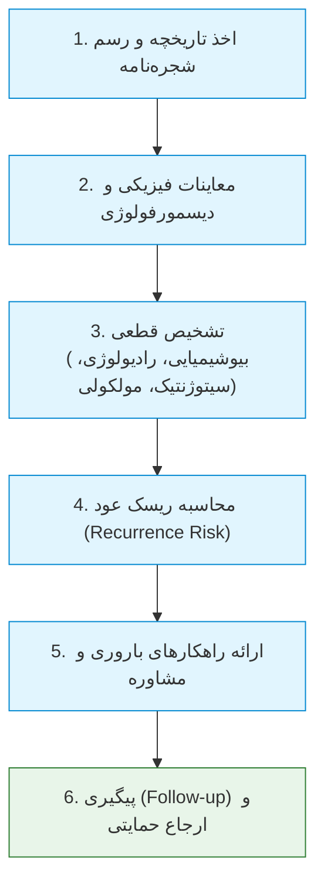
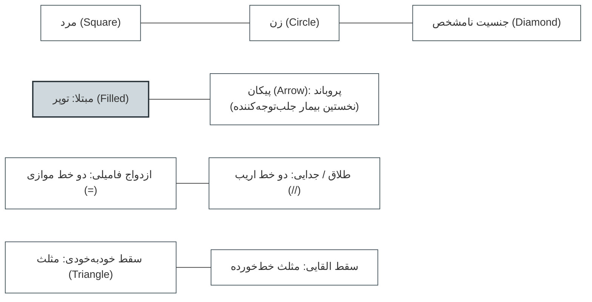
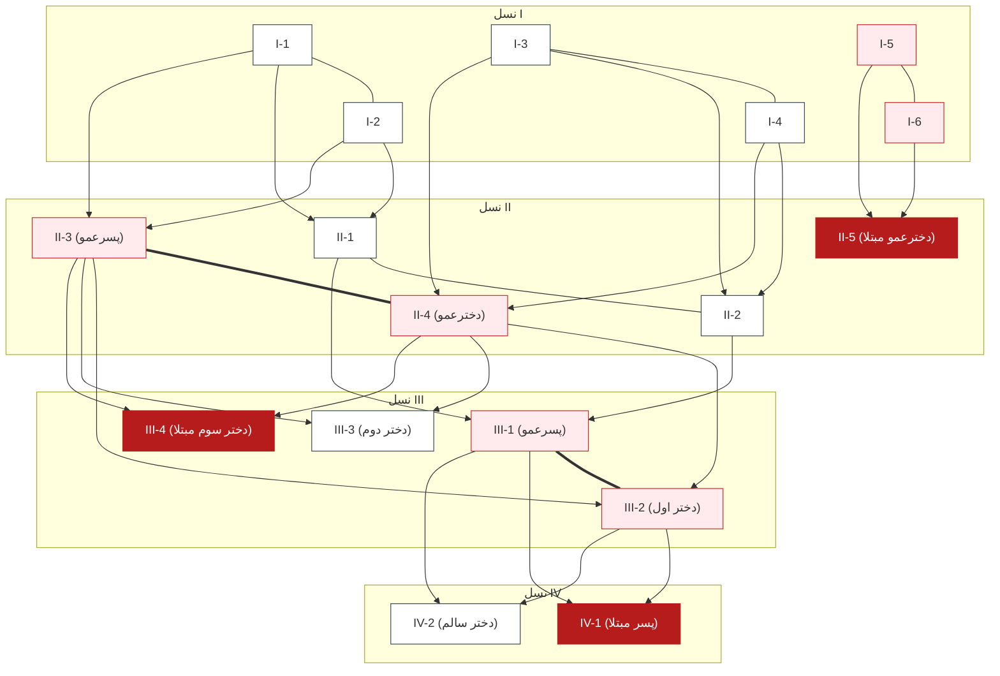
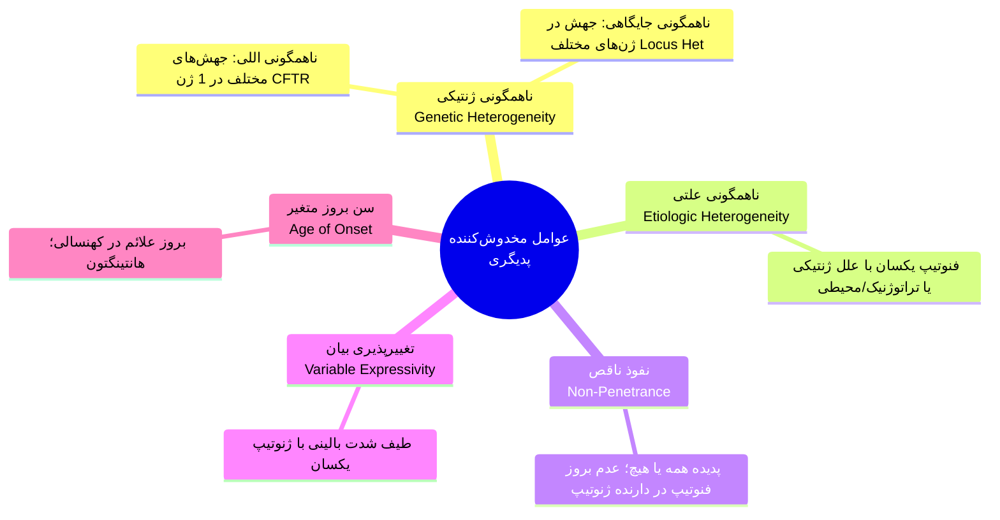
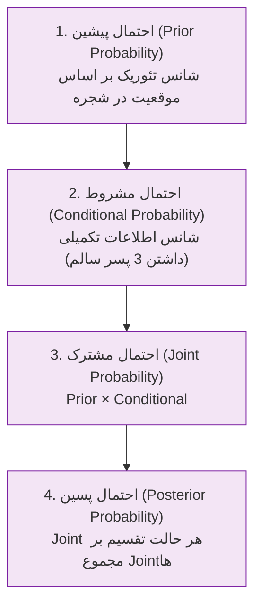
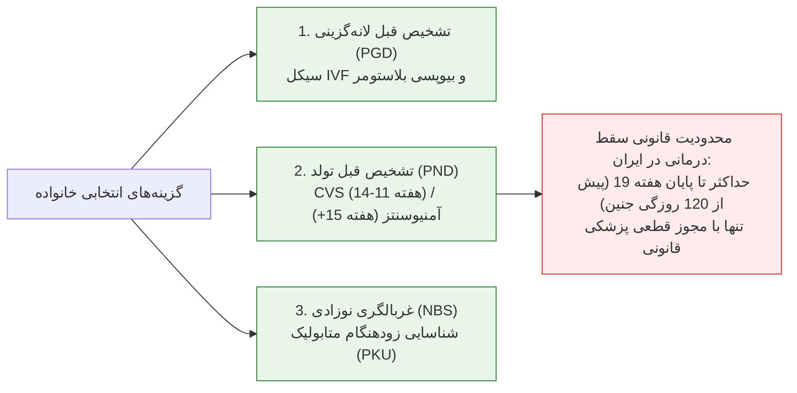

# جلسه ۵: مشاوره ژنتیک، رسم شجره‌نامه و تحلیل ریسک بیزی (Genetic Counseling & Risk Assessment)

## 1. تعاریف بنیادین و ارکان مشاوره ژنتیک

> [!info] تعریف مشاوره ژنتیک (Genetic Counseling)
> فرایند ارتباطی-آموزشی و روانی بین مشاوره‌دهنده (Counselor) و مراجع (Consultand) جهت درک ماهیت بیماری، الگوی توارث، تخمین خطر عود و کمک به تصمیم‌گیری آگاهانه و مستقل بدون تحمیل عقیده.

### اصول اخلاقی و رفتاری حاکم بر جلسه مشاوره
1. **حمایتی بودن (Supportive):** کاهش بار روانی و پذیرش اضطراب خانواده؛ معرفی مراکز حمایتی و انجمن‌های حمایتی بیماری‌های خاص (مانند اوتیسم و تالاسمی).
2. **غیرمستقیم و هدایت‌نشده (Non-Directive):** پرهیز مطلق از *تصمیم‌سازی*؛ تمام گزینه‌ها شفاف بیان شده و تصمیم نهایی منحصراً بر عهده خانواده است.
3. **بدون قضاوت (Non-Judgmental):** احترام کامل به باورهای مذهبی، اصول اخلاقی، توان مالی و شرایط فرهنگی مراجعین (مثلاً عدم سرزنش مادری که تصمیم به ادامه بارداری جنین مبتلا به داون می‌گیرد).
4. **زدودن حس تقصیر (Guilt Relieving):** تأکید مستمر بر اینکه ناهنجاری ژنتیکی هرگز ناشی از گناه، کوتاهی، تقصیر یا قصور والدین نبوده است.
5. **پاسخ غیریکنواخت مراجعین (Variable Response):** ادراک ریسک به شدت وابسته به باورهای مذهبی، زمینه احساسی و درک فرد از کیفیت زندگی کودک است؛ انتظار پاسخ یکسان از همه خانواده‌ها نادرست است.

---

## 2. اندیکاسیون‌های ارجاع به مشاوره ژنتیک

| دوره مراجعه | اندیکاسیون‌های کلیدی و علل ارجاع | اهداف و اقدامات مداخله‌ای |
| :--- | :--- | :--- |
| **بالغین و پیش از ازدواج** | سن بالای 35 سال، همخونی زوجین (Consanguinity)، سابقه فامیلی ناهنجاری، سرطان‌های ارثی فامیلی، اختلالات حسی/عصبی بالغین، برنامه بارداری (Pregnancy planning). | تعیین وضعیت ناقلی (Carrier testing)، تخمین خطر پیش از لانه‌گزینی، انتخاب روش‌های باروری کم‌خطر. |
| **دوران بارداری (Prenatal)** | سن مادر بالای 35 سال، غربالگری مثبت سه‌ماهه اول/دوم، تماس با تراتوژن‌ها، فشارخون/بیماری زمینه‌ای مادر، سابقه $\ge 2$ سقط خودبه‌خودی، ناهنجاری در سونوگرافی. | تشخیص پیش از تولد (CVS/آمنیوسنتز)، بررسی گزینه‌های سقط درمانی قانونی پیش از ولوج روح. |
| **نوزادی و کودکی (Pediatric)** | غربالگری نوزادی غیرطبیعی (NBS)، حضور $\ge 1$ نقص ساختاری ماژور، تأخیر رشد و تکامل (Failure to thrive)، عقب‌ماندگی ذهنی، نابینایی/ناشنوایی، دیسمورفیسم چهره. | پیشگیری از ناتوانی با شروع فوری رژیم/دارو در خطاهای متابولیک، تعیین الگوی توارث برای بارداری‌های بعدی. |

---

## 3. اصول رسم شجره‌نامه و علائم هشدار دهنده (Red Flags)

> [!important] قواعد طلایی جمع‌آوری تبارنامه
> * ثبت اطلاعات سلامت، بیماری و سن فوت حداقل در **3 نسل متوالی**.
> * بررسی دقیق قومیت (Ethnic background) و پیوندهای خویشاوندی (Consanguinity).
> * پرسش اختصاصی از **خویشاوندان آگاه و کلیدی (Informative relatives)** برای ثبت شاخه‌های دوردست.
> * به‌روزرسانی مداوم (Up-to-date) شجره‌نامه؛ حداقل **سالی یک بار** با تولدها، سقط‌ها یا شروع علائم جدید در فامیل.

### نشانه‌های هشدار فامیلی (Family History Red Flags)
* ابتلای چند عضو خانواده به یک بیماری یکسان یا تجمع غیرمعمول انواع سرطان‌ها در سنین پایین.
* بروز بیماری‌های تک‌ژنی نادر (نابینایی، ناشنوایی مادرزادی، نقایص متابولیک و میوپاتی‌ها).
* سابقه بستری مکرر نوزادان، تاخیر تکاملی، دیسمورفولوژی چهره یا ناهنجاری ساختاری جنینی.
* وقوع **مرگ ناگهانی (Sudden death)** در افراد جوان و به ظاهر سالم خانواده.
* شیوع نامتعارف و بسیار بالای بیماری‌های چندعاملی شایع (دیابت، پرفشاری خون) در یک شجره.

> [!note] نکات تکمیلی نمادهای شجره‌نامه
> * **پروباند (Proband / Index Case):** فرد مبتلایی که علت اصلی رجوع خانواده به کلینیک ژنتیک بوده و با **پیکان ($\nearrow$)** نشان داده می‌شود.
> * **مشاوره‌گیرنده (Consultand):** فرد مراجعه‌کننده به جلسه؛ می‌تواند خودِ پروباند یا فردی سالم از خانواده باشد.
> * **چند صفت همزمان:** تقسیم نماد دایره/مربع به 2، 3 یا 4 قطاع مجزا و پر کردن قطاع مربوط به هر بیماری.
> * **تعداد مشخص/نامشخص افراد سالم:** درج عدد داخل نماد (مثلاً عدد 5 داخل مربع = 5 پسر سالم؛ حرف $n$ = تعداد نامعلوم).
> * **بارداری فعال:** درج حرف **P** داخل لوزی به همراه سن بارداری بر اساس LMP.
> * **فوت:** خط مورب روی نماد به همراه درج سن فوت در زیر آن.
> * **روش‌های کمک‌باروری (ART):** تفکیک فرزندپذیری با براکت `[ ]`؛ در اهدای اسپرم، اهدای تخمک یا رحم اجاره‌ای (Surrogate)، خطوط بیولوژیک از خطوط حضانت تفکیک می‌شوند.

---

## 4. شجره‌نامه تمرینی سیستیک فیبروزیس (CF) در کلاس

> [!warning] نکات تستی شجره سیستیک فیبروزیس
> * **پروباند:** فرد **III-4** (با علامت پیکان).
> * **الگوی وراثت:** اتوزومال مغلوب (AR) به علت ابتلای فرزندان از والدین سالم و انتقال افقی در نسل‌ها.
> * **ناقلین قطعی (Obligate Carriers):** والدین بیماران AR بدون استثنا ناقل‌اند:
>   * والدین بیمار IV-1: افراد **III-1** و **III-2**.
>   * والدین بیمار III-4: افراد **II-3** و **II-4**.
>   * والدین بیمار II-5: افراد **I-5** و **I-6**.

---

## 5. عوامل مخدوش‌کننده تفسیر شجره‌نامه و دیتابیس OMIM

### مقایسه عوامل مخدوش‌کننده الگوهای مندلی

| پدیده ژنتیکی | تعریف مکانیکی دقیق | پیامد مستقیم در رسم پدیگری | مثال بارز بالینی |
| :--- | :--- | :--- | :--- |
| **Allelic Heterogeneity** | جهش‌های نقطه‌ای یا ساختاری مختلف در **یک لوکوس ژنی واحد**. | بروز شدت‌های مختلف یک بیماری مندلی واحد. | بیش از 2000 جهش مجزا در ژن *CFTR* یا ژن بتا-گلوبین. |
| **Locus Heterogeneity** | جهش در **ژن‌های کاملاً مستقل روی لوکوس‌های مختلف**. | وجود الگوهای وراثتی متفاوت (AD, AR, XR) برای یک بیماری. | ناشنوایی ارثی (>120 ژن)، Amelogenesis imperfecta، اهبرز-دانلوس. |
| **Etiologic Heterogeneity** | فنوتیپ یکسان حاصل برهم‌کنش ژنتیک یا عوامل تراتوژن/عفونی. | اشتباه در تلقی صفت فامیلی تک‌ژنی با موارد اسپورادیک. | عقب‌ماندگی ذهنی ناشی از داون در برابر عفونت داخل‌رحمی CMV. |
| **نفوذ ناقص (Non-Penetrance)** | نسبت دارندگان ژنوتیپ که فنوتیپ بیماری را بروز می‌دهند. | **پرش ظاهری از نسل (Skipping)** و اشتباه گرفتن AD با AR. | رتینوبلاستوما فامیلیال، جهش‌های سرطان برست BRCA1/2. |
| **تغییرپذیری تظاهر (Expressivity)** | شدت و دامنه علائم بالینی در دارندگان ژنوتیپ یکسان. | غفلت از ناقلین دارای فرم فوق‌خفیف به عنوان فرد سالم. | علائم پوستی خفیف نوروفیبروماتوز 1 در والد بیمار شدید. |

> [!important] قواعد امتحانی مفهوم نفوذ (Penetrance)
> * نفوذ در سطح **یک فرد منفرد** پدیده‌ای **همه یا هیچ (All-or-None)** است؛ نفوذ فرد یا 0% است یا 100% (حتی با خفیف‌ترین علامت، نفوذ فرد 100% محسوب می‌شود).
> * نفوذ کسری (مثلاً 80%) صرفاً در سطح **یک خانواده یا جمعیت** معنا دارد و نشان‌دهنده درصد مبتلایان بالینی نسبت به کل دارندگان ژنوتیپ جهش‌یافته است.

### کدهای شش‌رقمی پایگاه اطلاعاتی OMIM

| رقم آغازین کد MIM | طبقه‌بندی لوکوس یا صفت | تاریخچه ثبت در پایگاه داده |
| :--- | :--- | :--- |
| **100000 - 199999** | لوکوس‌ها یا فنوتیپ‌های اتوزومال غالب (AD) | پیش از 15 می 1994 (یا 1984 در برخی نسخ) |
| **200000 - 299999** | لوکوس‌ها یا فنوتیپ‌های اتوزومال مغلوب (AR) | پیش از 15 می 1994 |
| **300000 - 399999** | بیماری‌ها و جایگاه‌های وابسته به کروموزوم X | تمام ورودی‌ها |
| **400000 - 499999** | صفات و جایگاه‌های وابسته به کروموزوم Y | تمام ورودی‌ها |
| **500000 - 599999** | جهش‌ها و فنوتیپ‌های ژنوم میتوکندریایی (mtDNA) | تمام ورودی‌ها |
| **600000 به بالا** | کلیه لوکوس‌های اتوزومال (اعم از غالب یا مغلوب) | **ثبت‌شده پس از 15 می 1994** |

---

## 6. اصول و قوانین احتمالات در مشاوره ژنتیک

> [!info] اصل جمع (قانون OR - Addition Principle)
> برای وقایعی که **ناسازگار** هستند (امکان رخ دادن همزمان آن‌ها وجود ندارد):
> $$P(A \cup B) = P(A) + P(B)$$
> *مثال:* جنسیت جنین یا دختر است (50%) یا پسر (50%)؛ احتمال تولد فرزند پسر یا دختر برابر است با: $0.5 + 0.5 = 1$ (100%).

> [!info] اصل ضرب (قانون AND - Multiplication Principle)
> برای وقایع کاملاً **مستقل از یکدیگر** که وقوع همزمان آن‌ها امکان‌پذیر است:
> $$P(A \cap B) = P(A) \times P(B)$$
> *مثال دوقلوها:* شانس پسر بودن قل اول (1/2) و پسر بودن قل دوم (1/2)؛ احتمال همزمانی تولد دو قلو پسر: $1/2 \times 1/2 = 1/4$. شانس یک دختر و یک پسر فارغ از ترتیب: $(1/2 \times 1/2) + (1/2 \times 1/2) = 1/2$.

### جنبه کیفی درک ریسک در برابر کمیت ریاضی
* **ادراک کمّی:** والدین ناآگاه تصور می‌کنند شانس ابتلای 25% یعنی اگر 4 فرزند بیاورند، قطعاً 1 نفر مبتلا و 3 نفر سالم خواهند بود؛ در حالی که شانس حافظه ندارد و برای **هر بارداری مستقل** دقیقاً 25% خطر وجود دارد (و 75% شانس سلامت).
* **ادراک کیفی (Nature of Risk):** تصمیم‌گیری مراجعین بیشتر متأثر از بار بیماری بر زندگی آینده کودک است؛ خانواده‌ها ریسک بالای **50% برای یک نقص ساختاری جزئی و قابل اصلاح جراحی** (مانند پلی‌داکتیلی یا براکی‌داکتیلی) را بسیار راحت‌تر از ریسک اندک **1% تا 2% برای بیماری ناتوان‌کننده مادام‌العمر** (نظیر سندرم داون) می‌پذیرند.

---

## 7. تحلیل بیزی شجره‌نامه XR (حل کامل مسئله اسلاید 42 تا 44)

### صورت مسئله امتحانی
در یک شجره وراثت وابسته به X مغلوب (XR)، زن I-2 ناقل قطعی است (دارای برادر مبتلا I-3 و پسر مبتلا II-3). زن II-2 دختر او بوده و دارای **3 پسر کاملاً سالم** (III-1, III-2, III-4) و یک دختر سالم (III-3) است. مطلوب است محاسبه احتمال ناقل بودن دختر (III-3).

### جدول استاندارد محاسبات بیز برای وضعیت مادر (فرد II-2)

| گام‌های محاسبه بیز | فرض 1: فرد II-2 ناقل هتروزیگوت باشد | فرض 2: فرد II-2 سالم هوموزیگوت باشد |
| :--- | :--- | :--- |
| **احتمال پیشین (Prior)** | 1/2 (شانس دریافت X جهش‌یافته از مادرش I-2) | 1/2 (شانس دریافت X سالم از مادرش I-2) |
| **احتمال مشروط (Conditional)** | شانس داشتن 3 پسر سالم: $(1/2)^3 = \mathbf{1/8}$ | شانس داشتن 3 پسر سالم: $(1)^3 = \mathbf{1}$ |
| **احتمال مشترک (Joint)** | $1/2 \times 1/8 = \mathbf{1/16}$ | $1/2 \times 1 = 1/2 = \mathbf{8/16}$ |
| **احتمال پسین نهایی (Posterior)** | $\frac{1/16}{1/16 + 8/16} = \mathbf{1/9}$ | $\frac{8/16}{1/16 + 8/16} = \mathbf{8/9}$ |

> [!important] محاسبه نهایی برای دختر (فرد III-3)
> با توجه به اینکه احتمال پسین ناقل بودن مادرش (II-2) از 50% به **1/9** افت کرده است، احتمال ناقل بودن خودِ دختر (III-3) برابر است با:
> $$P(\text{III-3 is Carrier}) = P(\text{مادرش ناقل باشد}) \times \frac{1}{2} = \frac{1}{9} \times \frac{1}{2} = \mathbf{\frac{1}{18}}$$
> *(بدون در نظر گرفتن اطلاعات فرزندان، شانس تئوریک اولیه $1/2 \times 1/2 = 1/4$ محاسبه می‌شد که حضور 3 پسر سالم آن را به 1/18 کاهش داد).*

---

## 8. حل مسائل تمرینی شجره‌نامه اسلاید 12

### قوانین برخورد با افراد غریبه و خارج از خانواده (Outsider Rules)
1. **در شجره‌نامه‌های غالب (AD):** فرد غریبه مبتلا همواره **هتروزیگوت (Aa)** فرض می‌شود (زیرا هوموزیگوت AA فوق‌العاده نادر یا کشنده داخل‌رحمی است).
2. **در شجره‌نامه‌های مغلوب (AR):** فرد غریبه فنوتیپاً سالم همواره **سالم هوموزیگوت (AA)** فرض می‌شود، مگر فرکانس ناقلی جمعیت ($2pq$) تصریح شده باشد.

### تحلیل شجره‌نامه اسلاید 12 (Risk Assessments)
* **تعیین الگوی وراثت:** حضور والدین سالم با فرزندان مبتلا (III-4 پسر مبتلا و III-6 دختر مبتلا) و ابتلای هر دو جنس اثبات می‌کند بیماری **اتوزومال مغلوب (AR)** است.

#### پرسش 1: اگر فرد III-1 با فرد III-4 ازدواج کند، ریسک تولد فرزند مبتلا چقدر است؟
1. وضعیت فرد III-4: بیمار هوموزیگوت مغلوب (aa) است؛ بنابراین الل جهش‌یافته 'a' را با شانس قطعی **1** به فرزند منتقل می‌کند.
2. ریسک ناقلی III-1:
   * پدربزرگ و مادربزرگ مشترک (I-1 و I-2) ناقل قطعی هستند.
   * والد نسل دوم (II-1): شانس ناقلی = 1/2.
   * فرد III-1: یک نسل دورتر است؛ شانس ناقلی = $1/2 \times 1/2 = \mathbf{1/4}$.
3. احتمال انتقال الل معیوب از III-1 به فرزند = 1/2.
4. محاسبه نهایی:
   $$\text{Risk} = P(\text{III-1 Carrier}) \times \frac{1}{2} \times P(\text{III-4 Allele}) = \frac{1}{4} \times \frac{1}{2} \times 1 = \mathbf{\frac{1}{8}}$$

#### پرسش 2: شانس ابتلای فرزند حاصل از ازدواج زوج III-2 و III-3 چقدر است؟
1. ریسک ناقلی III-2: مشابه وضعیت III-1 بوده و برابر با **1/4** است.
2. ریسک ناقلی III-3: خواهرِ فنوتیپاً سالم افراد مبتلا (III-4 و III-6) در یک شجره AR است؛ طبق قاعده بایزی خواهر/برادر سالم، شانس ناقلی برابر با **2/3** است.
3. شانس انتقال الل جهش‌یافته از هر دو والد ناقل به فرزند = 1/4.
4. محاسبه نهایی:
   $$\text{Risk} = \frac{1}{4} \times \frac{2}{3} \times \frac{1}{4} = \frac{2}{48} = \mathbf{\frac{1}{24}}$$

---

## 9. راهکارهای تشخیصی و قوانین سقط درمانی

### مشخصات و زمان‌بندی تکنیک‌های تولیدمثلی
1. **PGD (تشخیص ژنتیکی پیش از لانه‌گزینی):** انجام لقاح آزمایشگاهی (IVF) و بیوپسی از سلول‌های بلاستوسیست؛ تنها رویان‌های فاقد جهش منتقل می‌شوند و مانع از نیاز به سقط درمانی می‌شود.
2. **PND (تشخیص ژنتیکی پیش از تولد):** با روش‌های تهاجمی CVS یا آمنیوسنتز انجام می‌شود.
3. **قانون سقط درمانی در ایران:** مجوز خاتمه قانونی بارداری صرفاً برای ناهنجاری‌های جنینی منجر به حرج یا بیماری‌های کشنده و پیش از **ولوج روح (حداکثر پیش از 120 روزگی سن جنین معادل پایان هفته 19 بارداری بر اساس سونوگرافی دقیق)** صادر می‌گردد؛ پس از این مهلت تحت هیچ شرایطی مجوز صادر نمی‌شود.
4. **غربالگری بدو تولد (Newborn Screening - NBS):** شناسایی نوزادان مبتلا به خطاهای مادرزادی متابولیسم (نظیر فنیل‌کتونوری و کم‌کاری تیروئید) با نمونه خون پاشنه پا جهت شروع درمان رژیمی پیش از بروز عقب‌ماندگی ذهنی برگشت‌ناپذیر.
