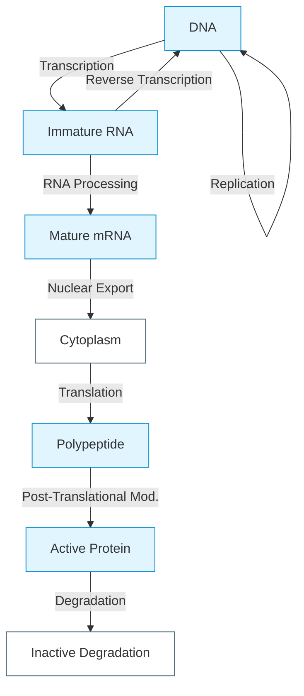
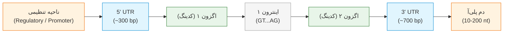
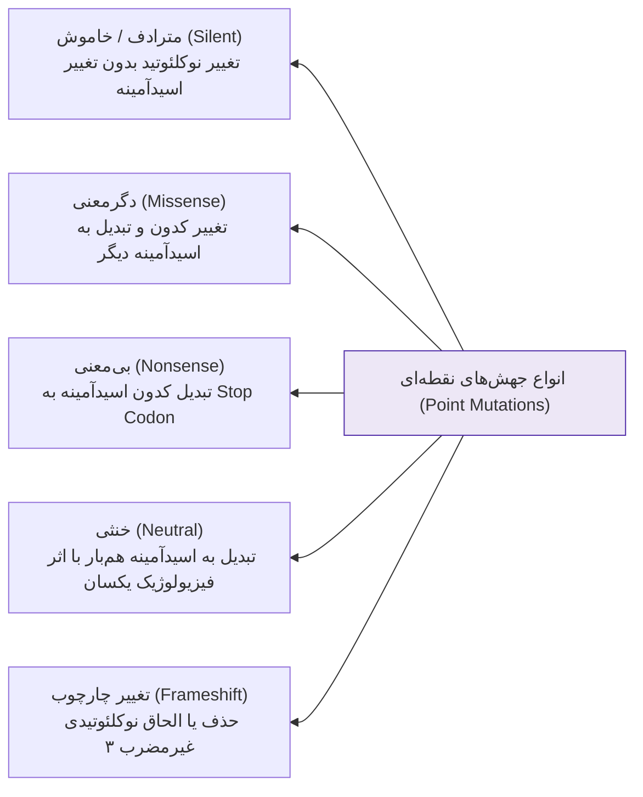
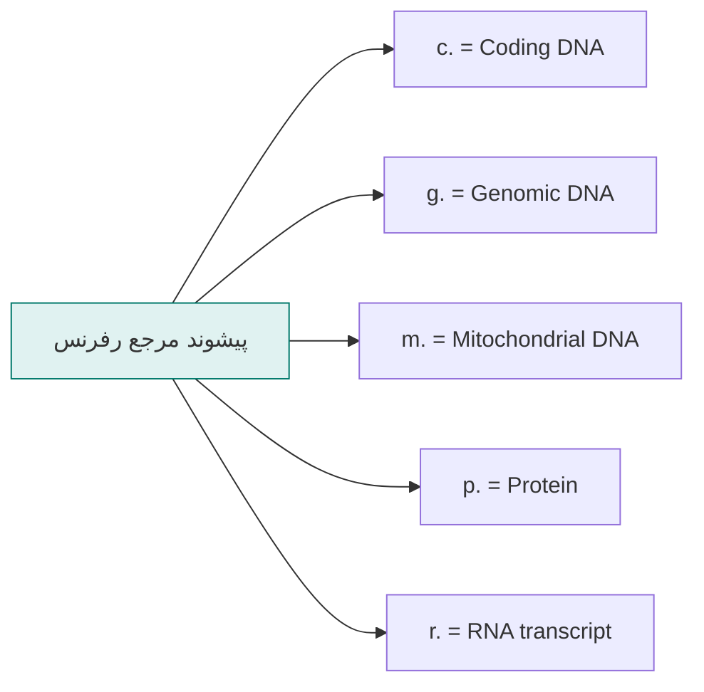
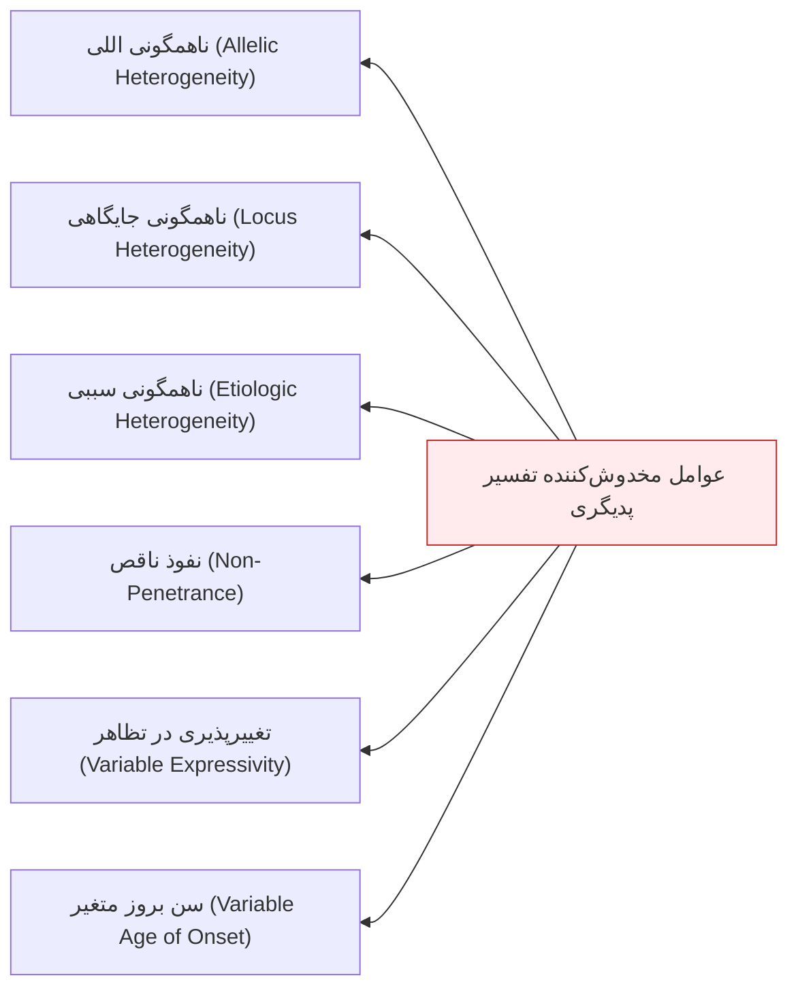
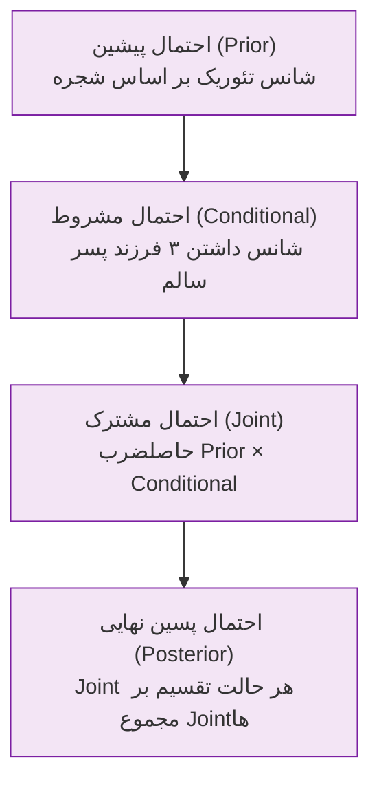
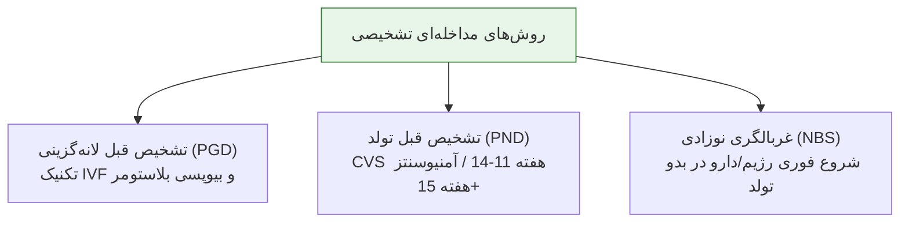

# جلسه ۰۶: ژنتیک مولکولی، جهش‌ها، نام‌گذاری HGVS و مشاوره ژنتیک

## ۱. شاخه‌های ژنتیک و دگمای مرکزی (Central Dogma)

### شاخه‌های هشت‌گانه ژنتیک
1. **Molecular Genetics:** مطالعه ساختار و عملکرد اطلاعات ژنتیکی در سطح DNA و RNA.
2. **Cytogenetics:** بررسی ساختار، تعداد و ناهنجاری‌های کروموزومی در سطح میکروسکوپی.
3. **Clinical Genetics:** کاربرد عملی ژنتیک در تشخیص، مدیریت، درمان و پیشگیری از نقایص مادرزادی.
4. **Population Genetics:** بررسی تواتر اللی (Allele frequency) و تعادل ژنتیکی در سطح جمعیت.
5. **Immunogenetics:** مطالعه پایه ژنتیکی پاسخ‌های ایمنی، آنتی‌بادی‌ها و ایمنوپاتولوژی.
6. **Pharmacogenetics:** تفاوت‌های فردی ژنتیکی در پاسخ، اثربخشی و سمیت داروها.
7. **Developmental Genetics:** کنترل ژنتیکی نمو طبیعی و غیرطبیعی رویانی/جنینی.
8. **Behavioral Genetics:** وراثت‌پذیری رفتارها، خلق‌وخو و عملکردهای شناختی.

> [!info] دگمای مرکزی زیست‌شناسی مولکولی
> جریان پیوسته و یک‌طرفه اطلاعات ژنتیکی از DNA به RNA (رونویسی) و از RNA به پروتئین (ترجمه)؛ الحاقات مدرن شامل **Replication** (تکثیر DNA) و **Reverse Transcription** (آنزیم ترنسکریپتاز معکوس در رتروویروس‌ها) است.

### مراحل تبدیل DNA به پروتئین فعال و جایگاه اتیولوژی بیماری‌ها
* **آنپکینگ کروماتین (Unpacking):** خروج کروماتین متراکم به حالت باز برای اتصال فاکتورهای رونویسی.
* **رونویسی (Transcription):** سنتز pre-mRNA از روی رشته تمپلیت توسط RNA Polymerase.
* **پردازش RNA (Processing):** حذف اینترون‌ها (Splicing)، کلاهک‌گذاری 5' ('5-Capping) و پلی‌آدنیلاسیون 3' (Poly-A Tail).
* **انتقال هسته‌ای (Nuclear Export):** جابجایی mRNA بالغ از منافذ غشای هسته به سیتوپلاسم.
* **ترجمه (Translation):** سنتز پلی‌پپتید توسط ریبوزوم‌ها با هدایت کدون‌های ژنتیکی.
* **فعال‌سازی پساترجمه‌ای (Activation/Folding):** تاخوردگی سه‌بعدی، افزودن گروه‌های شیمیایی و برش پروتئولیتیک.
* **تخریب پروتئین (Degradation):** پاکسازی پروتئین توسط سیستم یوبیکوئیتین-پروتئازوم.
* *نکته پاتولوژیک:* اختلال در **هر یک** از این مراحل، نقطه شروع یک بیماری ژنتیکی تک‌ژنی اختصاصی است.

---

## ۲. بیولوژی DNA و سازمان‌بندی ژنوم انسان

### ساختار مارپیچ دوگانه (Watson & Crick 1953)
* **واحدهای ساختمانی:** باز آلی نیتروژن‌دار + قند پنج کربنه دئوکسی‌ریبوز + گروه فسفات = **نوکلئوتید**.
* **اتصالات مکمل:** آدنین (A) با تیمین (T) توسط ۲ پیوند هیدروژنی ($A=T$)؛ گوانین (G) با سیتوزین (C) توسط ۳ پیوند هیدروژنی ($G \equiv C$).
* **جهت‌داری فضایی (Polarity):** دو رشته با جهت‌گیری موازی ناهمسو (Antiparallel)؛ یک رشته '5 به '3 و رشته مکمل '3 به '5.
* **قاعده خوانش سکانس:** جهت استاندارد خوانش همواره از **انتهای 5' آزاد به سمت انتهای 3' آزاد** است. رشته سنس (Sense) با جهت 5' به 3' سکانس اصلی بوده و توالی رشته آنتی‌سنس با قاعده مکملی مشخص می‌شود.
* **کدون‌های اختصاصی ژنتیکی:** ۶۴ کدون برای ۲۰ اسید آمینه.
  * **استارت کدون:** منحصراً **AUG** (کدکننده متیونین در آغازگر ترجمه).
  * **استاپ کدون‌ها:** سه کدون فاقد اسید آمینه: **UAA**، **UAG**، **UGA**.

### سازمان‌بندی فضایی اطلاعات ژنتیکی (تشبیه دایرةالمعارف)
* طول کامل ژنوم هاپلوئید انسانی معادل **۲ متر** DNA خطی درون هسته میکروسکوپی سلول است.
* تعداد ژن‌های کدکننده پروتئین: **۲۰,۰۰۰ تا ۲۵,۰۰۰ ژن**؛ تقریباً برابر با تنوع پروتئین‌های اصلی بدن.
* **تشبیه مفهومی استاد:** ۲۳ جفت کروموزوم معادل یک دوره دایرةالمعارف ۲۳ جلدی است؛ هر صفحه معادل یک لوکوس کروموزومی، واژگان معادل کدهای ژنتیکی ۳ نوکلئوتیدی (Codon) و جملات حاصل معادل پروتئین‌های کارکردی هستند. سلامت ارگانیسم وابسته به بدون نقص بودن تمام مجلدات و صفحات است.

---

## ۳. آناتومی مولکولی ژن‌های کدکننده پروتئین

### اجزای شش‌گانه ژن و ویژگی‌های بیوفیزیکی

| جزء ساختاری ژن | میانگین اندازه در ژنوم انسان | موقعیت و جهت‌گیری | عملکرد فیزیولوژیک کلیدی |
| :--- | :--- | :--- | :--- |
| **ناحیه تنظیمی (Regulatory Region)** | 50 تا 10,000 جفت‌باز (bp) | عمدتاً در 5' Flanking (سمت چپ ژن)؛ گاهی درون اینترون‌ها یا 3' Flanking | تنظیم مثبت یا منفی بیان ژن بر اساس سیگنال‌های بافتی و زمانی؛ اتصال TFها در توالی‌های تکراری 50-200 bp |
| **ناحیه غیرترجمه‌ای 5' (5' UTR)** | میانگین حدود 300 نوکلئوتید | در اگزون نخست؛ بین محل شروع ترنسکریپشن و استارت کدون (ATG) | ارتقای بازدهی و دقت هدایت ماشین ترجمه ریبوزومی (Translational efficiency) |
| **توالی کدکننده (Coding Exons)** | میانگین 1340 نوکلئوتید (کدکننده ~450 اسیدآمینه) | بین استارت کدون AUG و استاپ کدون (UAA/UAG/UGA) | حمل توالی تریپلت اسیدهای آمینه؛ تعداد اگزون در ژن‌ها از ۱ تا ۱۸۰ (میانگین ژنومی: ۹ اگزون؛ سایز هر اگزون ~50-200 bp) |
| **اینترون‌ها (Introns)** | میانگین 3365 جفت‌باز (بسیار بزرگ‌تر از اگزون‌ها) | فواصل بین اگزونی؛ تعداد اینترون‌ها همواره برابر است با: $\text{Exons} - 1$ | نواحی غیرکدکننده مداخله‌گر؛ حذف کامل در پیرایش RNA؛ افزایش طول فیزیکی ژن متناسب با بزرگی اینترون‌ها |
| **ناحیه غیرترجمه‌ای 3' (3' UTR)** | میانگین حدود 700 نوکلئوتید | در اگزون پایانی؛ بعد از استاپ کدون تا انتهای ناحیه ترنسکریپت‌شده | تضمین پایداری mRNA (Stability) و تعیین موقعیت مکانی رونوشت در بافت هدف (Localization) |
| **دم پلی‌آدنیلاسیون (Poly-A Tail)** | 10 تا 200 نوکلئوتید A | انتهای 3' پس از برش پیام‌رسان (Post-transcriptional) | محافظت در برابر اگزونوکلئازها و تسهیل ترجمه؛ در تمام mRNAهای پستانداران به جز **mRNA هیستون‌ها** |

### مرزهای اگزون-اینترون (Splice Junctions)
* **مرز اگزون-اینترون (Splice Donor):** در انتهای اگزون و آغاز اینترون حاوی توالی ثابت دی‌نوکلئوتیدی **GT** (موتیف محافظت‌شده **GTG** یا GTAAG).
* **مرز اینترون-اگزون (Splice Acceptor):** در انتهای اینترون و آغاز اگزون بعدی حاوی توالی محافظت‌شده **AG** (موتیف محافظت‌شده **CAG**).
* *نکته امتحانی بیوشیمی بالینی:* تغییرات جهشی در این مرزهای اینترونی باعث تغییر اسیدآمینه نمی‌شود، اما **پیرایش (Splicing) و رونویسی mRNA را متوقف یا نابجا** می‌سازد.

### الکتروفروگرام دستگاه توالی‌یاب DNA (Sanger Sequencing)
* در دستگاه‌های خودکار کاپیلاری، هر یک از ۴ نوکلئوتید با یک فلوروکروم اختصاصی شناسایی و ثبت می‌شود:
  * **آدنین (A):** رنگ **سبز (Green)**
  * **سیتوزین (C):** رنگ **آبی (Blue)**
  * **گوانین (G):** رنگ **سیاه (Black)**
  * **تیمین (T):** رنگ **قرمز (Red)**

---

## ۴. دسته‌بندی جامع موتاسیون‌ها و مکانیسم‌های مولکولی

> [!info] تعریف جهش (Mutation) در برابر واریانت (Variant)
> موتاسیون هرگونه تغییر دائمی در توالی نوکلئوتیدی ژنوم است. در استانداردهای نوین ژنتیک پزشکی، استفاده از کلمات قطبی‌شده «موتاسیون» (به بار معنایی بیماری) و «پلی‌مورفیسم» (به بار معنایی سلامت) کنار گذاشته شده و ترم‌های خنثی نظیر **Sequence Variant**، **Alteration** یا **Change** ترجیح داده می‌شوند.

### طبقه‌بندی بنیادین موتاسیون‌ها
1. **کشنده (Lethal) در برابر شرطی (Conditional):** جهش لتال بقای سلول را ناممکن کرده و منجر به مرگ زیگوت/سلول می‌شود (غیرقابل بازیابی در جامعه)؛ جهش کاندیشنال عملکرد ژن را تغییر می‌دهد اما با حیات سازگار است.
2. **خودبه‌خودی (Spontaneous) در برابر القایی (Induced):** جهش خودبه‌خودی ناشی از خطای ذاتی پلیمراز حین همانندسازی ($10^{-4}$ تا $10^{-6}$ در هر ژن در هر نسل) یا ناشی از جابجایی ترنسپوزون‌هاست؛ جهش القایی تحت اثر موتاژن‌های فیزیکی (اشعه) یا شیمیایی رخ می‌دهد.
3. **پیشرو، برگشتی و مهارکننده (Suppressor):**
   * *Forward Mutation:* تبدیل ژنوتیپ وحشی (Wild-type) طبیعی به فنوتیپ جهش‌یافته.
   * *Reverse Mutation:* جهش مجدد دقیقاً در همان جایگاه اولیه که توالی را به حالت وایلدتایپ بازمی‌گرداند.
   * *Suppressor Mutation:* جهش ثانویه در جایگاهی دیگر که اثر جهش اولیه را جبران (Restore) می‌کند. به دو فرم **اینتراژنیک (Intragenic)** در همان کدون/ژن یا **اینترژنیک (Intergenic)** در ژن تنظیمی دیگر.

### مقایسه عملکردی جهش‌های نقطه‌ای

| نوع جهش نقطه‌ای | سازوکار مولکولی | پیامد روی ترنسلیشن و پروتئین | نمونه بالینی یا تشبیه متنی |
| :--- | :--- | :--- | :--- |
| **ترنزیشن (Transition)** | تبدیل پورین به پورین ($A \leftrightarrow G$) یا پیریمیدین به پیریمیدین ($C \leftrightarrow T$) | تغییر نوکلئوتیدی هم‌خانواده | شایع‌ترین تیپ جابجایی بازی |
| **ترنسورژن (Transversion)** | تبدیل پورین به پیریمیدین یا بالعکس ($A/G \leftrightarrow C/T$) | تغییر فضایی باز پورین/پیریمیدین | نیازمند اعوجاج فضایی بیشتر دابل‌هلیکس |
| **سایلنت (Silent)** | تغییر نوکلئوتید در موقعیت ۳ کدون با حفظ اسیدآمینه به دلیل دژنره بودن ژنتیک کد | عدم تغییر در ساختمان اولیه پلی‌پپتید | کد شدن لیزین با دو توالی AAA و AAG |
| **میس‌سنس (Missense)** | تغییر یک باز و جایگزینی اسیدآمینه نامتجانس | تغییر ساختاری پروتئین از خفیف تا اختلال کامل | تبدیل لیزین به گلوتامیک اسید در پروتئین |
| **نان‌سنس (Nonsense)** | جهش نقطه‌ای منجر به تولید استاپ کدون زودرس (PTC) | توقف ترنسلیشن، پروتئین کوتاه و ناکارآمد (Truncated) | فعال‌سازی مسیر NMD و تخریب کامل محصول |
| **خنثی (Neutral)** | تغییر اسیدآمینه به اسیدآمینه با خواص بار شیمیایی مشابه | حفظ ساختار فضایی و عملکرد نرمال بیوشیمیایی | جایگزینی لیزین با آرژینین (هر دو بازی با بار مثبت) |
| **تغییر چارچوب (Frameshift)** | الحاق (Insertion) یا حذف (Deletion) با تعداد غیرمضرب ۳ | برهم‌خوردن تمام کدون‌های پایین‌دست و توقف نهایی | الحاق ۱ نوکلئوتید و دگرگونی تمام واژگان جمله |

> [!important] قاعده تستی طلایی ایندل‌های مضرب ۳ (In-frame Indels)
> حذف یا الحاق نوکلئوتیدی که **دقیقاً مضرب ۳ باشد (۳، ۶، ۹ و...)** هرگز چارچوب خوانش (Reading Frame) را تغییر نمی‌دهد؛ این پدیده صرفاً یک یا چند اسیدآمینه را کم یا زیاد کرده ولی فریم بقیه توالی دست‌نخورده باقی می‌ماند.

---

## ۵. مفاهیم پاتوژنیک نوین: منفی غالب و هاپلو‌اینسافیشنسی

> [!info] اثر منفی غالب (Dominant Negative / Antimorphic)
> پدیده‌ای که در آن محصول الل جهش‌یافته نه تنها عملکرد طبیعی خود را از دست می‌دهد (Loss-of-function)، بلکه مستقیماً یا با واسطه عملکرد پروتئین طبیعی الل سالم (Wild-type) را نیز مهار و بلاک می‌کند (مانند جهش ژن‌های **TP53** و **RAS** در انکوژنز).

> [!info] نارسایی تک‌نسخه‌ای (Haploinsufficiency)
> وضعیتی که در آن تولید ۵۰٪ دوز پروتئینی از الل سالم برای حفظ عملکرد طبیعی سلول کافی نیست و کاهش دوز پروتئین به زیر ۱۰۰٪ منجر به بروز فنوتیپ بیماری اتوزومال غالب می‌شود.

---

## ۶. بیماری‌های ناشی از گسترش ناپایدار تکرارهای سه‌نوکلئوتیدی

> [!info] پیش‌اندازی (Anticipation)
> پدیده ژنتیکی که طی آن سن شروع بیماری در نسل‌های متوالی زودرس‌تر شده و شدت علائم بالینی به دلیل افزایش تعداد تکرارهای تری‌نوکلئوتیدی در گامتوژنز تشدید می‌یابد.

| بیماری منسوب | الگوی وراثت | موتیف تکراری | ژن هدف | جایگاه در ژن | مرز تکرار نرمال | مرز تکرار پاتوژنیک |
| :--- | :--- | :--- | :--- | :--- | :--- | :--- |
| **هانتینگتون (Huntington)** | اتوزومال غالب (AD) | **CAG** | *HTT* | ناحیه کدینگ (اگزون ۱) | کمتر از ۳۴ تکرار | **بیش از ۴۰** تکرار |
| **سندرم X شکننده (Fragile X)** | وابسته به X | **CGG** | *FMR1* | ناحیه '5 UTR | کمتر از ۵۰ تکرار | **بیش از ۲۰۰** تکرار (متیلاسیون کامل) |
| **دیستروفی میوتونیک (DM1)** | اتوزومال غالب (AD) | **CTG** | *DMPK* | ناحیه '3 UTR | کمتر از ۳۵ تکرار | **۸۰ تا ۲۰۰۰** تکرار |
| **آتاکسی فریدریش (FRDA)** | اتوزومال مغلوب (AR) | **GAA** | *FXN* | اینترون ۱ | کمتر از ۳۴ تکرار | **۳۶ تا ۱۲۰۰** تکرار |
| **آتروفی عضلانی نخاعی-پیازی (SBMA)** | وابسته به X | **CAG** | *AR* | اگزون ژن گیرنده آندروژن | ۱۱ تا ۳۱ تکرار | بیش از ۴۰ تکرار |

---

## ۷. سیستم نام‌گذاری استاندارد واریانت‌ها (HGVS Nomenclature)

### علائم و کاراکترهای کلیدی سیستم HGVS
* `>` : جانشینی نوکلئوتیدی (Substitution؛ مثال: `c.1832G>A`).
* `del` : حذف نوکلئوتیدی (Deletion؛ مثال: `c.76_78del`).
* `ins` : الحاق نوکلئوتیدی (Insertion؛ مثال: `c.112_113insTG`).
* `delins` : حذف همزمان با الحاق توالی جدید (مثال: `c.112_117delinsTG`).
* `_` (Underscore) : نشان‌دهنده دامنه و بازه نوکلئوتیدی (Range).
* `+` : نشان‌دهنده موقعیت درون‌اینترونی به سمت انتهای 3' اگزون یا بالادست 5' UTR.
* `-` : نشان‌دهنده موقعیت درون‌اینترونی به سمت انتهای 5' اگزون یا پایین‌دست 3' UTR.
* `*` : نشان‌دهنده کدون خاتمه ترجمه (Ter) یا رونویسی پس از استاپ کدون.
* `[]` : نشان‌دهنده الل‌های کروموزومی جداگانه.
* `/` و `//` : به ترتیب نشان‌دهنده **موزائیسم (Mosaicism)** و **کایمریسم (Chimerism)**.
* `=` : نشان‌دهنده عدم تغییر توالی نسبت به رفرنس (Unchanged / Wild-type).
* `?` : ناشناخته بودن فاز ژنتیکی یا موقعیت دقیق تغییر.

> [!warning] تله امتحانی تفسیر کدون‌های اینترونی (چرا c.88+1G>T به جای c.89G>T؟)
> نوکلئوتید شماره ۸۸ آخرین نوکلئوتید اگزون کدکننده است. چون رفرنس گزارش `c.` (کدینگ) بوده و اینترون‌ها فاقد شماره کدینگ مستقیم هستند، نخستین نوکلئوتید اینترون بعدی به صورت **88+1** نام‌گذاری می‌شود. جهش در این باز به شدت پاتوژنیک بوده و پیوند اسپلایس را نابود می‌کند.

### تشریح نمونه گزارش‌های آزمایشگاهی بالینی کلاس درس
1. `c.1832G>A (p.Cys611Tyr)`: در DNA کدینگ، باز ۱۸۳۲ گوانین به آدنین تبدیل شده؛ در سطح پروتئین، آمینواسید شماره ۶۱۱ سیستئین به تیروزین تغییر یافته است.
2. `g.22171G>A (p.Gly691Ser)`: در سطح ژنومیک (ژنوم کامل)، باز ۲۲۱۷۱ جهش یافته و منجر به تبدیل گلیسین ۶۹۱ به سرین شده است.
3. `c.76_78del (p.Thr26del)`: حذف سه نوکلئوتید ۷۶ تا ۷۸ (ACT)؛ حذف در چارچوب یک اسیدآمینه ترئونین بدون شیفت فریم.
4. `c.112_117delinsTG`: حذف ۶ نوکلئوتید (۱۱۲ تا ۱۱۷) و الحاق همزمان دو نوکلئوتید TG (تغییر طول و شیفت چارچوب).

---

## ۸. مبانی و ارکان مشاوره ژنتیک (Genetic Counseling)

> [!info] تعریف مشاوره ژنتیک
> یک فرایند ارتباطی آموزشی و روانی میان مشاور (Counselor) و مراجع (Consultand) با هدف درک ماهیت بیماری، الگوهای انتقال، تخمین ریسک عود و ارزیابی راه‌های انتخابی تشخیصی و باروری.

### اصول اخلاقی و رفتاری حاکم بر جلسه مشاوره
1. **حمایتی بودن (Supportive):** پذیرش شرایط روحی خانواده و کاهش فشارهای روانی.
2. **غیرمستقیم و هدایت‌نشده (Non-Directive):** مشاور هرگز به جای بیمار تصمیم‌گیری نمی‌کند و تصمیم‌سازی تحمیلی انجام نمی‌دهد؛ تصمیم نهایی بر عهده خانواده است.
3. **بدون پیش‌داوری و قضاوت (Non-Judgmental):** احترام کامل به اعتقادات مذهبی، اصول اخلاقی و توان مالی/فرهنگی خانواده.
4. **زدودن احساس گناه:** تاکید مداوم بر اینکه وقوع اختلال ژنتیکی هرگز تقصیر، قصور یا گناه والدین نبوده است.

### اندیکاسیون‌های ارجاع به مشاوره ژنتیک
* **مشاوره در بزرگسالان (Adults):** مشاوره پیش از ازدواج (به‌ویژه همخونی)، بررسی سرطان‌های فامیلی زودرس، نقایص شناختی/حسی بالغین، تصمیم به باروری در افراد دارای سابقه بیماری در اقوام.
* **مشاوره پیش از تولد (Prenatal):** سن مادر بالای ۳۵ سال، آزمایش غربالگری غیرطبیعی، مواجهه جنین با تراتوژن، ابتلای مادر به صرع/دیابت/فشارخون، سابقه **۲ بار یا بیشتر سقط خودبه‌خودی**، ابتلای بستگان به ناهنجاری ساختاری.
* **مشاوره نوزادان و کودکان (Pediatric):** مثبت شدن تست غربالگری نوزادی (NBS)، حضور یک یا چند نقص مادرزادی ساختاری، عقب‌ماندگی ذهنی، تاخیر رشد و تکامل (Failure to thrive)، دیسمورفیسم صورتی، شک بالینی به بیماری‌های متابولیک یا کروموزومی.

---

## ۹. شجره‌نامه ژنتیکی، علائم و نشانه‌های هشدار (Red Flags)

### راهنمای جمع‌آوری تبارنامه
* ثبت سوابق سلامت و باروری حداقل در **۳ نسل متوالی**.
* بررسی قومیت، پیوندهای خویشاوندی (Consanguinity)، سن و علت فوت تمام فوت‌شدگان و سابقه سقط یا مرده‌زایی.
* **علامت پروپوزیتوس (Proband / Index Case):** نخستین فرد مبتلا در خانواده که توجه پزشکی را جلب کرده و در شجره‌نامه با یک **پیکان (Arrow)** نمایش داده می‌شود.

### نشانه‌های هشدار ژنتیکی در سابقه خانوادگی (Family History Red Flags)
* ابتلای چند فرد در خانواده به یک نوع بیماری یا سرطان‌های وابسته در سنین پایین.
* بروز بیماری‌های تک‌ژنی نادر (نابینایی، ناشنوایی مادرزادی، نقایص متابولیک).
* سابقه بستری مکرر نوزادان، تاخیر تکامل و دیسمورفولوژی.
* سابقه **مرگ ناگهانی (Sudden Death)** در افراد جوان و به ظاهر سالم فامیل.
* ابتلای بستگان به بیماری‌های با الگوی وراثتی وابسته به جنس یا مندلی قطعی.

---

## ۱۰. عوامل مخدوش‌کننده شجره‌نامه‌ها و دیتابیس OMIM

### تفکیک پدیده‌های ناهمگونی (Heterogeneity)
* **Allelic Heterogeneity:** جهش‌های متفاوت در **یک ژن واحد** سبب ایجاد یک فنوتیپ بیماری می‌شوند (مثال: صدها جهش مختلف در ژن CFTR عامل فیبروز سیستیک).
* **Locus Heterogeneity:** جهش در **ژن‌های کاملاً مجزا و روی کروموزوم‌های مختلف** فنوتیپ بالینی یکسانی ایجاد می‌کنند (مثال: Amelogenesis imperfecta و Ehlers-Danlos که فرم‌های AD، AR و XR دارند؛ کرولالی ارثی ناشی از بیش از ۸۰ ژن مجزا).
* **Etiologic Heterogeneity:** فنوتیپ بالینی یکسان می‌تواند ناشی از علل ژنتیکی یا آسیب‌های محیطی باشد (مثال: عقب‌ماندگی ذهنی ناشی از جهش ژنی یا عفونت/هیپوکسی داخل رحمی).

> [!info] کدهای شش‌رقمی پایگاه اطلاعاتی OMIM
> * **100000 - 199999:** لوکوس‌ها یا فنوتیپ‌های اتوزومال غالب (ایجادشده پیش از ۱۵ می ۱۹۸۴)
> * **200000 - 299999:** لوکوس‌ها یا فنوتیپ‌های اتوزومال مغلوب (ایجادشده پیش از ۱۵ می ۱۹۸۴)
> * **300000 - 399999:** لوکوس‌ها یا بیماری‌های وابسته به کروموزوم X
> * **400000 - 499999:** لوکوس‌ها یا صفات وابسته به کروموزوم Y
> * **500000 - 599999:** لوکوس‌ها یا جهش‌های ژنوم میتوکندریایی (mtDNA)
> * **600000 به بالا:** لوکوس‌ها یا بیماری‌های اتوزومال ایجادشده پس از ۱۵ می ۱۹۹۴

---

## ۱۱. اصول محاسبات ریسک ژنتیکی و قضیه بیز (Bayesian Analysis)

### قوانین بنیادی احتمالات
* **قاعده جمع (Addition Principle - قانون OR):** برای وقایعی که رخ‌دادن همزمان آن‌ها غیرممکن است (ناسازگار):
  $$P(A \cup B) = P(A) + P(B)$$
* **قاعده ضرب (Multiplication Principle - قانون AND):** برای وقایع مستقل از یکدیگر:
  $$P(A \cap B) = P(A) \times P(B)$$
* **جنبه کیفی ادراک ریسک (Qualitative Risk Perception):** ارزیابی بار بیماری بر زندگی کودک؛ خانواده‌ها ریسک بالای ۵۰٪ برای نقص جزئی نظیر براکی‌داکتیلی را بسیار راحت‌تر از ریسک ۱٪ برای نقایص وخیم نظیر سندرم داون می‌پذیرند.

### قوانین افراد خارج از خانواده (Outsider Rules)
1. **در شجره‌نامه‌های غالب (AD):** فرد غریبه‌ای که مبتلا است، همواره **هتروزیگوت (Aa)** فرض می‌شود (چون هوموزیگوت AA فوق‌العاده نادر یا کشنده است).
2. **در شجره‌نامه‌های مغلوب (AR):** فرد غریبه سالم، همواره **سالم هوموزیگوت (AA)** فرض می‌شود، مگر آنکه فرکانس ناقلی جمعیت ($2pq$) مشخصاً در مسئله لحاظ گردد.

### تحلیل گام‌به‌گام روش بیز در وراثت وابسته به X مغلوب (حل مسئله اسلاید کلاسی)
* **صورت مسئله اسلاید ۴۲-۴۴:** در یک شجره XR، مادر مادربزرگ I-2 ناقل قطعی بوده است. فرد II-2 دختر اوست و دارای ۳ پسر سالم (III-1, III-2, III-4) و یک دختر سالم (III-3) است. می‌خواهیم احتمال ناقل بودن دختر (III-3) را محاسبه کنیم.
* **تحلیل ناقلین قطعی (Obligate Carriers):**
  * فرد I-2 ناقل قطعی است (دارای برادر مبتلا I-3 و پسر مبتلا II-3).
  * فرد II-4 ناقل قطعی است (دارای پسر مبتلا III-5).

### جدول استاندارد محاسبات بیزی برای وضعیت فرد II-2

| گام محاسباتی بیز | حالت اول: II-2 ناقل هتروزیگوت باشد | حالت دوم: II-2 سالم هوموزیگوت باشد |
| :--- | :--- | :--- |
| **احتمال پیشین (Prior Probability)** | $1/2$ (دریافت X جهش‌یافته از مادر ناقل) | $1/2$ (دریافت X سالم از مادر ناقل) |
| **احتمال مشروط (Conditional Probability)** | شانس داشتن ۳ پسر سالم: $(1/2)^3 = 1/8$ | شانس داشتن ۳ پسر سالم: $(1)^3 = 1$ |
| **احتمال مشترک (Joint Probability)** | $1/2 \times 1/8 = 1/16$ | $1/2 \times 1 = 1/2 = 8/16$ |
| **احتمال پسین نهایی (Posterior Probability)** | $\frac{1/16}{1/16 + 8/16} = \mathbf{1/9}$ | $\frac{8/16}{1/16 + 8/16} = \mathbf{8/9}$ |

* **محاسبه احتمال نهایی ناقل بودن دختر (III-3):**
  $$P(\text{III-3 Carrier}) = P(\text{مادرش II-2 ناقل باشد}) \times \frac{1}{2} = \frac{1}{9} \times \frac{1}{2} = \mathbf{\frac{1}{18}}$$

---

## ۱۲. گزینه‌های پیش‌روی خانواده‌ها و تشخیص پیش از تولد

### مشخصات و زمان‌بندی تکنیک‌های تولیدمثلی
1. **تشخیص ژنتیکی پیش از لانه‌گزینی (PGD):** بررسی ژنتیکی بلاستومر رویان پیش از انتقال به رحم در سیکل IVF؛ اجتناب قطعی از سقط درمانی.
2. **تشخیص ژنتیکی پیش از تولد (PND):**
   * با بیوپسی پرزهای کوریونی (CVS در هفته ۱۱ تا ۱۴) یا آمنیوسنتز (از هفته ۱۵ به بعد).
   * **محدودیت قانونی سقط درمانی در ایران:** سقط درمانی جنین مبتلا حداکثر تا **پایان هفته ۱۹ بارداری (یا پیش از ۱۲۰ روزگی جنین بر اساس سن بارداری)** با مجوز پزشکی قانونی مجاز است؛ پس از ولوج روح تحت هیچ شرایطی مجوز صادر نمی‌شود.
3. **غربالگری بدو تولد (Newborn Screening - NBS):** شناسایی نوزادان مبتلا به خطاهای مادرزادی متابولیسم (نظیر فنیل‌کتونوری، گالاکتوزمی و کم‌کاری مادرزادی تیروئید) جهت مداخله رژیمی فوری و جلوگیری کامل از عقب‌ماندگی ذهنی.
