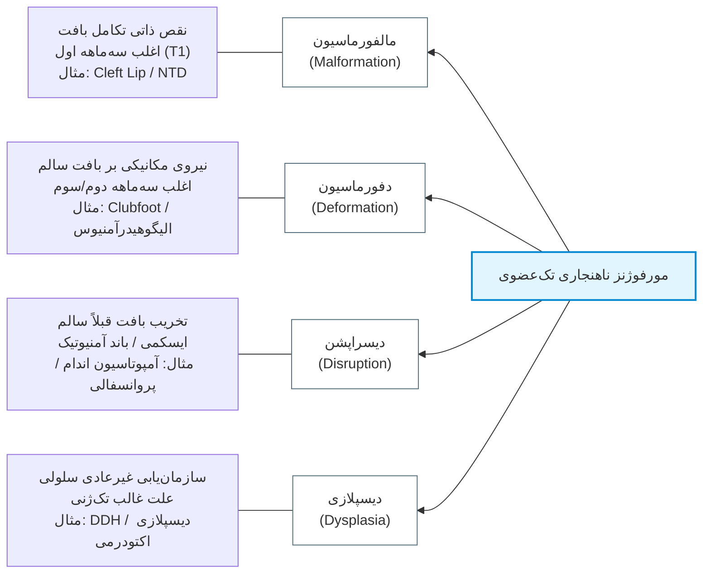
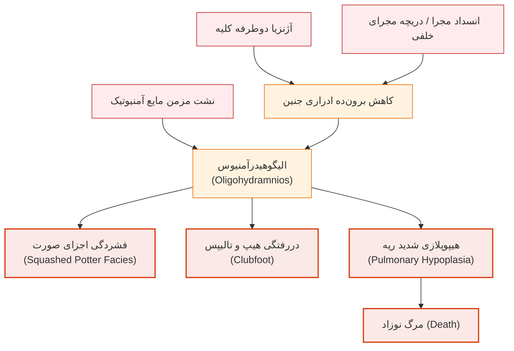
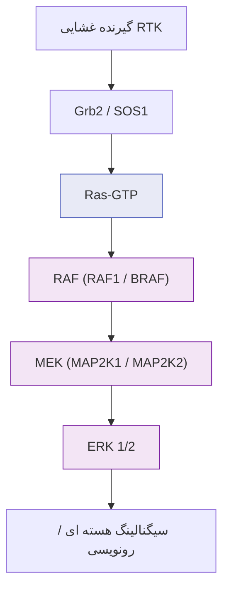
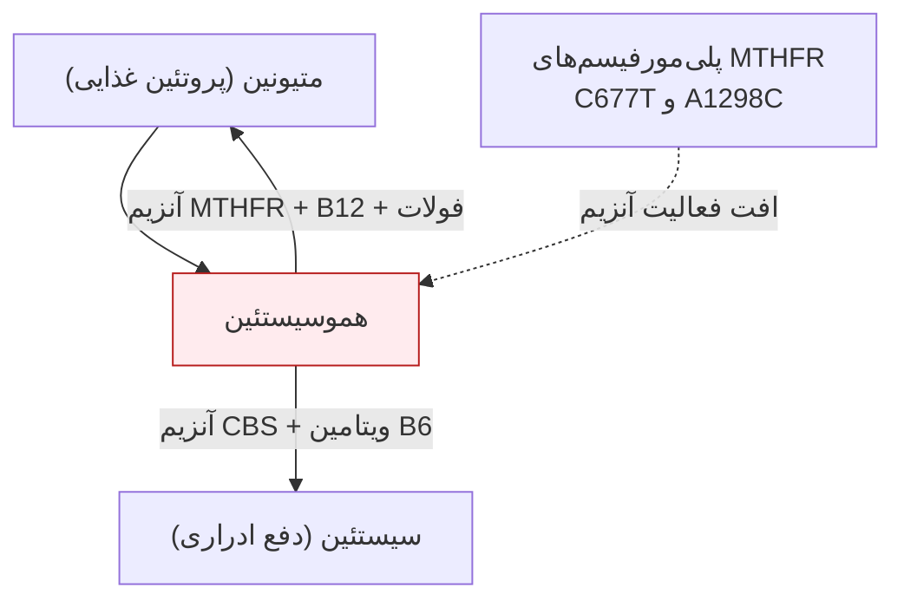
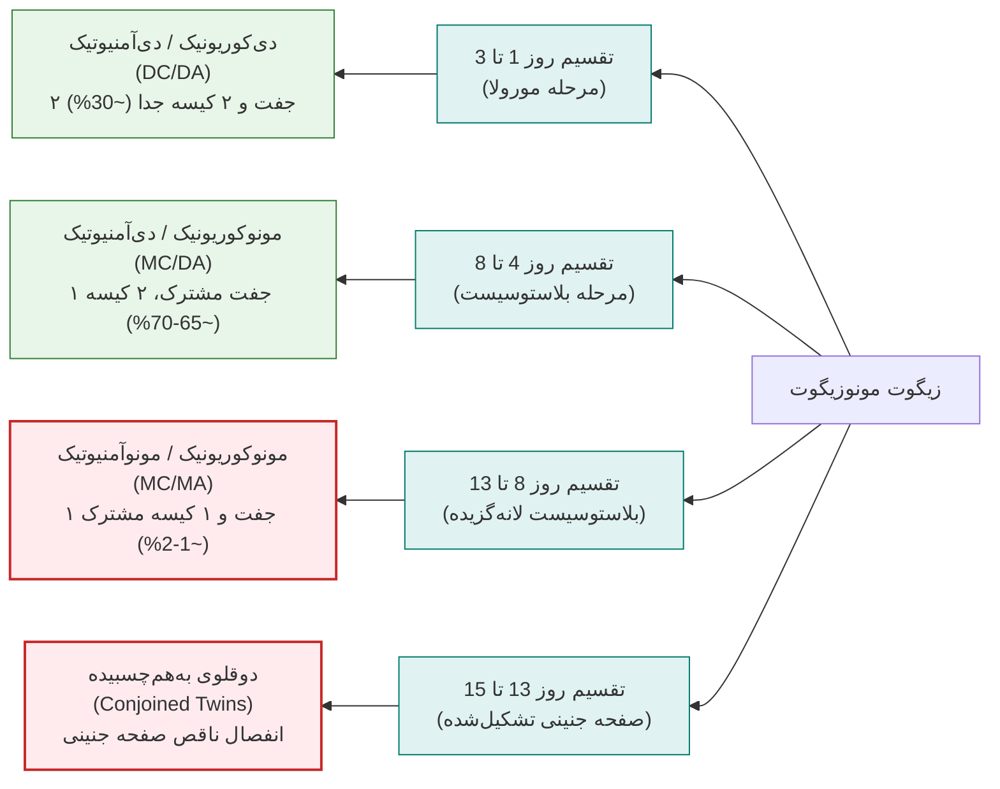
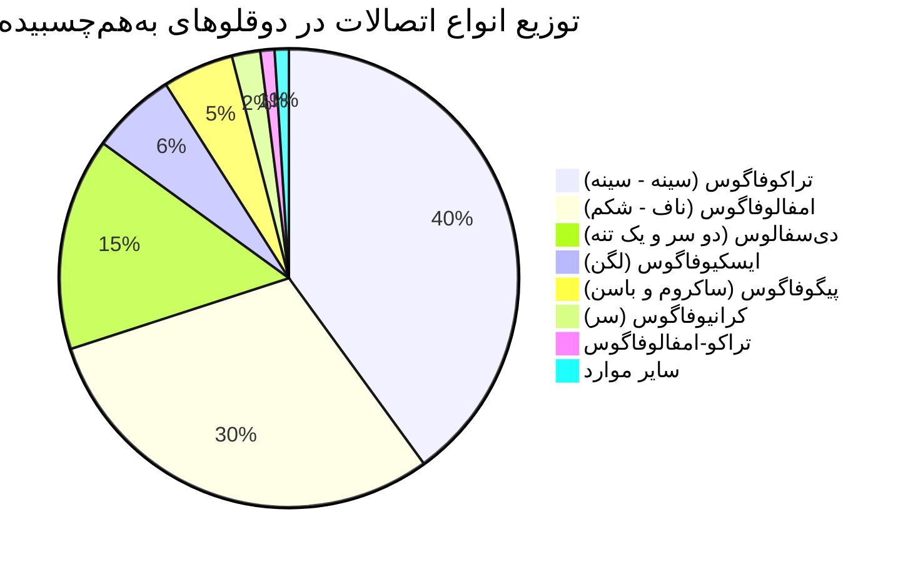

# جلسه ۷: ناهنجاری‌های مادرزادی، تراتوژن‌ها و ژنتیک دوقلویی

## ۱. اپیدمیولوژی سقط و مرگ‌ومیر ناشی از نقایص جنینی

> [!info] تعریف Birth Defect (نقص مادرزادی)
> وضعیت آناتومیک یا عملکردی پدیدارشده در بدو تولد (بدون وابستگی به علت زمینه‌ای) که منجر به ناتوانی جسمی (Physical)، تکاملی (Developmental) یا شناختی/ذهنی (Intellectual) می‌شود؛ این اصطلاح معادل *Congenital Malformation* نیز به‌کار می‌رود.

### آمار سقط و علل ژنتیکی
* شیوع سقط در جمعیت عمومی زنان: **1 از 4 تا 5 زن** (20% تا 25%).
* اوج زمانی رخداد: **سه ماهه اول بارداری (T1)**.
* سهم نقایص ژنتیکی در سقط سه‌ماهه اول: **50% تا 80%** (شامل اختلالات کروموزومی و بیماری‌های تک‌ژنی).
* شیوع ناهنجاری ساختاری در سقط خودبه‌خودی: سه‌ماهه اول **80% تا 85%** و سه‌ماهه دوم **25%**.

### مورتالیتی پری‌ناتال و نوزادی
* ناهنجاری مادرزادی بدو تولد: **3% تا 5%** کل متولدین زنده.
* مرگ دوره پری‌ناتال ناشی از عوامل ژنتیکی: **~80%**.
* مرگ نوزادی (Infant Deaths) ناشی از ناهنجاری ژنتیکی: **20% تا 30%**.
* مرگ پس از نوزادی (Post-neonatal) ناشی از مالفورماسیون مادرزادی: **30% تا 50%**.
* ریشه ژنتیکی در عقب‌ماندگی ذهنی (Mental Retardation): **50%**.

> [!important] تله امتحانی: نسبت سن به سهم مرگ ناشی از ناهنجاری ساختاری ماژور
> هرچه سن کودک افزایش یابد، سهم ناهنجاری‌های ساختاری ماژور در مرگ‌ومیر *کاهش* می‌یابد:
> 1. شیرخوارگی (Infancy / بدو تولد): **25%** مرگ‌ها.
> 2. سنین 1 تا 9 سال (1-10 سال): **20%** مرگ‌ها.
> 3. سنین 10 تا 14 سال (10-15 سال): **7.5%** مرگ‌ها.

---

## ۲. دسته‌بندی سه‌گانه نقایص ساختاری

| گروه ناهنجاری                       | تعریف و پیامد بالینی                                                | شیوع جمعیتی                                                 | نیاز به مداخله جراحی/پزشکی                    | مثال‌های بالینی شاخص                                                             |
| :---------------------------------- | :------------------------------------------------------------------ | :---------------------------------------------------------- | :-------------------------------------------- | :------------------------------------------------------------------------------- |
| **ناهنجاری ماژور (Major)**          | نقص ساختاری مخرب با اختلال عملکردی شدید و تهدیدکننده حیات یا زیبایی | **2% تا 3%** (در برخی منابع تا 5% با احتساب علائم دیرهنگام) | **قطعی و فوری**                               | آنانسفالی، شکاف کام/لب (Cleft lip/palate)، نقایص انسدادی روده                    |
| **ناهنجاری ماینور (Minor)**         | دگرگونی مورفولوژیک فاقد اثر سوء بالینی یا زیبایی شدید               | **~10%** نوزادان (تک‌علامتی در <4% جمعیت عمومی)             | **عدم نیاز روتین** (اختیاری در موارد زیبایی)  | پرده اپی‌کانتوس، شکاف پلکی مورب، چین منفرد کفی (Simian crease)، لکه‌های براشفیلد |
| **تغییرات نرمال (Normal Variants)** | تغییرات ساختاری انتهای طیف نرمال جمعیت بدون پاتولوژی ارگانیک        | شایع در جمعیت                                               | **عدم نیاز** (بسیاری خودبه‌خود تحلیل می‌روند) | پل بینی صاف، هیدروسل غیرارتباطی نوزادان، سین‌داکتیلی انگشت ۲ و ۳ پا              |

> [!warning] شاخص هشدار بالینی (Clinical Clue)
> حضور **3 ناهنجاری ماینور یا بیشتر** در معاینه بالینی نوزاد، قویاً به نفع وجود یک *ناهنجاری زمینه‌ای ماژور* پنهان است.

### میزان بروز ناهنجاری‌های ساختاری ماژور (به ازای ۱۰۰۰ تولد زنده)

| **سیستم درگیر**                | **بروز کلی (در ۱۰۰۰)**     | **ناهنجاری / بیماری**                                                                                                                        | **بروز (در ۱۰۰۰)**       |
| ------------------------------ | -------------------------- | -------------------------------------------------------------------------------------------------------------------------------------------- | ------------------------ |
| **قلبی‌عروقی (CVS)**           | ۱۰ (شایع‌ترین سیستم درگیر) | نقص دیواره بین‌بطنی (VSD) نقص دیواره بین‌دهلیزی (ASD) مجرای شریانی باز (PDA) تترالوژی فالوت (TOF)                                   | ۲.۵ ۱.۰ ۱.۰ ۱.۰ |
| **عصبی مرکزی (CNS)**           | ۱۰ (هم‌رده با CVS)         | اسپاینا بیفیدا کمری‌خاجی آنانسفالی (Anencephaly) هیدروسفالی (Hydrocephaly) میکروسفالی (Microcephaly)                                | ۲.۰ ۱.۰ ۱.۰ ۱.۰ |
| **گوارش (GI)**                 | ۴                          | شکاف لب/کام (Cleft lip/palate) فتق دیافراگم (Diaphragmatic hernia) آترزی مری (Esophageal atresia) مقعد بسته‌بسته (Imperforate anus) | ۱.۵ ۰.۵ ۰.۳ ۰.۲ |
| **ادراری‌تناسلی (Urogenital)** | ۴                          | آژنزیا دوطرفه کلیه اکستروفی مثانه کلیه پلی‌کیستیک نوزادی (ARPKD)                                                                       | ۲.۰ ۰.۰۳ ۰.۰۲      |
| **اندام‌ها (Limbs)**           | ۲                          | آمپوتاسیون عرضی مادرزادی                                                                                                                     | ۰.۲                      |

---

## ۳. ترمینولوژی مورفوژنز: نقایص تک‌گیر (Single Abnormalities)

### ۱. Malformation (بدشکلی)
* **پاتوفیزیولوژی:** اختلال اولیه، ذاتی و ساختاری در تکوین بافتی (Tissue development/differentiation).
* **زمان رخداد:** عمدتاً در **سه ماهه اول (T1)** حین ارگانوژنز.
* **اتیولوژی:** جهش‌های ژنتیکی، ناهنجاری کروموزومی یا تراتوژن‌های محیطی.
* **نمونه‌ها:** انواع Spina bifida، آنانسفالی، Cleft lip/palate.

### ۲. Deformation (بدریختی)
* **پاتوفیزیولوژی:** اثر سوء نیروهای بیومکانیکی خارجی بر بافت و اندام کاملاً طبیعی از نظر ژنتیکی.
* **زمان رخداد:** عمدتاً در **سه ماهه دوم و سوم** بارداری.
* **اتیولوژی:** محدودیت فضا در رحم (Fetal constraint)، حاملگی چندقلو، الیگوهیدرآمنیوس شدید.
* **پیش‌آگهی:** تمایل بسیار بالا به **بهبودی خودبه‌خودی** پس از تولد و رفع نیروی فشاری.
* **نمونه‌ها:** پاچنبری مادرزادی (Talipes equinovarus یا Clubfoot).

### ۳. Disruption (از هم‌گسیختگی)
* **پاتوفیزیولوژی:** تخریب فیزیکی، نکروز و اضمحلال بافتی که پیش از وقوع حادثه مسیر تکاملی کاملاً سالمی داشته است.
* **مکانیسم‌های اصلی:**
  1. *ایسکمی و انسداد عروقی:* ناشی از انسداد عروق یا مصرف داروهای وازواکتیو مثل **کوکائین**، ترومبوز جفتی.
  2. *حوادث فیزیکی خارجی:* گیر افتادن اندام در رشته‌های فیبرین آمنیوتیک (**Amniotic bands**).
  3. *پروانسفالی (Porencephaly):* فقدان تکامل نیمی از کورتکس مخ ناشی از CVA داخل رحمی.
* **علامت کلیدی تشخیصی:** *عدم تقارن شدید* (Asymmetry) در نقص اندام‌ها که نشانگر غیرژنتیکی بودن ضایعه است.

### ۴. Dysplasia (دیسپلازی)
* **پاتوفیزیولوژی:** اختلال در سازمان‌یابی ساختاری سلول‌ها در بستر بافت یا ارگان.
* **الگوی ژنتیکی:** تقریباً همواره ناشی از **جهش‌های تک‌ژنی (Single-gene variants)** بوده و ریسک عود (Recurrence risk) بالایی در بارداری‌های بعدی و فرزندان دارد.
* **نمونه‌ها:**
  * دیسپلازی اکتودرمی (Ectodermal dysplasia): دندان‌های مخروطی نوک‌تیز، کم‌پشتی شدید و خشکی مو.
  * دررفتگی مادرزادی هیپ (DDH): تکامل ناقص حفره استابولوم و جابجایی سر فمور؛ ارزیابی با مانورهای بالینی **Barlow** و **Ortolani**.

---

## ۴. دسته‌بندی ناهنجاری‌های چندگانه (Multiple Abnormalities)

> [!info] توالی (Sequence)
> زنجیره‌ای از حوادث پاتولوژیک پشت سر هم و با **ترتیب مشخص** که در آن یک نقص اولیه ساختاری یا مکانیکی، آبشاری از نقایص ثانویه را تحریک می‌کند.

### الگوریتم آبشاری توالی پاتر (Potter Sequence)

> [!info] سندروم (Syndrome)
> مجموعه‌ای از علائم و ناهنجاری‌های همزمان که علت ساختاری یا ژنتیکی مشترک دارند، اما نقص‌ها رابطه ترتیبی علی-معلولی مستقیم با یکدیگر ندارند (مانند سندروم داون).
> * **سندروم ون‌در وود (Van der Woude Syndrome):** وراثت اتوزوم غالب (AD)؛ بروز همزمان شکاف لب/کام با فرورفتگی‌های قرینه در لب پایین (Lower lip pits).

> [!info] همراهی (Association)
> رخداد همزمان چند ناهنجاری خاص با تواتری فراتر از شانس تصادفی، بدون وجود الگوی وراثتی مشخص یا علت منفرد پاتوژنیک شناخته‌شده.

### ناهنجاری‌های همراهی VACTERL
* **V (Vertebral):** نقایص مهره‌ای.
* **A (Anorectal):** آنومالی‌های آنورکتال نظیر آترزی یا انسداد مقعد.
* **C (Cardiovascular):** ناهنجاری‌های ساختاری قلب.
* **T (Tracheoesophageal):** فیستول بین نای و مری.
* **E (Esophageal):** آترزی مری.
* **R (Renal / Radial):** آژنزیا یا دیسپلازی کلیه / نقص تکاملی استخوان رادیوس.
* **L (Limb):** نقایص اندام‌ها نظیر هایپوپلازی انگشتان.

---

## ۵. اتیولوژی جامع ناهنجاری‌های مادرزادی

| علت ناهنجاری                 | زیرگروه‌ها و درصد تفکیکی                                                                              | سهم کلی        |
| :--------------------------- | :---------------------------------------------------------------------------------------------------- | :------------- |
| **عوامل ژنتیکی (Genetic)**   | کروموزومی: **6%**؛ تک‌ژنی: **7.5%** (در برخی منابع تا 10%)؛ چندعاملی (Multifactorial): **20% تا 30%** | **30% تا 40%** |
| **عوامل محیطی (Teratogens)** | داروها و مواد شیمیایی: **2%**؛ بیماری‌های مادر: **2%**؛ عفونت‌ها: **2%**؛ عوامل فیزیکی: **1%**        | **5% تا 10%**  |
| **علل ناشناخته (Unknown)**   | عدم کشف علت منفرد با تکنیک‌های روتین (بزرگ‌ترین دسته منفرد)                                           | **~50%**       |

### نقایص تک‌ژنی تفکیک‌شده بر اساس سیستم درگیر
* **سیستم عصبی مرکزی:** هیدروسفالی (*XR*)، مگالنسفالی (*AD*)، میکروسفالی (*AD/AR*).
* **چشم:** آنیریدیا (*AD*)، کاتاراکت مادرزادی (*AD/AR*)، میکروفتالمی (*AD/AR*).
* **اندام‌ها:** براکی‌داکتیلی (*AD*)، اکتروداکتیلی (*AD/AR*)، پلی‌داکتیلی (*AD*).
* **سایر سندروم‌های تک‌ژنی شاخص:**
  * *سندروم آپرت (Apert):* وراثت AD؛ کرانیوسینوستوزیس و سین‌داکتیلی شدید دست و پا.
  * *سندروم EEC:* وراثت AD؛ دیسپلازی اکتودرمی، اکتروداکتیلی و شکاف لب/کام.
  * *سندروم مکل (Meckel):* وراثت AR؛ انسفالوسل اکسیپیتال، پلی‌داکتیلی، کلیه پلی‌کیستیک.
  * *سندروم رابرتز (Roberts):* وراثت AR؛ فوکوملیا شدید اندام‌ها و شکاف فاسیال.

---

## ۶. بیماری‌های مسیر RAS-MAPK (RASopathies) و اورگروس

### سندروم نونان (Noonan Syndrome) و اسپکتروم مرتبط
* **رخساره اختصاصی:** هایپرتلوریسم، پیشانی پهن، افتادگی پلک (پتوز)، چشم‌های برجسته، چین عمیق بالای پلک، بینی عریض با نوک برجسته و برگشته، دهان با فرورفتگی Cupid bow لب بالا، پره‌های گردنی و موهای نازک (Wispy hair).
* **ناهنجاری ساختاری قلبی:** تنگی دریچه پولمونر (Pulmonary stenosis) و هایپرتروفیک کاردیومیوپاتی.
* **اسپکتروم ژنتیکی درگیر در نونان و بیماری‌های وابسته:**
  * **PTPN11:** علت در **≥50%** موارد نونان؛ عامل اصلی **سندروم LEOPARD** (لنتیژینوز متعدد، نقص قلبی، ناشنوایی).
  * **SOS1 / RIT1 (~5%) / RAF1 / KRAS / SHOC2:** عامل فنوتیپ‌های متغیر نونان (به‌ویژه SHOC2 در موارد همراه با شلی مو در بزرگسالی).
  * **Costello Syndrome:** جهش ژن **HRAS** در **>50%**؛ شیارهای عمیق کف دست و پا، گونه‌های پر، شلی پوست و افزایش ریسک تومورها.
  * **Cardio-facio-cutaneous (CFC) Syndrome:** جهش ژن **BRAF** در **≤50%**، به همراه MAP2K1/2؛ موهای فر و وزوزی شدید، درگیری پوستی گسترده و عقب‌ماندگی هوشی بارز.
  * **سندروم لگسیوس (Legius):** جهش در ژن **SPRED1**.

> [!important] سندروم سوتو (Sotos Syndrome - ژیکانتیسم مادرزادی)
> سندروم اورگروس اطفال با بزرگی سر (Macrocephaly)، پیشانی بسیار برجسته و بلند، چانه نوک‌تیز، انحراف ستون فقرات (اسکولیز) و تاخیر یادگیری:
> * **سوتو تیپ 1:** جهش یا حذف ژن **NSD1** (لوکوس 5q35.2-35.3)؛ مسئول **80% تا 90%** موارد.
> * **سوتو تیپ 2:** جهش ژن **NFIX** (لوکوس 9p13).
> * شیوع جمعیتی: **1 در 14,000** تولد زنده.

---

## ۷. نقایص لوله عصبی (NTD) و محور بیوشیمیایی MTHFR

### تکوین لوله عصبی و تیپولوژی ضایعات
* **بازه زمانی بحرانی بسته شدن نهایی لوله عصبی:** **هفته دوم تا چهارم بارداری (Days 14-28)**؛ اغلب پیش از آگاهی مادر از بارداری.
* **طیف بالینی:**
  * *آنانسفالی و اکسنسفالی:* نقص در بسته شدن قطب قدامی (فقدان کالواریا و بافت کورتکس).
  * *انسفالوسل (Encephalocele):* فتق بافت مغز و مننژ از استخوان اکسیپیتال.
  * *اسپاینا بیفیدا اوکولتا (Occulta):* عدم جوش‌خوردگی قوس مهره‌ای پشتی با لایه پوستی سالم، که تنها نشانه‌اش در معاینه فیزیکی نوزاد **وجود دسته موی نابه‌جا (Hairy patch)**، فرورفتگی یا خال عروقی در خط وسط کمر است.
  * *مننگوسل و میلومننگوسل:* فتق مننژ به تنهایی یا همراه با طناب نخاعی باز.

> [!danger] پاتولوژی هموسیستئین بالا ناشی از واریانت‌های MTHFR (C677T و A1298C)
> کاهش فعالیت آنزیم متیلن تتراهیدروفولات ردوکتاز باعث افت فولات پلاسما و تجمع شدید هموسیستئین می‌شود:
> 1. اتصال هموسیستئین به اندوتلیوم شریانی (برخلاف فاکتور ۵ لیدن که در ورید ترومبوز می‌دهد، هموسیستئین **آرترواسکلروز و ترومبوز شریانی** ایجاد می‌کند).
> 2. نکروز و ترومبوز عروق جفتی، پیری زودرس جفت و بروز **سقط در سه‌ماهه دوم و سوم** یا پره‌اکلامپسی.
> 3. نقص متیلاسیون DNA جنینی و مسدود نشدن لوله عصبی (بروز NTD).
> * **راهکار پروتکلیک درمانی:** تجویز روتین اسید فولیک با دوز بالا (**5 mg/day**) قبل و حین بارداری در زنان جامعه با شیوع بالای پلی‌مورفیسم. اضافه این ویتامین محلول در آب از ادرار دفع می‌شود.

---

## ۸. فارماکولوژی و تراتولوژی بالینی

> [!info] تعریف تراتوژن (Teratogen)
> هر عامل برون‌زاد (محیطی، شیمیایی، بیولوژیک یا فیزیکی) که تماس جنین با آن، ناهنجاری عملکردی یا ساختاری پایدار در جنین یا حتی نسل‌های بعدی ایجاد کند.

### فاکتورهای تعیین‌کننده آسیب تراتوژن
1. **زمان تماس (Timing):** تعیین‌کننده‌ترین فاکتور ارگان هدف بر اساس سن جنین.
2. **دوز و شدت مواجهه (Dose):** غلظت ماده در جریان خون مادر و انتقال جفتی.
3. **مدت زمان مواجهه (Duration):** تماس ممتد و تکراری اثر تخریبی بسیار بالاتری از تک‌دوز دارد.
4. **ژنوتیپ جنین و مادر (Susceptibility):** پلی‌مورفیسم آنزیم‌های تجزیه‌کننده مانند الکل دهیدروژناز.

### دوره‌های بحرانی تکامل انسانی (Critical Periods)
* **هفته ۱ تا ۲ (لقاح تا لانه‌گزینی):** قانون *همه یا هیچ (All-or-None)*؛ تماس کشنده منجر به مرگ زیگوت و سقط بسیار زودرس و عدم تماس کشنده منجر به ترمیم کامل بدون ناهنجاری مادرزادی پایدار می‌شود.
* **هفته ۳ تا ۸ (ارگانوژنز - سه‌ماهه اول):** **اوج آسیب‌پذیری ساختاری ماژور**. سیستم قلبی و عصبی از ابتدای هفته ۳ بیشترین حساسیت را دارند؛ اندام‌ها، چشم و گوش در هفته‌های ۴ تا ۶؛ کام و ژنیتالیا تا هفته ۸.
* **هفته ۹ تا ترم (دوره جنینی - Fetal Period):** آسیب تراتوژنیک به صورت *نقایص عملکردی (Functional defects)*، تاخیر رشد داخل رحمی (IUGR) و نقایص مورفولوژیک ماینور است نه ناهنجاری اسکلتی ماژور.

### جدول تطبیقی داروهای تراتوژن قطعی در انسان

| نام دارو | ناهنجاری‌های بارز ایجادشده در جنین | پنجره زمانی بحرانی یا نکته تشخیصی |
| :--- | :--- | :--- |
| **تالیدوماید (Thalidomide)** | آملیا (فقدان کامل اندام)، فوکوملیا (اندام باله‌مانند)، مایکروشیا، کری، پلی‌داکتیلی | **روز ۲۱ تا ۳۶ پس از لقاح** (بحرانی‌ترین: روز 24-29 اندام فوقانی، 27-31 تحتانی) |
| **الکل (FAS/FASD)** | شکاف پلکی کوتاه، فیلتروم صاف و بلند، لب بالایی باریک، خط هاکی کف دست، عقب‌ماندگی ذهنی، VSD | پدیده کوه یخ (Iceberg): اختلالات خفیف عصبی‌رفتاری بسیار شایع‌تر از فنوتیپ کامل |
| **والپروئیک اسید** | نقایص لوله عصبی (ریسک **1% تا 2%**)، چهره خاص، شکاف کام، نقایص شناختی و اتیسم | به عنوان آنتی‌کانوالسانت؛ مهار متابولیسم فولات |
| **فنی‌توئین (Dilantin)** | هایپوپلازی ناخن و بند دیستال انگشتان، شکاف لب/کام، نقایص ساختاری قلبی | سندروم هیدانتوئین جنینی (Fetal Hydantoin) |
| **ایزوترتینوئین (روآکوتان)** | مایکروشیا/آنوتیا (فقدان گوش)، هیدروسفالی، نقایص قوس آئورت و تترالوژی فالوت | مشتق ویتامین A؛ منع بارداری تا یک ماه پس از قطع |
| **مهارکننده‌های ACE** | دیسپلازی و نارسایی حاد کلیه، الیگوهیدرآمنیوس شدید، هیپوپلازی استخوان کالواریا | تماس در سه‌ماهه دوم و سوم بارداری |
| **وارفارین (Warfarin)** | هایپوپلازی شدید تیغه بینی، اپی‌فیزهای استخوانی نقطه‌نقطه (Stippled epiphyses) | عبور از جفت؛ جایگزینی با هپارین با وزن مولکولی پایین در بارداری |
| **تتراسایکلین** | هیپوپلازی مینای دندان، بدرنگی دائمی قهوه‌ای-زرد دندان‌ها | رسوب انتخابی در بافت کلسیمی دندان و استخوان |
| **استرپتومایسین** | مسمومیت عصب هشتم مغزی (CN VIII)، ناشنوایی حسی‌عصبی پایدار | آمینوگلیکوزیدها |
| **لیتیم** | آنومالی ابشتین (Ebstein anomaly - نزول دریچه تری‌کوسپید به بطن راست) | مصرف در سه‌ماهه اول بارداری |
| **دی‌اتیل‌استیل‌بسترول (DES)** | رحم T-شکل، نقایص سرویکس، آدنوکارسینومای سلول شفاف واژن در دختران | اثر تراتوژنی تاخیری و بین‌نسلی در سن بلوغ نوزاد |

### سایر عوامل تراتوژن محیطی و بیولوژیک
* **کوکائین:** اثرات وازوکانستریکتور و اختلال عروقی شدید $\rightarrow$ دیسراپشن، آترزی روده، نقص کلیوی و آمپوتاسیون اندام (اتصال کوکائین به اسپرم پدر نیز اثر مخرب دارد).
* **پرتوهای یونیزان (Radiation):** ایجاد میکروسفالی، عقب‌ماندگی ذهنی و ناهنجاری‌های چشمی؛ سی‌تی‌اسکن لگن/شکم تجمعی دوزی معادل حدود **100 برابر** یک گرافی قفسه سینه ایجاد می‌کند.
* **هایپرترمی پایدار (تب شدید، سونای روزانه در T1):** دناتوره شدن پروتئین‌ها و آنزیم‌های رونویسی در فاز میتوز $\rightarrow$ نقایص لوله عصبی و شکاف‌های فاسیال.
* **عفونت‌های TORCH:**
  * **T (توکسوپلاسموز):** کلسیفیکاسیون منتشر اینتراکرانیال، هیدروسفالی، کوریورتینیت، کاتاراکت، میکروسفالی.
  * **O (سایرین):** سیفلیس (رینیت خونی، پرده صماخ، اوستئیت استخوانی)، واریسلا زوستر (اسکارهای پوستی زیکاتریس، هایپوپلازی اندام).
  * **R (روبلا/سرخجه):** تریاد کاتاراکت، ناشنوایی حسی‌عصبی، ناهنجاری‌های قلبی (PDA و تنگی شریان ریوی).
  * **C (سیتومگالوویروس - CMV):** شایع‌ترین عفونت جنینی؛ کلسیفیکاسیون پری‌ونتریکولار بطنی، کوریورتینیت، میکروسفالی و هپاتواسپلنومگالی.
  * **H (هرپس سیمپلکس - HSV):** میکروسفالی، میکروفتالمی، آنسفالیت نکروزان.
* **تشخیص دقیق بالینی عفونت جنینی:** افزایش سطح سرمی **IgM نوزاد** نشانگر قطعی عفونت حاد جنینی است، زیرا آنتی‌بادی نوع IgG مادر از جفت عبور می‌کند اما IgM قابلیت عبور از سد جفتی را ندارد؛ تایید تکمیلی با **Real-Time PCR**.
* **بیماری‌های متابولیک مادری:**
  * **دیابت ملیتوس:** هایپرگلیسمی تراتوژنیک؛ اگرسیون کودال (Caudal regression syndrome یا عدم تشکیل خاجی - کاملاً اختصاصی دیابت مادر)، هایپوپلازی نیمه تحتانی، سندروم میکروسومی همی‌فاسیال، ناهنجاری ساختاری قلبی، ماکروزومی جنین و هایپوگلیسمی شدید پس از زایمان.
  * **فنیل‌کتونوری مادر (PKU):** در صورت عدم رعایت رژیم و سطح بالای فنیل‌آلانین خون مادر $\rightarrow$ میکروسفالی و نقص ساختاری قلب جنین (حتی با وجود جنین هتروزیگوت سالم).

---

## ۹. ژنتیک دوقلویی (Twins)

### دوقلوی همسان (MZ) در برابر ناهمسان (DZ)
* **دوقلوهای مونوزیگوتیک (MZ - Identical):** لقاح ۱ تخمک با ۱ اسپرم و تقسیم زودهنگام یک توده جنینی؛ **تشابه 100% ژنوم هسته‌ای**.
  * تفاوت‌های فنوتیپی اندک ثانویه ناشی از: ۱) DNA میتوکندریایی (که ممکن است غیریکسان توزیع شود) ۲) تفاوت‌های اپی‌ژنتیک ایجادشده در طول بارداری ۳) جهش‌های پسازیگوتی سوماتیک.
  * بهترین مدل بالینی جهت تفکیک نقش ژنتیک از عوامل محیطی (Twin Studies). مطالعات اخیر جهش‌هایی روی **کروموزوم X** و برخی اتوزوم‌ها را در تقسیم مونوزیگوتیک دخیل می‌دانند.
* **دوقلوهای دی‌زیگوتیک (DZ - Fraternal):** لقاح مستقل ۲ تخمک همزمان با ۲ اسپرم مجزا؛ **تشابه ژنتیکی ~50%** (معادل خواهر-برادرهای عادی).
  * تمایل به تخمک‌گذاری همزمان چندگانه ریشه ژنتیکی و سابقه خانوادگی مادری دارد. همواره دارای ۲ جفت و ۲ کیسه آمنیون کاملاً جدا هستند (Dichorionic/Diamniotic).

### تعیین پرده‌ها و جفت در دوقلوهای همسان (MZ) بر اساس زمان تسهیم

### پاتولوژی دوقلوهای به‌هم‌چسبیده (Conjoined Twins)
وقوع به دلیل عدم تفکیک کامل پس از **روز 13 تا 15 پس از لقاح**. شیوع جایگاه‌های چسبندگی:

* **توراکوپاگوس (Thoracopagus):** اتصال از ناحیه قفسه سینه (**40%** - شایع‌ترین تیپ)؛ اغلب اشتراک آناتومیک در ساختار قلبی دارند.
* **امفالوپاگوس (Omphalopagus):** چسبندگی از دیواره قدامی شکم و ناف (**30%**).
* **کرانیوپاگوس (Craniopagus):** اتصال از کاسه سر (**2%**)؛ مشهورترین نمونه لاله و لادن بیژنی (اشتراک در سینوس وریدی ساژیتال خلفی مغز و عروق درین‌کننده).
* **دوقلوی انگلی (Parasitic Twins):** چسبندگی جنین ناقص و به‌شدت رشدنیافته (فقدان ارگان‌های حیاتی مستقل) به عنوان زائده به دوقلوی سالم اتوزیت (نمونه‌های تاریخی: Betty Williams و Piramal & Sami).
