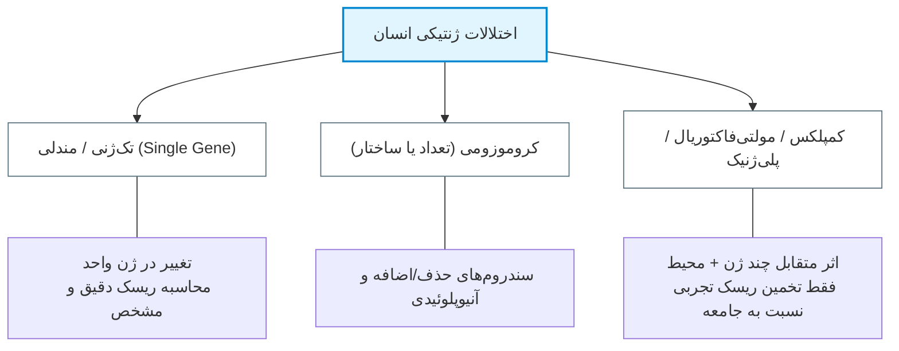
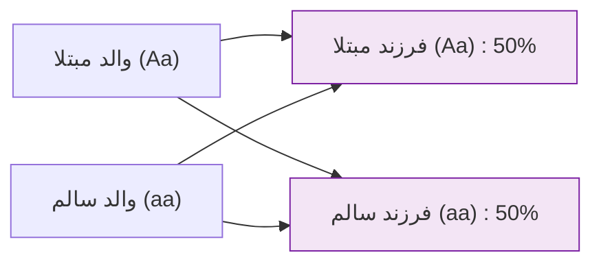
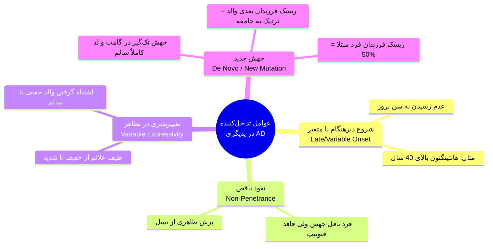
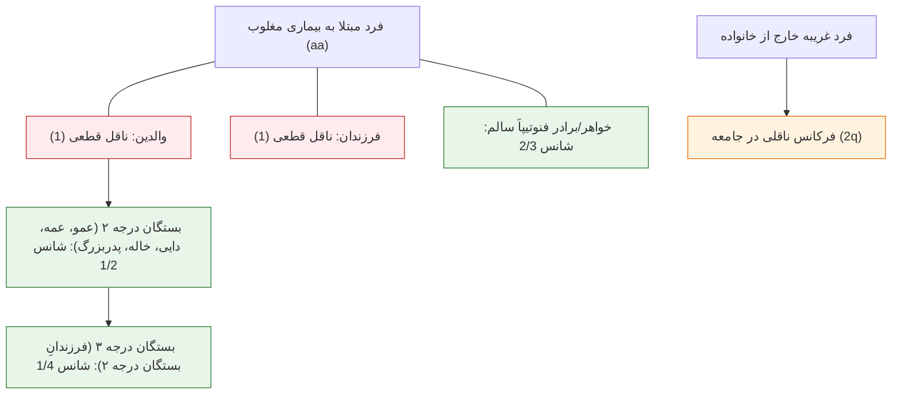
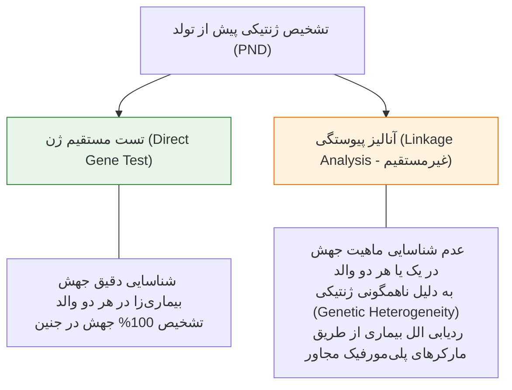
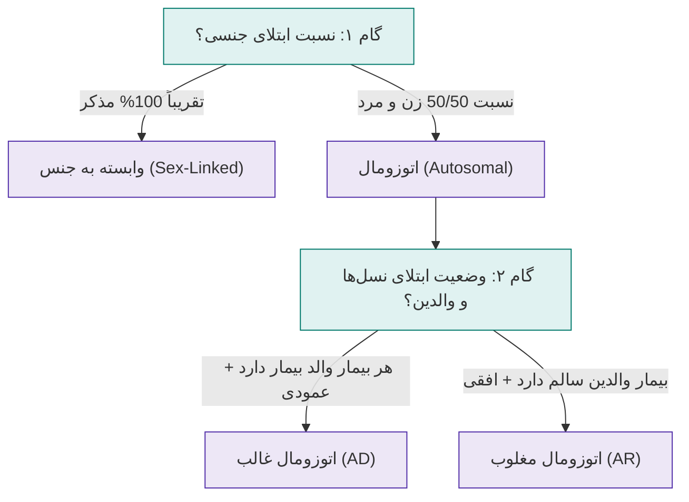

# الگوهای وراثتی اتوزومال غالب (AD) و مغلوب (AR)

## ۱. دسته‌بندی اختلالات ژنتیکی و مفاهیم پایه مندلی

> [!info] بیماری مندلی (Mendelian Disease) در برابر واریانت شایع (Common Variant)
> * **بیماری مندلی:** صفتی که تقریباً تماماً ناشی از یک ژن اصلی است؛ فنوتیپ تنها در ۱ حالت ژنوتیپی (در مغلوب) یا ۲ حالت از ۳ حالت ژنوتیپی ممکن (در غالب) بروز می‌کند.
> * **واریانت یا بیماری شایع (Common Disease):** فنوتیپ‌های شایع ناشی از تعداد محدودی واریانت اللی با تواتر ≥1% تا 5% در جمعیت عمومی.

### مبنای مولکولی-سلولی غالب یا مغلوب بودن صفات

> [!tip] مفهوم بنیادین: غالب و مغلوب بودن ربطی به «قوی» یا «ضعیف» بودن فیزیکی ژن ندارد!
> ملاک اختصاصی، **میزان آستانه نیاز بدن و سلول به پروتئین عملکردی** است:
> 1. **وراثت اتوزومال غالب (AD):** سلول به **100%** محصول پروتئینی برای عملکرد طبیعی نیاز دارد. هر الل سالم 50% پروتئین می‌سازد؛ جهش در یک الل بازده را به <100% رسانده و ایجاد علامت بالینی (فنوتیپ بیماری) می‌کند.
> 2. **وراثت اتوزومال مغلوب (AR):** حضور **50%** دوز پروتئین برای حیات و فیزیولوژی سلول کافی است؛ تخریب یک الل علامتی ایجاد نکرده و فرد فقط ناقل (Carrier) بی‌علامت باقی می‌ماند؛ بروز بیماری مستلزم آسیب هر دو الل (دوز پروتئین نزدیک صفر) است.

### مقایسه سیادت کامل و سیادت ناقص

| نوع سیادت (Dominance) | تعریف و تمایز فنوتیپی | شدت علائم در هوموزیگوت | مثال بارز بالینی |
| :--- | :--- | :--- | :--- |
| **غالبیت کامل (Complete)** | فنوتیپ هتروزیگوت (Aa) و هوموزیگوت جهش‌یافته (AA) کاملاً یکسان و غیرقابل تفکیک بالینی است | بدون تفاوت با هتروزیگوت | بیماری هانتینگتون (Huntington Disease) |
| **غالبیت ناقص (Incomplete)** | فنوتیپ هوموزیگوت با هتروزیگوت از روی بالین قابل تفکیک بوده و شدت علائم در هوموزیگوت بسیار بیشتر است | بسیار شدیدتر، سن شروع پایین‌تر یا کشنده (Lethal) | هیپرکلسترولمی فامیلی (FH)، آکندروپلازی |

> [!note] نکات تکمیلی جدول غالبیت
> * در **آکندروپلازی**، حالت هوموزیگوت جهش‌یافته (AA) لتال و ناسازگار با حیات نوزاد است.
> * در **هیپرکلسترولمی فامیلی (FH)**، بیماران هوموزیگوت دچار بیماری عروق کرونر زودرس بسیار شدید در کودکی، گزانتوم‌های وسیع و امید به زندگی (Life expectancy) بشدت کوتاه‌تر نسبت به هتروزیگوت‌ها هستند.

---

## ۲. الگوی وراثتی اتوزومال غالب (Autosomal Dominant)

بیش از **50%** کل بیماری‌های تک‌ژنی مندلی دارای وراثت AD هستند.

### شیوع‌های جمعیتی مهم شب امتحان
* هیپرکلسترولمی فامیلی (FH): **1:500**
* دیستروفی میوتونیک (DM): **1:550**
* بیماری هانتینگتون (HD): **1:3000**

### شاخص‌های قطعی شجره‌نامه اتوزومال غالب (AD Pedigree)
1. **انتقال عمودی (Vertical Transmission):** فنوتیپ در تمام نسل‌ها بدون پرش دیده می‌شود؛ هر فرد مبتلا حداقل یک والد مبتلا دارد.
2. **سلامت فرزندانِ افراد سالم:** فرد سالم فنوتیپی جهش را به نسل بعد انتقال نمی‌دهد (دارای استثنا).
3. **نسبت جنسی برابر (1:1):** ابتلای مردان و زنان از نظر فراوانی و شدت یکسان است.
4. **انتقال پدر به پسر (Male-to-Male Transmission):** *کلیدی‌ترین معیار تمایز AD از صفات وابسته به X* (پدر کروموزوم Y را به پسر می‌دهد، پس بیماری وابسته به X نمی‌تواند از پدر به پسر برسد).
5. **ریسک انتقال 50%:** هر فرزند والد هتروزیگوت مستقل از جنسیت 50% شانس ابتلا دارد.

> [!important] نتایج تلاقی در وراثت اتوزومال غالب
> * **Aa × aa (والد بیمار هتروزیگوت با سالم):** 50% فرزندان مبتلا (Aa) و 50% سالم (aa).
> * **Aa × Aa (تلاقی دو والد مبتلا):** 25% هوموزیگوت جهش‌یافته (AA - غالباً لتال یا بشدت وخیم)، 50% هتروزیگوت مبتلا (Aa)، 25% هوموزیگوت سالم (aa). *ریسک کلی فنوتیپی ابتلای فرزند زنده: 75%*.

### آکندروپلازی (Achondroplasia)
* نقص تکاملی اسکلتی، کوتاهی اندام‌ها (Short-limb dwarfism) و بزرگی نسبی سر (Macrocephaly).
* سطح هوش (IQ) کاملاً طبیعی و امید به زندگی متناسب با توانایی‌های فیزیکی نرمال.
* ازدواج دو فرد آکندروپلازی با یکدیگر شایع است؛ جنین هوموزیگوت (AA) دچار دیسپلازی شدید اسکلتی و مرگ داخل رحمی یا پری‌ناتال می‌شود.

### صفت محدود به جنس (Sex-Limited) در وراثت AD
* نسبت جنسی در AD به طور کلاسیک 1:1 است؛ انحراف شدید جنسی در صفات محدود به جنس رخ می‌دهد.
* **تستوتوکسیکوزیس فامیلیال مردانه (Male-limited Familial Testotoxicosis):**
  * ژن روی کروموزوم اتوزوم قرار دارد و جهش از پدر یا مادر انتقال می‌یابد.
  * فنوتیپ بیماری منحصراً در جنس مذکر بروز می‌کند.
  * اتیولوژی: جهش فعال‌کننده در **ژن گیرنده هورمون لوتئینه‌کننده (LHR Gene)**.
  * پاتولوژی: بلوغ زودرس و ظهور صفات ثانویه جنسی و جهش رشد در سن **حدود 4 سالگی**.
  * نکته تشخیصی در پدیگری: مشاهده **انتقال پدر به پسر (Male-to-Male)** ماهیت اتوزومال بودن آن را اثبات و وابسته به X بودن را رد می‌کند.

---

## ۳. عوامل مخدوش‌کننده تفسیر شجره‌نامه‌های اتوزومال غالب

> [!warning] تله تستی تفکیک نفوذ ناقص از جهش جدید در پدیگری
> * **در نفوذ ناقص (Non-Penetrance):** والد ظاهراً سالم ناقل الل جهش‌یافته است؛ بنابراین فرزندان دیگر این والد و خویشاوندان شاخه‌های جانبی همچنان در معرض ریسک بالای انتقال هستند.
> * **در جهش جدید (New Mutation):** جهش در سلول زایای یک والد رخ داده؛ ریسک تکرار برای فرزندان بعدی این زوج بالاتر از ریسک جمعیت نرمال نیست، اما ریسک انتقال بیماری از خودِ فرد مبتلا به فرزندانش **50%** است.

---

## ۴. الگوی وراثتی اتوزومال مغلوب (Autosomal Recessive)

بیماری زمانی فنوتیپ نشان می‌دهد که هر دو الل فرد معیوب باشند (Homozygous / Compound Heterozygous).

### ویژگی‌های قطعی شجره‌نامه اتوزومال مغلوب (AR Pedigree)
1. **انتقال افقی (Horizontal Transmission):** افراد مبتلا معمولاً در یک نسل (Sibship) دیده می‌شوند؛ والدین ناقل و از نظر بالینی کاملاً سالم‌اند.
2. **فقدان انتقال عمودی:** عدم مشاهده توالی بیماری در چند نسل متوالی.
3. **ریسک تکرار در هر بارداری:** تلاقی دو ناقل (Aa × Aa) شانس ابتلای **25% (1/4)** برای هر فرزند ایجاد می‌کند.
4. **نسبت جنسی برابر (1:1):** هر دو جنس مونث و مذکر با شانس و شدت یکسان مبتلا می‌شوند.
5. **ارتباط مستقیم با همخونی (Consanguinity):** وقوع ازدواج خویشاوندی ریسک بیماری‌های مغلوب نادر را شدیداً افزایش می‌دهد.
6. **کاهش افراد مبتلا در هر خانواده:** به علت کوچک شدن بعد خانواده‌ها در جوامع امروزی، به ندرت بیش از ۱ تا ۲ فرزند مبتلا در شجره دیده می‌شود.

---

## ۵. محاسبات ریسک ناقلی (Carrier Risk) و تبارشناسی در AR

### ناقلین قطعی (Obligate Carriers)
* **والدین** یک فرد مبتلا به صفت AR قطعاً ناقل‌اند (ریسک ناقلی = **1**).
* **تمامی فرزندان** یک فرد مبتلا به صفت AR قطعاً ناقل‌اند (ریسک ناقلی = **1**).

### شانس ناقلی خواهر یا برادر سالم فرد مبتلا: قاعده 2/3 (Bayesian Basis)
در تلاقی دو والد هتروزیگوت (Aa × Aa)، فضای نمونه فرزندان به شرح زیر است:
* 1/4 مبتلا (aa)
* 1/2 ناقل هتروزیگوت (Aa)
* 1/4 سالم هوموزیگوت (AA)

چون خواهر/برادر مورد نظر **از نظر فنوتیپی کاملاً سالم** است، حالت aa (1/4) از مخرج احتمالات حذف می‌شود:
$$\text{Carrier Probability} = \frac{P(Aa)}{P(AA) + P(Aa)} = \frac{1/2}{1/4 + 1/2} = \frac{2}{3}$$

> [!important] فرمول طلایی محاسبه ریسک فرزند مبتلا در AR
> $$\text{Risk} = P(\text{والد اول ناقل}) \times P(\text{والد دوم ناقل}) \times \frac{1}{4}$$

### قانون تعادل هاردی-واینبرگ (Hardy-Weinberg Equilibrium)
در ژنتیک جمعیت برای دو الل سالم (p) و بیماری‌زا (q):
$$p + q = 1 \implies p^2 + 2pq + q^2 = 1$$
* $q^2$: فراوانی بیماران هوموزیگوت در جامعه (Disease Frequency).
* $p^2$: فراوانی افراد سالم هوموزیگوت در جامعه.
* $2pq$: فراوانی ناقلین هتروزیگوت (Carrier Frequency).
* *نکته تقریب بالینی:* چون الل سالم بسیار شایع است ($p \approx 1$)، فراوانی ناقلین تقریباً برابر با **2q** محاسبه می‌شود.

---

## ۶. مقایسه تیپ‌های مختلف سناریوهای محاسبه ریسک بالینی

| سناریوی بالینی در صفت AR | داده‌های مفروض مسئله | فرمول محاسباتی | ریسک نهایی ابتلا |
| :--- | :--- | :--- | :--- |
| **زوج بدون سابقه خانوادگی** | فرکانس ناقلی جامعه = 1/22 | $(1/22) \times (1/22) \times (1/4)$ | **1:1936** (حدود 1:2000) |
| **خواهر فرد مبتلا با مرد غریبه (جامعه ۱)** | شانس زن = 2/3 \| فرکانس ناقلی جامعه = 1/20 | $(2/3) \times (1/20) \times (1/4)$ | **1:120** |
| **خواهر فرد مبتلا با مرد غریبه (جامعه ۲)** | شانس زن = 2/3 \| فرکانس ناقلی جامعه = 1/60 | $(2/3) \times (1/60) \times (1/4)$ | **1:360** |
| **خواهر فرد مبتلا با مرد غریبه (جامعه ۳)** | شانس زن = 2/3 \| فرکانس ناقلی جامعه = 1/100 | $(2/3) \times (1/100) \times (1/4)$ | **1:600** |
| **ازدواج دخترخاله-پسرخاله / پسرعمو** | زن خواهر مبتلا (2/3) \| پسرعمو (1/4) | $(2/3) \times (1/4) \times (1/4)$ | **1:24** |
| **همخونی پسرعمو-دخترعمو بدون فرد مبتلا** | هر دو والد نسل قبل ناقل 1/2 | $(1/2) \times (1/2) \times (1/4)$ | **1:16** |

> [!important] اثر کانسنگوینیتی (ازدواج خویشاوندی)
> * ازدواج فامیلی (مانند پسردایی-دخترعمه / پسرعمو-دخترعمو) شانس بروز نقایص شدید و مرگ‌ومیر ناشی از بیماری‌های AR را **3% تا 5% فراتر از جمعیت عمومی** افزایش می‌دهد.
> * مقایسه دو خروجی بالا: ریسک ابتلای فرزند خانم با برادر مبتلا در ازدواج با پسرعمو **1:24** است؛ اما در ازدواج با غریبه **1:600** می‌شود (افزایش خطر ۲۵ برابری صرفاً به دلیل همخونی).

---

## ۷. تشخیص مولکولی: تست مستقیم در برابر آنالیز پیوستگی (Linkage)

### الزامات Linkage Analysis (آنالیز اتصالی)
1. **مارکرهای پلی‌مورفیک (Polymorphic Markers):** واریانت‌های چندشکلی خنثی در مجاورت یا داخل ژن بیماری که امکان تفکیک دو نسخه کروموزومی را فراهم می‌کنند.
2. **پیوستگی فیزیکی:** مارکر و ژن در فواصل بسیار نزدیک قرار دارند تا نوترکیبی (Recombination) رخ ندهد.
3. **نیاز به DNA افراد سالم و مبتلا:** برای فازبندی (Phase determination) و تعیین اینکه کدام الل مارکر همراه با الل جهش‌یافته به ارث می‌رسد، دسترسی به نمونه بیولوژیک فرد مبتلا در خانواده الزامی است.

---

## ۸. حل گام‌به‌گام سوالات امتحانی و تله‌های پدیگری کلاس درس

### الگوریتم دو مرحله‌ای تفسیر پدیگری

---

### مسئله امتحانی ۱: شجره بیماری AD با مارکر درون‌ژنی و بروز بالای ۴۰ سال
* **شرایط مسئله:** بیماری AD با سن بروز >40 سال؛ افراد نسل III همگی زیر سن بروز علائم هستند؛ مارکر داخل ژنی دو الل A و B دارد؛ فرض بر عدم وجود Recombination است.
  * پدربزرگ (I-1): مبتلا (A/B)
  * مادربزرگ (I-2): سالم (A/A)
  * پدر (II-1): فنوتیپاً هنوز نامشخص/سالم (A/B)
  * مادر (II-2): سالم و خارج از خانواده (A/A)
  * فرزندان نسل III: دختر III-1 ژنوتیپ (A/A)، پسر III-2 ژنوتیپ (A/B)، جنین III-3 ژنوتیپ (A/B).

#### الف) احتمال وجود موتاسیون عامل بیماری در جنین چقدر است؟
* **پاسخ:** **50%**
* **علت و تله تستی:** ممکن است تصور شود چون فرد I-2 و II-2 هر دو A/A و سالم‌اند، پس الل A سالم است و الل B حتماً بیماری‌زاست؛ این استدلال غلط است زیرا مادر II-2 خویشاوند نبوده و تشابه الل A تصادفی است (Identity by State/Chance نه Identity by Descent). پدربزرگ هتروزیگوت A/B بوده؛ 50% شانس داشته که جهش روی A باشد و 50% روی B. همین شانس 50% به پدر (II-1) و سپس با انتقال الل B به جنین منتقل شده است. بنابراین احتمال حضور جهش در جنین دقیقاً **50%** است.

#### ب) وضعیت شخص III-1 با ژنوتیپ A/A چگونه است؟
* **پاسخ:** **سالم و غیرمبتلا (Unaffected)**
* **علت:** این فرد یکی از الل‌های A را از مادرش (که غریبه و فاقد هرگونه جهش است) و الل دیگر A را از پدرش (II-1) دریافت کرده است. الل A پدر از مادربزرگ سالم (I-2) به ارث رسیده؛ لذا این الل قطعاً فاقد جهش بوده و فرد قطعاً Unaffected است.

#### ج) اگر علائم بیماری در فرد II-1 در سن ۴۰ سالگی ظاهر شود، وضعیت جنین (A/B) چگونه است؟
* **پاسخ:** **مبتلا/حامل جهش (Affected / Carrier)**
* **علت:** بروز علائم در پدر (II-1) با ژنوتیپ A/B نشان می‌دهد که الل بیماری‌زای پدربزرگ با الل B به پدر منتقل شده بود (چون الل A از مادربزرگ سالم آمده بود). حال که مشخص شد الل B ناقل جهش است و جنین نیز الل B را از پدر دریافت کرده، جنین قطعاً دارای جهش بیماری‌زا بوده و در آینده **Affected** خواهد شد.

---

### مسئله امتحانی ۲: مشاوره ژنتیک دختر دارای برادر مبتلا به AR
خانم ۲۰ ساله‌ای دارای یک برادر مبتلا به بیماری اتوزومال مغلوب است:

#### سوال ۱: اگر با پسرعموی خود ازدواج کند، شانس ابتلای فرزندشان چقدر است؟
1. شانس ناقل بودن خانم (خواهر سالم مبتلا): **2/3**
2. پدربزرگ و مادربزرگ مشترک ناقل هستند (ریسک ناقلی والدین دختر = 1).
3. عموی دختر (برادر والد): ریسک ناقلی = **1/2**
4. پسرعمو (یک نسل دورتر): ریسک ناقلی = $1/2 \times 1/2 =$ **1/4**
5. شانس انتقال دو الل جهش‌یافته از زوج ناقل به فرزند: **1/4**
$$\text{Risk} = \frac{2}{3} \times \frac{1}{4} \times \frac{1}{4} = \frac{2}{48} = \frac{1}{24}$$

#### سوال ۲: اگر این خانم با مردی غریبه با فرکانس ناقلی 1/100 در جامعه ازدواج کند، شانس ابتلای فرزند اول چقدر است؟
$$\text{Risk} = \frac{2}{3} \times \frac{1}{100} \times \frac{1}{4} = \frac{2}{1200} = \frac{1}{600}$$
