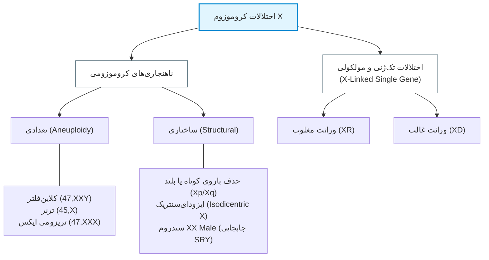
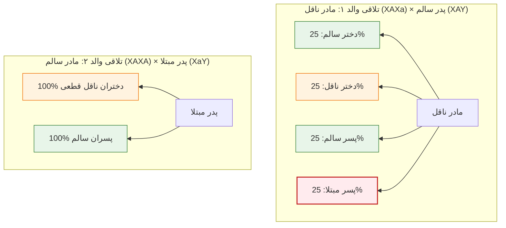
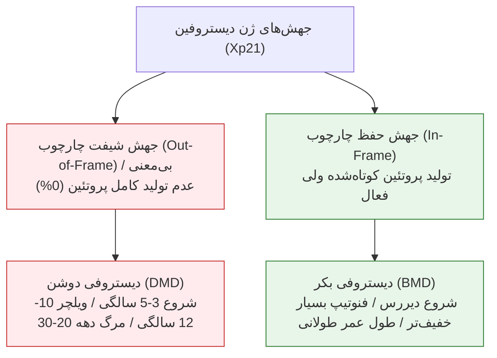

# جلسه ۹: وراثت وابسته به کروموزوم ایکس (X-Linked Inheritance)

## ۱. بیولوژی و مشخصات مولکولی کروموزوم X

> [!info] کروموزوم X در انسان
> کروموزوم جنسی ساب‌متاسانتریک با طول 153 میلیون جفت‌باز (153 Mb) که حاوی حدود 800 ژن کدکننده پروتئین است (در مقایسه با کروموزوم Y که تنها 70 ژن دارد).

* **عدم تعادل ژنی زن و مرد:** زنان دارای دو کروموزوم X (ژنوتیپ XX) و مردان دارای یک کروموزوم X و یک کروموزوم Y (ژنوتیپ XY) هستند. مردان برای ژن‌های کروموزوم X اصطلاحاً **Hemizygous** (تک‌نسخه‌ای) محسوب می‌شوند.
* **غیرفعال‌سازی کروموزوم X (Lyonization):** در اوایل تکوین جنینی اناث، یکی از دو کروموزوم X در تمام سلول‌های سوماتیک به شکل غیرفعال، هتروکروماتینی متراکم و فاقد رونویسی درمی‌آید که در هسته به صورت **Barr Body** مشاهده می‌شود.
* **ژن‌های Cancer-Testis (ژن‌های CT):** حدود 10% از کل ژن‌های کروموزوم X از خانواده *CT Genes* هستند.
  * *ویژگی اختصاصی:* در حالت فیزیولوژیک فقط در بافت بیضه (Testis) بیان می‌شوند؛ اما در سلول‌های توموری بدخیم مجدداً فعال می‌گردند.
  * *مکانیسم ایمنی:* به علت وجود *سد خونی-بیضه‌ای (Blood-Testis Barrier)*، آنتی‌ژن‌های بیضه از دسترس سیستم ایمنی پنهان‌اند؛ بنابراین بیان نابجای آن‌ها در تومورها، این مولکول‌ها را به تارگت‌های ایده‌آل برای **ایمونوتراپی و ژن‌درمانی سرطان** تبدیل کرده است.

---

## ۲. ناهنجاری‌های کروموزومی شاخص مرتبط با X

| سندرم کروموزومی | کاریوتایپ و شیوع | مکانیسم سایتوژنتیک | تظاهرات کلینیکی اختصاصی |
| :--- | :--- | :--- | :--- |
| **کلاین‌فلتر (Klinefelter)** | 47,XXY بروز: 1:1000 تولد پسر (1:650 در برخی مراجع) | عدم انفصال کروموزومی (Nondisjunction)؛ منشأ کروموزوم اضافه تقریباً 50/50 از پدر یا مادر (ارتباط فرم مادری با سن بالای مادر)؛ موارد اندک موزائیسم | قد بلند، ژنیکوماستی، موهای تنک ریش و بدن، چاقی ژینوئید، بیضه‌های کوچک، آزواسپرمی و عقیمی قطعی، اختلال یادگیری کلامی، خطر بالای پوکی استخوان و کارسینوم برست مردان |
| **ترنر (Turner)** | 45,X (مونوزومی X) بروز: 1:2500 تا 1:10,000 دختر | در 80% موارد ناشی از خطای میوز پدری (از دست رفتن X یا Y پدر)؛ عدم تعادل هاپلوژن SHOX در ناحیه سودواتوزومال | قد کوتاه، گردن پرده‌دار (Webbed neck)، قفسه سینه سپری‌شکل، نیپل‌های فاصله‌دار، کوتاهی متاکارپ ۴، کوآرکتاسیون آئورت، هایگروما کیستیک و ادم جنینی در T2، گناد خطی (Streak gonad) و آمنوره، هوش طبیعی |
| **سندرم مردان ایکس‌ایکس (XX Male)** | 46,XX (فنوتیپ مذکر) بسیار نادر | کراسینگ‌اور نابه‌جا در میوز پدر: جابجایی ژن SRY از Yp بر روی تلوپلاسم کروموزوم X | فنوتیپ ظاهری مردانه ناشی از تولید آندروژن جنینی، اما به دلیل فقدان سایر ژن‌های اسپرماتوژنز کروموزوم Y، فرد نابارور و فاقد اسپرم است |
| **سندرم X شکننده (Fragile X)** | جایگاه Xq27.3 | گسترش توالی تکراری سه‌نوکلئوتیدی CGG در 5' UTR ژن FMR1 و هایپرمتیلاسیون پروموتور | شایع‌ترین علت ژنتیکی ارثی عقب‌ماندگی ذهنی و اوتیسم، صورت دراز و باریک، گوش‌های بزرگ و برجسته، ماکروارکیدیسم (بزرگی بیضه پس از بلوغ) |

> [!warning] تله امتحانی درمان و عوارض کلاین‌فلتر و ترنر
> * در **سندرم کلاین‌فلتر**: درمان دارویی با **تستوسترون** صفات ثانویه جنسی را تقویت کرده و مانع از پوکی استخوان زودرس و زخم‌های مزمن اندام تحتانی می‌شود، اما ناباروری (آزواسپرمی) را درمان نمی‌کند.
> * در **سندرم ترنر**: درمان جایگزین با **استروژن** رشد صفات زنانه و پیشگیری از استئوپروز را تضمین می‌کند. وجود نارسایی هاپلو در ژن **SHOX** عامل مستقیم کوتاهی قد است.

---

## ۳. الگوی وراثت مغلوب وابسته به ایکس (X-Linked Recessive - XR)

### ویژگی‌های کلیدی شجره‌نامه XR
1. شیوع بسیار بالاتر بیماری در **مردان (Males)** نسبت به زنان.
2. **فقدان انتقال پدر به پسر (No Male-to-Male Transmission):** پدر کروموزوم Y را به پسر می‌دهد؛ بیماری هرگز از پدر به پسر منتقل نمی‌شود.
3. **انتقال اریب / حرکت اسب شطرنج (Diagonal / Knight's move):** بیماری از پدربزرگ مبتلا از طریق دختران ناقل سالم به نوه‌های پسری منتقل می‌شود (پرش ظاهری از یک نسل).
4. **دخترانِ پدر مبتلا:** همگی بدون استثنا **ناقل قطعی (Obligate Carrier)** هستند.
5. **ریسک فرزندان مادر ناقل:** هر پسر شانس ابتلای 50% (1/2) و هر دختر شانس ناقلی 50% (1/2) دارد.

### ۴ سازوکار استثنایی ابتلای بالینی زنان در بیماری‌های مغلوب XR
1. **هوموزیگوسیتی واقعی (Homozygosity):** ازدواج پدر مبتلا با مادر ناقل ($X^aY \times X^AX^a$) یا رخ دادن موتاسیون جدید (De novo) در آلل دوم جنین دختری که یکی از والدینش آلل جهش‌یافته دارد (مثال: شیوع 1:150 زنان در کوررنگی به دلیل فراوانی آللی بالای جامعه).
2. **غیرفعال‌سازی نامتعادل یا اریب کروموزوم X (Skewed X-Inactivation):** به صورت تصادفی در مرحله جنینی، کروموزوم X حاوی آلل سالم در اکثر سلول‌ها غیرفعال شود؛ در نتیجه آلل جهش‌یافته عمدتاً فعال مانده و زن به فرم خفیف تا شدید بیماری مبتلا می‌شود (**Manifesting Heterozygote**؛ دیده شده در دوشن و هموفیلی A).
3. **آنومالی‌های عددی (Numerical X Abnormalities):** همراهی آلل جهش‌یافته XR با **سندروم ترنر (45,X)**؛ نبود نسخه دوم X سبب بروز کامل صفت مغلوب در فنوتیپ مؤنث می‌شود.
4. **ترنسلوکیشن متقابل بین اتوزوم و ایکس (X-Autosome Translocation):** نقطه شکست ترنسلوکیشن در لوکوس بیماری (مثلاً Xp21 در ژن دیستروفین) قرار گیرد. برای حفظ بقای سلول، کروموزوم X طبیعی سالم به صورت انتخابی غیرفعال می‌شود تا سگمان اتوزومی جابجاشده خاموش نشود و سلول از بین نرود؛ در نتیجه فقط کروموزوم جهش‌یافته فعال مانده و دختر مبتلا به دیستروفی دوشن بروز می‌یابد.

---

## ۴. بیماری‌های High-Yield مغلوب وابسته به X

### ۱. کوررنگی سرخ-سبز (Red-Green Color Blindness یا Daltonism)
* **شیوع:** 7% تا 10% (یا 8%) در مردان؛ حدود 0.49% تا 1% (1:150) در زنان.
* **ژنتیک مولکولی:** ناشی از ژن‌های مجاور **OPN1LW** (طول‌موج بلند - L-opsin قرمز) و **OPN1MW** (طول‌موج متوسط - M-opsin سبز) در جایگاه **Xq28**.
  * شباهت بالای این دو ژن (96% هومولوژی) باعث تسهیل **نوترکیبی نابرابر (Unequal homologous recombination)** در میوز و حذف ژنی می‌شود.
* **انواع ۴ گانه نقص بینایی رنگ:**
  1. *پروتانوپیا (Protanopia):* کوری کامل رنگ قرمز (فقدان L-opsin؛ شیوع 2% مردان).
  2. *دوترانوپیا (Deuteranopia):* کوری کامل رنگ سبز (فقدان M-opsin؛ شیوع 6% مردان).
  3. *پروتانومالی (Protanomaly):* ضعف دید رنگ قرمز (حضور اپسین غیرطبیعی).
  4. *دوترانومالی (Deuteranomaly):* ضعف دید رنگ سبز.

### ۲. هموفیلی‌ها (Hemophilia)
* **هموفیلی A:** کمبود فاکتور انعقادی VIII (فرم کلاسیک و شایع‌تر)؛ الگوی XR.
* **هموفیلی B (Christmas Disease):** کمبود فاکتور انعقادی IX؛ الگوی XR. بیماری تاریخی خاندان سلطنتی ملکه ویکتوریا (Queen Victoria) از نوع هموفیلی B بوده است.
* **علائم:** خونریزی شدید مفصلی (همارتروز زانو حین بازی/ضربه)، اکیموزهای وسیع، خونریزی طولانی پس از کشیدن دندان.

> [!important] تله تست: هموفیلی C چیست؟
> **هموفیلی C (سندرم روزنتال - کمبود فاکتور ۱۱):** جهش بر روی **کروموزوم ۴** قرار دارد و الگوی وراثت آن **اتوزومال مغلوب (AR)** است؛ این بیماری برخلاف تیپ A و B ربطی به کروموزوم X نداشته و شیوع آن در هر دو جنس زن و مرد کاملاً برابر است.

### ۳. دیستروفی‌های عضلانی دوشن و بکر (DMD vs BMD)
* **لوکوس ژنی:** بازوی کوتاه کروموزوم X جایگاه **Xp21**؛ ژن دیستروفین با **79 اگزون** (بزرگ‌ترین ژن ژنوم انسان).
* **پاتولوژی مشترک:** اختلال پروتئین متصل‌کننده اکتین سیتوپلاسمی به کمپلکس سارکوگلیکان غشا $\rightarrow$ نکروز عضلانی و جایگزینی با فیبروز و چربی (**Pseudohypertrophy** به ویژه در عضله گاستروکنمیوس ساق پا).

* **علائم پیشرونده DMD:** ضعف عضلانی ابتدایی، زمین‌خوردن‌های مکرر، **نشانه گاورز (Gowers' sign)** (استفاده از دست‌ها و تکیه روی پاها برای برخاستن از زمین)، از دست دادن راه رفتن در سن 10 تا 12 سالگی، نیاز به تهویه غیرتهاجمی ریه در 15 سالگی به دلیل درگیری دیافراگم، کاردیومیوپاتی و مرگ در سن 20 تا 30 سالگی.
* **روش‌های تشخیص پیش از تولد (PND):**
  1. *cffDNA (تست غیرتهاجمی در خون مادر):* از هفته 10 تا 12.
  2. *CVS (نمونه‌برداری از پرزهای کوریونی):* هفته 11 تا 14 (ریسک سقط: 1%).
  3. *آمنیوسنتز (Amniocentesis):* از هفته 15 به بعد (ریسک سقط: 0.5%).

### ۴. سایر بیماری‌های مهم و امتحانی XR
* **ایکتیوز وابسته به X (X-linked Ichthyosis):** کمبود آنزیم *استروئید سولفاتاز (STS)*؛ پوست خشک، ضخیم و پولک‌مانند (فلس ماهی) با درگیری زیربغل و کشاله ران (شیوع 1:2000 تا 1:6000 مردان).
* **آگاماگلوبولینمی وابسته به X (XLA / بروتون):** نقص در ژن BTK؛ توقف بلوغ لنفوسیت‌های B در مرحله پره‌-B، فقدان آنتی‌بادی‌های سرم و مستعد شدن به عفونت‌های کشنده باکتریایی.
* **نقص G6PD (فاویسم):** افت مقاومت گلبول‌های قرمز در برابر استرس‌های اکسیداتیو ناشی از داروها (پریماکین، سولفونامیدها)، عفونت‌ها و مصرف باقلا $\rightarrow$ آنمی همولیتیک حاد و نارسایی کلیه.
* **آدرنولوکودیستروفی (ALD):** نارسایی غده فوق‌کلیه (آدرنال) همزمان با دمیلینه شدن و تخریب پیشرونده سیستم عصبی مرکزی و محیطی (CNS/PNS).

---

## ۵. الگوی وراثت غالب وابسته به ایکس (X-Linked Dominant - XD)

### مشخصات واریانت‌های غالب X
1. فنوتیپ هم در زنان هتروزیگوت و هم در مردان همی‌زیگوت ظاهر می‌شود.
2. **پدر مبتلا:** بیماری را به **100% دختران** خود انتقال می‌دهد، اما **هیچ‌یک از پسرانش** مبتلا نمی‌شوند.
3. **مادر مبتلا:** بیماری را به **50% فرزندان** (فارغ از جنسیت، چه دختر و چه پسر) انتقال می‌دهد.
4. **نسبت جنسی:** فراوانی ابتلای زنان در شجره‌نامه‌ها حدوداً **۲ برابر** مردان است؛ اما شدت علائم به دلیل حضور کروموزوم X سالم در زنان به مراتب خفیف‌تر و متغیرتر از مردان است.
5. **کشندگی در جنین پسر (Male Lethality):** در برخی بیماری‌های XD، فقدان نسخه سالم برای جنین مذکر کشنده است؛ لذا در پدیگری فقط زنان مبتلا و سابقه سقط‌های مکرر جنین‌های پسر دیده می‌شود (مانند *Incontinentia Pigmenti* با پیگمانتاسیون خطوط بلاشکو و *Rett Syndrome* ناشی از ژن MECP2 که 95% جهش دونوو است).
6. **سایر نمونه‌های XD:** راشیتیسم مقاوم به ویتامین D (X-linked Hypophosphatemia)، اکثر موارد سندرم آلپورت، سندرم گولتز (Goltz)، سندرم آیکاردی (Aicardi)، سندرم Giuffrè-Tsukahara، و هتروتوپی ندولار پری‌ونتریکولار (ژن FLNA).

> [!important] مفهوم استثنایی: وراثت متناقض وابسته به ایکس (Paradoxical X-Linked)
> در جهش‌های ژن **PCDH19** (عامل آنسفالوپاتی صرعی اوایل شیرخوارگی نوع ۹)، پدیده کاملاً برعکس رخ می‌دهد:
> * **مردان همی‌زیگوت:** کاملاً **سالم و بدون علامت** هستند!
> * **زنان هتروزیگوت:** دچار تشنج و بیماری **بسیار شدید** می‌شوند!
> * *توجیه مولکولی:* تداخل متابولیکی یا تداخل اتصالی بین پروتئین جهش‌یافته و پروتئین سالم در بافت مغزی موزائیک، پاتوژنیک‌تر از حضور سلول‌های همگون دارای پروتئین جهش‌یافته منفرد است.

---

## ۶. صفات تحت‌تاثیر جنس (Sex-Influenced) و وابسته به Y (Holandric)

### صفات تحت‌تاثیر جنس (Sex-Influenced Autosomal Dominant)
> [!info] تعریف صفت تحت‌تاثیر جنس
> ژن بیماری روی کروموزوم اتوزوم قرار دارد و الگوی وراثت آن به صورت **اتوزومال غالب** با ریسک انتقال 50% به نسل بعد است؛ اما **بروز و شدت فنوتیپ به شدت وابسته به فاکتورها و هورمون‌های جنسی (تستوسترون/استروژن)** است.

* **آلوپسی آندروژنیک (ریزش موی مردانه):** در مردان تحت غلظت بالای آندروژن مانند یک صفت غالب با نفوذ بالا زودرس تظاهر می‌یابد؛ اما در زنان به دلیل استروژن بالا و سطح پایین آندروژن بسیار خفیف‌تر و نادرتر است.
* **ناشنوایی غیرسندرومی اتوزومی ناشی از ژن GJB2 (Connexin 26):** با وجود اتوزومال بودن، نفوذ و تظاهرات آن بین دو جنس دارای تفاوت و ترجیح جنسی است.
* **ژن‌های محور رنین-آنژیوتانسین در هایپرتنشن:** ژن‌های AGT، ACE و AGTR1 تحت تأثیر فاکتورهای هورمونی هر جنس، ریسک متفاوتی برای فشار خون ایجاد می‌کنند. (گیرنده اندوتلیالی ACE2 در ریه و کلیه تارگت تخریب ویروس کووید نیز بوده است).
* **هموکروماتوز (Hemochromatosis):** صفت AR با تجمع آهن؛ زنان هوموزیگوت به علت اتلاف فیزیولوژیک خون در قاعدگی و زایمان علائم بالینی کمتری نشان می‌دهند.

### سندرم عدم حساسیت به آندروژن (AIS - Testicular Feminization)
* ژن گیرنده آندروژن (AR) بر روی کروموزوم X قرار دارد.
* جهش غیرفعال‌کننده AR سبب می‌شود جنین با **کاریوتایپ 46,XY** علیرغم تولید بالای تستوسترون، به دلیل فقدان گیرنده به سمت فنوتیپ زنانه رشد کند.
* *فنوتیپ:* ظاهر کاملاً زنانه (حتی زیباتر از زنان عادی به علت عدم وجود اثرات باقیمانده آندروژن آدرنال)، واژن کوتاه با انتهای بن‌بست، عدم وجود رحم و تخمدان (به دلیل عملکرد سالم فاکتور AMH مترشحه از بیضه‌های مخفی)، بیضه‌های داخلی داخل‌شکمی یا اینگوینال، آمنوره اولیه و ناباروری قطعی.

### وراثت وابسته به Y (Holandric Inheritance)
* ژن روی کروموزوم Y قرار دارد؛ منحصراً از **پدر به تمام پسران** منتقل می‌شود و دختران هرگز درگیر نمی‌شوند.
* صفاتی چون ژن **SRY**، آنتی‌ژن سازگاری بافتی **H-Y** و فاکتورهای اسپرماتوژنز (**AZF**) در این دسته هستند. حذف AZF سبب آزواسپرمی و ناباروری می‌شود که در صورت انجام لقاح مصنوعی با تزریق اسپرم (ICSI)، صفت ناباروری حتماً به تمام فرزندان پسر منتقل خواهد شد.

---

## ۷. پاسخ جامع و تشریحی به تکالیف و پرسش‌های چالشی استاد

### تکلیف ۱: مقایسه دقیق دیستروفی عضلانی دوشن (DMD) و بکر (BMD)
* **نوع جهش:** در DMD جهش‌ها از نوع *Out-of-Frame* (حذف/اضافه نابرابر یا جهش‌های بی‌معنی) هستند که چارچوب خوانش را به هم زده و پروتئین دیستروفین به طور کامل (0%) غایب است. در BMD جهش‌ها از نوع *In-Frame* بوده و چارچوب خوانش حفظ می‌شود؛ لذا پروتئین تولیدشده کوتاه‌تر از حالت نرمال ولی دارای فعالیت عملکردی نسبی است.
* **سن بروز و شدت:** در DMD شروع علائم در 3 تا 5 سالگی، ویلچرنشینی در 10 تا 12 سالگی و مرگ در دهه سوم عمر است. در BMD شروع در سنین نوجوانی یا بزرگسالی، روند بسیار آهسته و بیمار ممکن است تا سنین بالا توانایی راه رفتن را حفظ کند.

### تکلیف ۲: مفهوم ایزوکروموزوم (Isochromosome) و ساختار Isodicentric X
* **Isochromosome:** کروموزوم غیرطبیعی که به جای تقسیم طولی در مرحله آنافاز میتوز/میوز، دچار **تقسیم عرضی سانترومر** شده است؛ حاصل آن کروموزومی با دو بازوی کوتاه همسان یا دو بازوی بلند همسان است (یک بازو کاملاً دو برابر شده و بازوی دیگر حذف شده است).
* **Isodicentric X:** ساختاری که از اتصال دو کروموزوم X شکسته حاصل شده و دارای **دو سانترومر** فعال/غیرفعال است. این ناهنجاری ساختاری منجر به نارسایی تخمدان، دیسژنزی گنادی، آمنوره و اختلالات رشد جنسی می‌شود.

### تکلیف ۳: روش‌های تشخیصی سندرم عدم حساسیت به آندروژن (AIS)
1. **کاریوتایپ:** نشان‌دهنده الگوی کروموزومی **46,XY** در فردی با ظاهر زنانه.
2. **بررسی هورمونی:** سطح تستوسترون پلاسما در محدوده نرمال یا بالای مردانه همزمان با سطح بالای LH (نبود فیدبک منفی).
3. **سونوگرافی/MRI لگن:** فقدان ساختارهای لوله مولرین (فقدان رحم، لوله‌های فالوپ و تخمدان) و حضور بیضه‌های نهفته در کانال اینگوینال یا شکم.
4. **آنالیز ژنتیک مولکولی:** شناسایی موتاسیون بیماری‌زا در ژن **AR** روی کروموزوم X.

### تکلیف ۴: مکانیسم مولکولی بیماری Fragile X و والد انتقال‌دهنده
* **اشکال مولکولی:** افزایش بیش از حد تکرارهای تری‌نوکلئوتیدی **CGG** در ناحیه غیرکدکننده (5' UTR) ژن **FMR1**؛ در افراد مبتلا تکرارها به بیش از 200 کپی (Full Mutation) می‌رسد که باعث هایپرمتیلاسیون جزایر CpG، خاموشی رونویسی ژن و عدم ساخت پروتئین FMRP می‌شود.
* **والد انتقال‌دهنده:** انبساط توالی‌های پره‌موتیشن (55 تا 200 تکرار) به جهش کامل (بیش از 200 تکرار) **منحصراً حین اووژنز در مادر** رخ می‌دهد؛ پدران حامل پره‌موتیشن تنها می‌توانند پره‌موتیشن را بدون انبساط به جهش کامل به تمام دختران خود منتقل نمایند.
