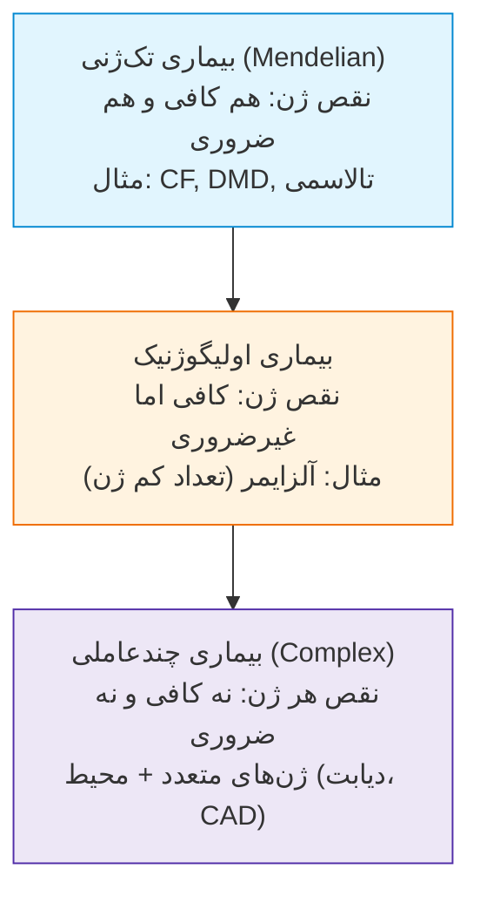
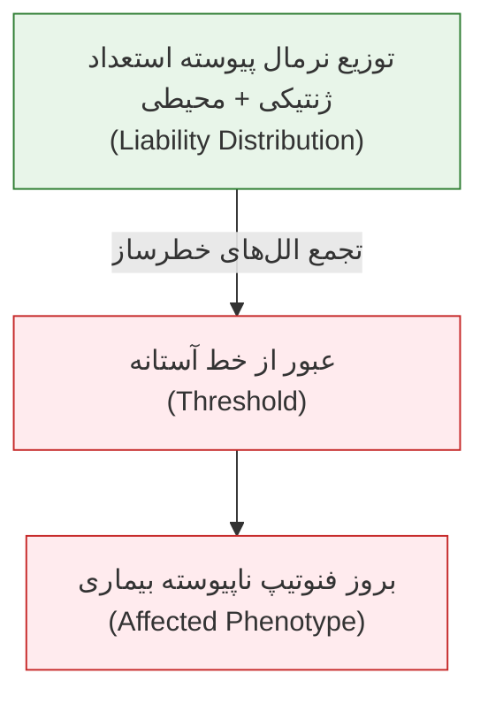
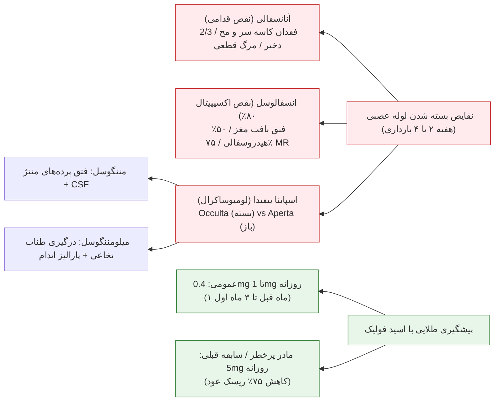
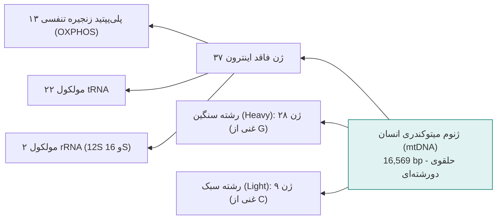
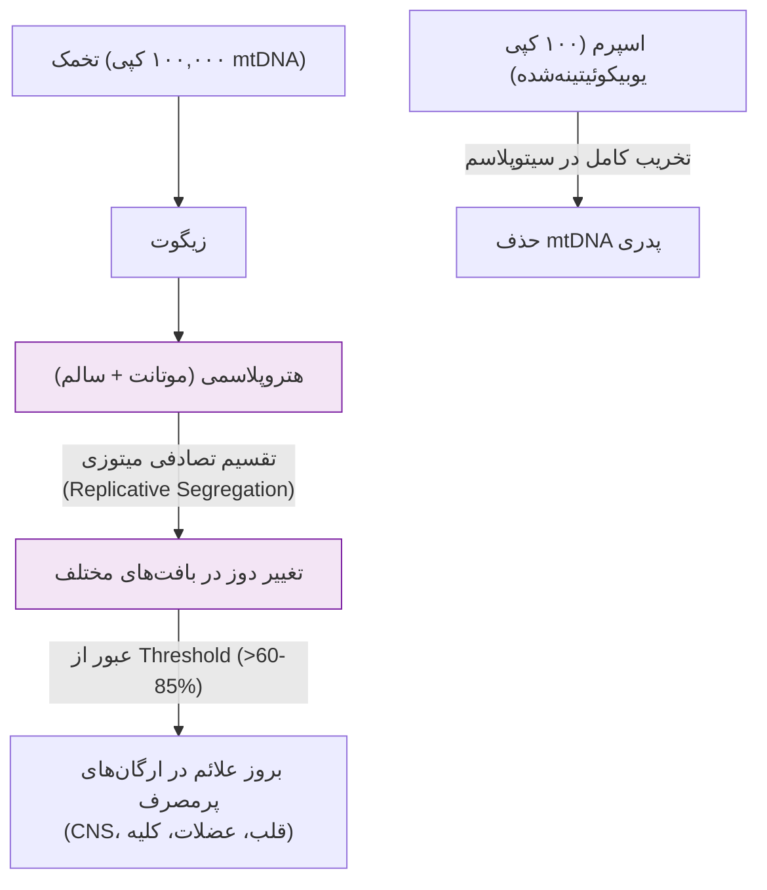
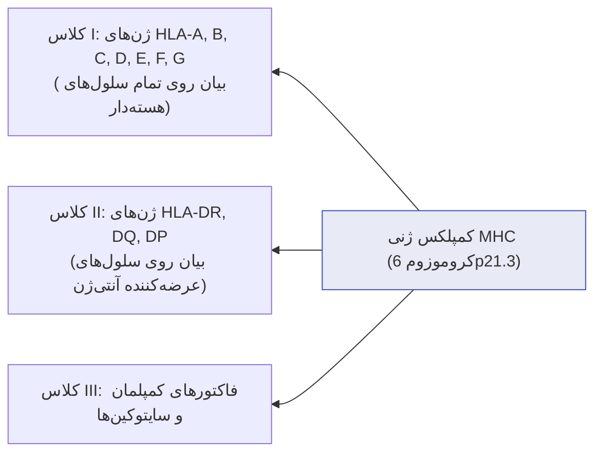

# جلسه ۱۰: وراثت چندعاملی، ژنتیک میتوکندریال و ایمونوژنتیک (Non-Mendelian Inheritance)

## ۱. مفاهیم بنیادین، ترمینولوژی و طیف بیماری‌ها

### واژگان کلیدی طبقه‌بندی صفات و بیماری‌ها

> [!info] تعریف اصطلاحات تشخیصی شجره‌نامه و بالین
> * **Familial:** تمایل به تجمع بیماری یا صفت در میان اعضای یک خانواده (تجمع فامیلی).
> * **Genetic:** وجود شواهد قطعی مبنی بر دخالت ژن یا کروموزوم در بروز نقص.
> * **Inherited:** انتقال عمودی صفت از نسلی به نسل دیگر (پدر یا مادر ناقل/مبتلا به فرزند).
> * **Sporadic:** بیماری تک‌گیر فاقد تجمع خانوادگی و فاقد الگوی انتقال عمودی (مانند بروز یک مورد سرطان پانکراس در کل فامیل).
> * **Congenital:** تظاهر صفت یا نقص ساختاری در بدو تولد (مانند سندرم داون که ژنتیکی و مادرزادی است اما ارثی نبوده و عمدتاً اسپورادیک است).

### طیف ژنتیک-محیط در بیماری‌های انسانی
بیماری‌ها در قالب یک پیوستار بررسی می‌شوند نه جزایر مستقل:
1. **سمت چپ طیف (ژنتیک محض):** بیماری‌های تک‌ژنی؛ نادر، ژنتیک ساده، ریسک عود بالا (مانند $\beta$-تالاسمی). با این حال فاکتور محیطی مؤثر است (مثلاً مصرف بالای آهن فنوتیپ تالاسمی را تشدید می‌کند).
2. **سمت راست طیف (محیط محض):** بیماری‌های عفونی و کمبودهای تغذیه‌ای (اسکوروی). ژنتیک باز هم مداخله دارد (مانند پلی‌مورفیسم‌های ایمنی مؤثر بر استعداد به بیماری سل یا مقاومت به درمان).
3. **مرکز طیف (بیماری‌های کمپلکس):** شایع (Common Diseases با شیوع >1:1000)؛ عامل بیش از 60% مرگ‌ومیر و ناتوانی در طول زندگی. ژنوتیپ صرفاً ریسک را تعدیل (Modify) می‌کند.

---

## ۲. مدل آستانه (Threshold Model) و وراثت چندعاملی

### صفات پیوسته در برابر صفات کیفی آستانه‌ای
* **صفات پیوسته (Quantitative Continuous):** قد، فشار خون، سطح هوش (IQ) و رنگ پوست؛ دارای توزیع زنگوله‌ای گوسی در جامعه ناشی از اثر تجمعی (Additive effect) چندین ژن پلی‌ژنیک.
* **صفات کیفی دارای آستانه (Qualitative Traits with Threshold):** استعداد ابتلا (Liability) متغیری پیوسته حاصل جمع استعداد ژنتیکی و عوامل محیطی است؛ صفت بیماری زمانی بروز می‌کند که لایبیلیتی فرد از حد **Threshold** بگذرد.

> [!important] اثر کارتر (Carter Effect) و تفاوت آستانه بین دو جنس
> اگر آستانه ابتلا بین دو جنس متفاوت باشد:
> * جنسیت با شیوع کمتر، **آستانه بالاتری** برای بروز بیماری دارد.
> * اگر فردی از جنس کم‌شیوع مبتلا شود (مثلاً پسر در NTD یا دختر در تنگی پیلور)، نشانگر **بار اللی و استعداد ژنتیکی بسیار بالاتر** در آن خانواده است.
> * نتیجه تستی: **ریسک عود در بستگان و فرزندان بعدی فرد مبتلا از جنس کم‌شیوع به مراتب بالاتر است.**

### ۵ اصل طلایی ریسک عود در بیماری‌های چندعاملی
1. ریسک عود تجربی (Empirical Risk) در بستگان درجه ۱ تقریباً معادل جذر شیوع جمعیتی صفت ($\sqrt{P}$) است.
2. برعکس صفات مندلی، **با افزایش تعداد افراد مبتلا در خانواده، ریسک عود شدیداً جهش می‌یابد** (در شکاف لب و کام: بدون سابقه 0.1%، با ۱ والد 3%، با ۲ والد مبتلا 30% تا 34%).
3. **شدت نقص فنوتیپی با ریسک عود رابطه مستقیم دارد**؛ بیماری شدیدتر نشانه بار اللی بالاتر خانواده است (شکاف لب یک‌طرفه بدون کام: ریسک عود 4%؛ شکاف دوطرفه همراه کام: ریسک عود 8%).
4. ریسک عود با دور شدن درجه خویشاوندی بسیار سریع‌تر از صفات اتوزومال غالب افت می‌کند (درجه ۱: 3.2% ⇦ درجه ۲: 0.5% ⇦ درجه ۳: 0.1%).
5. ازدواج خویشاوندی ریسک عود را افزایش می‌دهد.

---

## ۳. هرتابیلیتی (Heritability) و همبستگی دوقلویی

> [!info] تعریف و فرمول هرتابیلیتی ($h^2$)
> نسبتی از کل واریانس فنوتیپی یک صفت در جمعیت که مستقیماً ناشی از واریانس ژنتیکی افزایشی است:
> $$V_{Total} = V_{Genetic} + V_{Environmental}$$
> $$h^2 = \frac{V_{DZ} - V_{MZ}}{V_{DZ}} = \frac{V_{Genetic}}{V_{Total}}$$

### مقایسه شاخص‌های اپیدمیولوژیک و هرتابیلیتی بیماری‌های شایع

| اختلال بالینی | شیوع جمعیتی (%) | میزان هرتابیلیتی ($h^2$) | میزان تطابق MZ (%) | میزان تطابق DZ (%) |
| :--- | :--- | :--- | :--- | :--- |
| **اسکیزوفرنی** | 1% | 85% | 53% | 15% |
| **آسم** | 4% | 80% | - | - |
| **شکاف لب با/بدون کام** | 0.1% | 76% | 30% | 5% |
| **تنگی پیلور** | 0.3% | 75% | - | - |
| **اسپوندیلیت آنکیلوزان** | 0.2% | 70% | - | - |
| **بیماری عروق کرونر (CAD)** | 3% | 65% | - | - |
| **پای چنبری (Clubfoot)** | 0.1% | 68% | - | - |
| **فشار خون اساسی (HTN)** | 5% | 62% | - | - |
| **آنانسفالی و اسپاینا بیفیدا** | 0.3% | 60% | - | - |
| **صرع غیرتروماتیک** | - | - | 70% | 6% |
| **پسوریازیس** | - | - | 72% | 15% |
| **دیابت نوع ۱** | 0.4% | - | 40% | 4.8% |
| **بیماری سلیاک / پپتیک اولسر** | 4% | 37% | - | - |
| **نقایص مادرزادی قلب (CHD)** | 0.5% | 35% | - | - |
| **لوپوس اریتماتوز (SLE)** | - | - | 22% | 0% |

> [!note] نکات تکمیلی جدول تطابق و هرتابیلیتی
> * هرتابیلیتی بالاتر در اسکیزوفرنی (85%) نسبت به بیماری‌های مادرزادی قلب (35%) نشان‌دهنده غالب بودن مؤلفه ژنتیکی در اسکیزوفرنی و ارجحیت فاکتورهای محیطی در CHD است.
> * تطابق کمتر از 100% در دوقلوهای تک‌تخمی (MZ) اثبات قطعی دخالت فاکتورهای غیرژنتیکی (محیطی/اپی‌ژنتیک) در بیماری است.

---

## ۴. بررسی تفصیلی نقایص لوله عصبی (NTD) و شکاف لب/کام

### ویژگی‌های نقایص لوله عصبی (Neural Tube Defects)
* **اتیولوژی لایبیلیتی:** تماس جنین با والپروئیک اسید، دیابت نوع ۱ مادر، چاقی، نژاد سفیدپوست (سفید > سیاه‌پوست > آسیایی) و فقر تغذیه‌ای.
* **پیش‌آگهی بر اساس مهره درگیر:**
  * ضایعه پایین‌تر از S1: توانایی راه رفتن مستقل.
  * ضایعه بین L4-L5: راه رفتن مشروط با وسایل کمکی و بریس.
  * ضایعه بالاتر از L2: وابستگی دائم به ویلچر.
  * تقریباً تمام بیماران (بجز ضایعات شدیداً دمی) به کاتتریزاسیون مثانه نیاز دارند. 75% هوش طبیعی دارند.
* **غربالگری بیوشیمیایی (MS-AFP):** آلفافیتوپروتئین سرم مادر در NTDهای باز (Aperta) به دلیل نشت به مایع آمنیوتیک شدیداً **افزایش** یافته، اما در سندرم داون **کاهش** نشان می‌دهد.

> [!important] نقش ژن MTHFR در سندروم‌های چندعاملی
> پلی‌مورفیسم‌های C677T و A1298C ژن MTHFR سبب ناپایداری آنزیم، افت بازیافت فولات و تجمع هموسیستئین می‌شوند:
> * مادران دارای فرزند NTD دو برابر بیشتر ناقل هموزیگوت این واریانت هستند.
> * ارتباط بالینی گسترده در پایگاه OMIM: ناهنجاری‌های عروقی، پره‌اکلامپسی، ترومبوز شریانی، شکاف کام/لب، سقط مکرر، میگرن، گلوکوم و اسکیزوفرنی.

### مقایسه تطبیقی دو مالفورماسیون شایع چندعاملی

| شاخص بالینی | نقایص لوله عصبی (NTD) | شکاف لب با/بدون کام (CL/P) |
| :--- | :--- | :--- |
| **شیوع جمعیتی** | 2 تا 10 در 1000 تولد | 0.4 تا 1.7 در 1000 تولد |
| **ترجیح جنسی (Sex Ratio)** | **2/3 موارد مؤنث (Female)** | **60% تا 80% موارد مذکر (Male)** |
| **ترجیح نژادی** | سفیدپوستان > سیاه‌پوستان > آسیایی | **آسیایی‌ها > قفقازی‌ها > سیاه‌پوستان** |
| **پنجره بحرانی جنینی** | روز 14 تا 28 بارداری (هفته 2 تا 4) | حدود روز 35 جنینی (عدم اتصال Frontal به Maxillary) |
| **مداخله پیشگیرانه مؤثر** | مکمل اسید فولیک پری‌کانسپشنال | جراحی پلاستیک ترمیمی پس از تولد |

---

## ۵. بیماری‌های شایع بزرگسالی و روش‌های نقشه‌یابی ژنتیکی

### بیماری عروق کرونر (CAD/CHD) و چاقی
* **عوامل ژنتیکی CAD:** پلی‌مورفیسم‌های لیپوپروتئینی، ژن ACE، واریانت‌های گیرنده LDL (10% از CADهای زیر ۵۰ سال ناشی از هایپرکلسترولمی فامیلی مونوژنیک تک‌ژنی است).
* **اشکال ژنتیکی چاقی (Obesity):**
  * *فرم‌های تک‌ژنی AR:* کمبود مادرزادی لپتین، کمبود گیرنده لپتین، نقص پروهرومون کانورتاز ۱ (PC1) و نقص ژن POMC.
  * *فرم تک‌ژنی AD:* جهش ژن گیرنده ملانوکورتین ۴ (MC4R).
  * *فرم شایع (Multifactorial):* اثر ترکیبی بیش از ۵۸ ژن؛ واریانت‌های منفرد حدود 35% واریانس BMI را توجیه می‌کنند.

> [!info] تعریف فنوکوپی (Phenocopy)
> بروز فنوتیپ کاملاً مشابه با یک بیماری ژنتیکی در فردی که ژنوتیپ نرمال داشته و علائمش ناشی از عوامل غیرژنتیکی یا ژن‌های دیگر است (مانند دیابت یا ناشنوایی ناشی از عفونت رحمی در مقایسه با دیابت/ناشنوایی تک‌ژنی).

### روش‌های آماری سنجش تجمع خانوادگی (Familial Aggregation)
1. **مطالعات مورد-شاهدی (Case-Control):** مقایسه همسان‌شده بیماران با افراد سالم از نظر سن، شغل و قومیت.
2. **نسبت ریسک نسبی بستگان ($\lambda_r$):**
   $$\lambda_r = \frac{\text{شیوع بیماری در بستگان فرد مبتلا}}{\text{شیوع بیماری در جمعیت عمومی}}$$
   اگر $\lambda_r = 1$ باشد، هیچ تجمع خانوادگی وجود ندارد. بالاترین $\lambda_r$ در دوقلوهای MZ متعلق به اوتیسم ($\lambda_{MZ}=2000$)، کرون ($\lambda_{MZ}=840$) و ام‌اس ($\lambda_{MZ}=800$) است.

### روش‌های نقشه‌یابی در بیماری‌های پیچیده (Non-Parametric / Model-Free)
* **Affected Sib-Pair Method (ASP):** متکی بر عدم فرض الگوی مندلی خاص؛ بررسی میزان تسهیم آللی مارکرهای DNA بین دو خواهر/برادر مبتلا نسبت به مقادیر تصادفی مورد انتظار (25% فاقد آلل مشترک، 50% دارای ۱ آلل مشترک، 25% دارای ۲ آلل مشترک). افزایش معنادار تسهیم بالای 50%، نشانه پیوستگی جایگاه با ژن خطرساز است.
* **مطالعات وابستگی جمعیتی (Association Studies):** بررسی همبستگی وقوع یک آلل خاص با بیماری در سطح جمعیت از طریق محاسبه نسبت شانس (Odds Ratio):
  $$Odds\ Ratio = \frac{ad}{bc}$$
  (که در آن $a$ و $b$ بیماران با/بدون آلل، و $c$ و $d$ کنترل‌های با/بدون آلل هستند).

---

## ۶. ژنتیک سیتوپلاسمی و میتوکندریال (Mitochondrial Genome)

### ویژگی‌های بیوفیزیکی و عملکردی mtDNA
* **تراکم ژنی فوق‌العاده:** 93% ژنوم میتوکندری کدکننده است (در برابر تنها 3% ژنوم هسته)؛ میانگین ۱ ژن در هر 450 جفت‌باز.
* **کدون‌های اختصاصی ژنتیکی:** AUA کدکننده متیونین (به جای ایزولوسین)، TGA کدکننده تریپتوفان (به جای استاپ)، AGA و AGG کدون خاتمه ترجمه (Stop).
* **پلیمراز اختصاصی:** همانندسازی منحصراً توسط **DNA پلیمراز گاما ($\gamma$)**.
* **کپی‌نامبر:** 5 تا 10 کپی در هر میتوکندری؛ مجموعاً حدود 10,000 کپی mtDNA در هر سلول سوماتیک.

### مقایسه سازمان‌بندی ژنوم هسته‌ای و میتوکندریال

| ویژگی مقایسه‌ای | ژنوم هسته‌ای (Nuclear) | ژنوم میتوکندریال (mtDNA) |
| :--- | :--- | :--- |
| **اندازه ژنوم** | $3.3 \times 10^9$ جفت‌باز (3300 Mb) | 16,569 جفت‌باز (16.6 kb) |
| **تعداد ژن‌های کدشونده** | 20,000 تا 25,000 ژن | 37 ژن (13 پلی‌پپتید، 22 tRNA، 2 rRNA) |
| **حضور اینترون** | شایع در اکثر ژن‌ها | **کاملاً غایب (فاقد اینترون)** |
| **پروتئین‌های متصل** | هیستون‌ها (نوکلئوزوم) | **فاقد هیستون** (متصل به پروتئین‌های TFAM) |
| **الگوی رونویسی** | رونویسی مجزا برای هر ژن | **رونویسی پلی‌سیسترونیک بزرگ** از هر دو رشته |
| **الگوی وراثت** | مندلی (اتوزوم و جنسی) | **منحصراً مادری (Maternal Inheritance)** |
| **نرخ بروز جهش** | پایه استاندارد | **۱۰ تا ۱۷ برابر سریع‌تر از ژنوم هسته** |

> [!note] علل نرخ جهش بالاتر در mtDNA
> فقدان هیستون‌های محافظتی، فقدان سیستم‌های دقیق ترمیم DNA و مجاورت مستقیم با رادیکال‌های فعال اکسیژن (ROS) حاصل از فسفوریلاسیون اکسیداتیو غشای داخلی.

> [!warning] تله امتحانی وراثت مادری و هتروپلاسمی
> * **وراثت مادری (Maternal Inheritance):** مادر مبتلا بیماری را به **تمام فرزندان** خود (پسر و دختر) منتقل می‌کند؛ مرد مبتلا بیماری را به **هیچ‌یک از فرزندانش** انتقال نمی‌دهد. اسپرم حاوی میتوکندری است، اما میتوکندری‌های آن یوبیکوئیتینه شده و پس از لقاح در تخمک تخریب می‌شوند.
> * **تفکیک همانندسازی (Replicative Segregation):** توزیع تصادفی میتوکندری‌ها در میتوز سبب می‌شود درصد موتانت بین سلول‌ها و بافت‌ها نوسان کند؛ این پدیده **انجام تشخیص پیش از تولد (PND) را در بیماری‌های میتوکندریال عملاً غیرقابل اعتماد و دشوار می‌سازد.**

### بیماری‌های میتوکندریال شاخص شب امتحان
* **LHON (لبر):** نوروپاتی چشمی ارثی؛ جهش در ژن‌های زنجیره انتقال الکترون و کوری ناگهانی جوانان.
* **NARP:** نوروپاتی، آتاکسی و رتینیت پیگمانتوزا؛ ناشی از جهش **T8993G** در ژن *ATP6*.
* **MELAS:** میوپاتی، آنسفالوپاتی، اسیدوز لاکتیک و حملات شبه‌سکته مغزی؛ ناشی از جهش در ژن tRNA لوسین.
* **MERRF:** صرع میوکلونیک با فیبرهای قرمز تکه‌تکه (Ragged-Red Fibers) در بیوپسی عضله؛ ناشی از جهش **A8344G** در tRNA لیزین (آستانه فنوتیپی >85%).
* **نشانه‌های شک به بیماری میتوکندریال در بالین:** پتوز پلک، اوفتالموپلژی خارجی پیشرونده، میوپاتی پروگزیمال، عدم تحمل ورزش، کاردیومیوپاتی، کری حسی‌عصبی و اسیدوز لاکتیک.
* **سندرم‌های تحلیل mtDNA ناشی از ژنوم هسته‌ای (MDS):** جهش در ژن‌های هسته‌ای مسئول همانندسازی یا استخر نوکلئوتیدی میتوکندری (شامل *POLG*, *POLG2*, *Twinkle*, *TK2*, *DGUOK*, *MPV17*) که باعث تخریب بافت مغز، کبد و عضله می‌شوند.

---

## ۷. ایمونوژنتیک و سیستم HLA

### نقص‌های ایمنی اولیه شاخص (Primary Immunodeficiencies)
* **SCID (نقص ایمنی مرکب شدید):** وراثت اتوزوم مغلوب (AR - از جمله کمبود آنزیم ADA) یا وابسته به X مغلوب (XR). ویژگی: آپلازی/تحلیل تیموس، افت شدید هر دو رده سلول‌های T و B، افت فاحش سنتز ایمونوگلوبولین‌ها و عفونت‌های مرگبار زودهنگام. درمان: پیوند مغز استخوان (BMT) و آنزیم‌درمانی جایگزین.
* **سندرم دی‌جرج (DiGeorge):** حذف کروموزومی در جایگاه **22q11**. تریاد بالینی: هایپوپلازی تیموس (افت ایمنی سلولار T)، هایپوپلازی پاراتیروئید (هایپوکلسمی نوزادی) و نقایص ساختاری قلبی خروجی. *نکته امتحانی: سطح سلول‌های B، پلاسماسل‌ها و ساخت ایمونوگلوبولین در دی‌جرج کاملاً نرمال است!* درمان: پیوند بافت تیموس جنینی.
* **آگاماگلوبولینمی بروتون (XLA):** وابسته به X مغلوب؛ جهش ژن *BTK*، توقف تمایز لنفوسیت B، فقدان پلاسماسل و افت شدید سطح تمام ایمونوگلوبولین‌ها (ایمنی سلولار T نرمال است). درمان: تزریق IVIG دوره‌ای.
* **سندرم ویسکوت-آلدریچ (WAS):** وابسته به X مغلوب (لوکوس Xp11.22)؛ تریاد: اگزما، ترومبوسیتوپنی با پلاکت‌های کوچک (Small platelets) و عفونت‌های مکرر.
* **آتاکسی تلانژکتازی (AT):** اتوزوم مغلوب (ژن *ATM* روی 11q22.3)؛ همراه با افت انتخابی شدید سطح سرمی IgA در 50% تا 80% بیماران.

### پلی‌مورفیسم HLA و ارتباط با بیماری‌ها (Disease Association)
لوکوس HLA روی **6p21.3** پلی‌مورفیک‌ترین ناحیه در ژنوم انسان است (لوکوس HLA-B دارای 111 آلل و HLA-DR دارای 228 آلل). مولکول‌های عملکردی تریمرهایی از زنجیره سنگین پلی‌مورفیک و زنجیره سبک هستند.

### همبستگی‌های شاخص آلل‌های HLA با بیماری‌های خودایمنی شب امتحان
* **HLA-B27:** اسپوندیلیت آنکیلوزان (Ankylosing Spondylitis - بیش از ۹۰٪ ارتباط).
* **HLA-DR4:** بیماری سلیاک (Coeliac Disease).
* **HLA-DR3 / HLA-DR4:** دیابت شیرین نوع ۱ (T1DM).
* **HLA-DR2 / HLA-DR3:** لوپوس اریتماتوز سیستمیک (SLE).
