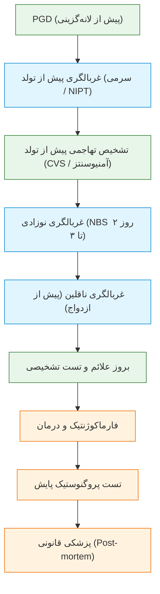
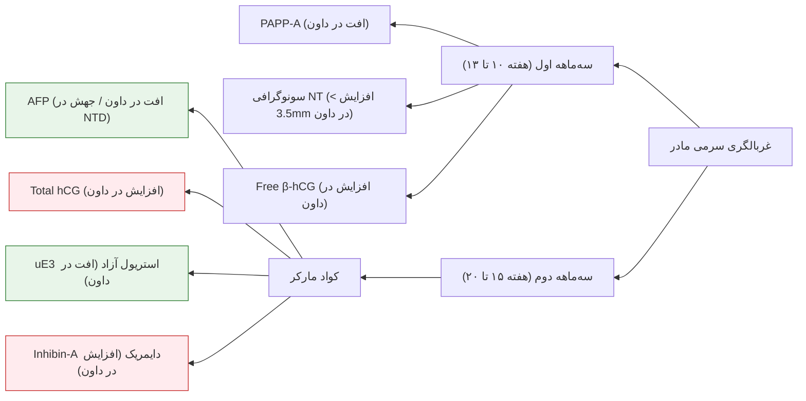
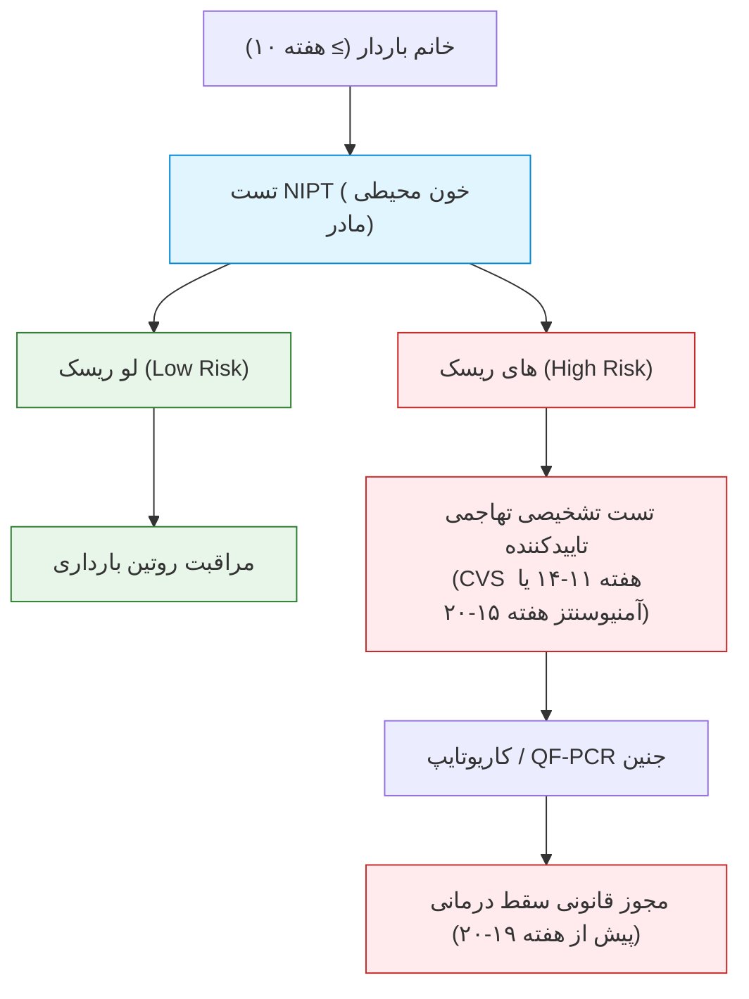
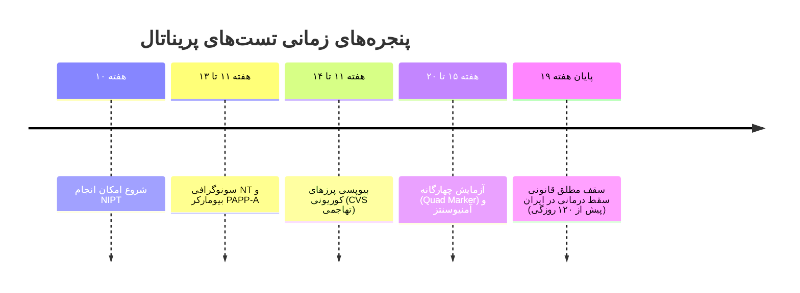
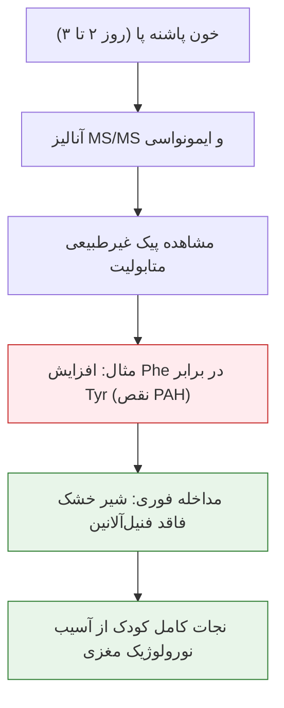

# جلسه ۱۱: غربالگری ژنتیکی پیش از تولد و نوزادی (Genetic Screening: Prenatal & Newborn)

## 1. مفاهیم بنیادین و تمایز تست‌های تشخیصی و غربالگری

> [!info] تعریف تست غربالگری (Screening Test) در برابر تست تشخیصی (Diagnostic Test)
> * **Screening Test:** شناسایی احتمالی افراد در معرض خطر (*High Risk*) یک بیماری یا نقص پنهان در جمعیت هدف **فاقد علامت بالینی** (*Asymptomatic*). خروجی آن تخمین ریسک است نه جواب قطعی آری/خیر.
> * **Diagnostic Test:** انجام آزمایش بر روی فرد دارای علامت مشکوک (*Suspected Condition*) جهت اثبات یا رد قطعی بیماری. بهترین روش تشخیصی موجود تحت شرایط استاندارد را **Gold Standard Test** می‌نامند.
> * **Prognostic Test:** پایش سیر پیشرفت بیماری یا پاسخ به درمان بالینی.

> [!important] تفاوت هدف تجاری و بالینی تست‌ها
> جامعه هدف تست‌های تشخیصی منحصراً بیماران دارای علامت است، در حالی که متقاضیان تست‌های غربالگری کل جمعیت سالم جامعه هستند؛ لذا بازار مالی و نیاز به توسعه تست‌های غربالگری در نظام سلامت به مراتب وسیع‌تر و حساس‌تر است.

---

## 2. شاخص‌های آماری، دقت ارزیابی و منحنی ROC

> [!info] حساسیت (Sensitivity) در برابر ویژگی (Specificity)
> * **Sensitivity (حساسیت):** توانایی تست در شناسایی صحیح مبتلایان حقیقی (نرخ مثبت واقعی یا *True Positive Rate*). حساسیت بالا یعنی حداقلِ منفی کاذب (*False Negative*).
> * **Specificity (ویژگی):** توانایی تست در شناسایی صحیح افراد سالم (نرخ منفی واقعی یا *True Negative Rate*). ویژگی بالا یعنی حداقلِ مثبت کاذب (*False Positive*).

* **ارزش اخباری مثبت (PPV):** نسبت مبتلایان واقعی به کل افراد با تست مثبت: $\text{PPV} = \frac{\text{True Positives}}{\text{All Positives}}$
* **ارزش اخباری منفی (NPV):** نسبت افراد واقعاً سالم به کل افراد با تست منفی: $\text{NPV} = \frac{\text{True Negatives}}{\text{All Negatives}}$
* **منحنی ROC (Receiver Operating Characteristic):** نمودار ارزیابی کارایی تست؛ محور عمودی Sensitivity و محور افقی $1 - \text{Specificity}$. بهترین تست در بالاترین نقطه گوشه چپ/راست قرار دارد.

> [!warning] تله تستی مقایسه فالس نگاتیو و فالس پوزیتیو (مثال غربالگری HIV)
> در بیماری‌های عفونی و مسری یا بدخیم (نظیر HIV در سازمان انتقال خون)، **False Negative به شدت فاجعه‌بارتر از False Positive است**؛ زیرا ورود یک کیس آلوده به چرخه انتقال خون جامعه‌ای را آلوده می‌کند، در حالی که فالس پوزیتیو با یک تست تاییدی مجدد خنثی می‌شود. بنابراین در غربالگری اولویت با حداکثر Sensitivity است.

---

## 3. معیارهای دوازده‌گانه یک تست غربالگری ایده‌آل

1. **Accuracy (دقت بالا):** حساسیت و ویژگی حداکثری (*AMAP: As Much As Possible*).
2. **Positive & Negative Predictive Value:** مقادیر بالای PPV و NPV متناسب با شیوع جامعه.
3. **Prevalence (شیوع بیماری):** بیماری مورد غربالگری باید در جامعه هدف شیوع معنادار داشته باشد (تست بیماری‌های بومی آفریقا در ایران بی‌فایده است).
4. **Cost-effectiveness:** قیمت پایین و تناسب هزینه با منافع پیشگیری.
5. **Safety:** ایمنی کامل و ارجحیت روش‌های غیرتهاجمی (*Non-invasive*).
6. **Ease of Use:** سادگی نمونه‌گیری، اجرا و ارجاع توسط کادر درمان.
7. **Acceptability:** مقبولیت عمومی، عدم ایجاد درد و سازگاری با موازین اخلاقی/فرهنگی.
8. **Regulatory Approval:** اعتبارسنجی و تایید رسمی توسط وزارت بهداشت و مراجع بین‌المللی (مانند FDA).
9. **Reproducibility & Reliability:** تکرارپذیری نتایج یکسان در آزمایشگاه‌های مختلف.
10. **Clinical Utility:** تغییر ملموس در مدیریت بالینی و پروتکل درمانی بیمار.
11. **Follow-up Protocols:** وجود مسیر درمانی مشخص پس از مثبت شدن تست.
12. **Natural History:** شناخت کامل پنجره پنهان بیماری پیش از ظهور عوارض برگشت‌ناپذیر.

---

## 4. مقایسه انواع سه‌گانه فناوری‌های تست ژنتیک

| نوع فناوری تست | سابجکت و متریال هدف | تغییرات ژنتیکی قابل شناسایی | نمونه‌های بالینی شاخص |
| :--- | :--- | :--- | :--- |
| **مولکولی (Molecular Genetic)** | توالی نوکلئوتیدی DNA / RNA | جهش‌های تک‌نوکلئوتیدی (SNVs)، ایندل‌های ریز، تغییرات بیانی | تست جهش ژن *CFTR*، بیماری هانتینگتون، پنل‌های توالی‌یابی NGS |
| **سیتوژنتیک (Chromosomal)** | کروموزوم کامل در متافاز/اینترفاز | آنیوپلوئیدی‌ها، جابجایی‌های بزرگ، مضاعف‌شدگی و حذف‌های بالای 5-10 Mb | کاریوتایپ سندرم داون، ترنر ($45,X$)، کلاین‌فلتر ($47,XXY$) |
| **بیوشیمیایی (Biochemical Genetic)** | سطح یا فعالیت آنزیم‌ها و پروتئین‌ها | اختلالات متابولیکی ناشی از نقص ثانویه عملکرد پروتئین | سنجش آنزیم گالاکتوزومیا، آلفافیتوپروتئین (AFP)، تست عرق CF |

---

## 5. غربالگری ناقلین (Carrier Screening)

> [!info] تعریف غربالگری ناقلین
> آزمایش خون بر روی افراد بالغ و به ظاهر سالم پیش از ازدواج یا بارداری، به منظور شناسایی حاملین الل جهش‌یافته مغلوب (اتوزوم مغلوب یا وابسته به X) که خطر تولد فرزند مبتلا دارند.

* **قانون انجام تست:** ژنوم سوماتیک فرد در طول حیات تغییر نمی‌کند؛ لذا غربالگری ژنتیکی ناقلین **فقط یک‌بار در طول عمر** فرد انجام می‌شود و نیازی به تکرار در هر بارداری ندارد.
* **اولویت جمعیتی:** بالاترین کاربرد در **ازدواج‌های خویشاوندی (Consanguineous Marriages)** است که ریسک ابتلای فرزندان به صفات اتوزوم مغلوب را جهش می‌دهد.
* **اهداف هشت‌گانه غربالگری ناقلین:**
  1. ارزیابی ریسک اختلالات مغلوب (تالاسمی، فیبروز سیستیک، تای‌ساکس، SMA).
  2. تصمیم‌گیری آگاهانه باروری (گزینش IVF همراه با PGT-M یا گامت اهدایی).
  3. درک خطرات وابسته به نژاد (سلول داسی‌شکل در نژاد آفریقایی/مدیترانه‌ای، تای‌ساکس در یهودیان اشکنازی).
  4. مداخله زودهنگام و مدیریت پیشگیرانه نوزاد.
  5. آمادگی روانی و هیجانی زوجین.
  6. صرفه‌جویی کلان اقتصادی در هزینه‌های نظام سلامت.
  7. آگاهی‌بخشی به سایر خویشاوندان در معرض خطر شجره‌نامه.
  8. توسعه تحقیقات جمعیتی و کشف واریانت‌های جدید ژنومیک.

> [!important] پنل ایرانی ۲۷۷ ژن اختصاصی (Expanded Carrier Screening)
> به دلیل شیوع بالای ازدواج‌های فامیلی در ایران، پنل اختصاصی مبتنی بر NGS شامل اگزون‌های ۲۷۷ ژن بیماری‌زای شایع اتوزوم مغلوب و وابسته به X طراحی شد تا با هزینه کمتر و سرعت بالاتر نسبت به توالی‌یابی کل اگزوم (WES)، موتاسیون‌های بومی کشور ردگیری شوند.

---

## 6. غربالگری پیش از تولد: روش‌های بیوشیمیایی سرمی

### مقایسه رفتار بیومارکرهای سرمی مادر در اختلالات شایع جنینی

| بیومارکر سرمی مادر | سندرم داون (تریزومی ۲۱) | سندرم ادوارد (تریزومی ۱۸) | نقایص لوله عصبی باز (NTD) |
| :--- | :--- | :--- | :--- |
| **AFP (آلفافیتوپروتئین)** | **کاهش (Low)** | **کاهش (Low)** | **افزایش شدید (High)** |
| **Total hCG / Free β-hCG** | **افزایش (High)** | **کاهش (Low)** | طبیعی یا فاقد ارتباط (N/A) |
| **uE3 (استریول غیرکونژوگه)** | **کاهش (Low)** | **کاهش (Low)** | فاقد ارتباط (N/A) |
| **Inhibin-A (این هیبین دایمریک)** | **افزایش (High)** | **کاهش (Low)** | فاقد ارتباط (N/A) |

> [!important] بیولوژی و عملکرد گلیکوپروتئین PAPP-A
> متالوپپتیداز ترشح‌شده از سلول‌های تروفوبلاست جفت که سطح آن در هفته‌های ۱۱ تا ۱۳ بارداری صعودی است. **افت شدید PAPP-A با سندرم داون و عوارض نامطلوب بارداری (Adverse Obstetric Outcomes) مرتبط است.**
> * **عملکردهای بیولوژیک:**
>   1. تجزیه پروتئین‌های متصل‌شونده به IGF (یعنی IGF-BP) و آزادسازی IGF جهت لانه‌گزینی تهاجمی تروفوبلاست.
>   2. انتقال جفتی گلوکز و اسیدهای آمینه.
>   3. تحریک رشد و نمو جنینی مشابه هورمون رشد.
>   4. استتار ایمونولوژیک جنین در برابر سیستم ایمنی مادر.
>   5. تسریع مینرالیزاسیون و استخوان‌سازی استئوبلاست‌های جنین.
>   6. تحریک آنژیوژنزیس و رگ‌زایی جفت.

---

## 7. غربالگری پیش از تولد غیرتهاجمی مبتنی بر DNA آزاد (NIPT / NIPS)

> [!info] ماهیت بیولوژیک cffDNA
> قطعات خردشده DNA با منشأ تروفوبلاست‌های جفتی جنین (*Cell-free fetal DNA*) که در پلاسمای مادر شناور هستند. از **هفته ۱۰ بارداری** وارد گردش خون شده و پس از زایمان به سرعت پاکسازی می‌شوند.

* **تکنولوژی اندازه‌گیری:** توالی‌یابی موازی عظیم (*Massively Parallel Sequencing*) با پلتفرم‌های NGS.
* **تارگت‌های تشخیصی استاندارد:** شناسایی آنیوپلوئیدی‌های کروموزوم‌های ۲۱ (داون)، ۱۸ (ادوارد)، ۱۳ (پاتو)، کروموزوم‌های جنسی (X و Y) و تعیین جنسیت جنین.
* **دقت تشخیصی:** حساسیت بالای **۹۹٪** برای سندرم داون؛ زمان جواب‌دهی کمتر از ۲ هفته.

### محدودیت‌ها و چالش‌های تکنیکی NIPT
1. **غربالگری بودن:** ماهیت تست ارزیابی ریسک است؛ هرگز **نباید مستقیماً بر مبنای NIPT مثبت دستور سقط جنین صادر شود** و انجام آمنیوسنتز/CVS تاییدی الزامی است.
2. **وابستگی حیاتی به Fetal Fraction (FF):** حداقل میزان DNA جنینی در پلاسمای مادر باید بین **۴٪ تا ۱۰٪** باشد؛ اگر FF زیر این آستانه باشد تست غیرقابل تفسیر و نامعتبر است.
3. **ناتوانی در کشف نقایص ساختاری:** NIPT توانایی شناسایی ناهنجاری‌های ساختاری ریز کروموزومی، واژگونی‌ها یا نقایص تک‌ژنی روتین را ندارد.
4. **موارد مثبت و منفی کاذب:** ناشی از موزائیسم محدود به جفت (*CPM*)، تحلیل قل دوقلو (*Vanishing Twin*) یا بدخیمی مخفی در مادر.

### کنتراندیکاسیون‌های قطعی و نسبی NIPT
* **بارداری‌های چندقلویی بالای ۲ قل (Triplets+):** در دوقلویی با چالش فنی همراه است ولی در سه‌قلویی و بیشتر کاملاً غیرقابل اعتماد است.
* **چاقی مادرزادی و وزن بسیار بالای مادر:** افزایش حجم پلاسما و بافت چربی سبب افت شدید درصد Fetal Fraction می‌شود.
* **سابقه انتقال خون (Blood Transfusion) اخیر مادر:** مخلوط شدن DNA اهداکننده با پلاسمای مادر و خطای مطلق در سکونسینگ.
* **حضور آنومالی‌های ساختاری ماژور در سونوگرافی یا NT بالای 3.5mm:** در این شرایط اتلاف وقت با NIPT جایز نیست؛ بیمار باید **مستقیماً برای تست تشخیصی تهاجمی (CVS/آمنیوسنتز)** ارجاع شود.

> [!important] شواهد NIPT در دوقلویی (مطالعه محققین آزمایشگاه نیلو و دکتر مدرسی)
> مطالعه بر روی ۳۵۶ بارداری دوقلو در مجله *Molecular Cytogenetics (2020)* اثبات کرد که NIPT در بارداری دوقلویی حساسیت ۱۰۰٪، ویژگی ۹۹.۷٪ و نرخ مثبت کاذب ترکیبی اندک ۰.۲۸٪ دارد؛ لذا در دوقلوها نیز بسیار کارآمد است اما نیازمند دقت آزمایشگاهی دوچندان است.

---

## 8. زمان‌بندی طلایی (Timing) تست‌های پیش از تولد و محدودیت قانونی سقط

> [!danger] تله امتحانی ضرب‌الاجل قانونی سقط درمانی در ایران
> صدور مجوز سقط قانونی توسط پزشکی قانونی منحصراً **تا پیش از ۱۲۰ روزگی جنین (معادل پایان هفته ۱۹ بارداری بر اساس سونوگرافی دقیق)** و به شرط تایید ناهنجاری با تست تشخیصی تهاجمی (نه غربالگری) مجاز است. انجام تست‌های دیرهنگام در سه‌ماهه دوم که منجر به گذشتن از این سن جنینی شوند، امکان سقط قانونی را کاملاً مسدود می‌سازد.

---

## 9. غربالگری نوزادی (Newborn Screening - NBS)

> [!info] تعریف غربالگری نوزادی
> آزمایش خون پاشنه پا (*Heel Prick*) بر روی کاغذ گاتری (*Guthrie Card*) در روزهای آغازین تولد، جهت کشف بیماری‌های متابولیک و ژنتیکی غیرقابل درمان در صورت تاخیر، که با مداخله رژیمی یا دارویی فوری از عقب‌ماندگی ذهنی یا مرگ نوزاد پیشگیری می‌کند.

* **زمان طلایی نمونه‌گیری:** **بین ۴۸ تا ۷۲ ساعت پس از تولد (روز ۲ تا ۳)**.
* **پروتکل تکرار:** اگر خون‌گیری زیر ۲۴ ساعت اول زندگی انجام شود، به دلیل تداخل با متابولیت‌های مادری یا عدم شروع تغذیه پروتئینی، **تکرار تست ظرف ۵ روز الزامی است**.

### فناوری طیف‌سنجی جرمی متوالی (MS/MS - Tandem Mass Spectrometry)
دستگاه MS/MS قادر است همزمان بیش از ۴۰ اختلال متابولیک مادرزادی (IEM) را با اندازه‌گیری دقیق نسبت **جرم به بار ($m/z$)** اسیدهای آمینه و مشتقات آسیل‌کارنیتین از یک قطره خشک‌شده خون شناسایی کند.

### بیماری‌های شاخص هدف در غربالگری نوزادی

| اختلال متابولیک/ژنتیکی | روش غربالگری اولیه (NBS) | پیامد پاتولوژیک تاخیر | استراتژی درمان یا مداخله فوری |
| :--- | :--- | :--- | :--- |
| **فنیل‌کتونوری (PKU)** | سنجش اسیدآمینه با MS/MS یا تست گاتری | مسمومیت مغزی، عقب‌ماندگی ذهنی شدید و دائم | شیر خشک رژیمی فاقد فنیل‌آلانین پیش از روزهای اول |
| **کم‌کاری مادرزادی تیروئید (CH)** | سنجش TSH با فلوئوروایمونواسی | کرتینیسم، کوتولگی و عقب‌ماندگی غیرقابل بازگشت | تجویز روزانه لووتیروکسین سدیم خوراکی |
| **هیپرپلازی مادرزادی آدرنال (CAH)** | سنجش 17-OHP با ایمونواسی | اتلاف حاد نمک، شوک نوزادی و ابهام تناسلی | تجویز هیدروکورتیزون و فلودروکورتیزون |
| **شربت افرا (MSUD)** | سنجش لوسین/والین با MS/MS | اسیدوز شدید، ادم مغزی و تشنج کشنده | رژیم غذایی فاقد اسیدهای آمینه شاخه‌دار (BCAA) |
| **گالاکتوزمی کلاسیک** | سنجش فعالیت آنزیم GALT و گالاکتوز | کاتاراکت، سیروز کبدی و سپسیس با اشریشیا کلی | قطع فوری شیر مادر و مصرف شیرهای پایه سویا |
| **نقص ایمنی مرکب شدید (SCID)** | سنجش دایره‌های TREC با Real-Time PCR | عفونت‌های مرگبار باکتریایی و ویروسی شیرخوارگی | ایزولاسیون استریل و پیوند مغز استخوان (BMT) |

> [!warning] قاعده تشخیصی نهایی در NBS
> غربالگری نوزادی تست تشخیصی نیست و خروجی آن به معنای ریسک بالاست؛ لذا در صورت مثبت شدن هر فاکتور در غربالگری نوزاد، **انجام فوری تست‌های تاییدیه بیوشیمیایی و ژنتیک مولکولی الزامی است**، هرچند در بیماری‌هایی نظیر PKU به موازات ارسال نمونه تاییدیه، اصلاح رژیم غذایی برای حفظ نورون‌های مغزی بلافاصله آغاز می‌شود.

---

## 10. پاسخ تشریحی به تکالیف و پرسش‌های امتحانی استاد

### تکلیف ۱: تفاوت «غربالگری» و «تشخیص زودهنگام» در بیماری تالاسمی
* **غربالگری تالاسمی (Screening):** بررسی افراد کاملاً سالم و فاقد شکایت جامعه در آزمایش‌های پیش از ازدواج با شاخص‌های اریتروسیتی ارزان CBC (مانند $MCV < 80$ و $MCH < 27$) و سپس الکتروفورز هموگلوبین جهت شناسایی زوجین ناقل هتروزیگوت مینور ($HbA_2 > 3.5\%$) بدون علامت.
* **تشخیص زودهنگام (Early Diagnosis):** انجام آزمایش تهاجمی ژنتیک مولکولی بر روی پرزهای جفتی جنین (CVS) در هفته ۱۱ تا ۱۲ بارداری در یک زوج ناقل قطعی، جهت بررسی موتاسیون‌های ژن بتا-گلوبین و تعیین وضعیت جنین (ماژور مبتلا در برابر سالم/ناقل) پیش از حلول روح جهت سقط درمانی قانونی.

### تکلیف ۲: ارتباط فناوری NGS با تست پیش از تولد NIPT
تست NIPT تمام دقت خود را مدیون فناوری توالی‌یابی موازی نسل جدید (NGS) است. مقادیر cffDNA در خون مادر بسیار اندک و خردشده است (کسر جنینی ۴ تا ۱۰ درصد). پلتفرم‌های NGS میلیون‌ها قطعه پلاسمای مادر را به صورت موازی سکونس کرده و به کمک نرم‌افزارهای بیوانفورماتیک محاسباتی، چگالی آماری قطعات نقشه‌برداری‌شده روی کروموزوم‌های ۲۱، ۱۸ و ۱۳ را با مقادیر نرمال مقایسه می‌کنند تا دوز نامتعادل ناشی از تریزومی جنین با حساسیت بالای ۹۹٪ بدون تهاجم مشخص گردد.

### تکلیف ۳: چهار بیماری شایع در غربالگری نوزادی ایران و متد تشخیصی آن‌ها
1. **کم‌کاری مادرزادی تیروئید (Congenital Hypothyroidism):** شایع‌ترین با بروز حدود 1:400 تا 1:1000 تولد در ایران؛ *روش غربالگری:* سنجش TSH با فلوئوروایمونواسی؛ *روش تایید تشخیصی:* اندازه‌گیری سرمی T4 ،Free T4 و T3 وریدی.
2. **فاویسم (کمبود آنزیم G6PD):** شیوع بالا در استان‌های شمالی و جنوبی؛ *روش غربالگری:* سنجش فلورسنتی کیفی فعالیت آنزیم از لکه خون؛ *روش تایید تشخیصی:* سنجش کمی اسپکتروفتومتری فعالیت G6PD و تعیین جهش‌های ژن روی کروموزوم X.
3. **فنیل‌کتونوری (PKU):** شیوع تخمینی حدود 1:4000 تا 1:6000 به دلیل همخونی بالا؛ *روش غربالگری:* سنجش فنیل‌آلانین پاشنه پا با MS/MS یا تست گاتری؛ *روش تایید تشخیصی:* کروماتوگرافی کمی HPLC اسیدهای آمینه پلاسما و آنالیز موتاسیون ژن *PAH*.
4. **هیپرپلازی مادرزادی آدرنال (CAH):** شیوع بالا در جمعیت سنتی و فامیلی؛ *روش غربالگری:* سنجش 17-OHP پاشنه پا؛ *روش تایید تشخیصی:* پروفایل کامل استروئیدی پلاسما، تست تحریک ACTH و توالی‌یابی جهش‌های ژن *CYP21A2*.
