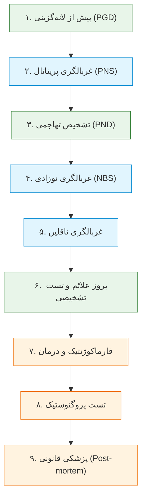
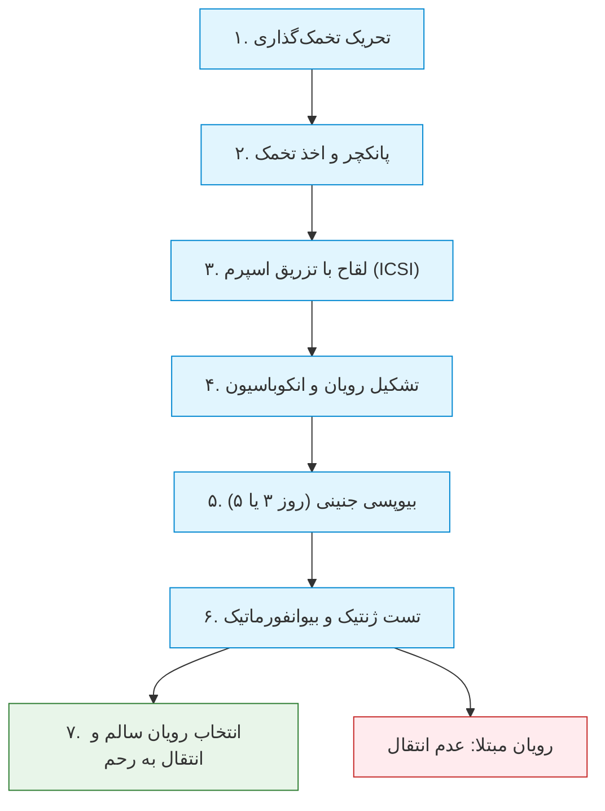
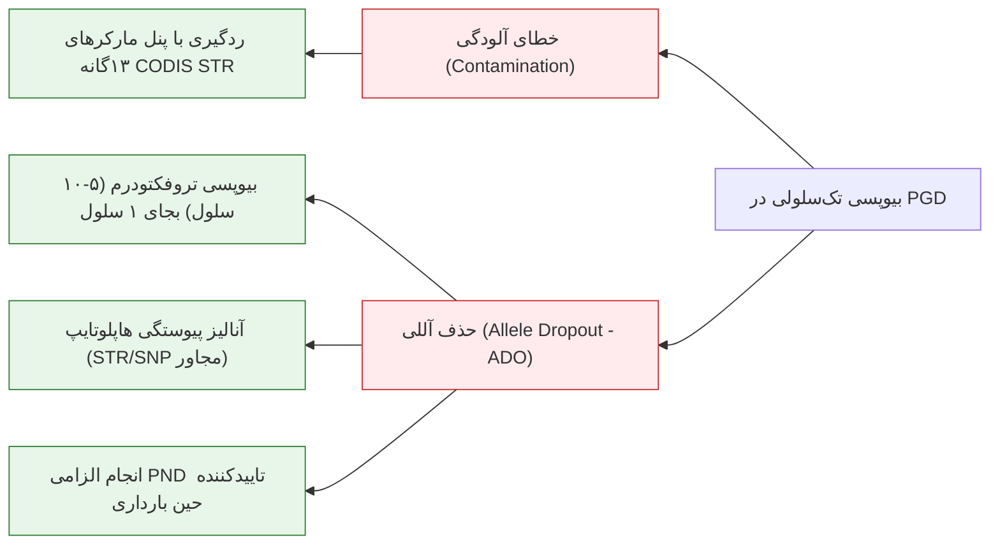
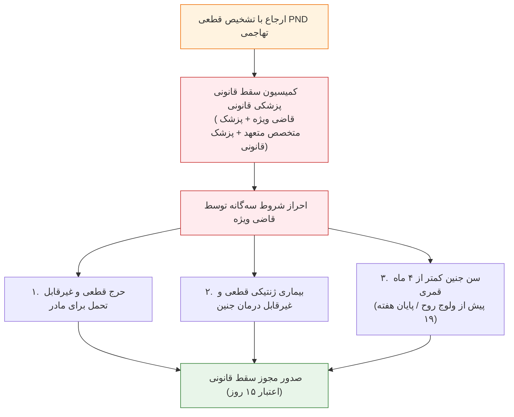

# جلسه ۱۲: تشخیص ژنتیکی پیش از تولد (PND) و پیش از لانه‌گزینی (PGD / PGT)

## ۱. مفاهیم بنیادین و خط سیر تست‌های ژنتیک در طول حیات

> [!info] تعریف تست تشخیصی (Diagnostic Test) در برابر تست استاندارد طلایی (Gold Standard)
> * **Diagnostic Test:** آزمایشی اختصاصی بر روی فرد مشکوک یا دارای علامت بالینی (*Suspected Condition*) جهت اثبات یا رد قطعی بیماری.
> * **Gold Standard Test:** دقیق‌ترین، قطعی‌ترین و معتبرترین متد تشخیصی استاندارد موجود تحت شرایط بالینی بدون محدودیت.

> [!important] تفاوت بنیادین پیامد بالینی غربالگری و تشخیص
> خروجی تست غربالگری منحصراً *تخمین ریسک (Risk Assessment)* است و هرگز مبنای صدور مجوز سقط جنین قرار نمی‌گیرد؛ مجوز قانونی خاتمه بارداری صرفاً بر اساس نتایج مثبت **تست تشخیصی تاییدکننده (PND تهاجمی)** صادر می‌شود.

---

## ۲. تشخیص ژنتیکی پیش از تولد (Prenatal Diagnosis - PND)

> [!info] تعریف PND
> انجام آزمایه‌های ژنتیکی و سیتوژنتیکی تهاجمی در دوران بارداری جهت تعیین قطعی ابتلا یا عدم ابتلای جنین به ناهنجاری‌های کروموزومی یا بیماری‌های تک‌ژنی منحصراً در مواردی که امکان مداخله درمانی یا صدور مجوز سقط قانونی وجود دارد.

### اندیکاسیون‌های پنج‌گانه ارجاع به PND
1. **سابقه فامیلی مثبت بیماری‌های تک‌ژنی:** ناقل بودن قطعی والدین برای بیماری‌های مغلوب (تالاسمی، فیبروز سیستیک، دوشن، SMA).
2. **مدیریت بارداری‌های پرخطر:** سن بالای مادر (۳۵ سال و بالاتر)، سابقه سقط مکرر خودبه‌خودی (RSA ≥ ۲ بار) یا زایمان قبلی با نقص کروموزومی.
3. **گزارش های‌ریسک در غربالگری پریناتال:** مثبت شدن تست‌های سرمی (کواد مارکر) یا NIPT عاری از سلول جنینی.
4. **آنومالی‌های ساختاری در سونوگرافی:** مشاهده مارکرهای دیس‌مورفیک ماژور، هایگروما یا NT ضخیم بالای 3.5mm.
5. **پایش تخصصی سلامت جنین:** در شرایط اضطرار بالینی جهت تعیین استراتژی زایمان و مداخله زودهنگام نوزادی.

### مراحل هشت‌گانه فرآیند PND در کلینیک
1. **مشاوره ژنتیک پیش از تست (Pre-Test Counseling):** تحلیل شجره‌نامه، تخمین ریسک و ارزیابی آمادگی روانی والدین.
2. **انتخاب تست تشخیصی مناسب:** تعیین CVS در برابر آمنیوسنتز بر مبنای سن بارداری.
3. **آماده‌سازی بیمار و اخذ رضایت آگاهانه:** تبیین ریسک سقط ناشی از پروسیجر (0.5% تا 1%) و اخذ رضایت‌نامه رسمی قانونی.
4. **نمونه‌برداری بالینی (Sampling):** انجام بیوپسی زیر گاید سونوگرافی دقیق.
5. **آنالیز آزمایشگاهی:** استخراج DNA، سیتوژنتیک یا بیوشیمی طبق پروتکل استاندارد.
6. **تفسیر و ابلاغ نتایج:** ارائه گزارش مکتوب سه حالته (سالم، ناقل هتروزیگوت، مبتلا هوموزیگوت).
7. **پیگیری و ارجاع بالینی:** معرفی به کمیسیون سقط قانونی پزشکی قانونی در صورت ابتلا.
8. **حمایت روانی و مشاوره‌ای:** مدیریت بحران سوگ و برنامه‌ریزی برای باروری‌های بعدی.

---

## ۳. روش‌های نمونه‌برداری جنینی و تکنیک‌های آزمایشگاهی در PND

### مقایسه تطبیقی متدهای نمونه‌برداری بالینی جنین

| روش نمونه‌برداری | سن بارداری طلایی | بافت و متریال هدف | ریسک القای سقط | کاربرد و محدودیت تشخیصی |
| :--- | :--- | :--- | :--- | :--- |
| **بیوپسی پرزهای کوریونی (CVS)** | هفته ۱۱ تا ۱۳ (حداکثر ۱۴) | پرزهای تروفوبلاست جفت جنینی | حدود ۱٪ (1%) | بهترین زمان برای اقدام قانونی زودهنگام؛ ریسک موزائیسم محدود به جفت (CPM) |
| **آمنیوسنتز (Amniocentesis)** | هفته ۱۵ تا ۱۸ (حداکثر ۲۰) | مایع آمنیوتیک و سلول‌های آمنیوسیت | حدود ۰.۵٪ (0.5%) | استاندارد طلایی و معتبرترین نمونه؛ فرصت محدود تا ضرب‌الاجل سقط قانونی |
| **خون بندناف جنین (Cordocentesis)** | بالای هفته ۲۰ بارداری | خون لنفوسیتی جنین از طناب نافی | ۱٪ تا ۲٪ (1-2%) | تایید سریع ناهنجاری‌های هماتولوژیک/ایمونولوژیک؛ عبور از سقف زمانی سقط قانونی ایران |
| **بیوپسی بافت جنین (Fetal Biopsy)** | نیمه دوم بارداری (>هفته ۱۸) | پوست، عضله یا کبد جنین | بالای ۲٪ (>2%) | بسیار نادر؛ اختصاصی دیستروفی‌های عضلانی فاقد جهش مشخص یا نقایص آنزیمی کبد |

> [!important] قوانین حیاتی شب امتحان در پروسه PND
> 1. **حجم نمونه جنینی فوق‌العاده اندک است:** ظروف نمونه باید بلافاصله با هویت کامل مادر لیبل‌گذاری شوند؛ هرگونه مخدوش شدن لیبل فاجعه‌بار است.
> 2. **احتمال آلودگی با سلول‌های مادری (MCC):** در نمونه‌های CVS و مایع آمنیوتیک، همیشه خطر مخلوط شدن با خون یا بافت دسیدوای مادر وجود دارد؛ **انجام تست کنترل آلودگی مادری با مارکرهای پلی‌مورفیک STR جنین و والدین الزامی است.**
> 3. **شناسایی جهش پیش از بارداری (Must Check in Advance):** پیش از آغاز حاملگی، جهش بیماری‌زا در زوجین باید با روش‌های مولکولی دقیق تعیین شده باشد؛ شناسایی کورکورانه جهش در بازه زمانی بحرانی بارداری غیرممکن است.
> 4. **تایید با دو متد مجزا:** با توجه به اینکه نتیجه آزمایه منجر به سقط جنین می‌شود، تایید ناهنجاری با دو آزمایش مستقل (مثلاً QF-PCR و کاریوتایپ یا توالی‌یابی سانگر) اجباری است.

### محدودیت‌های قطعی PND
* **موانع قانونی و شرعی:** عدم امکان صدور مجوز سقط برای نقایص خفیف یا پس از حلول روح.
* **بیماری‌های چندعاملی (Multifactorial):** ناتوانی در تشخیص اوتیسم، دیابت، اسکیزوفرنی و نقایص تکوین جنسی پلی‌ژنیک.
* **بیماری‌های دیررس (Late-Onset):** مانند هانتینگتون یا سرطان‌های ارثی ژن‌های *BRCA1/2* به علت منع سقط بالینی.
* **آسیب‌های غیرژنتیکی و تراتوژن‌ها:** ناهنجاری‌های ناشی از عفونت‌های رحمی، داروها و توکسین‌ها با تست DNA جنینی قابل شناسایی نیستند.

---

## ۴. تشخیص ژنتیکی پیش از لانه‌گزینی (Preimplantation Genetic Diagnosis - PGD / PGT)

> [!info] تعریف PGD / PGT
> تکنولوژی پیشرفته ارزیابی ژنتیکی رویان‌های ۳ تا ۵ روزه حاصل از لقاح آزمایشگاهی (IVF / ICSI) در محیط برون‌تنی، پیش از انتقال به رحم، به منظور انتقال انحصاری رویان‌های سالم و **پیشگیری قطعی از سقط درمانی**.

### تمایز اصطلاحی PGT بر اساس آخرین راهنماهای بین‌المللی
* **PGT-M (مونوژنیک):** تشخیص اختصاصی بیماری‌های تک‌ژنی توارث‌یافته از والدین (تالاسمی، هموفیلی، هانتینگتون، SMA).
* **PGT-SR (ناهنجاری ساختاری):** غربالگری ترنسلوکاسیون‌های متعادل پدری یا مادری جهت ممانعت از تشکیل رویان‌های نامتعادل.
* **PGT-A / PGS (آنیوپلوئیدی):** غربالگری کروموزومی تریزومی‌ها و مونوزومی‌ها در زوجین نابارور، سن بالای مادر یا سقط مکرر بدون نقص تک‌ژنی قبلی.

### اندیکاسیون‌های بالینی و غیرپزشکی PGD
1. **ممنوعیت قانونی یا مخالفت اعتقادی با سقط درمانی:** زوجینی که به دلیل باورهای مذهبی حاضر به انجام سقط جنین نیستند.
2. **سابقه سقط‌های مکرر ناشی از جابجایی‌های کروموزومی (RSA > 3):** حضور ترنسلوکاسیون روبرتسونین یا متقابل در یکی از والدین.
3. **تطابق بافت‌شناسی (HLA Typing):** انتخاب جنین سالمی که از نظر آنتی‌ژن‌های HLA با فرزند مبتلا به بیماری خونی پیشین (مانند تالاسمی ماژور) ۱۰۰٪ منطبق باشد تا بتوان پس از تولد با سلول‌های بنیادی بندناف پیوند مغز استخوان انجام داد (*Savior Sibling*).
4. **انتخاب جنسیت جنین (Gender Selection):** پیشگیری قطعی از تولد فرزندان پسر در اختلالات وابسته به X مغلوب وخیم و غیرقابل ردگیری جهش (یا انگیزه‌های خانوادگی غیراورژانس).

---

## ۵. انواع بیوپسی جنین، تکنیک‌های ژنتیکی و دام‌های تکنیکی PGD

### مقایسه تطبیقی متدهای سه‌گانه بیوپسی جنین

| روش بیوپسی | سن رویان / زمان اقدام | سلول برداشتی | مزایا و ارزش بالینی | معایب و ریسک تکنیکی |
| :--- | :--- | :--- | :--- | :--- |
| **جسم قطبی (Polar Body)** | بلافاصله پس از تخمک‌گذاری و لقاح | اولین و دومین Polar Body | غیرتهاجمی‌ترین روش برای رویان؛ عدم دستکاری ساختار جنین | **صرفاً حاوی ژنوم مادری است**؛ ژنوم پدری و خطاهای میوز مذکر را نشان نمی‌دهد |
| **بلاستومر (Cleavage Stage)** | روز سوم پس از لقاح (رویان ۶ تا ۸ سلولی) | ۱ تا ۲ سلول بلاستومر | رویکرد سنتی و ایجاد زمان کافی برای انتقال بدون فریز | آسیب نسبی به پتانسیل تکاملی رویان؛ **ریسک خطای بسیار بالا ناشی از موزائیسم جنینی** |
| **تروفکتودرم (Trophectoderm - TE)** | **روز پنجم تا ششم (مرحله بلاستوسیست)** | **۵ تا ۱۰ سلول تروفکتودرم (جفت آینده)** | **استاندارد طلایی کنونی**؛ عدم دستکاری توده سلولی داخلی (ICM)؛ دقت تشخیصی حداکثری | نیازمند پلتفرم انجماد شیشه‌ای (Vitrification) رویان و انتقال در سیکل بعدی |

> [!danger] تله امتحانی: چرا کاریوتایپ نوری در PGD غیرممکن است؟
> برای تهیه کاریوتایپ استاندارد، لنفوسیت‌ها باید حداقل ۷۲ ساعت در انکوباتور کشت داده شده و صدها سلول در فاز متافاز متوقف شوند. در PGD منحصراً **۱ سلول اینترفازی** (یا چند سلول تروفکتودرم) در اختیار است که زمان و امکان کشت و ورود به میتوز ندارد؛ لذا آنالیز کروموزومی در PGD منحصراً با **FISH اینترفازی**، **Array-CGH** یا **NGS دوزاژ کروموزومی** انجام می‌شود و کاریوتایپ متداول مطلقاً جایگاهی ندارد.

### ضرب‌الاجل زمانی و خطر هچینگ (Hatching)
در بیوپسی بلاستومر روز ۳، آزمایشگاه ژنتیک حداکثر **کمتر از ۲۴ ساعت** فرصت دارد تا جواب را گزارش دهد. چنانچه جنین تا روز ۵-۶ در محیط کشت باقی بماند و هچینگ روی دهد (شکسته شدن زونا پلوسیدا و خروج رویان)، امکان انتقال امن رویان تازه به رحم از بین رفته و جنین باید فریز شود.

### پدیده فاجعه‌بار حذف آللی (Allele Dropout - ADO)
> [!warning] تعریف و پاتوفیزیولوژی ADO
> به دلیل وجود تنها دو رشته دیپلویید DNA در یک سلول منفرد، حین استخراج DNA یا چرخه آغازین تکثیر PCR، ممکن است یکی از دو آلل ژنی هدف بر اثر شکست فیزیکی یا عدم اتصال پرایمر تکثیر نشود.
> * **پیامد در بیماری‌های اتوزومال غالب (AD):** اگر آلل جهش‌یافته دچار ADO شود و تکثیر نشود، رویانِ مبتلا به اشتباه **سالم هوموزیگوت** تشخیص داده شده و جنین بیمار به مادر منتقل می‌شود!
> * **راهکارهای مقابله با ADO:** 
>   1. بیوپسی چندسلولی تروفکتودرم (TE) به جای تک‌سلول.
>   2. تعیین فاز ژنتیکی با نشانگرهای چندشکلی STR و SNPهای بالادست و پایین‌دست ژن (*Linkage / Haplotype-based analysis*).
>   3. انجام PND تاییدی (آمنیوسنتز) پس از استقرار بارداری حاصل از PGD.

---

## ۶. کنترل کیفی و مارکرهای ۱۳‌گانه CODIS STR

به دلیل ماهیت تک‌سلولی PGD و خطر نشت سلول‌های کومولوس، سلول‌های اپیتلیال دست و ترشحات کادر آزمایشگاه، کنترل کیفی ژنتیکی اجباری است:
* **Short Tandem Repeats (STRs):** توالی‌های تکراری ۲ تا ۶ جفت‌بازی که حدود ۳٪ از ژنوم انسان را تشکیل داده و پلی‌مورفیسم بسیار بالایی در جمعیت دارند.
* **مارکرهای سیزده‌گانه CODIS:** لوکوس‌های استاندارد بین‌المللی پلیس فدرال (شامل *TPOX, D3S1358, FGA, D5S818, CSF1PO, D7S820, D8S1179, TH01, VWA, D13S317, D16S539, D18S51, D21S11* همراه با ژن تعیین جنسیت *Amelogenin*).
* **کاربرد در PND و PGD:** تعیین دقیق منشأ DNA جنینی و تمایز قطعی ژنوم جنین از سلول‌های مادری (MCC) یا آلودگی‌های خارجی.

---

## ۷. مبانی فقهی و حقوقی سقط درمانی در ایران (قانون جوانی جمعیت)

براساس مواد ۵۳، ۵۴ و ۵۶ **قانون حمایت از خانواده و جوانی جمعیت (مصوب ۱۴۰۰)**:

### نکات کلیدی مواد قانونی مرتبط با ژنتیک پزشکی
* **ماده ۵۳:** عدم ارجاع مادر به غربالگری تخلف انتظامی نیست. غربالگری فقط با درخواست یکی از والدین و تجویز پزشک متخصص مجاز است؛ تجویز نباید بر پایه شایعات بلکه مبتنی بر شواهد علمی باشد.
* **ماده ۵۴:** ثبت تمامی داده‌های باروری، غربالگری و سقط در سامانه ملی وزارت بهداشت اجباری است.
* **ماده ۵۶:** سقط غیرقانونی جرم عمومی بوده و مستوجب قصاص، دیه، حبس و ابطال دائم پروانه طبابت است.
* **تعریف فقهی و پزشکی ولوج روح:** دمیده شدن روح بر اساس موازین فقهی معادل **گذشت ۴ ماه قمری از لقاح (معادل ۱۲۰ روز سن جنین یا پایان هفته ۱۹ بارداری بر مبنای سونوگرافی دقیق اول)** است. وجود حرکات غیرارادی جنین، ضربان قلب یا مشاهده دست و پا به تنهایی اماره ولوج روح نیست و سقط تا پیش از ۱۲۰ روزگی در صورت عسر و حرج جایز است.

---

## ۸. حل کامل سناریوی بالینی امتحانی (کلاس درس)

### شرح سناریوی بالینی (اسلاید ۳۷ و ۳۸)
زوج ۲۹ ساله با سابقه تولد فرزند اول ۴ ساله (سارا) مبتلا به **تالاسمی ماژور وابسته به تزریق خون** با جهش‌های تاییدشده پدری ($IVS1-110$) و مادری ($IVS1-1$) مراجعه کرده‌اند. در سیکل PGT-M / IVF، تعداد ۱۲ تخمک برداشت شده، ۸ رویان به مرحله بلاستوسیست رسیده و بیوپسی تروفکتودرم (TE) انجام شده است.

### جدول نتایج آزمایشگاهی هشت رویان

| شماره رویان | جهش پدری (IVS1-110) | جهش مادری (IVS1-1) | وضعیت هاپلوتایپ مارکرها | وضعیت تفسیری رویان |
| :--- | :--- | :--- | :--- | :--- |
| **۱** | **حضور دارد** | **حضور دارد** | مشابه سارا | **تالاسمی ماژور (کامپاند هتروزیگوت)** |
| **۲** | حضور دارد | منفی (سالم) | هتروزیگوت پدری | ناقل تالاسمی (مینور) سالم بالینی |
| **۳** | منفی (سالم) | حضور دارد | هتروزیگوت مادری | ناقل تالاسمی (مینور) سالم بالینی |
| **۴** | **منفی (سالم)** | **منفی (سالم)** | **هاپلوتایپ کاملاً نرمال** | **کاملاً سالم (فاقد جهش)** |
| **۵** | منفی (سالم) | حضور دارد | هتروزیگوت مادری | ناقل تالاسمی (مینور) سالم بالینی |
| **۶** | منفی (مشکوک به ADO) | حضور دارد | هتروزیگوت پدری در مارکر مجاور | ناقل مینور (تکثیر ناقص آلل پدری / ADO) |
| **۷** | عدم تکثیر | عدم تکثیر | تشکیل نشد / فاقد پاسخ | غیرقابل تفسیر تکنیکی |
| **۸** | منفی (سالم) | حضور دارد | هتروزیگوت مادری | **ناقل مینور + موزائیسم ۳۰٪ تریزومی ۱۶** |

---

### پاسخ تشریحی سوالات سناریو و تکالیف استاد

#### سوال ۱ سناریو: تعیین رویان‌های انتخابی جهت انتقال و اولویت‌بندی
* **اولویت نخست (First Choice): رویان شماره ۴**
  * *علت:* این رویان هم از نظر بررسی مستقیم جهش‌ها و هم از نظر تحلیل هاپلوتایپ نشانگرهای متصل مجاور، هر دو آلل سالم را از پدر و مادر دریافت کرده است؛ جنین کاملاً سالم و غیرناقل بوده و فرزندی با ژنوتیپ نرمال به بار می‌آورد.
* **اولویت دوم (Second Choice): رویان‌های شماره ۲ و ۳ و ۵**
  * *علت:* این سه رویان ناقل هتروزیگوت (تالاسمی مینور) هستند. از نظر بالینی هیچ‌گونه علامت بیماری کم‌خونی ماژور نداشته، به ترانسفیوژن خون نیاز ندارند و از طول عمر و سلامت کاملاً طبیعی برخوردار خواهند بود.
* **رویان‌های غیرقابل انتقال و مردود:**
  * *رویان ۱:* مبتلا به تالاسمی ماژور (مشابه سارا).
  * *رویان ۶:* به دلیل رخداد نقص تکثیر آللی (ADO) پدری، اطمینان مولکولی قطعی ندارد.
  * *رویان ۷:* عدم تکثیر و نقص فنی در تست.
  * *رویان ۸:* دارا بودن آنیوپلوئیدی موزائیک کروموزوم ۱۶ که خطر سقط یا ناهنجاری رشدی به همراه دارد.

#### سوال ۲ سناریو: پنج تفاوت بنیادین PND و PGD و دلایل ارجحیت PGD در این خانواده
1. **زمان اقدام:** PGD پیش از لانه‌گزینی و در روز ۳ تا ۵ رویانی انجام می‌شود؛ PND پس از استقرار جنین در هفته ۱۱ تا ۱۸ بارداری صورت می‌گیرد.
2. **پیامد تشخیصی در رویان مبتلا:** در PGD هیچ‌گونه سقط جنین و بارداری تروماتیک رخ نمی‌دهد و رویان در محیط کشت آزمایشگاه کنار گذاشته می‌شود؛ در PND جنین مبتلا نیازمند کورتاژ و سقط درمانی تهاجمی است.
3. **متریال بیولوژیک مورد بررسی:** PGD با ۵ تا ۱۰ سلول تروفکتودرم رویان برون‌تنی کار می‌کند؛ PND با صدها هزار سلول پرز جفتی یا مایع آمنیوتیک مواجه است.
4. **ریسک تکنیکی ADO:** نقص حذف آللی (ADO) معضل اختصاصی PGD است، در حالی که در PND به علت وفور DNA چنین خطایی وجود ندارد.
5. **نیاز به لقاح کمکی:** PGD اجباراً متکی بر فرآیند گران‌قیمت IVF / ICSI است؛ PND در بارداری طبیعی (نچرال) انجام می‌گردد.
* **علت انتخاب PGD توسط این زوج:** ۱) اضطراب و ترومای روانی شدید مادر از سقط تهاجمی پس از تجربه تولد فرزند ماژور پیشین. ۲) پیشگیری از سقط درمانی و اطمینان از آغاز بارداری با رویان سالم. ۳) امکان تطابق همزمان HLA جنین جدید با سارا در پلتفرم PGD جهت نجات خواهر با پیوند خون بندناف.

---

#### پاسخ به تکالیف پایانی درس (Home Works)

##### تکلیف ۱: بررسی اخلاقی PND و PGD در بیماری‌های با شروع دیررس (مانند هانتینگتون)
* **در متد PND:** انجام PND برای بیماری هانتینگتون به لحاظ اخلاقی و قانونی با چالش جدی مواجه است؛ زیرا فرد تا سن ۴۰ تا ۵۰ سالگی زندگی کاملاً سالم و طبیعی خواهد داشت و سقط جنین سالمی که دهه‌ها بعد علامت‌دار می‌شود، سلب حق حیات تلقی شده و مراجع قانونی مجوز سقط صادر نمی‌کنند.
* **در متد PGD:** کاملاً اخلاقی، استاندارد و توصیه‌شده است. با روش‌های غیرمستقیم (*Exclusion Testing*) می‌توان بدون افشای ابتلای والدِ ناقل، رویان‌های فاقد هاپلوتایپ پرخطر را جهت لانه‌گزینی برگزید و از چرخه تولد بیماران پیشگیری نمود بدون آنکه جنین زنده‌ای سقط شود.

##### تکلیف ۲: بیماری‌های شایع مجاز برای PND در برابر موارد انحصاری PGD در ایران
* **۱۰ بیماری شایع مجاز برای PND در ایران (دارای تاییدیه قانونی سقط):**
  1. بتا-تالاسمی ماژور
  2. آتروفی عضلانی نخاعی (SMA تیپ ۱ و ۲)
  3. دیستروفی عضلانی دوشن (DMD)
  4. سندرم داون (تریزومی ۲۱) و تریزومی‌های ۱۸ و ۱۳
  5. فیبروز سیستیک (CF فرم‌های شدید ریوی-گوارشی)
  6. آنسفالوسل و نقایص باز لوله عصبی (NTD)
  7. هیپرپلازی مادرزادی آدرنال (CAH)
  8. بیماری سلول داسی‌شکل (Sickle Cell Disease)
  9. نقص ایمنی مرکب شدید (SCID)
  10. موکوپلی‌ساکاریدوزها (مانند MPS تیپ ۱ - سندرم هورلر)

* **۵ اختلال که مجوز PND (سقط قانونی) ندارند و منحصراً با PGD مدیریت می‌شوند:**
  1. سقط مکرر ایدیوپاتیک (مانند جابجایی کروموزومی)
  2. غربالگری کلی آنوپلوئیدی در موارد ناباروری (PGS/PGT-A)
  3. بیماری با شروع دیررس (مثل هانتیگتون یا آلزایمر زودرس)
  4. تعیین جنسیت
  5. تعیین اختصاصی جنسیت یا انتخاب جنین منطبق بر HLA فرزند قبلی بیمار (*Savior Sibling*)
