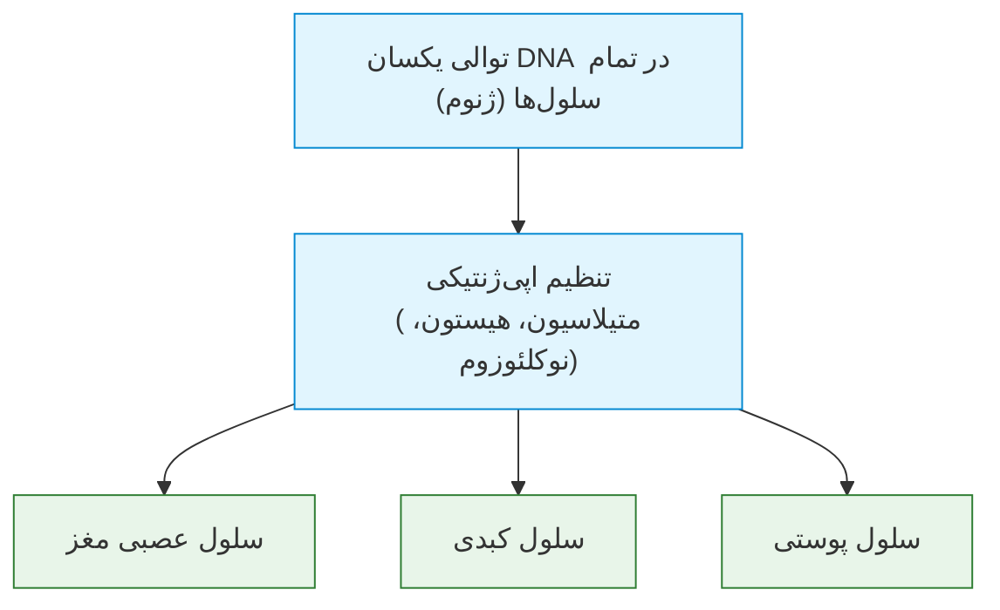
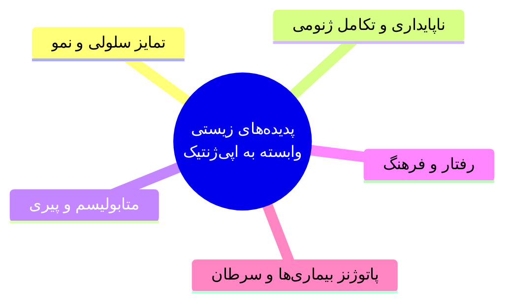
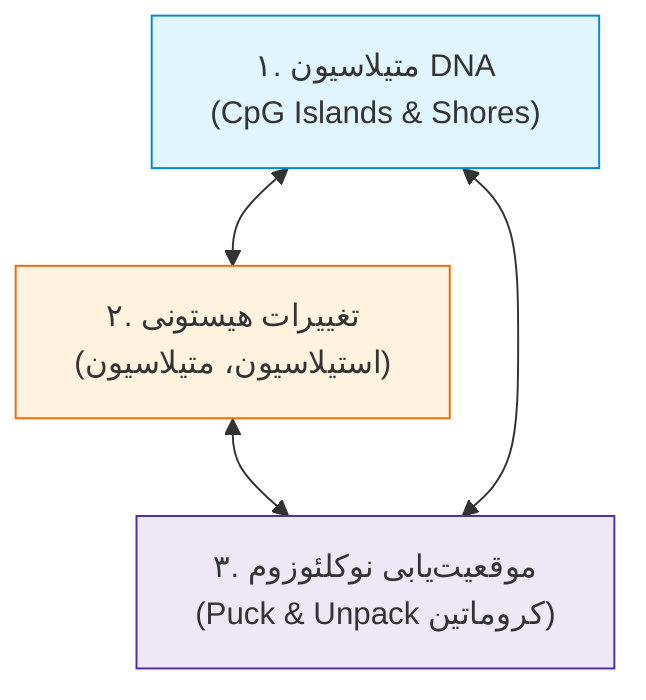
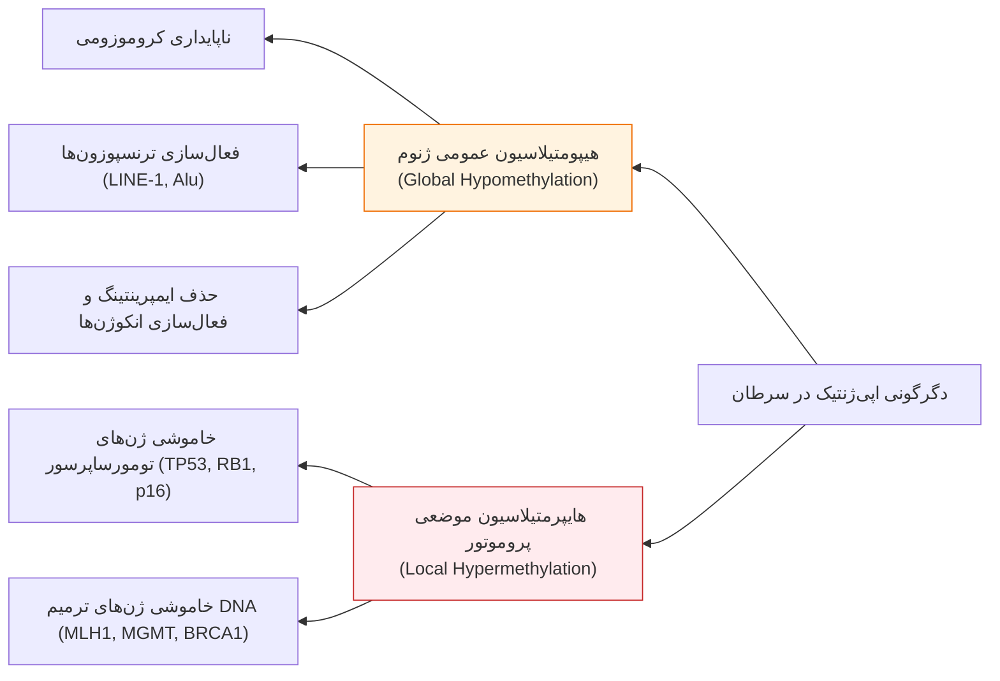
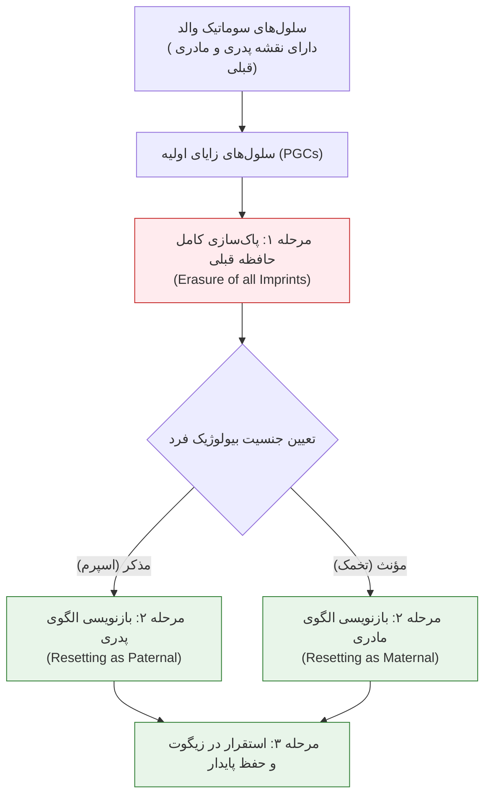
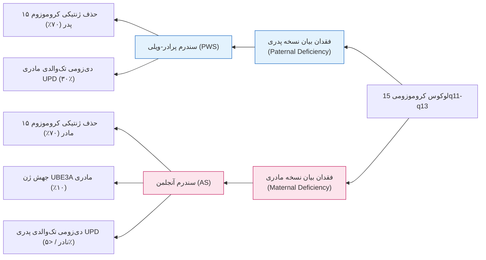

# جلسه ۱۳: اپی‌ژنتیک، ایمپرینتینگ ژنومی و بیماری‌های انسان (Epigenetics & Genomic Imprinting)

## ۱. نارسایی ژنتیک کلاسیک و لزوم پیدایش اپی‌ژنتیک

> [!info] تعریف اپی‌ژنتیک (Epigenetics)
> تغییرات ارث‌پذیر و پایدار در **بیان ژن (Gene Expression)** و فنوتیپ سلول یا موجود زنده بدون هرگونه دگرگونی در **توالی نوکلئوتیدی DNA (Sequence)**.

### معماهایی که ژنتیک محض قادر به حل آن‌ها نبود
1. **تمایز سلولی در نمو جنینی (Conrad Waddington 1942):** یک تخمک لقاح‌یافته منفرد با ژنوم کاملاً یکسان چگونه صدها رده سلولی با ریخت‌شناسی و عملکردهای متمایز (کبد، مغز، پوست) ایجاد می‌کند؟
2. **تنوع گسترده فنوتیپی جمعیت:** بیش از **99.9%** توالی ژنوم تمام انسان‌ها همسان است؛ تفاوت اندک کمتر از 0.1% نوکلئوتیدی هرگز توجیه‌گر این حجم از تمایزات ظاهری و استعداد بیماری‌ها نیست.
3. **دوقلوهای تک‌تخمی (MZ Twins) و کلون‌ها:** افراد دارای **100% ژنوم یکسان**، فنوتیپ، رفتار، طول عمر و استعداد متفاوتی در ابتلا به بیماری‌ها نشان می‌دهند.

### تشبیه بصری فونت در زبان DNA
توالی نوکلئوتیدی همانند **حروف الفبا (Letters)** ثابت است ($CAGT$)؛ اپی‌ژنتیک همانند **فونت، سایز، ضخامت و رنگ** این حروف است که خوانش و بیان متن را بدون دستکاری املا تغییر می‌دهد.

---

## ۲. دسته‌بندی نوین بیماری‌ها و مفهوم اپی‌موتاسیون

> [!warning] تعریف بیماری‌های ژنتیکی در برابر اپی‌ژنتیکی
> * **بیماری ژنتیکی:** ناشی از نقص در توالی نوکلئوتیدی DNA یا ساختار/تعداد کروموزوم‌ها.
> * **بیماری اپی‌ژنتیکی:** ناشی از ناهنجاری در اپی‌ژنوتیپ و انحراف بیان ژن در غیاب نقص نوکلئوتیدی.
> * **بیماری‌های ترکیبی (MEGDI):** مدل اختلالات ژنتیکی-اپی‌ژنتیکی آمیخته دونوو و توارثی (مانند اوتیسم).

### قاعده نابهنجاری اپی‌ژنتیک (Epigenetic Dysregulation)
* **تایپ نادرست در مکان نادرست (Wrong Type at Wrong Place):** متیلاسیون نابجا یا هیپومتیلاسیون یک ژن در بافتی که نباید رخ دهد (منجر به سرطان).
* **تایپ نادرست در زمان نادرست (Wrong Type at Wrong Time):** اختلال در زمان‌بندی خاموشی یا فعال‌سازی ژن‌ها در مراحل خاص رشد و نمو.

---

## ۳. مکانیسم‌های سه‌گانه کنترل اپی‌ژنتیک

### ۱. متیلاسیون DNA (DNA Methylation)
* انتقال کووالانسی یک گروه متیل از دهنده **S-آدنوزیل متیونین (SAM)** به **کربن شماره ۵ سیتوزین** توسط آنزیم‌های **DNA متیل‌ترانسفراز (DNMT)**.
* تشکیل باز **5-متیل‌سیتوزین (5-mC)** منحصراً در دی‌نوکلئوتیدهای متوالی **CpG**.
* **جزایر CpG (CpG Islands):** قطعاتی با طول بالای 200bp و نسبت نوکلئوتیدی $G+C \ge 50\%$ که در نواحی تنظیمی و پروموتور ژن‌ها واقع شده‌اند.
* **سواحل جزایر CpG (CpG Island Shores):** نواحی با تراکم کمتر در فاصله 1kb تا 2kb بالادست پروموتور که در خاموشی اختصاصی بافتی ژن‌ها دخالت دارند.

### خانواده آنزیم‌های متیل‌ترانسفراز (DNMT Family)
1. **DNMT3a و DNMT3b:** متیلاسیون نوزاد یا دونوو (**De novo Methylation**)؛ نشاندن نخستین گروه‌های متیل بر DNA نامتیله در نمو جنینی.
2. **DNMT1:** متیلاسیون نگهدارنده (**Maintenance Methylation**)؛ کپی‌برداری الگوی متیلاسیون از رشته مادری به رشته نوساز در چرخه همانندسازی.
3. **DNMT2:** متیلاسیون RNAهای ناقل (tRNA).
4. **DNMT3L:** پروتئین تنظیمی فاقد فعالیت کاتالیتیک مستقل؛ محرک DNMT3a/b در فرآیند ایمپرینتینگ گامت‌ها.
* **مهارکننده دارویی 5-آزاسیتیدین (5-Azacytidine):** آنالوگ سیتوزین با اتم نیتروژن در کربن ۵؛ مهارکننده غیرقابل بازگشت DNMT و داروی بازفعال‌کننده ژن‌های سرکوب‌شده توموری در شیمی‌درمانی.

### رخدادهای سلولی متعاقب متیلاسیون DNA
* **سد فیزیکی:** ممانعت از اتصال فاکتورهای عمومی رونویسی (TFs) به پروموتور.
* **جذب پروتئین‌های سرکوبگر (MBDs):** پروتئین‌های دارای موتیف اتصال به متیل‌سیتوزین (مانند MeCP2) کمپلکس‌های داستیلاز هیستون را فراخوانده و رونویسی را سرکوب می‌کنند.
* **تراکم کروماتین:** القای ساختار غیرفعال هتروکروماتینی.
* **موتاسیون خودبه‌خودی C به T (C>T Transition):** سیتوزین متیله تمایل شدید به دآمیناسیون خودبه‌خودی و تبدیل به تیمین (T) دارد (عامل اصلی جهش‌های نقطه‌ای ژنوم).

---

## ۴. ساعت اپی‌ژنتیک (Epigenetic Clock) و متیلاسیون در تومورزایی

> [!info] ساعت اپی‌ژنتیکی هورواث (Horvath's Epigenetic Clock)
> شاخص تخمین سن زیستی (Biological Age) مبتنی بر سطح متیلاسیون نقاط اختصاصی ژنوم از بدو تولد تا ۱۰۰ سالگی؛ سن زیستی بافت‌های مختلف یک فرد یکسان نیست.

* سن زیستی بافت پستان در زنان حدود **۱۰ تا ۱۵ سال پیرتر** از سن گاه‌شماری (Chronological) است.
* سن زیستی بافت معده در مردان بالغ حدود **۱۰ سال پیرتر** از سن بیولوژیک عمومی بدن است.

### عوامل تغذیه‌ای و محیطی تغییردهنده متیلاسیون
الکل، فولات، ویتامین A، متیونین، کولین، سلنیوم، روی (Zinc)، آرسنیک، فیبر، ژنستئین، دایدزئین، اکول و کومسترول مستقیماً استخر گروه‌های متیل (SAM) و راندمان DNMT را دستخوش نوسان می‌سازند.

---

## ۵. تغییرات هیستونی و ساختار کروماتین

* **نوکلئوزوم (Nucleosome):** واحد پایه تکراری کروماتین؛ شامل اکتامر پروتئینی (دو نسخه از H2A, H2B, H3, H4) با 147bp رشته DNA تنیده‌شده به دور آن و هیستون رابط **H1**.
* **موقعیت‌یابی نوکلئوزوم (Nucleosome Positioning):** پدیده باز و بسته شدن فنر کروماتین (Packaging/Unpackaging). قرارگیری مستقیم نوکلئوزوم بر جایگاه شروع رونویسی (TSS)، سدی فیزیکی در برابر فاکتورهای رونویسی ایجاد می‌کند.

### مقایسه یوکروماتین و هتروکروماتین

| شاخص مولکولی و عملکردی | یوکروماتین (Euchromatin) | هتروکروماتین (Heterochromatin) |
| :--- | :--- | :--- |
| **تراکم فیزیکی کروماتین** | باز، گسترده، غیراستراحت (**Unpacked / Relaxed**) | متراکم، فشرده، مارپیچ (**Packed / Condensed**) |
| **وضعیت متیلاسیون DNA** | **پایین (Low Methylation)** در جزایر CpG | **بالا (High Methylation)** و هایپرمتیله |
| **استیلاسیون هیستون‌ها** | **بالا (Hyperacetylated)** با آنزیم‌های HAT | **بسیار اندک (Deacetylated)** با آنزیم‌های HDAC |
| **فسفوریلاسیون هیستون‌ها** | بالا در باقی‌مانده‌های آمینواسیدی | بسیار پایین یا غایب |
| **پتانسیل رونویسی** | **فعال رونویسی (Actively Transcribed)** | **خاموش بیولوژیک (Transcriptionally Inactive)** |

> [!tip] اپی‌ژنتیک دوقلوهای تک‌تخمی با گذر زمان
> در سن ۳ سالگی، متیلاسیون 5-mC و استیلاسیون هیستون‌های H3 و H4 دوقلوهای MZ تقریباً **۱۰۰٪ منطبق** است؛ اما در ۵۰ سالگی تحت اثر واگرایی فاکتورهای محیطی، اپی‌ژنوتیپ آن‌ها کاملاً **نامتقارن** می‌گردد.

---

## ۶. جدول مقایسه‌ای ناهنجاری‌های اپی‌ژنتیک در بیماری‌های انسان

| دسته بیماری | ناهنجاری اپی‌ژنتیک شاخص | پیامد بیولوژیک | نمونه ژن‌های درگیر و تظاهرات بالینی |
| :--- | :--- | :--- | :--- |
| **سرطان‌ها (Cancers)** | هایپرمتیلاسیون پروموتور | سرکوب رونویسی ژن‌های سرکوبگر تومور | ژن *MLH1* (کولون و اندومتر)، *BRCA1* (پستان و تخمدان)، *MGMT* (گلیوما)، *p16INK4a* |
| **سرطان‌ها (Cancers)** | هیپومتیلاسیون پروموتور | افزایش غیرطبیعی بیان انکوژن‌ها | انکوژن *MASPIN* (پانکراس)، *SNCG* (پستان)، ژن *MAGE* (ملانوما) |
| **سرطان‌ها (Cancers)** | تغییرات دم هیستونی | تغییر سازماندهی هتروکروماتین | افت $H3K16ac$ و $H4K20me3$، افزایش $H3K9me$ و خاموشی ژن *CDKN1A/p21* |
| **بیماری‌های نورولوژیک** | نقص متیلاسیون ژنوم | ترنسپوزیشن و ناپایداری ژنومی | سندرم *ATRX* (آلفا تالاسمی و عقب‌ماندگی ذهنی وابسته به X)، آلزایمر |
| **بیماری‌های نورولوژیک** | اختلال استیلاسیون/متیلاسیون | تخریب پیشرونده نورونی | پارکینسون، هانتینگتون، آتاکسی فردریش (تکرار $GAA$ ژن فراتاکسین) |
| **بیماری‌های اتوایمیون** | هیپومتیلاسیون نوکلئوتیدی | اوراکسپرشن سایتوکاین‌ها و گیرنده‌ها | ژن‌های *ITGAL (CD11a)*، *CD70* و *PRF1* در بیماری لوپوس (SLE) و آرتریت روماتوئید |
| **بیماری‌های اتوایمیون** | نقص در متیلاسیون سانتومری | ناپایداری کروموزومی تکرارها | سندرم *ICF* ناشی از جهش بی‌آلل ژن متیل‌ترانسفراز *DNMT3B* |

---

## ۷. ایمپرینتینگ ژنومی (Genomic Imprinting)

> [!info] تعریف ایمپرینتینگ ژنومی
> یک پدیده اپی‌ژنتیکی و زیرمجموعه اختصاصی که در آن بیان یا خاموشی آلل یک ژن دیپلوئید منحصراً وابسته به **والد انتقال‌دهنده (Parent-of-Origin)** بوده و به شکل **مونوآللیک غیرتصادفی (Non-random Monoallelic)** تظاهر می‌یابد.

### تمایز بیان تک‌آللی تصادفی در برابر ایمپرینتینگ
* **بیان تک‌آللی تصادفی (Random Monoallelic):** ژن‌های ایمونوگلوبولین (Ig)، رسپتور سلول T (TCR)، گیرنده‌های بویایی و غیرفعال‌سازی کروموزوم X؛ خاموشی هر آلل به صورت کاملاً تصادفی و مستقل از منشأ پدری/مادری رخ می‌دهد.
* **بیان تک‌آللی ایمپرینتد (Non-random Imprinted):** تنها در کمتر از **۱٪ تا ۲٪ ژن‌های ژنوم** رخ داده و خاموشی به طور قطعی بر مبنای والد منشأ تعیین می‌گردد.

> [!important] قانون پاک‌سازی و تنظیم مجدد (Erasure & Resetting)
> یک مرد حامل آلل مادری خاموش، هنگام اسپرماتوژنز کل حافظه اپی‌ژنتیک سلول‌های جنسی اولیه را پاک‌سازی کرده و آن آلل مادری را با **نقشه فعال/خاموش پدری** به فرزندانش (دختر یا پسر) منتقل می‌نماید.

---

## ۸. سندرم‌های پرادر-ویلی و آنجلمن (لوکوس 15q11-q13)

لوکوس $15q11-q13$ حاوی ژن‌های ایمپرینتد حیاتی در عملکرد عصبی-متابولیک است:
* **ژن‌های فعال در کروموزوم پدری:** ژن‌های *SNRPN*، کلاستر *snoRNA* و *NDN* (آلل مادری به طور طبیعی متیله و خاموش است).
* **ژن فعال در کروموزوم مادری:** ژن *UBE3A* (آلل پدری در سلول‌های عصبی مغز به طور طبیعی متیله و خاموش است).

### علائم بالینی اختصاصی سندرم پرادر-ویلی (PWS)
* هایپوتونی شدید دوره نوزادی با ناتوانی در مکیدن شیر (Feeding problems).
* اشتهای سیری‌ناپذیر و پرخوری مفرط (Hyperphagia) از ۲ سالگی به بعد که به چاقی مفرط (Morbid Obesity) و دیابت نوع ۲ ختم می‌شود.
* هایپوگنادیسم و تحلیل اندام‌های جنسی، کوتاهی قد، دستان و پاهای کوچک، عقب‌ماندگی ذهنی خفیف تا متوسط.

### علائم بالینی اختصاصی سندرم آنجلمن (AS - Happy Puppet)
* عقب‌ماندگی ذهنی بسیار شدید با فقدان مطلق تکلم (Absent Speech).
* خنده‌ها و لبخندهای مداوم، نامتناسب و سرخوشانه (Happy disposition).
* حرکات آتاکسیک و دست‌وپاچلفتی دلقک‌مانند با لرزش دست‌ها (Ataxia / Tremor).
* میکروسفالی، فک پایین برجسته (Prominent mandible)، تشنج‌های صرعی مقاوم به درمان.

> [!danger] تله امتحانی تمایز دلیشن ژنتیکی از دی‌زومی تک‌والدی (UPD)
> * **در حذف کروموزومی (Deletion - ۷۰٪):** توالی DNA فیزیکاً قطع شده است؛ نقص **ژنتیکی** است.
> * **در دی‌زومی تک‌والدی (UPD - ۳۰٪ در PWS):** هر دو کروموزوم ۱۵ از مادر به ارث رسیده و توالی ساختاری کاملاً نرمال است؛ بیماری به علت **خاموشی اپی‌ژنتیک هر دو آلل** مادری بروز یافته و نقص **اپی‌ژنتیکی** محض است.

---

## ۹. اختلال طیف اوتیسم (ASD) و ایمپرینتینگ لوکوس ۱۵

* **شواهد ایمپرینتینگ:** مضاعف‌شدگی ناحیه $15q11-q13$ یا واژگونی مضاعف آن منحصراً زمانی که از **منشأ مادری (Maternal origin)** به ارث برسد منجر به اوتیسم می‌شود؛ دوپلیکاسیون نسخه پدری فنوتیپ اوتیسم ایجاد نمی‌کند.
* **شواهد ژنتیک کلاسیک:** تطابق ابتلای دوقلوهای تک‌تخمی بسیار بالاتر از دوقلوهای دو‌تخمی است، شیوع در جنس مذکر **۴ برابر** جنس مؤنث ($4:1$) است، و حداقل ۱۰ تا ۲۰ جایگاه ژنی مستقل در اتیولوژی آن شناسایی شده است.

### مدل اتیولوژی مگدی (MEGDI Model)
مدل بیماری‌زایی مختلط در بیماری‌های پیچیده چندعاملی و نورودولوپمنتال:
$$\text{MEGDI} = \text{Mixed} \textbf{ E}\text{pigenetic} \ \& \ \textbf{G}\text{enetic} \ \& \ \textbf{D}\text{e novo} \ \& \ \textbf{I}\text{nherited}$$
برآیند اثر متقابل جهش‌های نوکلئوتیدی توارثی/دونوو همگام با دگرگونی‌های اپی‌ژنتیک ناشی از محیط (استرس، تغذیه، عفونت) فنوتیپ نهایی بیماری را خلق می‌کند.

---

## ۱۰. چشم‌انداز درمان‌های نوین اپی‌ژنتیک (Epigenetic Therapy)

1. **اپی‌ژنتیک‌تراپی سرطان:** تجویز مهارکننده‌های DNMT (نظیر 5-Azacytidine و Decitabine) و مهارکننده‌های هیستون داستیلازها (HDACi نظیر Vorinostat) جهت **بازفعال‌سازی مجدد ژن‌های سرکوبگر تومور و آنزیم‌های ترمیم DNA**.
2. **برنامه‌ریزی مجدد سلول‌های بنیادی (iPSCs):** بازنشانی نشانگرهای اپی‌ژنتیک سلول‌های سوماتیک تمایزیافته بالغ با دستکاری متلاسیون و تبدیل مجدد آن‌ها به سلول‌های پرتوان بنیادی جهت پیوند بافت.
