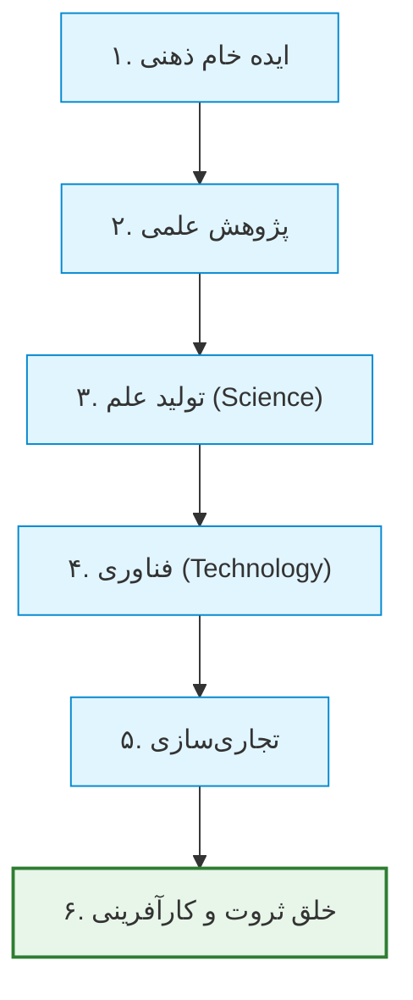
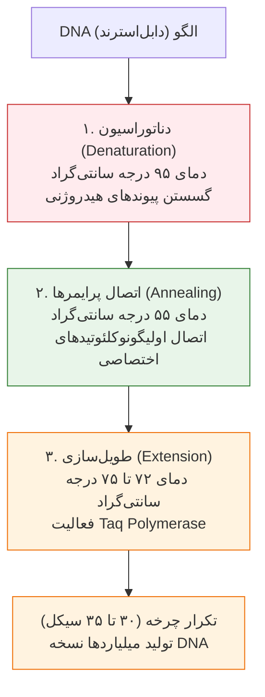
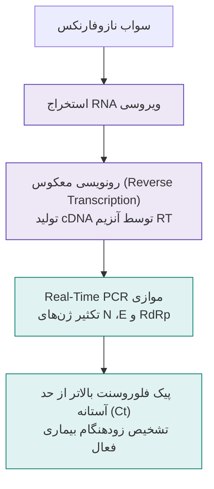
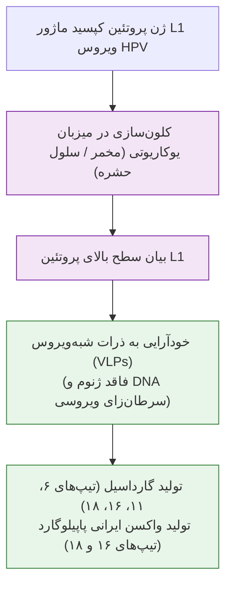
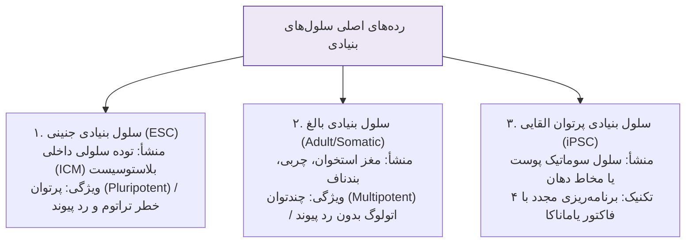
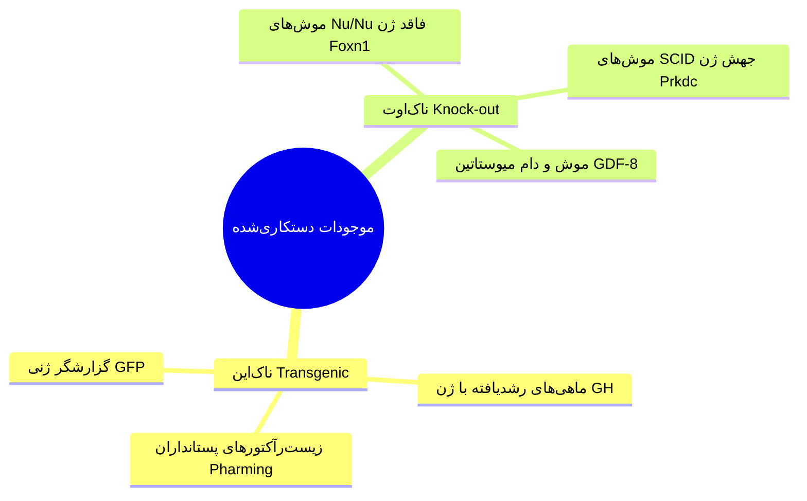
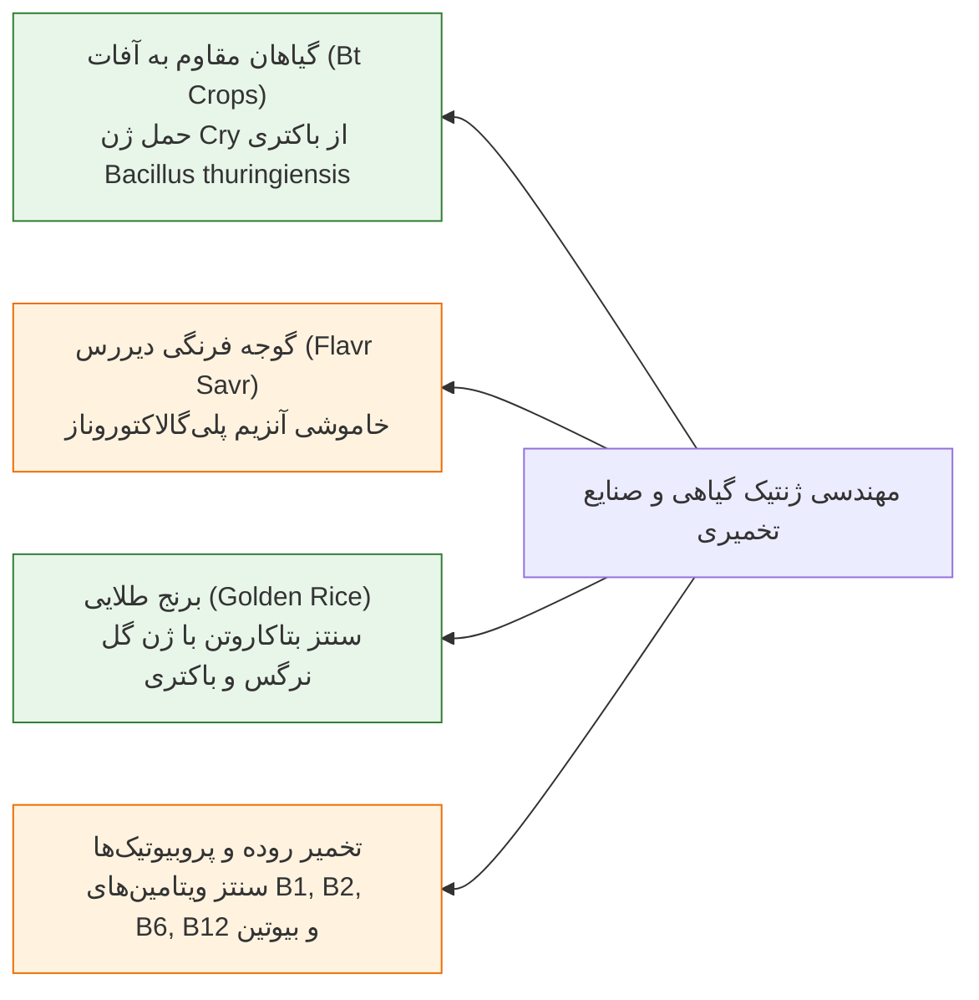

# چلسه ۱۴: مهندسی ژنتیک و بیوتکنولوژی در پزشکی و صنعت (Genetic Engineering in Medicine & Industry)

## 1. مفاهیم بنیادین و زنجیره تبدیل ایده به ثروت

> [!info] تعاریف مرجع: ژنتیک، بیوتکنولوژی و مهندسی ژنتیک
> * **Genetics (علم پایه):** شاخه‌ای از زیست‌شناسی که ساختار، عملکرد، وراثت و تنوع ژن‌ها را در موجودات زنده بررسی می‌کند.
> * **Biotechnology (فناوری زیستی):** به‌کارگیری سامانه‌ها و ارگانیسم‌های زنده یا مشتقات زیستی آن‌ها برای ساخت یا تغییر فرآورده‌ها و فرایندها در کاربردهای اختصاصی ($Bios=\text{Life}$ ، $Technos=\text{Tool}$ ، $Logos=\text{Study}$).
> * **Genetic Engineering (مهندسی ژنتیک):** مجموعه روش‌های دستکاری مستقیم ژنوم موجود زنده با ابزارهای زیست‌فناوری شامل حذف، افزودن، تغییر توالی یا نوترکیبی ژن‌ها فراتر از مرزهای گونه‌ای.

> [!tip] اقتصاد دانش‌بنیان دانشگاه استنفورد
> گردش مالی شرکت‌های تأسیس‌شده توسط فارغ‌التحصیلان دانشگاه استنفورد بالغ بر **۲.۷ تریلیون دلار در سال** (معادل دهمین اقتصاد قدرتمند جهان) است؛ این آمار اثبات می‌کند ارزش واقعی رشته‌های پزشکی در بهره‌گیری صنعتی و تولید ثروت بر پایه فناوری‌های نوین ژنتیکی است.

## 2. کرونولوژی نقاط عطف تاریخی مهندسی ژنتیک

| سال میلادی | دانشمند / مرجع کشف | دستاورد بنیادین و اهمیت امتحانی |
| :--- | :--- | :--- |
| **1961** | ژاکوب و مونو (Jacob & Monod) | ارائه مدل اپران لک و اثبات سازوکار تنظیم رونویسی ژن‌ها. |
| **1968** | ورنر آربر (Werner Arber) | کشف آنزیم‌های برش‌گر (Restriction Enzymes)؛ برنده جایزه نوبل. |
| **1973** | بویر و کوهن (Boyer & Cohen) | خلق نخستین مولکول DNA نوترکیب (rDNA) و آغاز عصر مهندسی ژنتیک. |
| **1978** | کمپانی Genentech | تولید نخستین انسولین انسانی نوترکیب در باکتری *E. coli*. |
| **1982** | تاییدیه رسمی FDA | ورود نخستین داروی نوترکیب انسان (انسولین Humulin) به بازار دارویی. |
| **1983** | کری مالیس (Kary Mullis) | ابداع تکنیک PCR و تکثیر تصاعدی DNA؛ برنده جایزه نوبل شیمی. |
| **1987** | باکتری *P. syringae* | تولید سویه یخ‌منفی (Ice-minus)؛ نخستین ارگانیسم تراریخته رهاسازی‌شده در محیط. |
| **1994** | گوجه فرنگی Flavr Savr | نخستین محصول زراعی خوراکی دستکاری‌شده ژنتیکی دارای تاییدیه تجاری. |
| **1996** | یان ویلموت (Ian Wilmut) | کلون‌سازی موفق گوسفند دالی (Dolly) از یک سلول سوماتیک تمایزیافته بالغ. |
| **2003** | کنسرسیوم جهانی HGP | اعلام پایان نقشه‌برداری و توالی‌یابی کامل ژنوم انسان پس از ۱۳ سال. |
| **2009** | تایید داروی ATryn | داروی ضد انعقاد آنتی‌ترومبین نوترکیب از شیر بز تراریخته؛ نخستین فرآورده حیوانی FDA. |
| **2010** | مؤسسه کریگ ونتر (JCVI) | سنتز شیمیایی نخستین ژنوم باکتریایی مصنوعی (*Mycoplasma mycoides JCVI-syn1.0*). |

## 3. اصول واکنش زنجیره‌ای پلیمراز (PCR) و الکتروفورز

> [!info] واکنش زنجیره‌ای پلیمراز (PCR)
> تکنیک آزمایشگاهی با تکثیر سریع، اختصاصی و آنزیمی قطعه معینی از DNA در شرایط برون‌تنی بر مبنای توان تصاعد هندسی ($2^n$).

> [!tip] تمثیل صفحه شطرنج و تصاعد هندسی در PCR
> مخترع شطرنج در برابر هر خانه، دو برابر گندم خانه قبلی ($2^{64}-1$ دانه معادل بیش از ۱۸ کوینتیلیون) طلب کرد که برای تهیه آن باید ۸ بار کل کره زمین زیر کشت گندم می‌رفت. در واکنش PCR نیز یک نسخه DNA پس از ۳۰ چرخه به بیش از یک میلیارد ($2^{30}$) کپی تبدیل می‌شود.

### تفکیک محصولات با الکتروفورز ژل آگاروز (Gel Electrophoresis)
* **اساس فیزیکی:** اسکلت فسفودی‌استر DNA دارای **بار منفی خالص** است؛ در میدان الکتریکی به سمت قطب مثبت (آند) مهاجرت می‌کند.
* **الگوی غربال مولکولی:** ژل آگاروز شبکه مشبک اسفنجی ایجاد می‌کند؛ قطعات کوچک‌تر سریع‌تر و دورتر و قطعات بزرگ‌تر کندتر حرکت می‌کنند.
* **آشکارسازی باندها:** رنگ‌آمیزی با اتیدیوم بروماید یا ژل‌رد و مشاهده تحت پرتو فرابنفش (UV Transilluminator)، یا روش فوق‌حساس نیترات نقره.

## 4. کیت‌های تشخیصی نوترکیب، آنزیم‌ها و تکنیک فیش (FISH)

> [!info] پروب مولکولی (Molecular Probe)
> قطعه‌ای تک‌رشته‌ای از DNA یا RNA نشان‌دارشده با ماده فلوروسنت یا رادیواکتیو که با توالی مکمل خود در ژنوم هدف جفت (هیبرید) می‌شود.

* **تکنیک فلوروسنت درجا (FISH):**
  * *برتری بر کاریوتایپ نوری:* کاریوتایپ قدرت تفکیک ۵ تا ۱۰ مگاباز دارد؛ FISH قدرت تفکیک **۱۰۰ کیلوباز** دارد و ریزحذف‌ها، مضاعف‌شدگی‌ها و بازآرایی‌های ساب‌میکروسکوپی را آشکار می‌سازد.
  * *انواع پروب‌ها:* پروب‌های تلومریک، پروب‌های سانترومریک (شمارش آنیوپلوئیدی‌ها در اینترفاز)، و پروب‌های اختصاصی ژنی (Locus-Specific مانند شناسایی لوکوس *TSGA10* و *GNG2* بر روی کروموزوم‌ها).

### آنزیم‌های شاخص سرمی در پایش تخریب بافتی

| آنزیم تشخیصی سرم | مخفف بین‌المللی | اندام یا بافت منشأ | بیماری و پاتولوژی بالینی شاخص |
| :--- | :--- | :--- | :--- |
| **کراتین کیناز** | CK | میوکارد قلب و عضله مخطط | انفارکتوس حاد میوکارد (اوج در روز اول)، دیستروفی دوشن |
| **آسپارتات ترانس‌آمیناز** | AST / SGOT | سلول‌های هپاتوسیت و قلب | هپاتیت حاد، نارسایی و سیروز کبد، آسیب میوکارد |
| **آلانین ترانس‌آمیناز** | ALT / SGPT | پارانشیم اختصاصی کبد | نکروز سلولی هپاتوسیت‌ها، کبد چرب، هپاتیت ویروسی |
| **لاکتات دهیدروژناز** | LDH | گلبول قرمز، بافت قلب، کبد | نکروز بافتی پیشرونده، همولیز، دیررس‌ترین مارکر سکته قلبی |
| **آلکالین فسفاتاز** | ALP | مجاری صفراوی، استئوبلاست استخوان | راشیتیسم، ایکتر انسدادی، کانسرهای متاستاتیک استخوان |
| **آمیلاز و لیپاز** | AMY / LPS | آسینوس‌های غده پانکراس | پانکراتیت حاد و مزمن، انسداد مجرای ویریشونگ |
| **اسید فسفاتاز** | ACP | سلول‌های اپیتلیال پروستات | کارسینوم بدخیم پروستات همراه با متاستاز استخوانی |

## 5. واکسن‌های نوترکیب نسل جدید

> [!info] طبقه‌بندی چهارگانه واکسن‌ها در پزشکی
> 1. **واکسن زنده ضعیف‌شده (Attenuated):** ایجاد پاسخ ایمنی کامل سلولی/همورال، فاقد توان بیماری‌زایی در افراد سالم (مانند پولیو خوراکی سابین، سرخک، BCG).
> 2. **واکسن کشته‌شده (Inactivated / Killed):** ارگانیسم فیزیکاً یا شیمیایی غیرفعال شده (مانند واکسن تزریقی فلج اطفال سالک، هپاتیت A، سینوفارم کرونا).
> 3. **واکسن‌های زیرواحد و نوترکیب پروتئینی (Subunit / Recombinant):** تخلیص پروتئین ایمونوژن محافظت‌شده با مهندسی ژنتیک؛ فوق‌العاده ایمن به دلیل عدم تماس با عامل پاتوژن زنده (مانند واکسن هپاتیت B، گارداسیل و پاپیلوگارد ضد HPV).
> 4. **واکسن‌های ژنتیکی (DNA & mRNA):** انتقال مستقیم توالی نوکلئوتیدی آنتی‌ژن به سلول‌های بدن جهت تولید درون‌سلولی پپتید ویروسی (مانند فایزر و مدرنا).

* **چالش واکسن‌های کووید-19:** ناپایداری به دلیل جهش‌های پیاپی در پروتئین‌های M ،S و N و گلیکوزیلاسیون متنوع پروتئین اسپایک (Spike) که کارایی واکسن‌های کشته سنتی را کاهش داد.

## 6. آنتی‌بادی‌های مونوکلونال (mAbs) و پلتفرم‌های درمانی

> [!info] آنتی‌بادی مونوکلونال نوترکیب (Monoclonal Antibody)
> ایمونوگلوبولین‌های مهندسی‌شده تک‌کلونی و فوق‌اختصاصی بر علیه یک اپی‌توپ مشخص؛ بخش اتصالی متغیر تک‌زنجیره‌ای را **scFv (Single-Chain Fv)** می‌نامند.

* **آمار بازار جهانی:** تولید بیش از **۵۰۰ نوع mAb** که بیش از **۱۰۰ مورد** دارای تاییدیه رسمی FDA هستند.
* **حجم اقتصاد دارویی:** بازار جهانی پادتن‌های مونوکلونال فراتر از **۲۰۰ میلیارد دلار** در سال است.
* **پرفروش‌ترین داروی تاریخ:** آدالیموماب (*Humira / AbbVie*) با فروش سالانه بالغ بر **۲۰ میلیارد دلار** در رتبه نخست جهان (مهارکننده TNF-alpha در آرتریت روماتوئید، کرون و پسوریازیس).

### ده آنتی‌بادی مونوکلونال پرفروش جهان

1. **Humira (Adalimumab):** مهارکننده اختصاصی TNF-alpha در بیماری‌های التهابی خودایمنی.
2. **Keytruda (Pembrolizumab):** مهارکننده چک‌پوینت ایمنی PD-1 در سرطان‌های ملانوما، ریه و مجاری ادراری.
3. **Herceptin (Trastuzumab):** مهارکننده اختصاصی گیرنده HER2/neu در کارسینوم پستان و معده.
4. **Avastin (Bevacizumab):** مهارکننده آنژیوژنزیس و فاکتور VEGF در سرطان کولورکتال، کلیه و گلیوبلاستوما.
5. **Rituxan (Rituximab):** مهارکننده پروتئین سطحی CD20 در لکوسیت‌های B در لوسمی و لنفوم لنفوسیتی.
6. **Opdivo (Nivolumab):** تارگت گیرنده PD-1 در ایمونوانکولوژی.
7. **Stelara (Ustekinumab):** مهارکننده اینترلوکین‌های IL-12 و IL-23 در پسوریازیس پلاکی.
8. **Remicade (Infliximab):** آنتی‌بادی کایمریک ضد TNF-alpha در کولیت اولسراتیو.
9. **Soliris (Eculizumab):** مهارکننده پروتئین کمپلمان C5 در سندرم همولیتیک یورمیک آتپیک.
10. **Cosentyx (Secukinumab):** مهارکننده سایتوکاین پیش‌التهابی IL-17A در اسپوندیلیت آنکیلوزان.

## 7. سلول‌های بنیادی و پزشکی بازساختی (Regenerative Medicine)

> [!info] تعریف سلول بنیادی (Stem Cell)
> سلول تمایزنیافته با دو ویژگی بنیادی: ۱) خودنوسازی نامحدود (Self-renewal)، ۲) توان تمایز به رده‌های سلولی تخصصی (Differentiation).

### مقایسه تطبیقی انواع سلول‌های بنیادی

| ویژگی بیولوژیک | سلول جنینی (ESC) | سلول پرتوان القایی (iPSC) | سلول بنیادی بالغ (Adult Stem Cell) |
| :--- | :--- | :--- | :--- |
| **منبع استخراج سلول** | توده سلولی داخلی رویان ۳ تا ۵ روزه | سلول‌های سوماتیک تمایزیافته فرد | ارگان‌های جنینی، بندناف و بافت‌های بالغ |
| **نرخ تکثیر در محیط کشت** | بسیار بالا | بسیار بالا | معمولاً پایین و محدود |
| **دسترس‌پذیری و اخلاق** | محدود / چالش تخریب جنین انسان | بالا / بدون محدودیت اخلاقی | متوسط / نیازمند بیوپسی بافتی |
| **پتانسیل تمایز** | پرتوان (Pluripotent) | پرتوان (Pluripotent) | چندتوان (Multipotent) |
| **ریسک رد ایمونولوژیک** | بالا (آلوژنیک با فرد دریافت‌کننده) | صفر (سلول اتولوگ خود بیمار) | صفر (در صورت استفاده اتولوگ) |

* **پوست بازساختی (Regenerative Skin):** کشت کراتینوسیت‌ها و فیبروبلاست‌ها بر داربست‌های زیستی برای درمان سوختگی‌های درجه ۳ شدید و زخم‌های دیابتی.

## 8. حیوانات تراریخته (Transgenic) و مدل‌های ناک‌اوت (Knock-out)

> [!info] ترانس‌ژنیک (Knock-in) در برابر ناک‌اوت (Knock-out)
> * **Transgenic (ناک‌این):** وارد کردن و الحاق ژن عملکردی خارجی به ژنوم موجود زنده (مانند ژن *GFP* یا ژن فاکتورهای رشد).
> * **Knock-out:** تخریب هدفمند یا حذف فیزیکی یک ژن از ژنوم به منظور کشف نقش عملکردی و تولید مدل بیماری‌ها.

### 1. موش‌های برهنه نود (Nu/Nu Mice)
* **نقص ژنتیکی:** حذف هموزیگوت در ژن فاکتور رونویسی **Foxn1**.
* **تظاهر پاتولوژیک:** عدم تکامل و آپلازی کامل غده **تیموس** $\rightarrow$ فقدان لنفوسیت‌های T فعال، عدم بلوغ ایمنی سلولی و ناتوانی در رد پیوند بافت بیگانه.
* **کاربرد طلایی:** پیوند و غربالگری داروهای شیمی‌درمانی بر تومورهای بدخیم انسانی (*Xenotransplantation*).

### 2. موش‌های مبتلا به نقص ایمنی مرکب شدید (SCID Mice)
* **نقص ژنتیکی:** جهش غیرفعال‌کننده هموزیگوت در ژن زیرواحد کاتالیتیک پروتئین کیناز وابسته به DNA (*Prkdc*) روی کروموزوم ۱۶.
* **تظاهر پاتولوژیک:** اختلال در نوترکیبی قطعات $V(D)J$ رسپتورهای آنتی‌ژنی و نقص در ترمیم شکست‌های دورشته‌ای DNA $\rightarrow$ **فقدان همزمان لنفوسیت‌های B و T**.
* **کاربرد:** پیوند رده‌های سلولی سرطان، ایجاد مدل موش‌های NOG (*NOD/SCID/IL-2R-gamma-null*) و مدل بیماری‌های التهابی مزمن روده (IBD و کرون).

### 3. مهارکننده رشد عضله: میوستاتین (GDF-8 Knock-out)
* **پاتولوژی:** ژن *GDF-8* سیتوکین بازدارنده میوژنز و تکثیر میوسیت‌ها است.
* **پیامد غیرفعال‌سازی:** هایپرتروفی و هایپرپلازی مفرط عضلانی (دو برابر شدن توده خالص ماهیچه).
* **نمونه‌های طبیعی:** نژاد گاو گوشتی بلژین بلو (Belgian Blue)، سگ‌های تازی بولی ویپت (Bully Whippet) و مدل‌های تجاری دامداری.

### 4. زیست‌رآکتورهای حیوانی (Animal Bioreactors / Pharming)
* ترشح پروتئین‌های نوترکیب در غدد شیری پستانداران تحت کنترل پروموتورهای بافتی نظیر بتالاکتوگلوبولین یا کازئین.
* تولید پروتئین‌های حیاتی: **آلفا-۱-آنتی‌تریپسین (AAT)** برای درمان آمفیزم ریوی و CF در شیر گوسفند، فیبر ابریشم عنکبوت (Spider Silk) برای الیاف فوق‌مقاوم، و **آنتی‌ترومبین III (ATryn)** در شیر بز.

## 9. زیست‌فناوری صنعتی، غذایی و ارگانیسم‌های تراریخته (GMO / LMO)

> [!info] تمایز اصطلاحی GMO در برابر LMO
> * **GMO (ارگانیسم دستکاری‌شده ژنتیکی):** مفهوم فراگیر؛ شامل هر موجود زنده یا هرگونه فرآورده، عصاره و مشتق بیولوژیک با DNA دستکاری‌شده (مانند روغن استخراج‌شده از سویای تراریخته).
> * **LMO (ارگانیسم زنده دستکاری‌شده):** طبق پروتکل ایمنی‌زیستی کارتاهنا؛ منحصراً به موجودات زنده‌ای اطلاق می‌شود که **دارای توان تکثیر و انتقال ماده ژنتیکی** در طبیعت باشند (مانند بذر زنده سویا یا ذرت تراریخته).

### ارکان سه‌گانه نظارت بر محصولات تراریخته
1. **Safety Assessment:** سنجش آلرژی‌زایی، سمیت سلولی و پایداری بر اساس شواهد معتبر حداقل ۱۰ ساله در جوامع مبدا.
2. **Food Labelling:** درج شفاف نشان تجاری تراریخته بر بسته‌بندی جهت رعایت حق آگاهی و انتخاب مصرف‌کننده.
3. **Sampling & Testing:** پایش ادواری محموله‌های وارداتی با پنل‌های اختصاصی Real-Time PCR توسط سازمان غذا و دارو (FDA / IFDA).

## 10. آنزیم‌های صنعتی و فرآوری غذا

* **پتانسیل مالی:** نرخ رشد سالانه مرکب **۱۴٪ (CAGR 14%)** با حجم بازار **۲۵.۸۸ میلیارد دلار** تا سال ۲۰۲۹.
* **رنین (Rennin / Chymosin):** آنزیم دلمه کردن شیر در پنیرسازی؛ پیش‌تر از معده گوساله‌ها استخراج می‌شد، اکنون با کلون ژن گاوی در میکروارگانیسم‌های بی‌خطر (GRAS) در فرمنتور تولید می‌شود.
* **تردکننده‌های گوشت (Meat Tenderizers):** پروتئازهای پاپائین (*Papain* از خربزه درختی)، بروملین (*Bromelain* از آناناس) و فیسین (*Ficin* از انجیر) برای هیدرولیز پیوندهای کلاژن بافت پیوندی گوشت در دمای پخت.

### جدول کاربرد آنزیم‌های بیوتکنولوژی در صنعت

| نام رده آنزیمی | کاربرد اختصاصی صنعتی | سازوکار و واکنش بیوشیمیایی |
| :--- | :--- | :--- |
| **پروتئازها (Proteases)** | فرآوری غذای کمکی شیرخواران | پیش‌هضم آنزیمی پروتئین‌های سنگین به پپتیدهای زودجذب |
| **پروتئاز و لیپاز** | پودرهای شوینده بیولوژیک | شکستن و پاکسازی لکه‌های پروتئینی، خون و چربی البسه |
| **کربوهیدرازها (Carbohydrases)** | صنایع قند و نشاسته | هیدرولیز نشاسته ذرت به شربت شیرین‌کننده گلوکوز |
| **ایزومراز (Glucose Isomerase)** | صنایع غذایی و شربت ذرت | تبدیل آنزیمی گلوکوز به قند بسیار شیرین‌تر فروکتوز (HFCS) |
| **لاکتاز (Lactase / $\beta$-galactosidase)** | صنایع لبنی و شیر رژیمی | تجزیه لاکتوز شیر به گلوکوز و گالاکتوز برای مبتلایان به عدم تحمل |
| **لیپازها (Lipases)** | صنایع شکلات، لبنیات و پنیر | آزادسازی اسیدهای چرب فرار و طعم‌دهی ویژه به پنیر و شکلات |

## 11. اخلاق‌زیستی (Bioethics) و حاکمیت اعتدال

> [!important] حاکمیت اعتدال بر دستکاری ژنوم
> علم مهندسی ژنتیک همانند تیغ دولبه است؛ دستکاری ژن‌ها نباید از مرزهای اخلاق و ایمنی بگذرد. شعار بنیادی در این عرصه آیه شریفه «*وَکَذَلِکَ جَعَلْنَاکُمْ أُمَّةً وَسَطًا لِتَکُونُوا شُهَدَاءَ عَلَى النَّاسِ*» است: **پرهیز مطلق از افراط (Extremism) و تفریط، و حاکمیت توازن و عدالت زیستی**.

* **اصول ممنوعه در اخلاق زیستی:**
  1. *دستکاری ژنتیکی رده زایا (Germline Editing):* ممنوعیت ویرایش ژنی گامت‌ها و رویان‌هایی که اثرات ناشناخته را به نسل‌های آینده منتقل می‌کنند.
  2. *کلون‌سازی درمانی در برابر تولیدمثلی:* ممنوعیت مطلق کلون انسان جهت تکثیر فیزیکی افراد.
  3. *محرمانگی داده‌ها:* صیانت از توالی ژنوم افراد برای جلوگیری از تبعیض‌های شغلی و بیمه‌ای.

## 12. پاسخ تشریحی به تکالیف پایانی درس (Home Works)

### تکلیف 1: مزایا و چالش‌های فناوری مهندسی ژنتیک در تولید کیت‌های تشخیصی

#### الف) کیت‌های تشخیصی عمومی پزشکی (نظیر کیت‌های الایزا)
* **مزایا:** تولید صنعتی و نامحدود آنتی‌ژن‌های فوق‌خالص در باکتری و مخمر بدون نیاز به کشت عوامل مرگبار بیماری‌زا (نظیر ویروس HIV یا HCV)، ایمنی کامل پرسنل آزمایشگاه، تکرارپذیری بالا و یکنواختی بچ‌های تولیدی، و هزینه پایین فرآیند.
* **چالش‌ها:** تفاوت در ساختار گلیکوزیلاسیون و تاخوردگی سه‌بعدی پروتئین‌های تولیدشده در میزبان پروکاریوتی نسبت به فرم طبیعی انسانی که می‌تواند سبب ایجاد موارد منفی یا مثبت کاذب گردد.

#### ب) کیت‌های تشخیصی فوق‌تخصصی ژنتیک پزشکی (نظیر کیت‌های NGS Panels و MLPA)
* **مزایا:** بررسی همزمان صدها اگزون ژنی بیماری‌زا با عمق خوانش (Depth) بالا، توانایی شناسایی جهش‌های نقطه‌ای ناشناخته، حذف‌ها و دوپلیکاسیون‌های ساب‌میکروسکوپی در یک واکنش واحد (مانند پنل‌های جامع سرطان پستان و ناشنوایی).
* **چالش‌ها:** هزینه راه‌اندازی بالا، نیاز مبرم به زیرساخت محاسباتی بیوانفورماتیک و سرورهای پردازش داده، پدیده حذف آللی (ADO)، و چالش در تفسیر بالینی واریانت‌های با توالی نامشخص (VUS).

### تکلیف 2: جایگاه و آینده فناوری کریسپر (CRISPR) در تشخیص‌های ژنتیکی

فناوری کریسپر علاوه بر ویرایش ژنی، تحولی بنیادین در حوزه تشخیص‌های مولکولی فوق‌سریع ایجاد کرده است:
* **سیستم‌های SHERLOCK (بر پایه Cas13) و DETECTR (بر پایه Cas12):**
  * این سیستم‌ها از ویژگی **برش جانبی غیرانتخابی (Collateral Cleavage)** آنزیم‌های Cas پس از شناسایی توالی هدف استفاده می‌کنند.
  * با اتصال gRNA به ژنوم ویروسی (نظیر کووید-19 یا HPV) یا جهش انکولوژی مورد نظر، آنزیم فعال‌شده و پروب‌های گزارشگر فلوروسنت موجود در لوله را هیدرولیز می‌کند.
* **مزیت نسبت به روش‌های مرسوم:** حساسیت و اختصاصیت در حد تک‌مولکول در کمتر از ۳۰ دقیقه، بدون نیاز به دستگاه‌های پیچیده و گران‌قیمت ترموسایکلر (Isothermal)، با قابلیت پیاده‌سازی بر نوارهای کاغذی تست سریع شبیه به بیبی‌چک (Lateral Flow Strips) برای پایش بالینی بر بالین بیمار (Point-of-Care Testing).
