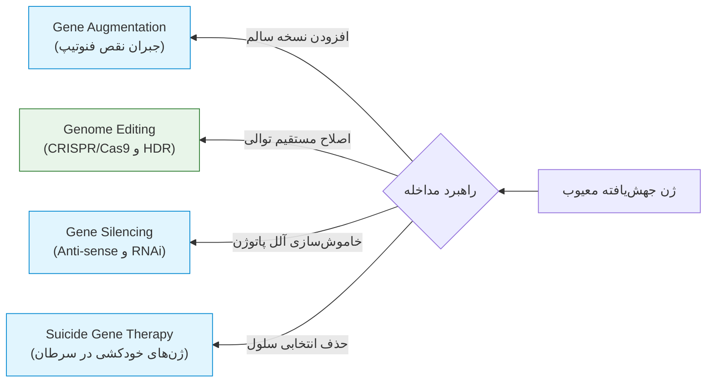
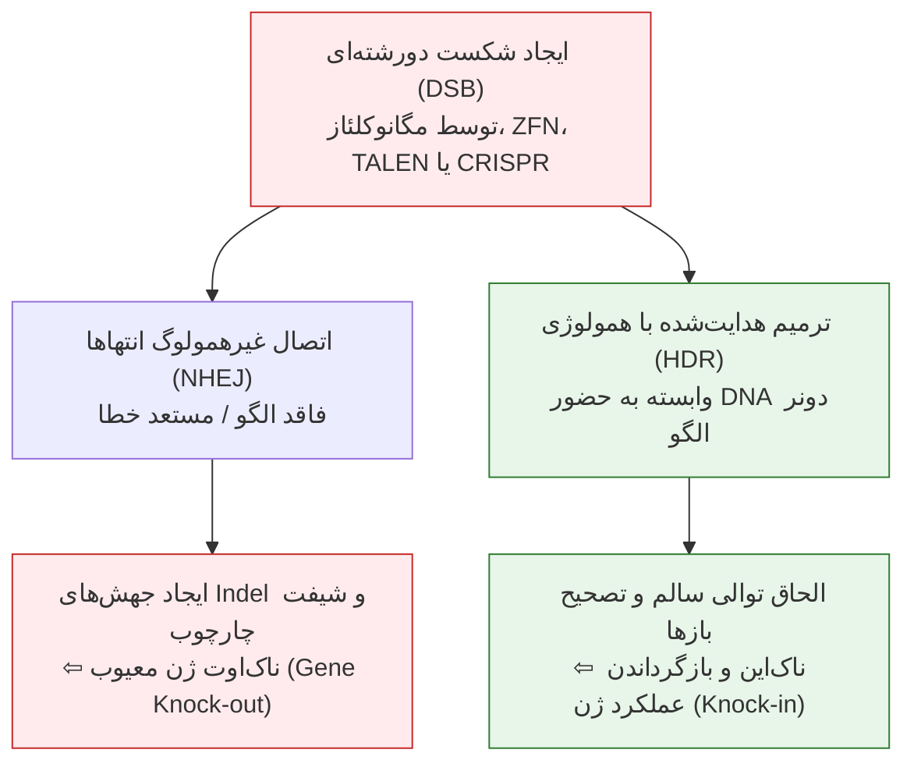
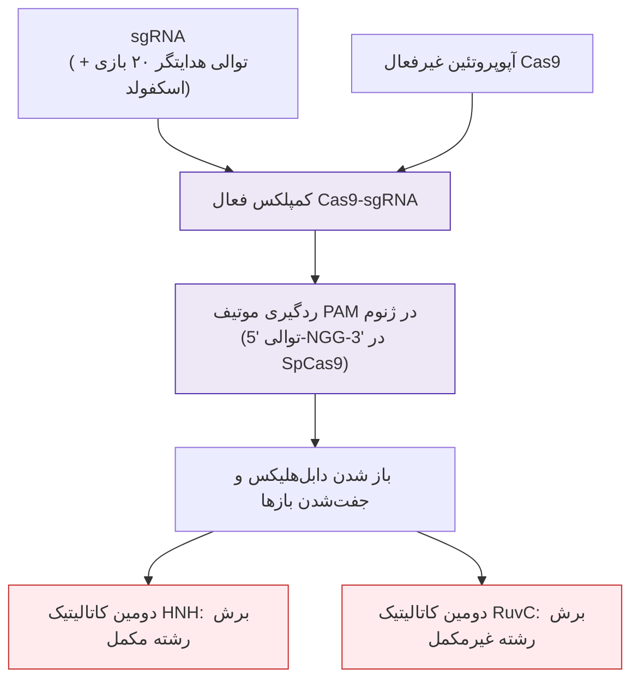
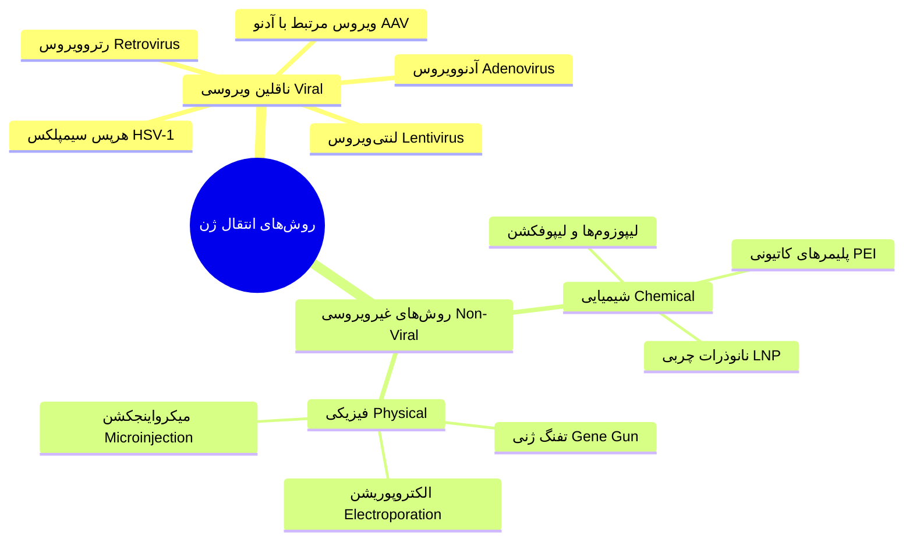
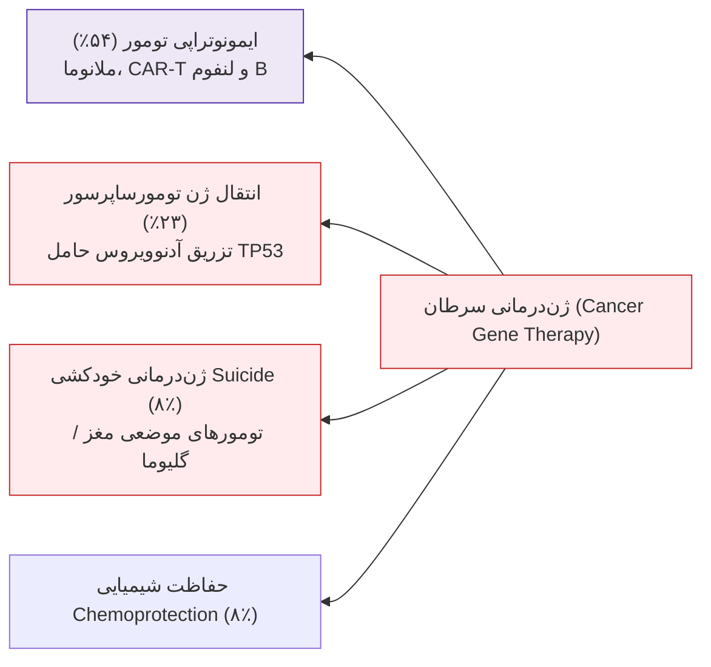
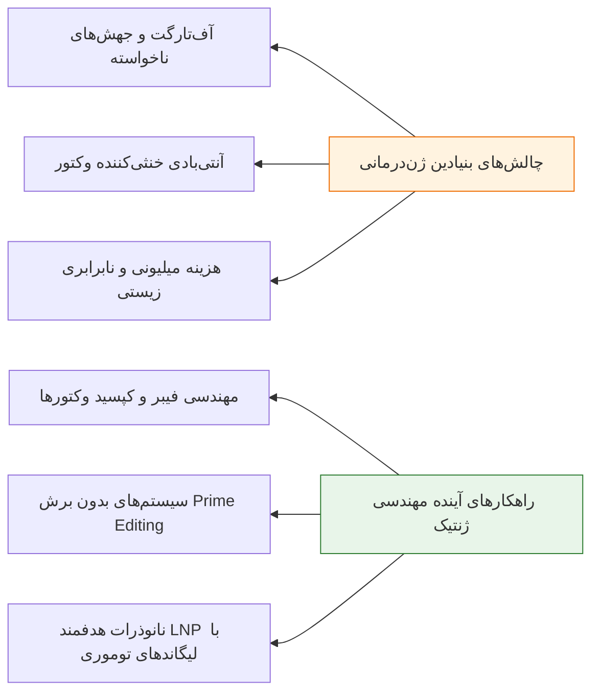

# جلسه ۱۵: ژن‌درمانی، ویرایش ژنوم و سیستم CRISPR-Cas9 (Gene Therapy & Genome Editing)

## 1. مفاهیم بنیادین و اهداف ژن‌درمانی

> [!info] تعریف ژن‌درمانی (Gene Therapy)
> فرآیند انتقال عمدی و هدفمند ماده ژنتیکی (DNA یا RNA) به سلول‌های بیمار با هدف اصلاح، ترمیم، جایگزینی یا سرکوب عملکرد یک ژن معیوب، جبران کمبود پروتئین ضروری و یا القای مرگ انتخابی در سلول‌های هدف (مانند تومورها).

### مقایسه راهبردهای سلولی در ژن‌درمانی

| شاخص بالینی | ژن‌درمانی سوماتیک (Somatic Cell) | ژن‌درمانی رده زایا (Germline) |
| :--- | :--- | :--- |
| **سلول‌های هدف** | بافت‌های سوماتیک بالغ (کبد، مغز استخوان، شبکیه، عضله) | اسپرم، تخمک، زیگوت یا بلاستومرهای اولیه جنین |
| **سرنوشت ژنتیکی در نسل‌ها** | **فقط محدود به خود بیمار**؛ به فرزندان منتقل نمی‌شود | **پایدار و ارثی**؛ به تمام نسل‌های آینده انتقال می‌یابد |
| **وضعیت قانونی و اخلاقی** | **کاملاً مجاز و دارای تأییدیه‌های بالینی FDA و EMA** | **در سراسر جهان به دلایل اخلاقی و ایمنی ممنوع است** |
| **نمونه‌های کاربردی** | اصلاح سلول‌های لنفوسیت در ADA-SCID، داروهای لوکستورنا و زولژنسما | ویرایش ژنی بحث‌برانگیز رویان در پژوهش‌های اولیه |

> [!important] تفاوت راهبردهای انتقال In vivo در برابر Ex vivo
> * **Ex vivo:** سلول‌ها از بدن بیمار استخراج شده (مانند سلول‌های بنیادی خونساز CD34⁺ مغز استخوان)، در شرایط آزمایشگاهی تمیز (Cleanroom) تحت کشت و انتقال ژن قرار گرفته و پس از تأیید سلامت، مجدداً به بیمار پیوند زده می‌شوند (بدون رد پیوند).
> * **In vivo:** وکتور حامل ژن درمانی مستقیماً به جریان خون یا بافت هدف بیمار (مانند تزریق زیرشبکیه‌ای در نابینایی یا عضله در دوشن) تزریق می‌گردد؛ وابستگی شدید به اختصاصیت بافتی وکتور دارد.

---

## 2. گاه‌شمار نقاط عطف تاریخی ژن‌درمانی

| سال میلادی | دانشمند / مرجع رویداد | دستاورد بنیادین و اهمیت امتحانی |
| :--- | :--- | :--- |
| **1989-1990** | کنسرسیوم NIH و فرنچ اندرسون | **نخستین ژن‌درمانی موفق بالینی انسان** در دختر ۴ ساله مبتلا به ADA-SCID (آشانتی دیسیلوا) با وکتور رتروویروس. |
| **1998** | کشف نوکلئازهای انگشت روی | ابداع پروتئین‌های مهندسی‌شده *Zinc-Finger Nucleases (ZFNs)* جهت برش توالی‌های اختصاصی DNA. |
| **1999** | مرگ جسی گلسینگر (Jesse Gelsinger) | فوت بیمار ۱۸ ساله دچار نقص OTCD به علت **پاسخ التهابی و ایمنی شدید کشنده به دوز بالای آدنوویروس**. |
| **2000-2003** | کارآزمایی بالینی کودکان حبابی فرانسه | درمان موفق کودکان مبتلا به X-SCID؛ توقف موقت کارآزمایی‌ها توسط FDA در ۲۰۰۳ به علت **بروز لوسمی ناشی از الحاق تصادفی رتروویروس**. |
| **2003** | سازمان غذا و داروی چین (CFDA) | تصویب داروی **Gendicine** (آدنوویروس حامل ژن مهارکننده تومور *TP53* در کارسینوم سر و گردن) به عنوان نخستین ژن‌درمانی تجاری جهان. |
| **2008-2010** | کارآزمایی‌های آمائوروزیس مادرزادی لبر | بازیابی موفق بینایی در کودکان مبتلا به رتینوپاتی ژنتیکی LCA با انتقال ژن *RPE65* به روش تزریق زیرشبکیه. |
| **2010-2012** | مقالات ساینس و نیچر (Doudna & Charpentier) | اثبات عملکرد ضدویروسی CRISPR در باکتری ماست و معرفی سیستم قابل‌برنامه‌ریزی **Cas9-sgRNA** برای برش اختصاصی DNA. |
| **2012** | تأیید داروی گلایبرا (Glybera) | نخستین داروی ژن‌درمانی تأییدشده در اروپا (AAV1 حامل ژن لیپوپروتئین لیپاز در نقص مونوژنیک LPLD). |
| **2013** | ژانگ و چرچ (مؤسسه برود / هاروارد) | نخستین کاربرد بالینی و موفق پلتفرم CRISPR-Cas9 در **ویرایش ژنوم سلول‌های پستانداران و سلول‌های انسانی**. |
| **2017** | تأیید تاریخی لوکستورنا (Luxturna) و CAR-T | تأیید FDA برای داروی *Luxturna* در نابینایی LCA2 و ورود پلتفرم سلول‌درمانی *CAR-T* در لوسمی لنفوبلاستیک حاد B-cell. |
| **2020** | اهدای جایزه نوبل شیمی | اعطای جایزه نوبل شیمی به **جنیفر دودنا و امانوئل شارپنتیه** برای ابداع روش ویرایش ژنوم با CRISPR-Cas9. |
| **2023-2024** | تأیید داروی Casgevy (Exa-cel) | **نخستین داروی ویرایش ژن مبتنی بر CRISPR در تاریخ** با خاموش‌سازی انسر ژن *BCL11A* برای درمان تالاسمی ماژور و داسی‌شکل. |

---

## 3. تکامل پلتفرم‌های ویرایش ژنوم (Genome Editing)

> [!info] تعریف ویرایش ژنوم (Genome Editing)
> فناوری دستکاری مستقیم DNA با ایجاد شکست‌های دورشته‌ای (DSBs) در لوکوس هدف توسط نوکلئازهای اختصاصی، که به سلول امکان می‌دهد توالی هدف را دچار حذف (Knock-out)، اصلاح یا الحاق (Knock-in) نماید.

### مقایسه تطبیقی چهار نسل نوکلئازهای ویرایش ژن

| ویژگی مهندسی | مگانوکلئازها (Meganucleases) | نوکلئازهای انگشت روی (ZFNs) | نوکلئازهای تالن (TALENs) | سیستم انقلابی CRISPR-Cas9 |
| :--- | :--- | :--- | :--- | :--- |
| **سازوکار شناسایی هدف** | پروتئین به DNA (موتیف‌های طویل طبیعی ۱۲ تا ۴۰ بازی) | پروتئین به DNA (آرایه‌های انگشت روی برای تریپلت‌های نوکلئوتیدی) | پروتئین به DNA (تکرارهای دمین TALE برای شناسایی تک‌بازها) | **هیبریداسیون RNA به DNA** (توالی ۲۰ نوکلئوتیدی sgRNA) |
| **دومِین برش کاتالیتیک** | خود ساختار درونی آنزیم | دومین اندونوکلئاز دایمریک **FokI** | دومین اندونوکلئاز دایمریک **FokI** | دو دومین درونی **HNH** و **RuvC** آنزیم Cas9 |
| **سهولت طراحی آزمایشگاهی** | بسیار سخت و طاقت‌فرسا | دشوار و پرهزینه (مهندسی پروتئین) | متوسط (نیازمند سنتز ژن‌های طویل) | **بسیار آسان، فوق‌سریع و ارزان** (فقط سنتز یک الیگو sgRNA) |
| **قابلیت هدف‌گیری همزمان (Multiplexing)** | تقریباً غیرممکن | بسیار محدود | بسیار محدود | **فوق‌العاده بالا** (تزریق همزمان چندین sgRNA با یک Cas9) |

---

## 4. بیولوژی و مکانیسم مولکولی سیستم CRISPR-Cas9

> [!info] ساختار و منشأ باکتریایی CRISPR
> سیستم ایمنی انطباقی ضدویروسی در پروکاریوت‌ها؛ باکتری قطعاتی از DNA باکتریوفاژ مهاجم را در ژنوم خود بین توالی‌های تکراری پالیندرومی کوتاه ذخیره می‌کند. در عفونت مجدد، رونوشت crRNA همراه با ترنس‌اکتینگ tracrRNA (که به صورت یک سرهم **sgRNA** مهندسی می‌شود) آنزیم Cas9 را به ژنوم ویروس هدایت و آن را قطعه‌قطعه می‌کند.

### اجزای عملکردی کمپلکس Cas9
1. **دومِین شناسایی (REC I و REC II):** اتصال محکم به چارچوب RNA راهنما و تثبیت ساختار فضایی.
2. **پل هلیکسی (Bridge Helix):** هماهنگ‌کننده تغییر ساختار فضایی از فرم غیرفعال (Apo) به فرم فعال بایندر.
3. **دومِین PAM-Interacting (PI):** وارسی سریع ژنوم برای شناسایی توالی مجاور پروتواسپیسر (**PAM** معادل توالی $5'\text{-NGG-}3'$ در *Streptococcus pyogenes*). بدون وجود PAM در DNA هدف، آنزیم اتصال نمی‌یابد.
4. **دومِین‌های برش کاتالیتیک:** دومین **HNH** دقیقاً ۳ نوکلئوتید بالادست PAM رشته متصل به sgRNA را می‌برد؛ دومین **RuvC** رشته مقابل را می‌شکند تا برش صاف (Blunt-ended DSB) ایجاد شود.

### واریانت‌های مهندسی‌شده Cas9 در پزشکی
* **نیکاز کاس۹ (Cas9 Nickase / Cas9n):** با غیرفعال‌سازی یکی از دو دومین کاتالیتیک (جهش D10A در RuvC یا H840A در HNH)، آنزیم به جای شکست دورشته‌ای، فقط یک شکست تک‌رشته‌ای (**Nick**) ایجاد می‌کند. استفاده از **جفت نیکاز (Paired Nickases)** خطای آف‌تارگت را به صفر نزدیک می‌کند.
* **دِد کاس۹ (Dead Cas9 / dCas9):** با غیرفعال‌سازی همزمان هر دو دومین، آنزیم توانایی برش را از دست داده اما کماکان با هدایت sgRNA به لوکوس هدف متصل می‌شود.
  * *CRISPRa (فعال‌کننده رونویسی):* اتصال dCas9 به فاکتورهای فعال‌ساز رونویسی مانند VP64 جهت افزایش بیان ژن‌های خاموش‌شده.
  * *CRISPRi (سرکوبگر رونویسی):* اتصال dCas9 به دمین مهارکننده KRAB جهت مسدودسازی فیزیکی و خاموشی بیان انکوژن‌ها بدون شکست DNA.
* **ویرایشگرهای باز و پرایم (Base & Prime Editing):** الحاق دآمینازها به dCas9 جهت تبدیل مستقیم سیتوزین به تیمین ($C \rightarrow T$) یا آدنین به گوانین ($A \rightarrow G$)، یا تلفیق ترنسکریپتاز معکوس در Prime Editing جهت درج و حذف دقیق بدون نیاز به برش دورشته‌ای و بدون دونر خارجی.

> [!important] دستاورد ایرانی در درمان تالاسمی با CRISPR (پژوهش‌های دکتر مدرسی و همکاران)
> در بیماری بتا-تالاسمی، کمبود سنتز زنجیره بتا-گلوبین منجر به رسوب زنجیره‌های آلفا و مرگ گلبول‌های قرمز می‌شود. راهبرد گروه دکتر مدرسی، بازفعال‌سازی بیان زنجیره گاما-گلوبین جنینی ($\gamma\text{-globin}$) جهت تشکیل هموگلوبین جنینی (HbF: $\alpha_2\gamma_2$) بود. با هدف‌گیری و ناک‌اوت ژن‌های سرکوبگر نظیر **KLF1** و به ویژه انسر ژن **BCL11A** (که به عنوان سوئیچ فیزیولوژیک خاموش‌کننده HbF عمل می‌کنند)، سطح هموگلوبین F به طور چشمگیری صعود کرده و نیاز بیمار به تزریق خون مکرر کاملاً مرتفع می‌گردد. این پلتفرم مبنای نخستین داروی ژن‌درمانی کریسپر تأییدشده جهانی (*Casgevy*) قرار گرفت.

---

## 5. ناقلین و سیستم‌های انتقال ژن (Gene Delivery Vectors)

> [!danger] گلوگاه اصلی ژن‌درمانی: چالش انتقال ژن (Gene Delivery)
> بزرگ‌ترین سد مهندسی در ژن‌درمانی، عبور دادن ایمن و با راندمان بالای اسید نوکلئیک باردار و هیدروفیلی از **غشای فسفولیپیدی سلول** و متعاقباً ورود به **منافذ غشای هسته** بدون تخریب در وزیکول‌های اندوزومی و بدون تحریک مرگبار سیستم ایمنی است.

### مقایسه تطبیقی ویژگی‌های وکتورهای ویروسی در ژن‌درمانی

| شاخص عملکردی | رتروویروس‌ها (Retrovirus) | لنتی‌ویروس‌ها (Lentivirus) | آدنوویروس‌ها (Adenovirus) | ویروس مرتبط با آدنو (AAV) |
| :--- | :--- | :--- | :--- | :--- |
| **ماده ژنتیکی وکتور** | RNA تک‌رشته‌ای | RNA تک‌رشته‌ای | DNA دورشته‌ای خطی (dsDNA) | DNA تک‌رشته‌ای (ssDNA) |
| **ظرفیت حمل ژن (Cargo)** | حدود 8 kb | حدود 8 kb | **بسیار بالا (۸ تا ۳۶ kb)** | **بسیار محدود (<4.7 kb)** |
| **وضعیت ژنوم در سلول میزبان** | **الحاق پایدار به ژنوم (Integrated)** | **الحاق پایدار به ژنوم (Integrated)** | **غیرالحاقی و اپی‌زومال (Episomal)** | **عمدتاً اپی‌زومال (>۹۰٪)** |
| **نوع سلول‌های هدف** | **منحصراً سلول‌های در حال تقسیم** | سلول‌های تقسیم‌شونده و نامقسم | طیف بسیار وسیع بافتی (اپیتلیال) | سلول‌های تمایزیافته (عضله، عصب) |
| **پتانسیل تحریک ایمنی** | پایین | پایین | **بسیار شدید و خشن (High)** | **بسیار ناچیز (Non-inflammatory)** |
| **خطر موتاژنز الحاقی** | **بالا** (تمایل به نشست در پروموتورها) | پایین‌تر (نشست درون اگزون/اینترون) | صفر (به ژنوم متصل نمی‌شود) | بسیار ناچیز (<۱۰٪ الحاق تصادفی) |
| **طول مدت بیان ژن** | طولانی و پایدار | طولانی و پایدار | گذرا و کوتاه‌مدت (Transient) | بسیار طولانی‌مدت در بافت‌های بالغ |

### زیست‌شناسی و مهندسی آدنوویروس‌ها در ژن‌درمانی
* **ساختار ویروس:** فاقد پوشش (Non-enveloped) با کپسید ۲۰ وجهی حاوی ۲۵۲ کپسومر؛ زوائد فیبر پروتئینی بیرون‌زده (Fiber & Knob) مسئول اتصال به گیرنده سلولی **CAR** (گیرنده کوکساکی‌ویروس-آدنوویروس) بر سطح سلول‌های اپیتلیال هستند.
* **ناقص‌سازی همانندسازی (Replication-Defective):** برای تبدیل ویروس پاتوژن به یک ماشین حمل بی‌خطر (Vehicle / Shuttle)، ژن‌های حیاتی اولیه **E1A و E1B** (مسئول ترنس‌آکتیویشن چرخه تکثیر) و ژن تنظیمی **E3** از ژنوم ویروس حذف شده و کاست ژن درمانی به جای آن‌ها کلون می‌شود.
* **تکثیر در سلول‌های بسته‌بندی HEK293:** چون وکتور نوترکیب فاقد ژن E1 است، به تنهایی در بدن بیمار توانایی تکثیر و لیز سلولی ندارد. برای تولید انبوه صنعتی در آزمایشگاه، از رده سلولی ترانسفکت‌شده **HEK293** (کلیه رویانی انسان) استفاده می‌شود که نسخه ژن E1 را در ژنوم خود داشته و پروتئین‌های تکثیر ویروس را به صورت ترانس (*in trans*) تأمین می‌نماید.
* **اثر سایتوپاتیک (CPE):** تجمع بیش از حد ویروس‌های سنتز‌شده درون سلول‌های HEK293 پس از ۲۴ تا ۴۸ ساعت، سبب گرد و بالن‌مانند شدن سلول‌ها و لایز شدن آن‌ها می‌شود؛ درست در آغاز این مرحله پیش از رهاسازی خودبه‌خودی، سلول‌ها با شوک سرمایش در نیتروژن مایع جمع‌آوری و با اولتراسانتریفیوژ سزیم کلراید تخلیص می‌گردند.

---

## 6. کارآزمایی‌های بالینی، خطرات سیستمیک و سندروم‌های کشنده

> [!info] توزیع بیماری‌های هدف در کارآزمایی‌های بالینی ژن‌درمانی
> بیش از **۶۵٪ کل کارآزمایی‌های بالینی جهان متعلق به سرطان** است. بیماری‌های تک‌ژنی مونوژنیک با **۱۱.۱٪** در رتبه دوم، بیماری‌های عفونی با **۷٪** در رتبه سوم و بیماری‌های قلبی‌عروقی با **۶.۹٪** در رتبه چهارم قرار دارند.

### خطرات و عوارض جانبی کشنده در تاریخ ژن‌درمانی

#### ۱. مرگ ناشی از شوک سیستمیک ایمنی: فاجعه جسی گلسینگر (1999)
* **بیماری زمینه:** نقص آنزیمی چرخه اوره معروف به کمبود اورنیتین ترانس‌کاربامیلاز (*OTCD*).
* **مکانیسم مرگ:** تزریق درون‌شریانی دوز فوق‌العاده سنگین آدنوویروس نسل اول به کبد بیمار منجر به طوفان شدید سیتوکینی (Cytokine Storm)، شوک آنافیلاکتیک، فعال‌سازی منتشر انعقاد داخل‌عروقی (DIC) و **نارسایی چندارگانی (MODS)** ظرف ۴ روز پس از مداخله گردید.
* **درس بالینی:** آدنوویروس به دلیل پروتئین‌های هگزون کپسید، ایمونوژنیک‌ترین وکتور است و نباید با دوزهای سیستمیک بالا تجویز شود.

#### ۲. موتاژنز الحاقی و انکوژنزیس: لوسمی کارآزمایی X-SCID فرانسه (2003)
* **بیماری زمینه:** نقص ایمنی مرکب شدید وابسته به X ناشی از جهش زیرواحد گامای گیرنده سایتوکین‌ها (*IL2RG*).
* **مکانیسم عارضه:** سلول‌های خونساز مغز استخوان با وکتور گاما-رتروویروس ترانسدیوس شدند. ژنوم رتروویروس به طور تصادفی دقیقاً در بالادست پروموتور پروتو-انکوژن **LMO2** الحاق یافت. پروموتورهای قوی تکرارهای طویل انتهایی (LTR) وکتور سبب بیان شدید و مهارنشدنی LMO2 گشته و ۵ کودک دچار **لوسمی حاد سلول T** شدند.
* **درس بالینی:** رتروویروس‌ها برای ژن‌های نزدیک انکوژن‌ها ایمن نیستند؛ امروزه ناقلین لنتی‌ویروسی خودغیرفعال‌شونده (*SIN*) و سایت‌های امن ژنومی جایگزین شده‌اند.

> [!warning] راهبردهای نوین ژن‌درمانی خودکشی (Suicide Gene Therapy) در گلیوبلاستوما
> در این روش، یک ژن آنزیمی بیگانه نظیر **تیمیدین کیناز ویروس هرپس سیمپلکس (HSV-tk)** با وکتور مستقیماً به توده توموری تزریق می‌شود. سپس پیش‌داروی غیرسمی **گان‌سیکلوویر (GCV)** به صورت سیستمیک به بیمار داده می‌شود. آنزیم ویروسی گان‌سیکلوویر را فسفوریله کرده و آنالوگ نوکلئوتیدی بسیار سمی تولید می‌کند که مهارکننده سنتز DNA است. این سم علاوه بر سلول آلوده، از طریق اتصالات شکاف‌دار (Gap Junctions) به سلول‌های سرطانی مجاور نیز سرایت کرده و توده را منهدم می‌سازد (**اثر رهگذر / Bystander Effect**).

---

## 7. چالش‌ها و افق‌های آینده ژن‌درمانی هدفمند (Targeted Delivery)

### چالش‌های اخلاقی، حقوقی و فنی فراگیر
1. **ویرایش رده زایا و حقوق آیندگان:** هرگونه مداخله بر گامت‌ها اثرات ناخواسته را به فرزندان انتقال می‌دهد؛ از این رو قوانین بین‌المللی مرز اکیدی بین درمان سلول‌های سوماتیک بیمار کنونی و مهندسی انسان‌های آینده قائل شده‌اند.
2. **پدیده Off-Target:** آنزیم Cas9 ممکن است با تسامح ۱ تا ۳ نوکلئوتیدی، توالی‌های غیراختصاصی شبه‌هدف را بشکند و زمینه‌ساز موتاسیون‌های ثانویه شود (حل این معضل با Paired Nickases و آنزیم‌های با وفاداری بالا نظیر HiFi Cas9).
3. **پاسخ ایمنی به باکتری:** Cas9 از باکتری‌های بیماری‌زای انسانی گرفته شده و بیشتر افراد جامعه از پیش دارای آنتی‌بادی خنثی‌کننده یا لنفوسیت T خاطره بر علیه آن هستند.
4. **نابرابری زیستی و قیمت دارو:** داروهای ژن‌درمانی کنونی (بین ۱.۵ تا ۳.۵ میلیون دلار به ازای هر دوز) شکاف طبقاتی عظیمی در دسترسی فقیر و غنی به حیات ایجاد می‌کنند.

### افق پیش‌رو: مهندسی وکتورهای هدفمند بافتی (Pseudotyping)
تغییر اسیدهای آمینه دُمین Knob در پروتئین فیبر آدنوویروس یا کپسید AAV به گونه‌ای که با CAR برهم‌کنش نداشته باشد، بلکه پپتیدهای الحاقی آن اختصاصاً به گیرنده‌هایی مانند **HER2**، **EGFR** یا **PSMA** بر سطح سلول‌های تومور متاستاتیک متصل شوند. در این حالت، تزریق وریدی وکتور کل متاستازهای ریز پراکنده در گردش خون را ردیابی کرده و ژن درمانی بدون سمّیت برای سلول‌های سالم کبد و ریه اعمال می‌گردد.
