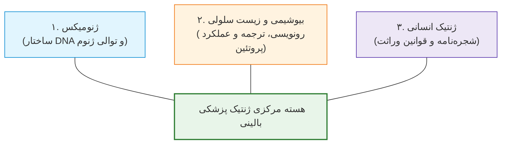
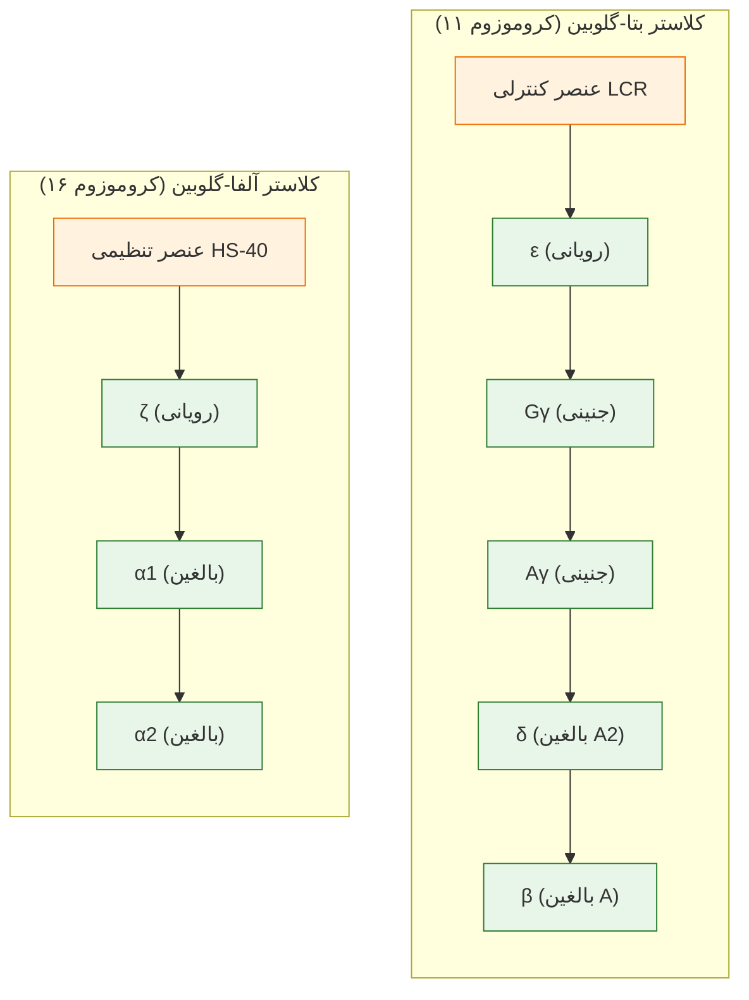
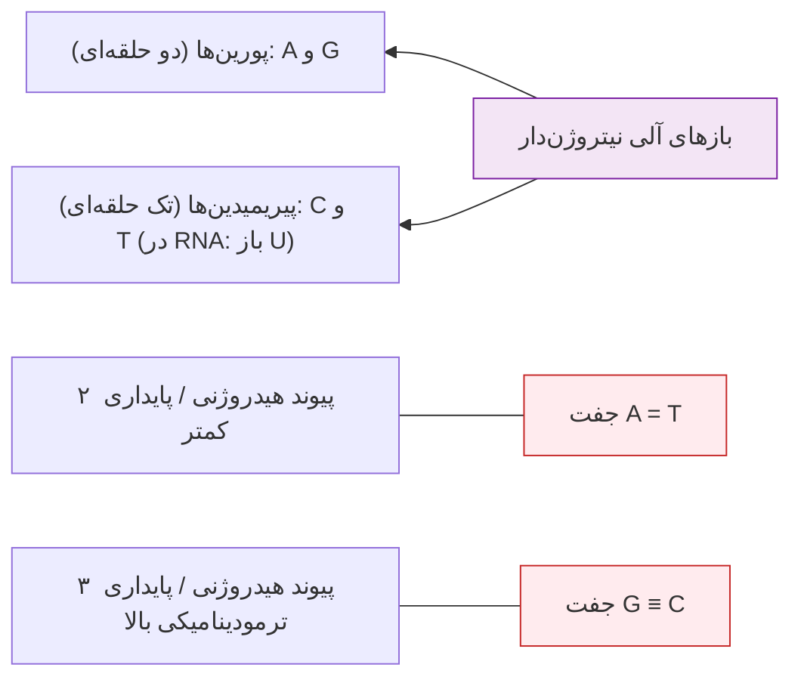
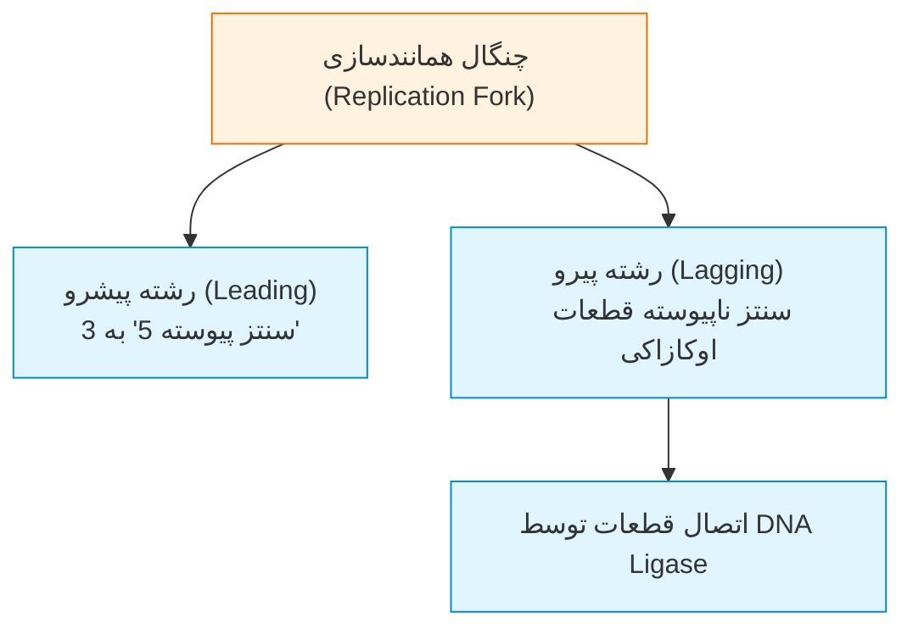

# جلسه ۱۶: ژنتیک مولکولی، رونویسی و تنظیم بیان ژن (Molecular Genetics & Gene Regulation)

## 1. ارکان سه‌گانه ژنتیک پزشکی و جایگاه ژنتیک مولکولی

> [!info] قلمروهای بنیادین ژنتیک پزشکی
> ژنتیک پزشکی بر برهم‌کنش ۳ حوزه اصلی استوار است:
> 1. **Genomics (ژنومیکس):** مطالعه ساختار، ابعاد و توالی کل مولکول DNA در هسته سلول.
> 2. **Cell Biology & Biochemistry:** مطالعه بیوشیمی اسیدهای نوکلئیک، رونویسی، ترجمه و عملکرد پروتئین‌ها.
> 3. **Human Genetics (ژنتیک انسانی):** الگوهای توارث شجره‌نامه‌ای و انتقال صفات و بیماری‌ها در خانواده‌ها.

---

## 2. آمار طلایی آناتومی ژنوم انسان

* **محتوای کل DNA:** سلول‌های دیپلوئید انسان ($2n=46$) حاوی **6 میلیارد جفت‌باز (6 Gb)** هستند (3 میلیارد جفت‌باز در ژنوم هاپلوئید اسپرم یا تخمک).
* **تعداد ژن‌های عملکردی:** بین **20,000 تا 23,000 ژن** (میانگین 22,000 ژن کدکننده پروتئین).
* **ابعاد متوسط ژن‌ها:** میانگین طول یک ژن انسانی **14,000 جفت‌باز (14 kb)** است (دامنه بین 2 kb تا 2,400 kb؛ بزرگ‌ترین ژن: *دیستروفین* با 2.4 Mb).
* **پیرایش دگرسان (Alternative Splicing):** بیش از **60%** ژن‌های انسان بیش از ۱ نوع mRNA تولید می‌کنند (به طور متوسط **2.6 رونوشت به ازای هر ژن**؛ حاصل ضرب 2.6 در 23,000 ژن معادل سنتز حدود **60,000 ترنسکریپت** عملکردی در سلول است).
* **سهم DNA غیرکدکننده:** بین **95% تا 98%** از کل ژنوم انسان غیرکدکننده پروتئین (Non-coding) است!

---

## 3. ترمینولوژی و تعاریف کلیدی واژگان ژنتیک

> [!info] تعریف تمایز صفات مادرزادی در برابر ژنتیکی
> * **Congenital (مادرزادی):** هر اختلال یا نقص ساختاری موجود در *بدو تولد* (روزهای نخست نوزادی)؛ لزوماً ژنتیکی نیست (نظیر آسیب‌های تراتوژن، سندرم روبلا یا عفونت‌های رحمی مادر).
> * **Genetic (ژنتیکی):** ناشی از جهش در *یک یا چند ژن مشخص*؛ لزوماً مادرزادی نیست و می‌تواند شروع دیررس (Adult/Late-onset) داشته باشد (مانند بیماری هانتینگتون در دهه ۳ و ۴ زندگی یا پلی‌کیستیک کلیه بالغین).

> [!info] تعریف لوکوس، آلل و هاپلوتایپ
> * **Locus (لوکوس):** آدرس فیزیکی ثابت یک ژن روی کروموزوم (مثال: لوکوس *4p16* یعنی کروموزوم 4، بازوی کوتاه p، ناحیه 1، باند 6).
> * **Allele (آلل):** اشکال و توالی‌های جایگزین نوکلئوتیدی یک ژن در یک لوکوس معین روی کروموزوم‌های همولوگ.
> * **Haplotype (هاپلوتایپ):** مجموعه‌ای از آلل‌های ژن‌های مجاور روی *یک کروموزوم واحد* که به علت پیوستگی فیزیکی نزدیک، در طول میوز با هم نوترکیب نشده و به صورت یک بسته پیوسته به نسل بعد منتقل می‌شوند.

### جدول مقایسه‌ای وضعیت آلل‌ها و واریانت‌های ژنوم

| نوع واریانت / آلل | تعریف مولکولی دقیق | تواتر در جمعیت (Frequency) | پیامد بالینی و فنوتیپی |
| :--- | :--- | :--- | :--- |
| **Wild-type (نوع وحشی)** | نسخه طبیعی و غالب توالی نوکلئوتیدی در جمعیت | اکثریت قاطع جامعه (>99%) | عملکرد زیستی استاندارد و فنوتیپ سالم |
| **Mutant (جهش‌یافته)** | تغییر دائمی در توالی نوکلئوتیدی ژن | نادر (معمولاً <1%) | اختلال عملکرد پروتئین و بروز بیماری ژنتیکی |
| **Polymorphism (پلی‌مورفیسم)** | حضور دو یا چند آلل نرمال در یک لوکوس معین | **شایع (≥1% جامعه)** | تنوع طبیعی جمعیت؛ فاقد بیماری‌زایی مستقیم |
| **Rare variant (واریانت نادر)** | تغییر نوکلئوتیدی خنثی و غیرپاتوژنیک | **بسیار کم‌تکرار (<1% جامعه)** | تنوع طبیعی فردی فاقد علامت بالینی |

> [!tip] تمایز ژنوتیپ و فنوتیپ
> **ژنوتیپ (Genotype)** ترکیب اللی دو کروموزوم والدینی در یک لوکوس است (هوموزیگوت AA/aa، هتروزیگوت Aa، همی‌زیگوت در مردان برای کروموزوم X). **فنوتیپ (Phenotype)** تظاهر قابل مشاهده مورفولوژیک، بالینی، بیوشیمیایی (فعالیت آنزیم) یا مولکولی است. فنوتیپ دقیق همواره به صورت خطی از روی ژنوتیپ قابل پیش‌بینی نیست، زیرا توسط برهم‌کنش سایر ژن‌های تعدیل‌کننده (Modifiers)، اپی‌ژنتیک و محیط تنظیم می‌شود.

---

## 4. کلاسترهای ژنی و سوئیچینگ نموی (Gene Clusters)

ژن‌های انسان در ژنوم به دو شکل سازمان می‌یابند: منفرد یا خوشه‌ای (Cluster):
1. **کلاسترهای هماهنگ‌کننده ساخت پروتئین:** ژن‌های هیستونی یا فاکتورهای رشد و گیرنده‌های آن‌ها که در مجاورت هم قرار دارند تا رونویسی همزمان انجام شود.
2. **کلاسترهای سوئیچینگ تکاملی هموگلوبین:**
   * **کلاستر آلفا-گلوبین (روی کروموزوم 16):** شامل ژن رویانی $\zeta$ (زتا) و ژن‌های بالغین $\alpha_1$ و $\alpha_2$ تحت کنترل ناحیه تنظیمی بالادست **HS-40** (سایت بسیار حساس به DNase I شماره 40).
   * **کلاستر بتا-گلوبین (روی کروموزوم 11):** شامل ژن رویانی $\varepsilon$ (اپسیلون)، ژن‌های جنینی $G\gamma$ و $A\gamma$، و ژن‌های بالغین $\delta$ و $\beta$ تحت کنترل هماهنگ‌کننده بالادست **LCR** (ناحیه کنترل لوکوس / Locus Control Region).

---

## 5. واحدهای اندازه‌گیری و فاکتورهای تبدیل در ژنوم

* **1 kb (کیلو باز):** 1,000 جفت‌باز DNA.
* **1 Mb (مگا باز):** 1,000,000 جفت‌باز DNA (معادل 1,000 kb).
* **1 cM (سانتی‌مورگان):** واحد نقشه ژنتیکی پیوستگی؛ تقریباً معادل **1 Mb (یک میلیون جفت‌باز)** در ژنوم انسان.
* **نرخ نوترکیبی (Recombination Frequency):** وقوع **1% کراسینگ‌اور** بین دو لوکوس معادل فاصله فیزیکی **1 cM** در نظر گرفته می‌شود. کراسینگ‌اور حاصل تبادل ماده ژنتیکی بین کروماتیدهای غیرخواهری کروموزوم‌های همولوگ در مرحله **پاکیتن (Pachytene)** از پروفاز ۱ میوز طی فرآیند سیناپسیس است.

---

## 6. ساختار شیمیایی، پیوندهای هیدروژنی و پایداری DNA

* **واحدهای ساختمانی:** باز آلی + قند پنتوز (دئوکسی‌ریبوز در DNA و ریبوز در RNA) = **نوکلئوزید**؛ نوکلئوزید + فسفات = **نوکلئوتید**.
* **پیوندهای هیدروژنی مکمل:**
  * آدنین و تیمین با **۲ پیوند هیدروژنی** ($A=T$) به هم متصل می‌شوند.
  * سیتوزین و گوانین با **۳ پیوند هیدروژنی** ($G \equiv C$) به هم متصل می‌شوند.
* **پایداری خارق‌العاده پیوندهای هیدروژنی:** محتوای بالاتر GC پایداری حرارتی مارپیچ دوگانه را جهش می‌دهد. همین پیوندهای مستحکم امکان استخراج و خوانش توالی DNA باستانی از استخوان‌های چند هزار ساله انسان‌های نئاندرتال در غارها را پس از هزاره‌ها فراهم می‌سازد.

---

## 7. مکانیسم پلیمورفیسم‌های تک‌نوکلئوتیدی (SNPs) و جهش C به T

> [!warning] تله فوق‌العاده امتحانی: منشأ بیوشیمیایی جهش‌های C>T
> * در ژنوم انسان بیش از **10 میلیون اسنیپ (SNP)** وجود دارد (به طور میانگین یک اسنیپ در هر 100 تا 300 نوکلئوتید).
> * **دو سوم (66%) کل اسنیپ‌های انسان ناشی از جانشینی سیتوزین به تیمین ($C \rightarrow T$) هستند!**
> * **مکانیسم مولکولی:** در جزایر CpG، سیتوزین ابتدا توسط آنزیم DNMT متیله شده و به *5-متیل‌سیتوزین* تبدیل می‌شود. 5-متیل‌سیتوزین تمایل ذاتی شدیدی به **دی‌آمیناسیون خودبه‌خودی (Deamination - از دست دادن گروه آمین)** دارد. با خروج گروه آمین و جایگزینی اکسیژن، 5-متیل‌سیتوزین مستقیماً به **تیمین (T)** تبدیل می‌شود.

---

## 8. همانندسازی DNA (Replication)

> [!info] ویژگی‌های کلیدی همانندسازی
> * **زمان وقوع:** منحصراً در **فاز S (سنتز)** چرخه سلولی قبل از ورود سلول به میتوز.
> * **نیمه‌حفاظت‌شده (Semi-conservative):** هر مولکول دوگانه حاصل، واجد یک رشته مادری قدیمی و یک رشته نوساز است.
> * **جهت سنتز آنزیمی:** منحصراً در جهت **5' به 3'** توسط DNA پلیمراز.

* **رشته پیشرو (Leading strand):** به صورت پیوسته و سریع هم‌جهت با چنگال همانندسازی در جهت 5' به 3' ساخته می‌شود.
* **رشته پیرو (Lagging strand):** به علت قطبیت معکوس، به شکل ناپیوسته و کندتر در قالب قطعات کوتاه **اوکازاکی (Okazaki fragments)** ساخته شده و سپس توسط آنزیم DNA Ligase به یکدیگر متصل می‌گردند.

---

## 9. رونویسی و آناتومی تنظیمی ژن (Transcription)

* **تعریف:** سنتز مولکول تک‌رشته‌ای pre-mRNA از روی رشته الگوی DNA در هسته توسط RNA Polymerase.
* **رشته سنس در برابر آنتی‌سنس:**
  * **رشته سنس (Sense / Coding strand):** جهت 5' به 3'؛ توالی آن دقیقاً مشابه رونوشت mRNA است (با این تفاوت که در RNA باز U به جای T قرار دارد).
  * **رشته آنتی‌سنس (Antisense / Template strand):** جهت 3' به 5'؛ رشته‌ای از DNA که RNA پلیمراز روی آن حرکت کرده و از روی آن کپی مکمل برمی‌دارد.
* **پروموتور (Promoter):** ناحیه تنظیمی بالادست ژن واجد موتیف‌های متصل‌شونده به فاکتورهای عمومی رونویسی شامل جعبه **TATA Box** (توالی کانسنسوس TATAAA در فاصله 25- تا 30- نوکلئوتیدی بالادست) و **سایت آغاز رونویسی (TSS / +1)**.
* **خاتمه‌دهنده (Terminator):** توالی مشخص در انتهای اگزون پایانی که سیگنال پایان رونویسی و اضافه شدن دم پلی‌آ را صادر می‌کند.

---

## 10. ترجمه (Translation) و پردازش پساترجمه‌ای (PTM)

> [!info] مراحل سه‌گانه ترجمه در ریبوزوم
> سنتز زنجیره پلی‌پپتیدی بر روی ریبوزوم با خوانش کدون‌های سه‌نوکلئوتیدی mRNA در جهت 5' به 3':
> 1. **Initiation (آغاز):** اتصال ریبوزوم به کلاهک 5' و اسکن تا رسیدن به کدون آغازگر **AUG (کدکننده متیونین)**.
> 2. **Elongation (طویل‌سازی):** ورود تریپلت‌های متوالی tRNA و تشکیل پیوندهای پپتیدی.
> 3. **Termination (پایان):** برخورد ریبوزوم با یکی از سه کدون خاتمه ترجمه (**UAA, UAG, UGA**) و رهاسازی پلی‌پپتید.

### چهار دگرگونی پساترجمه‌ای حیاتی (PTMs)
زنجیره پلی‌پپتیدی خام سنتز‌شده فاقد عملکرد زیستی است؛ برای کسب کارایی آنزیمی باید دستخوش تغییرات پساترجمه‌ای گردد:
1. **Phosphorylation (فسفوریلاسیون):** اتصال آنزیمی گروه فسفات ($PO_4^{3-}$) توسط کینازها به اسیدهای آمینه سرین، ترئونین یا تیروزین جهت فعال/خاموش‌سازی آنزیم‌ها.
2. **Glycosylation (گلیکوزیلاسیون):** اتصال زنجیره‌های الیگوساکاریدی در شبکه آندوپلاسمی و گلژی جهت حفظ حلالیت، تاخوردگی سه‌بعدی و هویت غشایی.
3. **Hydroxylation (هیدروکسیلاسیون):** افزودن گروه هیدروکسیل (-OH) به ریشه‌های پرولین و لیزین (نظیر ساختار مارپیچ سه‌گانه کلاژن).
4. **Methylation (متیلاسیون):** اتصال گروه متیل ($-CH_3$) به باقی‌مانده‌های لیزین و آرژینین (به‌ویژه در پروتئین‌های هیستونی و تنظیم کروماتین).

---

## 11. جمع‌بندی: همانندسازی در برابر رونویسی

| شاخص عملکردی                | همانندسازی DNA (Replication)   | رونویسی ژن (Transcription)              |
| :-------------------------- | :----------------------------- | :-------------------------------------- |
| **هدف بیولوژیک**            | تکثیر کل ژنوم جهت تقسیم سلولی  | کپی‌برداری انتخابی از یک ژن فعال        |
| **آنزیم پلیمراز کلیدی**     | DNA Polymerase                 | RNA Polymerase                          |
| **زمان چرخه سلولی**         | منحصراً فاز S (قبل از میتوز)   | تمام طول اینترفاز (فازهای G1, S, G2)    |
| **رشته الگوی مورد استفاده** | هر دو رشته DNA مادری (دوطرفه)  | منحصراً رشته آنتی‌سنس (3' به 5')        |
| **محصول نهایی**             | دو مولکول دابل‌استرند DNA      | مولکول تک‌رشته‌ای mRNA (سپس پردازش‌شده) |
| **پرایمر مورد نیاز**        | پرایمر موقت RNA (توسط Primase) | عدم نیاز به پرایمر اولیگونوکلئوتیدی     |
## 12. تست‌های تالیفی و سوالات چهارگزینه‌ای

### تست ۱
**در ژنوم دیپلوئید انسان، کدام گزینه در خصوص ابعاد ژنوم و رونوشت‌های RNA صحیح است؟**
1. طول متوسط یک ژن انسانی حدود 140 kb است و کمتر از 20% ژن‌ها پیرایش دگرسان دارند.
2. سلول‌های سوماتیک حاوی حدود 6 میلیارد جفت‌باز DNA بوده و ژن‌ها به طور متوسط 2.6 ترنسکریپت تولید می‌کنند.
3. ژنوم هاپلوئید انسان حاوی 6 میلیارد جفت‌باز DNA و حدود 60,000 ژن کدکننده پروتئین است.
4. بیش از 60% از کل ژنوم انسان به صورت اگزون‌های کدکننده به پروتئین ترجمه می‌شود.

* **پاسخ صحیح: گزینه ۲**
* **نکته تحلیلی:** سلول‌های دیپلوئید ($2n=46$) دارای 6 میلیارد جفت‌باز (6 Gb) هستند. تعداد ژن‌ها بین 20,000 تا 23,000 بوده و به علت Alternative Splicing در 60% ژن‌ها، هر ژن به طور متوسط 2.6 رونوشت mRNA و در مجموع حدود 60,000 ترنسکریپت مختلف تولید می‌کند. 95% تا 98% ژنوم غیرکدکننده است.

---

### تست ۲
**کدام اختلال زیر به عنوان یک بیماری «ژنتیکی غیرمادرزادی» طبقه‌بندی می‌شود؟**
1. سندرم ترنر ناشی از مونوزومی کروموزوم X
2. ناهنجاری فوکوملیا ناشی از مصرف تالیدومید در بارداری
3. بیماری هانتینگتون با سن بروز در میانسالی
4. سندرم سرخجه مادرزادی ناشی از عفونت داخل رحمی

* **پاسخ صحیح: گزینه ۳**
* **نکته تحلیلی:** بیماری هانتینگتون یک اختلال اتوزومال غالب تک‌ژنی است اما علائم آن در دهه ۳ و ۴ زندگی ظاهر می‌شود و نوزاد در بدو تولد کاملاً بدون علامت است؛ بنابراین ژنتیکی است اما مادرزادی نیست. سرخجه و تالیدومید مادرزادی اما غیرژنتیکی هستند.

---

### تست ۳
**علت اینکه حدود دو سوم (66%) کل پلی‌مورفیسم‌های تک‌نوکلئوتیدی (SNPs) در ژنوم انسان از نوع جانشینی سیتوزین به تیمین ($C \rightarrow T$) هستند، کدام پدیده بیوشیمیایی است؟**
1. اکسیداسیون خودبه‌خودی حلقه پورینی آدنین در جفت‌بازهای $A=T$
2. دآمیناسیون خودبه‌خودی باز 5-متیل‌سیتوزین در جایگاه‌های CpG
3. مهار آنزیم متیل‌ترانسفراز توسط فاکتورهای رونویسی متصل به TATA box
4. شکست نامتقارن قطعات اوکازاکی در رشته پیشرو حین همانندسازی

* **پاسخ صحیح: گزینه ۲**
* **نکته تحلیلی:** متیلاسیون سیتوزین در دی‌نوکلئوتیدهای CpG آن را به 5-متیل‌سیتوزین تبدیل می‌کند. این باز در اثر دآمیناسیون خودبه‌خودی (از دست دادن گروه آمین) تبدیل به باز تیمین (T) می‌شود که شایع‌ترین علت بروز جهش‌های نقطه‌ای گذار (Transition) و ایجاد اسنیپ‌ها است.

---

### تست ۴
**تنظیم تکاملی بیان ژن‌های کلاستر بتا-گلوبین بر روی کروموزوم ۱۱ توسط کدام توالی تنظیمی بالادست اعمال می‌شود؟**
1. جایگاه بسیار حساس به نوکلئاز HS-40
2. توالی پروموتوری جعبه پریبنو (Pribnow box)
3. ناحیه کنترل لوکوس (Locus Control Region - LCR)
4. اپران لک و توالی‌های اپراتور متصل به رپressor

* **پاسخ صحیح: گزینه ۳**
* **نکته تحلیلی:** کلاستر بتا-گلوبین روی کروموزوم 11 توسط **LCR** و کلاستر آلفا-گلوبین روی کروموزوم 16 توسط **HS-40** در بالادست کنترل و سوئیچینگ رشدی می‌شوند.

---

### تست ۵
**کدام توالی مربوط به کدون آغازگر ترجمه است و کدام آمینواسید را در ساختار اولیه پلی‌پپتید جای‌گذاری می‌کند؟**
1. توالی UAA - اسیدآمینه لیزین
2. توالی UGA - فاقد اسیدآمینه (استاپ کدون)
3. توالی AUG - اسیدآمینه متیونین
4. توالی UAG - اسیدآمینه سرین

* **پاسخ صحیح: گزینه ۳**
* **نکته تحلیلی:** کدون آغازگر در تمام mRNAهای یوکاریوتی بدون استثنا **AUG** است که کدکننده آمینواسید **متیونین** می‌باشد. کدون‌های UAA، UAG و UGA سه کدون خاتمه ترجمه هستند.
