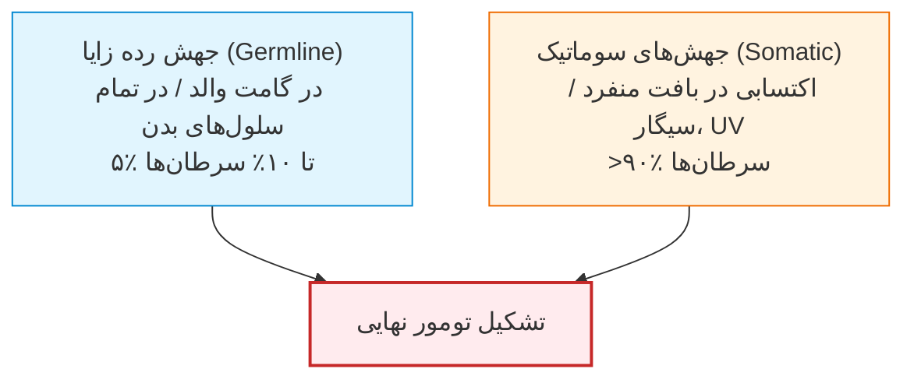
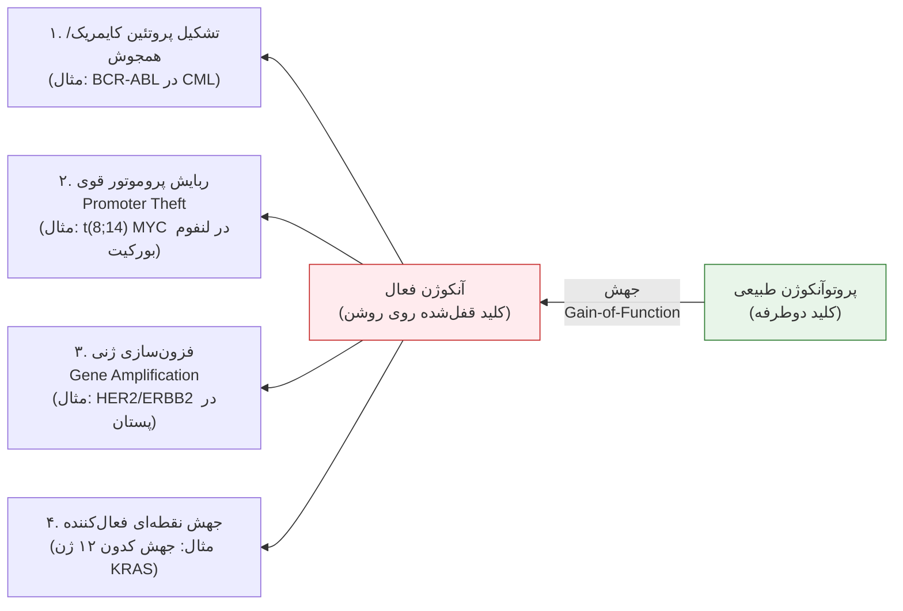
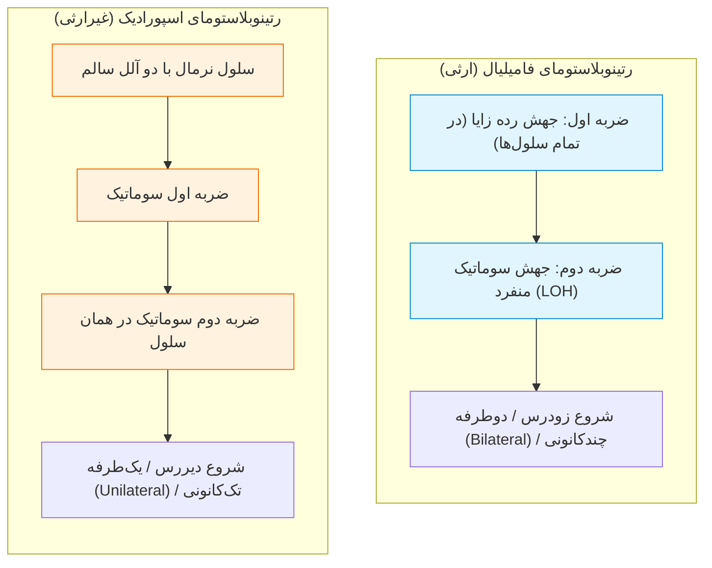
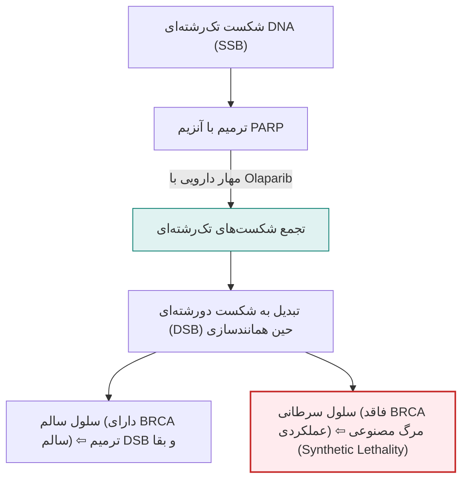
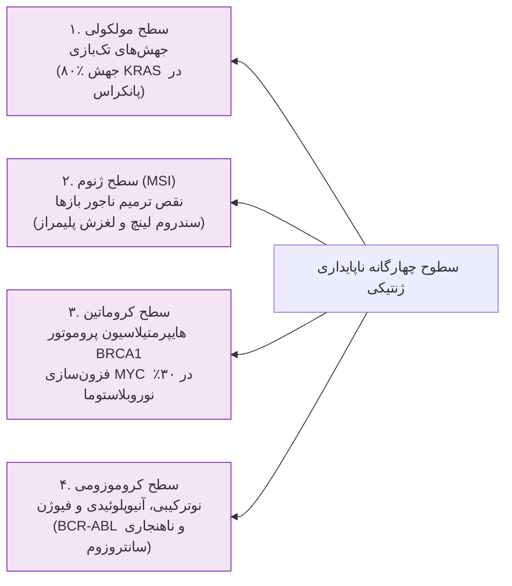
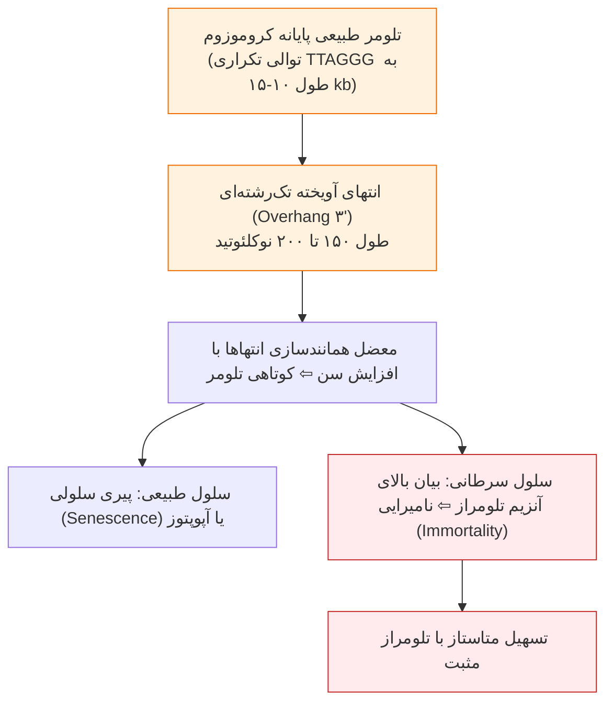
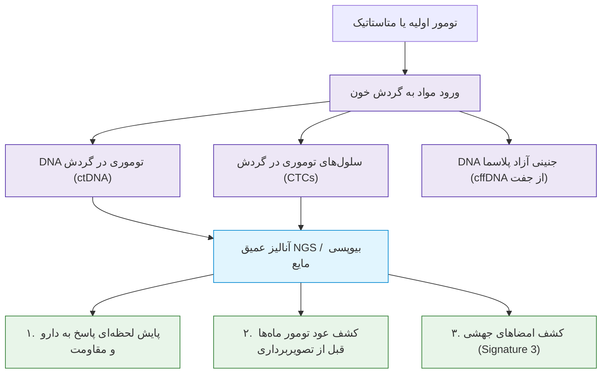

# جلسه ۱۷: ژنتیک سرطان، آنکوژن‌ها و سندروم‌های ارثی تومور (Cancer Genetics & Hereditary Syndromes)

## 1. اپیدمیولوژی، مبانی و ماهیت ژنتیکی سرطان

> [!info] تعریف بیولوژیک سرطان
> سرطان مجموعه‌ای از حدود ۲۰۰ بیماری بدخیم ناهمگن است؛ اختلال ژنتیکی سلول‌های سوماتیک که در آن چرخه تقسیم سلولی مهارنشده شده و سلول‌ها توانایی مرگ برنامه‌ریزی‌شده (Apoptosis) را از دست می‌دهند.

### آمار طلایی سرطان در جهان و ایران
* **جایگاه جهانی:** دومین عامل مرگ‌ومیر در جهان با سالانه حدود **10 میلیون قربانی**.
* **چشم‌انداز آینده:** تا سال ۲۰۷۰ موارد ابتلا به سرطان در مقایسه با سال ۲۰۲۴ **دو برابر** خواهد شد.
* **شایع‌ترین سرطان‌ها در جهان (گزارش ۲۰۲۲ WHO):** ۱) ریه (۲.۵ میلیون نفر معادل ۱۲.۲٪ کل موارد)، ۲) پستان زنان، ۳) کولورکتال، ۴) پروستات، ۵) معده.
* **شایع‌ترین سرطان‌ها در ایران به ترتیب شیوع:** ۱) پستان، ۲) روده بزرگ (کولورکتال)، ۳) معده، ۴) ریه، ۵) پروستات.
* **سهم وراثت:** ۵٪ تا ۱۰٪ سرطان‌های رایج (پستان و روده) ناشی از جهش‌های ارثی ژنوم زایا (Mendelian/Germline) هستند؛ بیش از ۹۰٪ موارد اسپورادیک (سوماتیک) می‌باشند.

### مقایسه جهش‌های پیش‌برنده (Driver) و مسافر (Passenger)
* **جهش‌های پیش‌برنده (Driver Mutations):** جهش‌های کلیدی که به طور مستقیم مزیت انتخابی رشد و بقا به سلول می‌دهند؛ محرک گسترش کلونی (Clonal Expansion) و انتخاب داروینی در سطح میکروسکوپی تومور هستند.
* **جهش‌های مسافر (Passenger Mutations):** جهش‌های خنثی تصادفی ناشی از نقص در ترمیم DNA؛ در تومور انباشته شده اما مستقیماً در تومورزایی نقشی ندارند.

> [!warning] برهم‌کنش ژنتیک و محیط (تله تستی تلومر و سیگار)
> عوامل محیطی در کارگران قطران و زغال‌سنگ (سرطان پوست) و رنگ آنیلین (سرطان مثانه) اثبات شده‌اند. افراد سیگاری دارای **تلومرهای کوتاه کروموزومی** در مقایسه با افراد غیرسیگاری و حتی سیگاری‌های دارای تلومر بلند، ریسک به مراتب بالاتری در ابتلا به سرطان‌های مرتبط با دخانیات نشان می‌دهند.

---

## 2. پروتوآنکوژن‌ها و آنکوژن‌ها (پدال گاز سلولی)

> [!info] تعریف پروتوآنکوژن و آنکوژن
> **پروتوآنکوژن‌ها (Proto-oncogenes):** ژن‌های نرمال کنترل‌کننده میتوژنز، تمایز و بقای سلول.  
> **آنکوژن‌ها (Oncogenes):** فرم جهش‌یافته فعال پروتوآنکوژن‌ها با جهش **کسب عملکرد (Gain-of-Function)**؛ این جهش‌ها در سطح سلولی **غالب (Dominant)** هستند (جهش در یک آلل منفرد برای القای پیام مهارنشدنی تکثیر کافی است).

### مکانیسم‌های سه‌گانه فعال‌سازی آنکوژن‌ها
1. **تشکیل پروتئین فیوژن (BCR-ABL):** ترنسلوکاسیون متقابل $t(9;22)(q34;q11)$ موسوم به **کروموزوم فیلادلفیا** در لوسمی میلوئیدی مزمن (CML)؛ ادغام ژن تیروزین کیناز ABL روی کروموزوم ۹ با ژن BCR روی کروموزوم ۲۲ $\rightarrow$ تولید پروتئین کایمریک BCR-ABL با فعالیت تیروزین کینازی دائمی و مهارنشدنی. داروی هدفمند **ایماتینیب (Gleevec)** مستقیماً در پاکت کینازی این آنزیم نشسته و آن را بلوک می‌کند.
2. **تغییر مکان و ربایش پروموتور (Promoter Hijacking):** ترنسلوکاسیون متقابل $t(8;14)(q24;q32)$ در **لنفوم بورکیت**؛ توالی کامل فاکتور رونویسی MYC از کروموزوم ۸ در مجاورت انسرها و پروموتور فوق‌فعال زنجیره سنگین ایمونوگلوبولین (IgH) روی کروموزوم ۱۴ قرار می‌گیرد $\rightarrow$ بیان بیش‌ازحد MYC بدون تغییر ساختار پروتئینی آن.
3. **فزون‌سازی ژنی (Amplification):** تکثیر تعداد کپی‌های ژنی DNA؛ تقویت ژن گیرنده فاکتور رشد **HER2 / ERBB2** در حدود ۲۰٪ سرطان‌های پستان (تارگت داروی آنتی‌بادی مونوکلونال تراستوزومب/هرسپتین) و تقویت ژن **MYCN** در ۳۰٪ موارد نوروبلاستومای پیشرفته اطفال.

---

## 3. ژن‌های مهارکننده تومور (TSGs) و فرضیه دو ضربه نادسن

> [!info] تعریف ژن‌های مهارکننده تومور (Tumor Suppressor Genes)
> ژن‌های ترمزکننده چرخه سلولی، القاکننده آپوپتوز و بازدارنده تومور؛ جهش آن‌ها از نوع **از دست دادن عملکرد (Loss-of-Function)** بوده و در سطح سلولی **مغلوب (Recessive)** هستند (هر دو آلل ژنی باید غیرفعال شوند تا نقص فنوتیپی بروز کند).

### فرضیه دو ضربه آلفرد نادسن (Knudson's Two-Hit Hypothesis)
* **در فرم فامیلیال:** ضربه اول ($M_1$) از طریق گامت والد در تمام سلول‌های بدن به ارث رسیده است. رخ دادن یک ضربه سوماتیک دوم ($M_2$) در هر یک از سلول‌های شبکیه به دلیل وفور سلولی رخ داده و به تومورهای دوطرفه، چندکانونی و زودهنگام ختم می‌شود.
* **در فرم اسپورادیک:** کودک با دو آلل سالم متولد می‌شود. رخ دادن هر دو ضربه ($M_1$ و $M_2$) به صورت مستقل در یک سلول منفرد نادر است؛ لذا تومور یک‌طرفه، تک‌کانونی و دیرهنگام ایجاد می‌شود.

> [!info] پدیده از دست رفتن هتروزیگوسیتی (Loss of Heterozygosity - LOH)
> شایع‌ترین سازوکار ضربه دوم در ژن‌های TSG؛ سلول هتروزیگوت دارای یک آلل سالم و یک آلل جهش‌یافته، طی نوترکیبی میتوزی، حذف بینابینی، یا عدم تفکیک کروموزومی، نسخه سالم خود را از دست داده و برای آلل معیوب هموزیگوت/همی‌زیگوت می‌شود.

### استثنای حیاتی TP53: اثر غالب منفی (Dominant-Negative Effect)
* **ژن TP53 (نگهبان ژنوم):** مهارکننده تومور با توقف سلول در ایستگاه G1/S و القای آپوپتوز.
* **مکانیسم تترامر:** پروتئین p53 برای اتصال به DNA باید کمپلکس چهارگانه (**تترامر**) تشکیل دهد. حضور حتی یک زیرواحد معیوب حاصل از تک‌آلل جهش‌یافته، کارکرد کل تترامر چهارگانه را مختل می‌سازد؛ این اثر **غالب منفی (Dominant-Negative)** نام دارد و رفتار تک‌آللی شبه‌غالب ایجاد می‌کند.

---

## 4. سندروم‌های ارثی تومور، ترمیم DNA و مفهوم مرگ مصنوعی

### جدول مقایسه‌ای سندروم‌های ارثی شاخص مستعدکننده سرطان

| سندروم بالینی | ژن درگیر و جایگاه | سازوکار مولکولی پایه | تظاهرات کلینیکی و بدخیمی‌های اولیه |
| :--- | :--- | :--- | :--- |
| **پولیپوز آدنوماتوز خانوادگی (FAP)** | ژن *APC* روی لوکوس 5q21 | اختلال در کمپلکس تخریب‌کننده بتاکاتنین در مسیر Wnt | ایجاد صدها تا هزاران پولیپ روده بزرگ در نوجوانی؛ نفوذ ۱۰۰٪ ابتلا به سرطان کولورکتال در صورت عدم کولکتومی |
| **سرطان ارثی پستان و تخمدان (HBOC)** | ژن‌های *BRCA1* (17q21) و *BRCA2* (13q12) | نقص در ترمیم شکست‌های دورشته‌ای DNA به روش نوترکیبی همولوگ (HRR) | افزایش شدید ریسک سرطان پستان، تخمدان، پروستات و پانکراس؛ ایجاد حساسیت کشنده به مهارکننده‌های PARP |
| **سندروم لینچ (HNPCC)** | ژن‌های *MLH1*, *MSH2*, *MSH6*, *PMS2* | نقص در سیستم ترمیم عدم تطابق بازها (MMR) | سرطان کولورکتال غیرپولیپوزی زودرس (عمدتاً کولون راست)، سرطان آندومتر، تخمدان و معده؛ همراه با ناپایداری ریزماهواره (MSI) |
| **سندروم لی-فرامنی (LFS)** | ژن *TP53* روی لوکوس 17p13 | اختلال در آپوپتوز و توقف چرخه سلولی در آسیب DNA | سارکوم‌های متعدد، سرطان پستان زودرس، تومورهای مغزی، لوسمی و کارسینوم قشر آدرنال در سنین نوجوانی و جوانی |

> [!important] مفهوم مرگ مصنوعی (Synthetic Lethality) در درمان با مهارکننده PARP
> در سلول‌های توموری مبتلا به جهش *BRCA1/2*، مسیر ترمیم شکست‌های دورشته‌ای (HRR) نابود شده و بقای سلول کاملاً وابسته به ترمیم تک‌رشته‌ای توسط **PARP** است. با مهار آنزیم PARP توسط داروهایی چون **الاپاریب (Olaparib)**، شکست‌های تک‌رشته‌ای به دورشته‌ای تبدیل شده و تومور به دلیل انسداد هر دو مسیر متلاشی می‌شود؛ سلول‌های نرمال بیمار به دلیل داشتن نسخه سالم BRCA زنده می‌مانند.

> [!warning] تله امتحانی افتراق سندروم لینچ از سرطان کولورکتال اسپورادیک
> در ایمونوهیستوشیمی (IHC)، عدم بیان پروتئین MLH1 الزاماً به معنای سندروم لینچ ارثی نیست؛ زیرا در ۸۰٪ موارد اسپورادیک، پروموتور MLH1 دچار **هایپرمتیلاسیون اپی‌ژنتیک** شده است.  
> * **تست کلیدی افتراق:** ارزیابی جهش سوماتیک **BRAF V600E**؛ حضور جهش BRAF منحصراً به نفع **سرطان اسپورادیک** بوده و احتمال سندروم لینچ ارثی را تقریباً منتفی می‌سازد.

* **اختصاصیت بافتی در سندروم لینچ:** ژن سرکوبگر گیرنده فاکتور رشد **TGFBR2** واجد یک توالی تکراری حاوی ۱۰ آدنین متوالی ($A_{10}$) است. حین همانندسازی، DNA پلیمراز روی این ریزماهواره لیز می‌خورد (*Polymerase Slippage*)؛ در غیاب سیستم ترمیم MMR، جهش شیفت چارچوب در TGFBR2 تثبیت شده و به سرطان کولون اختصاصی ختم می‌شود.

---

## 5. ناپایداری ژنتیکی، ناهنجاری‌های سانتروزومی و گروه‌های ژنی سرطان

> [!info] تعریف ناپایداری ژنتیکی (Genomic Instability)
> وضعیت جهش‌زایی دائم در سلول‌های توموری که هم علت پیدایش سرطان و هم عامل شتاب‌دهنده پیشرفت، تهاجم و فرار از درمان تومور است.

### نقش ناهنجاری سانتروزوم‌ها در ناپایداری کروموزومی
* **سانتروزوم به عنوان MTOC (مرکز سازماندهی میکروتوبول‌ها):** وظیفه قطبیت سلولی، سازمان‌دهی دوک تقسیم میتوزی دوقطبی و تفکیک کروموزوم‌ها میان سلول‌های دختری.
* **پاتولوژی توموری:** سلول‌های سرطانی ناهنجاری‌های عددی و ساختاری سانتروزوم (چندقطبی شدن دوک تقسیم) نشان می‌دهند که منجر به توزیع نامتعادل کروموزوم‌ها، آنیوپلوئیدی گسترده و تتراپلوئیدی می‌گردد.

### گروه‌های چهارده‌گانه ژنی دخیل در سرطان
حداقل **۱۴ رده ژنی** در همکاری متقابل تومورزایی نقش دارند:
1. آنکوژن‌ها
2. ژن‌های بازدارنده تومور (TSGs)
3. ژن‌های ترمیم DNA
4. ژن‌های ضد متاستاز
5. ژن‌های جهش‌پذیر
6. ژن‌های تنظیم‌کننده تلومراز
7. فاکتورهای رشد و رگزایی (Angiogenesis)
8. ترنسپوزون‌ها
9. ژن‌های ضد آپوپتوز نظیر سورویوین (Survivin)
10. عناصر بسیار محافظت‌شده (UCEs)
11. ژن‌های انتقال اپیتلیال به مزانشیمی (EMT)
12. ژن‌های سلول‌های بنیادی سرطان (CSCs)
13. RNAهای طویل غیرکدکننده (lncRNAs)
14. میکروRNAها (miRNAs)

---

## 6. تلومر، تلومراز و اپی‌ژنتیک در انکوژنز

* **ساختار تلومر:** تکرارهای دو رشته‌ای $TTAGGG$ به طول ۱۰ تا ۱۵ کیلوباز با دم آویخته تک‌رشته‌ای ۱۵۰ تا ۲۰۰ نوکلئوتیدی در انتهای 3'؛ آنزیم ترنسکریپتاز معکوس **تلومراز** انتهای 3' را شناسایی کرده و طول تلومر را حفظ می‌کند. بافت‌های متاستاتیک تومور غالباً مثبت تلومرازی هستند.
* **غیرفعال‌سازی کروموزوم X (لیونیزاسیون):** کشف توسط ماری لیون (۱۹۶۱)؛ از مرحله ۸ سلولی توسط رونوشت ژن غیرکدکننده **XIST** آغاز و یکی از دو کروموزوم X در سلول‌های ماده به صورت تصادفی به جسم بار متراکم و غیرفعال تبدیل می‌شود (جبران دوزاژ ژنی بین زن و مرد).

---

## 7. بیوپسی مایع (Liquid Biopsy) و امضاهای جهشی

### شاخص‌های ctDNA و CTC در بیوپسی مایع
* **همبستگی بالینی:** سطح ctDNA و تعداد CTCs در پلاسما با **مرحله (Stage)** بیماری و حجم تومور همبستگی مستقیم دارد؛ افت آن نشانه پاسخ درمانی و صعود آن نشانه عود زودهنگام یا شکست درمان است.
* **امضاهای جهشی (Mutational Signatures):** الگوهای منحصربه‌فرد ردپای جهش‌زاها در اگزوم تومور؛ **Signature 3** در NGS نمایانگر نقص در ترمیم نوترکیبی همولوگ (*BRCAness*) است و مجوز بالینی تجویز داروهای مهارکننده PARP را حتی بدون شناسایی جهش نقطه‌ای در خود ژن BRCA صادر می‌کند.
* **بار جهشی تومور (TMB):** تومورهای با نقص ترمیم MMR به دلیل جهش‌های فراوان، آنتی‌ژن‌های جدید جهش‌یافته (Neoantigens) زیادی تولید می‌کنند؛ این تومورها به شدت در تیررس سیستم ایمنی قرار گرفته و **بهترین پاسخ را به مهارکننده‌های چک‌پوینت ایمنی (پمبرولیزومب/Keytruda)** می‌دهند.

---

## 8. درمان‌های مدرن سرطان و پزشکی بازساختی

### ستون‌های پنج‌گانه درمان سرطان
1. **جراحی (Surgery):** نخستین خط درمان در تومورهای موضعی غیرمتاستاتیک با قابلیت برداشت کامل.
2. **شیمی‌درمانی و پرتودرمانی (Chemo/Radiotherapy):** سیتوتوکسیک نئوادجوانت (پیش از جراحی برای کوچک‌سازی) یا ادجوانت (پس از جراحی).
3. **هورمون‌درمانی (Hormone Therapy):** در تومورهای وابسته به هورمون (پستان ER/PR مثبت، پروستات).
4. **پیوند سلول‌های بنیادی مغز استخوان (BMT / HSCT):** نجات رده‌های خونساز پس از دوزهای لتال شیمی‌درمانی.
5. **ایمونوتراپی (Immunotherapy - ستون پنجم درمان):** تحریک سیستم ایمنی بدن بیمار علیه تومور (CAR-T Cell Therapy و آنتی‌بادی‌های مونوکلونال چک‌پوینت).

> [!important] پارادوکس بقا در سرطان در برابر بیماری‌های قلبی (آمار ۱۹۷۵ تا ۲۰۲۲ آمریکا)
> * مرگ‌ومیر ناشی از بیماری‌های قلبی بیش از **۶۰٪ کاهش** یافته، اما مرگ‌ومیر سرطان زیر ۸۵ سال تنها **۸٪ تا ۹٪ افت** داشته است!
> * میانگین هزینه سالانه درمان سرطان بالغ بر **۱۰۰ میلیارد دلار** است، اما تنها حدود **یک‌چهارم (۲۵٪)** مبتلایان به درمان‌های کنونی پاسخ می‌دهند.
> * **علل شکست درمان‌های کلاسیک:** فقدان غربالگری زودهنگام جامع، تمرکز بر درمان دیرهنگام در فاز متاستاتیک، تخریب محیط زیست، سبک زندگی و پیچیدگی فوق‌العاده اپی‌ژنتیک تومورها.

### شاخه‌های هشت‌گانه پزشکی بازساختی (Regenerative Medicine) در سرطان
1. **ژن‌درمانی (Gene Therapy):** انتقال ژن‌های سالم یا ویرایش ژنوم با CRISPR-Cas
2. **سلول‌درمانی (Cell Therapy):** تزریق سلول‌های تمایزیافته یا CAR-T
3. **ایمنی‌درمانی (Immunotherapy):** تقویت سیستم ایمنی خود فرد
4. **مهندسی بافت و زیست‌ماده (Biomaterials):** داربست‌های زیستی ترمیم بافت
5. **ویروس‌درمانی (Virotherapy):** انهدام تومورها با ویروس‌های انکولیتیک
6. **آنتی‌بادی‌های مونوکلونال (mAbs):** هدف‌گیری آنتی‌ژن‌های سطحی نئوپلازی
7. **اگزوزوم‌درمانی (Exosome Therapy):** وزیکول‌های خارج‌سلولی حامل داروهای هدفمند
8. **واکسن‌های درمانی (Therapeutic Vaccines):** آموزش سیستم ایمنی علیه آنتی‌ژن‌های توموری
