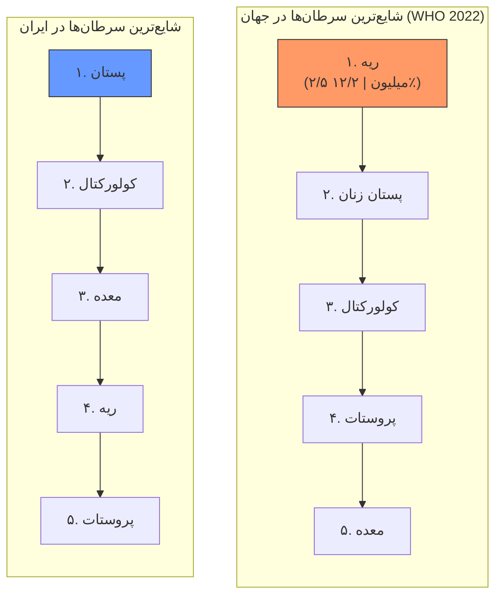
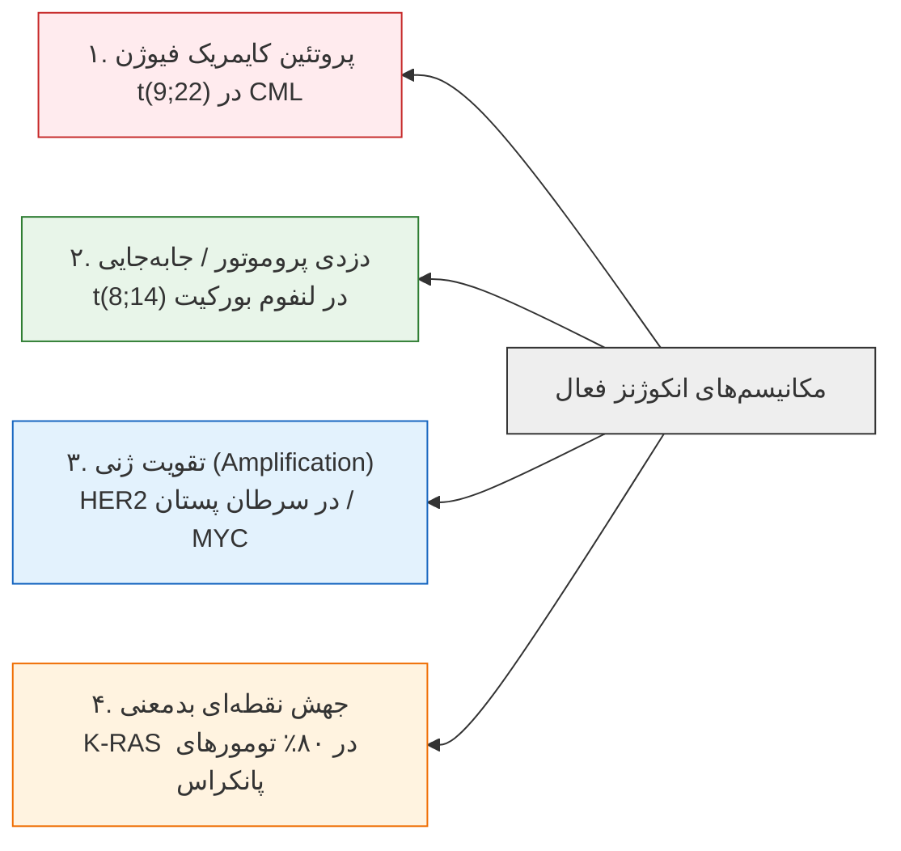
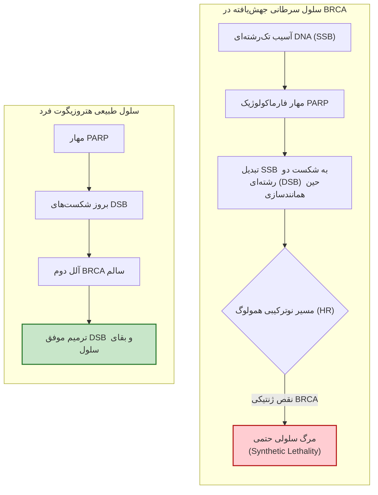
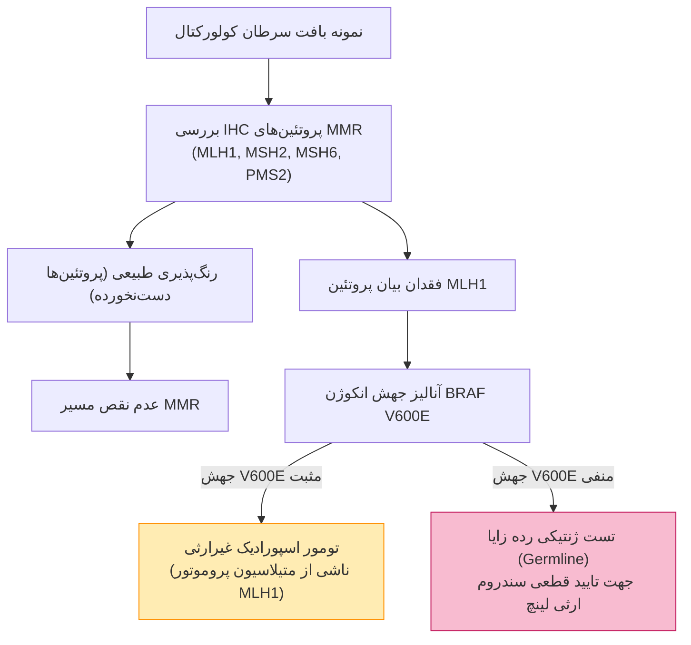
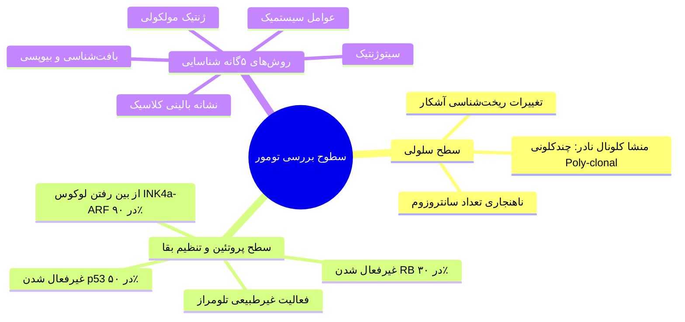
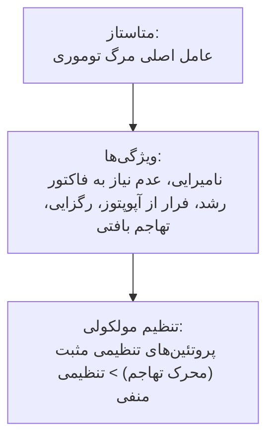

# درس‌نامه جامع و فشرده ژنتیک سرطان، آنکوژن‌ها و سندروم‌های ارثی تومور

> [!definition] تعریف بیولوژیک سرطان
> سرطان مجموعه‌ای از حدود **۲۰۰ نوع بیماری ناهمگن** ژنتیکی، اپی‌ژنتیکی و محیطی است؛ یک ناهنجاری پیش‌رونده در **چرخه سلولی** که با خروج سلول از مدار قوانین کنترلی تقسیم، نامیرایی و توانایی تهاجم تعریف می‌شود.

---

## ۱. اپیدمیولوژی، بار جهانی و اولویت‌های بالینی

* **جایگاه مرگ‌ومیر:** دومین عامل مرگ در جهان؛ سالانه حدود **۱۰ میلیون مرگ**.
* **پیش‌بینی شیوع:** تا سال **۲۰۷۰** شمار مبتلایان نسبت به سال **۲۰۲۴** حدود **۲ برابر** می‌شود.
* **نرخ پاسخ به درمان:** سالانه بیش از **۱۰۰ میلیارد دلار** هزینه درمان، اما پاسخ‌دهی تنها در حدود **۲۵٪** (یک‌چهارم) بیماران رخ می‌دهد.
* **ریسک مادام‌العمر:** بیش از **یک‌سوم** شهروندان (در جوامع پیشرفته مثل آمریکا) در طول عمر مبتلا به سرطان تشخیص داده می‌شوند.
* **روند مرگ‌ومیر آمریکا (۱۹۷۵ تا ۲۰۲۲):** مرگ سرطان زیر ۸۵ سال تنها **۸٪ تا ۹٪ کاهش** داشت (علت: ضعف غربالگری بهنگام، تمرکز صرف بر درمان، تخریب محیط‌زیست و سبک زندگی)؛ در حالی که مرگ‌ومیر ناشی از بیماری‌های قلبی حداقل **۶۰٪ کاهش** یافته است.

---

## ۲. رده‌های ژنتیکی و دسته‌بندی جهش‌های توموری

پیدایش بدخیمی حاصل همکاری دست‌کم **بیش از ۱۴ گروه ژنی** است:
1. انکوژن‌ها
2. ژن‌های بازدارنده تومور (TSG)
3. ژن‌های ترمیم DNA (کاهش نرخ ترمیم یا افزایش خطا)
4. ژن‌های ضد متاستاز
5. ژن‌های جهش‌پذیر (Mutator)
6. تنظیم‌کننده‌های تلومراز
7. فاکتورهای رشد و محرک‌های رگزایی
8. ترانسپوزون‌ها
9. سورواین (Survivin)
10. توالی‌های فوق‌حفاظت‌شده (UCEs)
11. تنظیم‌کننده‌های تمایز اپیتلیال به مزانشیمی (EMT) و سلول‌های بنیادی سرطان (CSCs)
12. RNAهای طویل غیرکدکننده (lncRNAs)
13. microRNAها (miRNAs)
14. تنظیم‌کننده‌های آپوپتوز و بقای سلولی

### جهش‌های پیش‌برنده (Driver) در برابر جهش‌های مسافر (Passenger)
* **جهش‌های Driver:** دست‌گذاشتن مستقیم روی پدال گاز؛ ایجاد **مزیت انتخابی رشد و بقا**؛ عامل پدیده **گسترش کلونال (Clonal Expansion)** تحت فشار انتخاب داروینی سلولی؛ تعداد اندک اما تعیین‌کننده.
* **جهش‌های Passenger:** جهش‌های تصادفی خنثی؛ ناشی از اختلال پایه‌ای در سیستم ترمیم DNA؛ فاقد مزیت عملکردی؛ بار ژنتیکی اضافه.

> [!important] اثر طول تلومر در افراد سیگاری بر ریسک سرطان
> در افراد سیگاری، افراد دارای **تلومرهای کروموزومی کوتاه** در مقایسه با همتایان غیرسیگاری و حتی سیگاری‌های دارای تلومر بلند، در معرض خطر به مراتب بالاتری برای ابتلا به سرطان‌های مرتبط با دخانیات هستند.

---

## ۳. تقابل عملکردی پروتوآنکوژن‌ها و مهارکننده‌های تومور (TSGs)

| ویژگی تشخیصی | پروتوآنکوژن‌ها (Proto-oncogenes) | ژن‌های مهارکننده تومور (TSGs) |
| :--- | :--- | :--- |
| **نوع جهش محرک** | **کسب عملکرد (Gain-of-Function)** | **از دست دادن عملکرد (Loss-of-Function)** |
| **تغییر بیوشیمیایی** | قفل‌شدن سوییچ تنظیمی در وضعیت دائم روشن | نابودی ترمز سلولی و خروج مسیر تنظیمی از مدار |
| **رفتار در سطح سلولی** | **غالب (Dominant)**؛ جهش یک آلل کافی است | **مغلوب (Recessive)**؛ هر دو آلل باید غیرفعال شوند |
| **خاستگاه جهش غالب** | عمدتاً جهش‌های **سوماتیک** حین زندگی | هر دو حالت **سوماتیک اسپورادیک** و **ژرم‌لاین ارثی** |
| **نمونه‌های شاخص** | *ABL*, *MYC*, *ERBB2 (HER2)*, *K-RAS* | *RB1*, *TP53*, *APC*, *BRCA1/2*, *MLH1/MSH2* |
| **رویکرد درمان هدفمند** | مهارکننده‌های کینازی و آنتی‌بادی علیه گیرنده | مهارکننده‌های مسیرهای جبرانی موازی (*Synthetic Lethality*) |

> [!definition] فرضیه دو ضربه‌ای نودسن (Knudson's Two-Hit Hypothesis)
> برای از کار افتادن یک ژن بازدارنده تومور، وقوع دو رخداد بیوشیمیایی الزامی است:
> * **فرم ارثی (مانند رتینوبلاستوما):** ضربه اول از طریق **سلول‌های زایشی (Germline)** به تمام سلول‌های بدن به ارث می‌رسد؛ ضربه دوم به شکل **سوماتیک میتوزی** رخ می‌دهد (بروز در سن پایین، دوطرفه و چندکانونی).
> * **فرم اسپورادیک:** هر دو ضربه به طور کاملاً مستقل در یک **سلول سوماتیک واحد** حین تقسیم میتوز رخ می‌دهند (بروز در سنین بالاتر، یک‌طرفه و تک‌کانونی).
> * **مکانیسم ضربه دوم:** عمدتاً از طریق پدیده **از دست رفتن هتروزیگوسیتی (LOH)** ناشی از نوترکیبی میتوزی، حذف ریزکروموزومی، یا عدم تفکیک صحیح کروموزومی رخ می‌دهد.

> [!warning] تله امتحانی: اثر غالب منفی در ژن TP53
> پروتئین p53 به عنوان *نگهبان ژنوم* به شکل یک **تترامر (کمپلکس ۴تایی)** عمل می‌کند. جهش بدمعنی (Missense) در یک آلل باعث تولید زیرواحد معیوبی می‌شود که با قرار گرفتن در کنار ۳ زیرواحد سالم، کل عملکرد بیولوژیک کمپلکس تترامری را فلج می‌کند؛ این پدیده **اثر غالب منفی (Dominant-Negative)** نام دارد و نشان می‌دهد چرا نقص در یک آلل p53 بر خلاف سایر TSGها رفتاری شبیه به صفات غالب نشان می‌دهد.

---

## ۴. مکانیسم‌های فعال‌سازی آنکوژن‌ها با مثال‌های بالینی

1. **پروتئین‌های هم‌یوغ یا کایمریک (Fusion Proteins):**
   * جابه‌جایی **t(9;22)(q34;q11)** یا **کروموزوم فیلادلفیا** در لوسمی میلوئید مزمن (CML).
   * پیوند ژن تیروزین کیناز *ABL* (کروموزوم ۹) به ژن *BCR* (کروموزوم ۲۲) ⇦ حذف دومین مهاری کیناز ⇦ کیناز پیوسته روشن.
   * داروی مهارکننده اختصاصی پاکت کیناز: **ایماتینیب (Gleevec)**.
2. **جابه‌جایی در مجاورت پروموتور قوی (Promoter Hijacking):**
   * جابه‌جایی **t(8;14)** در **لنفوم بورکیت**.
   * انتقال فاکتور رونویسی سالم *MYC* (کروموزوم ۸) به مجاورت انهنسرها و پروموتور قوی ژن‌های زنجیره سنگین ایمونوگلوبولین در لنفوسیت B (کروموزوم ۱۴) ⇦ افزایش شدید بیان رونویسی بدون تغییر در توالی آمینواسیدی.
3. **فزون‌سازی ژنی (Gene Amplification):**
   * تکثیر کپی‌های ژن *ERBB2 (HER2/neu)* در سرطان پستان ⇦ بیان بیش‌ازحد گیرنده‌ها بر غشای سلول.
   * تقویت ژن *MYC* در **۳۰٪ موارد پیشرفته نوروبلاستوما**.
4. **جهش‌های نقطه‌ای و حذف‌ها:**
   * جهش بدمعنی (Missense) در ژن **K-RAS** در **۸۰٪ سرطان‌های پانکراس**.

---

## ۵. سندروم‌های ارثی تومور، ترمیم DNA و آسیب‌پذیری دارویی

### سندروم پولیپوز آدنوماتوز خانوادگی (FAP)
* **ژن درگیر:** *APC* (مهارکننده تومور، تنظیم‌کننده مسیر Wnt).
* **مکانیسم مولکولی:** در شرایط فیزیولوژیک، پروتئین APC سوبسترای **بتا-کاتنین (β-Catenin)** را برای تخریب پروتئازومی نشانه‌گذاری می‌کند. با حذف دوآللی APC، بتا-کاتنین تخریب نشده، در سیتوپلازم انباشته و به هسته ترنسلوکه می‌شود و رونویسی ژن‌های محرک چرخه سلولی را آغاز می‌کند.
* **پیامد بالینی:** ایجاد هزاران پولیپ آدنوپاتیک در کولون با نفوذپذیری (Penetrance) **۱۰۰٪** به سمت بدخیمی در صورت عدم انجام کولکتومی پیشگیرانه.

### سندروم سرطان پستان و تخمدان و پدیده مرگ مصنوعی (Synthetic Lethality)
* **ژن‌های درگیر:** *BRCA1* و *BRCA2* (مسئول ترمیم نوترکیبی همولوگ در شکست‌های دو رشته‌ای DNA یا DSB).
* **مکانیزم درمانی با مهارکننده‌های PARP:** آنزیم PARP مسئول ترمیم شکست‌های تک‌رشته‌ای (SSB) است. در سلول‌های توموری با نقص BRCA، مسیر DSB خاموش است. مهار PARP باعث تبدیل شکست‌های تک‌رشته‌ای ترمیم‌نشده به شکست‌های دو رشته‌ای در حین رپلیکاسیون می‌شود؛ سلول تومور به دلیل فقدان هر دو مسیر فرومی‌پاشد، در حالی که سلول‌های سالم بدن به علت برخورداری از یک آلل طبیعی BRCA نجات می‌یابند.

### سندروم لینچ (HNPCC) و ناپایداری ریزماهواره (MSI)
* **ژن‌های معیوب:** ژن‌های ترمیم عدم تطابق بازها (MMR) شامل *MLH1*, *MSH2*, *MSH6*, *PMS2*.
* **علت درگیری اختصاصی روده:** ژن گیرنده مهاری *TGFBR2* واجد یک **توالی تکراری از ۱۰ باز آدنین پشت سر هم ($A_{10}$)** است. حین همانندسازی، DNA پلیمراز روی این توالی دچار لغزش (**Polymerase Slippage**) می‌شود. در صورت فقدان سیستم MMR، خطای تغییر چارچوب (Frameshift Mutation) رخ داده و ژن بازدارنده تومور *TGFBR2* تخریب می‌شود.

---

## ۶. ناپایداری ژنتیکی، ناهنجاری سانتروزومی و سطوح بررسی تومور

> [!definition] تعریف ناپایداری ژنتیکی (Genetic Instability)
> وضعیت گذرا یا دائمی که فرکانس حوادث جهشی و تغییرات کروموزومی ناخالص را به شدت بالا می‌برد. ناپایداری ژنتیکی صرفاً پیامد تومور نیست، بلکه محرک اولیه تومورزایی و فاکتور اصلی پیشرفت آن است و به صورت ناهمگن در کاریوتیپ تومورها حضور دارد.

### ۴ سطح ناپایداری ژنتیکی
1. **سطح مولکولی:** تغییرات نقطه‌ای، ورود یا حذف نوکلئوتیدی (مانند جهش *K-RAS* در ۸۰٪ کارسینوم پانکراس).
2. **سطح ژنوم:** نقص سیستم ترمیم و ایجاد ناپایداری ریزماهواره (**MIN / MSI**).
3. **سطح کروماتین / اپی‌ژنتیک:** متیلاسیون پروموتور و خاموشی ژن (مانند غیرفعال‌شدن *BRCA1* در تومورهای پستان اسپورادیک) و تکثیر ژنی (*MYC* در ۳۰٪ نوروبلاستوماهای پیشرفته).
4. **سطح کروموزومی:** نوترکیبی‌های میتوزی درون/بین‌کروموزومی، ترنسلوکاسیون‌ها، کسب یا از دست دادن بخش‌های بزرگ کروموزومی منتهی به **آنیوپلوئیدی** یا حتی **پلی‌پلوئیدی**.

> [!important] نقش کلیدی سانتروزوم‌ها به عنوان MTOC
> سانتروزوم‌ها مراکز سازماندهی میکروتوبول‌ها (**MTOC**) در سلول هستند که ساماندهی اسکلت سلولی، قطبیت، میکروتوبول‌های میتوزی و جداسازی دقیق کروموزوم‌ها را بر عهده دارند. ناهنجاری در شمار یا ساختار سانتروزوم‌ها، دوک‌های نامتقارن ایجاد کرده و ریشه اصلی بروز **ناپایداری کروموزومی (CIN)** و آنیوپلوئیدی در تومورها هستند.

---

## ۷. اپی‌ژنتیک، لیونیزاسیون و دینامیک ساختار تلومر

* **مفهوم اپی‌ژنتیک (Conrad Waddington 1942):** تغییرات پایدار و وراثت‌پذیر در بیان ژن، بدون دستکاری در کد و توالی نوکلئوتیدی DNA (انتقال با میتوز یا میوز).
* **نقش‌گذاری ژنومی (Genomic Imprinting):** بروز تظاهرات بالینی متفاوت بسته به انتقال الل از والد پدر یا مادر (*اثر خاستگاه والد*).
* **پدیده لیونیزاسیون (Mary Lyon 1961):** غیرفعال‌شدن تصادفی یکی از کروموزوم‌های X در سلول‌های جنین ماده در مرحله حدود **۸ سلولی** توسط ژن رونویسی شونده **XIST**؛ تشکیل **جسم بار (Barr Body)** و تنظیم جبران دوز ژنی میان زن و مرد.
* **الگوی متیلاسیون DNA:** پیوند گروه متیل به کربن ۵ حلقه باز سیتوزین در جزایر **CpG** که عموماً همبستگی مستقیم با **خاموشی رونویسی (Transcriptional Silencing)** دارد.

### بیولوژی تلومر در پیری و انکوژنز
* **ساختار تلومر:** تکرارهای پیاپی دو رشته‌ای به توالی **TTAGGG** با طول تقریبی **۱۰ تا ۱۵ کیلوباز** در ژنوم انسان.
* **آویخته تک‌رشته‌ای (Overhang):** قطعه‌ای انتهایی در پایانه '3 تلومر به طول **۱۵۰ تا ۲۰۰ نوکلئوتید** که توسط آنزیم **تلومراز** شناسایی و طویل می‌شود.
* **معضل همانندسازی انتهای DNA:** با تقسیمات مکرر، طول تلومر کوتاه شده، کلاهک محافظتی آن برداشته می‌شود و ناپایداری ژنومی رخ می‌دهد. در بافت‌های تهاجمی و متاستاتیک، **بیان بالای تلومراز** موجب نامیرایی و فرار سلول از سرنوشت مرگ می‌شود.

---

## ۸. متاستاز، بیوپسی مایع (Liquid Biopsy) و ایمونو-انکولوژی

> [!definition] اجزای بیوپسی مایع
> بررسی نشانگرهای توموری در گردش خون شامل:
> 1. **سلول‌های توموری در گردش (CTC)**
> 2. **DNA توموری در گردش (ctDNA)** یا کسر آزاد از سلول (Cell-free DNA / cfDNA).
> *(مقایسه بیولوژیک: cffDNA ژنوم جنینی مشتق از تروفوبلاست جفت است که وارد خون مادر می‌شود).*

* **همبستگی بالینی ctDNA و CTC:** فراوانی این دو در پلاسما، **همبستگی مستقیم با مرحله بیماری (Stage)** و رابطه معکوس با **طول عمر بقا** دارد.
* **کاربردهای تشخیصی:** ارزیابی پاسخ لحظه‌ای به دارو، مانیتورینگ مقاومت دارویی کلونال، تشخیص زودهنگام عود قبل از امکان مشاهده در CT اسکن یا تصویربرداری‌های مرسوم.
* **امضاهای جهشی (Mutational Signatures):** ارزیابی اگزوم با NGS الگوهای نوکلئوتیدی ویژه‌ای نشان می‌دهد؛ مثلاً **Signature 3** نشان‌دهنده نقص در ترمیم نوترکیبی همولوگ (**BRCAness**) است و پزشک را به استفاده از مهارکننده‌های PARP مجاز می‌سازد، حتی اگر در خود ژن BRCA جهش نقطه‌ای کلاسیک یافت نشود.
* **بار جهشی تومور (TMB) و ایمونوتراپی:** تجمع عظیم جهش‌ها (مانند تومورهای dMMR/MSI-High) باعث سنتز **نئوآنتی‌ژن‌های بیوشیمیایی غریبه** می‌شود. این پروتئین‌های جهش‌یافته توسط سیستم ایمنی شناسایی شده و موجب **پاسخ خیره‌کننده به مهارکننده‌های ایمونوتراپی (ستون پنجم درمان سرطان)** می‌شوند.

---

## ۹. آینده‌نگری: پزشکی دقیق و پزشکی بازساختی

طرح‌های بین‌المللی توالی‌یابی (مانند ژنوم انسان و پروژه صدهزار ژنوم) همراه با تکنولوژی مهندسی ژنوم **CRISPR-Cas** مسیر پزشکی انفرادی و دقیق را باز کرده‌اند.

> [!important] شاخه‌های ۸گانه پزشکی بازساختی (Regenerative Medicine)
> پزشکی بازساختی با هدف ترمیم و جایگزینی بافت‌های حیاتی (قلب، کبد، کلیه) و مقابله با چالش‌های کهنسالی و تومورزایی توسعه یافته و شامل حوزه‌های زیر است:
> 1. ژن‌درمانی
> 2. سلول‌درمانی
> 3. ایمنی‌درمانی (Immunotherapy)
> 4. مهندسی بافت و زیست‌مواد (Biomaterials)
> 5. ویروس‌درمانی (Virotherapy)
> 6. آنتی‌بادی‌های مونوکلونال
> 7. اگزوزوم‌درمانی
> 8. طراحی واکسن‌های درمانی
